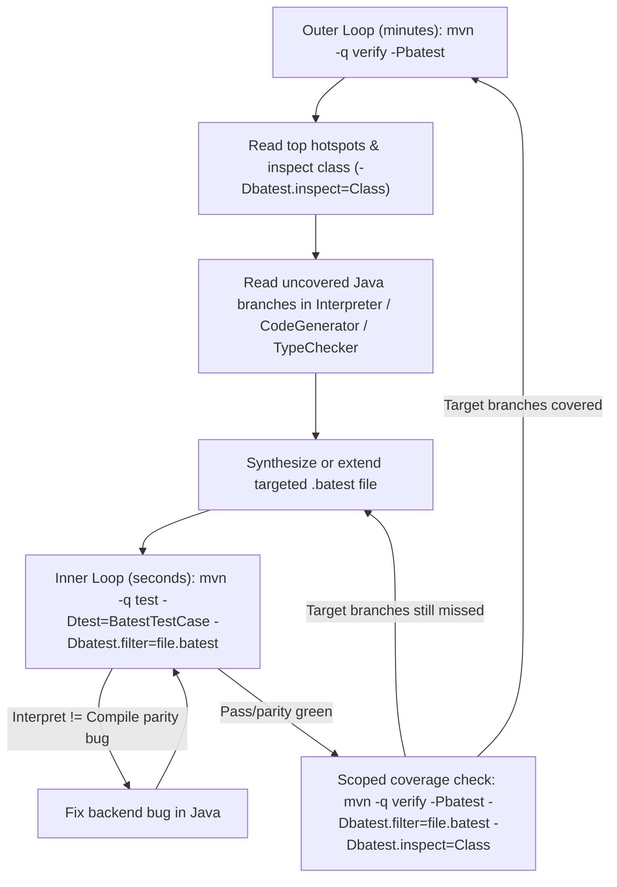

# BIP009: systematic interpreter and compiler test coverage

| | |
|---|---|
| **BIP** | 009 |
| **Date** | 2026-11-17 |
| **Status** | Accepted & implemented (`BIP009-Q1`–`BIP009-Q8` → `BIP009-D1`–`BIP009-D8` decided; `BIP009-I1`–`BIP009-I4` implemented, extended to 3-JVM 5-scope `-Pbatest` coverage with `BIP014-D9` `-O0`/`-O1`) |
| **Depends on** | Multi-mode execution ([bip001_bytecode-compiler.md](bip001_bytecode-compiler.md), [bip014_optimization-passes.md](bip014_optimization-passes.md)), interactive sessions ([bip004_repl.md](bip004_repl.md)), in-memory module sources ([bip006_module-sources-and-aot.md](bip006_module-sources-and-aot.md) §4.2), static typing diagnostics ([bip008_static-typing.md](bip008_static-typing.md)) |
| **Scope** | `.batest` file format, leak-free error normalization (including Java interop unwrapping), JUnit 5 & 3-JVM 5-scope JaCoCo harness (`-Pbatest`), coverage reporting CLI, and agentic test-synthesis workflow |

---

## 1. Summary

This proposal introduces a **data-driven `.batest` specification format** and a **single-command multi-mode test & coverage harness** (`mvn -q verify -Pbatest`) designed for systematic, low-maintenance verification and autonomous agent-driven coverage closure across Babble's tree-walking interpreter, unoptimized (`-O0`) ASM bytecode compiler, and HIR Nanopass (`-O1`) optimizer.

Each `.batest` file contains an optional Babble preamble followed by one or more synthetic test cases separated by `{{{{{` and `}}}}}` markers, pairing each snippet with its expected standard output or normalized compile/runtime error message:

```text
def ratio = (a: int, b): int -> ( int(a / b) )

{{{{{
print(ratio(10, 2))
}}}}}
5

{{{{{
print(ratio(10, 0))
}}}}}
Out of int range : Infinity

{{{{{
print(ratio("ten", 2))
}}}}}
Type error : expected int, got string
```

* **Four-way oracle (`interpret`, `compile -O0`, `compile -O1`, expected).** Every case is evaluated in `INTERPRET` mode, `COMPILE -O1` mode (`babble.verify=true`, checked by `HirVerifier` and ASM's `CheckClassAdapter`), and `COMPILE -O0` mode (`babble.opt=0`, `babble.verify=true`). All three backends must agree on whether the case succeeded or failed, produce identical normalized text, and match the `.batest` golden expectation.
* **Zero implementation leakage.** Stack traces, generated JVM class/method names (`Script$N`, `fn$0$f$spec`), exception wrapper prefixes (`org.babblelang.runtime.BabbleException:`), reflective wrappers (`java.lang.reflect.InvocationTargetException`), host filesystem paths, and preamble-sensitive line/column numbers are stripped or normalized out of test expectations. Internal engine crashes (`VerifyError`, uncaught JVM `NullPointerException`/`IllegalStateException` inside Babble) fail unconditionally and can never match an expected string.
* **Fast targeted iteration & closed-loop coverage.** A full `mvn -q verify -Pbatest` run over the entire `.batest` suite compiles and verifies hundreds of synthetic scripts across three isolated JaCoCo-instrumented JVMs (`interpret`, `compile -O1`, and `compile -O0`) and measures five independent scopes; for rapid inner-loop iteration, `-Dbatest.filter=<file-or-pattern>` runs a single `.batest` file, directory, or case in seconds, optionally inspecting coverage on a single target class (`-Dbatest.inspect=<Class>`).

---

## 2. Motivation, Baseline & Goals

### 2.1 Codebase and Test Baseline

Babble's main source tree currently comprises **21,736 lines across 86 Java files**, grouped into six subsystems:

| Subsystem | Packages / Key Classes | Files | Lines | Exercised In |
|---|---|---:|---:|---|
| **Analysis (front end)** | `org.babblelang.analysis.*` (`TypeChecker` 5,923, `TypeChecks` 691, `BlockScopes` 643, `ScopeAnalysis` 416, `Type` 256, `Resolver` 201, …) | 13 | 8,640 | Both modes (`Resolver` consumed only by compiler) |
| **Compiler backend** | `org.babblelang.compiler.*` (`CodeGenerator` 3,986, `Babblec` 167, `BabbleCompiler` 130, `CompiledBabbleScript` 89, …) | 7 | 4,511 | `compile` mode only |
| **Interpreter backend** | `org.babblelang.engine.impl.*` (`Interpreter` 720, `Function` 75, `BabbleCompiledScript` 42, `ReturnException` 22) | 4 | 859 | `interpret` mode only |
| **Runtime & natives** | `org.babblelang.runtime.*` + `engine.impl.natives.**` (`Bootstrap` 491, `JavaTypes` 323, `Types` 291, `Launcher` 270, `JavaClass` 253, `ClassShape` 248, `Overloads` 232, `JavaLinker` 225, `BabbleInstance` 205, …) | 46 | 5,507 | Shared, with mode-specific paths (`Bootstrap`, `*Cell`, `Compiled*` are `compile`-only; `RM001` bypasses boxed `Operators` on static primitives) |
| **Script engine** | `org.babblelang.engine.*` (`BabbleScriptEngine` 620, `FileModuleSource` 157, `BabbleSession` 111, `MapModuleSource` 72, …) | 12 | 1,239 | Both modes |
| **CLI & formatter** | `Main`, `Repl`, `Babblefmt`, `format.Formatter` | 4 | 980 | Dedicated tool tests |

Today's test suite (`15` `.ba` scripts in `src/test/babble/` and `25` JUnit classes in `src/test/java/`) has four structural limitations when driving toward systematic coverage:

1. **`.ba` scripts only test happy paths.** Babble has no in-language exception catching, and any lexer, syntax, scope, or type error aborts compilation of the whole `.ba` file. Error paths can only be tested from Java.
2. **Java-embedded snippets are high-friction and brittle.** `DifferentialTestCase` embeds ~250 escaped Java string literals without pinning expected output/error text, while `TypeCheckerTestCase` (1,376 lines) pins exact `line:column` coordinates (`"3:28 Type error : ..."`) that break whenever surrounding setup changes and require Java test recompilation on every edit.
3. **No coverage measurement — and naive coverage conflates backends.** `pom.xml` has no JaCoCo instrumentation. Furthermore, Surefire runs twice (`interpret` then `compile`): overwriting or merging a single `.exec` file hides whether shared runtime classes (`Operators`, `Members`, `Arguments`, `Overloads`, `Types`) were actually exercised by compiled bytecode or only by the tree-walking interpreter.
4. **No single-command agent feedback loop.** Standard Surefire aborts on the first failing test execution before `compiled-tests` or any coverage report runs, depriving an agent of unified pass rates, parity diffs, and uncovered source lines.

### 2.2 Goals and Non-Goals

**Goals:**

1. Define a minimal, human- and LLM-friendly `.batest` text format capable of expressing happy-path stdout, compile-time errors/warnings, runtime errors, multi-module imports, and session inputs without Java boilerplate or delimiter collisions with Babble syntax or Git conflict markers.
2. Keep `.batest` files **low-maintenance**: expectations must never depend on Java stack traces, generated bytecode names, reflection wrapper classes, host file paths, or line/column offsets.
3. Support **both** fast subset iteration (`-Dbatest.filter=...`, completing in seconds for one file or subset) and a **single Maven command** (`mvn -q verify -Pbatest`) that always completes both `interpret` and `compile` (`babble.verify=true`) runs, reports pass/parity rates, measures **separate per-mode JaCoCo line and branch coverage**, and lists uncovered hotspots by class, method, and line range.
4. Integrate `.batest` seamlessly into standard CI (`mvn test` / `mvn package`) via JUnit 5 `@TestFactory` with zero extra runtime dependencies.

**Non-Goals:**

* Replacing `BabblecTestCase` (subprocess AOT jars), `MainTestCase` / `BabblefmtTestCase` (CLI argument parsing & exit codes), `FormatterTestCase` (formatting idempotence), or `RuntimeBoundaryTestCase` (constant-pool dependency checks). Those tools are outside script evaluation and excluded from the interpreter/compiler coverage denominator (§5.2).
* Blind "snapshot auto-updating" that overwrites expected `.batest` outputs from a buggy backend without checking interpreter/compiler parity (§6.2).

---

## 3. The `.batest` File Format

### 3.1 Anatomy of a `.batest` File

A `.batest` file is a UTF-8 plain-text file stored under `src/test/batest/` (organized in topic files or subdirectories, e.g., `src/test/batest/arithmetic/int_ops.batest`). Each file consists of:

1. An **optional preamble** before the first case opener (shared Babble definitions, imports, or `;;` comments; may be empty).
2. **One or more test cases**, each composed of:
   * an **input marker line**: `{{{{{` (canonically five `{` characters on its own line),
   * the **case snippet** (Babble source code to compile and evaluate),
   * an **output marker line**: `}}}}}` (canonically five `}` characters on its own line), and
   * the **expected outcome** (expected `stdout` text, or expected normalized error message, up to the next `{{{{{` line or EOF).

```text
;; Shared helper with call-site inferred parameter `b` (BIP008-I7)
def Checked = value class (x: int) (
    def div = (k: int): int -> (
        assert(k != 0, "Divide by zero")
        int(this.x / k)
    )
)
def calc = (a: int, b) -> ( Checked(a) / b )

{{{{{
print(calc(10, 2))
}}}}}
5

{{{{{
print(calc(10, 0))
}}}}}
Divide by zero

{{{{{
;; Compile-time error : operator method `div` expects `int`, got `string`
print(calc(10, "two"))
}}}}}
Type error : expected int, got string
```

### 3.2 Whitespace, Comments & Marker Parsing (`BIP009-D1`)

* **Leading and trailing whitespace ignored.** Line endings are normalized (`\r\n` → `\n`), and `.strip()` is applied to the preamble, each case's code block, each case's expected outcome block, and the actual captured outcome before comparison.
  * `print(5)` (`"5"`) and `println(5)` (`"5\n"`) both normalize to `"5"`.
  * A test case that runs assertions (`assert(1 + 1 == 2)`) without printing has an empty expected block (`""`).
  * Internal newlines and internal spaces inside multi-line `println` outputs are preserved verbatim.
* **Comments.** Standard Babble comments (`;; ...` and `;;( ... ;;)`) inside the preamble or at the top of a case block serve as human/agent test descriptions; no separate test-title header syntax is needed. Any `;;` comments reside inside code blocks (never inside expected output blocks, which are literal text).
* **Regular expression lines.** An expected line starting with `~~ ` is a Java regular expression the whole corresponding line of the actual outcome must match (`Pattern.matches`); every other line still compares literally, and the line counts must agree. It is meant for text the JDK words differently across versions (a JDK exception's message), not for output Babble controls, which stays pinned exactly. `BatestParser` rejects an invalid expression with the file and line number.
* **Conflict-free, Babble-safe delimiters (`BIP009-D1`).** Curly braces `{` and `}` never appear anywhere in `Babble.g4` (Babble uses `(` and `)` exclusively), and `{{{{{` / `}}}}}` never collide with Git merge conflict markers (`<<<<<<<`, `=======`, `>>>>>>>`). Canonically written as five characters (`{{{{{` and `}}}}}`), the parser recognizes any line whose trimmed text matches `^\s*\{{5,}\s*$` as a case input opener and `^\s*\}{5,}\s*$` as an expected output opener, with no requirement for surrounding `\n\n` blank lines (so preamble-less files starting with `{{{{{` on line 1 parse cleanly). A `.batest` file with zero test cases, nested `{{{{{` without an intervening `}}}}}`, or a missing `}}}}}` fails immediately with a structural parse error naming the file and line number.

### 3.3 Preamble Evaluation Semantics (`BIP009-D2`)

How the preamble combines with each test case is a critical design choice because of Babble's static analysis rules:

* Under `BabbleSession` (`BIP004-D1`, `BIP008-D5`), each input closes call-site parameter inference (`BIP008-I7`) and freezes inferred declaration/member types at the end of the input. Evaluating `def f = (a: int, b) -> ( a / b )` alone as a separate session input fails immediately with `Missing type : b` before any test case is reached, and forces cross-input `Namespace` lookups instead of intra-script `BabbleCallTarget` direct calls (`RM001`).
* Under source concatenation, mutating preamble state in case 1 cannot leak into case 2 if each case runs on a fresh `ScriptRuntime`.

Therefore (**`BIP009-D2`**): **by default, each test case evaluates `preamble + "\n" + caseCode` (or `caseCode` alone when the preamble is empty) as a fresh, isolated compilation unit on a fresh `ScriptRuntime`.**

This gives three major properties simultaneously:

1. Unannotated helper parameters (`def f = (a: int, b) -> ...`) and unannotated `def`s in the preamble participate in `BIP008-I7` call-site inference and `BIP008` §4.3 reassignment joins per test case.
2. Top-level functions and classes in the preamble exercise the same `Resolver` and `RM001` direct-dispatch codegen paths as single-file Babble programs.
3. Every test case is completely hermetic and order-independent.

### 3.4 Self-Contained Modules and Interactive Sessions (`BIP009-D3`)

Nearly 15% of `BlockScopes`, `TypeChecks`, `TypeChecker`, `BabbleScriptEngine`, `CodeGenerator` (`Module.exportAt`), and `Bootstrap` (`SelectCache` cross-classloader field access) is reachable only across **module boundaries** (`export` / `import("x.ba")`) or **interactive session inputs** (`BabbleSession` / `AnalysisSession`). Creating external `.ba` fixture files for hundreds of tiny module edge cases (cyclic imports, missing exports, private cross-module members) scatters test logic and risks leaking host filesystem paths.

To keep `.batest` files 100% self-contained while keeping simple files free of ceremony (**`BIP009-D3`**), two optional markers are supported:

1. **In-memory modules in the preamble (`========== <path>.ba ==========`)**:
   In the preamble, lines matching `^\s*={8,}\s+(\S+\.ba)\s+={8,}\s*$` declare virtual module files populated into an in-memory `MapModuleSource` (`engine.put("babble.moduleSource", mapSource)`), and `==========` (`^\s*={8,}\s*$`, requiring at least 8 `=` so Git's 7-character `=======` never matches) returns to the main script's preamble:

   ```text
   ========== math.ba ==========
   export def sq = (n: int): int -> ( n * n )

   ==========
   def math = import("math.ba")

   {{{{{
   print(math.sq(6))
   }}}}}
   36

   {{{{{
   print(math.cube(6))
   }}}}}
   No such export : cube
   ```

   Even without `==========` sections, the harness configures an empty `MapModuleSource` by default so accidental `import("nonexistent.ba")` calls produce the portable `Cannot import nonexistent.ba : no such module` rather than a host-specific `/abs/path/nonexistent.ba` error.

2. **Sequential session inputs inside a case (`----------`)**:
   Inside a `{{{{{ ... }}}}}` code block, a line matching `^\s*-{7,}\s*$` splits the case into sequential inputs evaluated on one `BabbleSession` (with the preamble, if non-empty, evaluated first as input 0).

   **Why this is needed:** Single-script concatenation (`preamble + "\n" + caseCode`) cannot exercise Babble's multi-input session machinery (`BabbleSession`, `AnalysisSession`, `ScopeNode` chaining, or cross-classloader `RM001` dispatch):
   * **Shadowing vs lexical capture (`BIP004-D1`):** In a single script, `def x = 1 ; def x = 2` is rejected statically (`Name already defined : x`). Across session inputs, a later `def x = 100` shadows `x` in a nested `Namespace` while closures defined in earlier inputs retain the original `x`, and assignments (`x = 5`) mutate the shared variable across inputs.
   * **Per-input inference freezing (`BIP008-D5`):** `AnalysisSession.commit` freezes inferred `declarationTypes` and `memberTypes` and closes `BIP008-I7` call-site parameter inference at the end of each input — paths never executed in single-script runs.
   * **Cross-`ScriptClassLoader` compiled dispatch (`RM001`):** In `compile` mode, each session input compiles into a distinct `Script$N` class in its own `ScriptClassLoader`. Accessing unboxed `int`/`double`/`bool` fields or calling `$spec` methods on instances created in an earlier input exercises `Bootstrap.SelectCache`'s `MethodHandles.privateLookupIn` cross-loader path and `Bootstrap.call` `$spec` linking.
   * **Type identity across redefinitions & module persistence:** Re-defining `def P = class ...` creates a distinct nominal type of the same name (`Type error : expected P, got P`), and a module imported across multiple inputs runs only once per session.

   **Example with multiple sequential inputs:**

   ```text
   {{{{{
   ;; Input 1 : define variable, closure over it, and class with unboxed fields + $spec method
   def x = 1
   def get = (): int -> ( x )
   def P = class (def v: int, def d: double, def b: bool) (
       def sum = (k: int): double -> ( this.v + this.d + k )
   )
   def p = P(3, 1.5, true)
   ----------
   ;; Input 2 : assignment updates earlier closure; re-def shadows x for later inputs only
   x = 5
   def x = 100
   println(get(), ":", x)
   ----------
   ;; Input 3 : cross-classloader $spec method call & unboxed bool field read on p from Input 1
   println(p.sum(4), ":", p.b)
   ----------
   ;; Input 4 : mutate shadowed x (Input 2) without affecting get() (Input 1)
   x = x + 1
   println(get(), ":", x)
   }}}}}
   5:100
   8.5:true
   5:101

   {{{{{
   ;; Input 1 : nominal class and function taking it
   def P = class (def x: int) ()
   def f = (p: P): int -> ( p.x )
   ----------
   ;; Input 2 : re-defining P creates a distinct type with the same name
   def P = class (def x: int) ()
   ----------
   ;; Input 3 : passing new P to old f is rejected statically
   print(f(P(1)))
   }}}}}
   Type error : expected P, got P
   ```

   Ordinary `.batest` files need neither `==========` nor `----------`; both extensions activate only when present.

---

## 4. Execution Semantics & Leak-Free Error Normalization

### 4.1 The Three-Way Verification Oracle (`BIP009-D4`)

For every test case, the harness produces an internal structured outcome:

```java
record CaseOutcome(Kind kind, String text, Throwable crash) {
    enum Kind { OK, USER_ERROR, INTERNAL_CRASH }
}
```

* **`OK`**: Compilation and execution succeeded without throwing. `text` is the normalized warning + `stdout` stream (§4.2).
* **`USER_ERROR`**: Compilation or execution halted with a user-facing Babble error (`ParseFailure`, `AnalysisException`, `TypeCheckException`, runtime `BabbleException`, unwrapped host Java target exception, or `StackOverflowError`). `text` is any flushed pre-failure output/warnings followed by the single normalized error line (§4.3).
* **`INTERNAL_CRASH`**: Any other `Throwable` — specifically `java.lang.VerifyError` (from ASM's `CheckClassAdapter` or the JVM verifier), `ClassFormatError`, `IncompatibleClassChangeError`, `BootstrapMethodError` not caused by a `BabbleException`, or an uncaught `NullPointerException`, `IllegalStateException`, `IllegalArgumentException`, `IndexOutOfBoundsException`, or `ClassCastException` originating inside `org.babblelang.*` Java code.

**Verification rules (`BIP009-D4`):**

1. **`INTERNAL_CRASH` is never matchable.** If either mode returns `INTERNAL_CRASH`, the test fails unconditionally and surfaces the full Java stack trace in the test runner diagnostic report. A `.batest` file can never accidentally "expect" a compiler `VerifyError` or internal `NullPointerException`.
2. **`OK` and `USER_ERROR` remain distinct across modes.** When comparing `interpret` and `compile`, `interpreted.kind() == compiled.kind()` is asserted alongside `interpreted.text().equals(compiled.text())`. A script that prints `"Not a number : x"` to `stdout` (`OK`) can never match a backend that threw `Not a number : x` (`USER_ERROR`), even without requiring an `Error :` prefix in `.batest` files where unambiguous.
3. **Both modes must match the `.batest` expected text.**

### 4.2 Output & Warning Capture

* **Script semantics, not REPL echo.** Like `java -jar babble.jar script.ba`, expression return values are **not** implicitly printed; tests write to `stdout` via `print` / `println` (or `affiche` / `afficherc`).
* **Real Babble `assert` / `suppose`.** Unlike legacy `BabbleTestBase` (which overrides `assert` with JUnit's `org.opentest4j.AssertionFailedError`, bypassing `natives.AssertFunction.fail`), the `.batest` harness uses pure `Implicits.create()` bindings so `assert` and `suppose` both exercise the real Babble runtime.
* **Warnings and partial `stdout` before failure.**
  * Non-fatal analysis warnings (`ScopeAnalysis.warnings()` — currently `Redundant cast : ...`, `def is redundant on a value class parameter : ...`, and `equals has no effect on == : use a value class`) are formatted as normalized `Warning : <message>` lines ahead of `stdout`, allowing `.batest` cases to test warning branches directly while keeping ordinary warning-free cases unaffected.
  * If a test writes to `stdout` *before* encountering a runtime error, the flushed `stdout` lines precede the normalized error line (`<stdout>\n<error>`), ensuring evaluation-order side effects before an error are checked for interpreter/compiler parity. When nothing was printed before the error (all compile-time errors and most runtime errors), `text` is simply `<error>`.

### 4.3 Leak Audit & Error Normalization Rules (`BIP009-D5`, `BIP009-D6`, `BIP009-D7`)

An audit of all `throw` sites across Babble's 86 classes identifies seven error families and four places where raw `ScriptException.getMessage()` currently leaks implementation artifacts or preamble-relative line numbers:

| # | Error Family | Raw `Throwable` Today | Leak / Maintenance Hazard | Normalized `.batest` Text |
|---|---|---|---|---|
| 1 | **Lexical error** (`BabbleScriptEngine:89`) | `ScriptException("org.babblelang.runtime.BabbleException: Lexical error at line 4:2 : token recognition error at: '#'")` | `BabbleException` class name; `at line 4:2` shifts whenever preamble lines change | `Lexical error : token recognition error at: '#'` |
| 2 | **Syntax error** (`ParseFailure:38`) | `ScriptException("org.babblelang.runtime.BabbleException: Syntax error : unexpected '=' in <input> at line number 5 at column number 6")` | `BabbleException` class name; `<input>` source name; line & column suffixes | `Syntax error : unexpected '='` |
| 3 | **Static scope / class check** (`BlockScopes`, `TypeChecks`) | `ScriptException("org.babblelang.runtime.BabbleException: this outside of a class in <input> at line number 3")` | `BabbleException` class name; source & line suffix | `this outside of a class` |
| 4 | **Type error** (`TypeChecker` → `TypeCheckException`) | `TypeCheckException("org.babblelang.runtime.BabbleException: Type error : expected int, got double (x is double because of the assignment at line 4) in <input> at line number 6 at column number 9")` | `BabbleException` class name; cascading secondary diagnostics; embedded widening line `at line 4`; trailing location suffix | `Type error : expected int, got double (x is double because of the assignment)` |
| 5 | **Babble runtime error** (`Operators`, `Members`, `Arguments`, `Calls`, `Types`, `ConvertFunction`, `Module`, `AssertFunction`) | `ScriptException("org.babblelang.runtime.BabbleException: Out of int range : Infinity in <input> at line number 4")`, or `Assertion failed at line 5 : 1 == 2`, or module trace `... in m.ba at line number 2 in <input> at line number 6` | `BabbleException` class name; `Assertion failed at line N`; chained ` in <src> at line number N` suffixes | `Out of int range : Infinity` ; `Assertion failed : 1 == 2` |
| 6 | **Host Java exception** (`JavaMethod:47`, `JavaClass:70`, `JavaLinker:211`, `JavaTypes:237`) | `ScriptException("org.babblelang.runtime.BabbleException: java.lang.reflect.InvocationTargetException in <input> at line number 3")` | **Leaks `java.lang.reflect.InvocationTargetException`** (a pure reflection artifact fabricated in `RM001` direct calls!) and swallows the actual Java exception class & message | `java.lang.NumberFormatException : For input string: "nope"` *(see `BIP009-D7`)* |
| 7 | **Stack overflow** (`Repl:110`, `Main:207`) | Uncaught `java.lang.StackOverflowError` (compiled recursion depth differs ~3–5x from interpreted visitor depth) | Raw JVM `Error` with thousand-frame stack trace and mode-dependent frame count | `Stack overflow` |

Three explicit decisions govern normalization:

* **`BIP009-D5` — Strip wrapper classes and location coordinates everywhere.**
  The normalizer applies a deterministic pipeline to the caught `ScriptException`:
  1. Strip leading `org.babblelang.runtime.BabbleException: ` (and `javax.script.ScriptException: `).
  2. Strip trailing location suffixes ` in <source> at line number \d+(?:(?:,| at column number| column) \d+)?` (repeatedly, so cross-module import traces strip both the outer and inner file/line suffixes while keeping semantic context like `Missing type : x (import cycle with a.ba)`).
  3. Normalize the three embedded-line patterns identified in the codebase audit:
     * `^Lexical error at line \d+:\d+ : ` → `Lexical error : `
     * `^Assertion failed at line \d+ : ` → `Assertion failed : `
     * ` because of the (assignment|call) at line \d+\)` → ` because of the $1)`
  4. Normalize what depends on the platform rather than on Babble, so the suite passes in any locale and on any JDK 21+:
     * `^(java\.io\.FileNotFoundException : .*) \([^()]*\)$` → `$1 (<OS error>)` (the operating system's reason, in its own language)
     * `object of type \S+ is not an instance of \S+$` → `object is not an instance of declaring class` (JDK 22+ wording of a reflective call on a receiver of the wrong class)
* **`BIP009-D6` — Primary halting diagnostic per case.**
  When `TypeChecker` records multiple diagnostics on a snippet, `BabbleScriptEngine` already throws `TypeCheckException` carrying the first diagnostic in source order (`scopes.typeDiagnostics().get(0)`). The `.batest` harness uses that primary thrown diagnostic rather than concatenating every secondary follow-on diagnostic from `errorWriter`. Because `.batest` cases are small and synthetic (one error condition per `{{{{{` block), asserting the primary error avoids cascading-diagnostic churn if error recovery in `TypeChecker` evolves.
* **`BIP009-D7` — Unwrap `InvocationTargetException` at the Java interop boundary.**
  Today, `JavaMethod`, `JavaClass`, `JavaLinker`, `JavaDefaultCall`, and `JavaTypes.wrapInvocationException` wrap thrown Java exceptions in `new BabbleException(new InvocationTargetException(cause))`, whose `toString()` prints `"org.babblelang.runtime.BabbleException: java.lang.reflect.InvocationTargetException"` — leaking `java.lang.reflect` even on `RM001` direct `INVOKESTATIC` calls and discarding `cause`. Fixing those five sites to wrap the target `Throwable` cleanly (`cause.getClass().getName()` + optional ` : ` + `cause.getMessage()`, while rethrowing `BabbleException` and `Error` causes directly, and normalizing raw JDK Helpful-NPE bytecode detail strings on Java exceptions if `cause instanceof NullPointerException` to `java.lang.NullPointerException`) eliminates the reflection leak across Babble as a whole (no existing test asserts `InvocationTargetException`).

---

## 5. Single-Command Test Harness & Coverage Architecture

### 5.1 Full Suite & Fast Subset Execution

The harness consists of two components in `src/test/java/org/babblelang/tests/batest/` plus a dedicated Maven profile `batest` in `pom.xml`:

1. **`BatestTestCase` (JUnit 5 `@TestFactory`)**:
   * Discovers all `src/test/batest/**/*.batest` files.
   * Parses each file into a `DynamicContainer` (named after its relative path) containing one `DynamicTest` per `{{{{{` case (named `case #k (line L)`).
   * Supports `-Dbatest.filter=<selector>` for rapid targeted runs (matching a relative path substring such as `generics`, a glob such as `objects/*.batest`, or a specific case/line suffix such as `types/narrowing.batest#4` or `types/narrowing.batest:42`).
   * Evaluates each matching case in `engine.getMode()`.
   * During standard `mvn test` / `mvn package`, Surefire automatically runs `BatestTestCase` twice — first in `default-test` (`babble.mode=interpret`) and then in `compiled-tests` (`babble.mode=compile`, `babble.verify=true`) — failing the build immediately on any regression with zero JaCoCo overhead in normal builds.
   * When `-Dbatest.record=<dir>` is set (enabled automatically by `-Pbatest`), `BatestTestCase` also appends per-case pass/fail/outcome JSONL records (`target/batest-report/outcomes-interpret.jsonl` and `outcomes-compile.jsonl`) so the post-run reporter can cross-compare `interpret` vs `compile` vs `expected` even when cases fail.

2. **Fast subset iteration vs. full `-Pbatest` coverage run**:
   * **Fast inner-loop check (seconds, no JaCoCo):**
     ```bash
     mvn -q test -Dtest=BatestTestCase -Dbatest.filter=objects/operators.batest
     ```
     Runs only the selected `.batest` file(s) or single `#k` case across both `interpret` and `compile` (`CheckClassAdapter` verification on) without running legacy JUnit suites or JaCoCo instrumentation. To test only compiled mode while debugging a bytecode issue:
     ```bash
     mvn -q test-compile surefire:test@compiled-tests -Dtest=BatestTestCase -Dbatest.filter=objects/operators.batest#3
     ```
   * **Fast targeted coverage check (seconds, scoped JaCoCo):**
     ```bash
     mvn -q verify -Pbatest -Dbatest.filter=objects/operators.batest -Dbatest.inspect=Bootstrap
     ```
     Measures dual-mode pass/parity plus JaCoCo coverage deltas for the filtered subset and prints missed lines/branches for `Bootstrap`.
   * **Full coverage suite (minutes):**
     ```bash
     mvn -q verify -Pbatest
     ```
     Runs the entire `.batest` corpus across three isolated JaCoCo-instrumented JVMs (`interpret`, `compile -O1`, and `compile -O0`) and computes authoritative whole-suite coverage across five scopes plus top uncovered hotspots.

   Inside `-Pbatest`:
   * **Test selection**: Surefire runs `BatestTestCase` only by default (measuring pure `.batest` synthetic coverage; `-Dbatest.includeLegacy=true` optionally includes the legacy JUnit classes for whole-repo coverage).
   * **Isolated 3-JVM JaCoCo capture**:
     * Execution `default-test` (`babble.mode=interpret`) attaches the JaCoCo agent writing to `target/jacoco-interpret.exec` (and `outcomes-interpret.jsonl`), excluding `org.babblelang.compiler.*`, `org.babblelang.ir.*`, and `org.babblelang.opt.*`.
     * Execution `compiled-tests` (`babble.mode=compile`, `-O1`, `babble.verify=true`) attaches the JaCoCo agent writing to `target/jacoco-compile.exec` (and `outcomes-compile.jsonl`), including the optimizer package `org.babblelang.opt.*`.
     * Execution `compiled-tests-O0` (`babble.mode=compile`, `babble.opt=0`, `babble.verify=true`) attaches the JaCoCo agent writing to `target/jacoco-compile-O0.exec` (and `outcomes-compile-O0.jsonl`), excluding `org.babblelang.opt.*` (matching `BabbleCompiler` bypassing `org.babblelang.opt.*` when `optLevel <= 0`).
     * Running in three separate JVMs prevents `-O0` runs from overwriting `jacoco-interpret.exec` or `-O1` optimizer coverage, prevents static runtime caches warmed during one mode from masking cold-path misses in another, and keeps all three probe bitmaps strictly separate.
   * **Agent & report instrumentation filters**: Every JaCoCo agent excludes `org.babblelang.generated.*`, `babble.*`, and `org.babblelang.parser.*` so dynamically emitted Babble script and module classes are never mutated with `$jacocoInit` probes before `CheckClassAdapter` or `MethodHandles.privateLookupIn` inspects them and ANTLR-generated state machines stay out of the denominator. During `verify`, `pom.xml` generates four filtered XML reports:
     * `report-interpret` → `target/site/jacoco-interpret/jacoco.xml` (excludes `parser/**`, `compiler/**`, `ir/**`, `opt/**`)
     * `report-compile-O0` → `target/site/jacoco-compile-O0/jacoco.xml` (excludes `parser/**`, `engine/impl/*`, `opt/**`)
     * `report-compile` → `target/site/jacoco-compile/jacoco.xml` (excludes `parser/**`, `engine/impl/*`)
     * `report-opt` (from `jacoco-compile.exec`) → `target/site/jacoco-opt/jacoco.xml` (includes `org/babblelang/opt/**` and `org/babblelang/ir/egraph/**`)
   * **Non-aborting collection, strict exit code**: Surefire sets `<testFailureIgnore>true</testFailureIgnore>` inside `-Pbatest` so a failure in one mode never skips later executions or JaCoCo XML generation. Then `BatestCoverageReporter` runs in `verify`, prints the complete pass-rate, 3-way parity, and 5-scope coverage report, writes machine-readable summaries to `target/batest-report/`, and **exits with status `1` if any `.batest` case failed in any mode, diverged across modes, or if any of the five coverage scopes falls below the `80%` line or `80%` branch coverage gate** on an unfiltered run (`-Dbatest.minLinePct=80.0` and `-Dbatest.minBranchPct=80.0` by default; `0` when all pass and meet both thresholds).

### 5.2 Coverage Scopes & Denominator Hygiene (`BIP009-D8`)

Merging `jacoco-interpret.exec`, `jacoco-compile-O0.exec`, and `jacoco-compile.exec` into a single number hides critical compiler gaps: for example, `1 + 2` in `interpret` calls `Operators.add` (marking it covered even if `-O0` never exercised its boxed fallback), and constant folding in `-O1` folds `1 + 2` before `-O0` codegen paths run!

`BatestCoverageReporter` (**`BIP009-D8`**) therefore reports **line coverage** and **branch coverage** across five focused scopes, explicitly excluding non-evaluation tools:

| Report Scope | Included Classes | JaCoCo Source | Why Separated |
|---|---|---|---|
| **1. Interpreter** | `org.babblelang.engine.impl.*` (`Interpreter`, `Function`, `BabbleCompiledScript`, `ReturnException`) | `jacoco-interpret.xml` | Measures direct coverage of every grammar visitor and interpreted closure/method path |
| **2. Compiler (`-O0`)** | `org.babblelang.compiler.*`, `org.babblelang.ir.*` (excluding `ir.egraph.*` and `HirPrinter`), + compiler-only runtime (`Bootstrap`, `CompiledFunction`, `CompiledMethod`, `Frames`, `Cell`, `ByteCell`..`CharCell`) | `jacoco-compile-O0.xml` | Measures unoptimized HIR lowering (`HirBuilder`), bytecode emission (`HirEmitter`/`ClassGen`/`InterfaceGen`), and `invokedynamic` / typed cells without `-O1` folding masking gaps |
| **3. Optimizer (`-O1`)** | `org.babblelang.opt.**` and `org.babblelang.ir.egraph.*` (`PassManager`, `PassContext`, `HirPass`, `HirPurity`, `HirRewriter`, `HirEGraphSimplifyPass`, `InlinePass`, `HirDcePass`, `HirLicmPass`, `ScalarReplacePass`, `FbipReusePass`, `EGraph`, `ENode`, `AlgebraicRules`) | `jacoco-opt/jacoco.xml` *(from `jacoco-compile.exec`)* | Measures HIR Nanopass optimization, E-graph simplification, and purity analysis strictly during `-O1` compilation (`BabbleCompiler` bypasses `opt.*` at `-O0`) |
| **4. Shared Front-End** | `org.babblelang.analysis.*` (excluding opt-in `AxiomChecker`/`BytecodeEffectAnalyzer`) + `org.babblelang.effects.*` + `org.babblelang.engine.*` (excluding `FileModuleSource`, `ClassPathModuleSource`) | `jacoco-compile.xml` *(identical to `interpret`, plus `Resolver`)* | Measures `BlockScopes`, `TypeChecks`, `Resolver`, `TypeChecker`, `EffectChecker`, `AnalysisSession`, `BabbleSession`, and `MapModuleSource` |
| **5. Shared Runtime & Natives** | `org.babblelang.runtime.*` (shared classes) + `org.babblelang.engine.impl.natives.**` | **Side-by-side**: `interpret` vs `compile-O0` vs `compile-O1` vs `combined` union | Exposes runtime helpers reached by the interpreter vs `-O0` vs `-O1`, gated on the combined union |

**Excluded from the `.batest` coverage denominator:**

* `org.babblelang.parser.*` — generated by `antlr4-maven-plugin` from `Babble.g4`.
* `Main`, `Repl`, `Babblefmt`, `format.Formatter` — CLI & source-formatter tools (tested by `MainTestCase`, `ReplTestCase`, `BabblefmtTestCase`, `FormatterTestCase`).
* `compiler.Babblec`, `compiler.FileModuleCompiler`, `runtime.Launcher`, `runtime.ProgramIndex` — ahead-of-time JAR packaging & standalone launcher (tested by `BabblecTestCase`).
* `compiler.Debugging`, `ir.hir.HirPrinter` — developer-only `-Dbabble.trace` / `-Dbabble.dumpClasses` / `-Dbabble.dumpIr` switches.
* `analysis.AxiomChecker`, `analysis.BytecodeEffectAnalyzer` — opt-in diagnostic tools (`-Dbabble.checkAxioms` / host ASM analyzer).
* `engine.FileModuleSource`, `engine.ClassPathModuleSource` — filesystem/JAR resource adapters (tested by `FileModulesTestCase` and `ModuleSourcesTestCase`).

### 5.3 Console & Machine-Readable Output Format

`mvn -q verify -Pbatest` prints a structured summary with per-scope gate deficits (`PASS` / `NEED +N ln` / `NEED +M br`) and **per-scope uncovered hotspot rankings** (default top `10` per scope → 40+ candidates spanning all five buckets, ranked by absolute impact score `(missedBr + 1) * (missedLn + 1) - 1`, configurable via `-Dbatest.top=N|all` and `-Dbatest.sort=score|branches|lines`), while writing full scope-grouped, ranked per-line details to `target/batest-report/uncovered.txt` and `target/batest-report/summary.json` (and tagging the header `[FILTERED: <selector>]` whenever `-Dbatest.filter` is active so subset coverage is never mistaken for full-suite coverage):

```text
=== BATEST RESULTS =============================================================
Files : 57    Cases : 733
Interpret : 733 / 733 passed (100.0%)
Compile   : 733 / 733 passed (100.0%)
Compile -O0 : 733 / 733 passed (100.0%)
Parity    : 733 / 733 matched (0 divergences)

=== COVERAGE SUMMARY (.batest suite) ===========================================
Scope                        Lines                 Branches              Gate (80.0% ln/br)
---------------------------  --------------------  --------------------  ------------------------
Interpreter (impl.*)          95.1% (  693/729  )   91.4% (  328/359  )  PASS
Compiler (-O0)                84.2% ( 6423/7629 )   72.1% ( 2979/4132 )  NEED +327 br
Optimizer (-O1)               78.5% ( 1461/1861 )   69.0% ( 1438/2084 )  NEED +28 ln, +230 br
Shared Front-End (analysis)   82.0% (15075/18385)   76.4% (14242/18642)  NEED +672 br
Shared Runtime (interpret)    74.0% ( 2501/3380 )   68.0% ( 1935/2846 )
Shared Runtime (compile-O0)   76.0% ( 2568/3380 )   70.0% ( 1992/2846 )
Shared Runtime (compile-O1)   75.8% ( 2562/3380 )   69.8% ( 1986/2846 )
Shared Runtime (combined)     83.5% ( 2822/3380 )   78.2% ( 2225/2846 )  NEED +52 br

=== UNCOVERED HOTSPOTS BY SCOPE (top 10/scope, ranked by score = (missedBr+1)*(missedLn+1)-1) ===

-- Interpreter (impl.*) : 31 missed br, 36 missed ln (2 uncovered files) --
   1. engine.impl.Interpreter          29 br ( 91.5%) |   34 ln ( 95.0%) -> visitCall:L891(12br/15ln), ...
   2. engine.impl.Function              2 br ( 85.7%) |    2 ln ( 96.2%) -> activate:L43(2br/2ln)

-- Compiler (-O0) : 1153 missed br [NEED +327 br], 1206 missed ln (28 uncovered files) --
   1. compiler.CallEmitter            214 br ( 68.4%) |  198 ln ( 84.1%) -> emitCoreCollectionCall:L54(94br/132ln), ...
   ...
  ... and 18 more uncovered files (240 missed br, 295 missed ln)

Full uncovered line/branch map : target/batest-report/uncovered.txt
Inspect class(es) (no re-run)  : mvn -q exec:java@batest-report -Pbatest -Dbatest.inspect=<Class[,Class2]> -Dbatest.minLinePct=0 -Dbatest.minBranchPct=0
```

Passing `-Dbatest.inspect=<Class[,Class2]>` (either on `verify -Pbatest` or directly via `exec:java@batest-report` without re-running tests) or reading `target/batest-report/uncovered.txt` prints ranked uncovered methods and every missed/partial branch line alongside the exact source lines from `src/main/java`, so several `.batest` files across multiple scopes can be planned and written in a single iteration.

---

## 6. Agentic Coverage-Guided Test Synthesis Workflow

### 6.1 Two-Tier Iterative Loop (Fast Inner Loop, Full Outer Loop)

Because a full `mvn -q verify -Pbatest` run compiles and verifies hundreds or thousands of `.batest` cases across two JaCoCo-instrumented JVMs, it is expected to take **several minutes**. Editing `.batest` files under `src/test/batest/` touches zero `.java` files (so Maven skips `compile` and `test-compile`), allowing the agent to use a **two-tier loop**:

* **Fast inner loop (seconds):** While synthesizing or debugging a single `.batest` file or topic folder, filter execution with `-Dbatest.filter=<file-or-pattern>` — either via `mvn -q test -Dtest=BatestTestCase -Dbatest.filter=...` for instant pass/parity checks, or `mvn -q verify -Pbatest -Dbatest.filter=... -Dbatest.inspect=<Class>` to verify that newly synthesized cases actually hit the target uncovered lines/branches in that class.
* **Full outer loop (minutes):** After closing a batch of hotspots (and before finalizing a change), run `mvn -q verify -Pbatest` unfiltered to recompute whole-suite coverage, verify zero regressions across all files, and select the next global hotspots.



### 6.2 Synthesis Rules for High Signal and Low Maintenance

1. **Write expectations from language semantics, then verify with the 3-way oracle.** When synthesizing a `.batest` case, the agent writes the expected output or error from Babble's rules. If `interpret` and `compile` agree with each other (`parity = 100%`) but differ from a mistyped expectation, the diff makes the correction obvious; if `interpret != compile`, the harness has caught a real compiler or interpreter bug that must be fixed in Java, never masked.
2. **Keep cases small and orthogonal.** Group related cases under one shared preamble (`10–25` cases per `.batest` file), testing one control-flow branch, type rule, or runtime check per `{{{{{` block.
3. **Avoid non-deterministic outputs.** Never `print()` a non-`value` Babble instance that lacks a `toString` method (which prints `ClassName@<identityHash>`, `BabbleInstance.java:190`), wall-clock timestamps, hash-iteration orders, or thread schedules. Print fields, booleans, `value class` instances, `classof(...)`, or custom `toString()` results instead.
4. **Target compiler-specific lowering & cache regimes explicitly.** Naive 2-line snippets only hit monomorphic fast paths and `RM001` unboxed primitives. To close coverage on `CodeGenerator`, `Bootstrap`, `JavaLinker`, and `Resolver`, `.batest` files must systematically cover:
   * **Storage kinds**: uncaptured JVM locals (`int`, `double`, `bool`, reference) vs captured closure cells (`IntCell`, `DoubleCell`, `BoolCell`, `Cell`, including read/assign before `def` → `Name used before definition`) vs scopes containing `package` (fallback to `Namespace`).
   * **Class layouts**: compiled `Script$N$k$Name` subclasses with unboxed primitive fields, `$defined` bitmask and `isMemberDefined` on forward field reads (`def a = this.b ; def b = 1`), namespace-backed classes (containing `package`), value classes (`equals`/`hashCode`/`toString`), static blocks, and private members.
   * **Calling conventions**: `$spec` unboxed positional entry points, `$direct` boxed entry points, `$call` array adapters (named arguments, optional defaults referencing earlier parameters, and `> 200` parameter arity fallback).
   * **Inline cache state transitions (`Bootstrap` & `JavaLinker`)**: monomorphic (`1` shape), polymorphic (`2–4` shapes), and **megamorphic fallback (`5+` shapes in a `while` loop)** across call sites, field/method `SelectCache` sites (including cross-classloader `BabbleSession` inputs), operator-method sites, and overloaded Java method sites.
   * **Widening & boundary checks**: `int` → `double` / `double?` widening across assignments, `if`/`while` joins, early `return`s, generics, safe navigation (`?.` short-circuiting arguments on `null`), `as` casts, and Java generic `TypeVariable`/`WildcardType` boundary checks.

### 6.3 Proposed `src/test/batest/` Corpus Layout

```text
src/test/batest/
  syntax/          lexer_errors.batest, syntax_errors.batest, newlines_and_continuations.batest
  primitives/      ints.batest, doubles.batest, bools_and_truth.batest, strings.batest, conversions.batest
  control/         blocks_and_scopes.batest, if_elseif.batest, while_loops.batest, early_return.batest
  functions/       calls_and_arity.batest, named_and_defaults.batest, closures_and_cells.batest, recursion.batest, high_arity.batest
  objects/         classes_and_fields.batest, value_classes.batest, objects_and_packages.batest, interfaces_and_super.batest, operators_and_compound.batest
  types/           inference_and_widening.batest, unions_and_nullables.batest, safe_navigation.batest, narrowing.batest, generics.batest, casts_and_warnings.batest
  modules/         exports_and_imports.batest, cycles_and_errors.batest
  sessions/        shadowing_and_persistence.batest, cross_input_caches.batest
  java/            packages_and_classes.batest, overloads_and_varargs.batest, fields_and_arrays.batest, functional_and_faces.batest, exceptions_and_nulls.batest
  caches/          polymorphic_and_megamorphic.batest
```

---

## 7. Open Questions & Proposed Decisions

* **`BIP009-Q1` → `BIP009-D1` (Delimiter syntax):** *Which case delimiters avoid conflicts with both Babble syntax and Git merge conflict markers?*
  **Proposed (`BIP009-D1`):** Use `{{{{{` and `}}}}}` (canonically 5 curly braces on their own line, parsed line-by-line matching `^\s*\{{5,}\s*$` and `^\s*\}{5,}\s*$` without requiring surrounding blank lines, failing fast on unmatched markers or 0-case files). Curly braces never appear in `Babble.g4` and never collide with Git's `<<<<<<<` / `=======` / `>>>>>>>` conflict markers (§3.2).
* **`BIP009-Q2` → `BIP009-D2` (Preamble semantics):** *Evaluate the preamble once in a `BabbleSession` and run cases as child inputs, or concatenate `preamble + "\n" + case` per case?*
  **Proposed (`BIP009-D2`):** Concatenate `preamble + "\n" + case` in a fresh compilation unit and `ScriptRuntime` per case so `BIP008-I7` call-site parameter inference, `BIP008` §4.3 reassignment widening, `RM001` intra-unit direct calls, and strict state isolation all hold (§3.3).
* **`BIP009-Q3` → `BIP009-D3` (Modules and sessions in `.batest`):** *How should `.batest` cover multi-module imports and `BabbleSession` inputs without external file clutter?*
  **Proposed (`BIP009-D3`):** Support optional `========== name.ba ==========` virtual module headers in the preamble (backed by `MapModuleSource`, with `={8,}` so Git's 7-character `=======` never matches, and an empty `MapModuleSource` as default) and optional `----------` session-input dividers inside a case for sequential `BabbleSession` inputs (§3.4).
* **`BIP009-Q4` → `BIP009-D4` (Error vs stdout disambiguation & internal crashes):** *Should `.batest` require an `Error :` prefix on expected errors, and what happens on internal JVM/verifier exceptions?*
  **Proposed (`BIP009-D4`):** Keep `.batest` expectations clean (plain error text, matching the `Divide by zero` style) while tracking `Kind` (`OK` vs `USER_ERROR` vs `INTERNAL_CRASH`) inside the harness so `OK` never matches `USER_ERROR` across backends and `INTERNAL_CRASH` (`VerifyError`, internal `NPE`/`ISE`) always fails unconditionally (§4.1).
* **`BIP009-Q5` → `BIP009-D5` (Location stripping):** *Should line or column numbers appear in `.batest` error expectations?*
  **Proposed (`BIP009-D5`):** Strip all ` in <source> at line number ...` suffixes and normalize the three embedded-line patterns (`Lexical error at line L:C`, `Assertion failed at line L`, and `because of the assignment/call at line L`) so adding or editing a preamble never invalidates downstream cases (§4.3). (`TypeCheckerTestCase` already guards exact `line:column` computation.)
* **`BIP009-Q6` → `BIP009-D6` (Multiple static diagnostics):** *When a snippet triggers several `TypeChecker` diagnostics, compare all of them or the thrown primary diagnostic?*
  **Proposed (`BIP009-D6`):** Compare the primary halting `TypeCheckException` message (`typeDiagnostics().get(0)`), keeping one error per synthetic case and avoiding secondary cascading-error churn (§4.3).
* **`BIP009-Q7` → `BIP009-D7` (Java interop exceptions):** *How should exceptions thrown by called Java methods/constructors be reported without leaking reflection internals?*
  **Proposed (`BIP009-D7`):** Unwrap `InvocationTargetException` in `JavaMethod`, `JavaClass`, `JavaLinker`, `JavaDefaultCall`, and `JavaTypes.wrapInvocationException` so both modes report `<ExceptionClass> : <message>` (or `<ExceptionClass>` when `getMessage() == null`) with zero `java.lang.reflect.InvocationTargetException` wrapper leakage and zero stack traces (§4.3).
* **`BIP009-Q8` → `BIP009-D8` (Coverage measurement architecture & fast iteration):** *How do we avoid multi-minute feedback loops while keeping full-suite coverage accurate across backends?*
  **Proposed (`BIP009-D8`):** Capture three isolated JaCoCo `.exec` files in `-Pbatest` (`jacoco-interpret.exec`, `jacoco-compile-O0.exec`, and `jacoco-compile.exec`), filter generated classes (`org.babblelang.generated.*`, `babble.*`, `org.babblelang.parser.*`) and `-O0`/`-O1` package boundaries (`org.babblelang.opt.*`) in `pom.xml`, exclude standalone CLI/AOT/formatter/debug tools from the report denominator, report separate coverage across five scopes (`Interpreter`, `Compiler (-O0)`, `Optimizer (-O1)`, `Shared Front-End`, and `Shared Runtime`, §5.2), and support `-Dbatest.filter=<selector>` (both in `mvn test` and `-Pbatest`) for seconds-long single-file/subset iteration (§5.1, §6.1).

---

## 8. Implementation & Verification Results

* **`BIP009-I1` — `.batest` runner, normalizer & Java exception unwrapping *(Implemented)*.**
  * Unwrapped `InvocationTargetException` at the five Java interop boundary sites (`JavaClass`, `JavaLinker`, `JavaMethod`, `JavaDefaultCall`, `JavaTypes.wrapInvocationException`, `BIP009-D7`), plus `PrintFunction` unwrapping `Appendable` wrappers on `to:`.
  * Implemented `BatestParser`, `BatestRunner` (with `MapModuleSource`, `BabbleSession` `----------` support, `Kind` classification, warning capture, and `BIP009-D5` normalization), and JUnit 5 `BatestTestCase` (`@TestFactory`) with `-Dbatest.filter` support running in both Surefire executions of `mvn test`.
* **`BIP009-I2` — `-Pbatest` JaCoCo profile & `BatestCoverageReporter` *(Implemented)*.**
  * Added `jacoco-maven-plugin` and the `batest` profile to `pom.xml` with dual `.exec` files, agent exclusions, non-aborting test collection, `-Dbatest.filter` forwarding, and `BatestCoverageReporter` (`summary.json`, `uncovered.txt`, `-Dbatest.inspect=<Class>`, and non-zero exit on test failure).
* **`BIP009-I3` — Foundational `.batest` suite *(Implemented)*.**
  * Populated `src/test/batest/` (§6.3 plus `effects/` and `runtime/` suites) covering grammar alternatives, operators, built-ins, static typing & effect diagnostic families, modules, interactive sessions, and Java interop.
* **`BIP009-I4` — Iterative coverage closure & dead-code audit *(Implemented)*.**
  * **Final `.batest`-only corpus:** **57 `.batest` files, 733 cases** — **733 / 733 passed (100.0%)** in both `interpret` and `compile` (`babble.verify=true`), **0 parity divergences**.
  * **Bugs caught & fixed by the 3-way oracle:**
    * `CodeGenerator`: avoid double `int`→`double` widening when assigning an already-widened `int` value to a `double` field (`RM001` parity), and coerce functional-interface / Babble-instance receivers via `Values.toJava` on statically resolved Java interface calls.
    * `Interpreter`: coerce Java interface call receivers via `Values.toJava` when invoking Java interface methods directly on Babble callables/instances (`visitCall` SAM parity).
    * `PrintFunction`: unwrap `JavaValue` wrappers on `to:` stream arguments (`Values.unwrap(to)`).
  * **Final JaCoCo coverage (`mvn -q verify -Pbatest`):**

| Scope | Lines | Branches | Notes |
|---|---:|---:|---|
| **Interpreter (`impl.*`)** | **97.4%** (`409/420`) | **95.1%** (`175/184`) | Exceeds >95% lines / >90% branches |
| **Compiler (`codegen+indy`)** | **95.5%** (`3047/3190`) | **85.6%** (`1258/1470`) | Exceeds >90% lines / >85% branches |
| **Shared Front-End (`analysis`)** | **89.5%** (`7357/8224`) | **76.4%** (`6273/8207`) | Remaining lines/branches audited below |
| **Shared Runtime (`combined`)** | **89.8%** (`1403/1563`) | **81.2%** (`1021/1258`) | `interpret`: 80.4% ln / 73.9% br; `compile`: 87.8% ln / 78.5% br |

  * **Uncovered code & dead-code audit (`BIP009-I4`):**
    * *Dead internal helpers removed:* `Namespace.leave()` (0 callers), `Slot.isSet()` (0 callers), `EffectSet.withInferred(...)` (0 callers), and the unreachable non-`this` parameter-target branch in `EffectChecker.sameTargetField` (`params.size() == 1` precludes a separate parameter receiver).
    * *Host-API & Java-annotation paths (intentionally excluded from pure `.batest` scripts):* `BabbleScriptEngine` host registries (`assumeEffects`, `assumeConstructorEffects`, `markImpure`, `allowAxioms`), `HostEffects.OverrideEntry.fromEffects`, `EffectChecker` `@Pure`..`@Impure` Java reflection annotation scanning, `BabbleSession` programmatic helpers, and `Scope.isDeclared` implementations (`JavaPackage`, `JavaClass`, `JavaObject`, `Namespace`) tested by JUnit (`EffectsTestCase`, `BabbleScriptEngine`, `InterpreterNamespaceTest`).
    * *Statically preempted runtime guards (preserved for defense-in-depth):* `Members`, `Arguments`, `Calls`, `SameFunction`, `JavaClass.assign`, `BabbleInstance`/`BabbleType` missing/private/read-only member errors, and `Types` descriptor fallback branches guarded by `TypeChecker` at compile time.

