# BIP010: simplify and refactor the type checker

| | |
|---|---|
| **BIP** | 010 |
| **Date** | 2026-11-18 |
| **Status** | Implemented (`RM004`; §7 records what landed and where it departs from this proposal) |
| **Depends on** | Typed & JVM-interface bytecode lowering ([bip001_bytecode-compiler.md](bip001_bytecode-compiler.md) §19–§20), sessions ([bip004_repl.md](bip004_repl.md)), modules ([bip005_modules.md](bip005_modules.md)), function effects & algebraic contracts ([bip007_effects.md](bip007_effects.md)), mandatory static typing ([bip008_static-typing.md](bip008_static-typing.md)), systematic `.batest` coverage ([bip009_test-coverage.md](bip009_test-coverage.md)) |
| **Scope** | Internal architecture and algorithms of `org.babblelang.analysis` (`TypeChecker`, `Type`, `ModuleInterface`, `AnalysisSession`, and the `EffectChecker` boundary); zero changes to language semantics, diagnostics, `Babble.g4`, `Formatter`, `org.babblelang.runtime`, `Interpreter`, or `CodeGenerator` |

---

## 1. Summary

`src/main/java/org/babblelang/analysis/TypeChecker.java` has grown into a **6,828-line monolith** accumulated across seven major milestones (`BIP003`, `BIP005`, `BIP008-P1`–`P7`, `RM001`, `RM002`, and `RM003`—which alone added another +405 lines of JVM-interface lowering metadata). Well over a third of the file (~2,500 lines) is not type checking at all (`RM001` unboxing and static-dispatch lowering, `RM003` JVM interface hierarchy/call/`is` lowering, `T9` runtime descriptor encoding, `java.lang.reflect` host translation, and a 30+-method `EffectChecker`/session bridge), while the remaining ~4,300 lines implement Babble's static type rules through overlapping binary relations, four separate generic call solvers, mutable side-tables, imperative narrowing stacks, and whole-file `resetPass()` fixed-point loops.

This proposal specifies a **purely internal, zero-semantic-change refactoring** of `org.babblelang.analysis` grounded in state-of-the-art (SOTA) type-checking literature:

1. **Architectural decoupling** extracts non-typing concerns into cohesive package-private collaborators: `JavaTypeBridge` (host reflection, JPMS/bytecode accessibility, wildcard projection/containment & JVM overload specificity `[JLS21]`), `LoweringAnalyzer` (single post-convergence pass for `RM001` primitive kinds, definite initialization, and static dispatch targets, `RM003` `TypeHierarchyInfo`/`InterfaceCallTarget`/`IsTarget` lowering, and `T9` cast/boundary descriptors), and an immutable, AST-detached `TypedModuleSummary` on `ModuleInterface` paired with retiring `AnalysisSession.owners` (eliminating cross-module/cross-input `synchronized` `ask()` callbacks and unsynchronized `EffectChecker` cross-module AST re-walks, and freeing imported and prior-session `TypeChecker`s and ASTs for garbage collection `[CVGRL17]`).
2. **Bidirectional & contextual typing with partial prototypes and coercive subsumption** (`[PT00]`, `[OZZ01]`, `[DK21]`, `[XO24]`) replaces `typeOf`, its mutable `expectedTypes` map, and upward AST-parent peeking (`isCalleeOfCall`, `isReceiverOfSelector`, `isTypeTestRight`) with pure `synth`/`check`/`stmt` judgements over surrounding elimination contexts $\Sigma$ (`[XO24]`) and partial function prototypes (${\downarrow}P \to {\uparrow}R$, `[OZZ01]`), funneling all 25 expression/statement `int`→`double` widening sites (`BIP008-D7`) through a single `subsumes` mode-switch chokepoint and unifying variable/member target resolution across `def`, `=`, and compound `op=`.
3. **Local polarized matching/bi-unification and iterative deferred call inference** (`[PT00]`, `[OZZ01]`, `[DM17]`, `[Par20]`, `[XCJO26]`, `[JLS21]` §18.5.2) collapses five overlapping `Type × Type` relations into a single cycle-guarded, variance-aware `relate(sub, sup, mode, bounds)` procedure and replaces all four bespoke generic instantiation engines (plus `operatorCall`) with a single `CallSolver` combining iterative `open`→`closed` deferred higher-order argument dispatch and Spine-Local `Peek` return seeding (`[XCJO26]`).
4. **Set-theoretic union elimination and pure propositional occurrence typing** (`[FCB08]`, `[THF08]`, `[THF10]`, `[CLNL22]`) ground runtime `is` narrowing and directional `as` cast checking on a single erased ground-tag `overlapsErased(A, B)` kernel over reified runtime test types $\tau$, and replace mutable `NarrowScope` kill-stacks with persistent `TypeEnv` maps threading post-expression mutation kills and `(whenTrue, whenFalse)` refinement pairs.
5. **Hybrid Tarjan SCC scheduling and monotone `SlotCell` convergence** (`[Tar72]`, `[CVGRL17]`) combine static lexical SCC condensation with dynamic priority-worklist propagation over Babble's bounded-height reassignment and `BIP008-P7` parameter lattices—eliminating whole-file `resetPass()` state wipes, evaluating type annotations and Java reflection signatures once, and sharing a clean `TypedProgram` view with `EffectChecker` (`RM002`).

Together, these changes shrink `TypeChecker.java` by **~79%** (from 6,828 lines to ~1,450 lines) and cut **~3,000 lines of duplicated logic** across the typing subsystem while preserving 100% parity across all `TypeCheckerTestCase` `line:column` goldens, all 758 `.batest` cases across 60 files (`BIP009` + `RM003`), `Rm003P1AnalysisTestCase`, `RuntimeBoundaryTestCase`, and `examples/raytracer-argon/scene.ppm`.


> **Implemented in `RM004`.** §7 records the result: behavior is unchanged (identical diagnostics, lowering metadata and bytecode), `TypeChecker.java` went from 6,828 to 2,154 lines (−68%), but the subsystem as a whole did not shrink by the ~41% estimated in §4.7 — see §7.4.
---

## 2. Motivation & Quantitative Diagnosis

### 2.1 Codebase Baseline

Following `RM001`, `RM002` (`BIP007-P1`), `BIP009`, and `RM003` (`RM003-P1`–`P5`), Babble's main source tree comprises **29,576 lines across 120 Java files**, of which `org.babblelang.analysis` accounts for **14,130 lines (47.8%)** across 16 files:

| File in `org.babblelang.analysis` | Lines | Share of `analysis` | Primary Role |
|---|---:|---:|---|
| `TypeChecker.java` | 6,828 | 48.3% | Type inference/checking, narrowing, generics, Java reflection, module/session queries, `RM001` & `RM003` lowering, `T9` descriptors, `EffectChecker` bridge |
| `EffectChecker.java` | 3,790 | 26.8% | `RM002` Tarjan SCC effect & algebraic inference/verification, `@PARAM`/`@THIS` aliasing, `mut` exclusivity |
| `TypeChecks.java` | 705 | 5.0% | Static `implements`/`extends` completeness, default method conflicts, `SuperTargetInfo`, private/read-only member checks |
| `BlockScopes.java` | 676 | 4.8% | Scope hoisting, `TypeNode` extraction, standalone `axiom`/`impure` rules, placement checks, analysis pipeline driver |
| `ScopeAnalysis.java` | 556 | 3.9% | Shared front-end output container consumed by `Interpreter`, `CodeGenerator`, and `BabbleSession` |
| `Type.java` | 326 | 2.3% | Sealed algebraic `Type` hierarchy (`Simple` singletons `ERROR`/`ANY`/`NOTHING`/`NULL`/`INT`/`DOUBLE`/`BOOL`/`STRING`, `Union`, `JavaArray`, `TypeVar`, `Function`, `Instance`, `ClassValue`, `Package`, `Module`, `JavaPackage`, `JavaClassValue`, `JavaInstance`, `JavaMethod`, `Print`) |
| Remaining 10 files | 1,249 | 8.8% | `EffectSet`, `Resolver`, `HostEffects`, `ModuleInterface`, `Resolution`, `AnalysisSession`, `TypeNode`, `ScopeNode`, `ModuleLoader`, `AnalysisException` |
| **Total** | **14,130** | **100.0%** | |

`RM003` illustrated this accretion trend firsthand: adding JVM interface lowering (`TypeHierarchyInfo`, `InterfaceCallTarget`, static singleton `IsTarget` resolution, and `AnalysisSession.owners`) appended another +405 lines directly onto `TypeChecker.java`. With `BIP011` (core scalars, core collections, and Java nullability alignment), `BIP007-P2`–`P3` (`unique`/`move`/`freeze` ownership lattice & effect-driven bytecode optimizations), and planned language ergonomics (`BIP008` §5.1 array/collection indexing, `BIP005-D3` destructuring `def`, and `BIP003` §6 structural object types—now unblocked by `RM003`) ahead on the roadmap ([README.md](README.md)), refactoring the monolith first—while guarded by 758 `.batest` cases and dedicated `RM003` analysis/compiler suites—prevents compounding complexity across subsequent proposals.

### 2.2 Anatomy of `TypeChecker.java` (6,828 Lines)

Inspecting `TypeChecker.java` section by section reveals that **11 distinct responsibilities** currently live inside a single class with **49 mutable instance fields**:

| Line Range | Lines | Internal Section | Responsibilities Mixed Together |
|---|---:|---|---|
| `1–917` | 917 | State, driver, `RM001`/`RM003` publication & post-checks | 49 mutable `Map`/`Set`/`Deque` fields; `run()` outer fixed-point loop (`iterations < 64`) + 2 extra full AST walks around `EffectChecker`; `publishToAnalysis()` (`RM001` primitives, lexical definite-init scan, static dispatch targets) + `publishTypeHierarchies()`/`buildTypeHierarchyInfo()` (`RM003`); `commitInferred()`; `wideningNote()`; `checkMissingTypes()`; `checkInterfaces()` |
| `918–1032` | 115 | `runtime checks (T9)` | `recordCheck` & `descriptor` serializing runtime check descriptors (`Types.parse` wire format), declaration-site parameter widening flags, and `TypeNode` member types |
| `1033–1306` | 274 | `scopes and names` | Cross-module/session `ask()` delegation (`synchronized (owner)` via `owners` map); `typeOfDeclaration()`; `declaredType()`; `typeVarsOf()`; `parentAnnotation()`; `resolveTypeVar()` |
| `1307–1898` | 592 | `annotations` & Java reflection | `annotation()`, `simpleType()`, `fromModule()`, `typeThroughModule()`; `fromJava()`, `javaTypeEnv()`, `populateSuperJavaEnv()`, `fromJavaType()`, `satisfiesJavaBounds()`, `makeAccessible()` |
| `1899–2407` | 509 | `expressions` & callable inference | `typeOf(ctx, expected)` mutating `expectedTypes`; `signature()`, `recursiveSignature()`, `isInferrableCallable()` (`BIP008-P7`), `applyContextualType()`, `inferFunctionResult()` (nested 2-pass trial with diagnostic snapshot/rollback + `clearSubtreeTypes`) |
| `2408–3577` | 1,170 | `flow-sensitive narrowing` & `Typer` | Mutable `Deque<NarrowScope>` (`snapshotKilled`/`collectNewKills`/`restoreKilled`), `extractNarrowing()`, `recordInferred*`, upward parent peeks (`isCalleeOfCall`, `isReceiverOfSelector`, `isTypeTestRight`), and `Typer` (`if`, `while`, `block` early-exit `NOTHING`, `as`, `is` + `RM003` `isTargets`, and 3-way duplicated `def` / `=` / `op=` target checking) |
| `3578–4016` | 439 | `members` | Separate read/write member paths (`member`, `assignedMemberType`, `assignedBabbleMember`, `findMember`, `inheritedMember`, `memberType`, `javaMember`, `assignedJavaField`) |
| `4017–5496` | 1,480 | `calls` & static singleton resolution | 4 distinct generic call solvers (`instantiateFunctionValue`, `genericBabbleCall`, `javaGenericSamCall`, `javaConstructorCall` + `javaMethodCall` + `refineJavaEnvFromArgs`), `bind()`, erased boxed/widening `mostSpecific`/`applicable`, `RM001` call-target & `isBytecodeAccessible` checks, and `RM003` `recordInterfaceCall` + `resolveStaticRef` (`StaticType`/`StaticPackage`/`StaticModule`) |
| `5497–5736` | 240 | `operators` | `binaryOp`, `implicitType`, `comparable`, and `operatorCall` (re-implementing `bind` + `BIP008-P7` parameter inference for operator methods) |
| `5737–6605` | 869 | `generics & substitution` + `assignability` | 6 recursive `Type` walkers; 5 binary `Type × Type` relations (`unify`, `unifyReturnSingle`, `assignable`, `canCast`, `isRuntimeSubtype`, `canMatchAtRuntime`); duplicated function-effect join logic (`intersectCompatibleFunctions` vs `reassignmentJoin`) |
| `6606–6828` | 223 | `EffectChecker` & session bridge | 30+ package-private getters and query wrappers exposing internal `TypeChecker` maps to `EffectChecker` and `AnalysisSession` (`file()`, `ownersMap()`, `literalOfAcrossModules()`, `extractNarrowingForEffects()`) |

### 2.3 Five Structural Root Causes of Accretion

1. **Compiler lowering and host reflection interleaved with typing (~2,500 lines).**
   `RM001` target recording (`recordBabbleCall`, `recordJavaConstructor`, `recordJavaMethodCall`, `javaFieldTargets`, `moduleExportTargets`, `arrayLengthSelectors`), `RM003` interface lowering (`recordInterfaceCall`, `isTargets` / `resolveStaticRef`, `publishTypeHierarchies`), lexical definite-initialization scanning (`markDefinitelyDefined`), and `T9` runtime descriptor generation (`recordCheck`) are mutated *during* fixed-point typing passes and wiped on every `resetPass()`. None of these facts influence type inference; all of them depend only on converged types and static scope bindings.
2. **Five overlapping binary relations and six manual tree walkers over `Type` (~900 lines).**
   Because `Type` (`Type.java`) is a pure passive union of records with no traversal combinators, `TypeChecker` manually pattern-matches all 14 `Type` variants six separate times (`containsSyntheticTypeVar`, `containsUnresolved`, `hasForeignTypeVar`, `containsTypeVar`, `mentionsTypeVar`, `substitute`) and implements five separate structural relations (`assignable`, `isRuntimeSubtype`, `unify`, `unifyReturnSingle`, plus `canCast` and `canMatchAtRuntime`) that duplicate union distribution, `int`→`double` numeric promotion, nominal `TypeNode` / `JavaClass` ancestry, `JavaArray` covariance, and `Type.Function` parameter/effect variance—with subtle bugs (such as `unify` treating contravariant `Type.Function` parameters covariantly and lacking cycle guards on F-bounded wildcards).
3. **Four bespoke polymorphic call solvers plus a separate operator-method binder (~1,150 lines).**
   Generic Babble calls (`genericBabbleCall`), generic function values passed to higher-order parameters (`instantiateFunctionValue`), generic Java functional-interface conversions (`javaGenericSamCall`), and Java generic method/constructor calls (`javaMethodCall` / `javaConstructorCall` / `refineJavaEnvFromArgs`) each implement their own ad-hoc loop for deferred lambda arguments, return-type contextual seeding, bound checking, and `int`→`double` widening suppression. Meanwhile, `operatorCall` duplicates positional argument binding and `BIP008-P7` call-site parameter inference outside `call()`.
4. **Simulated bidirectional state, upward AST-parent peeking, and imperative flow-narrowing (~1,170 lines).**
   Expected types are passed through a mutable `Map<ParserRuleContext, Type> expectedTypes` side-table via `try`/`finally` blocks in `typeOf(ctx, expected)` while elimination roles are recovered by walking upward `getParent()` pointers (`isCalleeOfCall`, `isReceiverOfSelector`, `isTypeTestRight`). Consequently, `widened.add(...)` (`int`→`double` coercion) is scattered across **26 separate sites** (25 expression/statement value-coercion sites plus 1 parameter-declaration flag), and assignment target resolution (`Name` vs `this.x` vs `obj.x` vs package vs module export vs Java field) is written three times across `visitDefExpression`, `visitAssignExpression`, and `compoundAssignment`. Flow-sensitive narrowing mutates a `Deque<NarrowScope>` stack with explicit `snapshotKilled` / `collectNewKills` / `restoreKilled` snapshots across `if`/`else`, short-circuit `and`/`or`, early-exit `return`/`throw` blocks, and `while` loops (and `EffectChecker` duplicates a second `narrowedScopes` stack via `extractNarrowingForEffects`).
5. **Whole-file `resetPass()` fixed-point loops and live cross-module / cross-session `TypeChecker` retention (with an unsynchronized race).**
   `run(FileContext)` executes `do { resetPass(); walk(file); } while (changed && ++iterations < 64)`—wiping `types`, `widened`, `callChecks`, `diagnostics`, `warnings`, and all `RM001`/`RM003` target maps on every iteration and re-evaluating every type annotation and Java reflection lookup from scratch—then runs **two additional full-file `resetPass(); walk(file)` passes** before and after `effectChecker.inferAll(file)`. Inside each walk, `inferFunctionResult` runs its own nested 2-pass trial with `clearSubtreeTypes` and saved/restored diagnostic lists. Across modules *and* REPL inputs, `ModuleInterface` retains `pass` (`BlockScopes` → `TypeChecker`), `checks`, and `typed`, and `RM003-P1` extended this retention to `AnalysisSession.owners` (`owners.put(checker.file(), checker)`), keeping every transitive module's and prior session input's `TypeChecker` (49 maps), `EffectChecker`, and ANTLR `FileContext` parse tree pinned in memory (including via `TypeNode` and `Type.TypeVar` AST back-pointers)—behind `synchronized (owner)` `ask()`, direct `mod.checker().pass.fileScope` traversals, and an **unsynchronized cross-thread data race** in `EffectChecker.trySpecializeCall` (`literalOfAcrossModules` mutating `targetEC.specializationCache` and `activeSpecializations` concurrently).

### 2.4 Goals and Non-Goals

**Goals:**

- **100% behavioral, diagnostic, and bytecode parity:** Identical type judgements, identical `Error : ...` and `Warning : ...` wording and `line:column` coordinates (including `(widened to ... at line N)` provenance notes), identical `ScopeAnalysis` outputs (`widensToDouble`, `checkedType`, `RM001` primitive kinds and dispatch targets, `RM002` effect summaries, and `RM003` `TypeHierarchyInfo`/`InterfaceCallTarget`/`IsTarget` metadata), and zero changes outside `org.babblelang.analysis`.
- **Compact, SOTA-grounded core:** Shrink `TypeChecker.java` by **~79%** to **~1,430 lines** and cut ~3,000 lines of duplicated logic across the typing subsystem (~4,200 modular lines including `RM001`/`RM003` lowering vs. 7,154 lines across `TypeChecker.java` + `Type.java` today).
- **Single-pass non-iterative work:** Resolve type annotations and Java reflection signatures once per compilation; run `RM001`/`RM003`/`T9` lowering once after convergence; detach AST back-pointers and free imported and prior-session `TypeChecker`/`EffectChecker` instances immediately after committing immutable module/session summaries.
- **Extensibility for upcoming language work:** Provide clean, isolated extension points for `BIP011` core types and Java nullability, `Type.Frozen` and `unique`/`move` ownership (`BIP007-P2`), and indexing (`BIP008` §5.1), destructuring `def` (`BIP005-D3`), and structural object types (`BIP003` §6).

**Non-Goals:**

- **No language or type-system rule changes:** No global Hindley–Milner let-polymorphism (`BIP008` §4.9), no changes to `BIP008-P7` visibility rules (`export`/escaping callables still require parameter annotations), and no changes to `Babble.g4`, `Formatter`, `org.babblelang.runtime`, `Interpreter`, or `CodeGenerator`.

---

## 3. State of the Art & Theoretical Foundations

### 3.1 Why Global Hindley–Milner and Unrestricted Algebraic Subtyping Do Not Fit Babble

When confronted with a large type checker, a classic textbook instinct is to replace AST-directed checking with a global Hindley–Milner (Algorithm W / Damas–Milner) unifier or global algebraic subtyping (`MLsub` `[DM17]`, `Simple-sub` `[Par20]`). As already noted in `BIP008` §4.9, **global whole-program unification is fundamentally mismatched to Babble** for four concrete reasons:

1. **Ad-hoc operator overloading and nominal member selection.** In Babble, `a + b` means numeric addition on `int`/`double`, concatenation on `string`, or `a.plus(b)` on a `BabbleInstance`; `x.m` selects from a Babble `TypeNode`, `Package`, `Module`, or `java.lang.Class`. Without Haskell-style typeclasses or OCaml-style structural row variables, the receiver's concrete head constructor must be known locally before typing `.m` or `+`.
2. **Nominal inheritance, Java wildcards, and JVM overload resolution.** Babble interoperates directly with JVM classes, generic interfaces (`java.util.List(T)`), directional wildcard bound projection and containment (`? extends T`, `? super T`), functional-interface SAMs, and erased boxed/primitive-widening `mostSpecific` overload selection adapted from `[JLS21]`. Moreover, `MLsub` `[DM17]` (§1.1, §2.1–§2.2) requires every type parameter to be purely co- or contravariant (encoding mutable references only by splitting read/write capabilities into separate type parameters) and treats meets of distinct head constructors as non-empty ($\tau_f \sqcap \tau_r \neq \bot$), which is incompatible with Babble's single-parameter invariant mutable generics (`BIP011-D8`), disjoint runtime tags, and nominal multi-interface hierarchies.
3. **Coercive subsumption (`int` → `double`).** In Babble (`BIP008-D7`), `int <: double` is not a pure no-op inclusion: at runtime `Integer` and `Double` are distinct boxed types (and distinct JVM `I` vs `D` slots under `RM001`), so widening an `int` expression to `double` or `double?` must record `ScopeAnalysis.widensToDouble(ctx)` at the exact AST boundary where subsumption occurs.
4. **Source-order diagnostic provenance.** Babble's reassignment widening (`def x = 1 ; x = 1.5 ; x = "no"`) reports deterministic errors anchored at the failing statement, complete with `(widened to double at line 1)` notes (`BIP008` §4.10). Order-blind global constraint bags lose source-order provenance unless heavily instrumented, often shifting errors far from their cause.

### 3.2 Survey of Applicable SOTA Techniques

Modern industrial and academic type checkers facing this exact combination—subtyping, unions, nullability, generics, overloading, and flow-sensitive refinement—converged on **local, modular, bidirectional architectures** rather than global HM unification:

| SOTA Technique | Seminal Literature & Production Lineage | Babble Pain Point Solved |
|---|---|---|
| **Bidirectional & Contextual Typing with Partial Prototypes & Coercive Subsumption** | Pierce & Turner `[PT00]`; Odersky, Zenger & Zenger `[OZZ01]`; Dunfield & Krishnaswami `[DK21]`; Xue & Oliveira `[XO24]` *(Scala 3, TypeScript, Rust, Swift)* | Eliminates `expectedTypes`, `typeOf(ctx, expected)` `try`/`finally`, and upward `getParent()` peeking (`isCalleeOfCall`); propagates partial function prototypes (${\downarrow}P \to {\uparrow}R$) and surrounding elimination contexts $\Sigma$; centralizes all 25 expression/statement `widened.add(ctx)` (`int`→`double`) sites into a single `subsumes` chokepoint |
| **Local Polarized Matching / Bi-Unification & Iterative Deferred Call Inference** | Pierce & Turner `[PT00]`; Odersky, Zenger & Zenger `[OZZ01]`; Dolan & Mycroft `[DM17]`; Parreaux `[Par20]`; Xue, Cui, Jiang & Oliveira `[XCJO26]`; JLS §18.5.2 `[JLS21]` *(Java 8+, Scala 3, Kotlin, TypeScript)* | Unifies `assignable`, `isRuntimeSubtype`, `unify`, and `unifyReturnSingle` into one cycle-guarded, variance-aware `relate` procedure; replaces all 4 generic call/SAM/Java solvers (plus `operatorCall`) with one `CallSolver` handling `open`→`closed` deferred lambdas/selectors and Spine-Local `Peek` |
| **Semantic Subtyping, Runtime Test Types & Propositional Occurrence Typing** | Frisch, Castagna & Benzaken `[FCB08]`; Tobin-Hochstadt & Felleisen `[THF08]`, `[THF10]`; Castagna, Laurent, Nguyễn & Lutze `[CLNL22]` *(Typed Racket, CDuce, Flow, TypeScript)* | Grounds `canMatchAtRuntime` (`is`) and directional `canCast` (`as`) on one erased ground-tag `overlapsErased(A, B)` kernel over reified test types $\tau$; replaces mutable `Deque<NarrowScope>` and `snapshotKilled`/`restoreKilled` with pure `TypeEnv` maps and `(whenTrue, whenFalse)` refinements |
| **Tarjan SCC Condensation, Monotone Bounded Lattices & Context-Minimized Module Summaries** | Tarjan `[Tar72]`; Chaudhuri et al. `[CVGRL17]` *(Flow modular signatures, Luau, `RM002` `EffectChecker`)* | Replaces whole-file `resetPass()` wipes (up to 64+3 walks) with static lexical SCC condensation + dynamic `SlotCell` worklist propagation (for both reassignments and `BIP008-P7` call-site parameters); replaces `ask()`/`AnalysisSession.owners` and unsynchronized `EffectChecker` AST re-walks with lock-free, AST-detached `TypedModuleSummary` |

### 3.3 Deep Dive into the Four SOTA Pillars

#### Pillar 1 — Bidirectional & Contextual Typing with Partial Prototypes and Coercive Subsumption (`[PT00]`, `[OZZ01]`, `[DK21]`, `[XO24]`, `[XCJO26]`)

Bidirectional typing (`[PT00]` §4, `[DK21]`) splits the single overloaded `typeOf(expr, expected)` relation into mutually recursive modes, extended in Babble with discarded-statement typing (`stmt`) and surrounding elimination contexts $\Sigma$ (`[XO24]`):

- **Synthesis** ($\Gamma \vdash e \Rightarrow A$): compute the intrinsic type $A$ of expression $e$ bottom-up (literals, variable/member reads, `as` casts, `is` tests, operator expressions, parameter-annotated or default-valued or `BIP008-P7` `SlotCell`-inferred functions, and non-contextual calls).
- **Checking** ($\Gamma \vdash e \Leftarrow B$): verify that expression $e$ has expected type $B$ top-down, pushing $B$ into dual-mode introduction/elimination forms (`[DK21]` §4.1, §6) that benefit from context:
  - Unannotated or partially annotated function literals `(x) -> body` checked against a full or *partial* function prototype (`[OZZ01]`): following Odersky, Zenger & Zenger's *colored* prototypes, omitted non-defaulted parameter domains free of unsolved call `TypeVar`s are *inherited* top-down (${\downarrow}P_j$) from `Type.Function` or a Java functional interface, the return component is colored *dynamically*—inherited (${\downarrow}R$) into tail/`return` expressions when $R$ is ground (save Java `void` SAMs, where results are discarded per JLS §15.27.2 `[JLS21]`) or synthesized (${\uparrow}R$) when $R$ mentions unsolved call `TypeVar`s—and the body's `EffectSet` is always synthesized (${\uparrow}$) before recording the precise function type and checking `subsumes` against ground `expected`.
  - Conditional `if c then e1 else e2`, `while` loops, and sequence blocks `( s1 ; ... ; sn )`, running non-tail statements in discarded-value `stmt` mode and pushing $B$ into result positions.
  - Polymorphic call sites `f(args)` and unapplied polymorphic function selectors `id`, using $B$ to seed contextual return/function bounds (`[PT00]` `C-App-InfAlg`, `[XCJO26]` Spine-Local `Peek`; e.g., `java.util.Collections.emptyList()` checked against `java.util.List(string)` or `def g: (int) -> int = id`).

Unlike `[PT00]` §4 (which omitted a general `Sub` rule and scattered subtyping checks across individual `C-Var`/`C-App`/`C-Top` rules), `[DK21]` (§4.4 `Sub` & §4.6) funnels every non-contextual checking transition through a single **Subsumption Rule**, which `BIP010` extends with coercive `int`→`double` recording at AST boundary site $s$:

$$\frac{\Gamma \vdash e \Rightarrow A \qquad A \lesssim_s B}{\Gamma \vdash e \Leftarrow B}$$

Whenever $A \lesssim_s B$ succeeds via numeric widening (`int` or a union containing `int` widening to `double` or `double?` without `int` already in $B$), `subsumes(s, A, B)` records `widened.add(s)`—and synthesis-mode lattice joins (`if` arms and unannotated function body/`return` joins) call the exact same `subsumes` helper once the joined target type is computed. Beyond bare expected types, Xue & Oliveira's **Contextual Typing** `[XO24]` shows that surrounding elimination contexts $\Sigma$ (such as *application argument spines* $e_2 \mapsto \Sigma$ and *member projection labels*) can be pushed top-down ("teleported") through wrapper blocks into callees while restricting contextual subsumption to value-producing consumers—eliminating upward `getParent()` predicates (`isCalleeOfCall`, `isReceiverOfSelector`, `isTypeTestRight`), retiring leaked `Type.JavaMethod` pseudo-values, and typing immediate anonymous lambda calls `((x) -> body)(arg)` directly.

#### Pillar 2 — Local Polarized Matching / Bi-Unification & Iterative Deferred Call Inference (`[PT00]`, `[OZZ01]`, `[DM17]`, `[Par20]`, `[XCJO26]`, `[JLS21]`)

In Pierce & Turner's *Local Type Inference* `[PT00]`, Odersky, Zenger & Zenger's *Colored Local Type Inference* `[OZZ01]`, and Xue, Cui, Jiang & Oliveira's *Contextual System F* ($F_c$) `[XCJO26]`, polymorphic type variables exist **only locally at an application or instantiation site**: their solutions are ground types in the caller's environment ($\Gamma \models A$, *matching variables* in `[XCJO26]` §4.1) that never escape into `TypeEnv`. Dolan & Mycroft's `MLsub` `[DM17]` (whose constraints obey the polar invariant $\tau^+ \le \tau^-$, positive output on the LHS flowing into negative consumer on the RHS) and Parreaux's *Simple-sub* `[Par20]` (`constrain(lhs, rhs)`) show that directional subtyping and local bound collection are **the exact same traversal** when polarity is encoded implicitly by which side of `relate(sub, sup, mode, store)` an unpolarized `TypeVar` $\alpha$ lands on:

- Relating ground $A$ against ground $B$ checks $A \le_m B$.
- Relating $A^+ \le \alpha$ ($\alpha \in \text{solving}$ in **negative RHS** position, e.g., passing an argument of type $A$ to parameter `x: α`) records a **lower bound** $A \le_m \alpha$ (lazily joined via $\bigsqcup$ as required under non-structural union/`any`/`Nothing` subtyping, `[XCJO26]` §7).
- Relating $\alpha \le B^-$ ($\alpha \in \text{solving}$ in **positive LHS** position, e.g., checking return type `α` against contextual expectation $B$, or after contravariant `(supParam, subParam)` swapping on a callback parameter `(y: B) -> R` against `(α) -> R`) records an **upper bound** $\alpha \le_m B$.
- Relating $\alpha$ under `RelateMode.INVARIANT_ARG` (mutable generic classes and collections per `BIP011-D8`) records **both** exact bounds $T \le_{\text{exact}} \alpha$ and $\alpha \le_{\text{exact}} T$.

Crucially, pure `[PT00]` (`S-App-InfAlg`) and `[OZZ01]` type all value arguments of an uncurried polymorphic call in a **single pass**, failing on calls like `map(xs, (x) -> x + 1)` whenever `x`'s parameter type depends on an uninstantiated sibling type variable `T`. Combining `[XCJO26]`'s dynamic **`open`-vs-`closed` parameter dispatch** (`UC-Infer`/`UC-Check` + Spine-Local `Peek`, App. F) with industrial invocation type inference (`[JLS21]` §18.5.2), `BIP010`'s `CallSolver` iterates until fixed point: arguments whose parameter inputs are already closed are checked/synthesized first, progressively grounding $\sigma_{\text{cur}}(P_i)$ into `[OZZ01]` partial prototypes (${\downarrow}T_1 \to {\uparrow}U$) so chained higher-order lambdas and unapplied generic function selectors (`pipe(42, x -> x.toString(), s -> s.length())`, `twice(1, id)`) resolve cleanly before coalescing each $\alpha$ (pragmatically biasing toward $\bigsqcup \text{lower}(\alpha)$ when lower-bounded so `Box(1)` infers `Box(int)`, unlike `[PT00]` §3.5's invariant failure rule $\sigma_{CR}$, while emitting `Missing type : cannot infer type arguments` if completely unconstrained on a Babble generic callable).

#### Pillar 3 — Semantic Subtyping, Runtime Test Types & Propositional Occurrence Typing (`[FCB08]`, `[THF08]`, `[THF10]`, `[CLNL22]`, `[CVGRL17]`)

Babble's type algebra includes unions (`A | B`), `null` (`T?` = `T | null`), nominal classes/interfaces, functions, and non-null top (`any`, with `any?` = `any | null`). Frisch, Castagna & Benzaken `[FCB08]` and Castagna et al. `[CLNL22]` establish how subtyping, runtime tag tests, and branch narrowing behave soundly without exposing general intersection or negation types in surface syntax:

- **Left-union decomposition & guarded right-union search (`[FCB08]`):** $A_1 \mid A_2 \le B \iff A_1 \le B \land A_2 \le B$ is exact; after guarding `TypeVar <= any?`, syntactic right-union search ($A \le \bigvee_j B_j \impliedby \exists j.\, A \le B_j$) is sound and complete for Babble's open classes/interfaces, singleton-free primitives, and single `Type.Function` arrows (by powerset join-primality of extensional arrow types in `[FCB08]`), while intentionally omitting covariant container distribution ($C(A_1 \mid A_2) \le C(A_1) \mid C(A_2)$) to preserve `BIP008` parity without exponential subset search.
- **Reified runtime test types $\tau$, `overlapsErased`, and directional `canCast` (`[FCB08]`, `[CLNL22]` §2.2):** Following `[CLNL22]` §2.2 eq. (5), `e is RHS` constructs strictly **runtime-reified test types** $\tau$ (builtins and top-erased nominal instances `C(any?, ...)` / `J(any?, ...)`, never non-reified arrow types, `TypeVar`s, or parameterized generics). Symmetric **erased tag inhabitation** `overlapsErased(A, B)` ($\llbracket \text{erase}(A) \rrbracket \cap \llbracket \text{erase}(B) \rrbracket \neq \emptyset$, respecting JLS §5.1.6.1 class/interface disjointness `[JLS21]`) drives both `canMatchAtRuntime` (used only inside `narrowTarget`, as disjoint `e is T` expressions remain legal `bool` tests evaluating to `false`) and `canCast(from, to)` (which wraps `overlapsErased` with Babble's directional runtime cast conversions: `1 as double` widening, `null` targetability, and Babble callable $\leftrightarrow$ Java SAM adaptation).
- **Asymmetric intersection (`narrowTarget`) vs. difference (`subtractType`) (`[THF08]` §4, `[CLNL22]`):** Directly generalizing `[THF08]` §4's union `restrict` and `remove` metafunctions over $m \in \text{membersOf}(t_0) \setminus \{\text{null}\}$, `narrowTarget(t0, τ)` preserves $m$ (including generic type arguments, e.g. `Box(int)`) whenever `isRuntimeSubtype(m, τ)` holds and widens to erased $\tau$ when `overlapsErased(m, τ)` holds (falling back to $t_0$ when wholly disjoint so unreachable dead `then`-branches stay benign); `subtractType(t0, τ)` drops every union member $m$ satisfying **pure runtime subtyping `isRuntimeSubtype(m, τ)`** (never static `assignable`, since `1 is double` is `false` at runtime!), soundly subtracting concrete subtypes of open interfaces (`(Circle | Square) \ Shape = Square`) while leaving non-subtypes (`Shape \ Circle = Shape`) intact.
- **Pure propositional occurrence typing with mutation & closure barriers (`[THF08]` §5, `[THF10]`, `[CVGRL17]` Theorem 5.2):** Instead of mutating a `Deque<NarrowScope>` stack (and intentionally omitting `[THF08]`/`[THF10]` latent arrow predicates $\tau_1 \xrightarrow{\phi} \tau_2$, since user functions are not implicit type guards in `BIP008`), typing an expression $e$ under immutable `TypeEnv` $\Gamma$ returns a pure quadruple:

$$\Gamma \vdash e \Rightarrow \langle T,\; \Gamma',\; \psi^+,\; \psi^- \rangle$$

where $\Gamma'$ is the post-evaluation `TypeEnv` (with any local reassigned inside $e$ evicted), and $\psi^+, \psi^-$ are `Map<ParserRuleContext, Type>` refinements over narrowable lexical `def`/parameter bindings:
  - `x != null` / `x <> null` (and `null != x`, when $\text{null} \in \Gamma(x)$): $\psi^+ = [x \mapsto \Gamma(x) \setminus \text{null}]$ (if $\neq \bot$), $\psi^- = [x \mapsto \text{null}]$ (`==` swaps $\langle \psi^-, \psi^+ \rangle$); bare truthiness `x` yields $\psi^+ = [x \mapsto \Gamma(x) \setminus \text{null}]$ and $\psi^- = \emptyset$ (since `false` is also falsy).
  - `x is C` (with reified $\tau_C$, when $\Gamma(x) \not\le_{\text{rt}} \tau_C$): $\psi^+ = [x \mapsto \text{narrowTarget}(\Gamma(x), \tau_C)]$, $\psi^- = [x \mapsto \text{subtractType}(\Gamma(x), \tau_C)]$ (omitted if $\bot$ or unchanged); `not e` swaps $\langle \psi^-, \psi^+ \rangle$.
  - `e1 and e2` / `e1 or e2`: `e1 and e2` types `e2` in $\Gamma_1[\psi_1^+]$, yielding $\Gamma' = \Gamma_1 \setminus \text{kills}(e_2)$, narrower-wins $\psi^+ = \text{merge}(\psi_1^+ \setminus \text{kills}(e_2),\; \psi_2^+)$ (`[THF10]` `L-UPDATE`), and $\psi^- = \emptyset$; dually `e1 or e2` types `e2` in $\Gamma_1[\psi_1^-]$, yielding $\psi^+ = \emptyset$ and $\psi^- = \text{merge}(\psi_1^- \setminus \text{kills}(e_2),\; \psi_2^-)$ (preserving 100% `BIP008` parity and avoiding the sparse-map missing-key soundness trap of `[THF10]` Example 6 / `L-ORE`).
  - Symmetric early-exit `if c then t else f` in a block (`[THF10]` `L-BOT`, `[CLNL22]` `[0]`): when `t` has `Type.Nothing` and `f` does not, subsequent statements continue under $\Gamma_f$; symmetrically, when `f` has `Type.Nothing` and `t` does not, subsequent statements continue under $\Gamma_t$; otherwise they continue under $\Gamma_{\text{test}} \setminus (\text{kills}(t) \cup \text{kills}(f))$.
  - Closure & loop mutation barriers (`[THF08]` §5, `[THF10]` §7, `[CVGRL17]` Theorem 5.2): `capturedReassigned` locals (reassigned across callable or REPL-session boundaries) are never narrowed, entering a nested `FunctionLiteralContext` masks outer `reassigned` bindings (`env.enterCallable(...)`), `while c ( body )` evicts `assignedLocals(whileCtx)` *before* typing `c`, and mutable fields `this.x`/`v.x` are excluded from narrowing (leaving `[THF10]`'s selector paths $o = \pi(x)$ as a future extension for immutable `value class` / `BIP007-P2` `Frozen` fields).

#### Pillar 4 — Hybrid Tarjan SCC Condensation, Monotone `SlotCell` Lattices & Context-Minimized Summaries (`[Tar72]`, `[XO24]`, `[CVGRL17]`)

Two properties of `BIP008` eliminate whole-file `resetPass()` iteration and cross-module `TypeChecker` retention:

1. **Bounded-height monotone `SlotCell`s for both reassignments and `BIP008-P7` call-site parameters.** Unlike pure LTI/`[XCJO26]` (where `let succ = \x. x + 1 in succ 1` is untypeable without annotations, `[XCJO26]` §2.1), Babble's `BIP008-D6`/`D7` and `BIP008-P7` infer unannotated local/member `def`s *and* unannotated parameters of non-exported, non-escaping named `def`s, methods, and constructors via intra-module monotone dataflow over a tiny finite-height semi-lattice:

$$\bot \sqsubset \text{null} \sqsubset T? \qquad \text{and} \qquad \bot \sqsubset \text{int} \sqsubset \text{double} \sqsubset \text{double?}$$

(plus `EffectSet.intersect` on compatible function reassignments, bounded by $\le 3 + |\text{EffectSet}|$ steps, and $\top_{\text{escaped}}$ for dynamically discovered `recv.m` method-reference escapes). Condensing static lexical dependencies via Tarjan's $O(V + E)$ `STRONGCONNECT` (`[Tar72]` Lemma 12, Theorems 13–14) resolves acyclic forward references bottom-up on the first sweep while isolating recursive cycles for bounded priority-worklist propagation.
2. **Context-minimized module and session boundaries (`BIP004`, `BIP005`, `BIP008-D5`/`P7`, `[XO24]`, `[CVGRL17]`).** In Flow's OOPSLA '17 architecture (`[CVGRL17]` §§6–8, predating Flow's 2020 `types-first` and 2021 `LTI`), file-by-file parallel checking scales by enforcing *context minimization*: exported expressions cannot contain unresolved open type variables (demanding boundary annotations on exported function parameters while still inferring concrete exported values/returns during module checking and discarding internal constraint graphs afterward). Babble's `BIP008-D5`/`P7` follows this exact discipline (an operational instance of `[XO24]`'s QTAS annotatability when surrounding call-site count is $0$), and is even simpler on cycles than `[CVGRL17]` §8 because `BIP005` rejects cyclic value/type reads across in-progress modules eagerly (`Missing type : <name> (import cycle with <module>)`) instead of merging multi-file SCCs. Once a module or REPL input finishes analysis, its outward signature—including AST-free HOF effect templates (`RM002`)—is **100% closed, immutable, and AST-detachable** (`TypedModuleSummary`).

---

## 4. Proposed Architecture & Compact Algorithms

```mermaid
flowchart TD
    subgraph Current["Current Monolith (TypeChecker.java : 6,828 lines)"]
        C1["run() outer resetPass() loop (up to 64 walks) + 2 extra effect walks"]
        C2["Interleaved typing, Java reflection, T9 descriptors & RM001/RM003 targets"]
        C3["ModuleInterface & AnalysisSession retain live TypeChecker (ask() + AST race)"]
        C1 --> C2 --> C3
    end

    subgraph Proposed["Proposed Modular Pipeline (org.babblelang.analysis)"]
        P0["1. Static Indexing & Tarjan Lexical SCC Condensation (cached JavaTypeBridge)"]
        P1["2. Contextual Bidirectional TypeChecker (synth / check / stmt + CallSolver + TypeEnv + SlotCells)"]
        P2["3. EffectChecker & CallableEffectTemplate Extraction (Tarjan SCC over TypedProgram)"]
        P3["4. Single Lexical Diagnostic Walk & LoweringAnalyzer (post-convergence)"]
        P4["5. ScopeAnalysis + AST-Detached Module/Session Summaries (checkers & ASTs eligible for GC)"]
        P0 --> P1 --> P2 --> P3 --> P4
    end
```



### 4.1 Enriched `Type` & `TypeAlgebra`

Instead of scattering recursive `switch (type)` traversals across `TypeChecker`, structural operations move onto `Type` and a dedicated package-private `TypeAlgebra` helper:

1. **Structural catamorphisms on `Type` (`anyMatch` & `mapTypes`).**
   Two ~25-line combinators on `Type` encode child traversal over `Union`, `Function` (`Parameter` types + return), `Instance` (type arguments), `JavaInstance` (type arguments), and `JavaArray` (element type) **once**:
   - `boolean anyMatch(Predicate<Type> predicate)` replaces all five predicate walkers:
     - `containsSyntheticTypeVar(t)` $\equiv$ `t.anyMatch(x -> x instanceof TypeVar tv && isSynthetic(tv))`
     - `containsUnresolved(t)` $\equiv$ `t == ERROR || t.anyMatch(x -> x == ERROR)`
     - `hasForeignTypeVar(t, inScope)` $\equiv$ `t.anyMatch(x -> x instanceof TypeVar tv && !inScope.contains(tv))`
     - `containsTypeVar(t)` $\equiv$ `t.anyMatch(TypeVar.class::isInstance)`
     - `mentionsTypeVar(t, vars)` $\equiv$ `t.anyMatch(vars::contains)`
   - `Type mapTypes(UnaryOperator<Type> mapper)` implements `substitute(type, bindings)` in 6 lines while preserving physical reference sharing when children are unchanged.
2. **Uniform union decomposition (`elimUnion`) with `TypeVar` top-guard (`[FCB08]`).**
   Every relation dispatches in a single canonical precedence order over `Type.membersOf(t)`:
   1. Reflexivity (`sub.equals(sup)`), `ERROR` absorption, and bottom (`sub == NOTHING`).
   2. Left-union universal split: `sub instanceof Union u` $\implies$ `u.members().stream().allMatch(m -> relate(m, sup, mode, store))`.
   3. Unconstrained `sub instanceof TypeVar` guard (when `sub` is not in `store.solving()`): `sup.equals(NULLABLE_ANY)` returns `true`, `sup instanceof Union u` checks `anyMatch`, and any other `sup` (including non-null `ANY`) returns `false` immediately so unguarded `T` is never treated as non-null (`BIP008`).
   4. Right-union existential search: `sup instanceof Union u` $\implies$ speculative `anyMatch` with `ConstraintStore` mark/reset rollback.
3. **Single cycle-guarded polarized `relate` engine (`[DM17]`, `[Par20]`, `[XCJO26]`).**
   `assignable`, `covariantAssignable`, `isRuntimeSubtype`, `unify`, and `unifyReturnSingle` collapse into one method parameterized by a 4-way `RelateMode`:

   ```java
   enum RelateMode {
       ASSIGNABLE,        // top-level value flow: int -> double widening + Function/SAM subtyping
       SUBTYPE,           // container type args & Function returns: no int -> double coercion, keeps Function/SAM subtyping
       RUNTIME_EXACT,     // runtime representation (narrowTarget/subtractType/overlapsErased): no int -> double or Function/SAM variance
       INVARIANT_ARG      // exact type-argument matching inside invariant generics (BIP011-D8)
   }

   boolean relate(Type sub, Type sup, RelateMode mode, ConstraintStore store)
   ```

   - **Pure checking (`store == null`):** implements `assignable(..., true)` under `ASSIGNABLE`, `covariantAssignable` under `SUBTYPE` (transitioning `Function` returns and covariant container arguments to `SUBTYPE` while checking `Function` parameters contravariantly under `ASSIGNABLE`), and `isRuntimeSubtype` under `RUNTIME_EXACT` (matching `Function`s by reflexivity only).
   - **Local bound collection (`store != null`):** follows `[DM17]`/`[Par20]` implicit argument-side polarity—`sub <= α` ($\alpha \in \text{store.solving()}$ on the negative RHS) records `store.addLower(α, sub)`, `α <= sup` ($\alpha$ on the positive LHS) records `store.addUpper(α, sup)`, `INVARIANT_ARG` records both, and `Type.Function` parameters contravariantly swap `relate(supParam, subParam, ASSIGNABLE, store)` (fixing current `unify`'s covariant callback bug) while intersecting `EffectSet`s per `BIP007`.
   - **Coinductive cycle & transitivity invariants (`[Par20]`):** `relate` carries a coinductive `Set<RelationKey>` `(sub, sup, mode)` cycle guard (separating active recursive assumptions from proven cache hits so failed disjunctive union branches never poison the cache on F-bounded types like `Enum<T extends Enum<T>>`), propagates immediate transitive checks (`lower <= newUpper` and `newLower <= upper`, plus symmetric `α <= β` links) inside `ConstraintStore`, and supports `int mark = store.mark()` / `store.reset(mark)` rollback for speculative right-union trials.
4. **Symmetric `overlapsErased` kernel and directional `canCast` (`[FCB08]`, `[CLNL22]`, `[JLS21]` §5.1.6.1).**
   Runtime tag reasoning splits cleanly into two small layers:
   - `overlapsErased(Type a, Type b)` tests symmetric erased runtime-value inhabitation ($\llbracket \text{erase}(a) \rrbracket \cap \llbracket \text{erase}(b) \rrbracket \neq \emptyset$) over atomic union members, directly backing `canMatchAtRuntime` inside `narrowTarget`: `ANY` overlaps every non-`NULL` type; `NULL` overlaps only `NULL`; builtins overlap iff identical (`INT` and `DOUBLE` have disjoint runtime tags `Integer` vs `Double`); Babble `Instance` types overlap iff one `TypeNode` implements/equals the other or both are `interface`s (since Babble classes have no subclassing, a concrete class `TypeNode` overlaps an `interface` `TypeNode` iff `implementsInterface` holds); `JavaInstance` follows JLS §5.1.6.1 (`Class.isAssignableFrom`, two interfaces, or a non-`final` class vs an interface); and `JavaArray`, `ClassValue`, and `JavaClassValue` compare element/target identities.
   - `canCast(Type from, Type to)` is a thin directional wrapper over `overlapsErased` for `e as T` (after `visitAsExpression` rejects `containsFunction(to)`): it allows `NULL` only when `to` accepts `NULL`, permits Babble's directional runtime `INT`→`DOUBLE` cast (`1 as double` succeeds, whereas `1.5 as int` is rejected), permits `assignable` callable $\leftrightarrow$ Java SAM conversions, and delegates all remaining cases to `overlapsErased(from, to)`.
5. **Single parameterized `join(a, b, JoinPolicy)`.**
   Unifies `Type.join` (expression branches `if`, widening `int ⊔ double → double` and unioning heterogeneous types) with `reassignmentJoin` (mutable `def`/member and `BIP008-P7` parameter widening, allowing only `null ↔ T` and `int ↔ double` while intersecting `EffectSet`s on compatible `Type.Function` types and rejecting heterogeneous joins like `int` then `string`).

### 4.2 Bidirectional & Contextual Core (`synth`, `check`, `stmt`) and Unified `LValue`s

`Typer` replaces `typeOf(ctx, expected)`, `Map<ParserRuleContext, Type> expectedTypes`, and upward `getParent()` predicates (`isCalleeOfCall`, `isReceiverOfSelector`, `isTypeTestRight`) with explicit modes threading an immutable `TypeEnv` and surrounding elimination roles $\Sigma$ (`[DK21]`, `[XO24]`):

- `SynthResult synth(ExpressionContext expr, TypeEnv env)` — synthesizes `(Type type, TypeEnv postEnv, Refinement whenTrue, Refinement whenFalse)` and records `types.put(expr, type)`.
- `CheckResult check(ExpressionContext expr, Type expected, Set<TypeVar> unsolvedVars, TypeEnv env)` — checks `expr` against a ground or partial prototype `expected` (`[OZZ01]`):
  - **`# function` (`[OZZ01]` partial prototypes):** extracts a `CallableProto` from `Type.Function` or a Java SAM (`JavaTypeBridge.samSignature`), inherits ${\downarrow}P_j$ for omitted non-defaulted parameters free of `unsolvedVars`, checks/synthesizes the body under ${\downarrow}R$ when $R$ is ground (or `stmt` discard for Java `void` SAMs per JLS §15.27.2 `[JLS21]`) and under ${\uparrow}$ when $R$ mentions `unsolvedVars`, records the precise `Type.Function` (preserving its synthesized `EffectSet`), and runs `subsumes` when `expected` is ground.
  - **`# ifExpression`, `# whileExpression`, `# block` / `# parens`:** runs non-tail block items in discarded-value `TypeEnv stmt(ExpressionContext s, TypeEnv env)` mode (preserving `BIP008`'s suppression of unused branch-join errors on statement `if`/`while`) and pushes `expected` into tail/branch result positions.
  - **`# call` & unapplied polymorphic `# selector`:** passes `expected` as Spine-Local `Peek` context (`[XCJO26]`) into `CallSolver` (instantiating both generic calls `emptyList()` and unapplied generic function values `id` when `unsolvedVars.isEmpty()`).
  - **Default subsumption case:** calls `synth(expr, env)`, then `subsumes(expr, actual, expected)` (when `unsolvedVars.isEmpty()`).
- **Elimination-role teleportation (`[XO24]`):** `CallSpine(args, expectedReturn)`, `MemberSelect(name)`, and `TypeTestTarget` propagate top-down through transparent wrapper blocks `(e)` directly into callees/receivers—typing immediate anonymous lambda calls `((x) -> body)(arg)` cleanly without mutating side-tables or leaking `Type.JavaMethod` pseudo-types into value expressions.

`subsumes(ParserRuleContext site, Type actual, Type expected)` is the **single expression/statement coercion chokepoint** in the front end:
1. Checks `TypeAlgebra.relate(actual, expected, ASSIGNABLE, null)`.
2. Emits `Type error : expected <expected>, got <actual>` (plus any `wideningNote` when `expected` came from a widened `SlotCell`) on mismatch.
3. Records `widened.add(site)` iff `needsDoubleWidening(actual, expected)` holds (`actual` contains `INT` and `expected` accepts `DOUBLE` without accepting `INT`) at the exact AST boundaries expected by `Interpreter` and `CodeGenerator`: `DefExpressionContext` / `AssignExpressionContext` (`def`, `=`, `op=`), `ReturnExpressionContext` (`return`), `BlockContext` (`functionBlock`, `thenBlock`, `elseBlock`, `whileBlock`—without double-marking the inner tail expression), and `ExpressionContext` (call and operator arguments).

For assignments, `visitDefExpression`, `visitAssignExpression`, and `compoundAssignment` share a single `resolveLValue(ExpressionContext lhs, boolean isDef, TypeEnv env)` helper returning a sealed `LValue` record (`LocalBinding`, `OwnMember`, `InstanceMember`, `StaticMember`, `JavaField`, `ReadOnlyExportOrPackage`, `InvalidTarget`), eliminating ~320 lines of triplicated target-lookup and error-reporting code.

### 4.3 Unified Polymorphic Call & Instantiation Engine (`CallSolver`)

All five call/instantiation paths—`genericBabbleCall`, `instantiateFunctionValue`, `javaGenericSamCall`, `javaMethodCall` / `javaConstructorCall`, and `operatorCall`—converge on a package-private `CallSolver` operating over `CallableSignature(List<TypeVar> typeParams, List<Type.Parameter> params, Type returnType, EffectSet effects, Origin origin)` (`[OZZ01]`, `[Par20]`, `[XCJO26]`, `[JLS21]` §18.5.2):

1. **Argument Binding (`bind`).** Matches positional and named arguments against `params` once (handling defaults, unknown parameter names, duplicate names, and arity diagnostics uniformly—including unary/binary operator methods via 0/1-arg positional bindings and unapplied generic function instantiations via synthetic 0-step return matching).
2. **Step 1 — Eager Arguments.** Synthesizes every argument that is neither an unannotated lambda nor an unapplied generic function selector whose parameter inputs depend on unsolved `typeParams`, feeding `(argType, paramType)` into `TypeAlgebra.relate(argType, paramType, ASSIGNABLE, store)`.
3. **Step 2 — Iterative `open`→`closed` Deferred Rounds & Spine-Local `Peek` (`[XCJO26]`).**
   - Loops `do { ... } while (progress)`: solves current partial substitution $\sigma_{\text{cur}}$ from `store`, identifies deferred lambdas and generic function selectors whose required parameter domains are now closed under $\sigma_{\text{cur}}$, checks them via `check(arg, partialProto, remainingUnsolvedVars, env)` (`[OZZ01]`), and feeds their synthesized return/function types back into `store`—resolving multi-stage pipelines like `pipe(42, x -> x.toString(), s -> s.length())`.
   - Applies Spine-Local `Peek` (`relate(returnType, expected, SUBTYPE, store)`) when an outer `expected` type is present (running another `open`→`closed` round if `Peek` closes remaining lambda inputs), then checks any still-unconstrained deferred lambdas once under `NULLABLE_ANY` placeholders so nested diagnostics still fire.
4. **Step 3 — Coalescing, Bound Verification & Coercion.**
   - Coalesces final $\sigma$ per $\alpha \in \text{typeParams}$: biases to $\bigsqcup \text{lower}(\alpha)$ when lower-bounded (promoting `int` to `double`/`double?` only when constrained by an upper bound and `canWidenTypeVarToDouble` holds, `BIP010-D4`), else $\text{upper}(\alpha)$, else emits `Missing type : cannot infer type arguments for <callee>` (or `NULLABLE_ANY` for unconstrained Java method type variables).
   - Verifies Java F-bounds (`T extends Comparable<? super T>`) via `JavaTypeBridge.satisfiesBounds(sigma)`.
   - Runs `subsumes(argExpr, argType, sigma(paramType))` across all bound arguments (and records `BIP008-P7` `SlotCell` joins separately on monomorphic/inferred callables).

For overloaded Java methods and constructors, `JavaTypeBridge` and `CallSolver` preserve Babble's exact single-walk JLS staging (`[JLS21]` §5.1.2, §5.3, §15.9.3, §15.12.2.5) without speculative multi-walk AST re-typing:
1. Filter fixed-arity candidates (no implicit varargs expansion) via single-phase boxed/primitive-widening applicability (allowing `int`→`double`/`float`/`long`, forbidding `int`→`java.lang.Double`), typing each eager argument **once** (passing a parameter/SAM hint iff all arity-matching overloads agree on it) and filtering via per-parameter `applicableGeneric`.
2. When eager arguments narrow candidates to a single generic overload, refine its partial generic environment from eager arguments + `expected` before typing deferred lambda arguments **once**; otherwise type deferred lambdas once against any unanimous SAM hint.
3. Select the erased boxed/widening `mostSpecific` winner (falling back to a non-generic common-erased-return signature when mutually ambiguous, as in `AbstractStringBuilder`/`PrintStream.append`), then run full `CallSolver` (`relate`, `satisfiesBounds`, `subsumes`) **once on the winning candidate**.

### 4.4 Pure Propositional Occurrence Environments (`TypeEnv`)

`TypeEnv` is a lightweight persistent map wrapping an immutable lexical narrowings table (`Map<ParserRuleContext, Type>` keyed by narrowable `DefExpressionContext` and `ParameterDeclarationContext` declarations, typically 0–4 entries per scope with structural sharing) (`[THF08]`, `[THF10]`, `[CLNL22]`, `[CVGRL17]`):

- **Lookup & lexical scope boundary:** `env.lookup(decl)` checks active flow refinements before consulting the declaration's `SlotCell` / annotated type. Mutable object fields (`this.x`, `v.x`), module/package bindings, and `capturedReassigned` locals (reassigned across a callable or REPL-session boundary) are excluded from `TypeEnv` keys (`[THF08]` §5, `[THF10]` §7).
- **Logical connectives & guards:** `synth` returns `SynthResult(Type type, TypeEnv postEnv, Refinement whenTrue, Refinement whenFalse)`. Short-circuit `and`/`or`, `not`, `is`, `== null`/`!= null`/`<> null`, and bare truthiness compose `Refinement` maps algebraically (§3.3 Pillar 3) while propagating `postEnv` kills left-to-right.
- **Control-flow joins, early exits & closure/loop barriers:**
  - `if c then t else f`: checks `t` under `c.postEnv().apply(c.whenTrue())` and `f` under `c.postEnv().apply(c.whenFalse())`. In a block, if `t` has `Type.Nothing` and `f` does not, subsequent statements continue under `f.postEnv()`; symmetrically, if `f` has `Type.Nothing` and `t` does not, subsequent statements continue under `t.postEnv()` (`[THF10]` `L-BOT`); otherwise kills from both branches are evicted from `c.postEnv()`.
  - `while c ( body )`: looks up cached `assignedLocals(whileCtx)` once, evicts them from `env` *before* typing `c` (`[CVGRL17]` Theorem 5.2), types `body` under `c.postEnv().apply(c.whenTrue())`, and joins loop value result with `NULL`.
  - **Mutation & callable entry:** Reassigning local `x` (`=` or `op=`) returns `env.evict(x)`; entering a nested `FunctionLiteralContext` calls `env.enterCallable()` to strip refinements on outer `reassigned` locals so deferred/stored closures never observe stale narrowed types.

### 4.5 Hybrid Tarjan SCC & Monotone `SlotCell` Driver

To eliminate whole-file `resetPass()` wipes while preserving 100% deterministic source-order diagnostics and supporting dynamically resolved call/operator edges (`recv.m()`, `a + b`):

1. **Step P0 — Static Indexing & Tarjan Lexical SCC Condensation (`[Tar72]`).**
   - *Cached once per file:* Parsed `Type` annotations (`annotation(TypeExprContext)`), `TypeNode` member tables, `JavaTypeBridge` reflection signatures, `assignedLocals(whileCtx)` sets, `capturedReassigned` flags, and static `BIP008-P7` escape flags (`export`, RHS of reassignment, non-call argument).
   - *Lexical SCC condensation:* Runs Tarjan's $O(V + E)$ `STRONGCONNECT` (`[Tar72]`) over static lexical declaration references $G_{\text{lex}}$, assigning each declaration/callable its reverse-topological `sccRank`. Acyclic forward references (`def f = () -> g() ; def g = (): int -> 1`) evaluate `g` before `f` on the first sweep; multi-node unannotated return/initializer cycles emit `Missing type : <name> (recursive)` (`BIP008` §4.6), while singleton self-recursive return `SlotCell`s ($\text{NOTHING} \sqsubset R_1 \sqsubset R_2$, replacing `inferFunctionResult`'s nested 2-pass trial and `clearSubtreeTypes`) and recursive `BIP008-P7` parameter cycles iterate monotonically.
2. **Step P1 — Dynamic `SlotCell` Priority Worklist with Source-Ordered Contributor Maps.**
   - Every unannotated local `def`, class/object/static member, `BIP008-P7` inferred parameter, and unannotated function return owns a `SlotCell` backed by a **source-ordered contributor map** `TreeMap<SiteKey, Type>` (`SiteKey(int tokenIndex, int line)`), plus $\top_{\text{escaped}}$ for dynamically discovered `recv.m` method-reference escapes.
   - Whenever a declaration/callable is evaluated in **inference mode** from the `(sccRank, lexicalOffset)` min-heap worklist, reading a `SlotCell` registers a dynamic reader edge (covering `recv.m()` and operator methods `a + b` whose targets only appear once `recv`/`a` get concrete types) and writing a contributor site recomputes the folded lattice value left-to-right in $O(k)$ ($k$ typically $1\text{–}3$). Because the fold is ordered strictly by `SiteKey`, `firstLine`, `widenedLine`, and `firstConflict` are **100% invariant to worklist wakeup order**, and each cell can widen at most $\le 3 + |\text{EffectSet}|$ times.
3. **Step P2 & P3 — `EffectChecker` + Single Final Lexical Verification Walk.**
   - Once `SlotCell`s stabilize, `EffectChecker.inferAll(file, typedProgram)` runs its Tarjan SCC pass (`[Tar72]`) over `TypedProgram`, updating function `EffectSet`s and extracting compact `CallableEffectTemplate`s for exported/session-visible HOFs.
   - A **single final lexical verification walk** runs `synth`/`check`/`stmt` in **diagnostic & coercion mode**, emitting exact source-order errors, `(widened to ... at line N)` provenance notes from `SlotCell.widenedLine`, `checkMissingTypes()` / `TypeChecks` interface diagnostics, and `widened` AST nodes—followed, when `diagnostics.isEmpty()`, by `LoweringAnalyzer.publish(...)`.

### 4.6 Decoupled Collaborators (`JavaTypeBridge`, `LoweringAnalyzer`, `TypedModuleSummary`)

1. **`JavaTypeBridge` (~530 lines, `[JLS21]`).**
   Encapsulates all `java.lang.reflect` translation (`Class<?>`, `ParameterizedType`, `WildcardType`, `GenericArrayType`, `TypeVariable<?>`, guarded by an active-`WildcardType` cycle set for F-bounded wildcards like `Enum<?>` `[JLS21]` §4.4–§4.8), generic supertype substitution with covariant `JavaInstance` adaptation (§4.10.2), directional wildcard bound projection and containment (§4.5.1—distinct from §5.1.10 capture conversion), JPMS exports/opens and bytecode-dispatch accessibility (§6.6, §7.7.2, `JavaTypes.accessible`, and `RM003-P4` `isBytecodeAccessible`), F-bound satisfaction (`satisfiesBounds`), functional-interface SAM extraction with `java.lang.Object` public-method exclusion and `void`-compatible lambda handling (§9.8–§9.9, §15.27.2), and single-phase fixed-arity boxed/primitive-widening applicability + erased `mostSpecific` overload selection (§5.1.2, §5.3, §15.9.3, §15.12.2.5). `TypeChecker` never imports `java.lang.reflect.*` directly.
2. **`LoweringAnalyzer` (~550 lines).**
   Runs **once** post-convergence to populate `ScopeAnalysis` (and `ModuleInterface.setTypeHierarchies`):
   - `RM001` `PrimitiveKind` (`INT`, `DOUBLE`, `BOOL`) per expression, declaration, and function return, plus declaration-site `ParameterDeclarationContext` `widensToDouble` flags.
   - Lexical definite-initialization flags (`markDefinitelyDefined`) so `CodeGenerator` knows which unboxed fields/locals need `$defined` bitmask guards.
   - `RM001` static dispatch targets (`BabbleCallTarget`, `JavaCallTarget`, `JavaConstructorTarget`, `JavaFieldTarget`, `ModuleExportTarget`, and `arrayLengthClass`).
   - `RM003` JVM-interface lowering metadata (`TypeHierarchyInfo` with uninstantiated `MemberSpec` `FunctionSignature`s, `InterfaceCallTarget` for `INVOKEINTERFACE bm$<name>` / `bm$<name>$spec`, and `IsTarget` via `resolveStaticRef` over immutable top-level/package/module class and interface bindings for direct `INSTANCEOF`).
   - `T9` runtime cast and Java generic boundary descriptors (`ScopeAnalysis.checkedType` and `TypeNode` member/static type descriptors).
3. **`TypedModuleSummary` on `ModuleInterface` & `AnalysisSession` owner decoupling (~210 lines, `[CVGRL17]`).**
   Replaces `ModuleInterface.pass`/`checks`/`typed(TypeChecker)`, `AnalysisSession.owners` (`RM003-P1`), cross-module `synchronized (owner)` `ask()`, and `EffectChecker.literalOfAcrossModules` with genuinely AST-detached immutable value summaries:
   - `TypedModuleSummary` captures exported declaration types, detached `TypeNode`s (with explicit `typeParameters`, `resolvedParentTypes`, `memberTypes` covering inherited/default `super.m()` dispatch without `FunctionLiteralContext`, and `constructorParameters` carrying `mut`/`borrow` flags), `RM002` `axiom` rules and **AST-free `CallableEffectTemplate`s** (residual body `EffectSet` + forwarded callback-parameter bitset, enabling $O(1)$ lock-free, race-free `EffectChecker` HOF specialization across modules and REPL inputs), `RM003` `TypeHierarchyInfo` maps, and static singleton type/package maps (`x is m.I`, `x is m.p.C`).
   - Exported `Type.Package` values hold `Map<String, Type>` member maps rather than `List<PackageExpressionContext>`, `Type.TypeVar` keys by an opaque `SymbolId` rather than `DefExpressionContext`, and `TypeNode` AST pointers (`ctx`, `scope`, `parentTypes`, `Member.declaration`/`function`) are cleared upon compiled-mode summary publication (`AnalysisSession` likewise retains `Type.NULL` in `declarationTypes`/`memberTypes` alongside `CallableEffectTemplate`s and static singletons, retiring `AnalysisSession.owners`).
   - Importers and subsequent REPL inputs read exported/prior types, shapes, hierarchies, and HOF effect templates with **zero locking and zero cross-module AST walks**, while `ModuleInterface` lifecycle states (`ANALYZING` vs `COMPLETED`) preserve exact `Missing type : <name> (import cycle with <module>)` diagnostics and allow immediate garbage collection of `TypeChecker`, `EffectChecker`, and compiled-mode `FileContext` parse trees.

### 4.7 Target Package Layout & Complexity Budget

All new collaborators remain package-private inside `org.babblelang.analysis`:

| File | Current Lines | Proposed Lines | Role |
|---|---:|---:|---|
| `Type.java` | 326 | ~385 | Sealed `Type` hierarchy (`SymbolId`-keyed `TypeVar`, AST-free `Package` map) + `anyMatch` / `mapTypes` catamorphisms |
| `TypeAlgebra.java` *(new)* | *(in `TypeChecker`)* | ~390 | `elimUnion`, cycle-guarded 4-mode `relate` + `ConstraintStore`, `overlapsErased` + `canCast`, unified `join` |
| `TypeEnv.java` *(new)* | *(in `TypeChecker`)* | ~210 | Persistent lexical occurrence-typing environment + algebraic `Refinement` combinators |
| `CallSolver.java` *(new)* | *(in `TypeChecker`)* | ~370 | Unified `bind` + iterative `open`→`closed` deferred solver & Spine-Local `Peek` for Babble, SAM, operator & Java calls |
| `JavaTypeBridge.java` *(new)* | *(in `TypeChecker`)* | ~530 | `java.lang.reflect` translation, wildcard projection/containment, SAMs, bounds, JPMS/bytecode accessibility & `mostSpecific` |
| `LoweringAnalyzer.java` *(new)* | *(in `TypeChecker`)* | ~550 | Post-convergence `RM001` & `RM003` targets/hierarchies/`is` singletons, definite-init scan & `T9` descriptors |
| `TypedModuleSummary.java` *(new)* | *(in `ModuleInterface`/`TypeChecker`)* | ~210 | AST-detached lock-free cross-module/session type, `TypeNode`, `CallableEffectTemplate` & static-singleton summary |
| `TypedProgram.java` *(new)* | *(30+ getters in `TypeChecker`)* | ~125 | Clean read-only typed AST/narrowing/declaration view shared with `EffectChecker` & `LoweringAnalyzer` |
| `TypeChecker.java` | 6,828 | ~1,430 | Contextual `synth`/`check`/`stmt`, `subsumes`, `LValue`s, hybrid Tarjan SCC + `SlotCell` worklist & diagnostics |
| **Combined Subsystem Total** | **7,154** | **~4,200** *(~2,400 core typing + ~1,800 non-typing bridges)* | **~41% total code reduction; ~79% reduction in `TypeChecker.java`** |

---

## 5. Open Questions & Proposed Decisions

### `BIP010-Q1` → `BIP010-D1`: Package layout and runtime boundary

- **Question (`BIP010-Q1`):** Should `TypeAlgebra`, `CallSolver`, `JavaTypeBridge`, and `LoweringAnalyzer` live in sub-packages (e.g., `org.babblelang.analysis.types`) or remain package-private inside `org.babblelang.analysis`?
- **Proposed Decision (`BIP010-D1`):** Keep all new classes **package-private inside `org.babblelang.analysis`**. This avoids widening visibility across `ScopeNode`, `TypeNode`, `ScopeAnalysis`, and `EffectChecker`, keeps the public surface of `org.babblelang.analysis` unchanged, and trivially preserves `RuntimeBoundaryTestCase` (`BIP006` §3).

### `BIP010-Q2` → `BIP010-D2`: Monotone convergence vs. exact source-order widening diagnostics

- **Question (`BIP010-Q2`):** If declaration, `BIP008-P7` parameter, and function return types converge via Tarjan SCC order and dynamic `SlotCell` priority-worklist wakeups instead of whole-file `resetPass()` walks, could diagnostic ordering or `(widened to double at line N)` provenance notes change?
- **Proposed Decision (`BIP010-D2`):** Each `SlotCell` stores a **source-ordered contributor map** `TreeMap<SiteKey, Type>` (`SiteKey(tokenIndex, line)`) folded left-to-right on update, so `firstLine`, `widenedLine`, and `firstConflict` depend solely on lexical token order and never on worklist wakeup order. All user-facing diagnostics and `widened` AST nodes are emitted in a **single final lexical verification walk** after `SlotCell`s and `EffectChecker` stabilize, guaranteeing 100% identical `line:column` error ordering and widening provenance notes.

### `BIP010-Q3` → `BIP010-D3`: AST-detached `TypedModuleSummary`, HOF effect templates & retiring `AnalysisSession.owners`

- **Question (`BIP010-Q3`):** Does replacing `ModuleInterface.checker()` and `AnalysisSession.owners` (`ask()` + `literalOfAcrossModules`) with immutable summary tables handle exported classes, inherited interface defaults, `typeThroughModule` (`shapes.Circle`), exported higher-order function effect specialization (`BabbleModulesTestCase.rm002ExportedEffectContractsAndSpecialization`), `RM003` cross-module/cross-session static singleton `is` targets (`x is m.I`, `x is m.pkg.C`), and cyclic static imports—while truly freeing ASTs for GC?
- **Proposed Decision (`BIP010-D3`):** Yes. Because `BIP005` and `BIP008-D5`/`P7` enforce context minimization across `export` and session-input boundaries (`[CVGRL17]`), every exported or session-committed binding, detached `TypeNode` (with `typeParameters`, `resolvedParentTypes`, `memberTypes`, and `constructorParameters` with `mut`/`borrow`), `CallableEffectTemplate` (residual body `EffectSet` + forwarded callback-parameter bitset), `RM003` `TypeHierarchyInfo`, static singleton `TypeNode` path, and `axiom` rule is closed when analysis finishes. Keying `Type.TypeVar` by `SymbolId`, storing `Map<String, Type>` on exported `Type.Package`, and clearing `TypeNode` AST fields severs all parse-tree retention, eliminates both `synchronized (owner)` locks and the unsynchronized `EffectChecker` cross-module specialization race, and preserves `Missing type : <name> (import cycle with <module>)` via `ModuleInterface`'s `ANALYZING` vs `COMPLETED` state.

### `BIP010-Q4` → `BIP010-D4`: Handling `int`→`double` promotion inside the unified `relate` / `CallSolver`

- **Question (`BIP010-Q4`):** In `BIP008-P6b`, `int` is assignable to `double`, yet passing `1` to `def id = (T)(x: T): T -> ( x )` must infer `T = int` (not `double`), whereas `def pair = (T)(a: T, b: T): T -> ( a ) ; pair(1, 2.5)` must infer `T = double` and record `widensToDouble` on `1`—while `def head = (T)(xs: List(T)): T -> ...` checked against `double` must *reject* `List(int)` rather than promoting `T = double`. Does `relate` + `ConstraintStore` preserve all three?
- **Proposed Decision (`BIP010-D4`):** Yes. `store.addLower(α, sub)` joins lower bounds via `TypeAlgebra.join`: a single `int` yields $\text{lower}(\alpha) = \text{int}$, while `int` and `double` join to $\text{int} \sqcup \text{double} = \text{double}$. When $\text{lower}(\alpha) = \text{int}$ faces an upper bound $\alpha \le \text{double}$/`double?`, `store.solve()` promotes $\alpha$ to `double`/`double?` **iff** `canWidenTypeVarToDouble(α, params)` holds—every parameter occurrence of $\alpha$ sits at an AST-coercible argument boundary (direct `T`/`T?` parameter or unannotated lambda return `(...) -> T`, never inside `List(T)`, `JavaArray(T)`, or callback parameter positions). Final `subsumes(argExpr, int, sigma(T))` then marks `1` in `widened`.

### `BIP010-Q5` → `BIP010-D5`: Running `LoweringAnalyzer` strictly post-convergence

- **Question (`BIP010-Q5`):** Today `publishToAnalysis()` (both `RM001` and `RM003` metadata) and `recordCheck` run even on files that later fail or record intermediate targets during fixed-point passes. When should `LoweringAnalyzer` execute?
- **Proposed Decision (`BIP010-D5`):** `LoweringAnalyzer` executes **once**, immediately after the final verification walk, iff `analysis.typeDiagnostics().isEmpty()` (including `TypeNode` runtime member descriptors needed whenever compilation succeeds). Since `BabbleScriptEngine.compile()` throws `TypeCheckException` whenever any type diagnostic is present—before `Interpreter`, `CodeGenerator`, or `AnalysisSession.commit` ever inspects `RM001`, `RM003`, or `T9` tables (and `Rm003P1AnalysisTestCase` likewise asserts `typeDiagnostics().isEmpty()` on all positive cases)—skipping lowering on ill-typed scripts is 100% observable-equivalent and avoids defensive `ERROR`/`null` workarounds inside lowering logic.

### `BIP010-Q6` → `BIP010-D6`: Retiring the `EffectChecker` bridge via `TypedProgram`

- **Question (`BIP010-Q6`):** `EffectChecker` currently calls 30+ package-private methods on `TypeChecker` (`rawExprType`, `narrowedExprType`, `resolveCalleeFunction`, `resolvedJavaMethodAt`, `extractNarrowingForEffects`, `literalOfAcrossModules`, etc.) and triggers two extra `resetPass(); walk(file)` passes in `TypeChecker.run()`. Should `EffectChecker` also be refactored in `BIP010`?
- **Proposed Decision (`BIP010-D6`):** Keep `BIP010` scoped to `TypeChecker` and its boundary: introduce an explicit package-private `TypedProgram` facade (exposing converged raw and flow-narrowed expression types so `EffectChecker` can also drop its duplicate `extractNarrowingForEffects` stack, resolved Babble/Java callables at each call site, `SlotCell` signatures, and cross-module `CallableEffectTemplate`s) consumed by both `EffectChecker` and `LoweringAnalyzer`. This deletes the 223-line ad-hoc bridge in `TypeChecker.java` and eliminates the redundant pre-effect `resetPass()` walk without rewriting `EffectChecker`'s internal SCC engine.

---

## 6. Phased Refactoring Plan & Verification

Every phase below is a **self-contained, behavior-preserving pull request**. No phase may alter `.batest` expectations, `TypeCheckerTestCase` diagnostics, `EffectsTestCase` results, `Rm003P1AnalysisTestCase` metadata, or generated bytecode semantics.

### Verification Gate (Required at Every Phase `BIP010-P1`–`BIP010-P6`)

1. `mvn -B package` green on JDK 21 (full Surefire suite—1,463+ tests per mode—in both `interpret` and `compile` + ASM `CheckClassAdapter` modes).
2. `mvn -q test -Dtest=BatestTestCase` green across all 60 `.batest` files / 758 cases (`BIP009` + `RM003`).
3. `RuntimeBoundaryTestCase`, `TypeCheckerTestCase`, `EffectsTestCase`, `Rm003P1AnalysisTestCase`, `Rm003P1CompilerTestCase`–`Rm003P4SamMetafactoryTestCase`, `BabbleModulesTestCase`, `ReplTestCase`, and `BabblecTestCase` green with zero modified golden messages.
4. `examples/raytracer-argon` renders a byte-for-byte identical `scene.ppm`.

### Phase Breakdown

| Phase | Deliverables | Key Risk Mitigated |
|---|---|---|
| **`BIP010-P1`: Decouple `LoweringAnalyzer` & AST-Detached `TypedModuleSummary`** | Extract `RM001` primitive/target/param-widening publication, `RM003` `TypeHierarchyInfo`/`InterfaceCallTarget`/`IsTarget` (`resolveStaticRef`) publication, lexical definite-init scanning, and `T9` `recordCheck`/`descriptor` into post-convergence `LoweringAnalyzer`. Replace `ModuleInterface.typed(TypeChecker)` + `AnalysisSession.owners` + `ask()` + `literalOfAcrossModules` with AST-detached `TypedModuleSummary` (including `CallableEffectTemplate`s, `SymbolId` `TypeVar`s, and map-backed `Type.Package`). | Proves `RM001`/`RM003`/`T9` lowering needs zero fixed-point participation, fixes the cross-module `EffectChecker` specialization race, and frees `TypeChecker`/AST retention first—verified by `Rm003P1AnalysisTestCase`, `BabbleModulesTestCase`, and `ReplTestCase`. |
| **`BIP010-P2`: `Type` Catamorphisms & `TypeAlgebra`** | Add `Type.anyMatch` and `Type.mapTypes` (deleting 5 recursive predicate walkers). Extract `TypeAlgebra` with guarded `elimUnion`, cycle-guarded 4-mode `relate(sub, sup, mode, store)`, `overlapsErased(a, b)` + directional `canCast(from, to)`, and unified `join(a, b, policy)`. Add focused algebraic unit tests on `TypeAlgebra`. | Isolates all subtyping, F-bounded cycle guards, cast/match overlap, and lattice join subtleties behind fast, pure unit tests + `.batest` regression checks before touching AST visitors. |
| **`BIP010-P3`: `JavaTypeBridge` & Unified `CallSolver`** | Extract `java.lang.reflect` translation (with F-bounded wildcard cycle guard), supertype projection, SAM extraction, JPMS/`isBytecodeAccessible` checks, and single-walk `mostSpecific` staging into `JavaTypeBridge`. Replace `genericBabbleCall`, `instantiateFunctionValue`, `javaGenericSamCall`, `javaMethodCall`/`javaConstructorCall`, and `operatorCall` with the iterative `open`→`closed` `CallSolver`. | Eliminates ~1,150 lines of duplicated generic call/lambda/SAM inference while keeping `BabbleJavaObjectsTestCase`, `Rm003P3JavaImplementsTestCase`, `Rm003P4SamMetafactoryTestCase`, and generics `.batest` suites green. |
| **`BIP010-P4`: Contextual `synth`/`check`/`stmt`, `LValue`s & Pure `TypeEnv`** | Replace `typeOf(ctx, expected)`, `expectedTypes`, and upward `getParent()` peeks (`isCalleeOfCall`, `Type.JavaMethod` leaks) with contextual `synth` / `check` / `stmt` and single-point `subsumes` coercion recording (`widened`). Unify `def`, `=`, and `op=` target resolution via `LValue`. Replace `Deque<NarrowScope>` with persistent lexical `TypeEnv` and `(whenTrue, whenFalse)` refinements. | Eliminates mutable visitor side-tables, AST-parent peeking, and imperative narrowing stacks; verified directly against `RM001` `widensToDouble` bytecode tests and narrowing `.batest` cases. |
| **`BIP010-P5`: Hybrid Tarjan SCC + `SlotCell` Driver & `TypedProgram`** | Separate cached annotation/Java signature indexing and static Tarjan lexical SCC condensation from dynamic `SlotCell` worklist convergence (with source-ordered contributor maps); fold `inferFunctionResult` into `SlotCell`s; introduce `TypedProgram` between `TypeChecker`, `EffectChecker`, and `LoweringAnalyzer`; retire `resetPass()` loops and the 30+-method `EffectChecker` bridge. | Eliminates redundant AST/reflection re-walks and `clearSubtreeTypes` rollbacks while guaranteeing exact `wideningNote` line provenance and `RM002` effect parity. |
| **`BIP010-P6`: Coverage Audit, Compile-Time Benchmarks & Doc Sync** | Run `mvn -q verify -Pbatest` (`BIP009`) to verify that `org.babblelang.analysis` line and branch coverage meet or exceed the pre-refactoring baseline; measure front-end compile-time speedup and heap reduction across `.batest` and `examples/`; update `CLAUDE.md` and `docs/design/README.md` status. | Locks in code-size reduction, branch coverage improvement, memory reclamation, and compile-time latency gains. |

---

## 7. Implementation Notes (`RM004`)

`RM004` implemented `BIP010-P1`–`P6` as a series of behavior-preserving steps. At each step, `mvn -B package` stayed green in both modes, and a parity harness compared the step with the previous one. The harness compiles 879 programs with `babblec`: every non-session `.batest` case, every `src/test/babble` script, and both ray tracers. It requires byte-identical jars, so lowering metadata and generated code are identical, and identical error-writer output, so every diagnostic and warning is identical.

### 7.1 Collaborators

All package-private in `org.babblelang.analysis` (`BIP010-D1`):

| File | Lines | Role |
|---|---:|---|
| `TypeChecker.java` | 2,154 | Driver (`run`), expression rules (explicit `typeOf(ctx, expected, role)` dispatch), declarations and function signatures, `subsumes`/`coerce`, diagnostics |
| `TypeAlgebra.java` | 800 | Instance bound to a five-method `Env`: `relate` (4 modes) + `ConstraintStore`, effect-free function relation, `overlapsErased`, `canCast`, `narrowTarget`/`subtractType`, `join`/`reassignmentJoin` (one function merge), projections, `substitute` |
| `CallSolver.java` | 851 | Call dispatch (`call`), argument binding, generic Babble calls, function-value instantiation, SAM conversions, Java overloads, operator methods |
| `JavaTypeBridge.java` | 694 | All `java.lang.reflect` translation, Java member lookup (`JavaMember`, `AssignedField`), class loading |
| `LoweringAnalyzer.java` | 696 | Post-convergence `RM001`/`RM003`/`T9` publication, deriving every static dispatch target from the converged types |
| `TypeAnnotations.java` | 476 | What annotations denote, type variables, declared types |
| `MemberTypes.java` | 416 | Member resolution (instances, classes, packages, modules, Java values) and interface conformance |
| `TypedModuleSummary.java` | 375 | AST-detached module summary and its builder, with a `Session` part for REPL inputs |
| `SlotInference.java` | 351 | Tarjan ranking, the worklist, `SlotCell`s (defs, members, parameters, recursive results) |
| `OperatorTypes.java` | 232 | Operators, operator methods, implicit names |
| `StaticRefs.java` | 214 | Static singleton resolution for `is` targets and summaries |
| `TypedProgram.java` | 211 | The queries `EffectChecker` makes, implemented (no forwarding twins left in `TypeChecker`) |
| `Narrowing.java` | 185 | Refinement extraction (the `TypeEnv` companion), narrowable declarations, loop-assigned locals |
| `TypeEnv.java` | 126 | Persistent occurrence-typing environment |
| `ImportedSummaries.java` | 96 | The one lookup of other files: earlier session inputs, then every loaded module's summary |

### 7.2 What landed, by decision

- **`BIP010-D2` — one inference engine, one verification walk.** Inferred def, member, and parameter types come only from `SlotInference`. `run()` proceeds as follows:
  1. The worklist converges the slots.
  2. `EffectChecker.inferAll` infers effects.
  3. The worklist re-converges once, so the function types the slots hold carry their inferred effects.
  4. A single final walk verifies, checking each contribution against `SlotCell.foldBefore` (the source-ordered fold of the contributions before it).

  The second accumulation path (`nextInferred*`, `recordInferred`, `commitInferred`) and its post-effects walk are deleted. A `null` parameter default seeds the parameter's cell, as it seeded the old path. A self-recursive unannotated function reads its result from a result cell, and the worklist re-evaluates its unit until the result is stable; this replaces `inferFunctionResult`'s nested two-pass trial with diagnostics rollback.
- **`BIP010-D3`.** `ModuleInterface` holds a `TypedModuleSummary`. `BlockScopes` keeps the summary, never the `TypeChecker`, for sessions too, and `AnalysisSession.commit` reads summaries only. Callable effect templates are keyed by identity in sessions, as in modules. `ImportedSummaries` replaces six hand-written session-then-modules loops.
- **`BIP010-D4`.** `CallSolver.solveAll` (bounds, then return hints with the `int`→`double` promotion, then completeness) serves Babble generic calls, function-value instantiation, SAM conversions and Java calls.
- **`BIP010-D5`.** The typing walk records no lowering target. `LoweringAnalyzer` derives Java call, constructor and field targets, array lengths, indexed module exports, direct Babble calls and their primitive signatures, interface calls, and `is` targets from the converged types and the executables `CallSolver` resolved.
- **`BIP010-D6`.** `TypedProgram` implements the effect queries itself. `EffectChecker` drops its own narrowing stack (`narrowedScopes`, `extractNarrowingForEffects`): the type of a name where it occurs is the narrowed type the typing walk recorded there.
- **Bidirectional core (`BIP010-P4`).**
  - The ANTLR visitor and its mutable `currentExpected`/`currentRole` are replaced by an explicit dispatch taking the expected type and role as parameters, threaded into `CallSolver` and function signatures.
  - Every `int`→`double` conversion is recorded by one `coerce`; `subsumes` is a check plus `coerce`.
  - `flowInto` replaces four copies of recording a value into a slot.
- **One algebra (`BIP010-P2`).** Thirty `TypeChecker` wrappers around the algebra are gone. `TypeChecker` imports no `java.lang.reflect`.
- **One Java generic solver (`BIP010-P3`).** `solveJava` serves both generic Java methods and constructors.

### 7.3 Departures from the proposal

- **Re-convergence after effect inference.** The worklist re-converges once after `inferAll` instead of skipping straight to the final walk. Without it, function types in slots keep their pre-inference effects: a session's summary would freeze `def sq = (x: int): int -> x * x` as not `deterministic`, and a later `pure deterministic` caller would be rejected (`ReplTestCase.testRm002EffectsAndAxiomsAcrossInputs`).
- **`synth` returns a `Type`.** It does not return a `SynthResult`. `TypeEnv` stays a persistent value held in a field the walker threads through, and `Narrowing` computes `(whenTrue, whenFalse)` refinements from the test expression.
- **`CallSolver` keeps five entry points.** Babble generic call, function-value instantiation, SAM conversion, Java method, and Java constructor each take different inputs. They share their cores (`matchArguments`, `solveAll`, `solveJava`, `ConstraintStore.solution`) rather than one `CallableSignature`-driven `solve`.
- **`def` is not an `LValue`.** It is a declaration; `flowInto` unifies how `def`, `=` and `op=` feed inferred slots.
- **Sessions keep earlier inputs' parse trees.** No earlier `TypeChecker` is retained, but earlier inputs' parse trees stay reachable through their scope nodes, because later inputs resolve names to earlier declarations (and the interpreter runs them). Module parse trees are detached once their summary is published.
- **Structural `getParent()` walks remain.** Owning def, enclosing function, and argument-to-call walks stay; the role-dependent ones (callee, selector receiver, type-test right side) go through `Role`.

### 7.4 Results

| | Before `RM004` (`51747fd`) | After |
|---|---:|---:|
| `TypeChecker.java` | 6,828 lines | 2,154 lines (−68%) |
| Typing subsystem (§4.7 files and the new collaborators) | 7,153 lines | 8,387 lines in 16 files |
| `org.babblelang.analysis` | 14,130 lines | 15,554 lines |
| `babblec`, 879 harness programs, steady-state | 10.4 s | 8.3 s (−21%) |
| `-Pbatest` analysis coverage | — | 91.1% lines / 78.8% branches (9,000 executable lines) |

The §4.7 estimate of ~4,200 lines for the whole subsystem did not materialize. The duplication removed was real: wrappers, the second inference path, the nested recursion trial, duplicated solvers and lookups, the effect bridge, and the narrowing stack. But splitting the monolith into focused classes added class scaffolding, documentation and cross-collaborator accessors, and the expression rules themselves kept their edge cases.

Verification at the end of `RM004`:
- `mvn -B package`: 1,398 tests in each of the `interpret` and `compile` (`CheckClassAdapter`) runs.
- `mvn -q verify -Pbatest`: 869 cases in 61 files, 0 divergences.
- The parity harness: identical against the commit before.
- `examples/raytracer-argon/scene.ppm`: byte-identical.

---

## 8. Bibliography

- **`[PT00]`** Benjamin C. Pierce and David N. Turner. *"[Local Type Inference](https://doi.org/10.1145/345099.345100)."* **ACM Transactions on Programming Languages and Systems (TOPLAS)**, 22(1):1–44, January 2000. DOI: [`10.1145/345099.345100`](https://doi.org/10.1145/345099.345100) ([PDF](https://www.cis.upenn.edu/~bcpierce/papers/lti-toplas.pdf)). *(Preliminary version in [POPL 1998, pp. 252–265](https://doi.org/10.1145/268946.268967).)*
  - **Summary:** Pierce and Turner introduce *local type inference* for an impredicative System $F_\le$ calculus extended with `Top` and `Bot`—combining call-site *local type argument synthesis* via variable elimination and matching-modulo-subtyping interval constraints ($S_i <: X_i <: T_i$) solved by variance-sensitive minimal substitutions $\sigma_{CR}$ with syntax-directed *bidirectional checking* ($\Rightarrow$ / $\Leftarrow$)—and prove soundness, completeness, and principal-result optimality relative to explicit Kernel $F_\le$.
  - **Contribution to `BIP010`:** `[PT00]` supplies `BIP010`'s core scoping invariant—confining polymorphic type variables strictly to individual call sites as bounded intervals seeded bottom-up from arguments and top-down from contextual return expectations (`C-App-InfAlg`)—while delineating the exact limits on unannotated higher-order arguments, scattered subtyping rules, invariant constructors, and F-bounds (§5) that `BIP010` overcomes via `[DK21]`, `[OZZ01]`, `[XCJO26]`, and post-solving `JavaTypeBridge.satisfiesBounds`.

- **`[OZZ01]`** Martin Odersky, Christoph Zenger, and Matthias Zenger. *"[Colored Local Type Inference](https://doi.org/10.1145/360204.360207)."* In **Proceedings of the 28th ACM SIGPLAN-SIGACT Symposium on Principles of Programming Languages (POPL '01)**, pp. 41–53, London, UK, January 2001. DOI: [`10.1145/360204.360207`](https://doi.org/10.1145/360204.360207).
  - **Summary:** `[OZZ01]` refines Pierce and Turner's all-or-nothing bidirectional local type inference over explicit System $F_\le$ by decorating every type-tree node with an inherited (${\downarrow}$) or synthesized (${\uparrow}$) propagation direction ("color") so partial prototypes such as ${\downarrow}T_1 \to {\uparrow}T_2$ push known parameter domains into unannotated or partially annotated abstractions while synthesizing unknown result components and solving local polymorphic $\sqcup/\sqcap$ subtype constraints, proving decidability alongside sound and complete elaboration into explicit $F_\le$.
  - **Contribution to `BIP010`:** `[OZZ01]` provides `BIP010`'s partial-prototype model for checking unannotated and partially annotated function literals (§3.3 Pillar 1, §4.2)—inheriting solved parameter domains (${\downarrow}P_j$) and ground return expectations (${\downarrow}R$) while synthesizing open return components (${\uparrow}R$) and body `EffectSet`s—and defines the single-pass polymorphic sibling boundary (`map(xs, (x) -> e)`) that motivates `CallSolver`'s iterative `open`→`closed` deferral (§4.3).

- **`[DK21]`** Jana Dunfield and Neel Krishnaswami. *"[Bidirectional Typing](https://doi.org/10.1145/3450952)."* **ACM Computing Surveys**, 54(5), Article 98, pp. 1–38, May 2021. DOI: [`10.1145/3450952`](https://doi.org/10.1145/3450952) ([`arXiv:1908.05839`](https://arxiv.org/abs/1908.05839), [PDF](https://arxiv.org/pdf/1908.05839)).
  - **Summary:** `[DK21]` surveys and systematizes bidirectional type checking—splitting typing into bottom-up synthesis ($\Gamma \vdash e \Rightarrow A$) and top-down checking ($\Gamma \vdash e \Leftarrow B$) connected by annotations and subsumption—by distilling Pfenning's principal-connective recipe alongside its adaptations for dual-mode sum/conditional eliminations (§4.1), centralized subtyping subsumption (§4.4, §4.6), polymorphism (§5), and mixed-mode contextual variations (§6).
  - **Contribution to `BIP010`:** `[DK21]` underpins `BIP010` §4.2's replacement of the mutable `expectedTypes` side-table and overloaded `typeOf(ctx, expected)` visitor with explicit `synth` ($\Rightarrow$), `check` ($\Leftarrow$), and discarded-statement `stmt` modes joined at a single `subsumes` mode-switch chokepoint (§4.4 `Sub`), which `BIP010` extends with AST-anchored `int`→`double` coercion recording.

- **`[XO24]`** Xu Xue and Bruno C. d. S. Oliveira. *"[Contextual Typing](https://doi.org/10.1145/3674655)."* **Proceedings of the ACM on Programming Languages (PACMPL)**, 8(ICFP), Article 266, pp. 1–29, August 2024. DOI: [`10.1145/3674655`](https://doi.org/10.1145/3674655) ([PDF](https://i.cs.hku.hk/~bruno/papers/icfp24.pdf)).
  - **Summary:** `[XO24]` generalizes binary bidirectional modes into *Contextual Typing*—formulating declarative *Quantitative Type Assignment Systems* (QTASs) and a backtracking-free, *teleportation-based* algorithmic judgment ($\Gamma \vdash \Sigma \Rightarrow e \Rightarrow A$) that pushes rich surrounding contexts $\Sigma$ (empty holes, expected types, deferred application spines $e \mapsto \Sigma$, and projection labels) into subterms while confining *contextual subsumption* to generic consumers, with Agda proofs of soundness, completeness, decidability, and annotatability across STLC and intersection/record overloading ($C_\&$).
  - **Contribution to `BIP010`:** `[XO24]` justifies generalizing `BIP010`'s top-down context from a bare expected `Type` to structured elimination roles (`CallSpine`, `MemberSelect`, `TypeTestTarget`) teleported through wrapper blocks while restricting `subsumes` to value consumers (§4.2)—eliminating upward AST-parent peeking (`isCalleeOfCall`, `isReceiverOfSelector`, `isTypeTestRight`) and leaked `Type.JavaMethod` pseudo-types while grounding `BIP008-D5`/`P7`'s zero-context export annotation boundary (§3.3 Pillar 4).

- **`[XCJO26]`** Xu Xue, Chen Cui, Shengyi Jiang, and Bruno C. d. S. Oliveira. *"[Local Contextual Type Inference](https://doi.org/10.1145/3776653)."* **Proceedings of the ACM on Programming Languages (PACMPL)**, 10(POPL), Article 11, pp. 1–30, January 2026. DOI: [`10.1145/3776653`](https://doi.org/10.1145/3776653) ([PDF](https://i.cs.hku.hk/~bruno/papers/popl26.pdf)).
  - **Summary:** `[XCJO26]` reformulates Pierce and Turner's Local Type Inference via Contextual Type Assignment Systems in *Contextual System F* ($F_c$), introducing polarized matching subtyping with non-escaping ground matching variables, dynamic `open`-versus-`closed` parameter synthesis/checking dispatch (`UC-Infer`/`UC-Check`), and Spine-Local `Peek` return-type seeding to type curried and uncurried polymorphic applications with unannotated lambda arguments, mechanized for soundness, completeness, and decidability in Agda and Rocq.
  - **Contribution to `BIP010`:** `[XCJO26]` provides the formal foundation for `BIP010`'s `TypeAlgebra.relate` and `CallSolver` (§4.1, §4.3)—justifying non-escaping call-local matching variables, lazy polar bound accumulation under $\top$/$\bot$/union subtyping (§7), `open`→`closed` deferred higher-order argument dispatch, and Spine-Local `Peek` return seeding—while clarifying (§2.1) that named `def` call-site parameter inference (`BIP008-P7`) belongs to intra-module `SlotCell` dataflow (§4.5) rather than syntax-directed LTI.

- **`[DM17]`** Stephen Dolan and Alan Mycroft. *"[Polymorphism, Subtyping, and Type Inference in MLsub](https://doi.org/10.1145/3009837.3009882)."* In **Proceedings of the 44th ACM SIGPLAN Symposium on Principles of Programming Languages (POPL '17)**, pp. 60–72, Paris, France, January 2017. DOI: [`10.1145/3009837.3009882`](https://doi.org/10.1145/3009837.3009882).
  - **Summary:** `[DM17]` introduces algebraic subtyping for `MLsub`—modeling types as a profinite distributive lattice with guarded equirecursive types and strictly segregated positive output types ($\tau^+$ with $\sqcup, \bot$) and negative input types ($\tau^-$ with $\sqcap, \top$)—and proves type soundness, decidable principal type inference via polar biunification ($\tau^+ \le \tau^-$ eliminated by bisubstitutions), and compact type simplification via finite-state type automata.
  - **Contribution to `BIP010`:** `[DM17]` establishes both why global algebraic subtyping does not fit Babble (§3.1—requiring split read/write variance rather than single-parameter invariant mutable generics and assuming non-disjoint cross-constructor meets) and the polar LHS-to-RHS constraint invariant ($\tau^+ \le \tau^-$) that lets `TypeAlgebra.relate(sub, sup, mode, store)` unify directional subtyping with variance-aware bound collection without explicit polarity flags (§3.3 Pillar 2, §4.1).

- **`[Par20]`** Lionel Parreaux. *"[The Simple Essence of Algebraic Subtyping: Principal Type Inference with Subtyping Made Easy (Functional Pearl)](https://doi.org/10.1145/3409006)."* **Proceedings of the ACM on Programming Languages (PACMPL)**, 4(ICFP), Article 124, pp. 1–28, August 2020. DOI: [`10.1145/3409006`](https://doi.org/10.1145/3409006) ([PDF](https://infoscience.epfl.ch/bitstreams/afe084e0-0050-4542-99c7-c499d2fe1620/download)).
  - **Summary:** `[Par20]` presents `Simple-sub`, an operational distillation of `MLsub` that replaces polar type segregation and bisubstitutions with mutable per-variable lower/upper bound lists (`VariableState`), a cycle-cached `constrain(lhs, rhs)` algorithm with immediate transitive `lower <= upper` propagation and contravariant `(lhs, rhs)` swapping, level-based `extrude` generalization, and polarity-driven `coalesceType` simplification.
  - **Contribution to `BIP010`:** `[Par20]` supplies the concrete algorithmic design for `TypeAlgebra.relate` and `ConstraintStore` (§4.1, §4.3)—specifically implicit polarity via `(supParam, subParam)` swapping on `Type.Function` parameters, coinductive cycle/memoization guards (`Set<RelationKey>`) on F-bounded types, immediate transitive `lower <= upper` bound propagation across coupled type variables, and ground polar coalescing without `level`/`extrude` machinery.

- **`[FCB08]`** Alain Frisch, Giuseppe Castagna, and Véronique Benzaken. *"[Semantic Subtyping: Dealing Set-Theoretically with Function, Union, Intersection, and Negation Types](https://doi.org/10.1145/1391289.1391293)."* **Journal of the ACM (JACM)**, 55(4), Article 19, pp. 1–64, September 2008. DOI: [`10.1145/1391289.1391293`](https://doi.org/10.1145/1391289.1391293). *(Preliminary version in [LICS 2002, pp. 197–206](https://doi.org/10.1109/LICS.2002.1029829), [PDF](https://xml.coverpages.org/Frisch-lics02.pdf).)*
  - **Summary:** `[FCB08]` introduces *semantic subtyping* for recursive, product, and higher-order function types with arbitrary union, intersection, and negation connectives by interpreting types set-theoretically in an extensional bootstrap model, reducing subtyping to emptiness of type difference ($t_1 \le t_2 \iff \llbracket t_1 \land \neg t_2 \rrbracket = \emptyset$) decided coinductively via sort-wise disjunctive normal form, and proving type soundness and model equivalence on closed well-typed values.
  - **Contribution to `BIP010`:** `[FCB08]` grounds `BIP010`'s `TypeAlgebra` union and tag operations (§3.3 Pillar 3, §4.1)—explaining why left-union splitting is exact, why syntactic right-union search is exact on single function arrows (by powerset join-primality) and singleton-free primitives while intentionally omitting covariant container distribution, and why runtime tag inhabitation (`overlapsErased`) separates cleanly from directional `canCast` and runtime-exact `subtractType`.

- **`[THF08]`** Sam Tobin-Hochstadt and Matthias Felleisen. *"[The Design and Implementation of Typed Scheme](https://doi.org/10.1145/1328438.1328486)."* In **Proceedings of the 35th Annual ACM SIGPLAN-SIGACT Symposium on Principles of Programming Languages (POPL '08)**, pp. 395–406, San Francisco, CA, January 2008. DOI: [`10.1145/1328438.1328486`](https://doi.org/10.1145/1328438.1328486) ([PDF](https://www2.ccs.neu.edu/racket/pubs/popl08-thf.pdf)).
  - **Summary:** `[THF08]` introduces *occurrence typing* for Typed Scheme via the core calculus $\lambda_{TS}$—combining true untagged union types, visible expression predicates ($\Gamma \vdash e : \tau ; \phi$), latent type predicates on function arrows ($\tau_1 \xrightarrow{\phi} \tau_2$), and union `restrict`/`remove` metafunctions over immutable lexical variables—with type soundness mechanically proved in Nominal Isabelle.
  - **Contribution to `BIP010`:** `[THF08]` provides the `restrict` and `remove` union-refinement operations directly underlying `narrowTarget` and `subtractType` (§3.3 Pillar 3) as well as the `set!` lexical-mutation soundness boundary (§5) that motivates `BIP010`'s categorical exclusion of `capturedReassigned` bindings and `enterCallable` closure read-masking (§4.4), while clarifying that Babble intentionally omits latent arrow predicates ($\tau_1 \xrightarrow{\phi} \tau_2$).

- **`[THF10]`** Sam Tobin-Hochstadt and Matthias Felleisen. *"[Logical Types for Untyped Languages](https://doi.org/10.1145/1863543.1863561)."* In **Proceedings of the 15th ACM SIGPLAN International Conference on Functional Programming (ICFP '10)**, pp. 117–128, Baltimore, MD, September 2010. DOI: [`10.1145/1863543.1863561`](https://doi.org/10.1145/1863543.1863561) ([PDF](https://www2.ccs.neu.edu/racket/pubs/icfp10-thf.pdf)).
  - **Summary:** `[THF10]` generalizes occurrence typing into the propositional calculus $\lambda_{TR}$ ($\Gamma \vdash e : \tau ; \psi_+ | \psi_- ; o$), pairing expressions with asymmetric positive/negative propositions and immutable selector paths $o = \pi(x)$ reasoned over via natural deduction (`L-ORE`, `L-BOT`, `L-UPDATE`) to prove model-theoretic type soundness (**Lemma 1**, **Theorem 1**) while excluding `set!`-mutated locals and mutable struct fields (§7).
  - **Contribution to `BIP010`:** `[THF10]` underpins `BIP010` §4.4's pure `TypeEnv` design—replacing imperative `NarrowScope` stacks with asymmetric $(\psi^+, \psi^-)$ refinement maps over boolean connectives (`and`, `or`, `not`, truthiness) and symmetric `Type.Nothing` contradiction elimination (`L-BOT`)—while explaining both why sparse-map `and`/`or` merges avoid naive missing-key unions (Example 6 / `L-ORE`) and why mutable object fields (`this.x`/`v.x`) are excluded from narrowing (§7).

- **`[CLNL22]`** Giuseppe Castagna, Mickaël Laurent, Kim Nguyễn, and Matthew Lutze. *"[On Type-Cases, Union Elimination, and Occurrence Typing](https://doi.org/10.1145/3498674)."* **Proceedings of the ACM on Programming Languages (PACMPL)**, 6(POPL), Article 13, pp. 1–31, January 2022. DOI: [`10.1145/3498674`](https://doi.org/10.1145/3498674) ([PDF](https://mlaurent.ovh/publications/on_typecases_union_elimination_occtyping.pdf)).
  - **Summary:** `[CLNL22]` shows that occurrence typing on arbitrary expressions reduces declaratively to classic union elimination (`[∨]`) combined with three semantic-subtyping type-case rules (`[0]`, `[∈1]`, `[∈2]`) that split static types $s$ against strictly runtime-reifiable test types $\tau$ into $s \land \tau$ and $s \setminus \tau$, proving soundness via parallel reductions alongside sound, complete, and decidable checking and reconstruction via Maximal-Sharing Canonical Forms.
  - **Contribution to `BIP010`:** `[CLNL22]` grounds `BIP010`'s strict separation between static types and erased runtime-reified test types $\tau$ (`C(any?, ...)`, `J(any?, ...)`, and builtins, §2.2 eq. (5)) and explains the asymmetry in §3.3/§4.1 between `narrowTarget` ($t_0 \land \tau$, preserving generic arguments when $m \le_{\text{rt}} \tau$ and widening to $\tau$ on partial overlap) and `subtractType` ($t_0 \setminus \tau$, requiring pure `isRuntimeSubtype` rather than coercive `assignable`).

- **`[Tar72]`** Robert Endre Tarjan. *"[Depth-First Search and Linear Graph Algorithms](https://doi.org/10.1137/0201010)."* **SIAM Journal on Computing**, 1(2):146–160, June 1972. DOI: [`10.1137/0201010`](https://doi.org/10.1137/0201010) ([PDF](https://www.cs.cmu.edu/~cdm/resources/Tarjan1972-sccs.pdf)).
  - **Summary:** `[Tar72]` characterizes the palm-tree and directed-jungle structures induced by depth-first search and proves (`STRONGCONNECT`, Lemma 12, Theorems 13–14) that tracking preorder discovery numbers (`NUMBER`), lowest reachable active-component ancestors (`LOWLINK`), and an auxiliary active-vertex stack partitions any directed graph into maximal strongly connected components in $O(V + E)$ time and space while emitting components in reverse topological order of the condensation DAG.
  - **Contribution to `BIP010`:** `[Tar72]` both drives `EffectChecker`'s bottom-up callee-before-caller effect/mutability fixed-point pass over `TypedProgram` and enables `TypeChecker` (§4.5) to condense static lexical declaration dependencies in reverse topological order—resolving acyclic forward references on the first sweep while isolating recursive cycles for bounded `SlotCell` priority-worklist convergence and `BIP008` §4.6 recursion diagnostics.

- **`[CVGRL17]`** Avik Chaudhuri, Panagiotis Vekris, Sam Goldman, Marshall Roch, and Gabriel Levi. *"[Fast and Precise Type Checking for JavaScript](https://doi.org/10.1145/3133872)."* **Proceedings of the ACM on Programming Languages (PACMPL)**, 1(OOPSLA), Article 48, pp. 1–30, October 2017. DOI: [`10.1145/3133872`](https://doi.org/10.1145/3133872) ([`arXiv:1708.08021`](https://arxiv.org/abs/1708.08021), [PDF](https://arxiv.org/pdf/1708.08021)).
  - **Summary:** `[CVGRL17]` formalizes `FlowCore`'s constraint-based, flow-sensitive type and variable-update effect system—proving soundness via refinement invalidation (`erase`/`Havoc`) on mutable and captured variables (**Theorem 5.2**, §§2–5)—and scales separate checking across multi-million-line codebases by enforcing closed, open-type-variable-free module export *signatures* (*context minimization*, §§6–8) so internal ASTs and constraint graphs are discarded after module checking.
  - **Contribution to `BIP010`:** `[CVGRL17]` reinforces both `BIP010` §4.4's `while`/capture mutation invalidation (**Theorem 5.2**) and §4.6/`BIP010-D3`'s `TypedModuleSummary` + `AnalysisSession` owner decoupling—showing why banning open type variables in exports (`BIP008-D5`/`P7`) while still inferring concrete exported values, return types, and parametric `CallableEffectTemplate`s yields closed, AST-detachable summaries that enable lock-free imports and immediate `TypeChecker`/`FileContext` garbage collection.

- **`[JLS21]`** James Gosling, Bill Joy, Guy Steele, Gilad Bracha, Alex Buckley, Daniel Smith, and Gavin Bierman. **[The Java Language Specification, Java SE 21 Edition](https://docs.oracle.com/javase/specs/jls/se21/html/index.html)**, [Ch. 4 (*Types, Values, and Variables*)](https://docs.oracle.com/javase/specs/jls/se21/html/jls-4.html), [Ch. 5 (*Conversions and Contexts*)](https://docs.oracle.com/javase/specs/jls/se21/html/jls-5.html), [§6.6 (*Access Control*)](https://docs.oracle.com/javase/specs/jls/se21/html/jls-6.html#jls-6.6), [§9.8–§9.9 (*Functional Interfaces & Function Types*)](https://docs.oracle.com/javase/specs/jls/se21/html/jls-9.html#jls-9.8), [§15.12 (*Method Invocation Expressions*)](https://docs.oracle.com/javase/specs/jls/se21/html/jls-15.html#jls-15.12), [§15.27 (*Lambda Expressions*)](https://docs.oracle.com/javase/specs/jls/se21/html/jls-15.html#jls-15.27), and [Ch. 18 (*Type Inference*)](https://docs.oracle.com/javase/specs/jls/se21/html/jls-18.html) ([PDF](https://docs.oracle.com/javase/specs/jls/se21/jls21.pdf)). Oracle America, Inc., August 2023 (`2023-08-23`).
  - **Summary:** `[JLS21]` normatively specifies Java SE 21's static type system, generic bounds, wildcards, and erasure (Ch. 4), primitive widening and reference narrowing conversions (§5.1, §5.3), class and JPMS package accessibility (§6.6, §7.7.2), functional interfaces and function types (§9.8–§9.9), and compile-time constructor, method, and lambda overload resolution with most-specific signature selection (§15.9.3, §15.12.2, §15.27, Ch. 18).
  - **Contribution to `BIP010`:** `[JLS21]` defines the exact host-JVM rules encapsulated inside `JavaTypeBridge` (§4.6) and `TypeAlgebra` (§4.1)—including generic supertype substitution (§4.10.2), directional wildcard bound projection and containment (§4.5.1), class/interface overlap (§5.1.6.1), JPMS/member accessibility (§6.6, §7.7.2), SAM extraction with `Object`-method exclusion and `void`-compatible lambdas (§9.8–§9.9, §15.27.2), and single-phase fixed-arity boxed/primitive-widening applicability + erased `mostSpecific` overload selection (§5.1.2, §5.3, §15.12.2.5).
