# BIP010: simplify and refactor the type checker

| | |
|---|---|
| **BIP** | 010 |
| **Date** | 2026-11-18 |
| **Status** | Draft |
| **Depends on** | Modules ([bip005_modules.md](bip005_modules.md)), function effects & algebraic contracts ([bip007_effects.md](bip007_effects.md)), mandatory static typing ([bip008_static-typing.md](bip008_static-typing.md)), systematic `.batest` coverage ([bip009_test-coverage.md](bip009_test-coverage.md)) |
| **Scope** | Internal architecture and algorithms of `org.babblelang.analysis` (`TypeChecker`, `Type`, `ModuleInterface`, and the `EffectChecker` boundary); zero changes to language semantics, diagnostics, `Babble.g4`, `Formatter`, `org.babblelang.runtime`, `Interpreter`, or `CodeGenerator` |

---

## 1. Summary

`src/main/java/org/babblelang/analysis/TypeChecker.java` has grown into a **6,423-line monolith**—nearly 30% of Babble's entire Java codebase—accumulated across six major milestones (`BIP003`, `BIP005`, `BIP008-P1`–`P7`, `RM001`, and `RM002`). Roughly a third of the file (~2,100 lines) is not type checking at all (`RM001` unboxing and static-dispatch lowering, `T9` runtime descriptor encoding, `java.lang.reflect` host translation, and a 30-method `EffectChecker` bridge), while the remaining ~4,300 lines implement Babble's static type rules through overlapping binary relations, four separate generic call solvers, mutable side-tables, imperative narrowing stacks, and whole-file `resetPass()` fixed-point loops.

This proposal specifies a **purely internal, zero-semantic-change refactoring** of `org.babblelang.analysis` grounded in state-of-the-art (SOTA) type-checking literature:

1. **Architectural decoupling** extracts non-typing concerns into cohesive package-private collaborators: `JavaTypeBridge` (host reflection & JLS overload specificity), `LoweringAnalyzer` (single post-convergence pass for `RM001` primitive kinds, definite initialization, static dispatch targets, and `T9` cast/boundary descriptors), and an immutable `TypedModuleSummary` on `ModuleInterface` (eliminating cross-module `synchronized` `ask()` callbacks and freeing imported ASTs and checkers for garbage collection).
2. **True bidirectional typing with coercive subsumption** (`[PT00]`, `[DK21]`, `[XCJO26]`) replaces `typeOf` and its mutable `expectedTypes` map with pure `synth(expr, env)` ($\Gamma \vdash e \Rightarrow A$) and `check(expr, expected, env)` ($\Gamma \vdash e \Leftarrow B$) judgements, funneling `int`→`double` widening (`BIP008-D7`) through a single subsumption rule instead of 18 scattered AST mutation sites, and unifying variable/member target resolution across `def`, `=`, and compound `op=`.
3. **Colored / local bi-unification** (`[OZZ01]`, `[DM17]`, `[Par20]`) collapses five overlapping `Type × Type` relations into a single variance-aware `relate(sub, sup, mode, bounds)` procedure and replaces all four bespoke generic instantiation engines (plus `operatorCall`) with a single two-phase `CallSolver`.
4. **Set-theoretic union elimination and pure propositional occurrence typing** (`[FCB08]`, `[THF10]`, `[CLNL22]`) collapse cast and `is` compatibility into one ground-tag `overlaps(A, B)` predicate and replace mutable `NarrowScope` kill-stacks with persistent `TypeEnv` maps and `(whenTrue, whenFalse)` refinement pairs.
5. **Monotone bounded-height lattice convergence** (`[Tar72]`, `[CVGRL17]`) exploits Babble's height-2 reassignment widening lattice to eliminate whole-file `resetPass()` state wipes, evaluate type annotations and Java reflection signatures once, and unify function return inference with `EffectChecker` (`RM002`).

Together, these changes shrink `TypeChecker.java` by **~77%** (from 6,423 lines to ~1,450 lines) and cut **>3,000 lines of duplicated logic** across the typing subsystem while preserving 100% parity across all `TypeCheckerTestCase` `line:column` goldens, all 733 `.batest` cases (`BIP009`), `RuntimeBoundaryTestCase`, and `examples/raytracer-argon/scene.ppm`.

---

## 2. Motivation & Quantitative Diagnosis

### 2.1 Codebase Baseline

Following `RM001`, `RM002` (`BIP007-P1`), and `BIP009`, Babble's main source tree comprises **21,736 lines across 86 Java files**, of which `org.babblelang.analysis` accounts for **13,477 lines (62.0%)** across 16 files:

| File in `org.babblelang.analysis` | Lines | Share of `analysis` | Primary Role |
|---|---:|---:|---|
| `TypeChecker.java` | 6,423 | 47.7% | Type inference/checking, narrowing, generics, Java reflection, module queries, `RM001` lowering, `T9` descriptors, `EffectChecker` bridge |
| `EffectChecker.java` | 3,790 | 28.1% | `RM002` Tarjan SCC effect & algebraic inference/verification, `@PARAM`/`@THIS` aliasing, `mut` exclusivity |
| `TypeChecks.java` | 691 | 5.1% | Static `implements`/`extends` completeness, default method conflicts, private/read-only member checks |
| `BlockScopes.java` | 669 | 5.0% | Scope hoisting, `TypeNode` extraction, standalone `axiom`/`impure` rules, placement checks, analysis pipeline driver |
| `ScopeAnalysis.java` | 439 | 3.3% | Shared front-end output container consumed by `Interpreter`, `CodeGenerator`, and `BabbleSession` |
| `Type.java` | 325 | 2.4% | Sealed algebraic `Type` hierarchy (`Any`, `Null`, `Builtin`, `TypeVar`, `Union`, `Function`, `Instance`, `ClassType`, `Package`, `Module`, `JavaClass`, `JavaInstance`, `JavaArray`, `Nothing`, `Unknown`) |
| Remaining 10 files | 1,140 | 8.5% | `EffectSet`, `Resolver`, `HostEffects`, `Resolution`, `TypeNode`, `ModuleInterface`, `AnalysisSession`, `ScopeNode`, `ModuleLoader`, `AnalysisException` |
| **Total** | **13,477** | **100.0%** | |

With `RM003` (JVM interfaces & proxy-free Java adapters), `RM004` (`unique`/`move`/`freeze` ownership lattice & effect-driven bytecode optimizations), and `RM005` (array indexing, destructuring `def`, and structural object types) next on the roadmap ([README.md](README.md)), every upcoming language and compiler milestone touches `TypeChecker.java`. Refactoring the monolith now—while guarded by `BIP009`'s 733 `.batest` cases and 89.5% front-end line coverage—minimizes compounding complexity across `RM003`–`RM007`.

### 2.2 Anatomy of `TypeChecker.java` (6,423 Lines)

Inspecting `TypeChecker.java` section by section reveals that **11 distinct responsibilities** currently live inside a single class with **47 mutable instance fields**:

| Line Range | Lines | Internal Section | Responsibilities Mixed Together |
|---|---:|---|---|
| `1–763` | 763 | State, driver & post-checks | 47 mutable `Map`/`Set`/`Deque` fields; `run()` outer fixed-point loop (`iterations < 64`) + 2 extra full AST walks around `EffectChecker`; `publishToAnalysis()` (`RM001` primitives, lexical definite-init scan, static dispatch targets); `commitInferred()`; `wideningNote()`/`findWideningNote()`; `checkMissingTypes()`; `checkInterfaces()` |
| `764–878` | 115 | `runtime checks (T9)` | `recordCheck` & `descriptor` serializing runtime check descriptors (`Types.parse` wire format) and `ClassShape` member types |
| `879–1152` | 274 | `scopes and names` | Cross-module `ask()` delegation (`synchronized (owner)` via `owners` map); `typeOfDeclaration()`; `declaredType()`; `typeVarsOf()`; `resolveTypeVar()` |
| `1153–1744` | 592 | `annotations` & Java reflection | `annotation()`, `simpleType()`, `fromModule()`, `typeThroughModule()`; `fromJava()`, `javaTypeEnv()`, `populateSuperJavaEnv()`, `fromJavaType()`, `satisfiesJavaBounds()`, `makeAccessible()` |
| `1745–2253` | 509 | `expressions` & callable inference | `typeOf(ctx, expected)` mutating `expectedTypes`; `signature()`, `recursiveSignature()`, `isInferrableCallable()` (`BIP008-P7`), `applyContextualType()`, `inferFunctionResult()` (nested 2-pass trial with diagnostic snapshot/rollback + `clearSubtreeTypes`) |
| `2254–3418` | 1,165 | `flow-sensitive narrowing` & `Typer` | Mutable `Deque<NarrowScope>` (`snapshotKilled`/`collectNewKills`/`restoreKilled`), `extractNarrowing()`, `recordInferred*`, and `Typer` (`if`, `while`, `block` early-exit `NOTHING`, `as`, and 3-way duplicated `def` / `=` / `op=` target checking) |
| `3419–3857` | 439 | `members` | Separate read/write member paths (`member`, `assignedMemberType`, `assignedBabbleMember`, `findMember`, `inheritedMember`, `memberType`, `javaMember`, `assignedJavaField`) |
| `3858–5099` | 1,242 | `calls` | 4 distinct generic call solvers (`instantiateFunctionValue`, `genericBabbleCall`, `javaGenericSamCall`, `javaConstructorCall` + `javaMethodCall` + `refineJavaEnvFromArgs`), `bind()`, JLS `mostSpecific`/`applicable`, and `RM001` call-target recording |
| `5100–5339` | 240 | `operators` | `binaryOp`, `implicitType`, `comparable`, and `operatorCall` (re-implementing `bind` + `BIP008-P7` parameter inference for operator methods) |
| `5340–6208` | 869 | `generics & substitution` + `assignability` | 6 recursive `Type` walkers; 5 binary `Type × Type` relations (`unify`, `unifyReturnSingle`, `assignable`, `canCast`, `isRuntimeSubtype`, `canMatchAtRuntime`); duplicated function-effect join logic (`intersectCompatibleFunctions` vs `reassignmentJoin`) |
| `6209–6423` | 215 | `EffectChecker` bridge | 30+ package-private getters and query wrappers exposing internal `TypeChecker` maps to `EffectChecker` |

### 2.3 Five Structural Root Causes of Accretion

1. **Compiler lowering and host reflection interleaved with typing (~2,100 lines).**
   `RM001` target recording (`recordBabbleCall`, `recordJavaConstructor`, `recordJavaMethodCall`, `resolvedJavaFields`, `resolvedModuleExports`, `arrayLengthSites`), lexical definite-initialization scanning (`markDefinitelyDefined`), and `T9` runtime descriptor generation (`recordCheck`) are mutated *during* fixed-point typing passes and wiped on every `resetPass()`. None of these facts influence type inference; all of them depend only on the final converged types.
2. **Five overlapping binary relations and six manual tree walkers over `Type` (~900 lines).**
   Because `Type` (`Type.java`) is a pure passive union of records with no traversal combinators, `TypeChecker` manually pattern-matches all 15 `Type` variants six separate times (`containsSyntheticTypeVar`, `containsUnresolved`, `hasForeignTypeVar`, `containsTypeVar`, `mentionsTypeVar`, `substitute`) and implements five separate structural relations (`assignable`, `isRuntimeSubtype`, `unify`, `unifyReturnSingle`, plus `canCast` and `canMatchAtRuntime`) that duplicate union distribution, `int`→`double` numeric promotion, nominal `ClassShape` / `JavaClass` ancestry, `JavaArray` covariance, and `Type.Function` parameter/effect variance with subtle divergences.
3. **Four bespoke polymorphic call solvers plus a separate operator-method binder (~1,150 lines).**
   Generic Babble calls (`genericBabbleCall`), generic function values passed to higher-order parameters (`instantiateFunctionValue`), generic Java functional-interface conversions (`javaGenericSamCall`), and Java generic method/constructor calls (`javaMethodCall` / `javaConstructorCall` / `refineJavaEnvFromArgs`) each implement their own ad-hoc two-pass loop for deferred lambda arguments, return-type contextual seeding, bound checking, and `int`→`double` widening suppression. Meanwhile, `operatorCall` duplicates positional argument binding and `BIP008-P7` call-site parameter inference outside `call()`.
4. **Simulated bidirectional state and imperative flow-narrowing (~1,165 lines).**
   Expected types are passed through a mutable `Map<ParserRuleContext, Type> expectedTypes` side-table via `try`/`finally` blocks in `typeOf(ctx, expected)` instead of distinct synthesis and checking visitor entry points. Consequently, `widened.add(...)` (`int`→`double` coercion) has to be manually remembered at **18 separate AST sites**, and assignment target resolution (`Name` vs `this.x` vs `obj.x` vs package vs module export vs Java field) is written three times across `visitDefExpression`, `visitAssignExpression`, and `compoundAssignment`. Flow-sensitive narrowing mutates a `Deque<NarrowScope>` stack with explicit `snapshotKilled` / `collectNewKills` / `restoreKilled` snapshots across `if`/`else`, short-circuit `and`/`or`, early-exit `return`/`throw` blocks, and `while` loops.
5. **Whole-file `resetPass()` fixed-point loops and live cross-module `TypeChecker` retention.**
   `run(FileContext)` executes `do { resetPass(); walk(file); } while (changed && ++iterations < 64)`—wiping `types`, `widened`, `checkedTypes`, `diagnostics`, `warnings`, and all `RM001` target maps on every iteration and re-evaluating every type annotation and Java reflection lookup from scratch—then runs **two additional full-file `resetPass(); walk(file)` passes** before and after `effectChecker.inferAll(file)`. Inside each walk, `inferFunctionResult` runs its own nested 2-pass trial with `clearSubtreeTypes` and saved/restored diagnostic lists. Across modules, `ModuleInterface` stores a direct reference to the exporter's `TypeChecker` (`typed`), and importers query it via `synchronized (owner)` `ask()`, keeping every transitive module's `TypeChecker` (47 maps) and ANTLR `FileContext` parse tree pinned in memory for the lifetime of the module cache.

### 2.4 Goals and Non-Goals

**Goals:**

- **100% behavioral, diagnostic, and bytecode parity:** Identical type judgements, identical `Error : ...` and `Warning : ...` wording and `line:column` coordinates (including `(widened to ... at line N)` provenance notes), identical `ScopeAnalysis` outputs (`widensToDouble`, `checkedType`, `RM001` primitive kinds and dispatch targets, `RM002` effect summaries), and zero changes outside `org.babblelang.analysis`.
- **Compact, SOTA-grounded core:** Shrink `TypeChecker.java` to **~1,450 lines** and cut total lines across the typing subsystem by **~50%** (~3,200 modular lines vs. 6,748 lines across `TypeChecker.java` + `Type.java` today).
- **Single-pass non-iterative work:** Resolve type annotations and Java reflection signatures once per compilation; run `RM001`/`T9` lowering once after convergence; free imported `TypeChecker` instances and ANTLR parse trees immediately after building an immutable `TypedModuleSummary`.
- **Extensibility for `RM003`–`RM005`:** Provide clean, isolated extension points for JVM interface lowering (`RM003`), `Type.Frozen` and `unique` ownership (`RM004`), and structural object types (`RM005`).

**Non-Goals:**

- **No language or type-system rule changes:** No global Hindley–Milner let-polymorphism (`BIP008` §4.9), no changes to `BIP008-P7` visibility rules (`export`/escaping callables still require parameter annotations), and no changes to `Babble.g4`, `Formatter`, `org.babblelang.runtime`, `Interpreter`, or `CodeGenerator`.

---

## 3. State of the Art & Theoretical Foundations

### 3.1 Why Global Hindley–Milner and Unrestricted Algebraic Subtyping Do Not Fit Babble

When confronted with a large type checker, a classic textbook instinct is to replace AST-directed checking with a global Hindley–Milner (Algorithm W / Damas–Milner) unifier or global algebraic subtyping (`MLsub` `[DM17]`, `Simple-sub` `[Par20]`). As already noted in `BIP008` §4.9, **global whole-program unification is fundamentally mismatched to Babble** for four concrete reasons:

1. **Ad-hoc operator overloading and nominal member selection.** In Babble, `a + b` means numeric addition on `int`/`double`, concatenation on `string`, or `a.plus(b)` on a `BabbleInstance`; `x.m` selects from a Babble `ClassShape`, `Package`, `Module`, or `java.lang.Class`. Without Haskell-style typeclasses or OCaml-style structural row variables, the receiver's concrete head constructor must be known locally before typing `.m` or `+`.
2. **Nominal inheritance, Java wildcards, and JLS overload resolution.** Babble interoperates directly with JVM classes, generic interfaces (`java.util.List(T)`), bounded wildcards (`? extends T`, `? super T`), and JLS §15.12.2.5 `mostSpecific` overload selection `[JLS21]`. Subtyping over nominal multi-interface hierarchies with Java wildcards is not a distributive lattice, so global `MLsub` principal-type Simplification does not apply globally.
3. **Coercive subsumption (`int` → `double`).** In Babble (`BIP008-D7`), `int <: double` is not a pure no-op inclusion: at runtime `Integer` and `Double` are distinct boxed types (and distinct JVM `I` vs `D` slots under `RM001`), so widening an `int` expression to `double` or `double?` must record `ScopeAnalysis.widensToDouble(ctx)` at the exact AST boundary where subsumption occurs.
4. **Source-order diagnostic provenance.** Babble's reassignment widening (`def x = 1 ; x = 1.5 ; x = "no"`) reports deterministic errors anchored at the failing statement, complete with `(widened to double at line 1)` notes (`BIP008` §4.10). Order-blind global constraint bags lose source-order provenance unless heavily instrumented, often shifting errors far from their cause.

### 3.2 Survey of Applicable SOTA Techniques

Modern industrial and academic type checkers facing this exact combination—subtyping, unions, nullability, generics, overloading, and flow-sensitive refinement—converged on **local, modular, bidirectional architectures** rather than global HM unification:

| SOTA Technique | Seminal Literature & Production Lineage | Babble Pain Point Solved |
|---|---|---|
| **Bidirectional Typing with Coercive Subsumption** | Pierce & Turner `[PT00]`; Dunfield & Krishnaswami `[DK21]`; Xue & Oliveira `[XO24]`; Xue, Cui, Jiang & Oliveira `[XCJO26]` *(Scala 3, TypeScript, Rust, Swift)* | Eliminates the mutable `expectedTypes` map and `typeOf(ctx, expected)` `try`/`finally` dance; centralizes all 18 `widened.add(ctx)` (`int`→`double`) sites into a single subsumption judgement |
| **Colored / Local Bi-Unification** | Odersky, Zenger & Zenger `[OZZ01]`; Dolan & Mycroft `[DM17]`; Parreaux `[Par20]` *(Scala 2/3, Kotlin, TypeScript two-phase call inference)* | Unifies `assignable`, `isRuntimeSubtype`, `unify`, and `unifyReturnSingle` into one variance-aware `relate` procedure; replaces all 4 generic call/SAM/Java solvers with one two-phase local constraint solver |
| **Semantic Subtyping, Union Elimination & Propositional Occurrence Typing** | Frisch, Castagna & Benzaken `[FCB08]`; Tobin-Hochstadt & Felleisen `[THF08]`, `[THF10]`; Castagna, Laurent, Nguyễn & Lutze `[CLNL22]` *(Typed Racket, CDuce, Flow, TypeScript)* | Collapses `canCast` and `canMatchAtRuntime` into a single ground-tag `overlaps(A, B)` check; replaces mutable `Deque<NarrowScope>` and `snapshotKilled`/`restoreKilled` with pure `(whenTrue, whenFalse)` refinement environments |
| **SCC Scheduling, Monotone Bounded Lattices & Modular Interface Summaries** | Tarjan `[Tar72]`; Chaudhuri et al. `[CVGRL17]` *(Flow Local Type Inference, Luau, `RM002` `EffectChecker`)* | Replaces whole-file `resetPass()` wipes (up to 64+3 walks) with monotone slot cells over Babble's height-2 lattice; replaces synchronized cross-module `TypeChecker` retention (`ask()`) with immutable `TypedModuleSummary` artifacts |

### 3.3 Deep Dive into the Four SOTA Pillars

#### Pillar 1 — Bidirectional Typing with Coercive Subsumption (`[PT00]`, `[DK21]`, `[XCJO26]`)

Bidirectional typing splits the single overloaded `typeOf(expr, expected)` relation into two mutually recursive modes:

- **Synthesis** ($\Gamma \vdash e \Rightarrow A$): compute the intrinsic type $A$ of expression $e$ bottom-up (literals, variable/member reads, `as` casts, operator expressions, annotated functions, non-contextual calls).
- **Checking** ($\Gamma \vdash e \Leftarrow B$): verify that expression $e$ has expected type $B$ top-down, pushing $B$ into introduction/elimination forms that benefit from context:
  - Unannotated or partially annotated function literals `(x) -> body` checked against `Type.Function` or a Java functional interface (`[OZZ01]`, `[XCJO26]`).
  - Conditional `if c then e1 else e2` and sequence blocks `( s1 ; ... ; sn )`, pushing $B$ directly into tail positions.
  - Polymorphic call sites `f(args)`, using $B$ as an upper bound on the return type variable when arguments alone leave a type parameter unconstrained (e.g., `java.util.Collections.emptyList()` checked against `java.util.List(string)`).

Every other expression falls through to the **Coercive Subsumption Rule** (`[DK21]` §2, elaborated with coercion recording):

$$\frac{\Gamma \vdash e \Rightarrow A \qquad A \lesssim_c B}{\Gamma \vdash e \Leftarrow B}$$

Whenever $A \lesssim_c B$ succeeds via numeric widening (`int` or a union containing `int` widening to `double` or `double?` without `int` already in $B$), the subsumption rule itself records `widened.add(e)`. Coercion tracking becomes an **automatic invariant of the mode switch** rather than a manual checklist across 18 AST visitors.

Recently, Xue, Cui, Jiang & Oliveira `[XCJO26]` formalized **Local Contextual Type Inference**, showing how contextual type information can also flow from call sites to unannotated local function definitions (`BIP008-P7` call-site parameter inference) in a principled, syntax-directed bidirectional calculus without falling back to global Damas–Milner unification.

#### Pillar 2 — Colored / Local Bi-Unification with Polarity (`[OZZ01]`, `[DM17]`, `[Par20]`)

In Pierce & Turner's *Local Type Inference* `[PT00]` and Odersky, Zenger & Zenger's *Colored Local Type Inference* `[OZZ01]`, type variables exist **only locally at a polymorphic application site** (never escaping as unsolved unification variables into outer scopes). Parreaux's *Simple-sub* `[Par20]` (distilling Dolan & Mycroft's `MLsub` `[DM17]` into ~150 lines of core constraint logic) demonstrates that subtyping and polymorphic type-variable inference are **the exact same traversal** when parameterized by polarity:

- Relating a ground type $A$ against ground type $B$ checks $A \le B$.
- Relating $A \le \alpha^+$ (where $\alpha$ is a local call-site `TypeVar` in covariant/upper-bound position) accumulates a **lower bound** $A \le \alpha$, updated via lattice join: $\text{lower}(\alpha) \leftarrow \text{lower}(\alpha) \sqcup A$.
- Relating $\alpha^- \le B$ (contravariant/contextual position, such as a function parameter or contextual expected return type) accumulates an **upper bound** $\alpha \le B$, updated via meet/constraint check.
- Function parameter positions flip polarity (`INVARIANT` or contravariant depending on the relation mode), while covariant type constructors (`Instance(shape, args)`, `JavaInstance(cls, args)`, `JavaArray(elem)`) preserve polarity.

Once constraints are gathered from non-lambda arguments (and, if needed, upper-bounded by the contextual expected return type), each $\alpha$ resolves closed-form to $\text{lower}(\alpha)$ (falling back to $\text{upper}(\alpha)$ or `any` if unconstrained), which immediately types deferred lambda arguments in Phase 2. One compact `relate` engine replaces four separate unification and assignability implementations.

#### Pillar 3 — Semantic Subtyping, Union Elimination & Propositional Occurrence Typing (`[FCB08]`, `[THF10]`, `[CLNL22]`)

Babble's type algebra includes unions (`A | B`), `null` (`T?` = `T | null`), nominal classes/interfaces, functions, and top (`any` / `any?`). Frisch, Castagna & Benzaken `[FCB08]` and Castagna et al. `[CLNL22]` establish that subtyping and runtime tag tests over union types reduce cleanly to set-theoretic operations over **atomic ground members**:

- **Left-union decomposition:** $A_1 \mid A_2 \le B \iff A_1 \le B \land A_2 \le B$.
- **Ground overlap (non-disjointness):** Runtime casts `e as T` (`canCast`) and type-case tests `e is T` (`canMatchAtRuntime`) both ask the *same semantic question*: is the set-theoretic intersection $\llbracket A \rrbracket \cap \llbracket T \rrbracket$ inhabited at runtime? Expressing this as a symmetric `overlaps(A, T)` predicate over `Type.membersOf(...)` replaces two 70–120 line case tables with ~45 lines of algebra (accounting for closed `value class` finality, single-inheritance class disjointness, and open multi-inheritance `interface` / `JavaClass.isInterface()` overlap).
- **Pure propositional occurrence typing (`[THF08]`, `[THF10]`):** Instead of mutating a stack of `NarrowScope` maps and manually snapshotting/restoring killed bindings across branches, typing a boolean expression $e$ under immutable environment $\Gamma$ returns a triple:

$$\Gamma \vdash e \Rightarrow \langle T,\; \psi^+,\; \psi^- \rangle$$

where $\psi^+$ is the environment refinement (`Map<NarrowTarget, Type>` over resolved local `ScopeNode` bindings and receiver-anchored pure `this.x` / `v.x` paths) holding when $e$ evaluates to truthy, and $\psi^-$ holds when $e$ evaluates to falsy:

- `x != null` / `x <> null`: $\psi^+ = [x \mapsto \Gamma(x) \setminus \text{null}]$, $\psi^- = [x \mapsto \Gamma(x) \sqcap \text{null}]$.
- `x is C`: $\psi^+ = [x \mapsto \text{narrow}(\Gamma(x), C)]$, $\psi^- = [x \mapsto \Gamma(x) \setminus C]$ (subtracting closed classes/interfaces precisely as in `BIP008`).
- `not e`: swaps $\langle \psi^-, \psi^+ \rangle$.
- `e1 and e2`: types `e2` in $\Gamma[\psi_1^+]$, yielding $\psi^+ = \psi_1^+ \triangleright \psi_2^+$ and $\psi^- = \psi_1^- \sqcup \psi_2^-$.
- `e1 or e2`: types `e2` in $\Gamma[\psi_1^-]$, yielding $\psi^+ = \psi_1^+ \sqcup \psi_2^+$ and $\psi^- = \psi_1^- \triangleright \psi_2^-$.
- Early-exit `if c then ( return ... )` (where the `then` branch has type `Type.Nothing`): the remainder of the enclosing block simply continues under $\Gamma[\psi_c^-]$.
- Assignment to `x` (or calling a potentially mutating operation for field paths): returns an updated persistent `TypeEnv` with `x` (or mutable field refinements) evicted—no `snapshotKilled`/`collectNewKills`/`restoreKilled` bookkeeping required.

#### Pillar 4 — Monotone Bounded-Height Lattices, SCC Scheduling & Modular Summaries (`[Tar72]`, `[CVGRL17]`)

Two properties of `BIP008` make whole-file `resetPass()` iteration unnecessary:

1. **Bounded lattice height ($h \le 3$).** Under `BIP008-D6`/`D7`, unannotated `def`s and class members do *not* accumulate arbitrary unions across assignments; they widen strictly along a tiny finite-height semi-lattice:

$$\bot \sqsubset \text{null} \sqsubset T? \qquad \text{and} \qquad \bot \sqsubset \text{int} \sqsubset \text{double} \sqsubset \text{double?}$$

(plus function-effect meet `(P) -> R` with `EffectSet.intersect` on compatible function reassignments, whose `EffectSet` bitmask has at most 11 bits). Every inferred slot can widen **at most 2 times** for types (and boundedly for effect bits) before reaching a fixed point or signaling a conflict diagnostic.
2. **Modular export boundaries (`BIP005`, `BIP008-P7`, `[CVGRL17]`).** As pioneered at scale by Flow's modular architecture and *Local Type Inference* `[CVGRL17]` (and adopted by Roblox's Luau and Babble's own `BIP008-P7`), exported functions and escaping callables in Babble carry explicit parameter annotations, and exported unannotated `def`s converge completely within their defining file. Therefore, once a module finishes analysis, its exported interface is **100% closed and immutable**: importers never push call-site parameter constraints back into an imported module, so `ModuleInterface` needs only a compact value-data `TypedModuleSummary`—never a live `TypeChecker` or synchronized cross-file AST callbacks.

---

## 4. Proposed Architecture & Compact Algorithms

```mermaid
flowchart TD
    subgraph Current["Current Monolith (TypeChecker.java : 6,423 lines)"]
        C1["run() outer resetPass() loop (up to 64 walks) + 2 extra effect walks"]
        C2["Interleaved typing, Java reflection, T9 descriptors & RM001 targets"]
        C3["ModuleInterface retains live TypeChecker (synchronized ask())"]
        C1 --> C2 --> C3
    end

    subgraph Proposed["Proposed Modular Pipeline (org.babblelang.analysis)"]
        P0["1. Signature & Annotation Indexing (once per file, cached JavaTypeBridge)"]
        P1["2. Bidirectional TypeChecker (synth / check + CallSolver + pure TypeEnv)"]
        P2["3. EffectChecker (Tarjan SCC over shared TypedProgram view)"]
        P3["4. Final Diagnostic Verification & LoweringAnalyzer (once post-convergence)"]
        P4["5. ScopeAnalysis + Immutable TypedModuleSummary (AST & checker eligible for GC)"]
        P0 --> P1 --> P2 --> P3 --> P4
    end
```



### 4.1 Enriched `Type` & `TypeAlgebra`

Instead of scattering recursive `switch (type)` traversals across `TypeChecker`, structural operations move onto `Type` and a dedicated package-private `TypeAlgebra` helper:

1. **Structural catamorphisms on `Type` (`anyMatch` & `mapTypes`).**
   Two ~25-line combinators on `Type` encode child traversal over `Union`, `Function` (parameters + return), `Instance` (type arguments), `JavaInstance` (type arguments), and `JavaArray` (element type) **once**:
   - `boolean anyMatch(Predicate<Type> predicate)` replaces all five predicate walkers:
     - `containsSyntheticTypeVar(t)` $\equiv$ `t.anyMatch(x -> x instanceof TypeVar tv && isSynthetic(tv))`
     - `containsUnresolved(t)` $\equiv$ `t == UNKNOWN || t.anyMatch(x -> x == UNKNOWN)`
     - `hasForeignTypeVar(t, inScope)` $\equiv$ `t.anyMatch(x -> x instanceof TypeVar tv && !inScope.contains(tv))`
     - `containsTypeVar(t)` $\equiv$ `t.anyMatch(TypeVar.class::isInstance)`
     - `mentionsTypeVar(t, vars)` $\equiv$ `t.anyMatch(vars::contains)`
   - `Type mapTypes(UnaryOperator<Type> mapper)` implements `substitute(type, bindings)` in 6 lines while preserving physical reference sharing when children are unchanged.
2. **Uniform union decomposition (`elimUnion`).**
   Left-hand union distribution ($A_1 \mid A_2 \le B \iff \forall i.\, A_i \le B$) and right-hand membership search are factored into reusable combinators over `Type.membersOf(t)`, eliminating repeated `case Type.Union u` boilerplate.
3. **Single polarized `relate` engine.**
   `assignable`, `isRuntimeSubtype`, `unify`, and `unifyReturnSingle` collapse into one method:

   ```java
   enum RelateMode {
       ASSIGNABLE,        // allows int -> double widening & function effect subtyping
       RUNTIME_EXACT,     // exact runtime representation (no int -> double coercion)
       INVARIANT_ARG      // exact type-argument matching inside invariant positions
   }

   boolean relate(Type sub, Type sup, RelateMode mode, ConstraintStore bounds)
   ```

   When `bounds == null`, `relate` is a pure boolean relation (`assignable` when `mode == ASSIGNABLE`, `isRuntimeSubtype` when `mode == RUNTIME_EXACT`). When `bounds != null`, encountering a target `TypeVar` $\alpha$ records a lower bound `bounds.addLower(alpha, sub)` (in covariant position) or upper bound `bounds.addUpper(alpha, sup)` (in contravariant position), flipping polarity on `Type.Function` parameters while keeping Babble's exact parameter-invariance / effect-subtyping rules (`BIP007`, `BIP008`).
4. **Symmetric runtime tag overlap (`overlaps`).**
   `canCast(source, target)` and `canMatchAtRuntime(source, target)` unify into a single `overlaps(Type a, Type b)` predicate over atomic union members:
   - `any` overlaps every non-`null` type; `null` overlaps only `null` (and unions containing `null`, such as `any?` or `T?`).
   - Builtins overlap iff identical (`int` and `double` do **not** overlap at runtime—`1 as double` is rejected in `BIP008`, requiring `double(1)`).
   - Two nominal `Instance` types overlap iff one's `ClassShape` is assignable to the other, or both are `interface`s (unless the class side is non-extensible—in Babble, classes have no subclassing, so a concrete `ClassShape` overlaps an `interface` shape iff `ClassShape.implementsInterface` holds!).
   - Analogous exact rules hold for `JavaInstance` (`Class.isAssignableFrom` or open non-`final` class vs Java `interface`), `JavaArray`, `Function`, and `ClassType`.
5. **Single parameterized `join(a, b, JoinPolicy)`.**
   Unifies `Type.join` (expression branches `if`/`?:`, widening `int ⊔ double → double` and unioning heterogeneous types) with `reassignmentJoin` (mutable `def`/member widening, allowing only `null ↔ T` and `int ↔ double` while intersecting `EffectSet`s on compatible `Type.Function` types and rejecting heterogeneous joins like `int` then `string`).

### 4.2 Bidirectional Core (`synth` & `check`) and Unified `LValue`s

`Typer` replaces `typeOf(ctx, expected)` and `Map<ParserRuleContext, Type> expectedTypes` with two explicit methods threading an immutable `TypeEnv`:

- `ExprResult synth(ExpressionContext expr, TypeEnv env)` — synthesizes `(Type, Refinement whenTrue, Refinement whenFalse)` and records `types.put(expr, result.type())`.
- `Type check(ExpressionContext expr, Type expected, TypeEnv env)` — checks `expr` against `expected`:
  - **Contextual cases** (`# function`, `# ifExpression`, `# block`, `# call`, `# negate` literal folding): push `expected` directly into sub-expressions without mutating any map.
  - **Default subsumption case:** calls `synth(expr, env)`, then `subsumes(expr, actual, expected)`.

`subsumes(ParserRuleContext site, Type actual, Type expected)` is the **single chokepoint** in the entire front end that:
1. Checks `TypeAlgebra.relate(actual, expected, ASSIGNABLE, null)`.
2. Emits `Type error : expected <expected>, got <actual>` (plus any `wideningNote` when `expected` came from a widened slot) on mismatch.
3. Records `widened.add(site)` iff `needsDoubleWidening(actual, expected)` holds (`actual` contains `int` and `expected` accepts `double` without accepting `int`).

For assignments, `visitDefExpression`, `visitAssignExpression`, and `compoundAssignment` share a single `resolveLValue(ExpressionContext lhs, boolean isDef, TypeEnv env)` helper returning a sealed `LValue` record (`LocalBinding`, `OwnMember`, `InstanceMember`, `StaticMember`, `JavaField`, `ReadOnlyExportOrPackage`, `InvalidTarget`), eliminating ~320 lines of triplicated target-lookup and error-reporting code.

### 4.3 Unified Polymorphic Call & Instantiation Engine (`CallSolver`)

All five call/instantiation paths—`genericBabbleCall`, `instantiateFunctionValue`, `javaGenericSamCall`, `javaMethodCall` / `javaConstructorCall`, and `operatorCall`—are unified into a package-private `CallSolver` operating over a common `CallableSignature(List<TypeVar> typeParams, List<Type.Parameter> params, Type returnType, EffectSet effects, Origin origin)` view:

1. **Argument Binding (`bind`).** Matches positional and named arguments against `params` once (handling defaults, unknown parameter names, duplicate names, and arity diagnostics uniformly—including unary/binary operator methods via synthetic 0/1-arg positional call sites).
2. **Phase 1 — Eager Arguments & Contextual Seeding.**
   - Synthesizes every argument that is *not* an unannotated lambda whose parameter types depend on unsolved `typeParams` (or `BIP008-P7` call-site parameter inference).
   - Feeds `(argType, paramType)` into `TypeAlgebra.relate(argType, paramType, mode, store)` (deferring `int`→`double` promotion on unconstrained `TypeVar` parameters until bounds settle, preserving exact `BIP008-P6b` behavior so `id(1)` infers `int` while `pair(1, 2.0)` widens `1` to `double`).
   - If the call is in `check(..., expected, env)` mode, records upper-bound constraints from `relate(returnType, expected, ASSIGNABLE, store)`.
3. **Phase 2 — Deferred Lambdas, Bound Verification & Coercion.**
   - Solves `store` for preliminary substitutions $\sigma_1$, instantiates functional parameter types $\sigma_1(P_i)$ (or Java SAM descriptors via `JavaTypeBridge`), and checks deferred lambda arguments via `check(lambdaArg, instantiatedParamType, env)`, feeding inferred lambda return types back into `store` to form final substitution $\sigma$.
   - Verifies Java type-variable upper bounds (`T extends Comparable<? super T>`) via `JavaTypeBridge.satisfiesBounds(sigma)`.
   - Runs `subsumes(argExpr, argType, sigma(paramType))` across all bound arguments so `widened` coercions and exact argument-index diagnostics fire identically in one place.

For overloaded Java methods and constructors, `JavaTypeBridge` filters applicable candidates by arity/assignability, runs `CallSolver` in silent trial mode per candidate, picks the JLS §15.12.2.5 `mostSpecific` winner `[JLS21]`, and replays `subsumes` once on the winning signature.

### 4.4 Pure Propositional Occurrence Environments (`TypeEnv`)

`TypeEnv` is a lightweight persistent map wrapping an immutable narrowings table (`Map<NarrowKey, Type>`,typically 0–4 entries per scope, implemented with structural sharing / copy-on-write):

- **Lookup:** `env.lookup(NarrowKey)` checks active flow refinements before consulting the declaration's slot type.
- **Logical connectives & guards:** `synth` returns `ExprResult(Type type, Refinement whenTrue, Refinement whenFalse)`. Short-circuit `and`/`or`, `not`, `is`, `== null`/`!= null`/`<> null`, and bare truthiness compose `Refinement` values algebraically (§3.3 Pillar 3) without mutating checker fields.
- **Control-flow joins & early exits:**
  - `if c then t else f`: checks `t` under `env.apply(c.whenTrue())` and `f` under `env.apply(c.whenFalse())`. If `t` types as `Type.Nothing` (`return` or unconditional throw), an `if` without `else` (or sequential statements following `if` in a block) continues with `env.apply(c.whenFalse())`.
  - `while c ( body )`: pre-scans variables reassigned inside `body` (cached once per loop AST node, not recomputed per pass), evicts them from `env` before applying `c.whenTrue()`, and joins loop fallthrough with `null` (since `while` evaluates to `null` when its condition ends).
- **Invalidation on mutation:** Assigning to `x` returns `env.invalidateLocal(x)`; assigning to `.f` or calling a non-`pure` operation invalidates matching mutable field refinements in the returned `TypeEnv`.

### 4.5 Monotone Fixed-Point Driver & `EffectChecker` Integration

To eliminate whole-file `resetPass()` wipes while preserving 100% deterministic source-order diagnostics:

1. **Separate immutable resolution from monotone slot cells.**
   - *Cached once per file:* Parsed `Type` annotations (`annotation(TypeExprContext)`), `TypeNode` member tables, `JavaTypeBridge` reflection lookups, and loop mutation sets are computed once and never cleared.
   - *Monotone `SlotCell`s:* Every unannotated local `def`, class/object/static member, `BIP008-P7` inferred parameter list, and unannotated function return owns a `SlotCell(Type current, int firstLine, int widenedLine, Conflict firstConflict)` evolving strictly monotonically over Babble's height-2 lattice ($\bot \sqsubset \text{null} \sqsubset T?$, $\bot \sqsubset \text{int} \sqsubset \text{double} \sqsubset \text{double?}$).
2. **Convergence without speculative AST rollback.**
   - During slot convergence, typing runs in **inference mode** (accumulating `SlotCell` joins monotonically without emitting premature transient diagnostics or `RM001` targets). Because every `SlotCell` has lattice height $\le 3$, only declarations/callables whose upstream `SlotCell` actually widened need re-evaluation (scheduled in deterministic lexical/topological order, folding `inferFunctionResult`'s 2-pass self-recursive return trial into the exact same `SlotCell` mechanism without `clearSubtreeTypes` or diagnostic list snapshotting).
   - Once types stabilize, `EffectChecker.inferAll(file, typedProgram)` runs its Tarjan SCC pass (`[Tar72]`) directly over a clean read-only `TypedProgram` view, updating function `EffectSet`s monotonically.
   - A **single final verification walk** then runs `check`/`synth` in **diagnostic & coercion mode** (emitting exact source-order diagnostics, `(widened to ... at line N)` provenance notes from `SlotCell.widenedLine`, and `widened` AST nodes), followed—when `diagnostics.isEmpty()`—by `LoweringAnalyzer.publish(...)`.

### 4.6 Decoupled Collaborators (`JavaTypeBridge`, `LoweringAnalyzer`, `TypedModuleSummary`)

1. **`JavaTypeBridge` (~550 lines).**
   Encapsulates all `java.lang.reflect` translation (`Class<?>`, `ParameterizedType`, `WildcardType`, `GenericArrayType`, `TypeVariable<?>`), superclass/superinterface type-argument propagation (`populateSuperJavaEnv`), Java accessibility projection (`JavaTypes.accessible`), bound satisfaction (`satisfiesJavaBounds`), functional-interface SAM descriptor extraction, and JLS `mostSpecific` overload comparison. `TypeChecker` never imports `java.lang.reflect.*` directly.
2. **`LoweringAnalyzer` (~400 lines).**
   Runs **once** after types and effects converge cleanly to populate `ScopeAnalysis`:
   - `RM001` `PrimitiveKind` (`INT`, `DOUBLE`, `BOOL`) per expression and declaration.
   - Lexical definite-initialization flags (`markDefinitelyDefined`) so `CodeGenerator` knows which unboxed fields/locals need `$defined` bitmask guards.
   - Static dispatch targets (`BabbleCallTarget`, `JavaCallTarget`, `JavaConstructorTarget`, `JavaFieldTarget`, `ModuleExportTarget`, and `arrayLengthClass`).
   - `T9` runtime cast and Java generic boundary descriptors (`ScopeAnalysis.checkedType` and `ClassShape` member/static type descriptors).
3. **`TypedModuleSummary` on `ModuleInterface` (~150 lines).**
   Replaces `ModuleInterface.typed(TypeChecker)` and cross-module `synchronized (owner)` `ask()` delegation with an immutable snapshot built at the end of module compilation—mirroring the design already proven in `AnalysisSession` (`declarationTypes`, `memberTypes`, `constructorParams`, `callableEffects`, `exportedAxioms`).
   - Importers read exported types, class shapes, constructor signatures, and `RM002` effect contracts directly from `TypedModuleSummary` with **zero locking**.
   - Import cycles continue to detect in-progress modules via `ModuleInterface`'s lifecycle state (`STARTED` vs `TYPED`) and report the exact diagnostic `Missing type : <name> (import cycle with <module>)`.
   - Once `BabbleScriptEngine` caches `(BabbleScript, ModuleInterface)`, both the module's `TypeChecker` and its ANTLR `FileContext` parse tree become immediately unreachable in compiled mode (and only `BabbleCompiledScript` retains the parse tree in interpret mode).

### 4.7 Target Package Layout & Complexity Budget

All new collaborators remain package-private inside `org.babblelang.analysis`:

| File | Current Lines | Proposed Lines | Role |
|---|---:|---:|---|
| `Type.java` | 325 | ~380 | Sealed `Type` hierarchy + `anyMatch` / `mapTypes` catamorphisms |
| `TypeAlgebra.java` *(new)* | *(in `TypeChecker`)* | ~380 | `elimUnion`, polarized `relate` + `ConstraintStore`, `overlaps`, unified `join` |
| `TypeEnv.java` *(new)* | *(in `TypeChecker`)* | ~220 | Persistent occurrence-typing environment + algebraic `Refinement` combinators |
| `CallSolver.java` *(new)* | *(in `TypeChecker`)* | ~360 | Unified `bind` + two-phase local bi-unification solver for Babble, SAM, operator & Java calls |
| `JavaTypeBridge.java` *(new)* | *(in `TypeChecker`)* | ~520 | `java.lang.reflect` translation, SAM descriptors, bounds, accessibility & JLS `mostSpecific` |
| `LoweringAnalyzer.java` *(new)* | *(in `TypeChecker`)* | ~390 | Post-convergence `RM001` primitives/targets, definite-init scan & `T9` runtime descriptors |
| `TypedModuleSummary.java` *(new)* | *(in `ModuleInterface`/`TypeChecker`)* | ~150 | Immutable lock-free cross-module type, shape & effect summary |
| `TypedProgram.java` *(new)* | *(30 getters in `TypeChecker`)* | ~120 | Clean read-only typed AST/declaration view shared with `EffectChecker` & `LoweringAnalyzer` |
| `TypeChecker.java` | 6,423 | ~1,450 | Bidirectional `synth`/`check`, `subsumes`, `LValue`s, `SlotCell` convergence & diagnostics |
| **Combined Subsystem Total** | **6,748** | **~3,970** *(~2,400 core typing + ~1,570 non-typing bridges)* | **~41% total code reduction; ~77% reduction in `TypeChecker.java`** |

---

## 5. Open Questions & Proposed Decisions

### `BIP010-Q1` → `BIP010-D1`: Package layout and runtime boundary

- **Question (`BIP010-Q1`):** Should `TypeAlgebra`, `CallSolver`, `JavaTypeBridge`, and `LoweringAnalyzer` live in sub-packages (e.g., `org.babblelang.analysis.types`) or remain package-private inside `org.babblelang.analysis`?
- **Proposed Decision (`BIP010-D1`):** Keep all new classes **package-private inside `org.babblelang.analysis`**. This avoids widening visibility across `ScopeNode`, `TypeNode`, `ScopeAnalysis`, and `EffectChecker`, keeps the public surface of `org.babblelang.analysis` unchanged, and trivially preserves `RuntimeBoundaryTestCase` (`BIP006` §3).

### `BIP010-Q2` → `BIP010-D2`: Monotone convergence vs. exact source-order widening diagnostics

- **Question (`BIP010-Q2`):** If declaration and function return types converge via monotone `SlotCell` updates (or SCC order) instead of whole-file `resetPass()` walks, could diagnostic ordering or `(widened to double at line N)` provenance notes change?
- **Proposed Decision (`BIP010-D2`):** Each `SlotCell` records the source line of the initial assignment (`firstLine`) and the exact source line of the assignment that widened the cell (`widenedLine`), updating monotonically only in lexical encounter order within each re-evaluated declaration/scope. All user-facing diagnostics and `widened` AST nodes are emitted in a **single final lexical verification walk** after `SlotCell`s and `EffectChecker` stabilize, guaranteeing 100% identical `line:column` error ordering and widening provenance notes.

### `BIP010-Q3` → `BIP010-D3`: Immutable `TypedModuleSummary` vs. live cross-module `TypeChecker` queries

- **Question (`BIP010-Q3`):** Does replacing `ModuleInterface`'s live `TypeChecker` reference (`ask()`) with an immutable `TypedModuleSummary` handle exported classes, inherited interface defaults across modules, `typeThroughModule` (`shapes.Circle`), and cyclic static imports?
- **Proposed Decision (`BIP010-D3`):** Yes. Because `BIP005` and `BIP008-P7` forbid call-site parameter inference across `export` boundaries, every exported binding, `ClassShape` (with its member types, constructor `Type.Parameter` list, type parameters, and `RM002` method effects), package tree, and `axiom` rule is fully determined when the exporting module finishes analysis. `ModuleInterface` transitions atomically from `ANALYZING` (where cross-module reads report `Missing type : <name> (import cycle with <module>)`, identical to today) to `COMPLETED(TypedModuleSummary)`, releasing the exporter's `TypeChecker` and removing `synchronized (owner)` contention.

### `BIP010-Q4` → `BIP010-D4`: Handling `int`→`double` promotion inside the unified `relate` / `CallSolver`

- **Question (`BIP010-Q4`):** In `BIP008-P6b`, `int` is assignable to `double`, yet passing `1` to `def id = (T)(x: T): T -> ( x )` must infer `T = int` (not `double`), whereas `def pair = (T)(a: T, b: T): T -> ( a ) ; pair(1, 2.5)` must infer `T = double` and record `widensToDouble` on `1`. Does a single `relate` + `ConstraintStore` preserve this?
- **Proposed Decision (`BIP010-D4`):** Yes, cleanly and without special-case solver forks. When `relate(sub, TypeVar α, ASSIGNABLE, store)` runs, `store.addLower(α, sub)` joins lower bounds via `TypeAlgebra.join`: a single `int` argument yields $\text{lower}(\alpha) = \text{int}$, while `int` followed by `double` joins to $\text{int} \sqcup \text{double} = \text{double}$. Only if an explicit upper bound $\alpha \le \text{double}$ (from contextual return expectation or a Java bound) conflicts with $\text{lower}(\alpha) = \text{int}$ does `store.solve()` promote $\alpha$ from `int` to `double` when all occurrences of $\alpha$ are covariant/widening-capable. Phase 2's `subsumes(argExpr, int, sigma(T))` then automatically marks `1` in `widened`.

### `BIP010-Q5` → `BIP010-D5`: Running `LoweringAnalyzer` strictly post-convergence

- **Question (`BIP010-Q5`):** Today `publishToAnalysis()` and `recordCheck` run even on files that later fail or only skip partial state on error. When should `LoweringAnalyzer` execute?
- **Proposed Decision (`BIP010-D5`):** `LoweringAnalyzer` executes **once**, immediately after the final verification walk, iff `analysis.typeDiagnostics().isEmpty()` (plus `ClassShape` runtime member descriptors needed whenever compilation succeeds). Since `BabbleScriptEngine.compile()` throws `TypeCheckException` whenever any type diagnostic is present—before `Interpreter`, `CodeGenerator`, or `AnalysisSession.commit` ever inspects `RM001` or `T9` tables—skipping lowering on ill-typed scripts is 100% observable-equivalent and avoids defensive `UNKNOWN`/`null` workarounds inside lowering logic.

### `BIP010-Q6` → `BIP010-D6`: Retiring the `EffectChecker` bridge via `TypedProgram`

- **Question (`BIP010-Q6`):** `EffectChecker` currently calls 30+ package-private methods on `TypeChecker` (`rawExprType`, `narrowedExprType`, `resolveCalleeFunction`, `resolvedJavaMethodAt`, etc.) and triggers two extra `resetPass(); walk(file)` passes in `TypeChecker.run()`. Should `EffectChecker` also be refactored in `BIP010`?
- **Proposed Decision (`BIP010-D6`):** Keep `BIP010` scoped to `TypeChecker` and its boundary: introduce an explicit package-private `TypedProgram` facade (exposing converged expression types, flow-narrowed expression types, resolved Babble/Java callables at each call site, and `SlotCell` signatures) consumed by both `EffectChecker` and `LoweringAnalyzer`. This deletes the 215-line ad-hoc bridge in `TypeChecker.java` and eliminates the redundant pre-effect `resetPass()` walk without rewriting `EffectChecker`'s internal 3,790-line SCC engine (which can be simplified separately if desired before `RM004`).

---

## 6. Phased Refactoring Plan & Verification

Every phase below is a **self-contained, behavior-preserving pull request**. No phase may alter `.batest` expectations, `TypeCheckerTestCase` diagnostics, `EffectsTestCase` results, or generated bytecode semantics.

### Verification Gate (Required at Every Phase `BIP010-P1`–`BIP010-P6`)

1. `mvn -B package` green on JDK 21 (full Surefire suite in both `interpret` and `compile` + ASM `CheckClassAdapter` modes).
2. `mvn -q test -Dtest=BatestTestCase` green across all 57 `.batest` files / 733 cases (`BIP009`).
3. `RuntimeBoundaryTestCase`, `TypeCheckerTestCase`, `EffectsTestCase`, `BabbleModulesTestCase`, `ReplTestCase`, and `BabblecTestCase` green with zero modified golden messages.
4. `examples/raytracer-argon` renders a byte-for-byte identical `scene.ppm`.

### Phase Breakdown

| Phase | Deliverables | Key Risk Mitigated |
|---|---|---|
| **`BIP010-P1`: Decouple `LoweringAnalyzer` & `TypedModuleSummary`** | Extract `RM001` primitive/target publication, lexical definite-init scanning, and `T9` `recordCheck`/`descriptor` into post-convergence `LoweringAnalyzer`. Replace `ModuleInterface.typed(TypeChecker)` + `synchronized (owner)` `ask()` with immutable `TypedModuleSummary`. | Proves `RM001`/`T9` lowering needs zero fixed-point participation and frees cross-module `TypeChecker`/AST retention first, with zero changes to core typing rules. |
| **`BIP010-P2`: `Type` Catamorphisms & `TypeAlgebra`** | Add `Type.anyMatch` and `Type.mapTypes` (deleting 5 recursive predicate walkers). Extract `TypeAlgebra` with `elimUnion`, unified `relate(sub, sup, mode, bounds)`, `overlaps(a, b)` (replacing `canCast` and `canMatchAtRuntime`), and unified `join(a, b, policy)` (replacing duplicated `reassignmentJoin` / `intersectCompatibleFunctions`). Add focused algebraic unit tests on `TypeAlgebra`. | Isolates all subtyping, cast/match overlap, and lattice join subtleties behind fast, pure unit tests + `.batest` regression checks before touching AST visitors. |
| **`BIP010-P3`: `JavaTypeBridge` & Unified `CallSolver`** | Extract `java.lang.reflect` translation, superclass type-env projection, SAM extraction, accessibility, and JLS `mostSpecific` into `JavaTypeBridge`. Replace `genericBabbleCall`, `instantiateFunctionValue`, `javaGenericSamCall`, `javaMethodCall`/`javaConstructorCall`, and `operatorCall` with the unified two-phase `CallSolver`. | Eliminates ~1,150 lines of duplicated generic call/lambda/SAM inference while keeping `BabbleJavaObjectsTestCase` and generics `.batest` suites green. |
| **`BIP010-P4`: Bidirectional `synth`/`check`, `LValue`s & Pure `TypeEnv`** | Replace `typeOf(ctx, expected)` and `expectedTypes` with explicit `synth` / `check` and single-point `subsumes` coercion recording (`widened`). Unify `def`, `=`, and `op=` target resolution via `LValue`. Replace `Deque<NarrowScope>` and `snapshotKilled`/`collectNewKills`/`restoreKilled` with persistent `TypeEnv` and `(whenTrue, whenFalse)` refinements. | Eliminates mutable visitor side-tables and imperative narrowing stacks; verified directly against `RM001` `widensToDouble` bytecode tests and narrowing `.batest` cases. |
| **`BIP010-P5`: Monotone `SlotCell` Convergence & `TypedProgram`** | Separate cached annotation/Java signature resolution from monotone `SlotCell` state; fold `inferFunctionResult` into `SlotCell` convergence; introduce `TypedProgram` between `TypeChecker`, `EffectChecker`, and `LoweringAnalyzer`; retire whole-file `resetPass()` loops and the 30-method `EffectChecker` bridge. | Eliminates redundant AST/reflection re-walks and `clearSubtreeTypes` rollbacks while verifying exact `wideningNote` line provenance and `RM002` effect parity. |
| **`BIP010-P6`: Coverage Audit, Compile-Time Benchmarks & Doc Sync** | Run `mvn -q verify -Pbatest` (`BIP009`) to verify that `org.babblelang.analysis` line and branch coverage meet or exceed the pre-refactoring baseline (89.5% line / 76.4% branch, expected to rise substantially once dead defensive branches disappear); measure front-end compile-time speedup across `.batest` and `examples/`; update `CLAUDE.md` and `docs/design/README.md` status. | Locks in code-size reduction, branch coverage improvement, and compile-time latency gains. |

---

## 7. Bibliography

- **`[PT00]`** Benjamin C. Pierce and David N. Turner. *"Local Type Inference."* **ACM Transactions on Programming Languages and Systems (TOPLAS)**, 22(1):1–44, January 2000. DOI: `10.1145/345099.345100`. *(Preliminary version in POPL 1998, pp. 252–265.)*
  — Establishes syntax-directed local type argument synthesis and bidirectional propagation for languages with subtyping and impredicative/nominal polymorphism where global Hindley–Milner fails.

- **`[OZZ01]`** Martin Odersky, Christoph Zenger, and Matthias Zenger. *"Colored Local Type Inference."* In **Proceedings of the 28th ACM SIGPLAN-SIGACT Symposium on Principles of Programming Languages (POPL '01)**, pp. 41–53, London, UK, January 2001. DOI: `10.1145/360204.360207`.
  — Generalizes Pierce & Turner `[PT00]` so partial prototype expectations ("colors") propagate into unannotated lambda arguments and polymorphic calls—directly underlying `BIP010`'s contextual checking of partially annotated functions and two-phase `CallSolver`.

- **`[DK21]`** Jana Dunfield and Neel Krishnaswami. *"Bidirectional Typing."* **ACM Computing Surveys**, 54(5), Article 98, pp. 1–38, June 2021. DOI: `10.1145/3450952` (arXiv:`1908.05839`).
  — Comprehensive survey and recipe book for synthesis ($\Rightarrow$) vs. checking ($\Leftarrow$) judgements, principal subsumption placement, and elaboration of coercive subtyping (`BIP010` §4.2 `synth`/`check`/`subsumes`).

- **`[XO24]`** Xu Xue and Bruno C. d. S. Oliveira. *"Contextual Typing."* **Proceedings of the ACM on Programming Languages (PACMPL)**, 8(ICFP), Article 266, August 2024. DOI: `10.1145/3674655`.
  — Formalizes how richer contextual flow beyond bare expected types guides local inference cleanly without mutable side-tables.

- **`[XCJO26]`** Xu Xue, Chen Cui, Shengyi Jiang, and Bruno C. d. S. Oliveira. *"Local Contextual Type Inference."* **Proceedings of the ACM on Programming Languages (PACMPL)**, 10(POPL), January 2026. DOI: `10.1145/3776716`.
  — Extends bidirectional contextual typing to infer unannotated local function parameters from call-site contexts—providing the exact theoretical foundation for Babble's `BIP008-P7` call-site parameter inference without global Damas–Milner unification.

- **`[DM17]`** Stephen Dolan and Alan Mycroft. *"Polymorphism, Subtyping, and Type Inference in MLsub."* In **Proceedings of the 44th ACM SIGPLAN Symposium on Principles of Programming Languages (POPL '17)**, pp. 60–72, Paris, France, January 2017. DOI: `10.1145/3009837.3009882`.
  — Introduces algebraic subtyping and polar variable bounds ($\alpha^-$, $\alpha^+$), showing how subtyping constraints accumulate lower joins and upper meets monotonically by variance.

- **`[Par20]`** Lionel Parreaux. *"The Simple Essence of Algebraic Subtyping: Principal Type Inference with Subtyping Made Easy (Functional Pearl)."* **Proceedings of the ACM on Programming Languages (PACMPL)**, 4(ICFP), Article 124, pp. 1–28, August 2020. DOI: `10.1145/3409006`.
  — Distills polar bi-unification (`constrain lhs rhs`) into a remarkably compact recursive algorithm, inspiring `BIP010`'s unified `TypeAlgebra.relate` + local `ConstraintStore` (§4.1, §4.3).

- **`[FCB08]`** Alain Frisch, Giuseppe Castagna, and Véronique Benzaken. *"Semantic Subtyping: Dealing Set-Theoretically with Function, Union, Intersection, and Negation Types."* **Journal of the ACM (JACM)**, 55(4), Article 19, pp. 1–64, September 2008. DOI: `10.1145/1391289.1391293`.
  — Grounds union, nullable, and function types as sets of runtime values, justifying `BIP010`'s uniform union decomposition (`elimUnion`), inhabited-intersection `overlaps(A, B)` predicate for `as`/`is`, and type difference (`subtractType`).

- **`[THF08]`** Sam Tobin-Hochstadt and Matthias Felleisen. *"The Design and Implementation of Typed Scheme."* In **Proceedings of the 35th Annual ACM SIGPLAN-SIGACT Symposium on Principles of Programming Languages (POPL '08)**, pp. 395–406, San Francisco, CA, January 2008. DOI: `10.1145/1328438.1328486`.
  — Introduces occurrence typing for narrowing union types along control-flow branches in dynamically rooted languages.

- **`[THF10]`** Sam Tobin-Hochstadt and Matthias Felleisen. *"Logical Types for Untyped Languages."* In **Proceedings of the 15th ACM SIGPLAN International Conference on Functional Programming (ICFP '10)**, pp. 117–128, Baltimore, MD, September 2010. DOI: `10.1145/1863543.1863561`.
  — Generalizes occurrence typing into pure compositional `(T+, T-)` propositional refinements over boolean connectives (`and`, `or`, `not`), field paths, and early-exit control flow (`Type.Nothing`)—replacing imperative narrowing stacks in `BIP010` §4.4.

- **`[CLNL22]`** Giuseppe Castagna, Mickaël Laurent, Kim Nguyễn, and Matthew Lutze. *"On Type-Cases, Union Elimination, and Occurrence Typing."* **Proceedings of the ACM on Programming Languages (PACMPL)**, 6(POPL), Article 13, pp. 1–31, January 2022. DOI: `10.1145/3498674`.
  — Unifies set-theoretic subtyping (`[FCB08]`) with occurrence typing (`[THF10]`) for `is` type-cases and `else`-branch subtraction.

- **`[Tar72]`** Robert Endre Tarjan. *"Depth-First Search and Linear Graph Algorithms."* **SIAM Journal on Computing**, 1(2):146–160, June 1972. DOI: `10.1137/0201010`.
  — Linear-time strongly connected component (SCC) decomposition used by `RM002`'s `EffectChecker` and leveraged in `BIP010` §4.5 to schedule recursive callable convergence without blind whole-file fixed-point loops.

- **`[CVGRL17]`** Avik Chaudhuri, Panagiotis Vekris, Sam Goldman, Marshall Roch, and Gabriel Levi. *"Fast and Precise Type Checking for JavaScript."* **Proceedings of the ACM on Programming Languages (PACMPL)**, 1(OOPSLA), Article 48, pp. 1–30, October 2017. DOI: `10.1145/3133872`.
  — Describes Flow's modular module-boundary architecture (and motivates Flow's subsequent *Local Type Inference* explicit-export signature boundary), directly mirroring `BIP010`'s immutable, lock-free `TypedModuleSummary` (`BIP010-D3`).

- **`[JLS21]`** James Gosling, Bill Joy, Guy Steele, Gilad Bracha, Alex Buckley, Daniel Smith, and Gavin Bierman. **The Java Language Specification, Java SE 21 Edition**, Chapter 4 (*Types, Values, and Variables*) and §15.12 (*Method Invocation Expressions*). Oracle America, Inc., September 2023.
  — Normative specification for Java generic subtyping, wildcard capture, accessibility, and §15.12.2.5 `mostSpecific` overload resolution encapsulated in `JavaTypeBridge` (§4.6).
