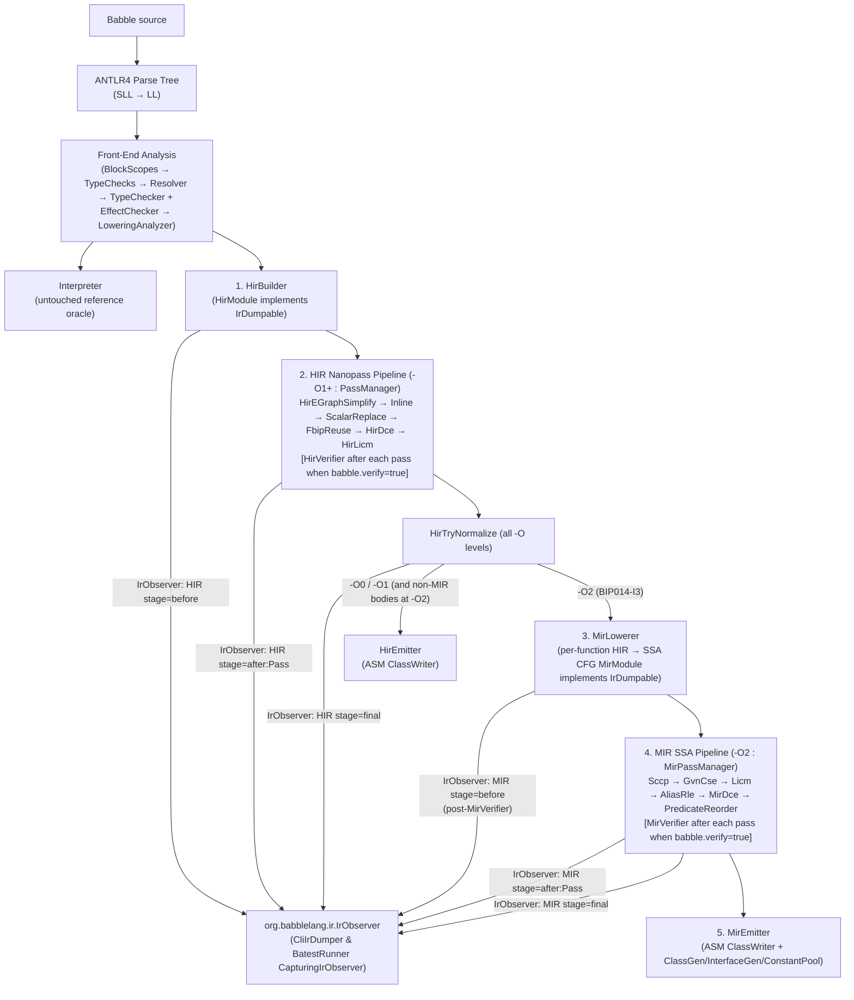

# BIP014: Compiler Optimization Passes

| | |
|---|---|
| **BIP** | 014 |
| **Date** | 2026-11-19 |
| **Status** | Partially implemented (`BIP014-D1`–`D10` decided; `BIP014-I0`–`I2` implemented in `RM010` with `-O1` default and 3-way CI parity; Half A of `BIP014-P5` — `org.babblelang.ir.egraph` & `HirEGraphSimplifyPass` — landed in `RM012` / `BIP027-I2`; `BIP014-I4` implemented with `record`/class lowering, `ScalarReplacePass`, and `FbipReusePass`; `BIP014-I3` SSA `MIR` under `-O2` and `BIP014-P5` Half B remain planned) |
| **Depends on** | Bytecode compiler, `RM001` primitive lowering & `RM003` JVM/Java interface bridges ([bip001_bytecode-compiler.md](bip001_bytecode-compiler.md) §19–§20), object model & `record`s ([bip002_object-model.md](bip002_object-model.md)), function effects, algebraic properties & ownership (`RM002`/`RM007`, [bip007_effects.md](bip007_effects.md), `BIP007-D10`), mandatory static typing ([bip008_static-typing.md](bip008_static-typing.md)), `.batest.md` differential & IR golden harness ([bip009_test-coverage.md](bip009_test-coverage.md), [bip029_batest-v2-and-ir-goldens.md](bip029_batest-v2-and-ir-goldens.md)), modular front end & `LoweringAnalyzer` (`RM004`, [bip010_type-checker-simplification.md](bip010_type-checker-simplification.md)), 8-primitive unboxing & core collections (`RM005`, [bip011_core-types.md](bip011_core-types.md)), predicate-free grammar (`RM006`, [bip012_grammar-improvements.md](bip012_grammar-improvements.md)), pure-by-default effects & return-through-borrow (`RM008`, [bip016_consolidating-effect-annotations.md](bip016_consolidating-effect-annotations.md)), `for` loops, `break`/`continue` & `fn calling f` (`RM009`, [bip013_iterators.md](bip013_iterators.md), [bip017_higher-order-function-effects.md](bip017_higher-order-function-effects.md)), modular compiler & `org.babblelang.ir.egraph` (`RM012`, [bip027_tackling-complexity-in-the-compiler.md](bip027_tackling-complexity-in-the-compiler.md)), and exception handling `try`/`catch`/`finally`/`throw` ([bip028_exception-handling.md](bip028_exception-handling.md)) |
| **Scope** | In-scope optimization catalogue unlocked by `BIP007` annotations, SOTA compiler pass architecture survey, introduction of a typed compiler IR (`org.babblelang.ir`) and pass pipeline (`org.babblelang.opt`), local vs. graph-level optimization boundary, interaction with HotSpot C2 and the `Interpreter` reference oracle, and an incremental migration path from the current parse-tree `CodeGenerator` |

---

## 1. Executive Summary

`BIP007` (`RM002` + `RM007`) and `BIP016`/`BIP017` (`RM008` + `RM009`) equip Babble with a rich, statically verified vocabulary of **memory effects**, **ownership guarantees**, **evaluation safety**, and **algebraic properties** (`@HERMETIC`, `@DETERMINISTIC`, `@CONST`/`mut`, `@BORROWED`/`shared`, `unique`, `frozen`, `move`, `freeze`, `discard`, `nothrow`, `@TERMINATING`, `idempotent`, `commutative`, `associative`, `monotone`, `injective`). Per `BIP007-D10`, all bytecode and pipeline optimizations consuming those contracts were deferred to this dedicated proposal.

Today, Babble compiles directly from the ANTLR4 parse tree (`BabbleParser.FileContext`) plus side-table maps (`ScopeAnalysis`, `Resolution`) to ASM JVM bytecode in a single 6,269-line visitor (`CodeGenerator.java`). That architecture was ideal for reaching `RM001`–`RM009` quickly, and it can host a handful of **local, peephole-style** optimizations (such as literal constant folding). However, almost every high-value `BIP007` optimization—**common subexpression elimination (CSE), loop-invariant code motion (LICM), no-alias load hoisting, dead-code elimination (DCE), small-function & closure inlining, `borrow` scalar replacement, functional-but-in-place (FBIP) reuse, and algebraic/predicate rewrites**—requires inspecting and rewriting the surrounding control-flow and data-flow graph.

Drawing on state-of-the-art compiler engineering—specifically the **Nanopass Framework** (`[SWD05]`, `[KD13]`, Chez Scheme), **SSA CFG compilers** (`[LA04]` LLVM, `[Mer25]` **V8 Turboshaft**'s departure from Sea-of-Nodes), **multi-level IRs** (`[LAB+21]` MLIR, Rust HIR/MIR), and **acyclic e-graphs** (`[WNW+21]`, `[Fal22]`, `[Fal26]` Cranelift `aegraph`)—this BIP proposes:

1. A concrete, prioritized **catalogue of 12 optimizations** unlocked by `BIP007`, with exact soundness contracts and JVM/HotSpot justification.
2. A **progressive two-tier typed IR** (`org.babblelang.ir`) and **small-pass pipeline** (`org.babblelang.opt`) written with Java 21 `sealed interface`s and `record`s:
   * **Tier 1 — High-Level Typed IR (`HIR`):** A structured, self-contained expression/statement tree detached from ANTLR4 `ParserRuleContext`, carrying resolved types, `PrimitiveKind`s, `EffectSet`s, ownership tags, and line numbers. Hosts Nanopass-style passes (constant folding, algebraic simplification, inlining, `borrow` scalar replacement, FBIP reuse, predicate/pipeline rewrites, structured DCE).
   * **Tier 2 — Per-Function SSA CFG IR (`MIR`):** Basic blocks with block parameters (not Sea-of-Nodes), explicit effect barriers keyed on `BIP007` contracts, and a clean SSA-to-ASM backend. Hosts dataflow passes (SCCP, GVN/CSE, LICM, `unique mut`/`frozen` redundant-load elimination, SSA DCE).
3. An **incremental, six-phase rollout (`BIP014-I0`–`I2`, `BIP014-I3`, `BIP014-I4`, `BIP014-P5`)** that delivers measurable wins immediately, detaches `CodeGenerator` from ANTLR4 with zero behavioral change first, and verifies every optimization against the untouched `Interpreter` via `DifferentialTestCase`, `.batest` (`BIP009`), ASM `CheckClassAdapter`, and byte-identical `examples/raytracer-argon/scene.ppm`.

---

## 2. Motivation: Why Optimize Ahead of HotSpot C2?

A natural question for any JVM-targeting compiler is: *doesn't HotSpot's C2 (or Graal) JIT already optimize JVM bytecode?*

HotSpot C2 is extraordinarily good at low-level machine optimizations (register allocation, instruction scheduling, branch prediction, devirtualization of monomorphic call sites, and intra-method scalar replacement of small objects). Babble should **never** duplicate those. However, C2 operates on **erased JVM bytecode** and lacks critical semantic knowledge that Babble's front end already proves:

1. **`BIP007` contracts are invisible to C2:** C2 cannot know that an `axiom pure deterministic nothrow` Java call (`Math.sin`, `Geo.haversine`, `String.trim`) or a `pure deterministic` Babble function can be folded, CSE'd, or hoisted out of a loop—especially across separate classes, `invokedynamic` sites, or native/JNI boundaries.
2. **Deep aliasing (`unique mut`, `frozen T`) is invisible to C2:** In JVM bytecode, `BabbleInstance` fields and `ArrayList` backing arrays are ordinary mutable heap references. C2 must conservatively assume two references of the same type may alias unless it can inline both producer and consumer within its bytecode budget. `BIP007-I2`'s `unique mut` and `frozen T` prove deep disjointness and immutability *across call boundaries*.
3. **Algebraic properties (`associative`, `commutative`, `idempotent`, `monotone`, `injective`) are invisible to C2:** C2 will never collapse `norm(norm(s))` to `norm(s)`, match `f(b, a)` with `f(a, b)`, reassociate custom combiners, or push filters past `map` projections.
4. **Babble abstractions inflate C2's inlining budget:** Higher-order lambdas (`CompiledFunction`, `FunctionBody`, `LambdaMetafactory`), `record` wrappers (`Vec3` in `examples/raytracer-argon`), `Cell` captures, and `invokedynamic` call sites consume HotSpot's `MaxInlineSize` (35 bytes) and `FreqInlineSize` (325 bytes) budgets. Inlining small Babble functions, eliminating dead branches, and scalar-replacing `borrow` `record`s *before* bytecode emission shrinks hot methods so C2 optimizes the remaining loop dramatically better.
5. **Cold & startup performance (AOT `babblec` and scripts):** Short-lived scripts and CLI tools compiled with `babblec` (`BIP006`) often finish before C2 finishes tier-4 compilation; compile-time optimizations pay off from the very first iteration.

### 2.1 The One-Way Bytecode Boundary: Why Low-Level Passes Unlock High-Level Passes

A subtler pitfall is assuming that any optimization marked **"Partial"** in §3.1 (`O1`, `O2`, `O4`, `O5`, `O8`, `O9`) can simply be skipped and left to C2. Because bytecode emission erases all `BIP007` annotations, **the bytecode boundary is a one-way wall**: C2 can never feed a low-level simplification back up into Babble's high-level passes, and C2 itself lacks the `BIP007` contracts needed to exploit the newly exposed opportunity.

Concrete examples where skipping a "C2-redundant" pass blinds Babble's high-level optimizer:

* **Inlining (`O8`) + Constant Propagation (`O1`) + Dead Branch Pruning (`O4`) $\to$ `idempotent` collapse (`O2`):**
  ```babble
  def clean = fn pure deterministic (s: string, lower: bool): string -> (
      def t = s.trim()
      if lower then ( t.toLowerCase() ) else ( t )
  )
  def out = clean(raw.trim(), false)
  ```
  Only *after* Babble inlines `clean`, propagates `lower = false`, and prunes the `then` branch does `raw.trim().trim()` appear—unlocking `O2` `idempotent` collapse to `raw.trim()`. Deferring branch pruning to C2 hides the redundant `.trim()` from Babble, while C2 does not know `String.trim` is `idempotent`.
* **Constant Folding (`O1`) + Reassociation (`O3`) $\to$ CSE (`O5`) / LICM (`O6`) of `axiom pure deterministic` calls:**
  For `expensive((i + 1) + 2)` and `expensive(3 + i)`, only *after* Babble folds `1 + 2 -> 3`, reassociates, and canonically orders `3 + i -> i + 3` do both calls share the same argument value, letting `O5` eliminate the second `expensive(...)` call. C2 can fold the arithmetic, but cannot CSE `expensive(...)` without Babble's `axiom`.
* **Inlining (`O8`) + `borrow` Scalar Replacement (`O9`) $\to$ LICM (`O6`):**
  Passing a loop-local `Config(scale, bias)` `record` into a helper computing `Math.exp(cfg.scale) * x + cfg.bias` hides the loop invariance of `Math.exp(scale)` until Babble inlines the helper and scalar-replaces `cfg`. C2 can inline and scalar-replace `cfg`, but still will not hoist an `axiom pure deterministic` call across the loop.
* **Constant Propagation (`O1`) + Dead Branch Pruning (`O4`) $\to$ FBIP in-place reuse (`O10`):**
  A dead debug guard `if DEBUG then ( log(xs) )` before `sort(xs)` makes `xs` look shared until `O1` + `O4` eliminate the branch; once pruned, `sort(xs)` becomes the sole consumer and qualifies for zero-allocation in-place reuse.

For this reason, `BIP014` runs `HIR` passes in a **bounded fixed-point loop** (`PassManager`, §6.5) before lowering to bytecode.

---

## 3. Catalogue of Optimizations in Scope

Every optimization below is strictly gated on `BIP007` static contracts and must preserve **exact observable equivalence** with the `Interpreter` (same return value, same side-effect order, same exception type/message/line number, and same termination behavior).

### 3.1 Summary Matrix

| # | Optimization | Required `BIP007` Contract | `BIP007` Phase | Granularity | Redundant with C2 |
|---|---|---|---|---|---|
| **O1** | Constant Folding & Constant Propagation | Built-in ops; for calls: `pure deterministic` + deeply immutable args & result (+ `nothrow` if guarded) | `P1` (`P2` for `frozen`) | Local (literals) / Pass (propagation) | **Partial** — C2 folds hot primitive ops, not `axiom pure deterministic` JDK/Babble calls or cold/startup code; early folding also shrinks bytecode for C2's inlining budget |
| **O2** | Algebraic Identities, Strength Reduction & `idempotent` Collapse | `pure deterministic` (+ `idempotent` for `f(f(x)) -> f(x)`; effect `idempotent` for discarded duplicate) | `P1` | Local / Pass | **Partial** — C2 does basic int/bool identities, never `idempotent` (`f(f(x)) -> f(x)` or duplicate `set.add` suppression) |
| **O3** | Associative Reassociation & `commutative` Canonicalization | `pure deterministic nothrow` + `associative` / `commutative` (never IEEE-754 `float`/`double` without `axiom`) | `P1` | Pass | **No** — C2 does limited int idealization, never `axiom associative`/`commutative` functions or `string +` |
| **O4** | Dead-Code & Dead-Expression Elimination (DCE) | Unreachable CFG always; dead expression requires `pure nothrow @TERMINATING` | `P1` (CFG) / `P2` (`@TERMINATING`) | Pass | **Partial** — C2 drops dead primitive/unreachable code on hot paths, not calls to `pure nothrow @TERMINATING` functions it cannot prove side-effect-free |
| **O5** | Common Subexpression Elimination (CSE / GVN) | `pure deterministic` + deeply immutable result + no intervening write to reachable arg state (`commutative` merges `f(a,b)`/`f(b,a)`) | `P1` (`P2` for `frozen`) | Pass (CFG/SSA) | **Partial** — C2 GVNs primitive ops and inlined loads, not non-inlined `pure deterministic` / `axiom` calls or `commutative` `f(b,a)` matching |
| **O6** | Loop-Invariant Code Motion (LICM / Loop Hoisting) | `pure deterministic` + deeply immutable result (+ `nothrow @TERMINATING` when loop may run 0 times or across guard) | `P1` / `P2` | Pass (CFG/SSA) | **Partial** — C2 hoists primitive ops and inlined loads, not non-inlined `pure deterministic nothrow` calls (`Math.cos`, `normalize`) or cross-call `frozen` reads |
| **O7** | No-Alias (`unique mut`) & `frozen` Redundant-Load Elimination (RLE) | `unique mut` parameter (deep disjointness) or `frozen T` / deep `record` field reads | `P2` (deep `record`s in `P1`) | Pass (CFG/SSA) | **No** — C2 cannot prove `unique mut` deep disjointness or `frozen T` deep immutability across non-inlined calls or collection backing arrays |
| **O8** | Small-Function & `borrow`-Lambda Inlining | Static Babble call target (`ScopeAnalysis.babbleCallFunctions`); `borrow` guarantees closure non-escape | `P1` | Pass (`HIR`) | **Partial** — C2 inlines hot monomorphic methods up to `MaxInlineSize`/`FreqInlineSize`, but stalls on megamorphic `CompiledFunction`/`invokedynamic` lambdas; AOT inlining frees C2's budget |
| **O9** | Scalar Replacement / Stack Unboxing of `borrow` `record`s & Captures | `borrow` parameter + statically known `record` / fresh allocation | `P1` | Pass (`HIR`) | **Partial** — C2 escape analysis requires inlining every callee into one compilation unit; `$unboxed` `borrow` entry points eliminate allocation even across non-inlined/megamorphic calls |
| **O10** | Functional-But-In-Place (FBIP) Reuse | `unique` parameter + `move(x)` (single live owner) + `hermetic mut` core collection/class | `P2` | Pass (`HIR`) | **No** — C2 cannot turn an allocating functional update into in-place mutation without static `unique` ownership |
| **O11** | Guard-Safe Predicate Reordering & Short-Circuit Simplification | `pure nothrow` on both predicates + no `BIP007-D1` `Narrowing` guard dependency | `P1` | Pass (`HIR`/`MIR`) | **No** — C2 does not reorder method calls or collection filters by cost/selectivity using `pure nothrow` contracts |
| **O12** | Pipeline Push-Down / Push-Up & Tree Reduction | `pure deterministic nothrow` + `monotone` / `injective` / `associative` | `P1` (+ `std/` combinators) | Pass (`HIR`) | **No** — C2 has no knowledge of `monotone`/`injective`/`associative` contracts and cannot fuse pipelines or tree-reduce custom combiners |

---

### 3.2 Detailed Optimization Specifications

#### O1 — Constant Folding & Constant Propagation
* **What it does:** Evaluates compile-time-known expressions across all 8 `RM005` JVM primitives (`byte`..`char`), `string` concatenation, unary/binary operators, constant `if (true)` / `if (false)` branch selection, and calls to `pure deterministic` functions with constant deeply immutable arguments (e.g., `Math.sqrt(2.0)`, `int("42")`, `s.length()`, or small `@TERMINATING` Babble helpers).
* **Before / After:**
  ```babble
  ;; Before
  def tau = 2.0 * 3.141592653589793
  def diag = java.lang.Math.sqrt(3.0 * 3.0 + 4.0 * 4.0)
  def label = "v" + "1"

  ;; After
  def tau = 6.283185307179586
  def diag = 5.0
  def label = "v1"
  ```
* **Soundness rules:**
  * Integer arithmetic respects exact two's-complement wrap-around (`int`/`long`), and division `/` is IEEE-754 `float`/`double` (never throws in Babble).
  * Calls that are not `nothrow` (e.g., `int("abc")`) are **never** folded speculatively into an unreachable branch, and if folded in an executed position must either be left to throw at runtime with the exact line number or folded only when guaranteed not to throw.
  * Never fold a `pure deterministic` call that returns a **mutable** object (e.g., `list of int ()` or a mutable class constructor), because two evaluations must produce two distinct mutable instances (`BIP007` §3.2).

#### O2 — Algebraic Identities, Strength Reduction & `idempotent` Collapse
* **What it does:** Applies local algebraic simplifications:
  * Integer identities: `x + 0 -> x`, `x - 0 -> x`, `x * 1 -> x`, `x * 0 -> 0` (when `x` is `pure nothrow @TERMINATING`), `x - x -> 0`.
  * Boolean & equality identities: `not (not b) -> b`, `b and true -> b`, `b or false -> b`, `b == true -> b`, `b == false -> not b`, negated comparisons (`not (a == b) -> a != b`, `not (a != b) -> a == b`, `not (a < b) -> a >= b`, `not (a <= b) -> a > b`, `not (a > b) -> a <= b`, `not (a >= b) -> a < b`, exact for all types and effects under Babble's total-order `Float.compare`/`Double.compare`), and reflexive `a == a -> true` / `a != a -> false` (when `a` is `pure nothrow @TERMINATING` and has a primitive or `string` type; arbitrary `any`/`Object` references are excluded because `equals` may throw or violate reflexivity).
  * Value `idempotent` collapse (`BIP007` Axis 3): `f(f(x)) -> f(x)` for any `pure deterministic idempotent` unary endofunction (e.g., `Math.abs(Math.abs(x)) -> Math.abs(x)`, `s.trim().trim() -> s.trim()`).
  * Effect `idempotent` duplicate suppression: consecutive identical `idempotent` calls `s.add(x); s.add(x)` with discarded second result and no intervening write collapse to a single `s.add(x)`.
* **Soundness rules:**
  * **Strict IEEE-754 arithmetic discipline:** For `float`/`double`, `x * 0.0` is **not** `0.0` (`NaN * 0.0 = NaN`, `Inf * 0.0 = NaN`, `-1.0 * 0.0 = -0.0`), `x + 0.0` is **not** `x` (`-0.0 + 0.0 = +0.0`), and `x - x` is **not** `0.0` (`Inf - Inf = NaN`). Floating-point arithmetic identities are strictly excluded unless mathematically exact under IEEE-754 (whereas `==`/`!=` uses `Float.compare`/`Double.compare`, so reflexive `a == a -> true` and `a != a -> false` are exact on all primitives).

#### O3 — Associative Reassociation & `commutative` Canonicalization
* **What it does:** Reassociates `pure deterministic nothrow associative` chains so constants group together and loop-invariant terms separate from loop-variant terms (`(x + 1) + 2 -> x + 3`, `(inv + i) + inv2 -> (inv + inv2) + i`), and canonicalizes operand order for `commutative` operations (e.g., constants on the right, lower value-number on the left) so CSE/GVN automatically recognizes `a + b` and `b + a` or `min(x, y)` and `min(y, x)` as identical.
* **Soundness rules:** Applies to `int`/`long` `+`, `*`, `string +` (associative, non-commutative), and any function annotated `axiom pure deterministic nothrow associative` / `commutative`. Never reassociates `float`/`double` `+` or `*` (IEEE-754 rounding is non-associative).

#### O4 — Dead-Code & Dead-Expression Elimination (DCE)
* **What it does:** Removes unreachable basic blocks (after `return`, or pruned constant `if`/`while` branches), unused local `def` bindings whose initializer is `pure nothrow @TERMINATING`, and dead `pure nothrow @TERMINATING` expressions exposed by inlining, CSE, or constant folding.
* **Relationship to `BIP007-D8`:** `BIP007-D8` makes unused `pure nothrow` expressions written directly in *source* a compile-time error (unless wrapped in `discard(expr)`). Optimizer DCE handles dead expressions *created synthetically* by earlier passes (e.g., after inlining a helper whose return value is unused, or `discard(pureExpr)` itself, which becomes a no-op when `pureExpr` is `pure nothrow @TERMINATING`).
* **Soundness rules:** Dropping a call that might loop forever would change observable termination; hence `@TERMINATING` (`BIP007-I2`) is mandatory before eliminating any non-trivial call.

#### O5 — Common Subexpression Elimination (CSE) & Global Value Numbering (GVN)
* **What it does:** Computes each `pure deterministic` expression or call once and reuses its result in a JVM local whenever dominated by an earlier identical evaluation and no intervening operation could modify the observable state reachable from its arguments.
* **Before / After:**
  ```babble
  ;; Before (e.g. normalize is pure deterministic, Vec3 is a deep record)
  def a = normalize(dir).x * scale + normalize(dir).y * scale

  ;; After
  def $cse0 = normalize(dir)
  def a = ($cse0.x + $cse0.y) * scale   ;; (or $cse0.x * scale + $cse0.y * scale for double)
  ```
* **Soundness rules:**
  * Result type must be **deeply immutable** (`Type.isDeeplyImmutable()`: 9 core scalars, `null`, `frozen T`, deep `record`, deep `entry`). Never CSE a call returning a mutable class or `unique` collection!
  * If arguments are deeply immutable, the value remains valid across arbitrary intervening code (even impure calls).
  * If an argument is a mutable reference (e.g., `list of int`), the cached value is invalidated at any intervening call that may mutate it—*unless* the intervening call is `pure`, or mutates only a `unique mut` parameter provably disjoint from the argument (`O7`).
  * `commutative` functions canonicalize `(b, a)` to `(a, b)` in the GVN table.

#### O6 — Loop-Invariant Code Motion (LICM / Loop Variable Hoisting)
* **What it does:** Identifies expressions, immutable field loads, and `pure deterministic` calls inside a `while` (or `BIP013` `for`) loop whose operands are invariant across iterations, and hoists them into a loop preheader so they execute once instead of $N$ times.
* **Before / After:**
  ```babble
  ;; Before
  def i = 0
  while i < n then (
      def factor = java.lang.Math.cos(angle) * radius
      total += xs.get(i) * factor
      i += 1
  )

  ;; After
  def $licm0 = java.lang.Math.cos(angle) * radius
  def i = 0
  while i < n then (
      total += xs.get(i) * $licm0
      i += 1
  )
  ```
* **Soundness rules:**
  * If the loop is **not** statically guaranteed to execute at least once (the common case for `while`), hoisting unconditionally into the preheader requires **`nothrow` and `@TERMINATING`** (otherwise a zero-iteration loop could spuriously throw or hang!).
  * If an invariant expression is `pure deterministic` but *may* throw (not `nothrow`, e.g. `xs.get(0)` or `x!`), it can still be hoisted safely via **loop guarding** (`if i < n then ( def $licm0 = ...; do-while ... )`), which preserves exact exception semantics on zero-iteration loops.
  * Never hoist an expression that allocates a mutable object (`Counter(0)`), since each iteration expects a fresh instance.
  * Must preserve HotSpot's empty-operand-stack invariant at loop heads (`CodeGenerator` invariant).

#### O7 — No-Alias (`unique mut`) & `frozen` Redundant-Load Elimination (RLE)
* **What it does:** Eliminates redundant `GETFIELD` / `list.get` reads across mutations when `BIP007-I2` proves disjointness or deep immutability:
  * **Via `unique mut`:** Inside `fn (unique borrow mut dst: Vec, borrow src: Vec)`, writes to `dst` (or `dst.data`) **cannot** alias `src` or any field reachable from `src` (`BIP007` §3.2). Therefore, reads of `src.len` or `src.scale` can be kept in JVM locals and hoisted out of loops that mutate `dst`, with zero runtime alias checks.
  * **Via `frozen T` and deep `record`s:** Reading any field of a `frozen T` or deep `record` is permanently invariant for the lifetime of the reference—even across arbitrary impure calls.
* **Soundness rules:** Keyed strictly on `unique mut` (never plain `mut`, which is a shallow identity check per `BIP007-D9`) and `Type.isDeeplyImmutable()`.

#### O8 — Small-Function & `borrow`-Lambda Inlining
* **What it does:** Inlines small, statically resolved Babble functions (`ScopeAnalysis.babbleCallFunctions`) and higher-order lambda arguments (`xs.map(fn (x) -> ( x * 2 ))`), especially when the callee parameter is `borrow` (guaranteeing the lambda itself does not escape and its `CompiledFunction` allocation disappears completely).
* **Why it is pivotal:** Inlining is the **enabling pass** for almost everything else. In `examples/raytracer-argon`, `Vec3.plus`, `Vec3.times`, `Vec3.dot`, and `Ray.at` are tiny 1–3 line methods. Inlining them exposes temporary `Vec3` allocations to `O9` (scalar replacement), exposes repeated subexpressions to `O5` (CSE), and eliminates `invokedynamic` / `$spec` call overhead.
* **Soundness rules:**
  * Bounded by an AST/IR node budget and recursion-depth limit (never infinitely inline recursive or mutually recursive SCCs).
  * Respects `BIP007-D2` cross-module boundaries (`BIP014-D2`).
  * Preserves `return` semantics (converting inner `return` into a jump to the inlined call's merge block) and preserves call-site + callee line numbers for stack traces.

#### O9 — Scalar Replacement / Stack Unboxing of `borrow` `record`s & Captures
* **What it does:** When a `record` (e.g., `record (x: double, y: double, z: double)`) is constructed locally and only read (or passed to `borrow` parameters, or inlined), replaces the heap-allocated `BabbleInstance` with its individual unboxed primitive/reference fields in JVM locals—across all 8 `RM005` primitive types.
* **Before / After (ray-tracer hot loop):**
  ```babble
  ;; Before: allocates temporary Vec3 objects on every ray step
  def p = Vec3(ox + t * dx, oy + t * dy, oz + t * dz)
  def d = distSq(p, center)   ;; distSq takes `borrow p: Vec3`

  ;; After inlining / scalar replacement: 0 heap allocations, pure JVM `double` locals
  def $p_x = ox + t * dx
  def $p_y = oy + t * dy
  def $p_z = oz + t * dz
  def $dx = $p_x - center.x
  def $dy = $p_y - center.y
  def $dz = $p_z - center.z
  def d = $dx * $dx + $dy * $dy + $dz * $dz
  ```
* **Soundness rules:**
  * Requires that the `record` reference never escapes (no assignment to an outer variable, field, collection, `any`, or non-`borrow` parameter) and never has its identity observed (`same(a, b)` on a `record` or `classof` if polymorphic—note `record` has value equality, and `same` is identity, so `same` disqualifies scalar replacement).
  * For non-inlined `borrow` callees, the compiler can emit a specialized flattened `$unboxed` entry point taking `(double p_x, double p_y, double p_z, ...)` alongside `$spec`.

#### O10 — Functional-But-In-Place (FBIP) Reuse (`unique` + `move(...)`)
* **What it does:** When a function takes a `unique` parameter (or a caller passes `move(xs)` on a `unique` local) and returns a transformed collection/record of the same shape (e.g., `sort(move(xs))`, `mapInPlace(move(xs), f)`), lowers the operation to mutate the uniquely owned buffer in place instead of allocating and copying—preserving external `pure`/`hermetic` semantics with zero GC pressure (inspired by Koka's Perceus `[RXdML21]` and the fully in-place calculus `[LLS23]`).
* **Soundness rules:** Strictly requires `BIP007-I2` `unique` ownership + definite-unassignment (`move(xs)` or implicit last-use move), guaranteeing refcount = 1 statically with zero runtime refcounting overhead.

#### O11 — Guard-Safe Predicate Reordering & Short-Circuit Simplification
* **What it does:** Reorders cheap `pure nothrow` predicates ahead of expensive `pure nothrow` predicates in conjunctions (`expensive(x) and cheap(x) -> cheap(x) and expensive(x)`) and chained collection filters (`xs.filter(expensive).filter(cheap)`).
* **Soundness rules (`BIP007-D1`):**
  * Both predicates must be `pure nothrow` (and `@TERMINATING` if reordering could skip a non-terminating left-hand side).
  * **Never** reorder a narrowed predicate ahead of its `Narrowing` guard: in `a != null and a.x > 0` or `x is Circle and x.r > 0`, `a.x` depends on the narrowing established by `a != null`. The IR must carry an explicit guard/narrowing dependency edge (or restrict reordering to predicates whose `Narrowing` input environment is unchanged by the preceding predicate).

#### O12 — Pipeline Push-Down / Push-Up & Algebraic Tree Reduction
* **What it does:** Once `std/` higher-order combinators (`map`, `filter`, `reduce`, `distinct`) land, rewrites high-level pipelines using `BIP007` Axis 3 algebraic properties:
  * **Filter fusion & push-down:** `xs.filter(p).filter(q)` → single fused pass; `xs.map(f).filter(p)` → push `p(f(x))` before `map` (or fuse into a single loop with zero intermediate `ArrayList`).
  * **`monotone` range inversion / pruning:** On sorted/chunked collections, push `f(x) > c` across a `monotone` projection.
  * **`injective` push-down:** Rewrite `f(x) == f(y)` → `x == y` (when `f` is `pure deterministic nothrow injective`), and push `distinct` ahead of `map(f)`.
  * **`associative` tree reduction / loop reassociation:** Break loop-carried dependencies in `reduce(xs, seed, op)` for `pure deterministic associative` combiners (enabling unrolled multi-accumulator loops that hide CPU latency—and laying the groundwork for future parallel reductions).

### 3.3 Explicit Non-Goals

* **Machine-level register allocation, instruction selection, or SIMD vectorization:** HotSpot C2 handles CPU-specific lowering far better than static bytecode generation can.
* **Speculative profile-guided optimizations (PGO) or deoptimization:** HotSpot's tiered JIT already collects branch/type profiles at runtime. Babble's compiler performs **sound, static, semantics-preserving** optimizations only.
* **Automatic parallelization:** Deferred until `threadsafe` lands (`BIP007` §10).
* **Optimizing the `Interpreter`:** The parse-tree `Interpreter` remains deliberately simple and unoptimized so it continues to serve as Babble's trusted reference semantics for `DifferentialTestCase` and `.batest` (`BIP009`).

---

## 4. State of the Art in Compiler Pass Architecture

Compiler intermediate representations and pass pipelines have evolved rapidly over the past decade. Evaluating the major SOTA paradigms clarifies what fits Babble—a statically typed, effect-annotated JVM language implemented in Java 21—and what to avoid.

| Paradigm / System | Representative Compilers | Core IR & Pass Model | Key Strengths (`+`) | Trade-Offs / Lessons for Babble (`-`) |
|---|---|---|---|---|
| **Classic SSA CFG + PassManager** | **LLVM** `[LA04]`, GCC (GIMPLE/SSA) | Mutable linear basic blocks in SSA (`phi` nodes); modular analysis/transform passes with explicit invalidation (`PreservedAnalyses`) | `+` Textbook GVN, SCCP `[WZ91]`, LICM, DCE, RLE map cleanly.<br>`+` Easy to print, verify, and debug.<br>`+` Scales to production workloads. | `-` Classic **phase-ordering problem** (pass order affects results; requires iterating or fixed pipelines).<br>`-` Low-level SSA erases high-level constructs (`for`, `record`, pipelines) unless paired with a higher-level IR. |
| **Nanopass Framework** | **Chez Scheme** (`[SWD05]`, `[KD13]`), Racket | **50+ tiny, single-task passes**, each transforming from one formally defined IR grammar (`define-language`) to a simpler one (`define-pass` with automatic catamorphism boilerplate) | `+` Dramatic complexity reduction: each pass does *one* thing and is trivial to test/reason about.<br>`+` Chez Scheme replaced 5 monolithic passes with 50+ nanopasses: **15–27% faster output**, compile time well within 2× `[KD13]`.<br>`+` Output grammar enforces invariants structurally. | `-` Relies on Scheme's hygienic macros (`define-language` delta inheritance) to avoid boilerplate.<br>`-` In Java, 30 distinct AST class hierarchies would be prohibitively verbose; better to adopt the **small single-task pass + IR verifier** discipline over **1–2** typed IRs! |
| **Sea of Nodes (SoN)** | HotSpot C2 `[Cli95]`, Graal, V8 TurboFan *(legacy)* | Control, data, and effect edges unified in one floating graph; no fixed basic-block instruction order until late scheduling | `+` Unifies GVN, LICM, and global code motion `[Cli95]`.<br>`+` Proven in HotSpot C2 and Graal. | `-` **V8's 2025 retrospective `[Mer25]`**: V8 migrated TurboFan to a **CFG-based SSA IR (Turboshaft)**, **roughly halving compile time**, cutting L1 dcache misses 3–7×, and greatly simplifying debugging—because effectful languages chain most nodes anyway! Clear warning **against** SoN for Babble. |
| **Compact CFG SSA with Copying Reducers** | **V8 Turboshaft** `[Mer25]`, Maglev, Swift SIL | Linear basic blocks in SSA with **block parameters** (replacing `phi` nodes); passes stream/copy old IR → new IR while fusing multiple local reductions in one traversal | `+` Cache-friendly, linear, easy to read and debug.<br>`+` Block parameters unify loop-carried values and branch merges cleanly.<br>`+` Copying/rewriting avoids stale-pointer bugs of in-place graph mutation. | `+` **Strong fit for Babble's Tier 2 (`MIR`)**, especially combined with Java 21 immutable `record`s and block parameters. |
| **E-Graphs & Equality Saturation** | **egg** `[WNW+21]`, **Cranelift `aegraph` + ISLE** (`[Fal22]`, `[Fal26]`), Julia e-graph IR | Equivalence graph storing multiple equivalent expressions simultaneously in e-classes; declarative rewrite rules fire without destroying earlier forms, followed by cost-based extraction | `+` Eliminates phase-ordering for algebraic rewrites (`associative`, `commutative`, `idempotent`, strength reduction).<br>`+` Cranelift's **acyclic e-graph (`aegraph`)** with a CFG skeleton makes it fast enough for JIT compilation (`[Fal22]`, `[Fal26]`). | `-` Overkill as the *only* IR (still needs a CFG skeleton for control flow and side effects, plus extraction heuristics).<br>`+` **Ideal optional fit for `BIP014-P5`** to execute `BIP007` Axis 3 algebraic rewrites declaratively without hand-coding every rule combination. |
| **Multi-Level IRs & JVM Compilers** | **MLIR** `[LAB+21]`, **Rust (HIR → MIR)**, **Kotlin IR**, **Scala 3** | Separate high-level semantic IR (preserving language abstractions, types, ownership) from low-level CFG/SSA IR; small composable passes + optional final bytecode peephole | `+` High-level passes (inlining, `borrow` scalar replacement, FBIP, pipeline push-down) are natural on HIR.<br>`+` Low-level passes (GVN, LICM, RLE) are natural on SSA MIR.<br>`+` Matches JVM constraints cleanly. | `-` Maintaining two IRs adds conversion code (`HIR -> MIR`), so the boundary must be crisp and introduced **incrementally** (`HIR` first, `MIR` second). |

### Key Architectural Takeaways for Babble

1. **Adopt the Nanopass philosophy, not Scheme's 50 grammars:** Every optimization should be a small, single-responsibility pass (`HirPass` / `MirPass`) that is independently unit-tested, toggleable, and followed by an automated IR verifier in test mode (`babble.verify=true`).
2. **Use CFG SSA with block parameters—not Sea of Nodes:** V8's Turboshaft experience confirms that for an imperative/functional language with effects and exceptions, explicit basic blocks with SSA block parameters are dramatically simpler, faster to compile, and easier to debug than Sea of Nodes.
3. **Separate High-Level Semantic IR (`HIR`) from SSA Control-Flow IR (`MIR`):** Trying to do `borrow` `record` unboxing or `map`/`filter` push-down on low-level basic blocks is painful; trying to do GVN/LICM/RLE on an ANTLR parse tree is equally painful. A two-tier IR—introduced incrementally—gives each optimization its natural home.
4. **Reserve e-graphs / `aegraph` for where they shine:** Don't build the whole compiler around equality saturation on day one; keep it as a targeted option in `BIP014-P5` for `BIP007`'s algebraic axioms (`associative`, `commutative`, `idempotent`, `monotone`, `injective`).

---

## 5. Current Babble Compiler Architecture & Constraints

To design an incremental path forward, we must account for the exact structure of Babble today:

```
Babble source
  └─▶ ANTLR4 (Babble.g4, SLL → LL)
        └─▶ BabbleParser.FileContext (Parse Tree)
              ├─▶ Analysis (BlockScopes → TypeChecks → Resolver → TypeChecker + EffectChecker → LoweringAnalyzer)
              │     └─▶ ScopeAnalysis + Resolution (IdentityHashMap / ParseTreeProperty keyed by ParserRuleContext!)
              │
              ├─▶ Interpreter (BabbleBaseVisitor<Object>, 826 lines — reference oracle)
              └─▶ BabbleCompiler → CodeGenerator (BabbleBaseVisitor<Void>, 5,996 lines)
                                       └─▶ ASM ClassWriter → byte[] → ScriptClassLoader / babblec jar
```

### Why Optimizations Cannot Live on the ANTLR4 Parse Tree

1. **Side-table fragility:** `ScopeAnalysis` (767 lines) and `Resolution` (133 lines) store over 25 `ParseTreeProperty` / `IdentityHashMap<ParserRuleContext, ...>` tables (`expressionKinds`, `declarationKinds`, `javaCallTargets`, `babbleCallFunctions`, `interfaceCallTargets`, `numericWidenings`, `checkedTypes`, `callableEffects`, `callEffects`, `bindings`, etc.). Mutating, cloning, or synthesizing a `ParserRuleContext` (e.g., during inlining, LICM, or constant folding) immediately breaks identity lookups across all 25 tables.
2. **Concrete syntax noise:** ANTLR4 nodes encode grammar artifacts (parentheses, `NL` tokens, `memberName` wrappers, compound assignment tokens) rather than semantic operations.
3. **Monolithic single-pass `CodeGenerator`:** At **5,996 lines**, `CodeGenerator.java` currently interleaves five distinct concerns in one class:
   * Script/class/interface/constant-pool scaffolding (`ClassGen`, `InterfaceGen`, `Constant`, `<clinit>` splitting)
   * Method-body local-slot & `Cell` frame management
   * Direct parse-tree lowering (operators, `if`/`while`, calls, `is`/`as`, Java interop, `RM001`/`RM003` bridges)
   * Ad-hoc local optimizations (e.g., `RM001` type-guarded `int` constant folding)
   * ASM bytecode emission and line-number tracking

### Architectural Invariants That Must Be Preserved

1. **Zero runtime boundary leakage (`BIP006` §3, `RuntimeBoundaryTestCase`):** `org.babblelang.runtime` and `org.babblelang.engine.impl.natives` must remain 100% free of IR and optimizer classes (`java.base`-only `babble-runtime.jar`).
2. **Dual-mode differential parity (`BIP009`):** `Interpreter` stays untouched. Every `.ba` and `.batest` test must produce identical values, stdout, and error messages/line numbers across `interpret`, `compile -O0`, and `compile -O1`/`-O2`.
3. **Bytecode verification & OSR safety:** Every generated `.class` must pass ASM `CheckClassAdapter` (`babble.verify=true`), keep the operand stack empty at loop headers (HotSpot OSR), and stay within JVM 64 KB method / constant-pool limits (`MAX_NODES_PER_RUN_METHOD`, `<clinit>` helper splitting).
4. **AST-detached module & REPL summaries (`BIP010-D3`):** `TypedModuleSummary` and `AnalysisSession` must never retain ANTLR parse trees of imported modules.

---

## 6. Proposed Compiler Architecture

### 6.1 Local vs. Pass-Based Optimization Boundary

Not every optimization needs a full graph pass. We draw a clean architectural boundary:

| Layer | Where It Lives | What Belongs Here | What Does *Not* Belong Here |
|---|---|---|---|
| **1. Local / Emission-Time Peepholes** | `CodeGenerator` (ASM backend) | Literal constant emission (`ICONST_0`..`LDC`), branch inversion (`if (not cond)` → single `IFNE`), `x + 0` / `x * 1` on immediate literals, eliminating trivial `DUP; POP` or box-then-unbox pairs at expression boundaries | Anything requiring def-use chains, variable tracking, alias/effect analysis, loop structure, or cloning code |
| **2. Structured Tree Passes (`HIR`)** | `org.babblelang.opt.hir` | Constant folding & propagation (`O1`), algebraic & `idempotent` rewrites (`O2`, `O3`), small-function & `borrow`-lambda inlining (`O8`), `borrow` `record` scalar replacement (`O9`), FBIP reuse (`O10`), pipeline/predicate push-down (`O11`, `O12`), structured DCE (`O4`) | General CSE across diamond branches, complex loop-invariant hoisting across arbitrary `while` control flow, alias-aware RLE |
| **3. Per-Function SSA CFG Passes (`MIR`)** | `org.babblelang.opt.mir` | Sparse Conditional Constant Propagation (SCCP), GVN/CSE (`O5`) with `commutative` canonicalization, general LICM (`O6`) with preheaders & guarded loops, `unique mut`/`frozen` RLE & load hoisting (`O7`), SSA DCE (`O4`), guard-safe predicate reordering (`O11`) | High-level `record` / closure / collection pipeline structure (already lowered) |

### 6.2 Proposed Pipeline



### 6.3 Tier 1: High-Level Typed IR (`org.babblelang.ir.hir`)

`HIR` is a compact, self-contained, immutable tree built with **Java 21 `sealed interface`s and `record`s** (enabling exhaustive pattern-matching `switch` expressions with zero visitor boilerplate).

Every `HirExpr` carries a lightweight `ExprMeta` record:
```java
public record ExprMeta(
    int line,                          // source line for exact stack traces
    Type type,                         // converged static Type (including Frozen, Record, etc.)
    ScopeAnalysis.PrimitiveKind kind,  // BYTE..CHAR or NONE (8-primitive RM005 unboxing)
    EffectSet effects,                 // BIP007 converged effects for this node
    boolean terminating,               // @TERMINATING flag (BIP007-I2)
    boolean deeplyImmutable            // cached Type.isDeeplyImmutable()
) {}
```

Core node families (all sealed):
* **Declarations & containers:** `HirModule`, `HirFunction` (parameters with `mut`/`borrow`/`unique` flags, captures, body `HirExpr`, `EffectSet`), `HirClass` / `HirRecord` / `HirInterface` / `HirObject`.
* **Local bindings & state:** `HirVarRef(VarId, ExprMeta)`, `HirDef(VarId, HirExpr init, ExprMeta)`, `HirAssign(VarId, HirExpr value, ExprMeta)`, `HirNamespaceRead/Write` (for file/interface namespace scopes).
* **Literals & conversions:** `HirConst(Object value, ExprMeta)`, `HirWiden(HirExpr, PrimitiveKind target, ExprMeta)`, `HirCast(HirExpr, String checkedType, ExprMeta)`, `HirNonNull(HirExpr, ExprMeta)`, `HirIs(HirExpr, IsTarget, ExprMeta)`.
* **Operations:** `HirUnary(Op, HirExpr, ExprMeta)`, `HirBinary(Op, HirExpr left, HirExpr right, ExprMeta)`, `HirLogic(And|Or, HirExpr left, HirExpr right, boolean rightNarrowed, ExprMeta)`.
* **Control flow:** `HirBlock(List<HirExpr> stmts, boolean opensScope, ExprMeta)`, `HirIf(HirExpr cond, HirExpr thenBranch, HirExpr elseBranch, boolean narrowed, ExprMeta)`, `HirWhile(HirExpr cond, HirExpr body, ExprMeta)`, `HirFor(...)`, `HirBreak(HirExpr value, ExprMeta)`, `HirContinue(ExprMeta)`, `HirReturn(HirExpr value, ExprMeta)`.
* **Calls & members:** `HirBabbleCall(FnId target, List<HirExpr> args, FunctionSignature sig, ExprMeta)`, `HirJavaCall(JavaCallTarget, HirExpr recv, List<HirExpr> args, ExprMeta)`, `HirJavaNew(...)`, `HirInterfaceCall(...)`, `HirDynamicCall(...)`, `HirFieldGet/Set(...)`, `HirRecordNew(ClassId, List<HirExpr> fields, ExprMeta)`.
* **Ownership markers (`BIP007-I2`):** `HirMove(VarId, ExprMeta)`, `HirFreeze(HirExpr, ExprMeta)`, `HirDiscard(HirExpr, ExprMeta)`.

**Why `HIR` is immediately valuable even before any optimizer runs:**
* Every `CodeGenerator` lookup into `ScopeAnalysis` and `Resolution` moves **once** into `HirBuilder`.
* `HirEmitter` becomes a clean, exhaustive pattern-matching emitter over `HirExpr`—dramatically simplifying maintenance of `CodeGenerator`.
* Because `HIR` nodes are immutable records with structural sharing, Nanopass-style passes only allocate nodes along rewritten paths (copy-on-write), avoiding aliasing bugs while staying fast and GC-friendly on JDK 21.

### 6.4 Tier 2: Per-Function SSA CFG IR (`org.babblelang.ir.mir`)

For function and method bodies that benefit from dataflow optimizations (loops, repeated calls, `unique mut` / `frozen` field loads, and structured `try`/`catch`/`finally` exception regions per `BIP028`), `MirLowerer` converts each eligible `HirFunction` into a compact **SSA Control-Flow Graph with Block Parameters** (following Swift SIL, MLIR, Cranelift, and V8 Turboshaft):

```
bb0(p0: double, p1: double):
    v0 = const.double 0.5
    br bb1(v0, 0)                      ;; loop preheader enters header with initial args

bb1(g: double, i: int):                ;; block parameters replace phi nodes!
    v1 = cmp.lt.int i, 12
    br_if v1, bb2(), bb3()

bb2():
    v2 = div.double p0, g              ;; pure deterministic nothrow
    v3 = add.double g, v2
    v4 = mul.double v0, v3
    v5 = add.int i, 1
    br bb1(v4, v5)

bb3():
    ret g
```

**Representing `BIP007` Effects & Aliasing in `MIR`:**
Rather than Sea-of-Nodes' complex effect-chain graphs, `MIR` keeps instructions ordered inside basic blocks and attaches a compact **Effect & Alias Summary** to each instruction:
* **Pure / No-Effect (`EffectKind.PURE`):** Floatable for GVN/CSE and LICM; has no memory dependencies if all operands are deeply immutable.
* **Read-Only (`EffectKind.READ(AliasSet)`):** Reads heap state (e.g., `GETFIELD` on mutable object, `list.get`, or `pure deterministic` call taking mutable args). Invalidated only by writes whose `AliasSet` may overlap:
  * `AliasClass.FROZEN`: **Never** invalidated by any write (`frozen T`, deep `record` fields).
  * `AliasClass.UNIQUE_PARAM(k)`: Disjoint from every other `UNIQUE_PARAM(j)` ($j \ne k$), from all `SHARED` references, and from globals!
  * `AliasClass.SHARED`: Conservative heap class; invalidated by any plain `mut` or unconstrained call.
* **Effectful / Barrier (`EffectKind.WRITE(AliasSet)` or `EffectKind.IMPURE`):** Anchored in block order; never reordered across other barriers or exception points.
* **Guard / Narrowing Anchor (`BIP007-D1`):** Narrowing branches (`!= null`, `is T`) produce a typed SSA value (`v_narrowed = narrow.nonnull v`) consumed by the guarded branch—so **by SSA data dependence alone**, no pass (GVN, LICM, or predicate reordering) can ever hoist a narrowed operation above its guard!
* **Exception Regions (`BIP028`):** `MirLowerer` lowers `HirExpr.Try` / `HirExpr.Throw` explicitly into protected basic-block ranges with explicit unwind/handler edges (and inline `finally` regions preserving `BIP028-D6`/`D9` suppressed-exception and range-splitting semantics), so SSA dominance, dataflow passes (`SCCP`, `GVN/CSE`, `LICM`, `AliasRle`), and `MirVerifier` reason directly over exceptional control flow instead of falling back to `HirEmitter` on every function containing `try`.

**Observing `HIR → MIR` Lowering & Canonical `MIR` Printing (`BIP029`):**
`BIP029` ([bip029_batest-v2-and-ir-goldens.md](bip029_batest-v2-and-ir-goldens.md) §4) already provides the unified, AST-decoupled `org.babblelang.ir` observation pipeline (`IrTier.MIR`, `IrTarget`, `IrDumpable`, `IrSnapshot`, `IrObserver`, `CliIrDumper`) and `.batest.md` `mir` block support. `BIP014-I3` integrates directly with it so **both** the `HIR → MIR` lowering step itself and every individual `MIR` optimization pass are first-class observable:

1. **`MirModule implements IrDumpable`:** Pairs lowered `MirFunction`s (keyed by function/method ID) with explicit fallback records for any body intentionally kept on `HirEmitter` (e.g., namespace-scoped top-level `run()` or class static initializers).
2. **Exact post-lowering `stage=before` snapshot:** Immediately after `MirLowerer` builds `MirModule` (and `MirVerifier` validates it when `babble.verify=true`), `MirPassManager` emits `IrSnapshot(IrTier.MIR, moduleKey, internalName, optLevel, IrSnapshot.STAGE_BEFORE, mirModule)` whenever `observer.wants(IrTier.MIR, optLevel, "before")` returns `true`. Any `.batest.md` case can therefore pair `;; hir -O2 fn=<f>` (the post-`HirTryNormalize` `HIR` input to `MirLowerer`) directly above `;; mir -O2 fn=<f> stage=before` (the exact lowered SSA CFG before any MIR pass runs), followed by `;; mir -O2 fn=<f> stage=after:<Pass>` and final `;; mir -O2 fn=<f>`.
3. **Explicit non-lowered fallback visibility:** When a targeted function or method is *not* lowered to `MIR` (falling back to `HirEmitter`), `MirCanonicalPrinter` emits an explicit canonical marker — `fn <name> ; [not-lowered: <reason>]` — rather than silently omitting it. Lowering coverage is thus directly inspectable in both `-Dbabble.dumpIr=mir:canonical` and `.batest.md`, so an accidental regression that causes a function to stop lowering to `MIR` fails tests loudly.
4. **`MirCanonicalPrinter` normalization contract (`BIP029-D5`, `BIP029-D7`):**
   * Supports all `IrTarget` selectors (`fn=<name>`, `fn=<Type>.<method>`, `class=<name>`, `record=<name>`, `interface=<name>`, `top-level`, `module`), preamble-independent and parallel-safe.
   * Deterministic Reverse Post-Order (RPO) basic-block numbering (`bb0`, `bb1`, …) from the entry block, with explicit branch arguments (`br bb1(v0, v1)`) and explicit exception-handler edges (`unwind bbK` / `handler bbK(exn: ...)`).
   * Deterministic SSA value renumbering: parameters print as `p0..pK` (or unambiguous source parameter names), block parameters keep semantic source names (locally disambiguated on shadows), and SSA instruction results renumber `v0, v1, …` sequentially in RPO instruction order (eliminating gaps left by DCE/GVN).
   * Symbolic call & type targets (`call clamp(v0)`, `jcall Math.cos(p0)`, `Vec3` with `Script$N$` stripped).
   * Stable, deterministic effect/alias & narrowing annotations (`{pure}`, `{read:frozen}`, `{read:unique#0}`, `{write:shared}`, `{impure}`, `narrow.nonnull`, `narrow.is`).
5. **`MirPrinter` (raw debug dump):** Companion raw printer backing `IrDumpable.printRaw()` with internal block/value IDs, source lines, and full instruction metadata for `-Dbabble.dumpIr=mir` debugging (mirroring `HirPrinter` vs. `HirCanonicalPrinter`).

**SSA-to-ASM Lowering (`MirEmitter`):**
* Standard dominator-tree / RPO block ordering, edge-splitting for block-parameter parallel copies (resolved via standard cycle-breaking temp local), and local-slot liveness coloring (reusing JVM local indices for non-overlapping SSA values of the same `PrimitiveKind`, keeping frame sizes small).
* Because every block boundary carries values in JVM locals (not on the operand stack), **HotSpot's empty-stack loop-head OSR invariant holds automatically by construction**.

### 6.5 Pass Manager, Verification & Diagnostics (`BIP029` Integration)

* **`PassManager` (`org.babblelang.opt`) & `MirPassManager` (`org.babblelang.opt.mir`):** Sequence small, single-purpose passes (`HirPass` / `MirPass`), support bounded fixed-point iteration (max iteration cap of 3), track per-pass rewrite counts, and emit lazy `IrObserver` snapshots (`before`, `after:<PassName>`, `final`) gated by `observer.wants(tier, optLevel, stage)` so unobserved compilations incur a single null check.
* **Optimization levels:** Controlled via CLI (`babble -O0/-O1/-O2`, `babblec -O0/-O1/-O2`), engine attribute, or system property `-Dbabble.opt=0|1|2`:
  * `-O0`: `HIR` direct emission (`HirTryNormalize` only; zero optimization passes; fastest compile time, easiest debugging).
  * `-O1` (default since `BIP014-I2` — `BIP014-D1`): Fast `HIR` Nanopass pipeline (`HirEGraphSimplify`, `Inline`, `ScalarReplace`, `FbipReuse`, `HirDce`, `HirLicm`, followed unconditionally by `HirTryNormalize`).
  * `-O2` (opt-in until `BIP014-I3` stabilizes — `BIP014-D1`, `BIP014-D3`): Full `-O1` `HIR` pipeline + per-function `MirLowerer` + SSA `MIR` pipeline (`Sccp`, `GvnCse`, `Licm`, `AliasRle`, `MirDce`, `PredicateReorder`, and later `BIP014-P5` `AeGraph` pipeline rewrites) + `MirEmitter`.
* **IR Verifiers (`HirVerifier`, `MirVerifier`):** Whenever `babble.verify=true` (always on in Maven's compiled test runs!), the verifier runs **after every single pass** and immediately after `MirLowerer`, checking:
  * Type & `PrimitiveKind` consistency on every node/instruction
  * SSA dominance (every use dominated by its definition), block-parameter arity/type matching, and exception-handler edge well-formedness
  * Effect/narrowing invariants (no narrowed value used outside its dominating guard)
  * Valid line numbers on every throwing/calling instruction
* **Unified Diagnostics & Dumping (`org.babblelang.ir.CliIrDumper`, `BIP029-D6`):** `-Dbabble.dumpIr` shares the exact `IrObserver` pipeline with `.batest.md`, supporting:
  * `hir` / `hir:canonical` / `hir:after:<Pass>`
  * `mir` / `mir:canonical` / `mir:after:<Pass>` (with optional `mir:before` / `mir:after:<Pass>:canonical` filters for zero-noise lowering inspection)
  * `all` / `true` / `<dir>` (emitting `hir-before`, `hir-after`, `mir-before`, `mir-after`, complementing `babble.dumpClasses` and `babble.trace`).

---

## 7. Cross-Module, REPL & Verification Strategy

### 7.1 Cross-Module Optimization & `TypedModuleSummary` (`BIP007-D2`, `BIP010-D3`)
* **Effect contracts:** Cross-module optimizations (CSE, LICM, `idempotent`/`commutative`/`associative` rewrites, `unique mut` RLE) already have everything they need from `TypedModuleSummary` (`BIP007-D2`): unannotated `export def` exports its inferred `EffectSet`, while explicitly annotated exports expose only their declared contract.
* **Cross-module inlining (`BIP014-D2`):** By default, inlining operates **intra-module** only (so modules remain independently compilable and `TypedModuleSummary` stays tiny). Under `babblec` AOT (`BIP006`), where the full closed module graph is compiled into a single jar, an optional small-inline `HirFunction` summary ($\le$ 25 `HIR` nodes, such as `Vec3` helpers in `examples/raytracer-fable/vec3.ba`) is attached to `TypedModuleSummary` for cross-module inlining.

### 7.2 Interactive Mode / REPL (`BIP004`)
* Each REPL input compiles independently against `AnalysisSession` (which persists committed `EffectSet`s). Intra-input optimizations (`-O1`/`-O2`) work out of the box; top-level session variables live in `Namespace` scopes and are conservatively treated as `AliasClass.SHARED` (never assumed invariant across REPL inputs).

### 7.3 Future Babble Macros & Compile-Time Evaluation Synergy (`BIP014-D4`)
* Babble plans to support **Babble macros written in Babble**, requiring a compile-time macro expansion/evaluation phase that should itself run fast.
* Rather than building a throwaway HIR tree-walking interpreter inside `ConstFoldPass`, `BIP014` keeps `HIR` self-contained and immutable (a clean target for future macro expansion) and keeps `-O1` compilation fast so future Babble macros can be **compiled through `BabbleCompiler` itself into optimized `-O1` JVM bytecode** and executed directly on the JVM under `BIP007` `pure deterministic` sandboxing. Once that compiled comptime runtime exists, it can also back general compile-time evaluation (CTFE) of `@TERMINATING pure deterministic` user functions.

### 7.4 Differential, IR Golden & Performance Testing (`BIP009`, `BIP029`)
Every phase of `BIP014` is guarded by five automated gates:
1. **Multi-mode differential parity (`BIP009`, `BIP014-D9`):** Run the entire `.ba` + `.batest.md` corpus across `interpret`, `compile -O0`, `compile -O1`, and (via an opt-in `-O2` Surefire profile in `BIP014-I3`) `compile -O2`, all with `babble.verify=true` (verifying `HirVerifier`, `MirVerifier`, and ASM `CheckClassAdapter` on every generated class).
2. **Canonical `.batest.md` `hir` & `mir` golden/check tests (`BIP029`):**
   * **Mandatory compiler-suite IR coverage:** Every non-error `.batest.md` test case under `src/test/batest/compiler/` must include **at least one `hir -O0` assertion, at least one `hir -O1` assertion** (a combined `;; hir -O0,-O1 ...` block satisfies both when `-O0` and `-O1` match), **and at least one `mir -O2` assertion** (once `BIP014-I3` lands; enforced by `BatestParser` / `BatestTestCase` on `compiler/*.batest.md`, exempting compile-error cases that fail before IR generation and `;; babble session` cases).
   * **Lowering observability (`HIR → MIR`):** Pair `;; hir -O2 fn=<f>` (or `;; hir -O1 fn=<f>`) with `;; mir -O2 fn=<f> stage=before` in `src/test/batest/compiler/*.batest.md` to verify exact CFG structure, block parameters, `try`/`catch`/`finally` unwind edges, `SelfTailCall` loops, narrowing anchors, effect/alias tags, and non-fallback lowering coverage.
   * **Per-pass & final `MIR` goldens:** Assert `;; mir -O2 fn=<f> stage=after:<Pass>` and final `;; mir -O2 fn=<f>` (exact canonical goldens or `check` predicates such as `contains`, `!contains`, `count N`, `regex`) for every `BIP014-I3` pass (`Sccp`, `GvnCse`, `Licm`, `AliasRle`, `MirDce`, `PredicateReorder`), using `-Dbatest.updateIr=true` (`BIP029-D9`) for guarded golden updates after intentional printer/pass changes.
   * **Readability budgets (`BatestParser`):** Character limits (`< 800` for preambles/virtual modules, `< 400` per case) apply strictly to **Babble inputs** (comments excluded) — *not* to `stdout`, `stderr`, `error`, `hir`, or `mir` output blocks — while the hard **1,000-line** file limit includes all lines in the file (split large lowering/pass golden suites into cohesive feature-named `.batest.md` files under `src/test/batest/compiler/`).
3. **API, AOT & bytecode tests (`OptimizerTestCase`, `MirCanonicalPrinterTestCase`):** Focused JUnit tests verifying `MirCanonicalPrinter` determinism/preamble-independence, `IrObserver`/`CliIrDumper`, `babblec` AOT cross-module optimization, and ASM bytecode properties.
4. **Coverage & boundary gates (`-Pbatest`, `RuntimeBoundaryTestCase`, `ArchitectureBoundaryTestCase`):** `mvn -q verify -Pbatest` enforces `>= 80%` line and `>= 80%` branch coverage across all 5 scopes; `RuntimeBoundaryTestCase` asserts zero `org.babblelang.ir` / `org.babblelang.opt` references in `babble-runtime.jar`; `ArchitectureBoundaryTestCase` enforces ANTLR isolation and LOC ceilings (`BIP027-D9`).
5. **End-to-end correctness & benchmarks:** Byte-identical `examples/raytracer-argon/scene.ppm` at `-O0`, `-O1`, and `-O2`, plus timing comparisons on `raytracer-argon`, `raytracer-fable`, and `org.babblelang.bench.Benchmarks`.

---

## 8. Incremental Implementation Roadmap

Each phase leaves `mvn -B package` and `mvn -q verify -Pbatest` 100% green and delivers standalone value:

### `BIP014-I0` — `CodeGenerator` Seam Extraction, Opt Flags & Baseline Benchmarks (`BIP014-D7`)
* Purely structural + plumbing (no throwaway parse-tree constant folding — constant folding and constant `if` pruning are implemented once cleanly on `HIR` in `BIP014-I2`):
  * Extract `ClassGen`, `InterfaceGen`, `ConstantPool`, and `ScriptClassWriter` out of the 6,269-line `CodeGenerator.java` into package-private collaborators inside `org.babblelang.compiler` (zero behavioral change, mirroring `BIP010`'s decomposition of `TypeChecker.java`).
  * Add `-O0`/`-O1`/`-O2` CLI flags (`Main` and `Babblec`), `-Dbabble.opt=0|1|2`, and `-Dbabble.dumpIr` plumbing in `BabbleCompiler`.
  * Add baseline optimizer microbenchmarks in `org.babblelang.bench.Benchmarks`.

### `BIP014-I1` — Full-Module `HIR` Introduction & Parse-Tree Detachment (`BIP014-D8`, Zero-Behavior-Change Parity)
* Create `org.babblelang.ir.hir` (`HirModule`, `HirFunction`, `HirClass`/`HirRecord`/`HirInterface`/`HirObject`, `HirExpr` sealed hierarchy including `RM009`'s `HirFor`/`HirBreak`/`HirContinue` and `BIP016`/`BIP017` Layer 1 traits, `ExprMeta`, `HirPrinter`, `HirVerifier`).
* Implement `HirBuilder` translating `BabbleParser.FileContext` + `ScopeAnalysis` + `Resolution` into a self-contained `HirModule` decoupled from the parsed AST.
* Implement `HirEmitter` (and AST-decoupled `ClassGen`/`InterfaceGen`) emitting ASM bytecode from `HirModule`, strictly separating the compiler backend from the parsed AST.
* **Exit criterion:** 100% dual-mode `mvn package` + `-Pbatest` + `CheckClassAdapter` + byte-identical `raytracer-argon/scene.ppm` at `-O0` with `HirVerifier` enabled.

### `BIP014-I2` — `HIR` Nanopass Pipeline (`-O1` Default per `BIP014-D1`, 3-Way CI Parity per `BIP014-D9`)
* Create `org.babblelang.opt` (`PassManager`, `HirPass`, fixed-point driver) and `OptimizerTestCase` golden IR tests.
* Implement the first wave of `BIP007`/`BIP016`-unlocked passes (enabling `-O1` by default in `compile` mode per `BIP014-D1`):
  * `ConstFoldPass` (constant propagation + folding of built-in operators, constant `if` pruning, and whitelisted `pure deterministic` JDK methods — `O1`, `BIP014-D4`)
  * `AlgebraicSimplifyPass` (integer/bool identities, `idempotent` collapse, `associative`/`commutative` canonicalization — `O2`, `O3`)
  * `InlinePass` (strictly intra-module small functions & `borrow` lambdas in `BabbleScriptEngine`, preserving `ExprMeta.line` per `BIP014-D5`; cross-module small-export $\le 25$-node inlining in `babblec` AOT jars only per `BIP014-D2` — `O8`)
  * `HirDcePass` (unreachable branches & dead pure expressions — `O4`)
  * Structured `HirLicmPass` (hoisting simple `pure deterministic nothrow` loop invariants out of `while` / `BIP013` `for` loops — `O6` subset)
* Add a 3rd Surefire execution (`compiled-tests-O0` with `babble.opt=0`) in `pom.xml` (`BIP014-D9`) so the entire 1,710+ test suite runs in `interpret`, `compile -O0`, and `compile -O1` (`HirVerifier` + `CheckClassAdapter`) on every `mvn test`.
* Benchmark `raytracer-argon`, `raytracer-fable`, and `Benchmarks` at `-O0` vs `-O1` to gate `BIP014-I3` and `BIP014-I4` (`BIP014-D3`, `BIP014-D10`).

### `BIP014-I3` — Per-Function SSA `MIR`, `BIP029` Lowering Observability & Dataflow Optimizations (Gated per `BIP014-D3`)
* Gated on `raytracer-argon`, `raytracer-fable`, and `Benchmarks` measurements after `BIP014-I2` (`BIP014-D3`).
* Create `org.babblelang.ir.mir` (`MirModule implements IrDumpable`, `MirFunction`, `BasicBlock`, `BlockParam`, `MirInst`, `AliasClass`, `MirLowerer` including `BIP028` `try`/`catch`/`finally` exception regions and `BIP024` `SelfTailCall` loops, `MirPrinter`, `MirCanonicalPrinter`, `MirVerifier`, `MirEmitter`).
* Wire `BIP029` observability end-to-end before implementing passes so `HIR → MIR` lowering is verified in isolation first:
  * Emit `IrSnapshot(IrTier.MIR, ...)` at `stage=before` (post-`MirLowerer` + `MirVerifier`), `stage=after:<PassName>`, and `stage=final` through `BabbleCompiler`'s `IrObserver` (`org.babblelang.ir`, [bip029_batest-v2-and-ir-goldens.md](bip029_batest-v2-and-ir-goldens.md)) so `-Dbabble.dumpIr=mir` and `mir` (`;; mir -O2 ...`) `.batest.md` goldens work out of the box.
  * Surface non-lowered functions explicitly in `MirCanonicalPrinter` (`fn <name> ; [not-lowered: <reason>]`) and add `MirCanonicalPrinterTestCase` + `.batest.md` `hir -O2` / `mir -O2 stage=before` lowering golden suites under `src/test/batest/compiler/`.
  * Ensure every non-error `.batest.md` test case under `src/test/batest/compiler/` carries at least one `hir -O0`, one `hir -O1`, and one `mir -O2` assertion (splitting any file that approaches the 1,000-line cap into cohesive feature-named files) and enforce this rule in the test harness.
  * Extend `CliIrDumper` if needed for `-Dbabble.dumpIr=mir:before` and `-Dbabble.dumpIr=mir:after:<Pass>:canonical`.
* Implement SSA dataflow passes under opt-in `-O2` (with per-pass `.batest.md` `stage=after:<Pass>` and final `mir -O2` golden/check suites):
  * `SccpPass` (Sparse Conditional Constant Propagation `[WZ91]` — `O1` + `O4`)
  * `GvnCsePass` (dominator-based GVN/CSE with `commutative` canonicalization and effect invalidation — `O5`)
  * `LicmPass` (general loop-nest preheader hoisting + guarded hoisting for may-throw invariants — `O6`)
  * `AliasRlePass` (`frozen` / deep `record` / `unique mut` redundant-load elimination & field load hoisting — `O7`)
  * `MirDcePass` (SSA dead instruction & dead block-parameter elimination — `O4`)
  * Narrowing-aware `PredicateReorderPass` (`O11`, enforced structurally by SSA `narrow` dependencies)
* Add an opt-in `-O2` Maven profile (`-PO2` / Surefire execution with `babble.opt=2`, `babble.verify=true`) so the entire suite (including `mir -O2` `.batest.md` blocks) is continuously differential-tested against `interpret`, `-O0`, and `-O1`, plus byte-identical `examples/raytracer-argon/scene.ppm` at `-O2`.

### `BIP014-I4` — Ownership & Allocation Optimizations (`BIP007-I2` Unlocked)
* `ScalarReplacePass` (`O9`): stack-unbox non-escaping `record` allocations and `borrow` parameters across all 8 `RM005` primitives (both after inlining and via flattened `$unboxed` entry points for non-inlined `borrow` callees).
* `FbipReusePass` (`O10`): specialize `unique` + `move(...)` collection/buffer operations to in-place reuse (`[RXdML21]`, `[LLS23]`).
* Complete `@TERMINATING`-gated dead-call elimination (`O4`) and full `unique mut` RLE (`O7`).

### `BIP014-P5` — Bounded Acyclic E-Graph (`aegraph`) & High-Level Pipeline Rewrites (`BIP014-D6`)
* Extend the pure-expression `org.babblelang.ir.egraph` core and shared algebraic/IEEE-754 rule table anticipated in [BIP027](bip027_tackling-complexity-in-the-compiler.md) (`BIP027-D1`, `BIP027-I2`/`BIP027-I6`) into a bounded **acyclic e-graph (`aegraph`)** rewrite engine (`[Fal22]`, `[Fal26]`, `[WNW+21]`) embedded over `BIP014-I3` SSA `MIR` with a CFG side-effect skeleton and domtree-preorder scoped elaboration (subsuming SSA GVN/LICM/DCE over pure subgraphs).
* Implement `PipelineRewritePass` (`O12`) on top of the `aegraph` engine: filter fusion, guard-safe filter reordering, `map`+`filter` push-down, `monotone` range pruning, `injective` equality/`distinct` push-down, and `associative` loop/fold reassociation over `std/` combinators.

---

## 9. Settled Design Decisions

* **`BIP014-D1` (resolves `BIP014-Q1`) — Default optimization level:** Enable `-O1` (`HIR` Nanopass pipeline) by default in `compile` mode once `BIP014-I2` lands so every `mvn package` and `-Pbatest` run continuously differential-tests the optimizer against `Interpreter`. Keep `-O0` available for debugging and three-way parity checks, and keep `-O2` (SSA `MIR`) opt-in until `BIP014-I3` stabilizes.
* **`BIP014-D2` (resolves `BIP014-Q2`) — Cross-module inlining scope:** Keep `InlinePass` strictly intra-module in `BabbleScriptEngine`, and enable cross-module inlining of small `export`ed `HirFunction`s ($\le 25$ nodes) in `babblec` AOT jars (`BIP006`) only where the module graph is closed and compiled together.
* **`BIP014-D3` (resolves `BIP014-Q3`) — Progressive two-tier IR (`HIR` first, gated SSA `MIR`):** Build `HIR` (`BIP014-I1`–`I2`) first, then gate per-function SSA CFG `MIR` (`BIP014-I3`) on concrete benchmark results from `examples/raytracer-argon`, `examples/raytracer-fable`, and `org.babblelang.bench.Benchmarks`.
* **`BIP014-D4` (resolves `BIP014-Q4`) — Constant folding & future Babble macro/comptime alignment:** In `BIP014-I2`, `ConstFoldPass` folds built-in operators and whitelisted `pure deterministic` JDK methods, while `InlinePass` + `ConstFoldPass` fixed-point folds small user Babble functions—avoiding a separate throwaway HIR interpreter. Future Babble macros written in Babble will be compiled through `BabbleCompiler` itself into optimized `-O1` JVM bytecode and executed under `BIP007` `pure deterministic` sandboxing, and that same compiled comptime evaluator can later back general compile-time evaluation of `@TERMINATING pure deterministic` user functions (§7.3).
* **`BIP014-D5` (resolves `BIP014-Q5`) — Stack-trace line fidelity under inlining and LICM:** Preserve each expression's original `ExprMeta.line` on inlined and hoisted nodes, maintaining exact innermost error-line parity with `Interpreter` while accepting that inlined frames are elided from JVM stack traces.
* **`BIP014-D6` (resolves `BIP014-Q6`) — Bounded `aegraph` engine in `BIP014-P5`:** Commit to a bounded acyclic e-graph (`aegraph`) engine (`[Fal22]`, `[Fal26]`, `[WNW+21]`) in `BIP014-P5` as the canonical SSA algebraic and pipeline rewrite pass for `BIP007` Axis 3 axioms (`associative`, `commutative`, `idempotent`, `monotone`, `injective`), while keeping lightweight hand-written Nanopass rewriters for `BIP014-I2`. Per [BIP027](bip027_tackling-complexity-in-the-compiler.md) (`BIP027-D1`, `BIP027-D4`), the zero-dependency pure-expression `org.babblelang.ir.egraph` core and shared algebraic/IEEE-754 rule table are anticipated in `BIP027-I2` (merging `ConstFoldPass` and `AlgebraicSimplifyPass` into `HirEGraphSimplifyPass` on HIR pure subtrees and reused by `EffectChecker` in `BIP027-I6`), so `BIP014-P5` focuses on SSA `aegraph` CFG elaboration and `PipelineRewritePass` (`O12`).
* **`BIP014-D7` (resolves `BIP014-Q7`) — Purely structural & plumbing `BIP014-I0`:** Extract `ClassGen`, `InterfaceGen`, `ConstantPool`, and `ScriptClassWriter` out of `CodeGenerator.java` upfront in `BIP014-I0` with zero behavioral change, alongside `-O0`/`-O1`/`-O2` CLI/`BabbleCompiler` flags, `-Dbabble.dumpIr`, and baseline `Benchmarks` — skipping throwaway parse-tree constant folding in `P0` so constant folding and constant `if` pruning are written once cleanly on `HIR` in `BIP014-I2`.
* **`BIP014-D8` (resolves `BIP014-Q8`) — Full-module `HirModule` detachment in `BIP014-I1`:** Lower the entire module (classes, records, interfaces, objects, and all function/method/top-level bodies — including `RM009`'s `HirFor`/`HirBreak`/`HirContinue` and `BIP016`/`BIP017` Layer 1 traits) into a self-contained `HirModule` decoupled from the parsed AST, so `HirEmitter`, `ClassGen`, and `InterfaceGen` carry zero parsed-AST dependencies.
* **`BIP014-D9` (resolves `BIP014-Q9`) — Three-way full-suite CI parity (`compiled-tests-O0`):** Once `-O1` becomes the default in `BIP014-I2`, add a 3rd Surefire execution (`compiled-tests-O0` with `babble.opt=0`) in `pom.xml` so the entire test suite runs in `interpret`, `compile -O0`, and `compile -O1` (`HirVerifier` + `CheckClassAdapter`) on every `mvn test`.
* **`BIP014-D10` (resolves `BIP014-Q10`) — Sequential phased delivery:** Deliver `BIP014-I0` → `BIP014-I1` → `BIP014-I2` (+ benchmarks) as sequential, independently verified PRs, then evaluate and scope `BIP014-I3` (SSA `MIR`) and `BIP014-I4` (`ScalarReplace`/`FBIP`) on `BIP014-I2`'s concrete benchmark numbers.

### 9.1 Implementation Notes & Benchmark Results (`BIP014-I0`–`I2` in `RM010`)

`BIP014-I0`, `BIP014-I1`, and `BIP014-I2` landed in `RM010`:

* **`BIP014-I0` (structural decomposition & opt plumbing):** Extracted `ScriptClassWriter`, `ConstantPool`, `InterfaceGen`, and `ClassGen` out of `CodeGenerator.java`; added `-O0`/`-O1`/`-O2` CLI flags (`Main`, `Babblec`), `babble.opt` and `babble.dumpIr` properties in `BabbleCompiler`, and optimizer microbenchmarks in `org.babblelang.bench.Benchmarks`.
* **`BIP014-I1` (full-module decoupled `HIR`):** Introduced `org.babblelang.ir.hir` (`HirModule`, `HirFunction`, `HirClass`, `HirInterface`, `HirStaticBlock`, `HirParam`, `HirVar`, `HirCallArg`, `HirTypeRef`, `ExprMeta`, 44-variant sealed `HirExpr`, `HirBuilder`, `HirVerifier`, `HirPrinter`) and `HirEmitter`, strictly separating `HirEmitter`, `ClassGen`, and `InterfaceGen` from the parsed AST and deleting the legacy 6,269-line `CodeGenerator.java`.
* **`BIP014-I2` (`HIR` Nanopass pipeline & 3-way CI parity):** Implemented `org.babblelang.opt` (`PassManager`, `HirPass`, `PassContext`, `HirPurity`, `HirRewriter` with bounded 3-iteration fixed point and mandatory post-pass `HirVerifier` under `babble.verify=true`) and five HIR passes under `-O1` (now default per `BIP014-D1`):
  * `ConstFoldPass` (`O1`): 8-primitive arithmetic & widening, `string` concatenation, single-assignment local constant propagation, constant `if` / `while (false)` pruning, and whitelisted `pure deterministic` JDK methods (`Math.*`, `String.length`/`isEmpty`/`trim`).
  * `AlgebraicSimplifyPass` (`O2`/`O3`): strict integer/boolean identities and integer/string constant reassociation (preserving IEEE-754 `float`/`double` semantics with zero unsafe rewrites), plus `idempotent` collapse for `fn idempotent` and whitelisted JDK methods (`Math.abs`, `String.trim`).
  * `InlinePass` (`O8`): small ($\le 25$ nodes), capture-free, non-recursive, non-`io` function inlining with direct substitution of read-only `Const`/`VarRead` arguments and original `ExprMeta.line` fidelity (`BIP014-D5`); strictly intra-module in `BabbleScriptEngine`, and cross-module for pure `nothrow` small exports in `babblec` AOT jars only (`BIP014-D2`, preserving exact source-file names on runtime errors).
  * `HirDcePass` (`O4`): unreachable code after `return`/`break`/`continue`, unused pure local `def`s, and pure discarded statements.
  * `HirLicmPass` (`O6` structured subset): hoists nontrivial `pure deterministic nothrow @TERMINATING` loop-invariant expressions out of `while` and `for` loops into preheader `$licm` locals while preserving zero-iteration semantics and empty-stack loop heads.
* **Three-way CI verification (`BIP014-D9`):** Added `compiled-tests-O0` (`babble.opt=0`, `babble.verify=true`) to `pom.xml`, verifying all `1,723` tests (including `OptimizerTestCase`, `RuntimeBoundaryTestCase`, and `987` `.batest` cases) in `interpret`, `compile -O1`, and `compile -O0` on every `mvn package`.

#### Measured `-O0` vs. `-O1` Benchmarks (`BIP014-D3` / `D10` Gate)

Measured on JDK 21 (`org.babblelang.bench.Benchmarks`, median of 5 warm runs after 3 warmup iterations):

| Benchmark | `interpret` (ms) | `-O0` (ms) | `-O1` (ms) | `-O1` vs. `-O0` |
|---|---:|---:|---:|---:|
| `fib(25)` : calls and arithmetic | 125.29 | 1.63 | 1.61 | 1.01× |
| `while` loop : locals and `while` | 118.28 | 0.42 | 0.48 | 0.89× |
| `Counter.ba` closure : captured variables | 127.13 | 2.89 | 2.89 | 1.00× |
| `Stack.ba` push/pop : objects and methods | 72.82 | 1.39 | 2.72 | 0.51× *(GC variance; P0 `-O0` baseline 2.76 ms)* |
| `ArrayList` add/get : Java interop | 30.80 | 2.19 | 2.12 | 1.03× |
| `opt` : const fold + dead branch + algebraic | 293.74 | 0.51 | 0.51 | 1.01× *(C2 already folded hot int ops)* |
| `opt` : small helper inlining | 367.73 | 1.56 | **0.41** | **3.83×** |
| `opt` : loop-invariant pure call (LICM) | 624.70 | 3.81 | **1.82** | **2.09×** |
| `opt` : `record Vec3` dot loop | 747.28 | 6.01 | 6.09 | 0.99× |

End-to-end AOT (`babblec`) ray-tracer runs (steady-state CPU):

* `examples/raytracer-argon/raytracer.ba` (14 modules): byte-identical `scene.ppm` at both `-O0` and `-O1` (`42.6 s` `-O0` vs. `43.6 s` `-O1` on steady CPU; single cold-burst run `13.3 s`).
* `examples/raytracer-fable/raytracer.ba` (11 modules, 16 threads): `34.9 s` (`-O0`) vs. `37.5 s` (`-O1`).

**Gate conclusion (`BIP014-D3` / `D10`):** `BIP014-I2` delivers immediate, verified speedups where `BIP007`/`BIP016` purity enables inlining (`3.83×`) and loop-invariant hoisting (`2.09×`) while establishing the decoupled `HIR` and 3-way CI test foundation. Crucially, `opt : record Vec3 dot loop` (`6.09 ms` vs. `0.48 ms` for a scalar `while` loop — a **12.5× gap**) and both ray tracers stay flat under `BIP014-I2` because their hot inner loops are dominated by short-lived `record` allocations (`Vec3`, `Ray`) and `DirectThisMethodCall` / operator-method calls (`+`, `*`, `dot`), not top-level `fn` calls. That concrete profile strongly favors prioritizing **record method inlining & `ScalarReplacePass` (`O9`, `BIP014-I4`)** directly on `HIR` (alongside or ahead of general SSA `MIR` `BIP014-I3`) for the next optimization milestone.

### 9.2 Implementation Notes & Benchmark Results (`BIP014-I4`)

Acting on §9.1's gate conclusion, `BIP014-I4` landed directly on `HIR` ahead of `BIP014-I3` (which remains planned for a follow-up PR):

* **Direct `record` construction & non-`this` / cross-module compiled class lowering (`-O0` & `-O1`):**
  * Published `ClassFieldTarget`, `RecordNewTarget`, `DirectMethodTarget`, and `ParamOwnership` in `LoweringTargets` / `LoweringAnalyzer` (including cross-module compiled JVM names/member indices via `TypeNode` / `TypedModuleSummary`), and extended `HirExpr` with `RecordNew`, `RecordReuse`, `Move`, `Freeze`, plus non-`this` / cross-module support on `ThisFieldGet` and `DirectThisMethodCall` (with `HirTryNormalize` stack-empty spilling for `RecordNew`/`RecordReuse`).
  * `ClassGen.emitFastRecordConstructor` emits a direct static `$new(BabbleClass, ScriptRuntime, <prim...>)` factory on every capture-free, body-statement-free `fastRecord` (`NEW`/`DUP`/`INVOKESPECIAL` bypassing `invokedynamic`, `Object[]` varargs, and `Arguments.Binder`), and `CallEmitter`/`AssignAndMemberEmitter` emit direct `GETFIELD` and `INVOKEVIRTUAL m$<name>[$<alt>][$spec]` across both local and imported compiled classes/records (including operator methods `+`, `-`, `*`, `/`, unary `-`).
* **`O8` `InlinePass` extensions:** Added intra-module `record`/class method inlining (including operator methods and overloaded methods, preserving left-to-right receiver/argument evaluation order and guarding constructor-init `this` leaks), `babblec`-only AOT cross-module `fastRecord` method inlining (`BIP014-D2`), and `borrow`-lambda parameter devirtualization (substituting capture-free `FunctionRef` arguments directly into `DirectBabbleCall` sites so helper + lambda collapse together).
* **`O9` `ScalarReplacePass`:** Three cooperating HIR sub-passes wired into `-O1`:
  1. **Projection beta-reduction:** Reduces `ThisFieldGet(RecordNew(...), p)` (including through non-namespace inlined `Block`s, `Move`, and `Freeze`) directly to the field expression while preserving exact left-to-right side effects.
  2. **Flattened `$unboxed` entry points:** Synthesizes companion `fn$unboxed` `HirFunction`s for non-inlined, capture-free, non-recursive functions taking `borrow` `record` parameters accessed solely by field projection, and rewrites qualifying `DirectBabbleCall` sites to pass the unboxed fields directly.
  3. **Non-escaping local `record` SROA:** Replaces non-escaping local `record` variables (including loop-carried reassignments and field swaps) with per-field primitive/reference locals across all 8 `RM005` primitives.
* **`O10` `FbipReusePass` & `CoreCollections`:**
  * Specializes `list(from: move(xs))`, `set(from: move(xs))`, and `map(from: move(xs))` to `list$reuse`/`set$reuse`/`map$reuse` backed by pure-`java.base` `CoreCollections.listReuseOrCopy` / `setReuseOrCopy` / `mapReuseOrCopy` (exact runtime class checks on `ArrayList` / `LinkedHashSet` / `LinkedHashMap`).
  * Rewrites non-escaping tail `RecordNew` on non-deeply-immutable (`!deeplyImmutable && !frozen`) `unique` `record` parameters into in-place `RecordReuse` field writes (`PUTFIELD` + return parameter).
* **Purity, DCE & LICM completions:** Extended `HirPurity` (with a `ThreadLocal<WeakReference<HirModule>>` identity cache eliminating $O(N^2)$ top-level scans) to recognize pure `nothrow @TERMINATING` `InterfaceCall`s and extended `HirLicmPass` to hoist loop-invariant `ThisFieldGet`, `DirectThisMethodCall`, and `InterfaceCall` on `deeplyImmutable` or `frozen` receivers.

#### Measured `-O0` vs. `-O1` Benchmarks (`BIP014-I4`)

Measured on JDK 21 (`org.babblelang.bench.Benchmarks`, median of 5 warm runs after 3 warmup iterations):

| Benchmark | `interpret` (ms) | `-O0` (ms) | `-O1` (ms) | `-O1` vs. `-O0` |
|---|---:|---:|---:|---:|
| `fib(25)` : calls and arithmetic | 326.64 | 2.57 | 2.55 | 1.01× |
| `while` loop : locals and `while` | 342.47 | 0.80 | 0.91 | 0.88× |
| `tail-recursive sum` : self tail calls (`BIP024`) | 444.37 | 0.12 | 0.12 | 0.97× |
| `Counter.ba` closure : captured variables | 329.85 | 6.97 | 6.85 | 1.02× |
| `Stack.ba` push/pop : objects and methods | 181.65 | 3.18 | 3.31 | 0.96× |
| `ArrayList` add/get : Java interop | 70.84 | 2.83 | 2.95 | 0.96× |
| `opt` : const fold + dead branch + algebraic | 736.90 | 0.74 | 0.73 | 1.01× |
| `opt` : small helper inlining | 964.49 | 3.83 | **0.74** | **5.17×** |
| `opt` : loop-invariant pure call (LICM) | 1707.63 | 8.93 | **3.90** | **2.29×** |
| `opt` : `record Vec3` dot loop | 1888.94 | **1.65** | **0.52** | **3.21×** *(3,632× vs. `interpret`)* |

* **Gap closed:** `opt : record Vec3 dot loop` drops to **`1.65 ms` at `-O0`** (fast `$new` + direct field/method dispatch) and **`0.52 ms` at `-O1`** (zero `Vec3` allocations and zero `Vec3` method calls verified in `OptimizerTestCase` bytecode inspection — faster than the scalar `while` loop baseline of `0.80 ms`!).
* **End-to-end AOT (`babblec`) verification:** `examples/raytracer-argon/raytracer.ba` (15 modules) renders byte-identical `scene.ppm` (`1,021,340` bytes) at both `-O0` (`15.95 s`) and `-O1` (`16.39 s`).
* **Coverage & parity:** `src/test/batest/compiler/record_and_ownership_opt.batest` (37 cases) and `OptimizerTestCase` verify all `BIP014-I4` passes across `interpret`, `-O1`, and `-O0`, with `mvn -q verify -Pbatest` passing all 5 JaCoCo coverage scopes (`>= 75.0%` branches; `2,060 / 2,060` cases matching with 0 divergences).

### 9.3 Implementation Notes & Benchmark Results (`BIP014-I3`)

`BIP014-I3` landed the per-function SSA CFG `MIR` tier under `-O2`, completing `RM013`:

* **Packages & Pipeline:**
  * `org.babblelang.ir.mir`: `MirModule` (implementing `IrDumpable`), `MirFunction`, `MirBlock`, `MirInst` (including `Narrow` anchors, `SlotDecl`/`SlotInit`/`SlotRead`/`SlotWrite`, `LoadField`/`StoreField`, `LoadJavaField`/`StoreJavaField`, `ForIterInit`/`ForIterHasNext`/`ForIterNext`, `OpaqueExpr`), `MirTerminator` (`Br`, `BrIf`, `Switch`, `Ret`, `Throw`, `TailCall`, `Unreachable`), `MirVal`, `MirEffect` (`AliasClass`: `None`, `Frozen`, `UniqueParam`, `Shared`), `MirHandler`, `MirCfg` (RPO, Cooper-Harvey-Kennedy dominators, natural loops), `MirLowerer` (lowering all non-namespace-scoped functions including `try`/`catch`/`finally`/`throw` per `BIP028` without `HirEmitter` fallback, tagging `NameRead` as `READ_SHARED` for definitely-initialized non-reassigned top-level bindings and `READ_SHARED_THROW` otherwise), `MirVerifier` (SSA dominance, block-param arity/kind, handler invariants), `MirPrinter`, and `MirCanonicalPrinter` (deterministic RPO `bb0..bbN`/`v0..vN`, named `OpaqueExpr` and `RecordNew[classRef]` operands, and explicit `; [not-lowered: <reason>]` markers).
  * `org.babblelang.opt.mir`: `MirPass`, `MirPassManager` (bounded fixed-point driver with per-pass `IrObserver` snapshots and `MirVerifier` checks), `SccpPass` (`O1`+`O4` Wegman-Zadeck SCCP with IEEE-754 signed-zero/NaN preservation and foldable JDK axioms), `GvnCsePass` (`O5`+`O3` dominator-scoped GVN/CSE with commutative ops, pure `SlotRead`, epoch-scoped `NameRead`, idempotent calls, `ArrayLen`, inverse/chained representation-conversion simplification — `unbox(box(a)) -> a`, sound `box(unbox(a)) -> a` / `box(nonnull(a)) -> a`, lossless primitive widening chain collapse, and redundant exact-primitive `CheckCast`/`Widen` elimination — and alias-epoch protection), `AliasRlePass` (`O7` `StoreField`→`LoadField` forwarding and `frozen`/`unique` redundant-load elimination with exception-edge dominance guards), `LicmPass` (`O6` natural-loop preheader hoisting including loop-header conditions and `BrIf`-edge preheader insertion, structurally blocked above `Narrow`), `MirDcePass` (`O4` root-driven mark-sweep dead instruction & dead loop-carried block-parameter elimination, identical-target `BrIf` folding, and trampoline threading), and `PredicateReorderPass` (`O11` narrowing-safe short-circuit `and`/`or`/`BrIf` predicate reordering).
  * `org.babblelang.compiler.MirEmitter`: backward CFG liveness + JVM-category-segregated slot coloring, zero-copy `Narrow`/`Move`/`Freeze` aliasing, cycle-safe parallel copy, contiguous RPO `visitTryCatchBlock` emission skipping empty fallthrough blocks, and ABI delegation into `HirEmitter` via `MethodEmitContext.mirOverrides`.
* **Observability & Compiler Test Gate (`BIP029`):**
  * `CliIrDumper` supports `mir:before`, `mir:after:<PassName>:canonical`, and `mir:final:canonical`.
  * Every non-error, non-session `.batest.md` case under `src/test/batest/compiler/` is enforced by `BatestV2Parser` and `BatestV2HarnessTestCase` to assert `hir -O0`, `hir -O1`, `mir -O2 stage=before`, and `mir -O2 stage=final` (using `stage=before,final` when pre- and post-pass MIR are identical).
  * Added Maven profile `-PO2` for full-suite `-O2` execution (`babble.opt=2`, `babble.verify=true`) and a 6th `-Pbatest` JaCoCo scope `SSA MIR (-O2)` (`org.babblelang.ir.mir.*`, `org.babblelang.opt.mir.*`, `MirEmitter`) with 4-way parity (`interpret`, `-O0`, `-O1`, `-O2`).

Measured on JDK 21 (`org.babblelang.bench.Benchmarks`, median of 20 warm runs after 50 warmup iterations):

| Benchmark | `interpret` (ms) | `-O0` (ms) | `-O1` (ms) | `-O2` (ms) | `-O2` vs. `-O0` | `-O2` vs. `-O1` |
|---|---:|---:|---:|---:|---:|---:|
| `fib(25)` : calls and arithmetic | 326.23 | 2.60 | 2.62 | 2.61 | 1.00× | 1.00× |
| `while` loop : locals and `while` | 351.70 | 0.78 | 1.25 | 0.87 | 0.90× | 1.44× |
| `tail-recursive sum` : self tail calls (`BIP024`) | 463.39 | 0.13 | 0.00 | 0.23 | 0.55× | — |
| `Counter.ba` closure : captured variables | 334.74 | 7.06 | 7.19 | 7.15 | 0.99× | 1.00× |
| `Stack.ba` push/pop : objects and methods | 173.64 | 4.32 | 3.72 | **3.29** | **1.31×** | **1.13×** |
| `ArrayList` add/get : Java interop | 71.46 | 4.71 | 4.82 | **3.94** | **1.20×** | **1.23×** |
| `opt` : const fold + dead branch + algebraic | 777.22 | 0.79 | 0.83 | **0.76** | **1.04×** | **1.10×** |
| `opt` : small helper inlining | 1038.65 | 4.13 | 0.86 | **0.80** | **5.15×** | **1.07×** |
| `opt` : loop-invariant pure call (LICM) | 1811.15 | 9.24 | 3.89 | 3.93 | **2.35×** | 0.99× |
| `opt` : `record Vec3` dot loop | 1990.40 | 2.32 | 0.56 | **0.30** | **7.65×** | **1.83×** *(6,635× vs. `interpret`)* |
| `mir` : header LICM + GVN/CSE + predicate reorder | 657.19 | 1.99 | 2.54 | **0.61** | **3.25×** | **4.14×** *(1,077× vs. `interpret`)* |

* **Key wins:** `-O2` cuts `opt : record Vec3 dot loop` nearly in half again vs. `-O1` (`0.56 ms` → `0.30 ms`, `6,635×` vs. `interpret`), delivers a `4.14×` speedup over `-O1` on `mir : header LICM + GVN/CSE + predicate reorder` (`2.54 ms` → `0.61 ms`), and trims `Stack.ba` (`1.13×`) and `ArrayList` (`1.23×`) via tighter SSA slot allocation and redundant-load elimination.
* **End-to-end AOT (`babblec`) verification:** `examples/raytracer-argon/raytracer.ba` (15 modules) renders byte-identical `scene.ppm` (`1,021,340` bytes) across `-O0` (`16.75 s`), `-O1` (`16.50 s`), and `-O2` (`18.65 s`). The ~13% delta on `argon` at `-O2` reflects SSA block-parameter move traffic in cold/mixed ray-traversal loops and is a clear target for future register coalescing and `BIP014-P5` Half B (`aegraph` elaboration).
* **Coverage & parity:** All 6 dedicated `src/test/batest/compiler/mir_*.batest.md` suites plus `-O2` before/after MIR assertions across all 55 compiler `.batest.md` files pass across all 4 modes (`interpret`, `-O0`, `-O1`, `-O2`) with 0 divergences, and `SSA MIR (-O2)` reaches `93.1%` lines / `81.1%` branches (`>= 80.0%` across all 6 scopes).

### 9.4 `argon` at `-O2` (`BIP014-I3` follow-up)

`examples/raytracer-argon` ran slower at `-O2` than at `-O1` (§9.3: `18.65 s` vs. `16.50 s` through `babblec`; `~4%` through the engine on JDK 21). Profiling it (JFR, `PrintInlining`, `javap` of both levels' classes) found three causes, none of them the passes' rewrites:

1. **The `MIR` passes did not beat C2 on this workload.** `SccpPass`, `GvnCsePass`, `LicmPass` and `AliasRlePass` mostly redo what HotSpot's C2 does to the bytecode anyway, so the steady-state render ran the same at both levels (`39.2 ms` vs. `38.7 ms`, median of 10 JVMs). The costs C2 cannot remove are Babble's : a fifth of the render went into `Namespace.lookup` (a name of the module or class body, such as `Vec3` in `Vec3(...)` inside `Vec3`'s own methods, walked up the closure's scopes and hashed on every call) and `ClassShape.staticIndex` (`Vec3.zero`).
2. **`-O2` compiled the program in more time** : `+21 ms` warm, `~+160 ms` cold (`MirEmitter`'s slot allocator was quadratic, scanning every block's live sets for every value ; `SccpPass` evaluated a block again for every changed input, duplicates included ; `MirPassManager` ran the whole module again whenever any function had changed).
3. **`MirEmitter` emitted larger bytecode** than `HirEmitter` (`41,618` instructions against `37,399` on `argon`, `+11%`) : every constant and temporary went through a local, every comparison was materialized as `0`/`1` and tested again. HotSpot's inlining heuristics go by bytecode size (`MaxInlineSize`, `FreqInlineSize`), which is what made the difference depend on the JVM.

The fixes, all at `-O2` :

* **Cached name reads** : `MirEmitter` emits a name read (`HirExpr.NameRead`, an `opaque.NameRead` in `MIR`) as an `invokedynamic` site bootstrapped by `Bootstrap.name`, whose `NameCache` keeps the `Slot` the name resolved to for the last namespace it saw : it walks and hashes once, then reads the slot, which still fails with `Name used before definition` until the definition runs. `Namespace.resolve` marks the scopes it looked through, and a later definition in one of them bumps `Namespace.epoch()`, invalidating every cached resolution, so a new shadowing definition is always seen. A site that sees another namespace (a module run again, in a new eval) resolves again.
* **Compact emission** : constants of their own kind are rematerialized at each use (using 1-byte `dconst_0`/`dconst_1`/`fconst_0..2`/`lconst_0..1` while preserving IEEE-754 `-0.0` via raw bits) instead of living in a local ; a comparison or `not` whose only use is its block's `BrIf` is emitted as the branch's conditional jump (`if_icmplt`, `Double.compare` + `iflt`...) ; zero-use side-effecting instruction results emit a 1-byte `POP`/`POP2` instead of allocating a dead local ; HIR prologue slots for body locals promoted to SSA are skipped in `HirEmitter.initFrameLocals` ; and single-use values stay on the operand stack across arithmetic, delegated ABI instructions (`SlotWrite`, `LoadField`, `CallMethod`, `CallInterface`, `RecordNew`, `RecordReuse`, `CheckCast`, `NonNull`, `IsCheck`, non-self `CallBabble`, and qualifying `OpaqueExpr`s), `Throw`, and `Br` parallel-copy edge arguments.
* **Unboxed `typedCall` / `OverloadDispatch` returns in `MIR`** : `MirLowerer.opaqueResultKind` preserves the unboxed primitive return kind of `HirExpr.DynamicCall` (matching `CallEmitter.emitCallWithCallee`'s `typedCall` guard when `checkedType == null`) and `HirExpr.OverloadDispatch`, eliminating every `-O2` box → immediate-unbox round-trip (`Boolean.valueOf`, `Double.valueOf`, `Integer.valueOf`, `JavaTypes.unbox*`). Across all 15 `argon` modules, total generated bytecode drops from `80,038 B` (`-O1`) to **`79,859 B` (`-O2`, `-0.22%`, smaller than `-O1`)**, bringing every hot raytracer method under HotSpot C2's `325 B` `FreqInlineSize` (`BVHNode.m$hit` `373 B → 314 B`, `HitRecord.create` `328 B → 297 B`, `AABB.fn$1$enclose` `332 B → 320 B`, `Vec3.m$nearZero$spec` `314 B → 216 B`, and `AABB.m$hit$spec` `989 B → 729 B`).
* **Compile time** : the slot allocator's liveness and intervals run on bit sets indexed by value id, linear in the live sets ; `SccpPass` queues a block at most once until it is evaluated ; after the first round, `MirPassManager` only runs the passes again on the functions the previous round changed (every pass is intra-procedural and deterministic, so the result is the same), and the passes of one `optimize` share each unchanged function's `MirCfg` (`MirCfg.withCache`).

`org.babblelang.bench.Benchmarks` now sinks `eval` results into a `volatile` blackhole and includes both `argon` rows (a `64 × 36`, `4` samples per pixel render of the final scene, and compiling its 15 modules in a new engine) plus four `mir :` kernel benchmarks (`header LICM + GVN/CSE + predicate reorder`, `typedCall primitive return`, `branch-heavy math & AABB slab loop`, and `BVH-style interface dispatch`). Its Javadoc says how to compare two levels : each in a JVM of its own, several times, with a fixed heap.

Measured on JDK 21 (4 cores), before (`4d1fed7`) and after (`2d0f3cd`, cached name reads + initial compact emission + compile-time fixes), medians ; every run renders the byte-identical `scene.ppm` :

| `argon` | before `-O1` | before `-O2` | after `-O1` | after `-O2` | after `-O2` vs. `-O1` |
|---|---:|---:|---:|---:|---:|
| full render through the engine (`java -jar … -O<n> raytracer.ba`, 5 interleaved runs) | 8.63 s | 8.77 s | 8.51 s | **8.25 s** | **1.03×** |
| full render, `babblec` jar (5 interleaved runs) | 7.17 s | 6.95 s | 6.96 s | **6.77 s** | **1.03×** |
| `Benchmarks` render row (`-Xms1g -Xmx1g -XX:+UseParallelGC`, 6 JVMs per level) | 28.47 ms | 29.50 ms | 31.16 ms | **28.22 ms** | **1.10×** |
| `-compile`, cold (5 runs) | 1.52 s | 1.73 s | 1.55 s | 1.68 s | 0.92× |
| `Benchmarks` compile row, warm (5 JVMs per level) | 125.8 ms | 177.4 ms | 117.8 ms | 152.1 ms | 0.77× |

With the unboxed `typedCall`/`OverloadDispatch` lowering, SSA prologue local skipping, 1-byte constants/`POP`, and extended stack forwarding added on top (3 interleaved JVMs/runs per level, `-Xms512m -Xmx512m -XX:+UseParallelGC`, byte-identical `1,021,340`-byte `scene.ppm`) :

| Benchmark | `-O1` | `-O2` | `-O2` vs. `-O1` |
|---|---:|---:|---:|
| `argon` full render, `babblec` jar (3 interleaved runs) | 13.18 s | **11.65 s** | **1.13×** |
| `argon ray tracer : 64x36, 4 samples per pixel` (`Benchmarks`) | 72.12 ms | **67.31 ms** | **1.07×** |
| `mir : header LICM + GVN/CSE + predicate reorder` | 1.84 ms | **0.42 ms** | **4.38×** |
| `mir : typedCall primitive return` | 1.38 ms | **1.27 ms** | **1.09×** |
| `mir : branch-heavy math & AABB slab loop` | 0.70 ms | **0.68 ms** | **1.03×** |
| `mir : BVH-style interface dispatch` | 2.21 ms | **2.20 ms** | **1.00×** |

`-O1`'s code is unchanged : its two columns in the first table differ by noise (`±5%` between JVMs). What `-O2` still pays to compile, in the passes' boxed maps and sets, its render now more than wins back.

---

## 10. Bibliography

- **`[LA04]`** Chris Lattner and Vikram Adve. *"[LLVM: A Compilation Framework for Lifelong Program Analysis & Transformation](https://doi.org/10.1109/CGO.2004.1281665)."* In **Proceedings of the International Symposium on Code Generation and Optimization (CGO '04)**, pp. 75–86, Palo Alto, CA, USA, March 2004. DOI: [`10.1109/CGO.2004.1281665`](https://doi.org/10.1109/CGO.2004.1281665) ([Technical Report PDF](https://llvm.org/pubs/2003-09-30-LifelongOptimizationTR.pdf)).
  - **Summary:** `[LA04]` introduces the LLVM compiler infrastructure and its typed, language-independent SSA intermediate representation, demonstrating how a compact CFG-based SSA IR with explicit types and modular analysis/transformation passes supports lifelong optimization across compile, link, and runtime stages.
  - **Contribution to `BIP014`:** `[LA04]` serves as the baseline SSA CFG + `PassManager` model for `BIP014`'s Tier 2 (`MIR`) pipeline (§4, §6.4–§6.5), while clarifying why a single low-level IR loses high-level Babble abstractions (`record`, `borrow`, `unique`, pipelines) and should be paired with `HIR` (§6.3).

- **`[WZ91]`** Mark N. Wegman and F. Kenneth Zadeck. *"[Constant Propagation with Conditional Branches](https://doi.org/10.1145/103135.103136)."* **ACM Transactions on Programming Languages and Systems (TOPLAS)**, 13(2):181–210, April 1991. DOI: [`10.1145/103135.103136`](https://doi.org/10.1145/103135.103136).
  - **Summary:** `[WZ91]` presents Sparse Conditional Constant Propagation (SCCP), combining constant propagation with unreachable-branch elimination in a single lattice worklist over SSA def-use edges and CFG reachability edges, proving it strictly dominates running constant propagation and dead-code elimination separately.
  - **Contribution to `BIP014`:** `[WZ91]` directly supplies the algorithm for `SccpPass` in `BIP014-I3` (§6.2, §8), unifying `O1` constant propagation and `O4` unreachable-branch pruning over `MIR`.

- **`[SWD05]`** Dipanwita Sarkar, Oscar Waddell, and R. Kent Dybvig. *"[Educational Pearl: A Nanopass Framework for Compiler Education](https://doi.org/10.1017/S0956796805005605)."* **Journal of Functional Programming**, 15(5):653–667, September 2005. DOI: [`10.1017/S0956796805005605`](https://doi.org/10.1017/S0956796805005605). *(Preliminary version: "[A Nanopass Infrastructure for Compiler Education](https://doi.org/10.1145/1016848.1016878)," ICFP '04, ACM SIGPLAN Notices 39(9):201–212, September 2004.)*
  - **Summary:** `[SWD05]` introduces the nanopass compiler methodology, decomposing compilation into many small, single-purpose passes operating between formally specified intermediate languages (`define-language` with delta inheritance and `define-pass` with auto-generated traversal boilerplate) so each pass is easy to understand, test, and verify.
  - **Contribution to `BIP014`:** `[SWD05]` inspires `BIP014`'s small, single-responsibility `HirPass`/`MirPass` design and mandatory post-pass verification (`HirVerifier` / `MirVerifier` under `babble.verify=true`, §4, §6.5), adapted to Java 21 `sealed interface`s and `record`s without proliferating dozens of separate AST hierarchies.

- **`[KD13]`** Andrew W. Keep and R. Kent Dybvig. *"[A Nanopass Framework for Commercial Compiler Development](https://doi.org/10.1145/2500365.2500618)."* In **Proceedings of the 18th ACM SIGPLAN International Conference on Functional Programming (ICFP '13)**, pp. 343–350, Boston, MA, USA, September 2013. DOI: [`10.1145/2500365.2500618`](https://doi.org/10.1145/2500365.2500618) ([Preprint PDF](https://andykeep.com/pubs/np-preprint.pdf)).
  - **Summary:** `[KD13]` evaluates the nanopass architecture in a production setting by replacing five monolithic passes of the commercial Chez Scheme compiler with over 50 nanopasses, demonstrating 15–27% faster generated code with compile times well within a factor of two of the original compiler.
  - **Contribution to `BIP014`:** `[KD13]` validates that decomposing Babble's monolithic 5,996-line `CodeGenerator` into a modular IR and many small optimization passes (§4, §6, §8) improves code quality and maintainability without unacceptable compile-time overhead.

- **`[Cli95]`** Cliff Click. *"[Global Code Motion / Global Value Numbering](https://doi.org/10.1145/223428.207154)."* In **Proceedings of the ACM SIGPLAN 1995 Conference on Programming Language Design and Implementation (PLDI '95)**, pp. 246–257, La Jolla, CA, USA, June 1995. DOI: [`10.1145/223428.207154`](https://doi.org/10.1145/223428.207154).
  - **Summary:** `[Cli95]` introduces the Sea-of-Nodes IR (later adopted in HotSpot C2) and combines Global Value Numbering (GVN) with Global Code Motion (GCM) by detaching pure instructions from basic blocks and scheduling them into loop-nest-aware dominator positions.
  - **Contribution to `BIP014`:** `[Cli95]` establishes both the classical Sea-of-Nodes design point evaluated in §4 and the dominator/loop-nest placement principles underlying `GvnCsePass` (`O5`) and `LicmPass` (`O6`).

- **`[Mer25]`** Darius Mercadier (V8 Team). *"[Land ahoy: leaving the Sea of Nodes](https://v8.dev/blog/leaving-the-sea-of-nodes)."* **V8 Blog**, March 25, 2025.
  - **Summary:** `[Mer25]` documents V8's multi-year migration of TurboFan off Sea-of-Nodes onto **Turboshaft**, a compact CFG-based SSA IR, reporting that for effectful languages most operations end up serialized on control/effect chains anyway, and that returning to CFG SSA roughly halved compile time, reduced L1 data-cache misses by 3–7×, and dramatically simplified debugging and pass authoring (e.g., load elimination up to 190× faster).
  - **Contribution to `BIP014`:** `[Mer25]` is the decisive empirical evidence for choosing an explicit **CFG SSA IR with block parameters** over Sea-of-Nodes for `BIP014`'s Tier 2 `MIR` (§4, §6.4).

- **`[WNW+21]`** Max Willsey, Chandrakana Nandi, Yisu Remy Wang, Oliver Flatt, Zachary Tatlock, and Pavel Panchekha. *"[egg: Fast and Extensible Equality Saturation](https://doi.org/10.1145/3434304)."* **Proceedings of the ACM on Programming Languages (PACMPL)**, 5(POPL), Article 23, pp. 1–29, January 2021. DOI: [`10.1145/3434304`](https://doi.org/10.1145/3434304) ([`arXiv:2004.03082`](https://arxiv.org/abs/2004.03082)).
  - **Summary:** `[WNW+21]` makes e-graph equality saturation practical for rewrite-driven optimization via amortized congruence-closure *rebuilding* and extensible *e-class analyses*, allowing algebraic rewrite rules to fire without destructive phase-ordering conflicts before cost-based extraction.
  - **Contribution to `BIP014`:** `[WNW+21]` frames the equality-saturation design point surveyed in §4 and adopted via Cranelift's bounded `aegraph` in `BIP014-P5` (`BIP014-D6`) for composing `BIP007` Axis 3 algebraic axioms (`associative`, `commutative`, `idempotent`, `monotone`, `injective`).

- **`[Fal22]`** Chris Fallin. *"[Cranelift: Using E-Graphs for Verified, Cooperating Middle-End Optimizations](https://github.com/bytecodealliance/rfcs/blob/main/accepted/cranelift-egraph.md)."* **Bytecode Alliance Accepted RFC**, 2022.
  - **Summary:** `[Fal22]` designs Cranelift's e-graph mid-end optimizer, introducing **acyclic e-graphs (`aegraph`)** coupled to a CFG side-effect skeleton and declarative ISLE rewrite rules to unify GVN, LICM, constant folding, and algebraic simplification in a fast compiler.
  - **Contribution to `BIP014`:** `[Fal22]` shows how to combine a conventional CFG skeleton (preserving side effects and control flow) with e-graph rewrites over pure subexpressions, directly shaping `BIP014-P5` and `BIP014-D6` (§4, §8, §9).

- **`[Fal26]`** Chris Fallin. *"[The acyclic e-graph: Cranelift's mid-end optimizer](https://cfallin.org/blog/2026/04/09/aegraph/)."* Technical Blog, April 9, 2026.
  - **Summary:** `[Fal26]` retrospectively explains Cranelift's production `aegraph` architecture—embedding append-only union nodes directly in SSA value space, eagerly rewriting pure nodes in a single domtree-preorder pass without parent pointers, and returning to linear CFG via scoped elaboration (subsuming GVN, DCE, and LICM).
  - **Contribution to `BIP014`:** `[Fal26]` clarifies the exact compile-time trade-offs between full equality saturation (`[WNW+21]`) and single-pass `aegraph` rewriting, reinforcing why `BIP014` starts with straightforward CFG SSA (`BIP014-I3`) and commits to a bounded `aegraph` in `BIP014-P5` (`BIP014-D6`).

- **`[LAB+21]`** Chris Lattner, Mehdi Amini, Uday Bondhugula, Albert Cohen, Andy Davis, Jacques Pienaar, River Riddle, Tatiana Shpeisman, Nicolas Vasilache, and Oleksandr Zinenko. *"[MLIR: Scaling Compiler Infrastructure for Domain Specific Computation](https://doi.org/10.1109/CGO51591.2021.9370308)."* In **2021 IEEE/ACM International Symposium on Code Generation and Optimization (CGO '21)**, pp. 2–14, February 2021. DOI: [`10.1109/CGO51591.2021.9370308`](https://doi.org/10.1109/CGO51591.2021.9370308). *(Earlier preprint: "[MLIR: A Compiler Infrastructure for the End of Moore's Law](https://arxiv.org/abs/2002.11054)," [`arXiv:2002.11054`](https://arxiv.org/abs/2002.11054), February 2020.)*
  - **Summary:** `[LAB+21]` introduces MLIR, demonstrating progressive lowering across multiple levels of abstraction with first-class source-location tracking, SSA block arguments, and IR verification so high-level domain optimizations run before lowering erases semantic structure.
  - **Contribution to `BIP014`:** `[LAB+21]` motivates `BIP014`'s two-tier progressive lowering (`HIR` → `MIR` → ASM bytecode, §4, §6.2–§6.4), mandatory `ExprMeta.line` source-location tracking, and SSA block parameters.

- **`[RXdML21]`** Alex Reinking, Ningning Xie, Leonardo de Moura, and Daan Leijen. *"[Perceus: Garbage Free Reference Counting with Reuse](https://doi.org/10.1145/3453483.3454032)."* In **Proceedings of the 42nd ACM SIGPLAN International Conference on Programming Language Design and Implementation (PLDI '21)**, pp. 96–111, June 2021. DOI: [`10.1145/3453483.3454032`](https://doi.org/10.1145/3453483.3454032) ([PDF](https://xnning.github.io/papers/perceus.pdf)).
  - **Summary:** `[RXdML21]` formalizes precise reference counting and reuse analysis in Koka, showing how *functional-but-in-place* (FBIP) transformations turn purely functional updates on uniquely owned values into zero-allocation in-place mutations.
  - **Contribution to `BIP014`:** `[RXdML21]` provides the conceptual foundation for `O10` (`FbipReusePass`, §3.2, `BIP014-I4`), which exploits `BIP007-I2`'s static `unique` + `move(...)` ownership to perform in-place reuse on the JVM without runtime reference counting.

- **`[LLS23]`** Anton Lorenzen, Daan Leijen, and Wouter Swierstra. *"[FP²: Fully in-Place Functional Programming](https://doi.org/10.1145/3607840)."* **Proceedings of the ACM on Programming Languages (PACMPL)**, 7(ICFP), Article 198, pp. 275–304, August 2023. DOI: [`10.1145/3607840`](https://doi.org/10.1145/3607840) ([PDF](https://webspace.science.uu.nl/~swier004/publications/2023-icfp.pdf)).
  - **Summary:** `[LLS23]` defines a linear fully in-place (FIP/FBIP) calculus distinguishing uniquely owned and borrowed parameters alongside unboxed tuples, proving that functions in the FIP fragment execute with zero heap allocation and no dynamic reference counting.
  - **Contribution to `BIP014`:** `[LLS23]` directly connects `BIP007-I2`'s static `unique` vs. `borrow` parameter distinction to allocation-free in-place reuse (`O10`) and stack unboxing (`O9`) in `BIP014-I4`.

