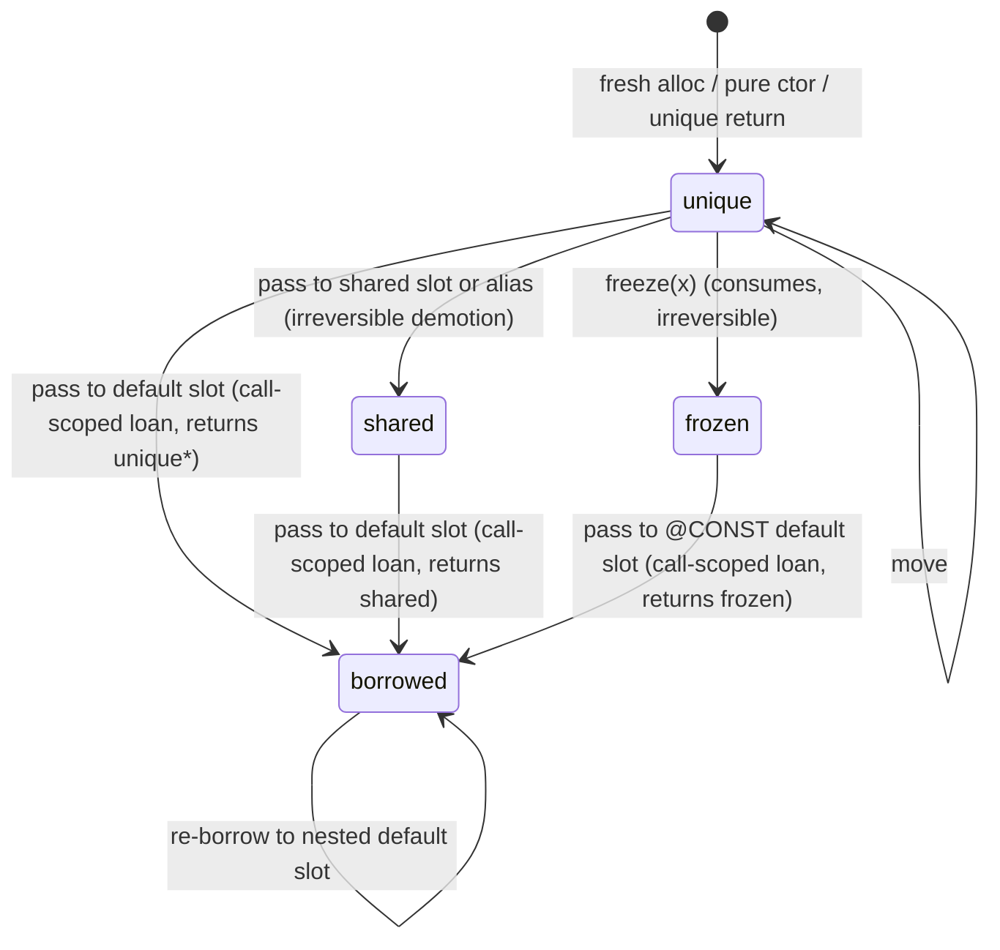

# BIP016: Consolidating Effect Annotations

| | |
|---|---|
| **BIP** | 016 |
| **Date** | 2026-11-19 |
| **Status** | Draft — Partially Decided (`BIP016-D1`–`D5` settled; Open Questions `BIP016-Q1`–`Q7`) |
| **Depends on** | Function effects and algebraic properties (`RM002` / `RM007`, [bip007_effects.md](bip007_effects.md)), core scalar & collection types (`RM005`, [bip011_core-types.md](bip011_core-types.md)), predicate-free LL(1)/LL(2) grammar (`RM006`, [bip012_grammar-improvements.md](bip012_grammar-improvements.md)), compiler optimization passes ([bip014_optimization-passes.md](bip014_optimization-passes.md)) |
| **Scope** | Surface ergonomics of Babble's effect and borrowing annotations: empirical audit of `examples/raytracer-argon/`, separating **internal orthogonal compiler traits** (`@UPPERCASE`) from **surface annotations defined as collections of traits** (`BIP016-D1`), consolidating `pure` = `{@HERMETIC, @CONST, @DETERMINISTIC}` and `hermetic` = `{@HERMETIC, @DETERMINISTIC}` with `@NOTHROW` & `@TERMINATING` inferred (`BIP016-D2`), using `volatile` for non-deterministic readers (`BIP016-D3`), making `@BORROWED` the unmarked default with no `borrow` keyword and `shared` for `!@BORROWED` (`BIP016-D4`), unifying `{unique, shared, @BORROWED}` + `frozen T` onto one ownership axis orthogonal to function effects (including `impure`) and `mut` (`BIP016-D5`), and aligning with `EffectSet`, `Babble.g4` (`SLL`), `org.babblelang.effects`, and `BIP014` |

---

## 1. Motivation: The "Attribute Soup" Revealed by Argon

In [bip007_effects.md](bip007_effects.md) §2, Babble explicitly identified D's **"attribute soup"** (`pure @safe nothrow @nogc const`) as a major usability pitfall and relied on two defenses:

1. **Whole-module fixed-point inference** for unannotated scripts and private helpers.
2. **Orthogonal, composable keywords** (`pure`, `hermetic`, `mut`, `borrow`, `deterministic`, `nothrow`, plus algebraic properties and `unique`/`frozen`) when authors write explicit contracts on exports, interfaces, or verified boundaries.

When we put `BIP007` through its first full-program stress test — annotating every function, method, interface signature, and callback across all 14 modules of [`examples/raytracer-argon/`](../../examples/raytracer-argon/) (~1,050 lines of 100% pure Babble, zero `axiom` escapes) — inference worked well internally, **but explicit contracts suffered from severe attribute soup**:

```babble
;; Today under BIP007 (examples/raytracer-argon/lib/vec3.ba & lib/materials.ba):
def dot = fn pure deterministic nothrow borrow (borrow v: Vec3): double -> (
    this.x * v.x + this.y * v.y + this.z * v.z
)

def scatter = fn hermetic deterministic nothrow borrow (borrow rIn: Ray, borrow rec: HitRecord, mut borrow rng: Rng): ScatterResult? -> (
    ...
)
```

On a trivial 3D dot product, the effect and aliasing qualifiers (`pure deterministic nothrow borrow`, `borrow`) outnumber the actual signature (`dot`, `v: Vec3`, `double`). Across the 105 `fn` declarations in Argon, explicit annotations required **439 effect/aliasing tokens** (**4.18 tokens per `fn`**):

* **362 function-level modifier tokens** (average **3.45** per `fn`), and
* **77 parameter/return modifier tokens** (`44` `borrow`, `16` `mut borrow`, `1` `mut`, `2` `unique` returns — including **124 `borrow` tokens** total across receivers and parameters!).

Two structural causes account for nearly all of this noise:

1. **1-to-1 coupling between internal compiler traits and surface keywords — with `pure` at the bottom instead of the top.** `BIP007` exposed almost every orthogonal internal bit as a separate opt-in keyword, and defined `pure` to mean *no writes only* (matching the Java Checker Framework's `@SideEffectFree`, not its `@Pure`). Consequently, `pure` alone was used **0 times** in Argon, while `pure deterministic [nothrow]` accounted for **73.3%** of all functions. Likewise, `hermetic` alone was used **0 times**, while `hermetic deterministic nothrow` accounted for **18.1%**.
2. **`borrow` has inverted polarity on annotated signatures.** In Argon, **88.9%** of non-`impure` instance methods do not escape `this` and **89.6%** of non-`impure` reference parameters do not escape. Yet because `BIP007-D2` locks explicitly annotated exports and interfaces strictly to their declared modifiers, writing `fn pure ...` drops inferred `borrow` on `this` and every parameter unless the author manually repeats `borrow` everywhere — even on deeply immutable `record` parameters (`Vec3`, `Ray`, `Interval`, `AABB`) and `mut` RNG parameters (`mut borrow rng: Rng`).

By cleanly decoupling **internal orthogonal compiler traits** (`@HERMETIC`, `@MUTABLE`, `@DETERMINISTIC`, `@NOTHROW`, `@BORROWED`, `@TERMINATING`, …) from **surface annotations defined as collections of traits** (`BIP016-D1`) — with **`pure` and `hermetic` implying `@DETERMINISTIC` while inferring `@NOTHROW`** (`BIP016-D2`), and **`@BORROWED` as the unmarked default** with **`shared`** for `!@BORROWED` (`BIP016-D4`) — the two functions above collapse to:

```babble
;; Proposed under BIP016:
def dot = fn pure (v: Vec3): double -> (
    this.x * v.x + this.y * v.y + this.z * v.z
)

def scatter = fn hermetic (rIn: Ray, rec: HitRecord, mut rng: Rng): ScatterResult? -> (
    ...
)
```

This proposal documents the complete Argon empirical data (§2), re-evaluates `BIP007` through the two-layer trait/annotation model and `@NOTHROW` optimizer audit (§3), surveys prior art across ten languages and academic effect systems (§4), compares four concrete consolidation designs (§5), details the consolidated synthesis and trait-desugaring table (§6), and records settled decisions `BIP016-D1`–`D4` alongside open questions `BIP016-Q1`–`Q7` (§7) backed by a detailed bibliography (§8).

---

## 2. Empirical Audit of `examples/raytracer-argon/`

Every `fn` expression and function type across all 14 files of [`examples/raytracer-argon/`](../../examples/raytracer-argon/) (`raytracer.ba` and `lib/*.ba`) was annotated with the strongest compiler-verified `BIP007` contract (zero `axiom` declarations, verified by `ExamplesTestCase`, `FormatterTestCase`, full dual-mode `mvn test`, and byte-for-byte `scene.ppm` rendering parity).

### 2.1 Function-Level Annotation Frequencies & Consolidation Table

The table below lists all **105 `fn` occurrences** in Argon, **sorted by decreasing frequency**, alongside their exact `BIP007` semantics and the proposed consolidated annotation under settled `BIP016-D1`–`D4` (with `BIP016-Q1`/`Q2` variants noted):

| Rank | Count (%) | Current `BIP007` Combination | Semantics & Argon Examples | Proposed New Annotation *(`BIP016-D1`–`D4`)* |
|---:|---:|---|---|---|
| **1** | **49** *(46.7%)* | `pure deterministic nothrow borrow` | Strictly side-effect-free, deterministic, exception-free instance method whose `this` does not escape (`Vec3.*`, `Ray.at`, `Interval.*`, `AABB.*`, `Describable.*`, `Material.kind`, `Hittable.boundingBox`/`kind`, `emptyHittable.*`, `Sphere.boundingBox`/`kind`/`describe`, `HittableList.boundingBox`/`countWhere`/`kind`, `BVHNode.boundingBox`/`kind`, `Color.linearToGamma`, `Scenes.threeSpheres`) | **`pure`** *(1 keyword; was 4 — `@NOTHROW` inferred, `@BORROWED` default)* |
| **2** | **25** *(23.8%)* | `pure deterministic nothrow` | **20** free/static functions & callbacks with no `this` (`lib/math.ba` ×13, `Interval.enclose`, `AABB.fromPoints`/`enclose`, `HitRecord.create`, `Dielectric.reflectance`, `countWhere` predicate type & lambda); **5** instance methods whose `this` (or sub-reference) escapes into the return value (`Hittable.hit`, `Sphere.hit`, `HittableList.hit`, `BVHNode.hit`, `HittableList.headNode`) | **`pure`** *(free/static, 20×)* · **`pure shared`** *(escaping `this`, 5×)* |
| **3** | **10** *(9.5%)* | `hermetic deterministic nothrow borrow` | No globals/I/O, deterministic, exception-free method whose `this` is read-only & non-escaping while mutating a `mut` parameter (`Material.scatter`, `Lambertian`/`Metal`/`Dielectric.scatter`, `Camera.sampleSquare`/`defocusDiskSample`/`getRay`/`rayColor`/`renderPixel`, `Scenes.finalScene`) | **`hermetic`** *(1 keyword; was 4 — `@NOTHROW` inferred, `@BORROWED` default)* |
| **4** | **5** *(4.8%)* | `hermetic deterministic nothrow` | Free/static functions (no `this`) with no globals/I/O, deterministic, exception-free, mutating a `mut` parameter (`Vec3.random`, `randomRange`, `randomUnitVector`, `randomOnHemisphere`, `randomInUnitDisk`) | **`hermetic`** *(1 keyword; was 3)* |
| **5** | **3** *(2.9%)* | `hermetic mut borrow deterministic nothrow` | No globals/I/O, deterministic, exception-free method mutating `this` without escaping `this` (`Rng.nextDouble`, `Rng.nextRange`, `HittableList.clear`) | **`hermetic mut`** *(2 keywords; was 5 — or 1-word shorthand per `BIP016-Q2`)* |
| **6** | **3** *(2.9%)* | `impure` | Unconstrained I/O or test harness entry points (`Camera.render`, `runTests`, `renderMain`) | **`impure`** *(unchanged)* |
| **7** | **2** *(1.9%)* | `pure nothrow` | Side-effect-free and exception-free, but reads an outer non-`record` object singleton (`emptyHittable`), so not `deterministic` (`HittableList.first`, `HittableList.second`, both escaping `this`) | **`pure volatile shared`** *(or `volatile shared`, per `BIP016-Q1`)* |
| **8** | **2** *(1.9%)* | `pure deterministic` | Side-effect-free and deterministic free function that may throw at runtime via narrowing `int(x)` (`math.toByte`, `math.toInt`) | **`pure`** *(1 keyword; was 2 — `pure` allows exceptions per `BIP016-D2`)* |
| **9** | **2** *(1.9%)* | `nothrow` | Exception-free but unconstrained on purity/determinism (`BVHNode.fromList` reading `emptyHittable` & mutating local partition lists; frame-local accumulator closure in `HittableList.countWhere`) | **`nothrow`** *(unchanged)* |
| **10** | **1** *(1.0%)* | `pure deterministic borrow` | Side-effect-free, deterministic, non-escaping `this` method that may throw via `math.toByte` (`Color.formatPpm`) | **`pure`** *(1 keyword; was 3 — `pure` allows exceptions per `BIP016-D2`)* |
| **11** | **1** *(1.0%)* | `hermetic mut deterministic nothrow` | No globals/I/O, deterministic, exception-free method mutating `this` where `this.head` escapes into a newly allocated `HittableNode` (`HittableList.add`) | **`hermetic mut shared`** *(3 keywords; was 4)* |
| **12** | **1** *(1.0%)* | `borrow` | Higher-order method polymorphic in callback `f`'s effects whose `this` does not escape (`HittableList.forEach`) | *(none — `@BORROWED` default; see `BIP016-Q3`)* |
| **13** | **1** *(1.0%)* | *(none)* | Unconstrained higher-order callback type `fn (item: Hittable): any?` inside `HittableList.forEach` | *(none — or `shared` if callback may hold/escape, see `BIP016-Q3`)* |
| **Total** | **105** *(100%)* | **362 function-prefix tokens** *(3.45 / fn)* | **0** uses of standalone `pure`; **0** uses of standalone `hermetic` | **~116 function-prefix tokens** *(1.10 / fn, −68%; **92/105 = 87.6%** single-keyword)* |

### 2.2 Parameter & Return Modifier Frequencies

Sorted by decreasing frequency across all parameter lists and return clauses in `examples/raytracer-argon/`:

| Scope | Count | Current `BIP007` Modifier | Breakdown in Argon | Proposed New Annotation *(`BIP016-D4`)* |
|---|---:|---|---|---|
| Parameter | **44** | `borrow` | **34** deeply immutable `record`s (`Vec3` ×12, `Ray` ×12, `Interval` ×8, `AABB` ×2), **4** `HitRecord`, **4** `Hittable`, **2** `fn` callbacks | *(omitted — `@BORROWED` is the default)* |
| Parameter | **16** | `mut borrow` | **16** `Rng` parameters (`Vec3.random*`, `Material.scatter`, `Camera.*`, `Scenes.finalScene`) | **`mut`** *(1 keyword; was 2)* |
| Parameter | **7** *(+1 in `impure`)* | *(none, ref param escaping)* | `p`, `outwardNormal`, `mat` in `HitRecord.create`; `item` in `HittableList.add`; `world` in `Camera.rayColor`/`renderPixel` (plus `Camera.render`); `mut items` in `BVHNode.fromList` | **`shared`** *(explicit `!@BORROWED` on the 7 escaping ref params)* |
| Parameter | **1** | `mut` | `mut items: HittableList` in `BVHNode.fromList` (stored into local partition lists) | **`mut shared`** |
| Return | **2** | `unique` | `Scenes.threeSpheres`, `Scenes.finalScene` (`: unique HittableList`) | **`unique`** *(unchanged)* |

Receiver `borrow` distribution across Argon's **72 non-`impure` instance methods**:

| Enclosing Construct | Non-escaping `this` (`borrow`) | Escaping `this` (no `borrow`) | Non-escaping share |
|---|---:|---:|---:|
| `record` (`Vec3`, `Ray`, `Interval`, `AABB`) | 26 | 0 | **100.0%** |
| `class` (`Rng`, `Lambertian`, `Metal`, `Dielectric`, `Sphere`, `HittableList`, `BVHNode`, `Camera`) | 25 | 7 | **78.1%** |
| `interface` (`Describable`, `Material`, `Hittable`) | 6 | 1 | **85.7%** |
| `object` (`emptyHittable`, `Color`, `Scenes`) | 7 | 0 | **100.0%** |
| **Total non-`impure` instance methods** | **64** | **8** | **88.9%** |

### 2.3 Four Empirical Takeaways

1. **91.4% of all functions are just two contracts:** `pure deterministic [nothrow]` (**77/105 = 73.3%**) and `hermetic deterministic nothrow` (**19/105 = 18.1%**, including 4 with `mut` `this`). Under `BIP007`, nearly all of those 96 functions required **3 to 5 keywords**.
2. **Standalone `pure` and standalone `hermetic` are dead weight in normal code:** Neither appeared even **once** (`0/105`) in Argon. The only real-world cases for *non-deterministic, side-effect-free* code are environment/clock/file reads (`Instant.now()`, `Files.readString`, reading a mutable outer singleton) — an uncommon boundary (~2% in Argon), not the default meaning programmers expect from the word `pure`.
3. **Non-escaping (`borrow`) is the ~89% norm for both `this` and parameters:** Requiring explicit `borrow` produced **124 `borrow` tokens** across 105 functions to protect against only **8** escaping receivers and **7** escaping reference parameters. Worse, `100%` of `record` methods (`26/26`) and `100%` of `mut` `Rng` parameters (`16/16`) had to repeat `borrow`.
4. **Algebraic properties (`associative`, `commutative`, `idempotent`, `monotone`, `injective`) are NOT the noise source:** They appeared **0 times** in Argon (they belong on math/reduction/collection library APIs and `axiom`s). Consolidating the core effect & borrowing axes fixes the everyday ergonomics problem without touching the algebraic vocabulary.

---

## 3. Reconsidering `BIP007`: Internal Orthogonal `@TRAITS` vs. Surface Annotations

### 3.1 The Minimal Orthogonal Basis (`BIP016-D1`)

`BIP007` §3 already introduced a clean notational convention: **lowercase** for surface modifiers written by programmers (`pure`, `mut`, `borrow`, …) and **`@UPPERCASE`** for internal compiler states and inferred-only guarantees (`@PARAM(i)`, `@THIS`, `@FROZEN`, `@MOVED`, `@EXTERNAL`, `@TERMINATING`, `@TOTAL`, `@AXIOMATIC`).

Auditing [`Effect.java`](../../src/main/java/org/babblelang/effects/Effect.java), [`EffectSet.java`](../../src/main/java/org/babblelang/analysis/EffectSet.java), [`Type.java`](../../src/main/java/org/babblelang/analysis/Type.java), and [`EffectChecker.java`](../../src/main/java/org/babblelang/analysis/EffectChecker.java) reveals that once derived concepts are factored out (notably `Effect.PURE` $\equiv$ `@HERMETIC` $\land$ `@CONST` on all slots), Babble's entire core effect and ownership system reduces to **4 function-level traits + 2 per-slot axes** (mutability and 3-state ownership), plus 5 optional algebraic traits and 2 control/metadata flags:

| Layer 1 Category | Internal Orthogonal Traits (`@UPPERCASE`) | Current Code Representation | Consumed By |
|---|---|---|---|
| **Function Effects (4)** | **`@HERMETIC`** *(no I/O or global/outer writes)*, **`@DETERMINISTIC`** *(depends only on visible inputs)*, **`@NOTHROW`** *(never throws on typed inputs)*, **`@TERMINATING`** *(finite execution; inferred-only)* | `Effect.HERMETIC`, `Effect.DETERMINISTIC`, `Effect.NOTHROW`, `EffectSet.terminating` | `EffectChecker` confinement, `BIP014` `O1`/`O4`/`O5`/`O6`/`O11`/`O12` |
| **Per-Slot Mutability Axis** | **`@CONST`** *(default, no keyword — read-only view through this slot, i.e., `!@MUTABLE`, distinct from deeply immutable `frozen T`)* vs. **`@MUTABLE`** *(`mut` — callee may mutate `this`/param `i`)* | `EffectSet.mutThis`, `Type.Parameter.mut` | Exclusivity, `pure` checking, `BIP007-D7` `frozen` calls, `BIP014` `O7` |
| **Per-Slot Ownership Axis** | **`@BORROWED`** *(default, no keyword — callee may manipulate the ref during the call, compiler guarantees it is no longer held when the callee terminates)* vs. **`@SHARED`** *(`shared` — ref may outlive the call)* vs. **`@UNIQUE`** *(`unique` — sole-owner graph transferred via `move` on param/return)* | `EffectSet.borrowThis`/`uniqueResult`, `Type.Parameter.borrow`/`unique` | Escape rejection, `RM005` covariance, `BIP007-D7` `frozen` calls, `BIP014` `O9`/`O10` |
| **Algebraic Traits (5)** | **`@IDEMPOTENT`**, **`@COMMUTATIVE`**, **`@ASSOCIATIVE`**, **`@MONOTONE`**, **`@INJECTIVE`** | `Effect.IDEMPOTENT`..`INJECTIVE` | `BIP014` `O2`/`O3`/`O12`, `AxiomChecker` |
| **Control / Provenance (2)** | **`@AXIOMATIC`** *(trusted `axiom` boundary)*, **`@IMPURE_LOCK`** *(locks function effects to `{}`)* | `EffectSet.axiomatic`, `EffectSet.impure` | `allowAxioms(false)`, `BIP007-D2` export rules |

*(Planned future function-level trait from `BIP007` §10: **`@THREADSAFE`**. Type-level **`frozen T`** / `Type.Frozen` and local flow states `@PARAM(i)`/`@THIS`/`@EXTERNAL`/`@MOVED` remain unchanged.)*

**Layer 2 — Surface Annotations as Trait Collections (`BIP016-D1`):** Surface keywords written by Babble programmers are **named collections (profiles) of Layer 1 traits** (desugared during `EffectChecker.parsePrefix` / `parseParamMods`):
* Adding a new internal compiler trait (like `@TERMINATING` in `RM007`, or future `@THREADSAFE`) does **not** pollute surface signatures.
* Evolving surface annotations requires **zero** change to the fixed-point inference engine, `TypeAlgebra` subtyping, `LoweringAnalyzer`, `BIP014` optimizer passes, or `babble-runtime` (`RuntimeBoundaryTestCase`).
* Diagnostics can name the exact violated `@TRAIT` while suggesting the concise surface annotation, and `EffectSet.toString()` / `:type` display can render the shortest canonical surface form covering the trait set.

### 3.2 Why `pure` Allows Exceptions (`@NOTHROW` & `@TERMINATING` Inferred — `BIP016-D2`)

A key reconsideration of `BIP007` is the role of **`@NOTHROW`** and **`@TERMINATING`** inside `pure`:

* **Why `@TERMINATING` stays inferred-only:** Because of the Halting Problem, `EffectChecker` conservatively drops `@TERMINATING` on any `while` loop or `recurse` call (`BIP007` §5.1). In Argon, that includes `math.sqrt`, `math.sin`, `math.cos`, `math.powInt`, `Vec3.length`, `Sphere.hit`, `HittableList.hit`, and `BVHNode.hit`. Requiring `@TERMINATING` in surface `pure` would make all of those textbook pure functions unverifiable without `axiom`. Keeping `@TERMINATING` inferred-only lets straight-line functions (`Vec3.dot`, `Interval.clamp`, `AABB.hit`) receive `@TERMINATING` automatically while loop/recursive pure functions stay `fn pure`.
* **Why `@NOTHROW` also stays inferred-by-default (opt-in `nothrow`):** Conceptually, an exception can be viewed as an alternate return channel (`T | Exception`). Auditing [`bip014_optimization-passes.md`](bip014_optimization-passes.md) shows:
  * **Does NOT need `@NOTHROW`:** CSE / GVN (`O5` — if the first `f(x)` threw, execution never reaches the second), constant folding on executed calls (`O1`), algebraic / `idempotent` collapse (`O2`), **guarded LICM** (`O6` — `if cond then (def tmp = f(inv); do-while ...)`), no-alias RLE (`O7`), inlining (`O8`), scalar replacement (`O9`), and FBIP reuse (`O10`).
  * **DOES need `@NOTHROW`:** Deleting an unused call (`O4` DCE / `f(x) * 0 -> 0`), unguarded speculative hoisting into a 0-iteration loop (`O6`), and reordering two calls/predicates (`O11` short-circuit reordering, `O12` filter push-down, `O3` reassociation).
  * Because `EffectChecker` already infers `@NOTHROW` automatically for every concrete Babble function (just like `@TERMINATING`), `BIP014` passes and `BIP007-D8` (`Unused pure expression`) retain **100% of their power** on concrete code **without** forcing `throws` or `nothrow` onto everyday signatures!
  * Defining **`pure` = `{@HERMETIC, @CONST, @DETERMINISTIC}`** (and **`hermetic` = `{@HERMETIC, @DETERMINISTIC}`**) aligns Babble directly with the Java Checker Framework (`@Pure` = `@SideEffectFree` + `@Deterministic`), Haskell `pure`, and Koka `pure` (`<div, exn>`), eliminates any `throws` keyword, keeps exception-freedom **100% monotonic** (`pure` $\to$ `pure nothrow`), and lets `math.toInt`, `math.toByte`, `Color.formatPpm`, and `Path.of` all be written cleanly as `fn pure`!

### 3.3 Remaining `BIP007` Surface Friction (`@BORROWED` & Precision Cleanups)

* **Contract-closure friction on `@BORROWED` (`borrow`, `BIP007-D2`):** For unannotated functions, `EffectChecker` optimistically infers `@BORROWED` on `this` and all parameters. Once an author writes *any* explicit effect annotation on an exported function or interface method, `BIP007-D2` exposes strictly the declared traits — silently dropping `@BORROWED` unless `borrow` is repeated on `this` and every single parameter (breaking `frozen T` method calls per `BIP007-D7` and `BIP014` `O9` scalar replacement). Yet `@BORROWED` holds on **88.9%** of receivers and **89.6%** of reference parameters in Argon! **`BIP016-D4`** fixes this by inverting the polarity: `@BORROWED` (the callee may manipulate the reference during the call, but guarantees it is no longer held when the callee terminates) becomes the unmarked default with no user-facing `borrow` keyword, and `!@BORROWED` is denominated explicitly with **`shared`**.
* **Precision cleanups surfaced by Argon (`BIP016-Q7`):**
  1. In `HittableList.first`/`second`, reading the stateless `object implements Hittable` singleton `emptyHittable` cleared `@DETERMINISTIC` because `EffectChecker` treats any non-`record` `object` singleton as potentially mutable outer state even when it defines zero fields.
  2. In `BVHNode.fromList(items: HittableList)`, storing `cur.item` (derived from `items`) into a fresh local `leftList` demoted `leftList` with `@PARAM(items)` taint, forcing `@MUTABLE` (`mut items`) even though `items` itself is never mutated.

---

## 4. Cross-Language Comparative Analysis

Other languages and static-analysis tools have all confronted the exact tension between **fine-grained compiler facts** and **livable surface annotations**. Their solutions fall into four distinct patterns:

| Language / System | Surface Vocabulary | How Common Combinations Are Shortened | Key Lesson for Babble |
|---|---|---|---|
| **D** (`[D-Func]`, `[D-Style]`) | `pure`, `nothrow`, `@safe`, `@nogc`, `const`, `scope` | Additive opt-in keywords; D's own style guide mandates writing `const @nogc nothrow pure @safe` on non-templated functions. Template inference mitigates it internally, not on virtual/interface/API signatures. | **Cautionary tale:** 1-to-1 additive attributes inevitably create attribute soup at API and interface boundaries — exactly what happened in Argon. |
| **Java Checker Framework** (`[CF-Pure]`, `[CF-SEF]`, `[CF-Man]`) | `@Pure`, `@SideEffectFree`, `@Deterministic` | **`@Pure` is explicitly defined as `@SideEffectFree` + `@Deterministic`**, reserving the weaker name `@SideEffectFree` for non-deterministic readers (`System.nanoTime()`). | **Naming lesson:** `pure` must sit at the **top** of the purity ladder; the weaker "no writes, may read mutable/external state" property deserves its own distinct name (`readonly` / `stable` / `volatile`). |
| **PostgreSQL** (`[PG-Vol]`) | `IMMUTABLE`, `STABLE`, `VOLATILE` | Single-word 3-tier stratified hierarchy (`VOLATILE` default; `STABLE` = no writes, snapshot-consistent; `IMMUTABLE` = no writes, forever deterministic). | **Stratification lesson:** A tiny 2–3-level ladder covers 95%+ of functions with **one** word instead of intersecting independent boolean flags. |
| **GCC / Clang & C23** (`[GCC-Attr]`, `[C23-N2956]`) | GCC `const`/`pure`; C23 `[[unsequenced]]` / `[[reproducible]]` | Two coarse profiles instead of fine-grained flags: `[[reproducible]]` = effectless + idempotent (depends on memory); `[[unsequenced]]` = `reproducible` + stateless + independent (strongest). WG14 explicitly rejected adding fine-grained individual flags. | **Bundling lesson:** Standard C23 bundles orthogonal properties (`effectless`, `idempotent`, `stateless`, `independent`) into **two** surface profiles (`[[unsequenced]]`, `[[reproducible]]`) while the compiler reasons over the underlying properties. |
| **Koka** (`[Koka-Book]`, `[Lei14]`) | `total`, `pure` (`<div, exn>`), `exn`, `div`, `ndet`, `io`, plus `alias` | **Named effect aliases** over an underlying row algebra (`total` = empty row `<>`; `pure` = `<div, exn>`; `io` = `<exn, div, ndet, alloc, read, write, console, ...>`). Also omits `total` by default when no effects are written. | **Profile & alias lesson:** Named bundles over a fine-grained internal lattice give both concise 1-word signatures and full internal precision. *(Note: Koka's `total` corresponds to Babble's `pure deterministic nothrow @TERMINATING`, whereas Koka's `pure` allows `exn` and `div`.)* |
| **Flix** (`[Flix-Doc]`, `[MP20]`) | `Pure` (default), `IO`, effect sets `{Eff1, Eff2}` | Functions are **pure by default** (`a -> b`); only impure effects are annotated (`a -> b \ IO`). Boolean unification handles higher-order effect polymorphism automatically. | **Polarity lesson:** Annotating the *rare deviation* instead of the *common guarantee* cuts annotation volume dramatically — though Babble must preserve backward compatibility for unannotated scripts (`BIP007` §1.3). |
| **Nim** (`[Nim-Eff]`) | `func`, `{.noSideEffect.}`, `{.raises: [].}`, `{.tags: [...].}` | Introduces a dedicated keyword **`func`** as shorthand for `proc ... {.noSideEffect.}` because writing `{.noSideEffect.}` on every pure routine was too noisy. | **Shorthand lesson:** Even a single noisy pragma justified a 1-word shorthand; a 4-word chain (`pure deterministic nothrow borrow`) justifies consolidation even more strongly. |
| **Swift** (`[SE-0377]`, `[Swift-Mut]`) | `throws` (opt-in), `mutating` (opt-in), `borrowing` (default in Swift 6) / `consuming` | Non-throwing is the default (`throws` opts out); non-mutating is the default (`mutating` opts in); **borrowing is the default** for parameters and `self` (SE-0377 / Swift 6), with `consuming` opting out. | **Escape & exception polarity lesson:** Swift systematically chooses the **safe, common case as the unmarked default** (`nothrow`, non-`mut`, `borrowing`) and marks the exception (`throws`, `mutating`, `consuming`). |
| **Rust** (`[Rust-Ref]`, `[Kla20]`) | `const fn`, `&self` / `&mut self`, `&T` / `T` | Immutable by default; borrowing (`&T`) is a 1-character sigil rather than a 6-character keyword; no exceptions (`Result` in return type). | **Ergonomics lesson:** Frequent qualifiers must be either implicit defaults or 1-word/short tokens; multi-word phrases fail ergonomic adoption. |
| **Ada / SPARK** (`[SPARK-Sub]`) & **Scala 3 Capture Checking** (`[BGO23]`, `[ROH12]`) | SPARK `Global => null`, `Side_Effects`; Scala `A -> B` (pure) vs `A => B` (impure), `T^` (capturing/escaping) | Rytz–Odersky–Haller (`[ROH12]`) note that **verbosity is the primary barrier to industrial adoption of effect systems**. Scala 3 Capture Checking defaults function parameters to scoped/non-escaping (`borrow`) and marks escaping/capturing references with `^`. | **Adoption lesson:** Verbosity kills effect-system adoption; non-escaping-by-default with explicit escape marking is the modern state of the art for capability/borrow checking. |

---

## 5. Design Space: Four Consolidation Options

All four options below **keep `BIP007`'s internal `EffectSet` bitmask (`PURE`, `HERMETIC`, `DETERMINISTIC`, `NOTHROW`, algebraic flags, `mutThis`/`borrowThis`, `uniqueResult`, `@TERMINATING`) 100% intact** — they differ strictly in the surface vocabulary and defaults that desugar into `EffectSet`.

### Option 1 — Consolidated `pure` / `hermetic` (`@HERMETIC` + `@DETERMINISTIC`) + `volatile` + Opt-In `nothrow` + Default-`@BORROWED` (`shared`) *(Selected Direction via `BIP016-D1`–`D4`)*

Redefine `pure` and `hermetic` as **consolidated trait collections** over Layer 1's 7 orthogonal `@TRAITS`, treat `@NOTHROW` and `@TERMINATING` as inferred-by-default (with explicit `nothrow` strictly opt-in — zero `throws` keyword!), use `volatile` for non-deterministic readers, and make `@BORROWED` the unmarked default (retiring the `borrow` keyword) with **`shared`** denoting `!@BORROWED`:

* **Consolidated core tiers (`BIP016-D2`):**
  * **`pure`** $\equiv$ `{@HERMETIC, @CONST, @DETERMINISTIC}` (with `@BORROWED` by default unless `shared`). Strictly forbidden with `mut`. Allows exceptions (`T | Exception`) and loops/recursion.
  * **`hermetic`** $\equiv$ `{@HERMETIC, @DETERMINISTIC}` (with `@BORROWED` by default unless `shared`). Compatible with `mut` on `this` (`fn hermetic mut`) and `mut` parameters (`mut rng: Rng`).
  * **`nothrow`** $\equiv$ `{@NOTHROW}` — purely additive and opt-in for APIs/interfaces wanting a contractual no-exception guarantee (while `EffectChecker` still infers `@NOTHROW` automatically for `BIP014` and `Unused pure expression`).
* **Non-deterministic readers (`BIP016-D3` / `BIP016-Q1`):**
  * **`volatile`** marks side-effect-free non-deterministic readers (`Instant.now()`, `Files.readString`, reading a mutable outer singleton) — either combined subtractively (`pure volatile`, `hermetic volatile`) or standalone (`fn volatile`), to be settled in `BIP016-Q1`.
* **Escape qualifier (`BIP016-D4`):**
  * **`@BORROWED` has no user-facing keyword** (the `borrow` keyword is retired): the callee may manipulate the reference during the call, but guarantees it is no longer held when the callee terminates.
  * **`shared`** (on `fn` prefix for `this`, or on a parameter `shared p: T`) specifies `!@BORROWED` on that slot (`fn pure shared (r: Ray, rayT: Interval): HitRecord?`; `fn hermetic mut shared (shared item: Hittable)`).
* **Unannotated functions remain 100% backward compatible:** An unannotated `fn (x: int): int -> (...)` still runs full fixed-point `@TRAITS` inference (`BIP007` §3.1; exact boundary rules for unannotated signatures and `unique` are tracked in `BIP016-Q3`).

* **Pros:**
  * Cuts Argon's total effect/aliasing tokens from **439 → ~143 (−67%)** and collapses **87.6%** of all `fn`s (**92/105**) to a **single keyword**!
  * Aligns `pure` with Java Checker Framework `@Pure` (`@SideEffectFree` + `@Deterministic`), Haskell `pure`, and Koka `pure` (`<div, exn>`).
  * **Zero `throws` keyword** — `math.toInt`, `math.toByte`, `Color.formatPpm`, and `Path.of` are all simply `fn pure`, and exception-freedom stays 100% monotonic (`pure` $\to$ `pure nothrow`).
  * Preserves 100% expressiveness of `BIP007`'s internal lattice and `Babble.g4`'s zero-predicate LL(1)/LL(2) pure-`SLL` grammar (`VOLATILE` + `SHARED`, replacing `BORROW`, exempted in `memberName`).
* **Cons:**
  * **Breaking change** to `BIP007`'s surface meaning of `pure`/`hermetic` and retiring `borrow` in favor of `shared` (existing tests/scripts migrate in one clean pass while Babble is pre-1.0, as in `RM006` / `BIP012`).

---

### Option 2 — Strictly Monotonic Stratified Hierarchy (Including `@NOTHROW` in `pure`)

Bundle `@NOTHROW` into `pure` and avoid subtractive modifiers entirely by naming every tier monotonically (`pure` = `{@HERMETIC, @CONST, @DETERMINISTIC, @NOTHROW}`, `calc` = `{@HERMETIC, @CONST, @DETERMINISTIC}`, `readonly` = `{@HERMETIC, @CONST}`, `hermetic` = `{@HERMETIC, @DETERMINISTIC, @NOTHROW}`, `local` = `{@HERMETIC}`).

* **Pros:** 100% monotonic; makes every `fn pure` interface automatically `@NOTHROW`.
* **Cons:** Forces programmers to memorize extra tier names (`calc`, `local`) for throwing pure functions like `math.toInt` / `Path.of`, even though `BIP014` already infers `@NOTHROW` automatically for concrete functions (superseded by **`BIP016-D2`**).

---

### Option 3 — Predefined Effect Profiles & User-Defined Effect Aliases

Keep `BIP007`'s atomic keywords (`pure`, `hermetic`, `deterministic`, `nothrow`, `borrow`, `mut`) unchanged, and add **named profiles** — either built-in shorthands (e.g., `total` = `pure deterministic nothrow`, `stateful` = `hermetic deterministic nothrow`) and/or user-defined aliases (like Koka's effect aliases):

```babble
;; Built-in or user-defined profile aliases:
export effect total = pure deterministic nothrow borrow
export effect local = hermetic deterministic nothrow borrow

def dot = fn total (borrow v: Vec3): double -> ( ... )
```

* **Pros:**
  * **Zero breaking changes** to `BIP007` (`pure` keeps its exact `RM002` meaning).
  * User-defined aliases let domain libraries name recurring algebraic bundles (e.g., `effect monoid = pure nothrow associative`).
* **Cons:**
  * **Leaves the best keyword (`pure`) wasted on the 0%-used meaning!** Every newcomer will still write `fn pure` expecting deterministic purity. *(Superseded for built-ins by `BIP016-D2`; whether to also support user-defined aliases on top remains open in **`BIP016-Q5`**.)*
  * **Does not fix parameter `borrow` noise** unless parameter-borrow polarity also changes.
  * **Dialect fragmentation & indirection:** User-defined `effect` aliases require readers to jump to alias definitions and add a new declaration/namespace kind across `Babble.g4`, `BlockScopes`, `TypedModuleSummary`, and `AnalysisSession`.

---

### Option 4 — Keep `BIP007` Keywords, Relax `BIP007-D2` (Partial Inference on Annotated Signatures)

Keep `BIP007`'s exact syntax, but change `BIP007-D2` so that writing `fn pure` on an exported function **still exports inferred `deterministic`, `nothrow`, and `borrow`** (only `impure` suppresses inference).

* **Pros:** Zero syntax changes; bodies could write `fn pure` and still get inferred properties.
* **Cons:** **Fails completely on `interface` declarations, function types, and `axiom` declarations** (none have Babble bodies to infer from!), and violates `BIP007-D2`'s API stability guarantee (callers silently depend on uncontracted properties).

---

### 5.5 Comparative Summary Matrix

| Criterion | Current `BIP007` | Option 1 *(`BIP016-D1`–`D4`)* | Option 2 *(Monotonic Tiers w/ `@NOTHROW`)* | Option 3 *(Profiles / Aliases)* | Option 4 *(Relax `BIP007-D2`)* |
|---|---|---|---|---|---|
| **Argon total tokens** *(fn + param)* | 439 *(4.18 / fn)* | **~143** *(−67%)* | ~150 *(−66%)* | ~240 *(−45%, param `borrow` remains)* | ~210 *(interfaces unchanged)* |
| **Argon 1-keyword `fn`s** | 8 / 105 *(7.6%)* | **92 / 105** *(87.6%)* | 89 / 105 *(84.8%)* | 84 / 105 *(80.0%)* | 74 / 105 *(bodies only)* |
| **Works on `interface` & `axiom`?** | Verbose | **Yes (1 keyword)** | Yes (1 keyword) | Partially | **No** |
| **Matches intuitive meaning of `pure`?** | No *(0% standalone)* | **Yes** *(Checker Framework / Haskell / Koka)* | Yes | No *(needs new word)* | No |
| **Needs `throws` keyword?** | No | **No** *(opt-in `nothrow`)* | No *(needs `calc`)* | No | No |
| **Fixes `borrow` explosion (124 tokens)?** | No | **Yes** *(`@BORROWED` default + `shared`, `D4`)* | Needs `D4` | No | Only on bodies |
| **Grammar (`Babble.g4` pure `SLL`)** | 0 predicates | **0 predicates** | 0 predicates | New `effect` decl | 0 predicates |

---

## 6. Consolidated Semantics (`BIP016-D1`–`D5`)

### 6.1 Surface Annotations as Collections of Layer 1 `@TRAITS`

Every surface annotation expands deterministically into Layer 1 orthogonal `@TRAITS` stored in `EffectSet` and `Type.Parameter`:

| Surface Annotation | Internal `@TRAITS` Collection | Per-Slot `@BORROWED` Default *(`BIP016-D4`/`D5`)* | Typical Use Case |
|---|---|---|---|
| `fn pure (...)` | `{@HERMETIC, @CONST, @DETERMINISTIC}` | `@BORROWED_THIS`, `@BORROWED(*)` *(unless `shared`)* | Mathematical functions, `record` methods, pure queries, throwing pure conversions (`math.sqrt`, `Vec3.dot`, `math.toInt`, `Path.of` — **73.3%** of Argon) |
| `fn pure nothrow (...)` | `{@HERMETIC, @CONST, @DETERMINISTIC, @NOTHROW}` | `@BORROWED_THIS`, `@BORROWED(*)` *(unless `shared`)* | Strict no-exception API/interface contracts (e.g., guard-safe filter combinators; concrete `fn pure` bodies infer `@NOTHROW` automatically!) |
| `fn pure volatile (...)` *(or `fn volatile`, `BIP016-Q1`)* | `{@HERMETIC, @CONST}` | `@BORROWED_THIS`, `@BORROWED(*)` *(unless `shared`)* | Side-effect-free, non-deterministic readers (`Instant.now()`, `Files.readString`, `HittableList.first`) |
| `fn hermetic (...)` | `{@HERMETIC, @DETERMINISTIC}` | `@BORROWED_THIS`, `@BORROWED(*)` *(unless `shared`)* | No globals/I/O, mutates `@MUTABLE` (`mut`) parameter(s) (`Material.scatter`, `Camera.rayColor`, `Vec3.random*`) |
| `fn hermetic mut (...)` | `{@HERMETIC, @MUT_THIS, @DETERMINISTIC}` | `@BORROWED_THIS`, `@BORROWED(*)` *(unless `shared`)* | No globals/I/O, mutates `this` (`Rng.nextDouble`, `HittableList.clear`, `list.add`) |
| `fn hermetic [mut] nothrow (...)` | `{@HERMETIC, @DETERMINISTIC, @NOTHROW}` *(+ `@MUT_THIS`)* | `@BORROWED_THIS`, `@BORROWED(*)` *(unless `shared`)* | Strict no-exception locally-mutating API/interface contracts |
| `fn nothrow (...)` | `{@NOTHROW}` | `@BORROWED_THIS`, `@BORROWED(*)` *(unless `shared`)* | Exception-free but unconstrained on global/mutable state (`BVHNode.fromList`, frame-local closures) |
| `fn impure (...)` | `{@IMPURE_LOCK}` *(locks function effects to `{}`)* | `@BORROWED_THIS`, `@BORROWED(*)` *(unless `shared`, `BIP016-D5`)* | Explicit effect opt-out (`println`, `Camera.render`, `URL.equals`); ownership & `mut` remain orthogonal |
| `fn (...)` *(unannotated)* | Full `BIP007` fixed-point `@TRAITS` inference | Inferred on bodies; type-position default per `BIP016-Q3` | Ordinary Babble scripts and private helpers (zero migration cost!) |

Per-slot modifiers (`mut`, `shared`, `unique`) simply set the slot's mutability (`@MUTABLE`) or ownership (`unique` vs. `shared` vs. default `@BORROWED`). **`@BORROWED` has no user-facing keyword** (`borrow` is retired per `BIP016-D4`). **`@CONST` (`pure`) and `@MUTABLE` (`mut`) remain mutually exclusive**, preserving `BIP007`'s zero weak-purity guarantee, while **`@NOTHROW`** and **`@TERMINATING`** are inferred automatically on every concrete body for `BIP014`.

**Algebraic properties** (`idempotent`, `commutative`, `associative`, `monotone`, `injective`) and **ownership modifiers** (`unique`, `frozen`, `move`, `freeze`, `discard`) compose identically as in `BIP007` — with far less boilerplate:

```babble
;; Before (BIP007):
axiom pure deterministic nothrow on java.lang.Math.sqrt
axiom pure deterministic on java.nio.file.Path.of
axiom pure on java.nio.file.Files.readString
axiom hermetic mut deterministic idempotent commutative on java.util.HashSet.add
def addComm = fn pure deterministic nothrow commutative associative (a: int, b: int): int -> (a + b)

;; After (BIP016 — showing `pure volatile` form; `volatile` standalone if BIP016-Q1 picks it):
axiom pure nothrow on java.lang.Math.sqrt
axiom pure on java.nio.file.Path.of
axiom pure volatile on java.nio.file.Files.readString
axiom hermetic mut idempotent commutative on java.util.HashSet.add
def addComm = fn pure commutative associative (a: int, b: int): int -> (a + b)
```

### 6.2 Escape Polarity (`BIP016-D4`) & Unified Ownership Axis (`BIP016-D5`)

Under `BIP016-D4`, `@BORROWED` is the unmarked default (with no user-facing `borrow` keyword): the callee may manipulate the reference during the call, **and the compiler statically guarantees that the reference is no longer held when the callee terminates**. Allowing a `@BORROWED` reference (or any mutable sub-reference reachable from it) to escape — storing it in a field, collection, or outer/global variable, capturing it in an escaping closure, returning it, or passing it to a `shared` or `unique` parameter — is a **compile-time error** enforced by `EffectChecker`. Authors write **`shared`** (`!@BORROWED`) only on the ~10% of slots whose reference may legitimately outlive the call:

* **On a method:** `def hit = fn pure shared (r: Ray, rayT: Interval): HitRecord? -> (...)` signals that `hit` may share/return references reachable from `this` (`this.mat` inside `HitRecord`), while `r` and `rayT` remain `@BORROWED` (enabling `BIP014` `O9` scalar replacement of temporary `Ray` and `Interval` values).
* **On a parameter:** `def add = fn hermetic mut shared (shared item: Hittable) -> (...)` documents that `this.head` may outlive the call inside a new node and `item` is stored inside `this`.
* **On `mut` parameters:** `mut rng: Rng` defaults to `@MUTABLE + @BORROWED` (matching 16/16 occurrences in Argon), whereas `mut shared items: HittableList` marks a mutated parameter whose contents may also remain held after the call.
* **On `impure` functions (`BIP016-D5`):** `impure` lives strictly on the **function-effect axis** (locking out `@HERMETIC`/`@DETERMINISTIC`/`@NOTHROW`/`@TERMINATING` inference and overriding built-in/axiom defaults). Slot ownership (`@BORROWED` default, `shared`, `unique`) and mutability (`mut`) remain orthogonal, so `fn impure (x: any?)` (like `println`) accepts `unique` locals and `frozen T` cleanly while `fn impure (shared x: T)` explicitly marks escaping parameters.
* **On unannotated functions (`BIP016-Q3`):** Concrete unannotated `fn (x: T): R -> (...)` still runs full `EffectChecker` inference (so `def id = fn (x: T): T -> (x)` needs no `shared`), whereas the default on unannotated function/interface types (`f: fn (item: Hittable)`) is finalized in `BIP016-Q3`.

#### Unified Ownership Axis (`unique` / `shared` / `borrowed`, plus `frozen` — `BIP016-D5`)

Because `unique` and `shared` are conceptual antonyms (writing `unique shared` for a consuming move would read like a contradiction), **`unique`, `shared`, and `@BORROWED` (default) unify onto a single mutually exclusive ownership axis**, orthogonal to both the function-effect axis (including `impure`) and `mut`, with **`frozen T`** as the immutable terminal state reached via `freeze(x)`:

* **Move semantics on `unique`:** Assigning a `unique` reference to a new binding, storing it into a `unique` container, passing it to a `unique` parameter, or returning it as `: unique T` **moves ownership to the destination and invalidates the source reference** (zero-cost identity at runtime; written explicitly with `move(x)` or inferred on a provable last use per `BIP007-D5`). **The compiler statically guarantees that the source reference is never used after the move** — any subsequent read or write of an invalidated (`@MOVED`) binding is a **compile-time error** enforced by `EffectChecker`'s definite-unassignment analysis.



*\*On `unique --> borrowed`: a `@CONST` borrow always returns `unique` to the caller intact; a `mut` borrow also stays `unique` when no `shared` value can be stored into it (e.g., `hermetic mut` with deeply immutable or `unique` arguments), and demotes to `shared` if a `shared` reference may be written into the graph.*

Complete ownership transition & compile-error matrix:

| Caller Has \ Target Slot | `unique` *(consuming)* | `shared` *(may escape)* | `@BORROWED` *(default, no escape)* | `frozen T` *(via `freeze`)* |
|---|---|---|---|---|
| **`unique`** *(sole owner)* | **Allowed (`move`)** — transfers ownership to destination and invalidates source (any later use is a compile error) | **Allowed** — one-way irreversible demotion to `shared` | **Allowed** — call-scoped loan; caller retains `unique` *(unless mutated with `shared` input)* | **Allowed** — `freeze(x)` consumes `x` (invalidating source) into deeply immutable `frozen T` |
| **`shared`** *(multi-owner)* | **Compile error** — other aliases may exist | **Allowed** — freely aliased, stored, or returned | **Allowed (call-scoped loan only)** — callee cannot hold ref past termination; caller's binding stays `shared` | **Compile error** — cannot freeze a shared mutable graph |
| **`@BORROWED`** *(frame-local loan)* | **Compile error** — callee does not own it | **Compile error** — `@BORROWED` reference MUST NOT escape | **Allowed** — re-borrow to nested `@BORROWED` callee | **Compile error** — callee does not own it |
| **`frozen T`** *(deeply immutable)* | **Compile error** — immutable forever | **Allowed only as `shared frozen T`** *(compile error to pass as unfrozen `shared T`, which would leak a mutable-typed ref!)* | **Allowed (`@CONST @BORROWED T`)** — callee cannot mutate or escape `this`/param, so `frozen T` safely lends as `@CONST @BORROWED T` (`BIP007-D7`) | **Allowed** — already `frozen T` |

**Orthogonality with mutability (`@CONST` default vs. `@MUTABLE` / `mut`):**
* **`@BORROWED` & `@SHARED`:** `@CONST` vs. `mut` (`@MUTABLE`) is **100% orthogonal** (`x: T` vs. `mut x: T`, `shared x: T` vs. `mut shared x: T`), because the caller (or other aliases) still hold the reference and can observe mutations (forbidding `pure`).
* **`@UNIQUE` (consuming `move`):** Because `move(x)` invalidates the caller's binding, the callee is the sole owner and may mutate the graph privately *even inside `pure`* (`EffectChecker.Origin.ofUniqueParam` leaves parameter-mutation bits empty when consuming), making `mut` redundant as a caller contract on consuming `unique` parameters.
* **`frozen T`:** `mut` is **forbidden** (compile error — deeply immutable forever), while every `@CONST @BORROWED T` method/function automatically accepts `frozen T` with zero extra annotations under `BIP016-D4`!

**Why `shared --> borrowed` and `frozen --> borrowed` are call-scoped loans (and must be allowed):** Neither `shared` nor `frozen T` permanently changes ownership state — the caller's binding stays `shared` or `frozen T`. However, lending either to a `@BORROWED` slot (`this.world.boundingBox()`, `item.boundingBox()`, or passing a `frozen list of int` to `fn pure (xs: list of int): int`) is 100% sound because `@BORROWED` constrains the *callee* (cannot retain the reference past termination — and for `frozen T`, `@CONST` ensures it cannot be mutated). This yields a clean capability order:

* **Value / argument capability order:** **`@UNIQUE`** $<:$ **`@SHARED`** $<:$ **`@BORROWED`** (and **`frozen T`** $<:$ **`@CONST @BORROWED T`**)
* **Function parameter subtyping (contravariant):** **`fn (x: T)`** $<:$ **`fn (shared x: T)`** $<:$ **`fn (unique x: T)`** *(matching `BIP007` §3.4: a callee promising not to keep `x` satisfies one that may keep `x`, which satisfies one demanding ownership of `x`)*.
* **Impact on `BIP007-P2`:** Making `{unique, shared, @BORROWED}` strictly mutually exclusive eliminates `unique shared` completely and collapses Layer 1's 3 per-slot booleans into **2 per-slot axes** (mutability + 3-state ownership), retiring explicit `unique borrow` (`@UNIQUE + @BORROWED`, 0 uses in Argon; single-target read-only and `hermetic mut` calls already preserve `unique` across `@BORROWED`).

### 6.3 Side-by-Side Impact on Argon (`examples/raytracer-argon/`)

```babble
;; lib/interfaces.ba — BEFORE (BIP007):
export def Describable = interface (
    def kind: fn pure deterministic nothrow borrow (): string
    def describe = fn pure deterministic nothrow borrow (): string -> (
        "<" + this.kind() + ">"
    )
)
export def Material = interface extends Describable (
    def scatter: fn hermetic deterministic nothrow borrow (borrow rIn: Ray, borrow rec: HitRecord, mut borrow rng: Rng): ScatterResult?
    def kind = fn pure deterministic nothrow borrow (): string -> ("material")
)
export def Hittable = interface extends Describable (
    def hit: fn pure deterministic nothrow (borrow r: Ray, borrow rayT: Interval): HitRecord?
    def boundingBox = fn pure deterministic nothrow borrow (): AABB -> (AABB.empty)
    def kind = fn pure deterministic nothrow borrow (): string -> ("hittable")
)

;; lib/interfaces.ba — AFTER (BIP016-D1–D4):
export def Describable = interface (
    def kind: fn pure (): string
    def describe = fn pure (): string -> (
        "<" + this.kind() + ">"
    )
)
export def Material = interface extends Describable (
    def scatter: fn hermetic (rIn: Ray, rec: HitRecord, mut rng: Rng): ScatterResult?
    def kind = fn pure (): string -> ("material")
)
export def Hittable = interface extends Describable (
    def hit: fn pure shared (r: Ray, rayT: Interval): HitRecord?
    def boundingBox = fn pure (): AABB -> (AABB.empty)
    def kind = fn pure (): string -> ("hittable")
)
```

Across the entire Argon codebase (under `BIP016-D1`–`D4`):
* **Function-level tokens:** `362` → `~116` (**−68%**)
* **Parameter/return modifier tokens:** `79` → `~27` (**−66%**, `60 borrow` → `7 shared` + `17 mut` + `2 unique`)
* **Total effect/ownership tokens:** `439` → `~143` (**−67%**)
* **Single-keyword functions:** `8/105` (7.6%) → **`92/105` (87.6%)**

### 6.4 Zero Backend, Optimizer, or Runtime Boundary Churn

Because consolidation is strictly a **Layer 2 front-end mapping** into Layer 1's existing `EffectSet` and `Type.Parameter`:

* **`org.babblelang.runtime` (`babble-runtime.jar`):** 0 lines changed (`RuntimeBoundaryTestCase` untouched).
* **`Interpreter` & `CodeGenerator`:** 0 lines changed.
* **`EffectChecker` fixed-point engine & `BIP014` optimizer passes:** 0 semantic changes (`EffectSet` still exposes the full Layer 1 orthogonal `@TRAITS`).
* **Grammar (`Babble.g4`):** Stays 100% predicate-free LL(1)/LL(2) pure-`SLL` (`ParserGrammarTestCase`): add `VOLATILE` and `SHARED` (retiring `BORROW`), exempted in `memberName` so `.volatile` / `.shared` remain valid member names.
* **Companion `EffectChecker` precision cleanups surfaced by Argon (`BIP016-Q7`):**
  1. Treat stateless `object` singletons (zero mutable fields, like `emptyHittable`) as deeply immutable for `@DETERMINISTIC` checks — upgrading `HittableList.first`/`second` to `pure shared`!
  2. Avoid tainting a fresh local container (`leftList` in `BVHNode.fromList`) as mutating `@PARAM(items)` when it only *stores* non-mutated elements read from `items` — allowing `BVHNode.fromList` to drop `mut` on `items` and become `fn pure shared (shared items: HittableList): Hittable`!

---

## 7. Settled Decisions & Open Questions

### 7.1 Settled Decisions (`BIP016-D1`–`D5`)

* **`BIP016-D1` — Two-layer architecture (Internal Orthogonal `@TRAITS` vs. Surface Annotation Collections):** Complete `BIP007`'s `@UPPERCASE` vs. lowercase separation by modeling Babble's atomic compiler facts (4 function-level traits `@HERMETIC`, `@DETERMINISTIC`, `@NOTHROW`, `@TERMINATING`; 2 per-slot axes: mutability `@CONST` [default] / `@MUTABLE` and 3-state ownership `@BORROWED` [default] / `@SHARED` / `@UNIQUE`; plus 5 algebraic traits and 2 metadata flags) as Layer 1 internal traits (`EffectSet` / `Type.Parameter`), and defining Layer 2 surface annotations declaratively as collections (profiles) of traits.
* **`BIP016-D2` — Consolidated `pure` and `hermetic` allowing exceptions (`@NOTHROW` & `@TERMINATING` inferred):**
  * **`pure`** $\equiv$ `{@HERMETIC, @CONST, @DETERMINISTIC}` (allows exceptions and loops/recursion — matching Checker Framework `@Pure`, Haskell, and Koka's `pure = <div, exn>`).
  * **`hermetic`** $\equiv$ `{@HERMETIC, @DETERMINISTIC}` (allows `@MUTABLE` slots, exceptions, and loops/recursion; mutually exclusive with `pure`).
  * Both **`@NOTHROW`** and **`@TERMINATING`** remain inferred automatically by `EffectChecker` for `BIP014` optimization passes and `BIP007-D8` unused-pure diagnostics; explicit **`nothrow`** stays purely additive/opt-in for APIs or interfaces requiring a strict no-exception contract. **No `throws` keyword** is added.
* **`BIP016-D3` — `volatile` keyword for non-deterministic side-effect-free readers:** Use the **`volatile`** keyword (rather than `readonly` or `stable`) for side-effect-free functions lacking `@DETERMINISTIC` (`Instant.now()`, `Files.readString`, mutable outer reads). Exact composability (`pure volatile` / `hermetic volatile` vs. standalone `volatile`) is tracked in `BIP016-Q1`.
* **`BIP016-D4` — `@BORROWED` is the unmarked default (no `borrow` keyword); `shared` denotes `@SHARED` (`!@BORROWED`):** Retire the user-facing `borrow` keyword. Receiver (`this`) and parameter slots default to `@BORROWED` (the callee may manipulate the reference during the call, and **the compiler statically guarantees it is no longer held when the callee terminates — allowing a `@BORROWED` reference to escape is a compile-time error**); the inverse `@SHARED` is denominated explicitly with the **`shared`** slot qualifier (`fn pure shared (...)`, `(shared item: Hittable)`).
* **`BIP016-D5` — Three orthogonal axes (Function Effects incl. `impure`, Unified Ownership Axis, and Mutability `@CONST` / `@MUTABLE`):**
  * **Unified 3-state ownership axis (`@UNIQUE` $<:$ `@SHARED` $<:$ `@BORROWED`, plus `frozen T`):** `@UNIQUE` (`unique`, consuming `move`, invalidating source with compile-time use-after-move check), `@SHARED` (`shared`, may escape), and `@BORROWED` (default, no escape) are mutually exclusive on one ownership axis (retiring `unique borrow` and eliminating `unique shared`). `frozen T` is reached irreversibly from `@UNIQUE` via `freeze(x)` and safely lends to any `@CONST @BORROWED T` slot (while rejecting `mut` and unfrozen `shared T`).
  * **Mutability axis (`@CONST` default vs. `@MUTABLE` / `mut`):** `@CONST` (read-only view through this slot, `!@MUTABLE`, distinct from deeply immutable `frozen T`) is the unmarked default, symmetric with `@BORROWED`. `@CONST` vs. `mut` is fully orthogonal on `@BORROWED` and `@SHARED` (where mutation is caller-visible, forbidding `pure`); consuming `@UNIQUE` already permits private mutation even inside `pure` (making `mut` redundant on `unique`); `frozen T` forbids `mut`.
  * **`impure` stays strictly on the function-effect axis:** `impure` locks out function-level effect inference (`@HERMETIC`, `@DETERMINISTIC`, `@NOTHROW`, `@TERMINATING`) and overrides Java defaults, while keeping slot ownership (`@BORROWED` default, `shared`, `unique`) and mutability (`@CONST` default, `mut`) orthogonal (so `fn impure (x: any?)` borrows `x` as `@CONST @BORROWED` and accepts `unique` / `frozen T`, while `fn impure (shared x: T)` marks escaping parameters).

### 7.2 Unsettled Questions (`BIP016-Q1`–`Q7`)

Before committing to implementation, the following design questions remain open:

* **`BIP016-Q1` — `volatile` syntax & composability:** Should `volatile` combine subtractively with `pure`/`hermetic` to clear `@DETERMINISTIC` (**recommended:** `pure volatile` = `{@HERMETIC, @CONST}` and `hermetic volatile` = `{@HERMETIC}`, avoiding confusion with PostgreSQL's `VOLATILE` meaning side-effectful), or stand alone as a 1-word read-only tier (`fn volatile` = `{@HERMETIC, @CONST}`, mutually exclusive with `pure`)?
* **`BIP016-Q2` — `hermetic mut` vs. 1-word mutating shorthand:** Should locally-mutating methods keep two words (`fn hermetic mut` — **recommended**, keeping `mut` orthogonal on `this` and parameters), or gain a 1-word profile shorthand (e.g., `mutating` / `local`)?
* **`BIP016-Q3` — Unannotated function types & interface methods (`@BORROWED` vs. unconstrained `shared`):** Concrete unannotated `fn (x: T) -> (...)` still infers `@BORROWED` vs. `shared` from its body (`BIP007` §3.1) so scripts like `def id = fn (x: T): T -> (x)` need no annotations. In **type position** (e.g., a higher-order callback type `f: fn (item: Hittable)` or an unannotated interface method with no effect keywords), should unmarked slots default to `@BORROWED` (so callbacks that may escape write `fn (shared item: Hittable)`, matching `BIP016-D4`/`D5` uniformly) or default to unconstrained `shared`?
* **`BIP016-Q4` — Fate of `deterministic` (and redundant combinations):** Once `pure` and `hermetic` imply `@DETERMINISTIC`, should `deterministic` be retired from the surface grammar (since standalone `fn deterministic` without `@HERMETIC` is rarely meaningful), or kept as a low-level modifier while diagnosing redundant `pure deterministic` / `hermetic deterministic`?
* **`BIP016-Q5` — Closed built-in vocabulary vs. user-defined effect profiles/aliases:** Should Babble keep a small, closed built-in vocabulary of trait collections (*recommended* to avoid codebase-specific effect dialects), or also support user-defined `effect Name = ...` aliases (Koka-style)?
* **`BIP016-Q6` — Java host API alignment (`org.babblelang.effects`):** Should `org.babblelang.effects.Effect` stay aligned 1-to-1 with Layer 1 atomic `@TRAITS` (`HERMETIC`, `DETERMINISTIC`, `NOTHROW`, …) while Java `@Pure` is updated to expand to `{@HERMETIC, @CONST, @DETERMINISTIC}` (matching Checker Framework `@Pure`, plus adding `@Volatile`), or should `Effect.PURE` itself become the consolidated bundle?
* **`BIP016-Q7` — Companion `EffectChecker` precision improvements & migration strategy:** Should the two Argon-discovered `EffectChecker` refinements (§6.4: stateless `object` singletons preserving `@DETERMINISTIC`; storing parameter elements into a fresh local not tainting the parameter as `@MUTABLE`) land alongside `BIP016`, and should existing `.ba`/`examples/`/`.batest` files be migrated in a single clean pass (as in `RM006` / `BIP012`)?

---

## 8. Bibliography

### Languages, Compilers & Standards

- **`[D-Func]`** / **`[D-Style]`** D Language Specification & Style Guide. *[Functions — Function Attributes](https://dlang.org/spec/function.html)*, *[Attributes](https://dlang.org/spec/attribute.html)*, and *[The D Style — Attributes](https://dlang.org/dstyle.html)*.
  - **Summary:** Specifies D's additive function attributes (`pure`, `nothrow`, `@safe`, `@nogc`, `const`, `scope`) and documents the official style convention of annotating non-templated functions with `const @nogc nothrow pure @safe`, relying on template inference internally.
  - **Contribution to `BIP016`:** Primary cautionary case study of additive "attribute soup" at API/interface boundaries (§1, §4).

- **`[CF-Pure]`** / **`[CF-SEF]`** / **`[CF-Man]`** The Checker Framework (University of Washington). *[`@Pure` API](https://checkerframework.org/api/org/checkerframework/dataflow/qual/Pure.html)*, *[`@SideEffectFree` API](https://checkerframework.org/api/org/checkerframework/dataflow/qual/SideEffectFree.html)*, and *[The Checker Framework Manual](https://checkerframework.org/manual/)*.
  - **Summary:** Separates side-effect-freedom (`@SideEffectFree`) from determinism (`@Deterministic`), and defines **`@Pure`** explicitly as their conjunction (`@SideEffectFree` + `@Deterministic`).
  - **Contribution to `BIP016`:** Directly motivates `BIP016-D2` (`pure` = `@HERMETIC` + `@CONST` + `@DETERMINISTIC`, allowing exceptions) and `BIP016-D3` (`volatile` for non-deterministic side-effect-free readers) (§1, §3.2, §4, §6.1).

- **`[PG-Vol]`** PostgreSQL Global Development Group. *[PostgreSQL Documentation: Function Volatility Categories (`IMMUTABLE`, `STABLE`, `VOLATILE`)](https://www.postgresql.org/docs/current/xfunc-volatility.html)* and *[`CREATE FUNCTION`](https://www.postgresql.org/docs/current/sql-createfunction.html)*.
  - **Summary:** Classifies every SQL function into one of three stratified volatility tiers (`IMMUTABLE`, `STABLE`, `VOLATILE`) driving query-planner constant folding, index scans, and caching.
  - **Contribution to `BIP016`:** Demonstrates how a compact 1-word stratified hierarchy captures the common optimization contracts without multi-keyword stacks (§4, §5 Option 2).

- **`[GCC-Attr]`** / **`[C23-N2956]`** GNU Compiler Collection & ISO/IEC WG14 (Jens Gustedt). *[GCC Common Function Attributes (`const`, `pure`)](https://gcc.gnu.org/onlinedocs/gcc/Common-Attributes.html)* and *[WG14 N2956: Unsequenced functions (`[[reproducible]]`, `[[unsequenced]]` in C23)](https://www.open-std.org/jtc1/sc22/wg14/www/docs/n2956.htm)*, April 2022.
  - **Summary:** Contrasts GCC's `const` vs. `pure` with C23's standardized `[[reproducible]]` and `[[unsequenced]]` attributes; N2956 explicitly documents how WG14 rejected exposing every underlying property (`effectless`, `idempotent`, `stateless`, `independent`) as separate surface attributes in favor of two bundled profiles, and discusses the historical ambiguity of the word `pure`.
  - **Contribution to `BIP016`:** Concrete industrial precedent for bundling fine-grained internal compiler properties into coarse surface profiles (§4, §5).

- **`[Koka-Book]`** / **`[Lei14]`** Daan Leijen (Microsoft Research). *[The Koka Programming Language — Effect Types](https://koka-lang.github.io/koka/doc/book.html)*, *[`std/core/types` Effect Aliases](https://koka-lang.github.io/koka/doc/std_core_types.html)*, and *"[Koka: Programming with Row Polymorphic Effect Types](https://arxiv.org/abs/1406.2061)"* (MSFP 2014 / EPTCS, [PDF](https://arxiv.org/pdf/1406.2061)).
  - **Summary:** Tracks effects (`exn`, `div`, `ndet`, `read`, `write`, `alloc`, `io`) via row polymorphism while giving programmers concise named aliases (`total` = empty row, `pure` = `<div, exn>`, `io` = all I/O effects) and defaulting unmarked functions to `total`.
  - **Contribution to `BIP016`:** Reference model for named effect profiles/aliases over a fine-grained internal effect algebra, and precedent for `pure` allowing exceptions and divergence (`BIP016-D2`) (§3.2, §4, §5 Option 3).

- **`[Flix-Doc]`** / **`[MP20]`** Magnus Madsen and Jaco van de Pol (Aarhus University). *[Programming Flix — Effect System](https://doc.flix.dev/effect-system.html)* and *"[Polymorphic Types and Effects with Boolean Unification](https://cs.au.dk/~magnusm/papers/oopsla20/paper_b.pdf)"*, **OOPSLA 2020** (PACMPL 4).
  - **Summary:** Separates `Pure` (default, unmarked) from `IO` and user effects using Hindley-Milner extended with Boolean unification (`~1.1x` compilation overhead), allowing purity-driven compiler optimizations without per-function boilerplate.
  - **Contribution to `BIP016`:** Demonstrates the ergonomic payoff of pure-by-default polarity and strong mathematical `Pure` semantics (§3.2, §4).

- **`[Nim-Eff]`** Nim Programming Language. *[Nim Manual — Effect System](https://nim-lang.org/docs/manual.html)* and *[Effect System Documentation (`noSideEffect`, `func`, `raises`)](https://nim-docs.readthedocs.io/en/latest/manual/effect_system/)*.
  - **Summary:** Tracks side effects (`{.noSideEffect.}`) and exceptions (`{.raises: [].}`) with inference, and introduces the `func` keyword as syntactic shorthand for `proc ... {.noSideEffect.}`.
  - **Contribution to `BIP016`:** Illustrates how real-world imperative languages adopt concise single-keyword shorthands when effect pragmas become pervasive (§4).

- **`[SE-0377]`** / **`[Swift-Mut]`** Swift Evolution. *[SE-0377: `borrowing` and `consuming` parameter ownership modifiers](https://github.com/swiftlang/swift-evolution/blob/main/proposals/0377-parameter-ownership-modifiers.md)* and *[Swift Forums: Borrowing `self` by default in Swift 6](https://forums.swift.org/t/pitch-dont-copy-self-when-calling-non-mutating-methods/61707)*.
  - **Summary:** Documents Swift's ownership polarity (`borrowing` as the default for non-mutating parameters and `self`, with `consuming` / `mutating` / `throws` written only when opting out of the safe baseline).
  - **Contribution to `BIP016`:** Directly informs `BIP016-D4`'s ownership polarity (default-`@BORROWED` with `shared` for `!@BORROWED`) (§4, §5 Option 1, §6.2).

- **`[SPARK-Sub]`** AdaCore. *[SPARK 2014 Reference Manual — Subprograms & Global Aspects](https://docs.adacore.com/spark2014-docs/html/lrm/subprograms.html)* and *[SPARK User's Guide](https://docs.adacore.com/spark2014-docs/html/ug/)*.
  - **Summary:** Enforces side-effect freedom on SPARK functions by default (forbidding `Output`/`In_Out` global state unless explicitly annotated with `Side_Effects`), scaling static verification to safety-critical codebases.
  - **Contribution to `BIP016`:** High-assurance precedent for side-effect-free defaults with explicit effect opt-in (§4).

- **`[Rust-Ref]`** Rust Language. *[Rust `const fn` & Ownership/Borrowing Model](https://github.com/rust-lang/const-eval/issues/1)* and *[Rust Ownership, Borrowing, and Aliasing XOR Mutability](https://dev.to/amritsingh183/a-complete-guide-to-rust-ownership-lifetimes-and-memory-management-4j2a)*.
  - **Summary:** Uses concise borrowing syntax (`&self`, `&mut self`, `&T`), immutable-by-default bindings, and return-type error handling (`Result`) instead of multi-keyword function attribute chains.
  - **Contribution to `BIP016`:** Contrasts Rust's lightweight borrowing ergonomics against Babble's current 124 explicit `borrow` keywords in Argon (§4).

### Academic Foundations on Effect Systems, Purity & Capabilities

- **`[LG88]`** John M. Lucassen and David K. Gifford. *"Polymorphic Effect Systems."* In **POPL '88**, pp. 47–57 (overview at [PLS Lab: Effect Systems](https://www.pls-lab.org/effect-system)).
  - **Summary:** Foundational paper introducing type-and-effect systems, effect masking (hiding local allocation/mutation inside pure computations), and effect polymorphism.
  - **Contribution to `BIP016`:** Theoretical basis for keeping `BIP007`'s underlying effect lattice and local `unique`-mutation masking while streamlining surface syntax (§3.1).

- **`[SR05]`** / **`[Pea11]`** Alexandru Sălcianu and Martin C. Rinard. *"Purity and Side Effect Analysis for Java Programs"*, **VMCAI 2005** ([abstract interpretation follow-up PDF](https://www.microsoft.com/en-us/research/wp-content/uploads/2011/09/purityAbstInt.pdf)); and David J. Pearce, *[JPure: A Modular Purity System for Java](https://whileydave.com/projects/jpure/)*, **CC 2011**.
  - **Summary:** Formalize modular purity checking and inference for object-oriented languages using freshness (newly allocated local objects, cf. Babble's `unique`) and locality (non-escaping parameters, cf. Babble's `@BORROWED`).
  - **Contribution to `BIP016`:** Grounds the relationship between purity, freshness, and parameter locality/borrowing in OO languages (§3.2, §6.2).

- **`[ROH12]`** Lukas Rytz, Martin Odersky, and Philipp Haller. *"[Lightweight Polymorphic Effects](https://infoscience.epfl.ch/entities/publication/553acaa9-4b8a-497a-8c78-96c1a80d9f65)."* In **ECOOP 2012**, LNCS 7313, pp. 258–282.
  - **Summary:** Argues that **syntactic verbosity is the primary obstacle preventing industrial adoption of effect systems**, and introduces lightweight default-based effect annotations and polymorphism across multiple effect domains in Scala.
  - **Contribution to `BIP016`:** Directly validates the motivation of `BIP016`: even a sound, expressive effect system fails in practice if everyday signatures are verbose (§1, §4).

- **`[GPP12]`** / **`[CDB15]`** Colin S. Gordon, Matthew J. Parkinson, Jared Parsons, Aleks Bromfield, and Joe Duffy. *"[Uniqueness and Reference Immutability for Safe Parallelism](https://www.cs.drexel.edu/~csg63/papers/oopsla12.pdf)"*, **OOPSLA 2012**; and Sylvan Clebsch, Sophia Drossopoulou, Sebastian Blessing, and Andy McNeil, *"Deny Capabilities for Safe, Fast Actors"* (**AGERE! 2015**, [Pony publications](https://wp.doc.ic.ac.uk/sd/publications/) & [reference capabilities overview](https://tamnd.github.io/brain/research/memory-management/ownership/06_pony_refcaps/)).
  - **Summary:** Establish the `unique`/`isolated` $\to$ `immutable`/`frozen` zero-copy permission lattice (`[GPP12]`) and Pony's 6-capability matrix (`[CDB15]`) — along with the usability lesson that pervasive per-reference capability qualifiers carry high annotation cost.
  - **Contribution to `BIP016`:** Contextualizes why Babble keeps `unique`/`frozen` minimal (`BIP007`) and retires explicit `borrow` via default-`@BORROWED` (`BIP016-D4`) (§3, §6.2).

- **`[BGO23]`** Aleksander Boruch-Gruszecki, Martin Odersky, Edward Lee, Ondřej Lhoták, and Jonathan Brachthäuser. *"[Capturing Types](https://abgru.me/publication/capturing-types/)."* **ACM TOPLAS** 45(4), 2023 (and [EPFL LAMP Capture Checking overview](https://chara.epfl.ch/~odersky/)).
  - **Summary:** Develops capture checking for Scala 3 where pure/non-escaping references are the concise unmarked default and capturing/escaping values are marked explicitly (`^`).
  - **Contribution to `BIP016`:** Modern blueprint for `BIP016-D4`'s non-escaping-by-default polarity (`shared` instead of 124 `borrow` keywords) (§4, §6.2).

- **`[Tae25]`** *"Type, Ability, and Effect Systems: Perspectives on Purity, Semantics, and Expressiveness."* **[arXiv:2510.07582](https://arxiv.org/html/2510.07582v1)**, October 2025.
  - **Summary:** Establishes a typing-independent semantic definition of purity — mathematical functions that terminate, produce deterministic results, and exhibit no observable side effects — and compares effect systems vs. capability systems on completeness and usability.
  - **Contribution to `BIP016`:** Reinforces the central thesis of `BIP016`: `pure` should denote strong mathematical purity (deterministic, non-throwing, side-effect-free), not merely absence of writes (§1, §3.2).
