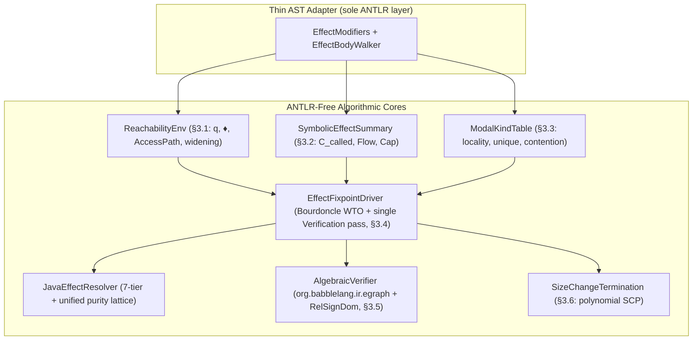

# BIP027: Tackling complexity in the compiler

| | |
|---|---|
| **BIP** | 027 |
| **Date** | 2026-11-22 |
| **Status** | Implemented in `RM012` (`BIP027-D1`–`D9` decided; `BIP027-I1`–`I6` implemented) |
| **Depends on** | Type-checker modular architecture ([bip010_type-checker-simplification.md](bip010_type-checker-simplification.md), `RM004`), ANTLR-free `HIR` & Nanopass optimizer ([bip014_optimization-passes.md](bip014_optimization-passes.md), `BIP014-I0`–`I2`, `RM010`), pure-by-default effects & HOF forwarding ([bip007_effects.md](bip007_effects.md), [bip016_consolidating-effect-annotations.md](bip016_consolidating-effect-annotations.md), [bip017_higher-order-function-effects.md](bip017_higher-order-function-effects.md)), refactored axioms & bytecode analysis ([bip019_refactoring-axioms.md](bip019_refactoring-axioms.md)), arrays, overloads & intersections ([bip020_array-types.md](bip020_array-types.md), [bip021_optional-variadic-overloaded-arguments.md](bip021_optional-variadic-overloaded-arguments.md), [bip022_intersection-types.md](bip022_intersection-types.md)), multiline strings ([bip026_multiline-strings-and-string-templates.md](bip026_multiline-strings-and-string-templates.md), `BIP026-I1`), and `.batest` 3-JVM 5-scope JaCoCo harness ([bip009_test-coverage.md](bip009_test-coverage.md)) |
| **Scope** | Internal architecture, modularity, and algorithmic foundations of Babble's compiler front end (`org.babblelang.analysis`), optimizer (`org.babblelang.opt`), shared pure-expression E-graph core (`org.babblelang.ir.egraph`, anticipating Half A of `BIP014-P5` per `BIP027-D1`), and bytecode emitter (`org.babblelang.compiler`); plus retirement of the already-deprecated `BIP019` `axiom ... on ...` / `io on ...` grammar rule (`BIP027-D6`), prefix-overlap `mut` exclusivity (`BIP027-D5`), and `SCP`-certified `@TERMINATING` unused-pure diagnostics (`BIP027-D8`). No new Babble surface syntax and no `org.babblelang.runtime` public-semantics or `Interpreter` behavior changes. |

---

## 1. Summary & Motivation

### 1.1 Why structural refactoring matters right now

Babble has shipped an extraordinary sequence of language and compiler capabilities since `RM004` (`BIP010`) and `RM010` (`BIP014-I0`–`I2`): core scalar & collection types (`BIP011`), predicate-free `SLL` grammar (`BIP012`), `for` loops & `break`/`continue` (`BIP013`), pure-by-default effects & `fn calling f` (`BIP016`/`BIP017`), curated/inferred axioms (`BIP019`), plain-JVM arrays & object classes (`BIP020`), optional/variadic/generic/overloaded calls (`BIP021`), intersection types (`BIP022`), type aliases (`BIP023`), self tail calls (`BIP024`), and multiline/raw strings (`BIP026-I1`).

Twice before, Babble deliberately paused feature accretion to dismantle emerging monoliths before the next wave of proposals:
- **`BIP010` (`RM004`):** split the 6,828-line `TypeChecker.java` into package-private collaborators (`TypeAlgebra`, `CallSolver`, `JavaTypeBridge`, `LoweringAnalyzer`, `SlotInference`, `TypedModuleSummary`), bringing `TypeChecker.java` down to 2,154 lines and speeding up `babblec` by 21%.
- **`BIP014-I0`–`I1` (`RM010`):** split the 6,269-line `CodeGenerator.java` into `ScriptClassWriter`, `ConstantPool`, `InterfaceGen`, `ClassGen`, ANTLR-free `HirBuilder`, and `HirEmitter`.

Following `RM011` (`BIP022-I2` and `BIP026-I1` at commit `3e5a3f4`), Babble's main source tree has grown to **63,275 LOC across 221 Java files** (up from 29,576 LOC at `BIP010`), and **three new complexity peaks** have reached or crossed those exact historical breaking points — right ahead of `BIP014-P4`/`BIP014-P3` (`record` scalar replacement and SSA `MIR`), `BIP015` (*Down with the ants*), `BIP026-P2`–`P5` (string templates), `BIP018` (multi-JDK Class-File API backend), and `BIP025` (WebAssembly).

### 1.2 Quantitative Baseline (`3e5a3f4`, post-`RM011`)

#### 5-Scope `.batest` JaCoCo Coverage (`mvn -q verify -Pbatest`: 97 files, 1,856 cases, 0 divergences)

| Scope | Lines | Branches | Margin above 75.0% Gate |
|---|---:|---:|---:|
| `Interpreter (impl.*)` | 96.5% (723/749) | 91.4% (339/371) | +16.4% |
| `Compiler (-O0)` | 89.7% (6,842/7,625) | 76.9% (3,301/4,294) | +1.9% |
| `Shared Runtime (combined)` | 85.3% (2,882/3,380) | 76.1% (2,166/2,846) | +1.1% |
| **`Optimizer (-O1)`** | 87.3% (1,664/1,905) | **75.9% (1,555/2,050)** | **+0.9%** |
| **`Shared Front-End (analysis)`** | 88.5% (16,355/18,485) | **75.7% (14,366/18,972)** | **+0.7%** |

#### Complexity Concentration in the Top Compiler Files

| File | LOC (`a199308` → `3e5a3f4`) | Recent Growth | Branches (Missed) | Branch Cov% | ANTLR Refs | ASM Refs |
|---|---:|---:|---:|---:|---:|---:|
| [`EffectChecker.java`](../../src/main/java/org/babblelang/analysis/EffectChecker.java) | 5,996 → **6,602** | +606 (+10.1%) | **4,981 (1,133)** | 77.3% | **599** | 0 |
| [`HirEmitter.java`](../../src/main/java/org/babblelang/compiler/HirEmitter.java) | 4,441 → **5,709** | **+1,268 (+28.6%)** | **2,216 (424)** | 80.9% | 0 | 33 (282 calls) |
| [`CallSolver.java`](../../src/main/java/org/babblelang/analysis/CallSolver.java) | 1,942 → **3,738** | **+1,796 (+92.5%)** | **2,460 (607)** | 75.3% | 148 | 0 |
| [`TypeChecker.java`](../../src/main/java/org/babblelang/analysis/TypeChecker.java) | 2,801 → **3,525** *(2,154 post-`BIP010`)* | **+1,371 (+63.6% vs. `BIP010`)** | **2,144 (563)** | **73.7%** | 444 | 0 |
| [`JavaTypeBridge.java`](../../src/main/java/org/babblelang/analysis/JavaTypeBridge.java) | 1,088 → **1,446** | +358 (+32.9%) | 888 (211) | 76.2% | 0 | 0 |
| [`LoweringAnalyzer.java`](../../src/main/java/org/babblelang/analysis/LoweringAnalyzer.java) | 924 → **1,415** | +491 (+53.1%) | 1,001 (203) | 79.7% | 108 | 1 |
| [`ScopeAnalysis.java`](../../src/main/java/org/babblelang/analysis/ScopeAnalysis.java) | 900 → **1,375** | +475 (+52.8%) | 336 (101) | **69.9%** | 202 | 0 |
| [`InlinePass.java`](../../src/main/java/org/babblelang/opt/hir/InlinePass.java) | 615 → **646** | +31 (+5.0%) | 362 (133) | **63.3%** | 0 | 0 |

Four files alone — `EffectChecker`, `HirEmitter`, `CallSolver`, and `TypeChecker` — represent **19,574 LOC (30.9% of the entire `src/main` codebase)** and **11,801 branches (40.5% of all measured branches across all 5 scopes)**.

### 1.3 Goals and Non-Goals

**Goals:**
1. **Modularize the three overloaded compiler subsystems along clean seams (executed straight through as one dedicated compiler-health milestone per `BIP027-D2`):**
   - **Track 1 (`BIP027-I1`):** Front-end call & analysis consolidation (`CallSolver`, regrown `TypeChecker`, `JavaTypeBridge`/`Overloads`, full `ScopeAnalysis` breakup into public sub-views + promoting ANTLR-free nested value types per `BIP027-D3`, and removing the last 4 `Interpreter` reverse-dependencies).
   - **Track 2 (`BIP027-I2`):** `HirEmitter` decomposition, per-method context isolation, primitive/bridge deduplication, `Optimizer (-O1)` module-traversal / `InlinePass` hygiene, and a shared pure-expression E-graph core (`org.babblelang.ir.egraph`, anticipating Half A of `BIP014-P5` per `BIP027-D1`) merged with `ConstFoldPass` + `AlgebraicSimplifyPass` into a single `HirEGraphSimplifyPass` (`BIP027-D4`) ahead of `BIP014-P4`/`BIP014-P3` and `BIP018-P1`/`BIP018-P2`.
   - **Track 3 (`BIP027-I3`–`I6`):** Structural decomposition, ANTLR isolation (`BIP015` readiness), and SOTA algorithmic modernization of `EffectChecker` (reachability qualifiers & widening with prefix-overlap exclusivity per `BIP027-D5`, single-pass symbolic HOF summaries, Bourdoncle WTO, OxCaml-style modal kinds, `AxiomTable` consolidation & deprecated `axiom ... on ...` removal per `BIP027-D6`, bounded E-graph algebraic verification reusing `org.babblelang.ir.egraph`, and polynomial Size-Change Termination with `BIP007-D8` unused-pure diagnostics per `BIP027-D8`).
2. **Preserve 100% parity during pure refactoring phases (`BIP027-I1`, `BIP027-I3`, and `BIP027-I2`'s emitter split):** Identical diagnostics, `line:column` coordinates, `ScopeAnalysis` facts, and semantics across all 1,856+ `.batest` cases and JUnit suites.
3. **Widen the 75% JaCoCo branch-coverage safety margin** in `Shared Front-End` (currently 75.7%) and `Optimizer (-O1)` (currently 75.9%) by eliminating duplicated branches, dead methods, symmetric algebraic `if`-cascades, and legacy shadow tables.
4. **Lock in modularity permanently (`BIP027-D9`):** Add `ArchitectureBoundaryTestCase` enforcing both import boundaries and file-size ceilings so decomposed compiler passes cannot silently regress into monoliths.
5. **De-risk upcoming BIPs:** Share clean JVM primitive/bridge/method emitters with `BIP014-P3` (`MirEmitter`) and `BIP018-P2` (`Class-File API`), isolate ANTLR from ~75% of effect analysis before `BIP015`, deliver `org.babblelang.ir.egraph` early so `BIP014-P5` focuses purely on SSA `aegraph` CFG elaboration and `PipelineRewritePass` (`O12`), and prepare modal axes for `BIP007` §10 (`threadsafe`) and `BIP014-P4` (`FbipReusePass`).

**Non-Goals:**
- No new Babble surface syntax (the only grammar change is deleting the already-deprecated `BIP019` `axiom ... on ...` / `io on ...` rule in `BIP027-I5` per `BIP027-D6`).
- No changes to the `java.base`-only runtime boundary (`RuntimeBoundaryTestCase`).
- No CFG-embedded SSA `aegraph` elaboration or `std/` `PipelineRewritePass` (`O12`) prior to `BIP014-P3` SSA `MIR` (that remains Half B of `BIP014-P5`, reusing `BIP027`'s `org.babblelang.ir.egraph` core).
- No Rust-style explicit lifetime annotations (`'a`), no global Hindley–Milner Boolean unification, no external SMT solvers, and no whole-program Datalog points-to engine (§3.7).
- `BytecodeEffectAnalyzer.analyzeSingleMethod` (371 LOC) is deferred to `BIP018-P1`'s `BytecodeInspector` SPI (`BIP027-D7`), and `Interpreter` thread-safety (known issue in `AGENTS.md`) is tracked separately.

---

## 2. Quantitative Complexity Diagnosis

### 2.1 Track 1 — Front-End Call & Type-Checking Sprawl (`org.babblelang.analysis`)

1. **`CallSolver.java` (3,738 LOC, +92.5% since `a199308`) mixes five distinct domains:**
   - Core Babble polymorphic/generic call solving & argument binding (~700 LOC).
   - Java reflection method/constructor/SAM/varargs solving (~550 LOC), while [`JavaTypeBridge.java`](../../src/main/java/org/babblelang/analysis/JavaTypeBridge.java) and [`Overloads.java`](../../src/main/java/org/babblelang/runtime/Overloads.java) carry **verbatim copy-pasted** `isTypeMoreSpecific`, `isMoreSpecific`, and `isVarArgsMoreSpecific` implementations.
   - Core collection & array factory typing (~550 LOC), where `checkSeqCollectionCall` and `checkMapCall` duplicate the exact `capacity:`/`comparator:`/`from:`/`Comparable` logic.
   - Explicit `expr of T` type application (`applyTypes`, 149 LOC).
   - Overload-set resolution & union-splitting (~950 LOC), awkwardly split between `CallSolver` and [`OverloadSolver.java`](../../src/main/java/org/babblelang/analysis/OverloadSolver.java) (1,068 LOC), producing three >200-line methods: `matchOverloadAlternative` (**262 LOC** — #3 longest method in the codebase), `tryOverloadUnionSplit` (**237 LOC**), and `overloadedOperatorCall` (**207 LOC**).
2. **`TypeChecker.java` (3,525 LOC, 73.7% branch coverage) has regrown +63.6% above its post-`BIP010` size (2,154 LOC):**
   - Carries 55+ instance fields and regrown domain helpers such as `ForIterableInfo` / `resolveNonNullIterable` (119 LOC, #1 uncovered method in `TypeChecker`) and `visitOverloadExpression`, while [`TypeAnnotations.java`](../../src/main/java/org/babblelang/analysis/TypeAnnotations.java) repeats its generic type-argument validation three times.
3. **`ScopeAnalysis.java` (1,375 LOC, 69.9% branch coverage) is a 47-field mutable blackboard:**
   - Mixes `ParseTreeProperty` and `IdentityHashMap` across **47 mutable collections/properties**, 30+ nested record/enum types, and >320 methods — including **4 dead methods** with zero callers anywhere in `src/main` or `src/test` (`widenToDouble`, `widensToDouble`, `assignMember`, `paramIsPrivate`).
4. **Residual `analysis`/`ir.hir → engine.impl` layering cycle:**
   - `BIP026-I1`'s [`StringLiterals`](../../src/main/java/org/babblelang/parser/StringLiterals.java) removed 9 of the 12 reverse-dependencies on [`Interpreter`](../../src/main/java/org/babblelang/engine/impl/Interpreter.java), leaving just **4 calls across 2 files**: `Interpreter.targetText` in `TypeChecker.java` and `HirBuilder.java`, `Interpreter.unescapeChar` in `HirBuilder.java`, and `Interpreter.operatorSite` in `HirBuilder.java`.

### 2.2 Track 2 — Backend Monolith & Optimizer Fan-Out (`org.babblelang.compiler`, `org.babblelang.opt`)

1. **`HirEmitter.java` (5,709 LOC, +28.6% since `a199308`) is approaching legacy `CodeGenerator.java`'s 6,269-LOC peak:**
   - Owns **51.6%** of all branches in `Compiler (-O0)` (2,216 / 4,294).
   - Holds **23 mutable per-method cursor fields** (`mv`, `methodOwnerId`, `rtLocal`, `nsLocal`, `nextLocal`, `currentLine`, `deferred`, `slots`, `definedSlots`, `stackKind`, `methodReturnKind`, `capturedVariables`, `capturedLocal`, `staticTarget`, `selfLocal`, `thizLocal`, `methodClass`, `constructorClass`, `tailLoop`, `typedThisLocal`, `frameNs`, `parameterBase`, `loopTargets`) directly on the module-level emitter rather than a scoped per-method context.
2. **Tight bidirectional coupling with [`ClassGen`](../../src/main/java/org/babblelang/compiler/ClassGen.java) & [`InterfaceGen`](../../src/main/java/org/babblelang/compiler/InterfaceGen.java):**
   - `ClassGen` (844 LOC) references `HirEmitter` **149 times**; `InterfaceGen` (271 LOC) references `HirEmitter` **69 times**; and `superHelper(...)` is verbatim-duplicated between `ClassGen` and `InterfaceGen`.
3. **Heavy lowering duplication inside `HirEmitter.java`:**
   - **27 `PrimitiveKind` `switch` statements** (21 `case BYTE` blocks) scattered across descriptors, opcodes, boxing/unboxing, cell classes, and array ops.
   - **3× duplicated primitive compound-assignment arithmetic** (`IADD`/`DADD` switches) across `emitVarAssign`, `emitThisFieldAssign` (179 LOC), and `emitJavaFieldAssignExpr` (192 LOC).
   - **3× duplicated bound-argument reordering & temp-packing loops** across `emitBoundTypedArgs`, `emitBoundBoxedArgs`, and `emitBoundArgumentsArray` inside a **1,453-line calls section**.
   - Oversized monolithic emitters: `emitFor` (209 LOC) and `emitCoreCollectionCall` (156 LOC, 6 repetitive `switch (kind)` tables).
4. **Optimizer boilerplate, duplicated algebraic rules, & coverage erosion:**
   - `ConstFoldPass.run` and `HirDcePass.run` duplicate `HirRewriter`'s module-level function/class/interface traversal boilerplate.
   - [`AlgebraicSimplifyPass.java`](../../src/main/java/org/babblelang/opt/hir/AlgebraicSimplifyPass.java) (**280 LOC, 290 branches / 60 missed**, `79.3%`) encodes symmetric left/right `lVal`/`rVal` `if`-cascades and separate Babble vs. Java `idempotent` matchers that **duplicate** the exact same integral/boolean/string/IEEE-754 algebraic laws hard-coded a second time in [`EffectChecker.java`](../../src/main/java/org/babblelang/analysis/EffectChecker.java) §9 (577 LOC).
   - Adding a single `HirExpr` variant (as in `BIP022-I2`) fans out across **11 IR/optimizer files** (`HirExpr`, `HirParam`, `HirBuilder`, `HirPrinter`, `HirVerifier`, `HirPurity`, `HirRewriter`, `ConstFoldPass`, `HirDcePass`, `HirLicmPass`, `InlinePass`).
   - [`InlinePass.java`](../../src/main/java/org/babblelang/opt/hir/InlinePass.java) dropped to **63.3% branch coverage** (133 missed branches), pulling `Optimizer (-O1)` down from 76.9% to **75.9%**.

### 2.3 Track 3 — `EffectChecker.java` Monolith & Algorithmic Debt (`org.babblelang.analysis`)

[`EffectChecker.java`](../../src/main/java/org/babblelang/analysis/EffectChecker.java) (**6,602 LOC**, **4,981 branches / 1,133 missed**, **599 ANTLR refs**, **231 methods**) is now just 226 lines shy of `TypeChecker.java`'s pre-`BIP010` peak. It fuses **six distinct algorithmic engines** inside 12 numbered sections:

| # | Engine inside `EffectChecker.java` | Approx. LOC | Current Algorithm | Concrete Structural & Algorithmic Debt |
|---|---|---:|---|---|
| 1 | **Alias, Ownership, Move & Exclusivity** (`Origin`, `BodyAnalyzer`) | ~3,000 | 12-field ad-hoc `Origin` record, mutable `env`, `while (iter++ < 8)` loop iteration, exact `directKeys`/`pathKey` match (`staticallySameObject`) | **No widening at loop cap:** stops silently after 8 iterations (unsound on long dependency chains). **Prefix-aliasing gap:** `a` vs. `a.f` have unequal `PathKey`. Separate boolean flags (`unique`, `localFresh`, `moved`, `elementParams/This/External`) inflate branch count (`Origin.equals` has 28 missed branches). |
| 2 | **HOF Polymorphism & Cross-Module Summaries** (`classifyClosures`, `trySpecializeCall`, `buildCallableTemplate`) | ~750 | Five overlapping mechanisms (`fn calling f`, `capturedCallings`, `frameLocalOwner`, `trySpecializeCall`, and probing in `buildCallableTemplate`) | `buildCallableTemplate` re-runs `recomputeSummary` **$1 + k + \sum \text{arity}(cb_i)$ times** with synthetic probes. `inferAll` clears `specializationCache.clear()` on **every** callable in every SCC iteration. Intra-file and cross-module HOFs diverge. |
| 3 | **Immutability, `frozen` & Modes** (Section 10 + scattered helpers) | ~350 | Recursive `isDeeplyImmutable(Type)` with per-call `IdentityHashMap` cycle sets + ad-hoc `localFresh` shell flags | Re-walks `TypeNode` graphs repeatedly; lacks an algebraic extension point for `BIP007` §10 (`threadsafe`) and `BIP014-P4` (FBIP reuse). |
| 4 | **Interprocedural Fixpoint & Java Boundary** (Sections 2–4 & 6 + `BytecodeEffectAnalyzer`) | ~1,050 | Flat `tarjanScc` + `iter < 32` cap; dual legacy `HostEffects` (31.4% branch cov) + `AxiomTable`; static `REPORTED_REDUNDANT_AXIOMS` | Process-global mutable static state; direct `java.lang.reflect.*` in `EffectChecker`; separate result lattices between `BytecodeEffectAnalyzer` and `EffectChecker`. |
| 5 | **Algebraic Property Verification** (Section 9) | 578 | Single-expression syntactic AST pattern matching (`singleBodyExpression`, `relationalProps`, `binaryWrapperProps`) | Cannot verify multi-statement pure bodies (`def s = x + y; s * s`), `if`-expressions (`min`/`max`), composed laws, or monotonicity beyond `param 0`. |
| 6 | **Termination & Non-Termination** (`cyclicCallables`, `evalWhile`, `evalFor`) | ~180 | Binary cycle flag: *every* recursive SCC and *every* `while` / non-array `for` sets `terminating = false` | Disables `@TERMINATING`-gated DCE (`BIP014-P4`) and unused-pure detection on standard decreasing recursions (`fib`, `gcd`, `sum`) and finite collection `for` loops. |

---

## 3. State of the Art & Algorithmic Foundations

Just as `BIP010` grounded `TypeChecker`'s simplification in bidirectional typing, polarized subtyping, and monotone `SlotCell` convergence, `BIP027` grounds `EffectChecker`'s modernization in **six SOTA algorithmic pillars** from recent PL and static-analysis literature (2018–2026).

### 3.1 Pillar 1 — Reachability Qualifiers + Flow-Sensitive Use/Kill Effects

Recent work on **Reachability Types** (`[Bao+21]`, `[Wei+24]`, `[Free25]`) and **reference immutability / external uniqueness** (`[GPP12]`, `[Lee+23]`, `[Dort+24]`) formalizes aliasing, uniqueness, borrowing, mutation, and `move` without Rust-style lifetime parameters:
- Every value carries a minimal **reachability qualifier** $q$ (naming the roots/parameters reachable from it) plus a **contextual freshness marker** $\diamond$ (disjoint from all observable bindings).
- Effects separate **use** ($\varepsilon_{\mathrm{rd}}(q)$ reads, $\varepsilon_{\mathrm{wr}}(q)$ writes) from **mention**, and model `move(x)` / `freeze(x)` as a **flow-sensitive kill effect** $\varepsilon_{\mathrm{kill}}(x)$ (`[Free25]`) that invalidates $x$ and produces a fresh capability $\diamond$.
- **Separation checking** ($\text{overlaps}(q_1, q_2) = \emptyset$, with reader–reader non-interference for `frozen`/immutable reads) uniformly handles call-site `mut` exclusivity, closure capture aliasing, and return-origin provenance (`BIP016-D10`).
- **Guaranteed-terminating widening (`[CC77]`, `[Bou93]`):** bounding `AccessPath` depth to $k = 3$ (`(root, f1, f2, *)`) and joining `BitSet` roots guarantees finite ascending chains at `while`/`for` loop heads with **zero** silent early-exit after 8 iterations — while prefix-aware path overlap (`a` overlaps `a.f`; `a.x` and `a.y` stay disjoint) closes the prefix-aliasing soundness gap in `staticallySameObject`.

### 3.2 Pillar 2 — Capture Sets & Single-Pass Symbolic Effect Summaries

Work on **Capturing Types** (`[BGO23]`, `[Odersky+22]`), **second-class values** (`[Osv+16]`), **Type, Ability, and Effect synthesis** (`[BaoRompf25]`), and **Boolean-algebra effect summaries** (`[MP20]`, `[MPH23]`, `[Lee+25]`) unifies Babble's five overlapping HOF mechanisms:
- `[BaoRompf25]` proves that latent *effects* (what happens when invoked) and *abilities/captures* (what capabilities a value holds) are incomparable alone and strictly stronger together — matching Babble's `EffectSet` + `fn calling f` + `capturedCallings`.
- A frame-local closure (`frameLocalOwner`) is precisely a **2nd-class / borrowed capturing value** (`[Osv+16]`, `[BGO23]`).
- **Single-pass symbolic HOF summary:** during one single body transfer of $F(p_0, \dots, p_{n-1})$, record:
  1. Residual base effects $E_{\mathrm{base}}$ (excluding calls through callback parameters $p_i$).
  2. Invoked callback bitmask $C_{\mathrm{called}} \subseteq \{0 \dots n-1\}$.
  3. Parametric argument-flow matrix $\text{Flow}[i][m]$ (`BitSet` of caller roots passed to argument $m$ of callback $p_i$).
  4. Capture set $\text{Cap}(F)$.
- Instantiating *any* HOF call (intra-file, cross-module, interface, or REPL) becomes an $O(k)$ bitvector evaluation:
  $$E(F(\vec{a})) = E_{\mathrm{base}} \wedge \bigwedge_{i \in C_{\mathrm{called}}} E(a_i), \qquad \text{mut}(F(\vec{a})) = \text{mut}_{\mathrm{base}} \cup \bigcup_{i \in C_{\mathrm{called}}} \bigcup_{m \in \text{mut}(a_i)} \text{Flow}[i][m]$$
  (and identically for `BIP019` $\text{read}(F(\vec{a}))$!). This **eliminates** `buildCallableTemplate`'s $1 + k + \sum \text{arity}(cb_i)$ probing re-walks, eliminates `trySpecializeCall` and `specializationCache`, and gives exact parity across module boundaries.

### 3.3 Pillar 3 — Modal Axes & Algebraic Mode Crossing (OxCaml / DRFCaml)

Jane Street's OxCaml modal type system (`[Lor+24]` ICFP 2024, `[DRF25]` POPL 2025, `[Pet+26]` ICFP 2026) maps 1-to-1 onto Babble's ownership/mutability surface and future `BIP007` §10 parallelism:

| Modal Axis | Submoding Order ($\bot \le \top$) | Babble Equivalent | Downstream Payoff |
|---|---|---|---|
| **Locality** | `global` (`shared`) $\le$ `local` (`borrowed`) | `shared` vs. default `@BORROWED` | Frame-local closures, `BIP014-P4` scalar replacement |
| **Uniqueness** | `unique` $\le$ `aliased` | `unique` vs. default | Pure local mutation, `move`/`freeze`, `BIP014-P4` FBIP reuse (`[UdM19]`, `[RXdML21]`) |
| **Contention / Mutability** | `uncontended` (`mut`) $\le$ `shared_read` (`frozen`/const) $\le$ `contended` | `mut` / default const / `frozen` | `BIP019` mutable-read determinism + parallel read sharing |
| **Portability** *(future)* | `portable` (`threadsafe`) $\le$ `nonportable` | `BIP007` §10 `threadsafe` | Safe parallel combinators (`parallelMap`/`parallelReduce`) |

Using **Mode Crossing (`[Pet+26]`)**, every `TypeNode` caches a compact modal kind `(crossedAxes, typeParamDeps)` computed once by a tiny lattice fixpoint:
- Core scalars (`byte`..`char`, `string`, `null`) and `frozen T` cross all axes.
- `record` types cross the intersection of their field types' crossed axes (`with T` bounds for generic `record`s), eliminating repeated per-call recursive `isDeeplyImmutable` traversals.
- A **shallow modality** (stopping deep propagation at container elements) cleanly replaces `Origin`'s ad-hoc `localFresh` + `elementParams` flags (`BIP016-D9`).

### 3.4 Pillar 4 — Reduced-Product Collaborative Lattices & Bourdoncle WTO

- **Bourdoncle Weak Topological Ordering (`[Bou93]`):** replaces flat `tarjanScc` + `iter < 32` with hierarchical cycle decomposition `(head ...)` that stabilizes inner recursive cycles before outer ones, minimizing body re-evaluations and guaranteeing finite convergence on the finite-height `CallableSummary` lattice.
- **Reduced Product / OPAL Lattice Modularization (`[CC79]`, `[Helm+18]`, `[Helm+20]`):** splits the monolithic pass into decoupled, independently testable lattice stages communicating via immutable summaries, and aligns [`BytecodeEffectAnalyzer.Result`](../../src/main/java/org/babblelang/analysis/BytecodeEffectAnalyzer.java), `JavaCallProfile`, and `CallableSummary` onto one shared purity/effect lattice (following OPAL's unified purity lattice `[Helm+18]` and ReIm `[HMDE12]`/`[Mil18]`), retiring legacy [`HostEffects.OverrideEntry`](../../src/main/java/org/babblelang/analysis/HostEffects.java) into `AxiomData`.

### 3.5 Pillar 5 — Shared Pure-Expression E-Graph (`BIP027-D1`, `BIP027-D4`) + Derivative-Sign Domain

- **Clean split of `BIP014-P5` into Half A (anticipated into `BIP027`) vs. Half B (kept in `BIP014-P5`):**
  - **Half A — Pure-expression E-graph core & shared algebraic rule table (`org.babblelang.ir.egraph`, `BIP027-D1`, landed in `BIP027-I2` and reused in `BIP027-I6`):** A ~250-LOC zero-dependency E-graph (`[Wil+21]`: union-find, hash-consed e-nodes, congruence-closure rebuilding, e-class constant-folding analysis, and cost-based extractor) plus a ~150-LOC declarative algebraic/IEEE-754 rule table (integral `+`/`*`/`-` identities & AC laws, strict IEEE-754 `double` C-only guards, `String` `+` associativity, boolean identities, and generic `associative`/`commutative`/`idempotent` call laws). Because it operates purely on expression trees / normalized pure terms with **zero dependency on SSA `MIR` (`BIP014-P3`)**, it serves two consumers from one single source of truth:
    1. **Optimizer (`BIP027-I2`, `BIP027-D4`):** Merges [`ConstFoldPass`](../../src/main/java/org/babblelang/opt/hir/ConstFoldPass.java) (603 LOC) and [`AlgebraicSimplifyPass`](../../src/main/java/org/babblelang/opt/hir/AlgebraicSimplifyPass.java) (280 LOC, 290 branches) into a single combined `HirEGraphSimplifyPass` (local single-assignment `def` constant propagation + constant `if`/`while (false)` pruning + whitelisted pure JDK constant folding + pure-subtree E-graph saturation/extraction), eliminating `ConstFold` ↔ `AlgebraicSimplify` phase-ordering ping-pong, removing symmetric left/right special cases, unifying Babble/Java `idempotent` calls, and generalizing algebraic rewrites to all verified `associative`/`commutative`/`idempotent` callees.
    2. **Effect algebraic verifier (`BIP027-I6`):** Replaces Section 9's brittle single-expression AST matchers (`binaryWrapperProps`, `isUnaryIdempotentWrapper`, `isMutCommutativeBody`, ~250 LOC) with uniform bounded equivalence queries (≤64 e-nodes, ≤4 saturation rounds) over normalized pure expressions with local `def` substitution and pure `ite(c, t, e)` (`equiv(f(a,b), f(b,a))`, etc., framing 2-/3-safety relational laws per `[BCK11]`).
  - **Half B — CFG-embedded SSA `aegraph` & `PipelineRewritePass` (`O12`, kept in `BIP014-P5`):** Cranelift-style union nodes inside SSA value space + domtree-preorder scoped elaboration (subsuming GVN/LICM/DCE) genuinely requires `BIP014-P3` SSA `MIR`, and `O12` pipeline fusion requires a `std/` combinator library. Pulling Half B onto tree-structured `HIR` ahead of `BIP014-P3` would *add* complexity; keeping it in `BIP014-P5` lets it build directly on `org.babblelang.ir.egraph`.
- **Order & bijectivity properties (`monotone`, `injective`):** Because monotonicity and injectivity are non-equational, generalize `relationalProps` into an abstract **Partial-Derivative Sign & Bijectivity Domain** $\mathcal{D}_{\mathrm{rel}} = \text{Var} \to (\{\bot, \text{CONST}, \text{INC}, \text{DEC}, \top\} \times \text{bool})$ over multi-statement `def` environments and all parameter positions (~120 LOC).

### 3.6 Pillar 6 — Polynomial Size-Change Termination (`SCP`) + Finite-Iterator Certification

- Replace the coarse `!cyclicCallables.contains(owner)` check with **Ben-Amram & Lee's polynomial-time Size-Change Termination approximation (`[LJB01]`, `[BAL07]`, ~150 LOC)** over integer decrease patterns (`n > 0` guarded `n - 1` / `n / 2`) and acyclic `record` structural descent.
- Certify `@TERMINATING` on `for` loops over curated finite collections (`list`, `set`, `sortedset`, `map`, `sortedmap`) whenever the loop body does not mutate the iterated collection (already tracked by `activeForIterables`).

### 3.7 What Not to Adopt (Explicit Non-Goals)

- **Rust explicit lifetime parameters (`'a`) / Polonius CFG borrow checker:** Unnecessary on a GC/JVM runtime and contrary to Babble's ergonomic design (`BIP016`).
- **Global Hindley–Milner Boolean Unification (`[MP20]`/`[MPH23]`):** Overkill without whole-program type inference or effect exclusion; monotone bitvector summaries (`§3.2`) are $O(k)$ and deterministic.
- **External SMT solvers (Z3/Servois):** Violates Babble's zero-external-solver architecture and REPL compile-time budgets.
- **Whole-program Datalog points-to (Doop):** Incompatible with separate compilation, incremental REPL sessions (`BIP004`), and AST-detached `TypedModuleSummary` (`BIP010-D3`).

---

## 4. Track 1 Architecture — Front-End Call & Analysis Consolidation (`BIP027-I1`)

Purely structural, zero-semantic-change refactoring inside `org.babblelang.analysis` (plus removing 4 reverse-dependencies on `Interpreter`):

1. **Split [`CallSolver.java`](../../src/main/java/org/babblelang/analysis/CallSolver.java) (3,738 → ~1,350 LOC) into focused package-private collaborators:**
   - `OverloadCallResolver` (~950 LOC, or co-located with [`OverloadSolver`](../../src/main/java/org/babblelang/analysis/OverloadSolver.java)): owns `overloadedCall`, `resolveOverloadSingle`, `matchOverloadAlternative` (decomposed into arg-binding, generic-instantiation, and spread-scoring helpers), `tryOverloadUnionSplit`, and `overloadedOperatorCall`.
   - `CollectionCallChecker` (~380 LOC, down from ~550): owns `coreCollectionCall`, `checkArrayCall`, `arrayOfCall`, `checkEntryCall`, and a unified `checkContainerFactoryCall` collapsing the duplicated `capacity:`/`comparator:`/`from:`/`Comparable` logic shared by `checkSeqCollectionCall` and `checkMapCall`.
   - `JavaCallSolver` (~550 LOC): owns `javaMethodCall`, `javaConstructorCall`, `javaCall`, `solveJava`, `javaGenericSamCall`, `refineJavaEnvFromArgs`, and `matchingGenericJavaMethods`.
2. **Eliminate reflection/specificity duplication:**
   - Expose package/public static `Overloads.isMoreSpecific` / `Overloads.isVarArgsMoreSpecific` (or `JavaTypes`) in `org.babblelang.runtime` and remove the verbatim duplicates from [`JavaTypeBridge.java`](../../src/main/java/org/babblelang/analysis/JavaTypeBridge.java).
3. **Prune regrown helpers in [`TypeChecker.java`](../../src/main/java/org/babblelang/analysis/TypeChecker.java) (3,525 → ~2,700 LOC) & [`TypeAnnotations.java`](../../src/main/java/org/babblelang/analysis/TypeAnnotations.java):**
   - Extract `ForIterableInfo` / `resolveNonNullIterable` (119 LOC) into `MemberTypes` (or a dedicated `IterableResolver`), and collapse the 3× duplicated generic type-argument validation in `TypeAnnotations.java`.
4. **Full breakup of [`ScopeAnalysis.java`](../../src/main/java/org/babblelang/analysis/ScopeAnalysis.java) (`BIP027-D3`) & severing the last `Interpreter` reverse-dependencies:**
   - Delete the 4 dead methods (`widenToDouble`, `widensToDouble`, `assignMember`, `paramIsPrivate`).
   - Split `ScopeAnalysis`'s 47 mutable maps into cohesive public sub-views (`lowering()`, `calls()`, `hierarchy()`, `effects()`) and update callers across `analysis`, `Interpreter`, and `HirBuilder`.
   - Promote ANTLR-free nested value types (`PrimitiveKind`, lowering target records, `BoundArg`, `CoreCollectionKind`) out of `ScopeAnalysis` into top-level ANTLR-free types so `ir.hir`, `opt`, and `compiler` stop importing ANTLR-bearing `ScopeAnalysis` entirely.
   - Move `Interpreter.unescapeChar` into [`StringLiterals`](../../src/main/java/org/babblelang/parser/StringLiterals.java) and move `targetText`/`operatorSite` into a tiny `org.babblelang.analysis.SyntaxText` helper, eliminating all remaining `analysis`/`ir.hir → engine.impl` imports.
5. **Introduce `ArchitectureBoundaryTestCase` (`BIP027-D9`):**
   - Lock in zero `analysis`/`ir`/`opt`/`compiler → engine.impl` imports, zero ANTLR imports in `ir.hir`/`opt`/`compiler` and ANTLR-free `analysis` cores (`TypeAlgebra`, `JavaTypeBridge`), and file-size ceilings on refactored front-end classes (`CallSolver` ≤ 2,000 LOC).

---

## 5. Track 2 Architecture — Modular Bytecode Emission, Shared E-Graph & Optimizer Hygiene (`BIP027-I2`)

Structural decomposition inside `org.babblelang.compiler` (strictly zero-bytecode-change for the emitter split) paired with `org.babblelang.opt` hygiene and the unified pure-expression E-graph pass (`BIP027-D1`, `BIP027-D4`) — designed directly as the foundation for `BIP014-P4`/`BIP014-P3` (`ScalarReplacePass` / `MirEmitter`), `BIP014-P5` (SSA `aegraph`), and `BIP018-P1`/`BIP018-P2` (`Class-File API` backend):

1. **Extract `JvmPrimitives` / `JvmDescriptors` (~450 LOC):**
   - Centralize all `RUNTIME` internal-name constants, `PrimitiveKind` → JVM descriptor / load / store / return / default-zero / box / unbox / cell-class / array-op / widening tables (collapsing the 27 scattered `PrimitiveKind` switches), and `$spec`/bridge descriptor builders.
   - Eliminates the bulk of the 218 back-references from `ClassGen` (149) and `InterfaceGen` (69) into `HirEmitter`.
2. **Extract `MethodEmitContext` (~250 LOC):**
   - Move the 23 mutable per-method cursor fields (`mv`, `slots`, `definedSlots`, `stackKind`, `methodReturnKind`, `loopTargets`, `tailLoop`, `deferred`, local allocator, line tracking) out of `HirEmitter` into an explicit per-method context object.
3. **Extract `CallEmitter` (~1,100 LOC):**
   - Move the 1,453-line calls section (`emitCall`, `emitOverloadDispatch`, `emitSuperCall`, `emitCoreCollectionCall`, Java varargs/spread/rest packing) and collapse the 3× duplicated bound-argument reordering/temp-packing loops (`emitBoundTypedArgs`, `emitBoundBoxedArgs`, `emitBoundArgumentsArray`) into one parameterized `emitBoundArgs(...)` helper.
4. **Extract `AssignAndMemberEmitter` (~700 LOC):**
   - Move defs, assignments, member selection, and array ops, collapsing the 3× duplicated primitive compound-assignment arithmetic (`emitVarAssign` / `emitThisFieldAssign` / `emitJavaFieldAssignExpr`) into a single `emitPrimitiveCompoundOp(...)` helper.
5. **Extract `BridgeHelpers` (~350 LOC):**
   - Deduplicate `superHelper(...)` shared verbatim by `ClassGen` and `InterfaceGen`, alongside `collectAncestorMethods`, `emitInheritedDefaultInvoke`, and `emitLoadJavaBridgeArg`.
6. **Introduce shared `org.babblelang.ir.egraph` core & unified `HirEGraphSimplifyPass` (`BIP027-D1`, `BIP027-D4`, Half A of `BIP014-P5`):**
   - Build a ~250-LOC zero-dependency pure-expression E-graph (`EGraph`, `ENode`, union-find + congruence-closure rebuilding + e-class constant analysis + cost-based extractor) and a ~150-LOC shared declarative algebraic/IEEE-754 rule table (`AlgebraicRules`) in `org.babblelang.ir.egraph` (strictly outside `org.babblelang.runtime`).
   - Merge [`ConstFoldPass.java`](../../src/main/java/org/babblelang/opt/hir/ConstFoldPass.java) (603 LOC) and [`AlgebraicSimplifyPass.java`](../../src/main/java/org/babblelang/opt/hir/AlgebraicSimplifyPass.java) (280 LOC, 290 branches) into one combined `HirEGraphSimplifyPass`: single-assignment local `def` constant propagation, constant `if`/`while (false)` pruning, whitelisted pure JDK constant folding, and E-graph pure-subtree saturation/extraction in one pass — removing `ConstFold` ↔ `AlgebraicSimplify` phase-ordering ping-pong, eliminating symmetric left/right special-case branches, unifying Babble/Java `idempotent` collapse, and generalizing pure `associative`/`commutative` simplification with strict IEEE-754 guards.
7. **Optimizer hygiene (`org.babblelang.opt`) & guardrails (`BIP027-D9`):**
   - Add `HirRewriter.rewriteModule(HirModule, BodyRewriter)` so `HirEGraphSimplifyPass`, `HirDcePass`, and future `BIP014-P4` passes stop copy-pasting top-level/function/class/interface module-walking boilerplate.
   - Audit and close uncovered/redundant branches in [`InlinePass.java`](../../src/main/java/org/babblelang/opt/hir/InlinePass.java) (63.3% → ≥78% branches), lifting `Optimizer (-O1)` safely above the 75% gate ahead of `BIP014-P4`.
   - Extend `ArchitectureBoundaryTestCase` with `HirEmitter` ≤ 2,000 LOC and zero ANTLR imports in `org.babblelang.ir.egraph`.

---

## 6. Track 3 Architecture — Modular, ANTLR-Isolated, SOTA `EffectChecker` (`BIP027-I3`–`I6`)

Because `EffectChecker` runs *inside* `TypeChecker.run` (between slot-inference convergence round 1 and round 2 so inferred effects populate `Type.Function` and `TypedModuleSummary`), it stays in `org.babblelang.analysis` rather than moving after `HirBuilder`. However, mirroring `BIP010`'s `TypeAlgebra`/`JavaTypeBridge`, **all algorithmic cores have zero ANTLR imports**, insulated behind one thin `EffectBodyWalker` adapter for `BIP015`:

The four progressive phases cleanly separate **pure zero-behavior-change refactoring** from **algorithmic upgrades**:

- **`BIP027-I3` — Pure structural split & ANTLR isolation (zero behavioral change):**
  Extract `EffectModifiers`, `JavaEffectResolver` (isolating `java.lang.reflect.*` and scoping `REPORTED_REDUNDANT_AXIOMS` per engine/run), `Reachability` (from `Origin` + `PathKey`), `EffectBodyWalker`, `CallEffectAnalyzer`, and `AlgebraicVerifier`. Shrinks [`EffectChecker.java`](../../src/main/java/org/babblelang/analysis/EffectChecker.java) from **6,602 → ~1,000 LOC** with 100% diagnostic/bytecode parity, and extends `ArchitectureBoundaryTestCase` (`BIP027-D9`) with `EffectChecker` ≤ 2,000 LOC and zero ANTLR imports across all extracted cores.
- **`BIP027-I4` — Symbolic HOF summaries, Bourdoncle WTO & loop widening:**
  Replace `buildCallableTemplate` probing and `trySpecializeCall`/`specializationCache` with single-pass `SymbolicEffectSummary` (`C_called` + `Flow[i][m]`, also forwarding `BIP019` mutable reads); replace flat `tarjanScc`+cap-32 with Bourdoncle WTO; replace `while (iter++ < 8)` with depth-bounded `AccessPath` widening (`k = 3`) and prefix-overlap `mut` exclusivity (`BIP027-D5`).
- **`BIP027-I5` — Modal kinds, unified Babble/Java purity lattice & `HostEffects`/legacy-axiom cleanup:**
  Add `ModalKindTable` (`[Pet+26]`) replacing recursive `isDeeplyImmutable` + `localFresh` special cases; align `JavaCallProfile` and `CallableSummary` onto one shared purity lattice (leaving `BytecodeEffectAnalyzer.analyzeSingleMethod` for `BIP018-P1` per `BIP027-D7`); lower `BabbleScriptEngine`'s public host methods (`assumeEffects`, `assumeConstructorEffects`, `markIO`) directly into `AxiomData.AxiomTable`, delete `HostEffects.OverrideEntry` and the 3 duplicate `*JavaEffects` maps, and remove the `BIP019`-deprecated `axiom ... on ...` / `io on ...` grammar rule (`BIP027-D6`).
  *As implemented :*
  - **Legacy axioms retired (`BIP027-D6`).** `Babble.g4` loses `effectDeclaration`, `effectTarget`, `effectClause`, the `def x = axiom ... on Target` alternative of `defExpression`, and the `ON` token : `on` is an ordinary name again (`ParserGrammarTestCase.testDeprecatedAxiomOnSyntaxIsGone`). The `def` form went too, since it was the same BIP007 spelling, with `axiom Target: fn ...` plus a plain `def` as its replacement. With it go `BlockScopes.PendingEffectDecl`, the `JAVA_TARGET` word context and target resolution of `EffectModifiers`, `EffectChecker.defPrefixes`, and the three parallel `*JavaEffects` maps of `EffectChecker` (local, committed, exported) with their copies in `TypedModuleSummary`, `AnalysisSession` and `ModuleInterface`. The check that an axiom cannot be nested in a verified function (`axiom declaration is not allowed inside a verified constrained function`) now applies to `axiom Target: ...`.
  - **`HostEffects` → `AxiomTable`.** `HostEffects.OverrideEntry`, `JavaTarget` and `TargetKind` are gone. `HostEffects.Registry` (used by `BabbleScriptEngine.assumeEffects`, `assumeConstructorEffects` and `markIO`, whose public signatures and `IllegalArgumentException`s are unchanged) lowers each registration into an `AxiomData.MemberAxiom` without a signature (`MemberAxiom.host`) : a method is a named axiom applying to the method's overrides, a constructor a `new` axiom, a class an `exact` instance wildcard plus an `exact` static wildcard on the class itself (so it still covers the class's and its declaring class's own members only). `JavaEffectResolver` keeps the tier order : the program's axioms (tier 1), the host's named axioms (tier 2), Java method annotations (tier 3), the host's wildcards (tier 4), class annotations, curated axioms, bytecode analysis.
  - **`ModalKindTable` (§3.3).** One ANTLR-free table now decides deep immutability for both the type checker (`TypeChecker.isDeeplyImmutable`, `TypeAlgebra.Env`) and the effect checker (`JavaEffectResolver.isDeeplyImmutable`), replacing their two recursive walkers. A type's `ModalKind` is the set of modal axes it crosses (`CONTENTION` — deep immutability — and `PORTABILITY`, the `BIP007` §10 `threadsafe` bit, crossed together today) and the type variables it depends on ; a record's kind is computed once per `TypeNode` (greatest fixpoint on recursive records) and instantiated with an instance's type arguments. The per-node cache is on only while types are settled (effect inference and verification) and is dropped at each phase change, since slot inference and `demoteSamField` still change fields before. Unifying the two walkers fixed a hole : the effect checker ignored the type arguments of a Java class the axioms call `immutable`, so a function could mutate a `Box` reached through a `Map.Entry of (string, Box)` parameter without `mut` (`effects/modal_kinds.batest`).
  - **Shallow modality.** `Reachability.Origin`'s `localFresh`, `elementParams`, `elementThis` and `elementExternal` become one `Provenance shallow` (non-null for a fresh local shell, holding what its elements reach), with `localFresh()`, `owned()` (`unique` or a fresh shell, the test the walkers made in twenty places) and `elements()`.
  - **Purity lattice.** `Purity` (`PURE`, `SIDE_EFFECT_FREE`, `CONTEXTUALLY_PURE`, `CONTEXTUALLY_SIDE_EFFECT_FREE`, `IMPURE` ; OPAL's `[Helm+18]`) is the product of "mutates its arguments", "volatile reads" and "not hermetic", and `JavaCallProfile.purity()` and `CallableSummary.purity()` put both kinds of callee on it ; `CallEffectAnalyzer` and `EffectChecker` ask it rather than recombining `isHermetic`/`isDeterministic`/`mutParams`. `BytecodeEffectAnalyzer` reaches it through `Result.toProfile` and is otherwise untouched (`BIP027-D7`).
  - Tests : `org.babblelang.analysis.ModalKindsAndPurityTestCase` (the four cores), `effects/modal_kinds.batest`, and the migrated `EffectsTestCase`, `FormatterTestCase`, `ParserGrammarTestCase`, `AxiomsTestCase` and `.batest` cases (those that only exercised the legacy target resolution and its deprecation warnings are deleted).
- **`BIP027-I6` — Bounded E-graph algebraic verifier & polynomial `SCP` termination:**
  Replace syntactic Section 9 with `AlgebraicVerifier` directly reusing `BIP027-I2`'s `org.babblelang.ir.egraph` core and `AlgebraicRules` (`BIP027-D1`), paired with the partial-derivative sign domain for `monotone`/`injective`; add polynomial `SCP` recursion termination + finite-collection `for`-loop `@TERMINATING` certification wired into `BIP007-D8` `Unused pure expression` diagnostics (`BIP027-D8`).
  *As implemented :*
  - **Shared E-graph algebraic verifier (`BIP027-D1`).** `ENode` gains `Op.ITE` and `isExactOrdered()`, and `AlgebraicRules.verifierRules()` extends the shared rule table with integral ring laws (`-(a+b)`, `-(a*b)`, `(-a)*(-b)`, `a-b == -(b-a)`), strict IEEE-754 floating sign-flip laws, boolean De Morgan/identities, relational flips, exact-ordered negated comparisons, and `ITE`/`$min`/`$max`/`$abs` lattice rules (with constant-bound distributivity for `clamp`). `AlgebraicVerifier` (723 LOC, ANTLR-free and reflection-free) verifies `commutative`, `associative`, `idempotent`, `mut idempotent`, and `mut commutative` via bounded saturation over a sealed `Term`/`MutBody` IR (delegating constant-term folding to `EGraph`), paired with `RelSignDomain` (coordinate-wise `Sign` lattice for multi-param `monotone`, 1-param and triangular multi-param `record` `injective`, and sound 2's-complement/IEEE-754 guards). Thin ANTLR extraction lives in `EffectAstExtractors` (multi-statement local `def` + straight-line assignment substitution and early-return `if -> Ite`).
  - **Polynomial `SCP` termination (`[LJB01]`/`[BAL07]`).** `SizeChangeTermination` (464 LOC, ANTLR-free) implements Ben-Amram & Lee's polynomial-time solver (Tarjan SCC pruning + Criterion 1 parameter-SCC Kuhn bipartite matching + Criterion 2 max-measure GFP + Criterion 3 min-measure GFP). `EffectAstExtractors.certifyComponentTermination` extracts guarded integer decreases (`n - k`, `n + (-k)`, `a - b`, `int(n / k)`, `Math.floorDiv`, `Math.floorMod` with path-sensitive lower-bound refinement across `if`/`else`/`and`/`or`/`not`/early `return`/`!=`) and acyclic `record` structural descent per cyclic WTO component, conservatively rejecting `forever`, interface defaults, rest/spread calls, escaping component references, and indirect calls reaching the component. `JavaEffectResolver` also guards `toStringProfile`/`singleEqualityProfile` against recursive `record` cycles.
  - **Finite-collection `for`-loop `@TERMINATING` & `BIP027-D8`.** `EffectBodyWalker.evalFor` certifies `for` loops over arrays and curated finite collections (driven purely by `java.util.Collection.iterator`'s curated `nothrow view` axiom — zero hardcoded collection names) as `@TERMINATING`/`nothrow` whenever the iterable is not mutated during the loop and the body is hermetic/terminating, publishing `EffectMetadata.forEffects` into `HirExpr.For` so `HirDcePass` (`HirPurity.isPureLocalBlock`) eliminates dead pure-local `for` blocks (including inlined `sumList` calls). `EffectBodyWalker.evalDiscarded` enforces `BIP007-D8` `Unused pure expression` on `SCP`-certified calls and pure finite-collection `for` loops (`BIP027-D8`).
  - **Final `RM012` metrics & tests.** `ArchitectureBoundaryTestCase` enforces `AlgebraicVerifier` and `SizeChangeTermination` in `ANTLR_FREE_ANALYSIS_CORES` alongside the 2,000-LOC ceilings (`CallSolver` 1,484 LOC, `HirEmitter` 1,498 LOC, `EffectChecker` 1,286 LOC). Direct unit tests in `org.babblelang.analysis.AlgebraicAndTerminationTestCase`, extended `EGraphTestCase`/`OwnershipTestCase`/`OptimizerTestCase`, and `effects/algebraic_egraph_and_termination.batest`; full 5-scope `-Pbatest` (`100` files, `1,951` cases, `0` divergences): `Interpreter` 91.1%, `Compiler (-O0)` 77.4%, `Optimizer (-O1)` 78.4%, `Shared Front-End` 77.0%, `Shared Runtime` 76.1% branches.

---

## 7. Settled Decisions (`BIP027-D1`–`BIP027-D9`)

All open design questions (`BIP027-Q1`–`Q8`) have been resolved:

- **`BIP027-D1` (resolves `BIP027-Q5`) — Anticipate Half A of `BIP014-P5` (`org.babblelang.ir.egraph`) into `BIP027`:**
  Build a small (~250-LOC) zero-dependency pure-expression E-graph core plus a ~150-LOC shared declarative algebraic/IEEE-754 rule table in `org.babblelang.ir.egraph` (strictly outside `org.babblelang.runtime`) in `BIP027-I2`, and reuse that exact same engine and rule table for [`EffectChecker`](../../src/main/java/org/babblelang/analysis/EffectChecker.java)'s `AlgebraicVerifier` in `BIP027-I6`. Keep Half B of `BIP014-P5` (CFG-embedded SSA `aegraph` elaboration over `BIP014-P3` `MIR` and `std/` `PipelineRewritePass` `O12`) in `BIP014-P5`, building directly on `org.babblelang.ir.egraph`.
- **`BIP027-D2` (resolves `BIP027-Q4`) — Straight-through dedicated compiler-health milestone:**
  Execute all of `BIP027-I1`–`I6` straight through now as a single dedicated compiler-health milestone ahead of `BIP014-P4`/`BIP014-P3`, `BIP015`, `BIP026-P2`, and `BIP018` (sequenced as the next milestone in [docs/design/README.md](README.md)).
- **`BIP027-D3` (resolves `BIP027-Q2`) — Full breakup of `ScopeAnalysis` (`BIP027-I1`):**
  Delete the 4 verified-dead methods, split `ScopeAnalysis`'s 47 mutable fields into cohesive public sub-views (`lowering()`, `calls()`, `hierarchy()`, `effects()`), promote ANTLR-free nested value types (`PrimitiveKind`, lowering target records, `BoundArg`, `CoreCollectionKind`) out of `ScopeAnalysis` so `ir`/`opt`/`compiler` stop importing ANTLR-bearing `ScopeAnalysis`, and update callers across `analysis`, `Interpreter`, and `HirBuilder`.
- **`BIP027-D4` (extends `BIP027-D1`) — Unified `HirEGraphSimplifyPass` (`BIP027-I2`):**
  Merge [`ConstFoldPass`](../../src/main/java/org/babblelang/opt/hir/ConstFoldPass.java) and [`AlgebraicSimplifyPass`](../../src/main/java/org/babblelang/opt/hir/AlgebraicSimplifyPass.java) into a single combined E-graph simplification pass (`HirEGraphSimplifyPass`) handling local `def` constant propagation, constant `if`/`while (false)` pruning, whitelisted pure JDK folding, e-class constant analysis, strict IEEE-754 algebraic laws, and Babble/Java `idempotent`/`associative`/`commutative` rewrites in one module walk.
- **`BIP027-D5` (resolves `BIP027-Q1`) — Prefix-overlap `mut` exclusivity (`BIP027-I4`):**
  Tighten `AccessPath` overlap to reject prefix overlaps on `mut` arguments (e.g. `mutatePairAndReadBox(pair, pair.a)` and `f(mut a.x, a)`) while continuing to allow disjoint sibling fields (e.g. `swapBoxes(pair.a, pair.b)`), audited against the full `.ba` / `.batest` / `examples/` corpus.
- **`BIP027-D6` (resolves `BIP027-Q3`) — Consolidate `HostEffects` into `AxiomTable` & retire deprecated `axiom ... on ...` syntax (`BIP027-I5`):**
  Preserve `BabbleScriptEngine`'s public host APIs (`assumeEffects`, `assumeConstructorEffects`, `markIO`) by lowering them into `AxiomData.AxiomTable`, delete `HostEffects.OverrideEntry` and the 3 parallel `*JavaEffects` maps in `EffectChecker`, and remove the `BIP019`-deprecated `axiom ... on ...` / `io on ...` grammar rule from `Babble.g4` (keeping only `BIP019`'s `axiom Target: ...` syntax; check whether the `on` keyword can also be retired if unused elsewhere).
- **`BIP027-D7` (resolves `BIP027-Q7`) — Defer `BytecodeEffectAnalyzer` decomposition to `BIP018-P1`:**
  Leave `BytecodeEffectAnalyzer.analyzeSingleMethod` (371 LOC) untouched in `BIP027` so `BIP018-P1` refactors it directly while extracting the `BytecodeInspector` SPI.
- **`BIP027-D8` (resolves `BIP027-Q6`) — Enforce `BIP007-D8` `Unused pure expression` on `SCP`-certified `@TERMINATING` calls (`BIP027-I6`):**
  Let polynomial `SCP`-certified pure recursive functions (e.g. `fib`) and finite-collection `for` loops trigger `Unused pure expression` when their result is discarded (`discard(...)` remains the explicit opt-out), audited against all `.ba` / `.batest` scripts when `BIP027-I6` lands.
- **`BIP027-D9` (resolves `BIP027-Q8`) — Continuous architectural fitness tests (`ArchitectureBoundaryTestCase`):**
  Add `ArchitectureBoundaryTestCase` (analogous to `RuntimeBoundaryTestCase`) enforcing **both** import boundaries (zero `analysis`/`ir`/`opt`/`compiler → engine.impl` imports; zero ANTLR imports in `org.babblelang.ir.egraph`, `opt`, `compiler`, and ANTLR-free `analysis` cores) **and** file-size ceilings (failing CI if refactored compiler classes such as `CallSolver`, `HirEmitter`, or `EffectChecker` grow back past 2,000 LOC).

---

## 8. Implementation Plan & Verification (`BIP027-I1`–`I6`)

| Phase | Track | Deliverables | Target Metrics & Exit Criteria |
|---|---|---|---|
| **`BIP027-I1`** | Front-End Call & Analysis Consolidation | Split `CallSolver` → `OverloadCallResolver` + `CollectionCallChecker` + `JavaCallSolver`; share `Overloads.isMoreSpecific`/`isVarArgsMoreSpecific`; prune `TypeChecker` & `TypeAnnotations`; delete 4 dead `ScopeAnalysis` methods, split into public sub-views & promote ANTLR-free nested value types (`BIP027-D3`); remove last 4 `Interpreter` reverse-refs; add `ArchitectureBoundaryTestCase` (`BIP027-D9`) | `CallSolver` ≤ 1,500 LOC (ceiling ≤ 2,000); zero methods >150 LOC in `CallSolver`; zero `analysis`/`ir`/`opt`/`compiler → engine.impl` imports; zero `ScopeAnalysis` imports in `ir.hir`/`opt`/`compiler`; `Shared Front-End` branch cov ≥ 77%; 100% parity across `mvn -B package` & `-Pbatest` |
| **`BIP027-I2`** | Bytecode Emitter, Unified E-Graph Pass & Optimizer Hygiene | Extract `JvmPrimitives`/`JvmDescriptors`, `MethodEmitContext`, `CallEmitter`, `AssignAndMemberEmitter`, `BridgeHelpers` (deduplicate `superHelper`, 3× compound assign, 3× bound args); introduce `org.babblelang.ir.egraph` + `AlgebraicRules` (`BIP027-D1`, Half A of `BIP014-P5`) and merge `ConstFoldPass` + `AlgebraicSimplifyPass` into `HirEGraphSimplifyPass` (`BIP027-D4`); add `HirRewriter.rewriteModule`; close `InlinePass` uncovered branches; extend `ArchitectureBoundaryTestCase` (`BIP027-D9`) | `HirEmitter` ≤ 1,500 LOC (ceiling ≤ 2,000); 0 mutable per-method fields on `HirEmitter`; `ClassGen`/`InterfaceGen` back-refs reduced by >80%; `Optimizer (-O1)` branch cov ≥ 78%; strict IEEE-754 parity on `OptimizerTestCase`; byte-identical `examples/raytracer-argon/scene.ppm` & `babblec` jars |
| **`BIP027-I3`** | `EffectChecker` Structural Split & ANTLR Isolation | Extract `EffectModifiers`, `JavaEffectResolver`, `Reachability`, `EffectBodyWalker`, `CallEffectAnalyzer`, `AlgebraicVerifier`; remove static `REPORTED_REDUNDANT_AXIOMS`; extend `ArchitectureBoundaryTestCase` (`BIP027-D9`); zero behavioral change | `EffectChecker` ≤ 1,200 LOC (ceiling ≤ 2,000); zero `java.lang.reflect` in `EffectChecker`; zero ANTLR imports outside `EffectModifiers`/`EffectBodyWalker`; 100% parity on `EffectsTestCase`, `OwnershipTestCase`, `AxiomsTestCase`, and all 1,856+ `.batest` cases |
| **`BIP027-I4`** | Symbolic HOF Summaries, WTO & Loop Widening | Single-pass `SymbolicEffectSummary` (`C_called` + `Flow[i][m]`, deleting `buildCallableTemplate` probing & `trySpecializeCall`/`specializationCache`); Bourdoncle WTO; depth-bounded `AccessPath` widening (`k = 3`) & prefix-overlap `mut` exclusivity (`BIP027-D5`) | Zero HOF probing re-walks; faster `babblec` analysis on `examples/raytracer-argon`; new `.batest` specs for deep loop chains, prefix aliasing (`pair` vs `pair.a`, disjoint `pair.a` vs `pair.b`), and cross-module `readParams` HOF forwarding |
| **`BIP027-I5`** | Modal Kinds, Purity Lattice & Legacy Axiom Retirement | Cached `ModalKindTable` (`[Pet+26]`) replacing recursive `isDeeplyImmutable` & `localFresh` flags; unified `JavaCallProfile`/`CallableSummary` purity lattice (`BytecodeEffectAnalyzer` deferred per `BIP027-D7`); lower `BabbleScriptEngine` host APIs into `AxiomData.AxiomTable`, delete `HostEffects.OverrideEntry` + 3 `*JavaEffects` maps, and remove deprecated `axiom ... on ...` / `io on ...` grammar rule (`BIP027-D6`) | `HostEffects` legacy override tables and deprecated `axiom ... on ...` syntax retired; `ParserGrammarTestCase`, `FormatterTestCase`, and `AxiomsTestCase` green; `BIP007` §10 `threadsafe` axis ready as a single modal bit |
| **`BIP027-I6`** | E-Graph Algebraic Verifier & Polynomial `SCP` | Wire `AlgebraicVerifier` onto `BIP027-I2`'s `org.babblelang.ir.egraph` + `AlgebraicRules` (`BIP027-D1`) + ~120-LOC partial-derivative sign domain replacing Section 9; polynomial `SCP` + finite-iterator `@TERMINATING` wired into `Unused pure expression` (`BIP027-D8`) | Zero duplicate algebraic/IEEE-754 rules between `analysis` and `opt`; multi-statement `commutative`/`associative`/`idempotent`/`monotone`/`injective` functions verified; `fib`/`gcd`/`sum` & finite-collection `for` loops certified `@TERMINATING`; new `.batest` & `OptimizerTestCase` DCE tests |

### Global Verification Gate (Every Phase)
- Three-way `mvn -B package` (`interpret`, `compile -O1`, `compile -O0`, with `HirVerifier` and ASM `CheckClassAdapter` enabled).
- Full 3-JVM 5-scope `mvn -q verify -Pbatest` (`0` divergences, all 5 scopes ≥ 75% branch coverage, with upward trend on `Shared Front-End` and `Optimizer`).
- `RuntimeBoundaryTestCase`, `ParserGrammarTestCase`, `AxiomsTestCase`, `ExamplesTestCase`, and `-format -check` clean.
- Byte-identical `examples/raytracer-argon/scene.ppm` at `-O0` and `-O1`, plus `babblec` compilation-time regression checks.

---

## 9. Bibliography

- **`[BAL07]`** A. M. Ben-Amram, C. S. Lee. *"[Program Termination Analysis in Polynomial Time](https://doi.org/10.1145/1180475.1180480)."* **ACM TOPLAS 29(1)**, Article 5, 2007. DOI: [`10.1145/1180475.1180480`](https://doi.org/10.1145/1180475.1180480).
- **`[Bao+21]`** Y. Bao, G. Wei, O. Bračevac, Y. Jiang, Q. He, T. Rompf. *"[Reachability Types: Tracking Aliasing and Separation in Higher-Order Functional Programs](https://doi.org/10.1145/3485516)."* **PACMPL 5 (OOPSLA 2021)**, Article 139. DOI: [`10.1145/3485516`](https://doi.org/10.1145/3485516) ([PDF](https://www.cs.purdue.edu/homes/rompf/papers/bao-oopsla21.pdf)).
- **`[BaoRompf25]`** Y. Bao, T. Rompf. *"[Type, Ability, and Effect Systems: Perspectives on Purity, Semantics, and Expressiveness](https://doi.org/10.1145/3839518)."* **PACMPL 10 (OOPSLA 2026)**. DOI: [`10.1145/3839518`](https://doi.org/10.1145/3839518) ([`arXiv:2510.07582`](https://arxiv.org/abs/2510.07582), Oct 2025).
- **`[BCK11]`** G. Barthe, J. M. Crespo, C. Kunz. *"[Relational Verification Using Product Programs](https://doi.org/10.1007/978-3-642-21437-0_17)."* **FM 2011**, LNCS 6664, pp. 200–214. DOI: [`10.1007/978-3-642-21437-0_17`](https://doi.org/10.1007/978-3-642-21437-0_17).
- **`[BGO23]`** A. Boruch-Gruszecki, M. Odersky, E. Lee, O. Lhoták, J. Brachthäuser. *"[Capturing Types](https://doi.org/10.1145/3618003)."* **ACM TOPLAS 45(4)**, Article 21, 2023. DOI: [`10.1145/3618003`](https://doi.org/10.1145/3618003) ([PDF](https://plg.uwaterloo.ca/~olhotak/pubs/toplas23.pdf)).
- **`[Bou93]`** F. Bourdoncle. *"[Efficient Chaotic Iteration Strategies with Widenings](https://doi.org/10.1007/BFb0039704)."* **FMPA 1993**, LNCS 735, pp. 128–141. DOI: [`10.1007/BFb0039704`](https://doi.org/10.1007/BFb0039704).
- **`[CC77]`** P. Cousot, R. Cousot. *"[Abstract Interpretation: A Unified Lattice Model for Static Analysis of Programs by Construction or Approximation of Fixpoints](https://doi.org/10.1145/512950.512973)."* **POPL 1977**, pp. 238–252. DOI: [`10.1145/512950.512973`](https://doi.org/10.1145/512950.512973).
- **`[CC79]`** P. Cousot, R. Cousot. *"[Systematic Design of Program Analysis Frameworks](https://doi.org/10.1145/567752.567778)."* **POPL 1979**, pp. 269–282. DOI: [`10.1145/567752.567778`](https://doi.org/10.1145/567752.567778) ([HTML](https://cs.nyu.edu/~pmc309/COUSOTpapers/POPL79.shtml)).
- **`[Dort+24]`** V. Dort, Y. Li, O. Lhoták, P. Parízek. *"[Pure Methods for roDOT](https://doi.org/10.4230/LIPIcs.ECOOP.2024.13)."* **ECOOP 2024**, LIPIcs 313, pp. 13:1–13:29. DOI: [`10.4230/LIPIcs.ECOOP.2024.13`](https://doi.org/10.4230/LIPIcs.ECOOP.2024.13).
- **`[DRF25]`** A. L. Georges, B. Peters, L. Elbeheiry, L. White, S. Dolan, R. A. Eisenberg, C. Casinghino, F. Pottier, D. Dreyer. *"[Data Race Freedom à la Mode](https://doi.org/10.1145/3704859)."* **PACMPL 9 (POPL 2025)**, Article 23. DOI: [`10.1145/3704859`](https://doi.org/10.1145/3704859) ([PDF](https://iris-project.org/pdfs/2025-popl-drfcaml.pdf)).
- **`[Free25]`** H. Deng, S. He, S. Jia, Y. Bao, T. Rompf. *"[Free to Move: Reachability Types with Flow-Sensitive Effects for Safe Deallocation and Ownership Transfer](https://arxiv.org/abs/2510.08939v1)."* **arXiv:2510.08939**, Oct 2025 ([`arXiv:2510.08939`](https://arxiv.org/abs/2510.08939); later versions are retitled *"Capture Now, Consume Later: Reachability Types with Flow-Sensitive Effects for Higher-Order Ownership Transfer"*).
- **`[GPP12]`** C. S. Gordon, M. J. Parkinson, J. Parsons, A. Bromfield, J. Duffy. *"[Uniqueness and Reference Immutability for Safe Parallelism](https://doi.org/10.1145/2384616.2384619)."* **OOPSLA 2012**, pp. 21–40. DOI: [`10.1145/2384616.2384619`](https://doi.org/10.1145/2384616.2384619) ([extended version, MSR-TR-2012-79](https://www.cs.drexel.edu/~csg63/publications/msr-tr-2012-79/)).
- **`[Helm+18]`** D. Helm, F. Kübler, M. Eichberg, M. Reif, M. Mezini. *"[A Unified Lattice Model and Framework for Purity Analyses](https://doi.org/10.1145/3238147.3238226)."* **ASE 2018**, pp. 340–350. DOI: [`10.1145/3238147.3238226`](https://doi.org/10.1145/3238147.3238226).
- **`[Helm+20]`** D. Helm, F. Kübler, M. Reif, M. Eichberg, M. Mezini. *"[Modular Collaborative Program Analysis in OPAL](https://doi.org/10.1145/3368089.3409765)."* **ESEC/FSE 2020**, pp. 184–196. DOI: [`10.1145/3368089.3409765`](https://doi.org/10.1145/3368089.3409765) ([`arXiv:2010.04476`](https://arxiv.org/abs/2010.04476)).
- **`[HMDE12]`** W. Huang, A. Milanova, W. Dietl, M. D. Ernst. *"[ReIm & ReImInfer: Checking and Inference of Reference Immutability and Method Purity](https://doi.org/10.1145/2384616.2384680)."* **OOPSLA 2012**, pp. 879–896. DOI: [`10.1145/2384616.2384680`](https://doi.org/10.1145/2384616.2384680) ([PDF](https://ece.uwaterloo.ca/~wdietl/publications/pubs/HuangMDE12.pdf)).
- **`[Lee+23]`** E. Lee, O. Lhoták. *"[Simple Reference Immutability for System $F_{<:}$](https://doi.org/10.1145/3622828)."* **PACMPL 7 (OOPSLA 2023)**, pp. 857–881. DOI: [`10.1145/3622828`](https://doi.org/10.1145/3622828) ([`arXiv:2307.04960`](https://arxiv.org/abs/2307.04960)).
- **`[Lee+25]`** E. Lee, J. L. Starup, O. Lhoták, M. Madsen. *"[Qualified Types with Boolean Algebras](https://doi.org/10.1145/3763096)."* **PACMPL 9 (OOPSLA 2025)**, Article 318. DOI: [`10.1145/3763096`](https://doi.org/10.1145/3763096) ([PDF](https://plg.uwaterloo.ca/~olhotak/pubs/oopsla25.pdf)).
- **`[LJB01]`** C. S. Lee, N. D. Jones, A. M. Ben-Amram. *"[The Size-Change Principle for Program Termination](https://doi.org/10.1145/360204.360210)."* **POPL 2001**, pp. 81–92. DOI: [`10.1145/360204.360210`](https://doi.org/10.1145/360204.360210).
- **`[Lor+24]`** A. Lorenzen, L. White, S. Dolan, R. A. Eisenberg, S. Lindley. *"[Oxidizing OCaml with Modal Memory Management](https://doi.org/10.1145/3674642)."* **PACMPL 8 (ICFP 2024)**, Article 253. DOI: [`10.1145/3674642`](https://doi.org/10.1145/3674642).
- **`[Mil18]`** A. Milanova. *"[Definite Reference Mutability](https://doi.org/10.4230/LIPIcs.ECOOP.2018.25)."* **ECOOP 2018**, LIPIcs 109, pp. 25:1–25:30. DOI: [`10.4230/LIPIcs.ECOOP.2018.25`](https://doi.org/10.4230/LIPIcs.ECOOP.2018.25).
- **`[MP20]`** M. Madsen, J. van de Pol. *"[Polymorphic Types and Effects with Boolean Unification](https://doi.org/10.1145/3428222)."* **PACMPL 4 (OOPSLA 2020)**. DOI: [`10.1145/3428222`](https://doi.org/10.1145/3428222) ([PDF](https://users-cs.au.dk/magnusm/papers/oopsla20/paper_b.pdf)).
- **`[MPH23]`** M. Madsen, J. van de Pol, T. Henriksen. *"[Fast and Efficient Boolean Unification for Hindley-Milner-Style Type and Effect Systems](https://doi.org/10.1145/3622816)."* **PACMPL 7 (OOPSLA 2023)**. DOI: [`10.1145/3622816`](https://doi.org/10.1145/3622816).
- **`[Odersky+22]`** M. Odersky, A. Boruch-Gruszecki, E. Lee, J. I. Brachthäuser, O. Lhoták. *"[Scoped Capabilities for Polymorphic Effects](https://arxiv.org/abs/2207.03402)."* **arXiv:2207.03402**, Jul 2022 (journal version: `[BGO23]`).
- **`[Osv+16]`** L. Osvald, G. Essertel, X. Wu, L. I. G. Alayón, T. Rompf. *"[Gentrification Gone Too Far? Affordable 2nd-Class Values for Fun and (Co-)Effect](https://doi.org/10.1145/2983990.2984009)."* **OOPSLA 2016**, pp. 234–251. DOI: [`10.1145/2983990.2984009`](https://doi.org/10.1145/2983990.2984009).
- **`[Pea11]`** D. J. Pearce. *"[JPure: A Modular Purity System for Java](https://doi.org/10.1007/978-3-642-19861-8_7)."* **CC 2011**, LNCS 6601, pp. 104–123. DOI: [`10.1007/978-3-642-19861-8_7`](https://doi.org/10.1007/978-3-642-19861-8_7) ([author page](https://whileydave.com/publications/pea11_cc/)).
- **`[Pet+26]`** B. Peters, J. Jacobs, D. Kalinichenko, L. Stevenson, A. Smith, D. Dreyer, R. A. Eisenberg. *"[Mode Crossing](https://doi.org/10.1145/3828681)."* **PACMPL 10 (ICFP 2026)**, Article 283. DOI: [`10.1145/3828681`](https://doi.org/10.1145/3828681) ([PDF](https://iris-project.org/pdfs/2026-icfp-modecrossing.pdf)).
- **`[RXdML21]`** A. Reinking, N. Xie, L. de Moura, D. Leijen. *"[Perceus: Garbage Free Reference Counting with Reuse](https://doi.org/10.1145/3453483.3454032)."* **PLDI 2021**, pp. 96–111. DOI: [`10.1145/3453483.3454032`](https://doi.org/10.1145/3453483.3454032) ([extended version, MSR-TR-2020-42](https://www.microsoft.com/en-us/research/publication/perceus-garbage-free-reference-counting-with-reuse/)).
- **`[SR05]`** A. Sălcianu, M. C. Rinard. *"[Purity and Side Effect Analysis for Java Programs](https://doi.org/10.1007/978-3-540-30579-8_14)."* **VMCAI 2005**, LNCS 3385, pp. 199–215. DOI: [`10.1007/978-3-540-30579-8_14`](https://doi.org/10.1007/978-3-540-30579-8_14) ([PDF](https://people.csail.mit.edu/rinard/paper/vmcai05.purity.pdf)).
- **`[UdM19]`** S. Ullrich, L. de Moura. *"[Counting Immutable Beans: Reference Counting Optimized for Purely Functional Programming](https://doi.org/10.1145/3412932.3412935)."* **IFL 2019**. DOI: [`10.1145/3412932.3412935`](https://doi.org/10.1145/3412932.3412935) ([`arXiv:1908.05647`](https://arxiv.org/abs/1908.05647)).
- **`[Wei+24]`** G. Wei, O. Bračevac, S. Jia, Y. Bao, T. Rompf. *"[Polymorphic Reachability Types: Tracking Freshness, Aliasing, and Separation in Higher-Order Generic Programs](https://doi.org/10.1145/3632856)."* **PACMPL 8 (POPL 2024)**, Article 14. DOI: [`10.1145/3632856`](https://doi.org/10.1145/3632856) ([`arXiv:2307.13844`](https://arxiv.org/abs/2307.13844)).
- **`[Wil+21]`** M. Willsey, C. Nandi, Y. R. Wang, O. Flatt, Z. Tatlock, P. Panchekha. *"[egg: Fast and Extensible Equality Saturation](https://doi.org/10.1145/3434304)."* **PACMPL 5 (POPL 2021)**, Article 23. DOI: [`10.1145/3434304`](https://doi.org/10.1145/3434304) ([`arXiv:2004.03082`](https://arxiv.org/abs/2004.03082)).
