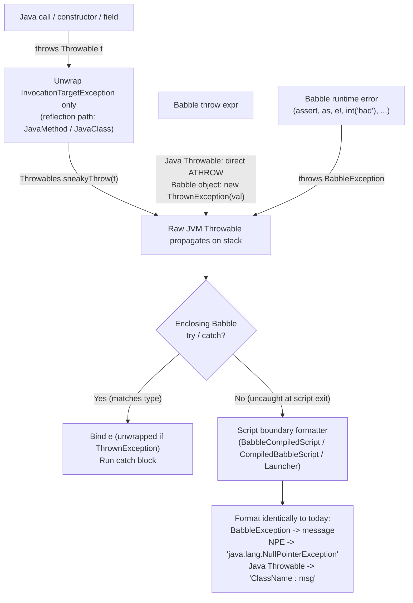
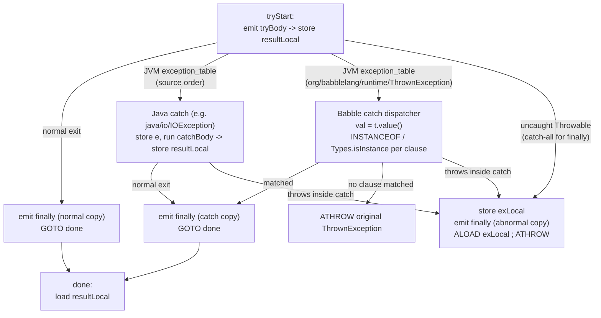

# BIP028: Exception handling (`try`, `catch`, `finally`)

| | |
|---|---|
| **BIP** | 028 |
| **Date** | 2026-11-23 |
| **Status** | Implemented (`BIP028-D1`–`D10` settled, resolving `BIP028-Q1`–`Q10`; `BIP028-I1`–`I5` implemented) |
| **Depends on** | Object model & plain compiled classes ([bip002_object-model.md](bip002_object-model.md), `RM003`, `BIP020-D18`), interactive mode ([bip004_repl.md](bip004_repl.md)), `java.base`-only runtime boundary ([bip006_module-sources-and-aot.md](bip006_module-sources-and-aot.md)), static typing, unions, narrowing & `Type.NOTHING` ([bip008_static-typing.md](bip008_static-typing.md), [bip010_type-checker-simplification.md](bip010_type-checker-simplification.md)), core types & Java nullability ([bip011_core-types.md](bip011_core-types.md)), predicate-free single-bracket `()` grammar ([bip012_grammar-improvements.md](bip012_grammar-improvements.md)), `for` loops & `break`/`continue` ([bip013_iterators.md](bip013_iterators.md)), typed `HIR` & Nanopass optimizer ([bip014_optimization-passes.md](bip014_optimization-passes.md), [bip027_tackling-complexity-in-the-compiler.md](bip027_tackling-complexity-in-the-compiler.md)), pure-by-default effects, ownership & HOF forwarding ([bip007_effects.md](bip007_effects.md), [bip016_consolidating-effect-annotations.md](bip016_consolidating-effect-annotations.md), [bip017_higher-order-function-effects.md](bip017_higher-order-function-effects.md), [bip019_refactoring-axioms.md](bip019_refactoring-axioms.md)), self tail calls & `forever` ([bip024_tail-calls.md](bip024_tail-calls.md)), WebAssembly 3.0 `try_table`/`exnref` alignment ([bip025_compile-to-wasm.md](bip025_compile-to-wasm.md)) |
| **Scope** | Expression-oriented `try`, `catch`, `finally`, and `throw` plus the core `exception` type across `Babble.g4`, `Formatter`, REPL `BabbleSession.classify`, `BlockScopes`/`Resolver`/`TypeChecker`/`Narrowing`/`TailCalls`/`EffectChecker`/`LoweringAnalyzer`, direct JVM `Throwable` propagation & custom Babble exception values via `ThrownException` in `org.babblelang.runtime`, `Interpreter` (`ControlFlowSignal`), `HirExpr.Try`/`HirExpr.Throw` lowering & JVM `exception_table`/`finally` bytecode emission with automatic `addSuppressed`, and `BIP014` Nanopass optimizer soundness |

---

## 1. Summary & Motivation

### 1.1 What Babble has today

Runtime failures occur across every Babble program that talks to the outside world or validates input: Java library calls (`Integer.parseInt`, `Files.readString`, `List.get`, `Math.floorDiv`), Babble scalar conversions (`int("bad")`), checked `as` casts, non-null assertions (`e!`), `assert(...)`, array indexing (`ArrayIndexOutOfBoundsException`, `ArrayStoreException`), uninitialized local reads (`Name used before definition`), and dynamic `import(...)`.

Today, Babble has **no structured way to catch exceptions, guarantee cleanup, or throw domain errors**:

1. **No recovery.** Any exception aborts the entire script or REPL evaluation. Calling `java.lang.Integer.parseInt(s)` or `java.nio.file.Files.readString(path)` cannot recover from malformed input or missing files without writing a Java wrapper class.
2. **No guaranteed cleanup.** Code that opens a `java.io.Writer`, `InputStream`, `Socket`, or `ReentrantLock` cannot guarantee `.close()` or `.unlock()` runs when an exception, `return`, `break`, or `continue` exits a block.
3. **No structured throwing from Babble.** Code can only fail via `assert(false, "message")` (which always throws `BabbleException` with an unstructured string) or by delegating to a Java helper.
4. **Inconsistent Java exception wrapping.** Today, [`JavaMethod.invoke`](../../src/main/java/org/babblelang/engine/impl/natives/java/JavaMethod.java), [`JavaLinker`](../../src/main/java/org/babblelang/engine/impl/natives/java/JavaLinker.java), [`JavaClass`](../../src/main/java/org/babblelang/engine/impl/natives/java/JavaClass.java), and [`CallEmitter.emitWrappedJavaInvoke`](../../src/main/java/org/babblelang/compiler/CallEmitter.java) wrap every Java call inside a `try/catch (Throwable)` that routes non-`BabbleException`, non-`Error` throwables into [`JavaTypes.wrapInvocationException`](../../src/main/java/org/babblelang/runtime/JavaTypes.java), constructing `new BabbleException(name + " : " + msg, t)`. Meanwhile, direct JVM instructions emitted by compiled code (such as `ArrayOp` `<X>ALOAD` throwing `ArrayIndexOutOfBoundsException` or `ArrayStoreException`) throw the raw Java exception directly. Catching `java.io.IOException` or `java.lang.NumberFormatException` requires resolving this inconsistency cleanly so Java exceptions preserve their true runtime types across both modes.
5. **Internal interpreter control-flow exceptions.** [`Interpreter`](../../src/main/java/org/babblelang/engine/impl/Interpreter.java) implements `return`, `break`, and `continue` with zero-stacktrace `RuntimeException` subclasses ([`ReturnException`](../../src/main/java/org/babblelang/engine/impl/ReturnException.java), `Interpreter.BreakException`, `Interpreter.ContinueException`). Exception handling must guarantee that user `catch` clauses never intercept these internal signals, while `finally` blocks still execute as they unwind.

### 1.2 What this proposal introduces

`BIP028` adds expression-oriented `try`, `catch`, `finally`, `throw`, and the core `exception` type tailored to Babble's idioms — single bracket `()`, predicate-free `PredictionMode.SLL` grammar, native union types `A | B` for multi-catch, `Type.NOTHING` for `throw`, automatic `addSuppressed` on `finally`, pure-by-default `BIP016` effects and local-catch provenance soundness, and 3-way `interpret` / `-O0` / `-O1` parity:

```babble
;; 1. Expression-oriented try / catch with native union multi-catch & unnamed catch
def parsePort = fn nothrow (text: string): int -> (
    try (
        def n = java.lang.Integer.parseInt(text)
        if n < 1 or n > 65535 then (
            throw exception("port out of range : " + text)
        )
        n
    ) catch : java.lang.NumberFormatException | exception then (
        8080
    ) catch then (
        8080
    )
)

;; 2. Custom Babble domain exceptions using records (also portable to BIP025 Wasm)
def ParseError = record (def line: int, def message: string) ()

def parseLine = fn (line: int, raw: string): int -> (
    try (
        java.lang.Integer.parseInt(raw)
    ) catch : java.lang.NumberFormatException then (
        throw ParseError(line, "expected integer, got " + raw)
    )
)

def result = try (
    parseLine(4, "abc")
) catch e: ParseError then (
    println("line ", e.line, " : ", e.message)
    -1
) finally (
    println("done")
)

;; 3. try / finally for guaranteed cleanup (runs on normal exit, return, break, continue, and throw;
;;    if reader.close() throws while an exception is in flight, it is attached via addSuppressed!)
def readFirstLine = fn io (path: java.nio.file.Path): string? -> (
    def reader = java.nio.file.Files.newBufferedReader(path)
    try (
        reader.readLine()
    ) finally (
        reader.close()
    )
)
```

### 1.3 Goals and non-goals

**Goals:**
1. **Expression-oriented `try` / `catch` / `finally` and `throw`** (`BIP028-D1`, `BIP028-D5`) consistent with `if`, `while`, `for`, `return`, `break`, and `continue`, preserving Babble's single-bracket `()` grammar and pure `PredictionMode.SLL` parsing with zero predicates (`ParserGrammarTestCase`).
2. **First-class Java exception interop** (`BIP028-D3`) with **no checked-exception ceremony**: Java exceptions propagate with their true runtime type across both `Interpreter` and compiled bytecode, retiring the per-call `emitWrappedJavaInvoke` wrapper while keeping existing uncaught error formatting byte-identical.
3. **Ergonomic custom Babble exceptions & core `exception` type** (`BIP028-D2`): open nominal `record`/`class`/`object`/`interface` domain errors via `ThrownException` plus core `exception` aliasing `BabbleException`, composing naturally with Babble's unions `A | B`, `is` narrowing, `frozen` immutability, and future WebAssembly 3.0 `try_table`/`exnref` lowering (`BIP025`).
4. **Sound integration with Babble's static type, effect, and ownership systems:** `Type.NOTHING` for `throw`, unreachable-catch rejection, automatic `addSuppressed` & forbidden jumps out of `finally` (`BIP028-D6`), `nothrow` restoration on exhaustive catch-all handlers (`BIP028-D7`), conservative `@MOVED`/`unique` joins across `try` → `catch`/`finally`, intra-procedural local-catch `@BORROWED` provenance (`BIP028-D8`), and exact `BIP024` tail-call interaction.
5. **Verified JVM bytecode lowering & Nanopass soundness (`BIP028-D9`):** empty-operand-stack invariant for `try` inside compound expressions (`1 + try (...)`), native JVM `exception_table` dispatch, pure inline `finally` duplication with `try`-range splitting and non-local exit handling (`return`/`break`/`continue`), passing `HirVerifier` and ASM `CheckClassAdapter` across `-O0`, `-O1`, and `-O2`, with zero runtime dependencies outside `java.base` (`RuntimeBoundaryTestCase`).

**Non-goals:**
* **Java-style checked `throws` clauses on function types.** Babble already tracks throwability via opt-in `nothrow` (`BIP007` / `BIP016`) and `fn calling f` (`BIP017`). Adding checked exception lists to every function signature would conflict with Babble's lightweight, pure-by-default ergonomics; fine-grained typed throw-sets are noted only as a possible future extension (§6.1).
* **Algebraic resumable effect handlers** (Koka / OCaml 5 continuations). JVM bytecode has no delimited continuations, and `BIP028` targets standard unwind-only exceptions.
* **Built-in `Result of (T, E)` monad or `?` error-propagation operator.** `Result` can live cleanly in `std/` using Babble's existing generics and unions (`Ok of T | Err of E`); `BIP028` provides the underlying exception mechanism required for JVM interop, assertions, and resource cleanup.

---

## 2. State of the Art

| Language / Target | `try` form | Checked exceptions? | Multi-catch | Custom exceptions | `return`/`break` in `finally` | Resource management |
|---|---|---|---|---|---|---|
| **Java** (JLS §14.20) | Statement | Yes (`throws`) | `catch (A \| B e)` | Subclass `Throwable` | Allowed (silently swallows exceptions) | `try (var r = ...)` (`AutoCloseable` + `addSuppressed`) |
| **Kotlin** | Expression (`finally` discarded) | No | Not built-in | Subclass `Throwable` | Allowed | `resource.use { ... }` stdlib inline HOF |
| **Scala 3** | Expression (`finally` discarded) | Opt-in `CanThrow` capability | Pattern `case e: A \| B =>` | Subclass `Throwable` (`NonFatal` extractor) | Allowed (warns) | `Using(resource) { ... }` |
| **Python 3.14** | Statement (`else` + `finally`) | No | `except (A, B) as e:` | Subclass `BaseException` | Deprecated / `SyntaxWarning` (**PEP 765**) | `with open(...) as f:` |
| **C# / Swift** | Statement / `do`-`catch` + `defer` | No / typed `throws(E)` (Swift 6) | Guard filters | Subclass `Exception` / `Error` protocol | **Forbidden** at compile time | `using var r = ...` / `defer` |
| **WebAssembly 3.0** (`BIP025`) | `try_table` + `exnref` + `tag` | N/A (IR target) | Multiple `catch` clauses | Typed `tag` payload (`anyref`) | Structured blocks | Lowered from `finally` |

Key lessons for Babble:
1. **Expression-oriented `try` with discarded `finally` (Kotlin / Scala 3)** matches Babble's "everything is an expression" rule (`if`, `while`, `for`).
2. **Native union multi-catch (`A | B`)** requires zero special grammar in Babble because `type` already supports unions, and `Narrowing` already narrows union values via `if e is A then (...)`.
3. **No checked `throws` (Kotlin / Scala default)** avoids viral signature friction on Java interop while letting Babble's existing `nothrow` + `fn calling f` effect layer enforce exception-freedom where demanded (e.g., optimizer gates and pure `nothrow` APIs).
4. **Forbidding `return` / `break` / `continue` escaping `finally` (C# / Swift / Python PEP 765)** eliminates one of the JVM's most notorious bug sources (silently swallowing an in-flight exception or overwriting a pending return value) and dramatically simplifies `HirEmitter`.
5. **Fatal `Error` separation (Java / Scala `NonFatal` / Python `BaseException` vs `Exception`)** ensures a casual catch-all does not accidentally swallow `OutOfMemoryError` or `StackOverflowError`.
6. **HOF resource cleanup (`using` via `BIP017` `fn calling f`)** achieves Kotlin's `.use` ergonomics with full effect forwarding (`io`, `mut`, `volatile`, `nothrow`) and zero extra syntax, while leaving room for `try`-with-resources syntax if ever wanted (§8).

---

## 3. Syntax, Grammar, Formatting & REPL

### 3.1 Keyword audit

Five new lexer tokens are added (`BIP028-D1`, `BIP028-D2`):

```antlr
TRY:       'try';
CATCH:     'catch';
FINALLY:   'finally';
THROW:     'throw';
EXCEPTION: 'exception';
```

`EXCEPTION` joins `coreTypeKeyword` (aliasing `org.babblelang.runtime.BabbleException`, usable both as a type and as a constructor `exception("msg")` / `exception("msg", cause)`, like `string`/`list`). All five tokens are exempted in `memberName` (`memberName: ... | TRY | CATCH | FINALLY | THROW;`, with `EXCEPTION` covered via `coreTypeKeyword`), following `BIP011-D11`, `BIP012-D7`, `BIP013-D1`, and `BIP024-D9`, so Java methods/fields or named arguments with those names continue to work after `.` / `?.` and in `name: value` call arguments.

**Corpus impact check:** Searching all `.ba` scripts (`src/test/babble/`, `examples/`, `src/main/java/org/babblelang/axioms/`) and all `.batest` files (`src/test/batest/`) confirms **zero identifier collisions** for `try`, `catch`, `finally`, `throw`, and `exception` (every existing match is inside comments or prose).

### 3.2 `try` / `catch` / `finally` and `throw` grammar (`BIP028-D1`)

A `try` expression must have at least one `catch` clause, a `finally` block, or both (bare `try (...)` with neither is a syntax error). **`BIP028-D1`** adopts the `then`-delimited header — mirroring `for name (: type)? in ... then (...)`, `while ... then (...)`, and `if ... then (...)` — with **zero predicates and pure `PredictionMode.SLL`**:

```antlr
expression:
          ...
          | TRY NL* tryBlock=block
            ( (NL* catchClause)+ (NL* FINALLY NL* finallyBlock=block)?
            | NL* FINALLY NL* finallyBlock=block
            )                                               # tryExpression
          ...
          | EXCEPTION                                       # coreExceptionRef
          ...
          | RETURN expression                               # returnExpression
          | FOREVER expression                              # foreverExpression
          | BREAK expression?                               # breakExpression
          | CONTINUE                                        # continueExpression
          | THROW expression                                # throwExpression
          ;

catchClause: CATCH (NL* name=ID)? (':' type)? THEN NL* catchBlock=block;
```

All four catch-clause shapes parse strictly in LL(1) / `PredictionMode.SLL` (`ID` vs. `':'` vs. `THEN`, since `THEN` cannot appear anywhere inside `type`):

```babble
def x = try (
    risky()
) catch e: java.io.IOException | java.lang.IllegalArgumentException then (
    fallback(e)
) catch : java.lang.NumberFormatException then (   ;; unnamed typed catch
    0
) catch e then (                                   ;; untyped catch-all (non-Error, BIP028-D4)
    recover(e)
) finally (
    cleanup()
)

def y = try (risky()) catch then (0)               ;; unnamed catch-all (non-Error)
```

*(Alternatives considered and rejected in `BIP028-Q1` → `BIP028-D1`: `catch (e: T) -> (...)`, `catch (e: T) then (...)`, and Java-style `catch (e: T) (...)`, which add extra parentheses or adjacent `)(` groups diverging from `for`/`if`/`while`.)*

**`throw` precedence:**
`THROW expression` sits at the bottom of `expression` alongside `RETURN expression`, `FOREVER expression`, `BREAK expression?`, and `CONTINUE`. Thus `throw IllegalArgumentException("bad: " + x)` parses as `throw (IllegalArgumentException("bad: " + x))`, while `if bad then (throw err) else (ok)` and `def x = if ok then (1) else (throw err)` parse naturally. Unlike `break expression?`, `throw` always requires an expression (`throw e` to rethrow), eliminating any newline-termination ambiguity.

**Unambiguous newline continuation:**
Because `CATCH` and `FINALLY` are reserved keywords that can never begin a standalone `expression`, `(NL* catchClause)+` and `(NL* FINALLY NL* finallyBlock=block)?` can never conflict with a following statement on the next line — identical to `(NL* ELSE NL* ...)?` in `ifExpr` and `(NL* STATIC NL* staticBlock=block)?` in `classExpression`.

### 3.3 `Formatter` (`babblefmt`) rules

Following [`Formatter.java`](../../src/main/java/org/babblelang/format/Formatter.java)'s existing rules for `if`/`else`/`static` and `for`/`then`:
* `try (` keeps its opening `(` on the same line as `try` (dropped newline before block `(`, unless a comment intervenes).
* `) catch ... then (` and `) finally (` are pulled back onto the line of the preceding block's closing `)`, exactly like `) else (` and `) else if ... then (` and `) static (`.
* Single spaces around `catch`, `then`, `finally`, `throw`, and `|` in multi-catch types; no space before `:`, one space after `:` (`catch e: A | B then (`).
* Anchoring: the `try`, `catch`, and `finally` blocks all anchor their indentation to the line starting the `try` expression (so bodies indent by 4 spaces relative to `try`, not relative to `catch` or `finally`).
* Round-trip parse-tree equivalence (`shape()`) continues to hold unchanged.

### 3.4 REPL (`BabbleSession.classify`)

[`BabbleSession.classify`](../../src/main/java/org/babblelang/engine/BabbleSession.java) classifies inputs by checking `ParseFailure.atEnd()`:
* Typing `try (\n    risky()\n)` and pressing Enter fails at `EOF` expecting `catch` or `finally` → `ParseFailure.atEnd() == true` → **`INCOMPLETE`** (REPL continues reading).
* Typing `try (\n    risky()\n) catch e: java.lang.Exception then` and pressing Enter fails at `EOF` expecting `(` → **`INCOMPLETE`**.
* Typing `try (\n    risky()\n) catch e: java.lang.Exception then (\n    0\n)` is a complete `tryExpression` → **`COMPLETE`** (same rule as `if c then (a)` without `else`: to chain another `catch` or `finally` interactively, place `) catch` or `) finally` on the closing `)` line, matching canonical `babblefmt` style).
* `Completions` adds `try`, `catch`, `finally`, and `throw` to its keyword list.

---

## 4. Exception Model, Throwing & Java Interop

### 4.1 Retiring per-call Java exception wrapping (`BIP028-D3`)

Today, Java exceptions are wrapped eagerly at **every** Java call boundary:
* `JavaMethod.invoke` catches `Throwable` and calls `JavaTypes.wrapInvocationException(t)`.
* `JavaLinker` attaches `MethodHandles.catchException(..., FAIL)` delegating to `JavaTypes.wrapInvocationException`.
* `JavaClass` wraps constructor/field reflection errors via `JavaTypes.wrapInvocationException`.
* `CallEmitter.emitWrappedJavaInvoke` wraps **every** statically lowered Java method/constructor call in bytecode with a synthetic `visitTryCatchBlock(..., "java/lang/Throwable")` calling `JavaTypes.wrapInvocationException` and rethrowing `BabbleException`.

That design made sense before `try`/`catch` existed because it unified uncaught formatting and bypassed `javac`'s checked-exception rules on `Callable.call`. With `try`/`catch`, eager wrapping breaks native JVM `exception_table` dispatch, leaks `BabbleException` wrappers back into Java callers of `RM003` bridges, and bloats bytecode at every Java call site.

**Settled architecture (`BIP028-D3` — direct `Throwable` propagation with boundary formatting):**



Key pieces of `BIP028-D3`:
1. **`org.babblelang.runtime.Throwables`** (tiny `java.base`-only utility in `org.babblelang.runtime`):
   * `public static RuntimeException sneakyThrow(Throwable t)`: type-erased generic rethrow (`throw (T) t;`), allowing checked exceptions (such as `IOException`) to propagate unmodified through `Interpreter`, `JavaMethod.invoke`, `Callable.call`, and `JavaLinker` with zero wrapping.
   * `public static RuntimeException unwrapReflection(Throwable t)`: peels `InvocationTargetException` (with `Error` passing straight through) and calls `sneakyThrow(t)`.
   * `public static void addSuppressed(Throwable primary, Throwable secondary)`: attaches `secondary` to `primary` with a `if (primary != secondary)` self-suppression guard (`BIP028-D6`).
2. **`CallEmitter.emitWrappedJavaInvoke` is deleted.** Direct Java `INVOKEVIRTUAL`/`INVOKESTATIC`/`INVOKEINTERFACE`/`NEW` emits the instruction directly; if Java throws `NumberFormatException` or `IOException`, the JVM propagates the exact exception object with zero wrapper allocation.
3. **Top-level uncaught formatting stays 100% backwards-compatible:**
   `ArraySupport.formatThrowable(Throwable t)` (called by `BabbleCompiledScript.eval`, `CompiledBabbleScript.eval`, and `Launcher.message`) formats uncaught exceptions identically to today:
   * `BabbleException` → `org.babblelang.runtime.BabbleException: <msg>` (or `<msg>` in `Launcher`)
   * `ThrownException` → `org.babblelang.runtime.BabbleException: <ArraySupport.format(value)>`
   * `NullPointerException` → `java.lang.NullPointerException` (omitting JDK 14+ Helpful NPE text that leaks synthetic compiler local names, preserving `BIP009` parity)
   * `ArrayStoreException` → existing compiled-class-name normalizer in `ArraySupport.formatThrowable`
   * Any other non-`Error` `Throwable` → `t.getMessage() == null ? name : name + " : " + t.getMessage()` (exact space-before-colon match with `src/test/batest/java/exceptions_and_nulls.batest`).
4. **`PrintFunction` (`print`/`println` to a custom `Appendable`):** Rethrows `IOException` directly via `Throwables.sneakyThrow(e)` so `try (println("hi", to: brokenWriter)) catch e: java.io.IOException then (...)` catches it naturally.

### 4.2 Custom Babble exceptions, `ThrownException`, and what `throw` accepts (`BIP028-D2`)

Because Babble classes are plain JVM classes extending `java.lang.Object` (`BIP020-D18`) with no class inheritance (only interface `implements`), **`BIP028-D2`** adopts the open nominal carrier model:

1. **What `throw expr` accepts:** Any non-null `java.lang.Throwable` (including `exception`) OR any Babble nominal instance (`class`, `record`, `object`, `interface`, or union/intersection thereof). `throw` statically rejects `null`, nullable `T?`, `void`, primitives (`byte`..`char`), `string`, `array of T`, functions, overload sets, class values, modules, and packages (`Type error : cannot throw <type>`).
2. **Works seamlessly with `record`, interfaces, unions, and `frozen`:**
   ```babble
   def AppError = interface (def code: fn (): int)
   def NotFound = record (def id: string) implements AppError (
       def code = fn (): int -> (404)
   )
   def Denied = record (def user: string) implements AppError (
       def code = fn (): int -> (403)
   )
   ```
   A caller can catch `e: NotFound`, `e: NotFound | Denied`, `e: AppError`, or `e: AppError | java.io.IOException`, with zero new class-declaration syntax and full `BIP025` WebAssembly portability (`tag $babble_exn (param anyref)` + `br_on_cast`).
3. **`org.babblelang.runtime.ThrownException extends RuntimeException` (`BIP028-D2`):**
   * `ThrownException` is a `public final class ThrownException extends RuntimeException` holding `private final Object value` and overriding `getMessage()` via `ArraySupport.format(value)`.
   * Extending `RuntimeException` makes thrown Babble objects friendly to Java host callers (`Runnable`, `Comparator`, `ExecutorService`, JUnit): Java's `catch (RuntimeException e)` and `catch (Exception e)` catch it cleanly without sneaky checked-`Throwable` surprises, and callers can inspect `e.value()`.
   * **Type-honest Babble `catch` isolation:** Inside Babble `try`/`catch`, handlers targeting `java.lang.Exception` or `java.lang.RuntimeException` explicitly skip `ThrownException` (a 3-instruction guard in compiled bytecode, zero cost on the happy path). Thus `catch e: java.lang.Exception` catches only Java `Exception`s (including `exception`), `catch e: ParseError` catches `ParseError` in any clause order, untyped `catch e then (...)` catches both Java `Exception`s and Babble thrown values (unwrapped, `e: any`), and `catch e: java.lang.Throwable` catches every `Throwable` (including `ThrownException` as a `Throwable` for infrastructure code).

### 4.3 The core `exception` type (`BIP028-D2`)

Babble's own runtime errors — `assert(false, ...)`, `x as T`, `e!`, `Name used before definition`, dynamic `import(...)` failures — all throw `org.babblelang.runtime.BabbleException` (`extends RuntimeException`).

* **`exception` core type keyword (`BIP028-D2`):** Reserved lowercase core type keyword (in `coreTypeKeyword` and `memberName`, like `string` and `list`) aliasing `org.babblelang.runtime.BabbleException`:
  * In type positions: `catch e: exception then (...)`, `e is exception`, `fn (): exception` (and `org.babblelang.runtime.BabbleException` resolves to the exact same type, just as `string` == `java.lang.String`).
  * In expression positions: constructible via `exception("message")` and `exception("message", cause)` (matching `BabbleException`'s constructors).
  * Portable to `BIP025` WebAssembly without naming `org.babblelang.runtime.*`.
* **Note on `int("bad")` / `double("bad")`:** [`ConvertFunction.java`](../../src/main/java/org/babblelang/engine/impl/natives/ConvertFunction.java) calls `Integer.parseInt` / `Double.parseDouble` (throwing `NumberFormatException` directly under `BIP028-D3`) and throws `BabbleException` (`exception`) for range/type failures like `int(1e30)`. `BIP028-I1` audits `ConvertFunction` so every conversion failure's exception class is documented and verified identically in all 3 modes.

### 4.4 Fatal JVM `Error`s, wildcard `catch`, and `ControlFlowSignal` (`BIP028-D4`)

Three distinct categories of `Throwable` can fly past a `try` block on the JVM:

| Category | Examples | Caught by `catch e: T` (explicit `T`)? | Caught by untyped `catch e then (...)` / `catch then (...)`? | Runs `finally`? |
|---|---|---|---|---|
| **Interpreter control-flow signals** | `ControlFlowSignal` (`ReturnException`, `BreakException`, `ContinueException`, see §7.3) | **NEVER** (even `catch e: java.lang.Throwable`) | **NEVER** | **YES** (for `finally` blocks between jump and target) |
| **Normal exceptions** | `java.lang.Exception`, `RuntimeException`, `IOException`, `exception` (`BabbleException`), Babble `ThrownException` | Yes, if runtime value matches `T` | **YES** (binds `e: any`) | **YES** |
| **JVM `Error`s** | `OutOfMemoryError`, `StackOverflowError`, `LinkageError`, `AssertionError` | Yes **only** if `T` explicitly accepts `Error` (e.g., `java.lang.Error`, `java.lang.StackOverflowError`, `java.lang.Throwable`) | **NO** (`BIP028-D4`) | **YES** (standard JVM `catch-all` `finally`) |

Under **`BIP028-D4`**:
* Untyped `catch e then (...)` (and unnamed `catch then (...)`) catches **all non-`Error` exceptions** — every Java `Exception`, every `exception` (`BabbleException`), and every Babble thrown object (unwrapped) — binding `e: any`, while **never** silently swallowing `OutOfMemoryError` or `StackOverflowError`.
* Code that explicitly wants to intercept `AssertionError`, `StackOverflowError`, or every `Throwable` writes `catch e: java.lang.Error` / `catch e: java.lang.Throwable` explicitly.
* `ControlFlowSignal` bypasses every `catch` clause (even `java.lang.Throwable`) while running every intervening `finally`.

---

## 5. Static Semantics: Typing, Scoping, Control Flow & Reachability

### 5.1 `throw` expression typing

* `throw expr`:
  * Checks `expr` against the throwable constraint (§4.2): non-nullable `java.lang.Throwable` (or Babble nominal instance under Option 2B). Rejects `null`, `T?`, primitives, `void`, functions, arrays, modules, packages, and class values with a clear diagnostic (`Type error : cannot throw <type>`).
  * **Expression type is `Type.NOTHING`** (Babble's existing bottom type in [`Type.java`](../../src/main/java/org/babblelang/analysis/Type.java), already used for `return`, `break`, and `continue`).
  * Because `Type.NOTHING` is a subtype of every type `T` (`TypeAlgebra.subsumes(T, NOTHING) == true`) and `join(T, NOTHING) == T`, idioms like the following type-check with zero casts:
    ```babble
    def requirePos = fn (n: int): int -> (
        if n > 0 then (n) else (throw java.lang.IllegalArgumentException("must be positive"))
    )
    def nonNullName: string = if maybe != null then (maybe) else (throw MissingName())
    ```
  * Statements following an unconditional `throw` in the same block are unreachable (same handling as after `return`/`break`/`continue`).

### 5.2 `try` / `catch` / `finally` expression typing (`BIP028-D5`)

Consistent with `if` / `else`, `while`, and `for`:

1. **Bidirectional type flow (`BIP010`):**
   * The enclosing `expected` type flows into `tryBlock` AND into every `catchBlock`.
   * `finallyBlock` (if present) is checked in **discarded statement position** (`Role.STATEMENT`, no `expected` type) — its result value is always discarded and never contributes to the `try` expression's type.
2. **Result type:**
   * Let $T_0$ be the type of `tryBlock` and $T_1, \dots, T_k$ be the types of the `catch` blocks.
   * The type of `try ... catch ... finally` is the join of all non-`NOTHING` branches:
     $$T_{\text{try}} = \text{join}(T_0, T_1, \dots, T_k)$$
     (if all branches have type `Type.NOTHING` — e.g., every branch returns or throws — then $T_{\text{try}} = \text{Type.NOTHING}$).
   * If there are **no `catch` clauses** (`try (...) finally (...)`), $T_{\text{try}} = T_0$.
   * **Numeric widening (`BIP008-D7`, `BIP011-D4`):** If `tryBlock` yields `int` and a `catchBlock` yields `double`, `join(int, double) == double`, and `TypeChecker.coerce` records widening on the `int` branch just as it does for `if`/`else`.
   * **Unboxed primitive results (`RM001` / `RM005`):** When $T_{\text{try}}$ is a non-nullable core primitive (`byte`..`char`), `LoweringAnalyzer` gives the `HirExpr.Try` that `PrimitiveKind`, so `def n: int = try (parseInt(s)) catch : java.lang.NumberFormatException then (0)` never boxes the `int` result.
   * **Edge case — `finallyBlock` has type `Type.NOTHING` (always throws):**
     If `finallyBlock` unconditionally throws (e.g., `finally (throw Fatal())`), then the `try` expression can never complete normally, so $T_{\text{try}} = \text{Type.NOTHING}$ (and `TypeChecker` may emit a warning if a non-`NOTHING` `try`/`catch` result is unconditionally masked by a throwing `finally`).

### 5.3 Catch-type validity, multi-catch unions, and unreachable catches

For every `catchClause` with type annotation `C`:
1. **Valid catch types:**
   * Each member of `C` (after flattening `Type.Union`) must be a reifiable catchable type (`BIP028-D2`): a `java.lang.Throwable` class (including `exception`), OR a Babble `class`, `record`, `object`, or `interface` (or `A & B` intersection of Babble/Java interfaces).
   * **Rejected statically** (mirroring `resolveIsTarget` in [`TypeChecker.java`](../../src/main/java/org/babblelang/analysis/TypeChecker.java)):
     - `null` or nullable `T?` (`Cannot catch nullable type : ...`)
     - `void`, primitives (`int`, `double`, ...), `string`, `array of T`, function types, overload sets (`Cannot catch non-exception type : ...`)
     - Erased generic type arguments (`catch e: Box of int` → `Cannot catch erased type arguments : use Box`)
     - Type variables `T` (`Cannot catch type parameter : T` — erased at runtime)
     - `frozen T` (`Cannot catch 'frozen' type : ...` — matching `Cannot test 'frozen' with 'is'`)
     - Non-`Throwable` Java classes (e.g., `catch e: java.lang.String` or `catch e: java.util.List` — `Type error : java.lang.String is not a Throwable`).
2. **Multi-catch unions (`A | B`):**
   * `catch e: java.io.IOException | java.lang.IllegalArgumentException then (...)` requires zero new syntax.
   * Inside `catchBlock`, `e` has static type `java.io.IOException | java.lang.IllegalArgumentException`. Common supertypes/members work through `MemberTypes`, and `if e is java.io.IOException then (...)` narrows `e` using Babble's existing `Narrowing` pass.
   * Redundant union members within one `catch` clause (`catch e: java.lang.Exception | java.io.IOException`) are rejected: `Redundant catch type : java.io.IOException is already a subtype of java.lang.Exception`.
3. **Unreachable catch clauses (compile-time error):**
   * Clauses are checked in source order. Maintaining the accumulated union $U_{<i}$ of types caught by clauses $1 \dots i-1$ (with untyped `catch` subsuming all non-`Error` types, and `java.lang.Throwable` subsuming everything):
     - If every member of clause $i$'s type $C_i$ is subsumed by $U_{<i}$, report a compile-time error: `Unreachable catch clause : <C_i> is already caught by <earlier>`.
     - If a member $M$ of a union catch $C_i = M \mid N$ is already subsumed by $U_{<i}$, report `Unreachable catch type : <M> is already caught by <earlier>`.

### 5.4 Block scoping, read-only binding, narrowing & definite initialization

* **Scopes (`BlockScopes` & `Resolver`):**
  * `tryBlock`, each `catchClause` (its binding `e`, if named, + `catchBlock`), and `finallyBlock` are separate lexical block scopes (child `ScopeNode`s).
  * `e` is bound in the `catchClause`'s scope and is **read-only** (`Assigning to catch parameter : e` is a compile-time error, matching `for`'s loop variable `BIP013-D6`).
  * `e` may be captured by closures inside `catchBlock` (promoted to a `Cell` by `Resolver` if captured, just like any block local).
  * Names `def`'d inside `tryBlock` are not visible in `catchBlock` or `finallyBlock`.
* **Narrowing (`Narrowing` / `TypeEnv`):**
  * **Into `catchBlock` and `finallyBlock`:** Start from the `TypeEnv` **before `try`** (NOT the `TypeEnv` at the end of `tryBlock`, because an exception may have been thrown on the very first line of `tryBlock` before any `!= null` or `is T` guard executed). Furthermore, invalidate any narrowing on variables that are reassigned anywhere inside `tryBlock` (or `catchBlock` when entering `finallyBlock`), just like `while`/`for` loop invalidation.
  * **After `try` / `catch` / `finally`:** Intersect the post-narrowings of `tryBlock` and all non-`NOTHING` `catchBlock`s (re-applying any unconditional narrowing established in `finallyBlock`), dropping facts on variables reassigned in any branch.
* **Definite initialization:**
  * A `def x: T` declared outside `try` without an initializer and assigned only inside `tryBlock` is **NOT** definitely initialized inside `catchBlock`, `finallyBlock`, or after `try` (unless also assigned in every non-`NOTHING` `catchBlock`, or in `finallyBlock`), keeping `mayBeUndefined = true` for `HirVar` so `Name used before definition` behaves identically in both backends.

### 5.5 Non-local exits (`return`, `break`, `continue`) & `finally` suppression (`BIP028-D6`)

1. **`return`, `break`, `continue` inside `try` or `catch`:**
   * **Allowed** (whenever inside an enclosing function / loop, per `BlockScopes` placement rules).
   * The `return e` or `break e` value expression `e` is evaluated **before** `finally` runs; mutations inside `finally` do **not** alter the already-evaluated return/break value (matching Java, Kotlin, and Python).
   * All enclosing `finally` blocks between the jump and its target (enclosing function for `return`; enclosing loop for `break`/`continue`) execute innermost-to-outermost before control transfers.
2. **`return`, `break`, `continue` escaping `finally` — statically forbidden (`BIP028-D6`):**
   * `BlockScopes` tracks `finallyDepth` (resetting inside a nested `fn` literal or nested loop contained within `finally`, so a `return` inside a closure or a `break` inside an inner loop inside `finally` remains legal).
   * Diagnostics: `Cannot return from a finally block`, `Cannot break out of a finally block`, `Cannot continue out of a finally block`.
3. **Throwing inside `finally` — automatic `addSuppressed` (`BIP028-D6`):**
   * `finally` **is allowed to throw** (so cleanup calls like `reader.close()` work directly inside `finally` without boilerplate).
   * If `try`/`catch` exited **normally** (or via `return`/`break`/`continue`) and `finally` throws `secondary`, `secondary` propagates normally.
   * If a **`primary` exception is already in flight** entering `finally` and `finally` throws `secondary`, Babble does **NOT** silently drop `primary` (unlike Java/Kotlin/Python's plain `try`/`finally`): instead, it attaches `secondary` to `primary` via `Throwables.addSuppressed(primary, secondary)` (with a `if (primary != secondary)` self-suppression guard) and rethrows `primary`!
   * When `finallyBlock` is statically proven `nothrow` by `EffectChecker`, compiled bytecode omits the suppression handler around the abnormal `finally` copy completely (zero runtime overhead).

### 5.6 Interaction with self tail calls & `forever` (`BIP024`)

[`TailCalls`](../../src/main/java/org/babblelang/analysis/TailCalls.java) must respect exception handlers and cleanup:
* **`tryBlock` is NEVER in tail position:** `try (recurse(n - 1)) catch ...` and `try (recurse(n - 1)) finally (...)` must keep the stack frame active so the `catch`/`finally` handler executes if `recurse` throws or returns.
* **`catchBlock` without `finally` IS in tail position** (when the `try` expression itself is in tail position): once inside `catch`, the `try` handler is no longer active and there is no cleanup left to run, so `try (...) catch e: E then (recurse(n - 1))` can tail-call cleanly.
* **`catchBlock` WITH `finally` is NEVER in tail position:** `finally` must run after `catch` finishes.
* **`finallyBlock` is NEVER in tail position** (its result is discarded).
* **`return e` inside `try` or `catch` when a `finally` is active is NEVER in tail position** (because `finally` must run after `e` returns).
* **`BIP024-D7` & `BIP024-D8` (`forever`):** A `throw` inside a `while true` loop or recursive function makes it NOT `nothrow`, so `while true then (if done then (throw Stop()))` does not require `forever` (consistent with `BIP024-D8`).

---

## 6. Effect, Ownership & Axiom Integration

Babble's static effect & ownership system (`BIP007`, `BIP016`, `BIP017`, `BIP019`, `BIP027`) interacts with `try`/`catch`/`finally`/`throw` in four concrete ways.

### 6.1 `nothrow` inference & dead-catch warnings (`BIP028-D7`)

* **`throw expr`:** Immediately sets `walker.nothrow = false` (in [`EffectBodyWalker`](../../src/main/java/org/babblelang/analysis/EffectBodyWalker.java)) and marks `stmtHasSideEffect = true` (so `throw` is never flagged as `Unused pure expression`).
* **`try` / `catch` / `finally`:**
  Save and isolate the `nothrow` flag across `tryBlock` (`tryNothrow`), each `catchBlock` (`catchNothrow[i]`), and `finallyBlock` (`finallyNothrow`):
  * If `tryNothrow == true`: `tryBlock` cannot throw, so the `try` expression's `nothrow` equals `finallyNothrow`. When `catch` clauses are present and the enclosing function does **not** have a `calling` clause (`BIP017`, where a callback may throw at some call sites), `EffectChecker` emits a non-fatal warning: `Warning : try block cannot throw; catch clause is unreachable`. (A `try (nothrowExpr) finally (...)` *without* `catch` clauses is valid and emits no warning, since `finally` still runs on normal exit or `return`/`break`/`continue`.)
  * If `tryNothrow == false` (`BIP028-D7`): the `try` expression restores `nothrow = true` iff:
    1. The `catch` clauses include an **exhaustive catch-all** — an untyped `catch` (`catch e then (...)` / `catch then (...)`) or `java.lang.Throwable` (consistent with `BIP007`/`BIP016`'s JVM `nothrow` model, which treats asynchronous `VirtualMachineError`s as outside `nothrow`), **AND**
    2. Every `catchBlock` has `catchNothrow[i] == true`, **AND**
    3. `finallyBlock` (if present) has `finallyNothrow == true`.
    Otherwise, `walker.nothrow = false`.
  * *(Future refinement: full static throw-set inference per callable/Java method can strictly relax `BIP028-D7` later without breaking any existing program.)*

### 6.2 Purity, hermeticity & determinism (`BIP028-D8`)

* **Pure `try`/`catch` is pure and deterministic:** Catching an exception thrown by a pure, deterministic computation (e.g., `Integer.parseInt(s)` throwing `NumberFormatException`) performs no I/O and reads no external mutable state. Therefore, `try`/`catch`/`finally` **preserves `pure` (`@HERMETIC`, `@DETERMINISTIC`)** as long as `tryBlock`, all `catchBlock`s, and `finallyBlock` are themselves `@HERMETIC` and `@DETERMINISTIC`.
* **Union of side effects across all clauses:** Every `io`, `volatile`, `mut` (on `this`, parameters, or captured variables), `readsThis`, `readParams`, and callback invocation in `tryBlock`, ANY `catchBlock`, or `finallyBlock` joins into the enclosing callable's effect summary.
* **Stack-trace inspection axioms (`BIP028-D8`):**
  * `Throwable.printStackTrace()` writes to `System.err` → already `io` via bytecode analysis / `curated.ba`.
  * `Throwable.getMessage()`, `getCause()`, `getSuppressed()` → pure getters.
  * `Throwable.getStackTrace()` reflects the call stack (which varies with caller context and optimizer inlining) and is marked `volatile` in `src/main/java/org/babblelang/axioms/java/lang/curated.ba` (with `fillInStackTrace` already `mut nothrow`), ensuring pure functions cannot observe optimizer inlining differences.
  * `finallyBlock` statements are **all** in discarded position, so `Unused pure expression` (`BIP007-D8`) checks every statement in `finallyBlock` (catching bugs like `finally (x + 1)` that forgot to assign or call `close()`).

### 6.3 Ownership (`unique` / `@MOVED`) across `try` / `catch` / `finally`

An exception can be thrown at **any potentially-throwing expression** inside `tryBlock`, transferring control immediately to `catchBlock` and `finallyBlock`. [`EffectBodyWalker`](../../src/main/java/org/babblelang/analysis/EffectBodyWalker.java) preserves ownership soundness across all possible unwind points:

1. **Snapshot before `try`:** Save `preEnv = copy(env)` before walking `tryBlock`.
2. **Track intermediate moves & demotions inside `tryBlock`:** Any variable moved (`move(x)` / `freeze(x)`) or demoted from `unique` to `@EXTERNAL`/`@PARAM` *anywhere* inside `tryBlock` may or may not have happened when an exception fires:
   * On entry to each `catchBlock`, initialize `env` by **joining `preEnv` with the cumulative move/demotion state of `tryBlock`** (if `x` was moved at any point in `tryBlock`, `x` is `@MOVED` in `catchBlock` and cannot be used unless reassigned first; if `x` was demoted in `tryBlock`, `x` is demoted in `catchBlock`).
   * On entry to `finallyBlock`, join `preEnv`, `tryBlock`'s cumulative state, and every `catchBlock`'s state (with the same conservative `@MOVED` and demotion join).
   * After `try`/`catch`/`finally`, join the exit states of `tryBlock` and all non-`NOTHING` `catchBlock`s, followed by `finallyBlock`.
3. **Mutating a fresh `unique` local in `try`:** Remains completely legal inside a `pure` function — `tryBlock` mutates the local, and if it throws, `catchBlock`/`finallyBlock` sees the mutated local (still 100% frame-local and hermetic).

### 6.4 Exception-escape provenance (`@BORROWED` soundness, `BIP028-D8`)

Under `BIP016`, parameters are `@BORROWED` by default — a function may not let a `@BORROWED` parameter escape its dynamic extent unless annotated `shared`:

```babble
def Leak = record (def box: Box) ()
def bad = fn (b: Box): int -> (   ;; b is @BORROWED by default!
    throw Leak(b)                 ;; ESCAPES b out of `bad` -> compile error unless `shared b`
)

def localOk = fn (b: Box): int -> (
    try (
        throw Leak(b)             ;; guaranteed caught locally by `catch e: Leak` -> allowed!
    ) catch e: Leak then (
        e.box.value               ;; `e` carries `b`'s @PARAM provenance, never escapes `localOk`
    )
)
```

**Intra-procedural local-catch escape analysis (`BIP028-D8`):**
Mirroring [`EffectBodyWalker.loopBreakOrigins`](../../src/main/java/org/babblelang/analysis/EffectBodyWalker.java#L79), `EffectBodyWalker` maintains an `activeTryStack` of enclosing `TryFrame`s inside the current function (cleared upon entering a nested `fn` literal):
* Each `TryFrame` records the catch clauses of the active `try` and an accumulated `Reachability.Origin` per catch clause.
* When walking `throw expr`:
  1. Walk `activeTryStack` from innermost to outermost.
  2. If an enclosing `TryFrame` has a `catch` clause whose type statically subsumes `expr`'s type (or is an untyped catch-all for a non-`Error` `expr`), join `expr`'s `Origin` into that `catch` clause's accumulated origin and **do not** treat `expr` as escaping the function.
  3. If no enclosing `TryFrame` in the current function is guaranteed to catch `expr`'s static type, call `recordEscape(origin, exprType)` — rejecting `@BORROWED` parameters/`this` unless annotated `shared`, moved via `unique`, or deeply immutable/`frozen`.
* When walking each `catch` clause `e: T`, initialize `e`'s origin to the join of `Origin.EXTERNAL` (when non-local throws can reach the handler — i.e., if `tryBlock` can throw anything besides locally-tracked `throw`s — or `Origin.IMMUTABLE` when `T` is deeply immutable via `ModalKindTable`) with all locally-caught `throw` origins routed to that clause! Thus if a `catch` block later tries to return, store, or rethrow `e` outside an enclosing handler, normal `EffectBodyWalker` provenance catches the escape right there.

---

## 7. Backend Lowering, `HIR`, Optimizer & WebAssembly

### 7.1 `HIR` representation

`org.babblelang.ir.hir.HirExpr` gains two immutable sealed record variants (bringing `HirExpr` from 51 to 53 variants), keeping `ir`, `opt`, and `compiler` 100% detached from ANTLR4 and `ScopeAnalysis` (`ArchitectureBoundaryTestCase`):

```java
record Throw(
        HirExpr value,
        boolean isJavaThrowable,
        ExprMeta meta
) implements HirExpr {}

record HirCatch(
        HirVar var,                   // null if unnamed catch (: T or bare catch)
        String typeDescriptor,        // runtime Types descriptor (for Babble / union / interface tests)
        List<String> jvmCatchTypes,   // JVM internal names for direct visitTryCatchBlock (e.g. "java/io/IOException")
        boolean catchesBabble,        // true if any target member can match ThrownException
        boolean catchesNonErrorAny,   // true for untyped wildcard catch (Exception | ThrownException, excluding Error)
        List<HirExpr> body,
        List<HirVar> declaredVars,
        boolean opensNamespace,
        int wideningRank
) {}

record Try(
        List<HirExpr> tryBody,
        List<HirVar> tryDeclaredVars,
        boolean tryOpensNamespace,
        int tryWideningRank,
        List<HirCatch> catches,
        List<HirExpr> finallyBody,    // empty list if no finally clause
        List<HirVar> finallyDeclaredVars,
        boolean finallyOpensNamespace,
        boolean finallyNothrow,       // omits addSuppressed wrapper on abnormal exit when true (BIP028-D6)
        ExprMeta meta
) implements HirExpr {}
```

`HirVerifier` checks:
* `Throw.value` is non-null.
* `Try` has at least one catch clause or non-empty `finallyBody`.
* Every `HirCatch.var` (if non-null) belongs to the enclosing function/method's frame and is properly declared.
* `HirPrinter` formats `throw <expr>` and `try (...) catch <v>:<desc> (...) finally (...)` cleanly for `-Dbabble.dumpIr`.

### 7.2 Compiled JVM bytecode lowering (`ControlAndOpEmitter` & `HirEmitter`)

#### 7.2.1 The JVM empty-operand-stack invariant (expression-oriented `try`)

On the JVM, entering an exception handler **clears the entire operand stack** and pushes only the caught `Throwable`. When `try` appears as a subexpression with live values already on the operand stack — for example:

```babble
def a = 1 + try (parse(s)) catch e: java.lang.NumberFormatException then (0)
def b = compute(firstArg(), try (secondArg()) catch e: java.lang.Exception then (fallback))
```

emitting `1` onto the operand stack and then entering `try (...)` would cause a `VerifyError` (`CheckClassAdapter` / StackMapTable frame mismatch between normal exit `[int, int]` and catch exit `[int]`).

**Solution (Operand-stack spilling before `Try`):**
Either during `HirBuilder` lowering or as a tiny HIR normalization pass (`HirTryNormalize`, running unconditionally before `HirEmitter` at every `-O` level including `-O0`):
* Whenever a compound expression (binary op, unary op, call arguments, array creation/op, field assign, `as`/`is`, etc.) contains a `HirExpr.Try` anywhere in a non-first operand, hoist all preceding sibling subexpressions (and the `Try` itself) into sequential synthetic temp `HirVar`s in a wrapping `HirExpr.Block` — preserving strict left-to-right evaluation order and exact `ExprMeta.line` coordinates!
* **Invariant guaranteed to `HirEmitter`:** Every `HirExpr.Try` is emitted with an **empty JVM operand stack** (just like loop heads for HotSpot OSR). Both the normal `tryBody` exit and every `catch` exit store their result into a dedicated `resultLocal` (typed with `try.meta().kind()`, unboxed for primitives!) and `GOTO tryEnd` with an empty stack, after which `tryEnd` loads `resultLocal`.

#### 7.2.2 Native `exception_table` & Babble `ThrownException` dispatch



Key bytecode details:
* **Pure Java catches** (`catch e: java.io.IOException`, or multi-catch `IOException | IllegalArgumentException`): emit one `mv.visitTryCatchBlock(tryStart, tryEnd, catchLabel, internalName)` per union member — **zero runtime dispatch overhead**.
* **Babble catches** (`catch e: ParseError`, `catch e: AppError`, or mixed `ParseError | java.io.IOException`):
  * Emit `visitTryCatchBlock` for `"org/babblelang/runtime/ThrownException"` (and any Java `Throwable` members).
  * In the `ThrownException` handler, call `ThrownException.value()`, test against each matching clause in source order using direct `INSTANCEOF` (for statically known compiled Babble classes and JVM interfaces, `RM003`/`BIP020`) or `Types.isInstance` (for intersections/dynamic types), bind `e`, and execute the clause; if none match, rethrow the original `ThrownException` (preserving its stack trace!).
  * **Order preservation (`BIP028-D2`):** Because `ThrownException extends RuntimeException` (so Java callers catch it cleanly), any Babble `catch` clause whose JVM type is a supertype of `ThrownException` (`java/lang/RuntimeException` or `java/lang/Exception`, excluding explicit `java/lang/Throwable` and untyped catch-all) emits a 3-instruction filter (`DUP; INSTANCEOF org/babblelang/runtime/ThrownException; IFNE nextHandler`) at the start of its handler, keeping Java and Babble catch clauses type-honest and order-independent with zero happy-path cost.
* **ASM `visitTryCatchBlock` ordering:** All inner `try` blocks inside `tryBody` MUST register their `visitTryCatchBlock` entries before the enclosing `try` registers its own entries, because the JVM searches the `exception_table` linearly from first to last. Emitting child `try` blocks during `tryBody` emission and registering the enclosing `try`'s `visitTryCatchBlock` entries right after (or via a scoped list) guarantees correct innermost-first ordering automatically.

#### 7.2.3 Pure inline `finally` emission, range splitting & `addSuppressed` (`BIP028-D6`, `BIP028-D9`)

Because JVM class files ≥ Java 6 prohibit `JSR`/`RET` (Babble targets Java 21 = class version 65 with `COMPUTE_FRAMES`), `finally` is lowered via **pure inline path duplication** (matching `javac`, `BIP028-D9`; helper-method outlining can be added later as a purely internal compiler optimization if ever needed):

1. **`MethodEmitContext.activeFinallies` stack:**
   ```java
   record ActiveFinally(HirExpr.Try tryNode, int loopDepthAtEntry, List<Label> rangeSplits) {}
   ```
   When entering `tryBody` (or a `catchBody`) of a `Try` with a non-empty `finallyBody`, push an `ActiveFinally` onto `ctx.activeFinallies`.
2. **Non-local exit interception (`return`, `break`, `continue`):**
   * `emitReturn(r)`: evaluate `r.value()` into a fresh temp local `retTmp` (typed `methodReturnKind`); then for each `ActiveFinally` in `ctx.activeFinallies` (innermost to outermost):
     - **Range splitting:** emit a `splitEnd` label closing the active `try` range before the inline `finally` copy, emit `finallyBody` (with `ctx.activeFinallies` popped to that level so inner `finally` doesn't recursively cover itself!), and emit a `splitStart` label resuming the `try` range afterwards!
     - Finally, load `retTmp` and emit `returnInsn(methodReturnKind)`.
   * `emitBreak(b)` / `emitContinue()`: evaluate `b.value()` (if any) into `loop.resultSlot()`; emit all `ActiveFinally` entries whose `loopDepthAtEntry >= currentLoopDepth` (innermost to outermost, with range splitting); then `GOTO breakLabel`/`continueLabel`.
3. **Normal exit & abnormal `catch-all` exit with automatic `addSuppressed` (`BIP028-D6`):**
   * Normal exit of `tryBody` and each `catchBody` emits one `finallyBody` copy and jumps to `done`.
   * Abnormal exit registers `visitTryCatchBlock(segStart, segEnd, finallyExLabel, null)` across every split segment `[segStart, segEnd)` of `tryBody` and every `catchBody`, stores the caught `primary` `Throwable` in `exLocal`, runs `finallyBody`, reloads `exLocal`, and emits `ATHROW`.
   * **Suppression guard:** If `finallyBody` is **not** statically `nothrow` (recorded as `finallyNothrow` on `HirExpr.Try`), the abnormal-exit `finallyBody` copy is wrapped in an inner `visitTryCatchBlock(finStart, finEnd, suppressLabel, "java/lang/Throwable")` that calls `Throwables.addSuppressed(exLocal, secondary)` (`if (primary != secondary) primary.addSuppressed(secondary);`) and falls through to `ALOAD exLocal ; ATHROW`! When `finallyNothrow == true`, this inner handler is omitted completely (zero overhead).

### 7.3 Interpreter parity (`Interpreter.java`)

[`ReturnException`](../../src/main/java/org/babblelang/engine/impl/ReturnException.java), `Interpreter.BreakException`, and `Interpreter.ContinueException` are unified under a single package-private zero-stacktrace base class `abstract class ControlFlowSignal extends RuntimeException` (constructing via `super(null, null, false, false)`).

*Why `ControlFlowSignal` rather than a return-value sentinel:* Unlike `BIP024`'s `TailCall` (which is restricted to tail position), `return`, `break`, and `continue` are expressions that can appear in any subexpression position (`1 + return 42`, `f(a, if done then (break 99) else (b))`). Propagating a return-value sentinel through the tree-walking `BabbleBaseVisitor` would require `if (v instanceof Control) return v;` guards at all 39 `visit(...)` sites in `Interpreter.java` (making future expression additions fragile and adding ~80–100 rarely-taken branches to the `-Pbatest` `Interpreter` JaCoCo gate). A single `ControlFlowSignal` base class keeps `visitTryExpression` to one bypass clause, lets Java's own `finally` unwind automatically, and leaves an eventual shift away from control-flow exceptions to a future flat `HIR` interpreter (if `BIP015` / thread-safe `Interpreter` replaces the ANTLR tree-walker).

[`Interpreter.visitThrowExpression`](../../src/main/java/org/babblelang/engine/impl/Interpreter.java) and `visitTryExpression` mirror the compiled semantics directly (including `BIP028-D6` `addSuppressed`):
* `visitThrowExpression`: evaluates `ctx.expression()`, invokes `Throwables.toThrowable(val)`, and throws via `Throwables.sneakyThrow`.
* `visitTryExpression`:
  ```java
  ParserRuleContext failingAt = null;
  Throwable primary = null;
  Object result = null;
  try {
      try {
          result = runBlock(ctx.tryBlock);
      } catch (ControlFlowSignal control) {
          throw control;   // bypasses all catch clauses; finally still runs!
      } catch (Throwable t) {
          failingAt = last;
          Match match = matchCatch(ctx.catchClause(), t);
          if (match != null) {
              failingAt = null;
              result = runCatchBlock(match.clause(), match.boundValue());
          } else {
              primary = t;
              throw Throwables.sneakyThrow(t);
          }
      }
  } catch (ControlFlowSignal control) {
      throw control;
  } catch (Throwable t) {
      // Catch exception thrown by a catchBlock as well
      if (primary == null) {
          failingAt = last;
          primary = t;
      }
      throw Throwables.sneakyThrow(t);
  } finally {
      if (ctx.finallyBlock != null) {
          if (primary != null) {
              try {
                  runBlock(ctx.finallyBlock);
              } catch (Throwable secondary) {
                  Throwables.addSuppressed(primary, secondary);
              }
              last = failingAt;
          } else {
              runBlock(ctx.finallyBlock);
          }
      }
  }
  return result;
  ```
* **Line-number fidelity:** Restoring `last = failingAt` when a `primary` exception was already in flight guarantees that `BabbleCompiledScript.eval` reports the exact line inside `try` (or `catch`) that threw `primary` — matching compiled mode's stack-trace line (`CompiledBabbleScript.lineOf`) 100%! When `try`/`catch` completed normally and `finally` throws, `last` stays at the throwing line inside `finally`, again matching compiled mode.

### 7.4 Nanopass optimizer (`BIP014` / `BIP027`) soundness

Every pass in `org.babblelang.opt` updates cleanly via exhaustive sealed-switch matching on `HirExpr`:
* **[`HirPurity`](../../src/main/java/org/babblelang/opt/HirPurity.java):**
  * `HirExpr.Throw` → `isPureNothrowTerminating` returns `false`.
  * `HirExpr.Try` → `isPureNothrowTerminating` returns `true` iff `tryBody`, every `catch.body`, and `finallyBody` are all `isPureNothrowTerminating` (and none opens a namespace scope).
* **`HirEGraphSimplifyPass` (`BIP027-I2`):** Rewrites inside `tryBody`, each `catch.body`, `finallyBody`, and `Throw.value` independently; never merges or moves expressions across a `Try` boundary.
* **`HirDcePass`:**
  * Truncates dead statements after an unconditional `HirExpr.Throw` in a block (matching `Return`/`Break`/`Continue`).
  * **Dead-catch elimination (at `-O1`):** When `tryBody` is proven `isPureNothrowTerminating`, no exception can ever be thrown from `tryBody` — `-O1` simplifies `try (body) catch ... finally (fin)` directly to `(body)` (if `fin` is empty) or `(def $r = body ; fin ; $r)`, eliminating the JVM `exception_table` completely.
* **`HirLicmPass`:** Already gates hoisting strictly on `isPureNothrowTerminating`, so throwing operations inside a `try` are **never** hoisted out of `try` (and `Try`/`Throw` themselves are never hoisted unless completely pure+nothrow+terminating).
* **`InlinePass`:**
  * In `BIP028-I3`, `isInlineCandidate` conservatively skips functions whose body contains `HirExpr.Try` (matching `SelfTailCall` in `BIP024`) while still allowing calls *inside* a `try` block to be inlined (preserving `ExprMeta.line` per `BIP014-D5`, and keeping inlined code inside the `try` range so exceptions thrown by the inlined body are caught identically).
  * Functions containing `HirExpr.Throw` (without `Try`) CAN still be inlined safely because `Throw` has no handler range and preserves `ExprMeta.line`.
* **3-way parity:** `interpret`, `compile -O0`, and `compile -O1` (plus `-O2` when `BIP014-I3` SSA `MIR` lands, where `Try` maps to CFG exception edges / landing pads) must produce identical results, outputs, and error messages on every test case.

### 7.5 WebAssembly 3.0 alignment (`BIP025`)

`BIP025` targets WebAssembly 3.0's `try_table` + `exnref` + `tag` instructions. `BIP028`'s design aligns with `BIP025` by construction:
* `HirExpr.Try` and `HirExpr.Throw` are completely target-neutral (no ASM or `java.lang.reflect` types inside `HirExpr`).
* Both custom Babble exceptions (`record ParseError(...)`) and the core `exception` type (`BIP028-D2`) avoid naming `java.*` or `org.babblelang.runtime.*`, lowering cleanly to Wasm `tag $babble_exn (param anyref)` + `throw $babble_exn` + `try_table (catch $babble_exn $handler)` + `br_on_cast`.

---

## 8. Resource Management (`AutoCloseable` & `using`, `BIP028-D10`)

Because `BIP028-D6` already gives every `try (...) finally (...)` automatic `addSuppressed` semantics when `finally` throws while a primary exception is in flight, Kotlin-style `AutoCloseable` resource cleanup becomes a **3-line library helper** in plain Babble using `BIP021` bounded generics and `BIP017` `fn calling f`:

```babble
export def using = fn io of (R: java.lang.AutoCloseable, T) calling f (
    resource: R,
    f: fn (r: R): T
): T -> (
    try (f(resource)) finally (resource.close())
)

;; Caller:
def text = using(java.nio.file.Files.newBufferedReader(path), fn (r) -> (
    r.readLine()
))
```

Per **`BIP028-D10`**, `BIP028` stays focused on `try`/`catch`/`finally`/`throw`/`exception`, deferring `using` to the future `std/` library.

---

## 9. Implementation Plan & Phases

`BIP028` splits into five self-contained, independently verifiable phases, each keeping 3-way `mvn package` (`interpret`, `compile -O1`, `compile -O0`) and `-Pbatest` green:

* **`BIP028-I1` — Runtime exception model & Java interop cleanup (`BIP028-D2`, `BIP028-D3`, `BIP028-D6`).**
  * Add `org.babblelang.runtime.Throwables` (`sneakyThrow`, `unwrapReflection`, `toThrowable`, `unwrapForCatch`, `addSuppressed`) and `org.babblelang.runtime.ThrownException` (`extends RuntimeException`, staying strictly inside `java.base`, verified by `RuntimeBoundaryTestCase`).
  * Retire `JavaTypes.wrapInvocationException` and `CallEmitter.emitWrappedJavaInvoke` (unwrapping only `InvocationTargetException` in reflective `JavaMethod`/`JavaClass`/`JavaLinker`); move uncaught exception formatting (`NPE` Helpful-message stripping, `ArrayStoreException` normalization, `ClassName : msg` space-before-colon) into `ArraySupport.formatThrowable` / script boundaries (`BabbleCompiledScript`, `CompiledBabbleScript`, `Launcher`).
  * Audit `ConvertFunction`, `PrintFunction`, and `JavaDefaultCall` so every existing test passes identically in all 3 modes before any new syntax lands.
* **`BIP028-I2` — Grammar, `Formatter`, REPL & front-end analysis (`BIP028-D1`, `BIP028-D2`, `BIP028-D4`–`D8`).**
  * Add `TRY`, `CATCH`, `FINALLY`, `THROW`, and core type `EXCEPTION` tokens (all exempted in `memberName`), `# tryExpression`, `catchClause`, `# coreExceptionRef`, and `# throwExpression` to `Babble.g4`; verify 0 predicates and pure `PredictionMode.SLL` (`ParserGrammarTestCase`).
  * Update `Formatter` (`try (`, `) catch ... then (`, `) finally (`, `throw `) and `Completions` / `BabbleSession.classify`.
  * Implement static checks across `BlockScopes` (scopes, read-only catch variable, forbidding `return`/`break`/`continue` escaping `finally`), `Resolver` (catch local / capture cell), `TypeChecker` & `Narrowing` (core `exception` type & constructors, `Type.NOTHING` for `throw`, `join` & numeric widening for `try`, catch-type validity, multi-catch unions, unreachable-catch diagnostics, narrowing & definite-init resets), `TailCalls` (`BIP024` tail-position & `forever` rules), `EffectBodyWalker` / `EffectChecker` (`nothrow` restoration & dead-catch warnings, purity, `@MOVED`/`unique` joins, `activeTryStack` intra-procedural local-catch provenance, `finally` unused-pure checks), `curated.ba` `Throwable.getStackTrace` `volatile` axiom, and `LoweringAnalyzer` (target descriptors, `finallyNothrow`, & JVM catch class names).
* **`BIP028-I3` — `Interpreter`, `HIR`, `HirEmitter` & Nanopass optimizer (`BIP028-D4`, `BIP028-D6`, `BIP028-D9`).**
  * Unify `ReturnException`, `BreakException`, and `ContinueException` under a package-private `ControlFlowSignal` base class, and implement `visitThrowExpression`, `visitCoreExceptionRef`, and `visitTryExpression` in `Interpreter` (bypassing `catch` on `ControlFlowSignal`, automatic `addSuppressed` on `finally`, restoring `last` when `primary` was in flight).
  * Add `HirExpr.Throw`, `HirExpr.Try` (with `finallyNothrow`), and `HirCatch`; update `HirBuilder` (including empty-operand-stack temp spilling for `Try` inside compound expressions), `HirVerifier`, `HirPrinter`, and `HirRewriter`.
  * Implement `emitThrow` and `emitTry` in `ControlAndOpEmitter` / `MethodEmitContext` (`activeFinallies`, pure inline `finally` duplication with `try`-range splitting on `return`/`break`/`continue`, automatic `addSuppressed` wrapper when `!finallyNothrow`, native JVM `visitTryCatchBlock` + `ThrownException` filter on `Exception`/`RuntimeException`), verified by `CheckClassAdapter`.
  * Update `HirPurity`, `HirEGraphSimplifyPass`, `HirDcePass` (dead code after `Throw` and dead-catch elimination when `tryBody` is pure+nothrow+terminating), `HirLicmPass`, and `InlinePass`.
* **`BIP028-I4` — Comprehensive testing & coverage.**
  * Add end-to-end `src/test/babble/Exceptions.ba` (auto-run in all 3 modes, type-checked, and format-checked).
  * Add systematic `.batest` suites under `src/test/batest/` (e.g., `control_flow/try_catch_finally.batest` and `effects/exceptions_effects.batest`): Java exceptions (checked `IOException`, unchecked `NumberFormatException`, `ArrayIndexOutOfBoundsException`, `NullPointerException`), core `exception("msg")`, custom Babble `record`/`class`/`interface` exceptions, `ThrownException` isolation from `catch e: java.lang.Exception`, multi-catch unions + `is` narrowing, unnamed/untyped catches excluding `java.lang.Error`, expression values & primitive unboxing, `1 + try (...)` stack spilling, nested `try`/`catch`/`finally`, `return`/`break`/`continue` through multiple `finally` blocks, `addSuppressed` when `finally` throws while unwinding (including self-suppression), `Interpreter.last` line parity, `BIP024` tail calls inside `try` vs `catch`, `nothrow` restoration, dead-catch warnings, local-catch `@BORROWED` provenance vs escaping `throw`, `@MOVED`/`unique` joins, unreachable catch errors, and `finally` jump errors.
  * Add targeted JUnit tests in `TypeCheckerTestCase`, `EffectsTestCase`, `FormatterTestCase`, `ReplTestCase`, `BabbleCompilerTestCase` (verifying `visitTryCatchBlock` and no `emitWrappedJavaInvoke` overhead), `OptimizerTestCase` (dead-catch elimination, LICM barrier, inlining inside `try`), `BabblecTestCase` (AOT jar uncaught & caught exceptions), and confirm `mvn -q verify -Pbatest` meets `>= 75%` branch coverage across all 5 scopes and `ArchitectureBoundaryTestCase` stays green.
* **`BIP028-I5` — Documentation & examples.**
  * Update [`README.md`](../../README.md) (tour section & *Implemented Features* checklist), [`docs/ARCHITECTURE.md`](../ARCHITECTURE.md), [`docs/design/README.md`](README.md), and promote `BIP028-I1`–`I5` to `BIP028-I1`–`I5` via `src/tools/mark_bip_implemented.py`.

---

## 10. Settled Decisions

All ten open questions (`BIP028-Q1`–`Q10`) were settled into decisions **`BIP028-D1`–`D10`**:

| Decision | Resolves | Choice | Summary |
|---|---|---|---|
| **`BIP028-D1`** | `BIP028-Q1` | Option 1A | `try (...) catch [e] [: A \| B] then (...) finally (...)` and `throw expr`; five reserved tokens (`try`, `catch`, `finally`, `throw`, `exception`) all exempted in `memberName`, strictly LL(1) / `PredictionMode.SLL`, zero corpus collisions |
| **`BIP028-D2`** | `BIP028-Q2` | Option 2B-i + `exception` | `throw` accepts non-null `java.lang.Throwable` OR any Babble nominal instance (`class`/`record`/`object`/`interface`), carried by `ThrownException extends RuntimeException` (friendly to Java callers) while Babble `catch Exception`/`RuntimeException` skips `ThrownException` for type-honest order independence; lowercase core keyword `exception` aliases `BabbleException` (type + constructor) |
| **`BIP028-D3`** | `BIP028-Q3` | Option 3A | Direct JVM `Throwable` propagation (`Throwables.sneakyThrow` on reflection paths), retiring `JavaTypes.wrapInvocationException` and `CallEmitter.emitWrappedJavaInvoke`; existing uncaught error formatting preserved at script boundaries (`ArraySupport.formatThrowable`) |
| **`BIP028-D4`** | `BIP028-Q4` | Option 4A + `ControlFlowSignal` | Untyped `catch e then (...)` / `catch then (...)` catches all non-`Error` exceptions (Java `Exception`, `exception`, and Babble thrown values, binding `e: any`), excluding `java.lang.Error` (which requires explicit `Error`/`Throwable`); interpreter `ReturnException`/`BreakException`/`ContinueException` unified under package-private `ControlFlowSignal` and never caught |
| **`BIP028-D5`** | `BIP028-Q5` | Option 5A | Expression-oriented `try` yielding `join(try, catches...)` with unboxed primitive lowering and numeric widening, `finally` checked in discarded statement position, and `throw` typed `Type.NOTHING` |
| **`BIP028-D6`** | `BIP028-Q6` | Option 6A + `addSuppressed` | Statically forbid `return`/`break`/`continue` escaping `finally` in `BlockScopes`; allow `finally` to throw and automatically attach `secondary` via `Throwables.addSuppressed(primary, secondary)` (with self-suppression guard) whenever a `primary` exception is in flight (omitted when `finally` is statically `nothrow`) |
| **`BIP028-D7`** | `BIP028-Q7` | Option 7A | Restore `nothrow` on exhaustive catch-all (untyped `catch` or `java.lang.Throwable`) when all `catch` and `finally` blocks are `nothrow`; emit a non-fatal warning when a `try` with `catch` clauses is statically `nothrow` (skipping `fn calling f` HOFs) |
| **`BIP028-D8`** | `BIP028-Q8` | Option 8B + stack-trace axiom | Intra-procedural `activeTryStack` local-catch provenance in `EffectBodyWalker` (allowing `@BORROWED` values to be thrown if guaranteed caught in the same function, routing origin to `e`; escaping `throw` calls `recordEscape`); `Throwable.getStackTrace` marked `volatile` in `curated.ba` |
| **`BIP028-D9`** | `BIP028-Q9` | Option 9B | Pure inline `finally` duplication with `try`-range splitting on `return`/`break`/`continue` (matching `javac`), plus operand-stack temp spilling before `HirExpr.Try`; helper outlining deferred as a future transparent optimization |
| **`BIP028-D10`** | `BIP028-Q10` | Option 10A | Defer the 3-line `AutoCloseable` `using` HOF (`fn io ... calling f -> (try (f(resource)) finally (resource.close()))`) to the future `std/` library |
