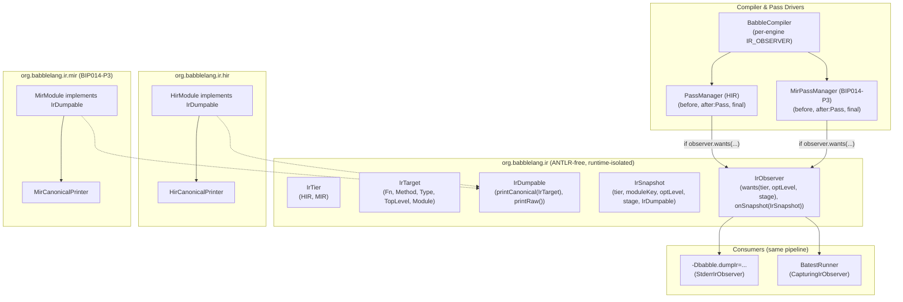

# BIP029: `.batest.md` v2 format and unified HIR/MIR golden testing

| | |
|---|---|
| **BIP** | 029 |
| **Date** | 2026-11-23 |
| **Status** | Implemented (`BIP029-Q1`–`Q10` → `BIP029-D1`–`D10` settled; `BIP029-I1`–`I4` implemented) |
| **Depends on** | Systematic `.batest` harness ([bip009_test-coverage.md](bip009_test-coverage.md)), ANTLR-free `HIR`, `HirPrinter`, `-O0`/`-O1` Nanopass pipeline (`BIP014-I1`–`I2`, `BIP014-I4`, `BIP014-D9`), and planned Tier 2 SSA `MIR` ([bip014_optimization-passes.md](bip014_optimization-passes.md), `BIP014-P3`, `BIP014-P5`), unified E-graph pass ([bip027_tackling-complexity-in-the-compiler.md](bip027_tackling-complexity-in-the-compiler.md), `BIP027-I2`), `HirTryNormalize` ([bip028_exception-handling.md](bip028_exception-handling.md)) |
| **Scope** | Redesigned, readable, extensible `.batest.md` v2 specification format (named `##` cases, prose documentation, explicit `stdout`/`stderr`/`error` blocks with uniform `DOTALL` `regex` flag, case-scoped virtual modules, `babble session` inputs, extensible IR/artifact blocks); unified compiler IR dumping & observation architecture (`IrTier`, `IrTarget`, `IrDumpable`, `IrSnapshot`, `IrObserver`) spanning `HIR` (`-O0`/`-O1`/`-O2`) and upcoming `BIP014-P3` SSA `MIR` (`-O2`, `before`/`after:<Pass>`/`final`); canonical preamble- and ID-independent printers (`HirCanonicalPrinter` and the `MirCanonicalPrinter` contract); 3-JVM/4-JVM Surefire and `-Pbatest` `BatestCoverageReporter` integration; guarded IR-only update mode (`-Dbatest.updateIr=true`); and lossless migration of all 103 existing `.batest` files (`2,060` cases) to `.batest.md` |

---

## 1. Summary & Motivation

### 1.1 Why `.batest` v1 (`BIP009`) has reached its limit

`BIP009` established Babble's data-driven `.batest` corpus — now **`103` files / `2,060` cases** verified by a 3-way execution oracle (`interpret`, `compile -O0`, `compile -O1` with `HirVerifier` + ASM `CheckClassAdapter`) and 5-scope JaCoCo reporting (`mvn -q verify -Pbatest`).

As Babble's compiler has evolved (`BIP014-I1`–`I2` `HIR`, `BIP014-I4` `ScalarReplacePass` & `FbipReusePass`, `BIP027-I2` E-graph simplification, `BIP028` `HirTryNormalize`) and prepares for **`BIP014-P3`** (per-function SSA `MIR` under `-O2`), **`BIP014-P5`** (SSA `aegraph`), and **`BIP025`** (WebAssembly backend), six structural limitations of the v1 `.batest` format have become clear:

1. **Cryptic punctuation delimiters don't scale.** v1 relies on ad-hoc ASCII art markers: `========== foo.ba ==========`, `{{{{{`, `----------`, `}}}}}`, and `~~ `. Adding IR golden blocks, per-pass snapshots, MIR dumps, or case metadata by bolting on more punctuation degrades readability and makes specs harder for humans and LLMs to author and audit.
2. **Unnamed test cases.** Cases have no real names — only fragile `#index` and `:line` coordinates (`case #4 (line 66)`). Reviewers have to read comments inside the code block to understand intent, JUnit trees show anonymous numbers, and `-Dbatest.filter` cannot select a case by name.
3. **Conflated behavioral outcomes.** Everything after `}}}}}` is a single raw string matched against *either* stdout, warnings, *or* a normalized error message. A buggy test that prints `"Type error : expected int, got string"` satisfies a case meant to assert a compile-time error, and you cannot put explanatory comments after `}}}}}` without turning them into expected stdout.
4. **No way to assert compiler IR transformations — silent optimization regressions pass 100% of `.batest`.** Today, `.batest` checks only behavioral equivalence (`interpret == -O0 == -O1`). If an optimization in `HirEGraphSimplifyPass`, `InlinePass`, `HirDcePass`, or `HirLicmPass` silently stops firing, every `.batest` test still passes. Only scattered Java string tests in [`OptimizerTestCase.java`](../../src/test/java/org/babblelang/tests/OptimizerTestCase.java) inspect `HirPrinter.print(...)`, using brittle `contains(...)` / `indexOf(...)` checks.
5. **Upcoming `BIP014-P3` SSA `MIR` needs first-class dumping & golden testing from day one.** `BIP014-P3` introduces Tier 2 per-function SSA `MIR` (basic blocks with block parameters, `SccpPass`, `GvnCsePass`, general `LicmPass`, `AliasRlePass`, `MirDcePass`, `PredicateReorderPass`, and later `BIP014-P5` `aegraph`). Debugging and testing `HIR → MIR → optimized MIR` demands **one unified IR dumping & canonicalization architecture** supporting both `HIR` and `MIR`, per-optimization-level (`-O0`, `-O1`, `-O2`), and pre-/post-pass snapshots (`before`, `after:<Pass>`, `final`).
6. **File-only virtual modules and rigid metadata.** Virtual modules (`========== mod.ba ==========`) can only be declared globally in the file preamble, never scoped to a single case, and directives like `;; LARGE: <reason>` are smuggled inside Babble comments rather than structured block metadata.

### 1.2 What `BIP029` introduces

`BIP029` replaces v1's punctuation markers with a **clean, constrained Markdown-fenced `.batest.md` specification format** (`BIP029-D1`–`D4`) backed by a **unified multi-tier IR observation and canonical printing pipeline** (`HIR` now, `MIR` in `BIP014-P3`, `BIP029-D5`–`D8`):

````markdown
# Algebraic simplification & constant folding

References : `BIP014-I2`, `BIP027-I2`, `HirEGraphSimplifyPass`.

```babble preamble
def clamp = fn axiom pure nothrow idempotent (x: int): int -> (
    def r = if x < 0 then (0) else (x)
    return r
    r
)
```

## Idempotent collapse across Babble and JDK calls

```babble
def norm = fn (x: int): int -> (
    clamp(clamp(java.lang.Math.abs(java.lang.Math.abs(x))))
)
assert(norm(-5) == 5)
assert(norm(3) == 3)
```

```hir -O0 fn=norm
fn norm (x:int) -> int {pure nothrow}
  (call-fn clamp (call-fn clamp (jcall Math.abs (jcall Math.abs var(x)))))
```

```hir -O1 fn=norm
fn norm (x:int) -> int {pure nothrow}
  (call-fn clamp (jcall Math.abs var(x)))
```

## IEEE-754 double reassociation is forbidden

`(x + 1.0) + 2.0` must stay un-reassociated at both `-O0` and `-O1`.

```babble
def add3 = fn (x: double): double -> ( (x + 1.0) + 2.0 )
assert(add3(1.0) == 4.0)
```

```hir -O0,-O1 fn=add3
fn add3 (x:double) -> double {pure nothrow}
  (+:double (+:double var(x) 1.0:double) 2.0:double)
```

## Printing output and warnings

```babble
println("hello")
```

```stdout
hello
```

## Type mismatch fails at compile time

```babble
def bad: int = "not an int"
```

```error
Type error : expected int, got string
```
````

And once `BIP014-P3` lands SSA `MIR` under `-O2`, the **exact same format** naturally expresses `MIR` goldens alongside `HIR` and execution parity:

````markdown
## Loop-invariant hoisting and GVN in SSA MIR

```babble
def newton = fn (x: double): double -> (
    def g = 0.5
    def i = 0
    while i < 12 then (
        g = 0.5 * (g + x / g)
        i += 1
    )
    g
)
assert(java.lang.Math.abs(newton(4.0) - 2.0) < 1.0e-9)
```

```mir -O2 fn=newton
fn newton (p0: double) -> double:
  bb0(p0: double):
    v0 = const.double 0.5
    br bb1(v0, 0)
  bb1(g: double, i: int):
    v1 = cmp.lt.int i, 12
    br_if v1, bb2(), bb3()
  bb2():
    v2 = div.double p0, g
    v3 = add.double g, v2
    v4 = mul.double v0, v3
    v5 = add.int i, 1
    br bb1(v4, v5)
  bb3():
    ret g
```
````

---

## 2. Prior Art & Format Evaluation

| Format / Tool | Representative | Strengths (`+`) | Weaknesses / Lessons for Babble (`-`) |
|---|---|---|---|
| **Constrained Markdown Fenced Specs (`.batest.md`)** *(Selected — `BIP029-D1`, `BIP029-D2`)* | Rustdoc, Zig/Dart spec tests, CommonMark literate tests | `+` Renders natively on GitHub, VS Code, IntelliJ, and LLM UIs with syntax highlighting.<br>`+` One uniform extensible block grammar (```` ```<kind> [attrs...] ````) handles Babble code, modules, sessions, `stdout`, `stderr`, `error`, `hir`, `mir`, future `bytecode`/`wat`.<br>`+` Built-in escaping via fence length (```` ```` ````) — zero delimiter collisions with *any* output or code.<br>`+` Named `##` cases and free prose documentation outside fences. | `-` Adds a closing ```` ``` ```` line per block.<br>`-` Requires a one-shot mechanical migration of the 103 existing v1 `.batest` files (`BIP029-I3`). |
| **Line-Headed Section Format (`===` / `---`)** | Go `txtar`, Tree-sitter corpus, Cranelift `.clif` | `+` Slightly fewer closing delimiter lines. | `-` No built-in escaping if stdout or multiline strings contain `---`/`===`; plain text in GitHub/editors; prose needs `;;` prefixes. |
| **LLVM `FileCheck` + `update_test_checks.py`** | LLVM `opt` tests | `+` Function-scoped checks + automated bless tool; supports targeted negative checks (`CHECK-NOT`). | `-` Embedding `; CHECK:` inside Babble source pollutes source code; adopted instead as an opt-in `check` block flag (`BIP029-D4`). |
| **Sidecar Golden Files (`.mir` / `.hir`)** | rustc `tests/mir-opt/` | `+` Separates source and IR dumps. | `-` Fragments one logical test across multiple files, hurting `.batest`'s single-file auditability (`src/test/batest/AGENTS.md`). |

---

## 3. The `.batest.md` v2 Specification

### 3.1 File Structure (`BIP029-D1`, `BIP029-D2`)

Test files live under `src/test/batest/` with the extension **`.batest.md`** (UTF-8, `\r\n` normalized to `\n`). Each file consists of:

1. **File header (before the first `## ` heading):**
   - Optional `# <File Title>` heading and free Markdown prose (description, `BIP###` references, notes). Ignored by the runner and excluded from code-character budgets.
   - Zero or more file-level fenced blocks:
     - `babble preamble [large="..."]` — shared Babble code prepended to each case (`BIP009-D2`). At most one `babble preamble` block per file.
     - `babble module=<path> [large="..."]` — shared virtual module visible to all cases in the file (`LogicalPaths.normalize(<path>)`; duplicates rejected).
2. **One or more test cases**, each started by a level-2 heading outside any fence:
   ```markdown
   ## <Case Name>
   ```
   followed by optional prose documentation and a sequence of fenced blocks describing the case's input(s), optional case-scoped modules, expected behavioral outcomes (`stdout`/`stderr`/`error`), and optional IR assertions (`hir`/`mir`).

Level-1 (`# `) and level-3+ (`### `) headings outside fences are documentation prose. Only `## ` outside fences opens a new test case.

### 3.2 Fence & Info-String Grammar

A fenced block opens with a line matching `` ^(`{3,})\s*(\S+)(?:\s+(.*))?$ `` (at most 3 leading spaces) and closes with the first subsequent line matching `` ^`{N,}\s*$ `` where $N$ is at least the opening backtick count. Unclosed fences fail fast at parse time with file and line number.

The info-string starts with a **block kind** followed by space-separated **tokens** (bare flags such as `preamble`, `session`, `regex`, `check`, `-O1`, or `key=value` / `key="quoted value"` pairs):

| Scope | Block info-string | Purpose |
|---|---|---|
| **File header** | `babble preamble [large="..."]` | Shared preamble prepended to every case (`< 800` code chars unless `large="..."`). |
| **File header / Case** | `babble module=<path> [large="..."]` | Virtual module `<path>` (`.ba`). Inside a case, scoped to that case only (overrides a file-level module of the same path). |
| **Case** | `babble [large="..."]` | Single-compilation-unit Babble test snippet (`< 400` code chars unless `large="..."`). |
| **Case** | `babble session [large="..."]` | Sequential `BabbleSession` input. Multiple `babble session` blocks in one case execute in order on the same session (replacing v1's `----------`). Cannot mix plain `babble` and `babble session` in the same case. |
| **Case** | `stdout [regex]` | Expected normalized stdout (`context.getWriter()`). When omitted, asserts **nothing** is printed to stdout (`""`). |
| **Case** | `stderr [regex]` | Expected normalized non-fatal stderr (`context.getErrorWriter()`, e.g., `Warning : ...`). When omitted, asserts **nothing** is printed to stderr (`""`). |
| **Case** | `error [regex]` | Expected fatal compile-time or runtime failure (`Kind.USER_ERROR`, normalized exception message). When omitted, asserts the case **succeeded** (`Kind.OK`). |
| **Case** | `hir <opt-levels> <target> [stage=...] [in=<mod>] [regex\|check]` | Canonical `HIR` assertion verified at `<opt-levels>` (`-O0`, `-O1`, `-O0,-O1`, `-O2`). |
| **Case** | `mir <opt-levels> <target> [stage=...] [in=<mod>] [regex\|check]` | Canonical SSA `MIR` assertion (`BIP014-P3`, verified at `-O2`). |
| **Case** *(reserved)* | `bytecode <opt-levels> <target> [regex\|check]`<br>`wat <target> [regex\|check]` | Reserved for future bytecode allocation checks (`BIP014-I4` `ScalarReplacePass` / `FbipReusePass`) and `BIP025` WebAssembly text assertions without changing the parser core. |

Unknown block kinds, duplicate behavioral blocks (e.g., two `stdout` blocks in one case), duplicate IR targets for the same `(tier, optLevel, stage, module, target)`, or unknown flags/keys fail fast at parse time in `BatestParser` with file and line number.

### 3.3 Case Names, Slugs, and Filtering (`BatestFilter`)

- Every `## <Case Name>` heading must be non-empty; duplicate case names within the same file are rejected by `BatestParser`.
- JUnit 5 `DynamicTest` display name: `<Case Name> (line <L>)`.
- [`BatestFilter`](../../src/test/java/org/babblelang/tests/batest/BatestFilter.java) supports:
  - File substrings and globs: `algebraic_simplify`, `compiler/*.batest.md` (bare `algebraic_simplify` continues matching seamlessly!),
  - Index and line suffixes: `algebraic_simplify.batest.md#4`, `algebraic_simplify.batest.md:42`,
  - New case-name suffix: `algebraic_simplify.batest.md@idempotent` (or `algebraic_simplify@idempotent`, case-insensitive substring match against the case name).

### 3.4 Explicit Behavioral Outcome Semantics (`BIP029-D3`, `BIP029-D4`)

Every case independently checks **three** behavioral channels — `stdout`, `stderr`, and `error` — with empty/success as the zero-boilerplate default:

| Blocks present in case | Expected `stdout` | Expected `stderr` (non-fatal) | Expected `Kind` / `error` |
|---|---|---|---|
| *(none — silent `assert(...)` case)* | `""` | `""` | `OK` |
| `stdout` | Matches `stdout` | `""` | `OK` |
| `stderr` | `""` | Matches `stderr` | `OK` |
| `stdout` + `stderr` | Matches `stdout` | Matches `stderr` | `OK` |
| `error` | `""` | `""` | `USER_ERROR`, matches `error` |
| `stdout` + `error` | Matches `stdout` (printed before failing) | `""` | `USER_ERROR`, matches `error` |
| `stderr` + `error` | `""` | Matches `stderr` (e.g., warnings before failing) | `USER_ERROR`, matches `error` |
| `stdout` + `stderr` + `error` | Matches `stdout` | Matches `stderr` | `USER_ERROR`, matches `error` |

**Important detail on `stderr` vs. `error` for `TypeCheckException`:**
When `TypeChecker` fails, [`BabbleScriptEngine.report`](../../src/main/java/org/babblelang/engine/BabbleScriptEngine.java#L566-L582) writes `Warning : ...` lines and `Error : ...` lines to `context.getErrorWriter()` and throws `TypeCheckException` for the first error. To avoid forcing every compile-error test to duplicate its error message in both `stderr` and `error`, `BatestRunner` extracts non-fatal stderr lines (normalized `Warning : ...` lines and any other non-`Error : ` lines written to `errorWriter`) into `stderr`, while the fatal normalized diagnostic is checked against `error`.

**`INTERNAL_CRASH`** (`VerifyError`, uncaught JVM `NullPointerException`/`IllegalStateException` inside Babble) always fails unconditionally regardless of blocks (`BIP009`).

**Uniform `regex` matching (`BIP029-D4`):**
- v1's `~~ ` line prefix is retired.
- Any `stdout`, `stderr`, `error`, `hir`, or `mir` block carrying the `regex` flag compiles its trimmed body with `Pattern.compile(expected, Pattern.MULTILINE | Pattern.DOTALL)` and checks `matcher(actual).matches()` — so `.*` naturally spans multiple lines by default (and invalid patterns fail at parse time in `BatestParser` naming file and line).
- Blocks *without* `regex` (and without `check`) perform exact normalized string equality (`expected.equals(actual)`).

### 3.5 Code-Character Budgets & `large="..."`

Readability budgets (`src/test/batest/AGENTS.md`) remain enforced by `BatestParser`:
- `babble preamble` and each `babble module=<path>`: strictly **< 800 code characters** (Babble comments excluded), unless the fence carries `large="<non-empty reason>"`.
- Combined `babble` / `babble session` code in a case: strictly **< 400 code characters** (Babble comments excluded), unless any `babble` fence in the case carries `large="<non-empty reason>"`.
- Prose outside fences and all non-Babble blocks (`stdout`, `stderr`, `error`, `hir`, `mir`) do **not** count toward the Babble code budget.

### 3.6 IR Block Syntax (`hir`, `mir`, `stage=`, `check`)

```text
```<tier> <opt-levels> <target> [stage=<stage>] [in=<module-path>] [regex|check]
```

- **`<tier>`:** `hir` or `mir`.
- **`<opt-levels>`:** One or more comma-separated levels: `-O0`, `-O1`, `-O2`, `-O0,-O1`, `-O1,-O2`.
- **`<target>`:**
  - `fn=<name>` — top-level or local named function `<name>`
  - `fn=<Type>.<method>` — method `<method>` of class/record/object/interface `<Type>`
  - `class=<name>` / `record=<name>` / `interface=<name>` — type declaration header, body/init statements, and directly owned methods in declaration order (`BIP029-D7`)
  - `top-level` — script top-level statements
  - `module` — entire normalized module
- **`stage=<stage>` *(optional, default `final`, `BIP029-D6`)*:**
  - `stage=final` *(default)* — final IR handed to the emitter (`HirEmitter` for `hir` post-`HirTryNormalize`, `MirEmitter` for `mir` post-`MirPassManager`).
  - `stage=before` — IR right after lowering (`HirBuilder` for `hir`, `MirLowerer` for `mir`), before optimization passes run.
  - `stage=after:<PassName>` (e.g., `stage=after:HirEGraphSimplify`, `stage=after:Inline`, `stage=after:Sccp`, `stage=after:GvnCse`, `stage=after:Licm`, `stage=after:AeGraph`) — IR immediately after a specific named pass.
- **`in=<module-path>` *(optional)*:** Inspects a virtual module's compiled IR (e.g., `in=lib/math.ba`) instead of the main script.
- **`regex` or `check` *(mutually exclusive optional flags, `BIP029-D4`)*:**
  - *(omitted)* — exact normalized canonical IR equality.
  - `regex` — whole-block Java regex (`Pattern.MULTILINE | Pattern.DOTALL`).
  - `check` — FileCheck-style line predicates evaluated over the canonical IR text (blank lines ignored):
    - `contains <substring>` — substring appears at least once
    - `!contains <substring>` — substring does not appear anywhere
    - `count <N> <substring>` — substring appears exactly `N` times
    - `regex <pattern>` — `Pattern.compile(pattern, Pattern.MULTILINE | Pattern.DOTALL).matcher(actual).find()` matches
- **Session cases (`babble session`):** IR blocks are disallowed on multi-input session cases in `BIP029-I2` (parse error) to avoid ambiguity over which session input's module is captured.

Example using `check` mode and `stage=after:<Pass>` for a `BIP014-P3` MIR pass:

````markdown
## GVN/CSE eliminates duplicate pure deterministic call

```babble
def heavy = fn axiom pure nothrow (x: int): int -> (
    def a = x * x + 1
    return a
    a
)
def useTwice = fn (x: int): int -> ( heavy(x) + heavy(x) )
assert(useTwice(4) == 34)
```

```mir -O2 fn=useTwice stage=before check
count 2 call heavy(
```

```mir -O2 fn=useTwice stage=after:GvnCse check
count 1 call heavy(
```
````

---

## 4. Unified Compiler IR Dumping & Observation Architecture (`HIR` + `MIR`)

A core requirement of `BIP029` is ensuring that **both** `HIR` (`BIP014-I1`–`I2`) and upcoming **`MIR`** (`BIP014-P3`) share **one** IR observation, dumping, and canonical-printing architecture.

### 4.1 Package & Interface Architecture (`org.babblelang.ir`)

All shared IR dumping interfaces live in a tiny, ANTLR-free package **`org.babblelang.ir`** (strictly outside `org.babblelang.runtime`, enforced by `RuntimeBoundaryTestCase` and `ArchitectureBoundaryTestCase`):



Key design properties:

1. **Lazy `wants(IrTier, int optLevel, String stage)` gating:**
   - When no `IrObserver` is attached (`null`), `BabbleCompiler` and `PassManager` do a single null check with zero allocation or printing cost.
   - When an observer is attached (e.g., a `.batest.md` case only checking `hir -O1 fn=f` at `stage=final`), `wants(...)` returns `false` for `before` and intermediate passes so nothing is printed or retained for unneeded stages.
   - When a case or `-Dbabble.dumpIr` requests `stage=after:GvnCse`, `wants(...)` returns `true` for that exact pass and captures the immutable `IrDumpable` snapshot immediately after `GvnCsePass` completes.
2. **CLI `-Dbabble.dumpIr` and `.batest.md` share one pipeline:**
   - Today's `-Dbabble.dumpIr=hir|all|true` in [`BabbleCompiler.java`](../../src/main/java/org/babblelang/compiler/BabbleCompiler.java#L148-L179) becomes a `StderrIrObserver` registered via `IrObserver`, naturally gaining `-Dbabble.dumpIr=mir`, `-Dbabble.dumpIr=hir:canonical`, `-Dbabble.dumpIr=mir:after:GvnCse`, etc. when `BIP014-P3` arrives.
3. **100% parallel JUnit 5 safe:**
   - [`BatestRunner`](../../src/test/java/org/babblelang/tests/batest/BatestRunner.java) registers a fresh per-case `CapturingIrObserver` via `engine.put(BabbleCompiler.IR_OBSERVER, observer)` on its fresh `BabbleScriptEngine`.
   - Zero `System.setProperty`, zero `System.err` redirection, zero `@ResourceLock(Resources.GLOBAL)`.

### 4.2 `HirCanonicalPrinter` Normalization Rules (`BIP029-D5`, `BIP029-D7`)

Existing [`HirPrinter.print(HirModule)`](../../src/main/java/org/babblelang/ir/hir/HirPrinter.java) remains intact for raw debug dumps. **`HirCanonicalPrinter`** renders any `IrTarget` from a `HirModule` into deterministic, preamble-independent, human-readable text:

| Raw `HirPrinter` artifact | `HirCanonicalPrinter` output | Why |
|---|---|---|
| `module babble/Script$42 (<unknown>)` | Omitted for scoped targets (`fn`, `class`, `record`, `interface`, `top-level`); `module <main>` or `module <path>` for `module` target | Eliminates parallel-order `Script$N` counter nondeterminism. |
| `fn #4 norm [fn$4$norm] (x:int) -> int` | `fn norm (x:int) -> int` | Global function IDs shift on preamble edits; `[fn$4$norm]` is JVM-mangling noise. |
| `var(x#17)`, `(def r#18 ...)`, `(set i#15 += ...)` | `var(x)`, `(def r ...)`, `(set i += ...)` when unique in target; `var(x#1)`, `var(x#2)` on shadowed names; synthetic temps (`$licm`, `$inl`, `$try`, `$for`) renumbered locally from `0` (`$licm0`, `$licm1`, …) in traversal order | Zero preamble sensitivity; readable diffs; exact alpha-equivalence on shadowed locals and compiler temps. |
| `(call-fn #1 ...)`, `(tail-call #4 ...)`, `(self-recurse #4 ...)`, `(fn-ref #5)` | `(call-fn clamp ...)`, `(tail-call loop ...)`, `(self-recurse fact ...)`, `(fn-ref <anon#0>)` | Symbolic target names are stable across preamble edits and immediately understandable to reviewers. |
| `(call-this.dot #7 ...)` | `(call-this.dot ...)` | Method name already identifies the call. |
| `(class-ref #2)`, `(iface-ref #3)` | `(class-ref Vec3)`, `(iface-ref Drawable)` | Symbolic class/interface names. |
| `Script$42$Vec3`, `babble/Script$42$Vec3` in `Is`/`As`/`HirCatch` | `Vec3` | Strips generated script class prefixes. |
| Single long line for nested `block`/`if`/`while`/`for`/`try` | Deterministic 2-space indented multi-line layout for structured control flow; compact single-line for leaf/arithmetic expressions | Clean line-by-line diffs between `-O0` and `-O1`. |

### 4.3 `MirCanonicalPrinter` Design Contract (for `BIP014-P3`, `BIP029-D5`)

When `BIP014-P3` implements `org.babblelang.ir.mir` (`MirModule`, `MirFunction`, `BasicBlock`, `BlockParam`, `MirInst`), implementing `IrDumpable` via `MirCanonicalPrinter` plugs straight into `BIP029` with zero `.batest.md` harness changes:

1. **Native per-function unit:** `fn=<name>` and `fn=<Type>.<method>` map 1-to-1 to a single `MirFunction`.
2. **Deterministic RPO basic-block numbering (`bb0`, `bb1`, …):** Emitted in Reverse Post-Order from the entry block, renumbered sequentially `bb0, bb1, …` regardless of internal block allocation IDs or deleted unreachable blocks.
3. **Deterministic SSA value renumbering (`p0..pK`, `v0..vN`):** Function parameters print as `p0, p1, …` (or `<name>` when unambiguous), block parameters keep their semantic source name (disambiguated locally if shadowed), and SSA instruction results are renumbered `v0, v1, …` sequentially in RPO instruction order — eliminating gaps left by DCE or GVN.
4. **Symbolic call & type targets:** Calls print as `call clamp(v0)` / `jcall Math.cos(p0)` and types strip `Script$N$` prefixes (`Vec3`, not `Script$42$Vec3`).
5. **Stable effect/alias annotations:** `BIP014` §6.4's `EffectKind` / `AliasClass` tags (`{pure}`, `{read:frozen}`, `{write:unique#0}`) print in a deterministic canonical order where non-trivial.
6. **Per-pass hooks in `MirPassManager`:** Emitting `before`, `after:<PassName>` (`Sccp`, `GvnCse`, `Licm`, `AliasRle`, `MirDce`, `PredicateReorder`, and later `AeGraph` in `BIP014-P5`), and `final` through `IrObserver` lets `.batest.md` tests inspect either final `-O2` MIR or individual pass deltas.

---

## 5. Harness, Multi-Mode Execution, `-Pbatest`, and Migration

### 5.1 Multi-Mode Execution Matrix (`BIP029-D8`)

| Surefire execution / JVM | Active mode | Behavioral (`stdout`/`stderr`/`error`) | `hir -O0` | `hir -O1` | Future `hir -O2` / `mir -O2` |
|---|---|---|---|---|---|
| `default-test` | `interpret` | **Checked** | Skipped | Skipped | Skipped |
| `compiled-tests-O0` | `compile -O0` | **Checked** | **Checked** | Skipped | Skipped |
| `compiled-tests` | `compile -O1` | **Checked** | Skipped | **Checked** | Skipped |
| *(future `BIP014-P3`)* | `compile -O2` | **Checked** | Skipped | Skipped | **Checked** |

If a case expects a compile-time error (`error` block) and *also* specifies an IR block that requires compilation to succeed, the IR assertion fails cleanly (`No HIR snapshot captured for target 'fn=f' (compilation failed)`).

### 5.2 `-Pbatest` & `BatestCoverageReporter` Parity Isolation

[`BatestCoverageReporter`](../../src/test/java/org/babblelang/tests/batest/BatestCoverageReporter.java) compares behavioral outcomes across `outcomes-interpret.jsonl`, `outcomes-compile.jsonl`, and `outcomes-compile-O0.jsonl` to report 3-way behavioral parity (`0 divergences`).

- `CaseOutcome` stays strictly behavioral (`kind`, `stdout`, `stderr`, `error`).
- IR check failures are recorded separately: when an IR assertion fails in a compiled run, `passed` is `false` and an `"irError": "..."` field is written to `outcomes-<mode>.jsonl`.
- `BatestCoverageReporter` reports IR mismatches distinctly from behavioral divergences and displays each case's `## <Case Name>` alongside its file and line number.

### 5.3 Guarded IR-Only Bless Mode (`-Dbatest.updateIr=true`, `BIP029-D9`)

When intentionally refining `HirCanonicalPrinter` / `MirCanonicalPrinter` formatting or landing an optimizer improvement that updates multiple IR goldens:

```bash
mvn -q test -Dtest=BatestTestCase -Dbatest.filter=compiler/ -Dbatest.updateIr=true
```

Safety guardrails (preserving `BIP009` §2.2's prohibition against blind behavioral snapshot blessing):

1. **Exact-golden IR blocks only:** Only exact-golden `hir` and `mir` block bodies (never `regex`, `check`, `babble`, `stdout`, `stderr`, `error`, or prose) are rewritten.
2. **Behavioral & verifier gate:** A block is updated *only* if the case's behavioral expectations (`stdout`/`stderr`/`error`) passed and both `HirVerifier`/`MirVerifier` and ASM `CheckClassAdapter` passed.
3. **Always fails loudly after writing:** After writing updates, `BatestTestCase` fails with `Updated N IR golden block(s) in M file(s) : inspect git diff and re-run without -Dbatest.updateIr=true`, so CI can never turn green with auto-blessing enabled.
4. **Parallel-safe file rewriting:** Updates are buffered per file and written once cleanly under a per-file lock, preserving original line endings, headings, and prose verbatim.

### 5.4 Coexistence & Lossless Migration of All 103 Existing `.batest` Files (`BIP029-D10`)

To guarantee zero regressions while introducing `.batest.md`, v1 (`.batest`) and v2 (`.batest.md`) **explicitly coexist during `BIP029-I2` and `BIP029-I3`** (strangler-fig rollout):

1. **Coexistence in `BIP029-I2`:** `BatestTestCase` discovers both `*.batest` (parsed by the existing v1 parser, completely untouched) and `*.batest.md` (parsed by the new v2 parser) into a unified `BatestFile` / `BatestCase` model. All 103 existing `.batest` files (`2,060` cases) continue running unchanged alongside new `.batest.md` tests and `BatestHarnessTestCase` suites, proving the v2 infrastructure breaks nothing before a single legacy test is touched.
2. **Lossless migration in `BIP029-I3`:** A deterministic migrator converts all 103 v1 `.batest` files (`2,060` cases) to `.batest.md` (verifiable directory-by-directory under coexistence):
   - **Header & preamble:** Leading file `;;` comments become `# <Title>` + prose; remaining preamble Babble code becomes ` ```babble preamble ` (preserving `large="..."` from `;; LARGE: <reason>`).
   - **Virtual modules:** Each `========== path.ba ==========` block becomes ` ```babble module=path.ba `.
   - **Case headings:** Each case's leading `;;` description comment becomes `## <Case Name>` (disambiguated cleanly if repeated within a file); cases without a leading comment receive a concise descriptive heading.
   - **Sessions:** Cases split by `----------` become sequential ` ```babble session ` blocks.
   - **Exact `stdout` / `stderr` / `error` classification:** The migrator classifies every case using actual 3-way execution (`CaseOutcome.Kind.OK` vs. `USER_ERROR`, stdout, and normalized warnings), upgrading all `2,060` cases to explicit `stdout` / `stderr` / `error` blocks with 100% verified parity (`0` divergences, unchanged 5-scope `-Pbatest` coverage).
3. **v1 retirement after verification:** Only after all 103 files are migrated to `.batest.md` and full `mvn -B package` + `mvn -q verify -Pbatest` pass with zero regressions is the legacy v1 parser removed.

---

## 6. Settled Design Decisions (`BIP029-D1`–`D10`)

All ten design questions (`BIP029-Q1`–`Q10`) have been settled:

- **`BIP029-D1` (resolves `BIP029-Q1`) — Constrained Markdown-fenced syntax:** Use `#`/`## <Case Name>` headings, free prose outside fences, and fenced ```` ```<kind> [flags / key=value ...] ```` blocks (zero delimiter collisions with `Babble.g4` or Git conflict markers; lossless escaping via fence length ```` ```` ````).
- **`BIP029-D2` (resolves `BIP029-Q2`) — `.batest.md` file extension:** Rename test specification files to `.batest.md` so GitHub, VS Code, and IntelliJ render them natively as Markdown with syntax highlighting.
- **`BIP029-D3` (resolves `BIP029-Q3`) — Explicit `stdout`, `stderr`, and `error` blocks:** Separate expected stdout (`stdout`), expected non-fatal stderr such as `Warning : ...` (`stderr`, excluding duplicated fatal `Error : ...` lines already reported in `error`), and expected fatal compile/runtime failures (`error`). Omitting `stdout` asserts empty stdout; omitting `stderr` asserts empty stderr; omitting `error` asserts `Kind.OK`.
- **`BIP029-D4` (resolves `BIP029-Q4`) — Uniform `DOTALL` `regex` flag + `check` predicate mode:** Retire v1's `~~ ` line prefix in favor of a uniform `regex` block flag (`Pattern.MULTILINE | Pattern.DOTALL`, full-block `matches()`) on `stdout`, `stderr`, `error`, `hir`, and `mir`. On `hir` and `mir` blocks, also support an opt-in FileCheck-style `check` mode (`contains`, `!contains`, `count N`, `regex <pattern>`).
- **`BIP029-D5` (resolves `BIP029-Q5`) — Canonical IR identifier normalization:** In `HirCanonicalPrinter`, omit `#id` when a user variable name is unique in the target (`var(x)`), append `#1`/`#2` on shadows, locally renumber synthetic temps (`$licm0`, `$inl0`, `$try0`), resolve internal `#id` calls/classes/interfaces to symbolic names, strip `Script$N$` prefixes, and 2-space pretty-print nested control flow. In `BIP014-P3`'s `MirCanonicalPrinter`, use deterministic RPO `bb0..bbN` block numbering, sequential SSA `v0..vN` numbering, and symbolic call/type names.
- **`BIP029-D6` (resolves `BIP029-Q6`) — Default `stage=final` + per-pass `before`/`after:<Pass>` hooks:** Default `hir` and `mir` blocks to `stage=final` (post-`PassManager` and post-`HirTryNormalize` for `HIR`; post-`MirPassManager` for `MIR`), with explicit `stage=before` and `stage=after:<PassName>` lazily gated via `IrObserver.wants(...)`, unifying `-Dbabble.dumpIr` onto the same `IrObserver` pipeline.
- **`BIP029-D7` (resolves `BIP029-Q7`) — `class=` / `record=` target includes owned methods:** `class=Foo` / `record=Foo` prints the type header, body/init statements, and directly owned methods in declaration order; `fn=Foo.bar` targets a single method.
- **`BIP029-D8` (resolves `BIP029-Q8`) — Skip unmatched optimization levels:** IR blocks whose `<opt-levels>` do not include the active run are skipped (so a case may specify only `-O1`, both `-O0` and `-O1`, `-O0,-O1`, or future `-O2` `mir`).
- **`BIP029-D9` (resolves `BIP029-Q9`) — Guarded `-Dbatest.updateIr=true` fails loudly after writing:** Rewrite only exact-golden `hir`/`mir` blocks on behaviorally-passing verified cases, then fail the test run with a summary of modified files/blocks so CI can never pass silently with auto-blessing enabled.
- **`BIP029-D10` (resolves `BIP029-Q10`) — Coexistence, full migration to `.batest.md`, v1 retirement, and `OptimizerTestCase` cleanup:** Coexist v1 `.batest` and v2 `.batest.md` parsers in `BIP029-I2` so all 103 existing `.batest` files stay untouched while v2 is proven end-to-end; migrate all 103 `.batest` files (`2,060` cases) to `.batest.md` in `BIP029-I3` and retire the v1 parser once verified; then add compiler HIR goldens and clean up redundant HIR substring checks in [`OptimizerTestCase`](../../src/test/java/org/babblelang/tests/OptimizerTestCase.java) in `BIP029-I4` (keeping API/AOT/bytecode tests in `OptimizerTestCase`).

---

## 7. Phased Implementation Plan

### `BIP029-I1` — Unified IR Observation Pipeline (`HIR` + `MIR`-Ready) & `HirCanonicalPrinter`
- Create `org.babblelang.ir` core abstractions: `IrTier` (`HIR`, `MIR`), `IrTarget`, `IrDumpable`, `IrSnapshot`, `IrObserver` (ANTLR-free, zero `org.babblelang.runtime` references).
- Implement `org.babblelang.ir.hir.HirCanonicalPrinter` (`HirModule implements IrDumpable`) with target resolution (`fn=`, `fn=Type.m`, `class=`/`record=`/`interface=`, `top-level`, `module`), local variable/temp renumbering, symbolic call/type names, `Script$N$` stripping, and structured 2-space indentation (`BIP029-D5`, `BIP029-D7`).
- Wire per-engine `BabbleCompiler.IR_OBSERVER` into `BabbleCompiler` and `PassManager` (`before`, `after:<PassName>`, `final`), gated lazily by `observer.wants(...)`, and unify `-Dbabble.dumpIr` onto the same `IrObserver` mechanism (`BIP029-D6`).
- Add `HirCanonicalPrinterTestCase` verifying preamble-independence, shadowed locals, synthetic temp renumbering, `after:<Pass>` hooks, and `ArchitectureBoundaryTestCase` / `RuntimeBoundaryTestCase` compliance.

### `BIP029-I2` — `.batest.md` v2 Parser & Harness Coexisting with v1 `.batest`
- Add the `.batest.md` v2 parser alongside the existing v1 `.batest` parser (`BatestParser` dispatches by extension `.batest` vs. `.batest.md`, and `BatestTestCase` discovers both `*.batest` and `*.batest.md` files).
- Support `#`/`##` headings, prose outside fences, fenced blocks (`babble`, `babble preamble`, `babble module=`, `babble session`, `stdout`, `stderr`, `error`, `hir`, `mir`), `regex` (`MULTILINE | DOTALL`), `check` predicates, `large="..."` budget overrides, case-scoped virtual modules, and strict parse-time validation (`BIP029-D1`–`D4`).
- Extend `BatestFilter` with case-name matching (`file@name`) alongside `#index` and `:line`.
- Extend `BatestRunner` and `BatestTestCase` to enforce explicit `stdout`/`stderr`/`error` separation on v2 cases (preserving legacy v1 matching untouched), attach `CapturingIrObserver` in compiled modes, verify matching `hir`/`mir` exact, `regex`, and `check` blocks (`BIP029-D8`), and emit `"irError"` separately in `outcomes-<mode>.jsonl`.
- Update `BatestCoverageReporter` to display case names and report IR mismatches distinctly from behavioral divergences.
- Implement guarded `-Dbatest.updateIr=true` bless mode (`BIP029-D9`), comprehensive v2 unit tests in `BatestHarnessTestCase`, and initial `.batest.md` smoke/IR-golden files while proving all 103 untouched v1 `.batest` files pass with 100% parity and coverage.

### `BIP029-I3` — Automated Lossless Migration of All 103 `.batest` Files to `.batest.md` & v1 Retirement
- Run the automated migrator across all 103 v1 `.batest` files (`2,060` cases), classifying `stdout` / `stderr` / `error` directly from the 3-way oracle and promoting leading `;;` descriptions to `## <Case Name>` headings (`BIP029-D10`).
- Verify 100% pass rate, `0` divergences, and unchanged `>= 75%` 5-scope branch coverage in `mvn -q verify -Pbatest` with all files on `.batest.md`.
- Once verified, retire the v1 `.batest` parser cleanly and update `src/test/batest/AGENTS.md` to document `.batest.md` authoring guidelines.

### `BIP029-I4` — Compiler HIR Goldens, `OptimizerTestCase` Cleanup & Docs
- Add `-O0` vs. `-O1` and `-O0,-O1` canonical HIR golden blocks across `src/test/batest/compiler/*.batest.md` (`const_fold`, `algebraic_simplify`, `inlining_and_dce`, `licm_and_purity`, `record_and_ownership_opt`, `try` dead-catch elimination), including `stage=after:<Pass>` and `check` examples.
- Clean up redundant HIR substring checks in `OptimizerTestCase` while preserving API (`PassManager`, `-Dbabble.dumpIr`), `babblec` `AOT_CROSS_MODULE`, and ASM bytecode tests (`BIP029-D10`).
- Update `AGENTS.md`, `docs/ARCHITECTURE.md`, and `docs/design/README.md`, and cross-link `BIP014-P3` to implement `MirModule implements IrDumpable` + `MirCanonicalPrinter` against `BIP029`'s `IrObserver` contract.

---

## 8. Acceptance Criteria

1. **Preamble & order independence:** Adding or reordering definitions in a `babble preamble` or other cases in the same `.batest.md` file never changes any case's canonical `HIR` (or future `MIR`) golden output.
2. **Real regression detection:** Temporarily disabling any `-O1` pass (`HirEGraphSimplifyPass`, `InlinePass`, `HirDcePass`, `HirLicmPass`) causes the corresponding `.batest.md` IR golden tests to fail loudly with a readable line diff — even though behavioral execution remains green.
3. **Explicit outcome soundness:** A case expecting `error` fails if the snippet merely prints that string to stdout and exits normally; a case omitting `stdout` and `stderr` fails if anything is printed to either stream.
4. **Zero-friction `BIP014-P3` `MIR` readiness:** `org.babblelang.ir` (`IrTier.MIR`, `IrTarget`, `IrDumpable`, `IrSnapshot`, `IrObserver`) and `.batest.md`'s ```` ```mir -O2 ... ```` parser/matcher/blesser are ready in place so `BIP014-P3` only has to implement `MirCanonicalPrinter` and emit snapshots from `MirPassManager`.
5. **Boundaries & full CI parity:** `RuntimeBoundaryTestCase` and `ArchitectureBoundaryTestCase` pass (`org.babblelang.runtime` stays IR-free; `org.babblelang.ir` stays ANTLR-free); full `mvn -B package` (all 3 Surefire runs) and `mvn -q verify -Pbatest` (all 5 scopes `>= 75%` branch coverage, `0` divergences) pass cleanly under parallel JUnit execution.
