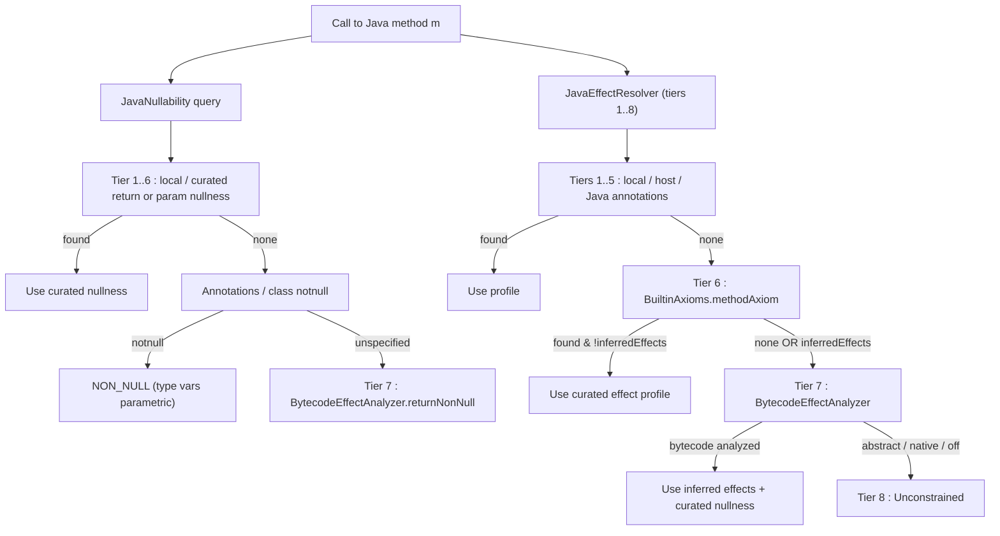

# BIP030: Axiom nullability and inferred effects

| | |
|---|---|
| **BIP** | 030 |
| **Date** | 2026-11-23 |
| **Status** | Implemented (`BIP030-Q1`–`Q6` → `BIP030-D1`–`D7` decided ; `BIP030-I1`–`I3` implemented) |
| **Depends on** | structured axioms and `BytecodeEffectAnalyzer` ([bip019_refactoring-axioms.md](bip019_refactoring-axioms.md)), Java nullability alignment ([bip011_core-types.md](bip011_core-types.md)), pure-by-default effects ([bip016_consolidating-effect-annotations.md](bip016_consolidating-effect-annotations.md)), `...` elision in function types ([bip021_optional-variadic-overloaded-arguments.md](bip021_optional-variadic-overloaded-arguments.md)) |
| **Scope** | replacing `class nullmarked` with `class notnull`, supporting `T!` everywhere as non-null type syntax (`T! == T` in Babble code) while enforcing explicit `!` or `?` on concrete reference types in Java axioms, reusing `...` in `axiomEffectWord` (`fn ... : T!` and `fn ... (…): T!`) to keep bytecode-inferred effects while declaring return/parameter nullability, allowing return-only `: T!` without repeating `fnTypeParameters`, fixing `isAtLeastAsStrongAs` redundancy reporting, and migrating `src/main/java/org/babblelang/axioms/` ; across `Babble.g4`, `Formatter`, `TypeAnnotations`, `AxiomData`, `BuiltinAxioms`, `JavaNullability`, `JavaEffectResolver`, `BytecodeEffectAnalyzer`, `AxiomDumper`, `curated.ba`, and tests |

---

## 1. Summary

Under `BIP019`, declaring that a Java method returns a non-null type requires writing a full signature, and a signature with no effect modifier defaults to `pure`. To avoid asserting purity on methods that previously only had a nullness entry in `JavaNullability`, `BIP019-I6` wrote `fn io` on 103 curated Java members — including `java.io.StringWriter.getBuffer`, `java.nio.CharBuffer.wrap`, `java.util.Arrays.copyOf` / `toString`, `java.util.Collections.emptyList` / `unmodifiableList`, and `java.util.Optional.*` :

```babble
;; Today (src/main/java/org/babblelang/axioms/java/io/curated.ba)
axiom java.io.StringWriter: class (
    def getBuffer: fn io (): java.lang.StringBuffer
)
```

Because curated axioms (tier 6) override bytecode analysis (tier 7), `fn io` forcibly downgrades every one of those methods to `EffectSet.IO_DECLARED`, even when `BytecodeEffectAnalyzer` would infer `pure nothrow view` (`StringWriter.getBuffer`) or `pure fresh` (`Collections.emptyList`, `Arrays.copyOf`).

At the same time :

* `BIP019` adopted JSpecify's term `nullmarked` for `class nullmarked ( … )`, which reads backwards as *"marked as null"* instead of *"non-null by default"*.
* In Java axioms, writing bare `java.lang.StringBuffer` made it easy to miss that the axiom is asserting non-nullability on an unannotated Java type — and gave no way to distinguish a parametric type variable `T` from a forced-non-null type variable `T!`.

This proposal solves all three with minimal, strictly LL(1) / pure `SLL` grammar updates (`T!` in `nullableType` / `nonParenNullableType`, `ELLIPSIS` in `axiomEffectWord`, and optional `fnTypeParameters` before `: type`) :

```babble
;; 1. Clearer class-level default (replaces `class nullmarked`)
axiom java.math.BigInteger: class notnull (
)

;; 2. Return-only nullability with bytecode-inferred effects (`T!` makes non-null unmistakable)
axiom java.io.StringWriter: class (
    def getBuffer: fn ... : java.lang.StringBuffer!
)

axiom java.lang.Runtime: class (
) static (
    def getRuntime: fn ... : java.lang.Runtime!
)

;; 3. Full signature with bytecode-inferred effects (when parameter nullness or overload selection matters)
axiom java.util.Arrays: class (
) static (
    def copyOf: fn ... (original: (array of int)!, newLength: int): (array of int)!
    def toString: fn ... (a: (array of int)?): string!
    ;; ...
)

axiom java.util.Optional of T: class notnull (
    def get: fn ... : T!
    def orElse: fn ... (other: T): T
    def orElseThrow: fn ... : T!
) static (
    def of: fn of T ... (value: T!): (java.util.Optional of T)!
    def ofNullable: fn of T ... (value: T?): (java.util.Optional of T)!
)
```

In ordinary Babble code, non-nullability remains the default and `T! == T` everywhere (`def s: string! = "hi"` is valid and identical to `def s: string = "hi"`, and `(string?)!` strips nullability). In Java axioms, `!` (or `?`) is **enforced** on every concrete reference type so every nullability assumption stands out explicitly.

---

## 2. Motivation

Inspecting `src/main/java/org/babblelang/axioms/java/io/curated.ba` exposes four coupled defects left over from `BIP019-I6` :

1. **`fn io` is conflating two unrelated meanings.**
   `StringWriter.getBuffer()` compiles to three instructions : `aload_0; getfield buf; areturn`, where `buf` is `private final java.lang.StringBuffer`. Because `BytecodeEffectAnalyzer` conservatively marks every `GETFIELD` on an instance field as `mayBeNull = true`, it cannot prove `getBuffer()` returns non-null. Without a curated entry, `JavaNullability.returnNullness` types `getBuffer()` as `java.lang.StringBuffer?`, breaking `sw.getBuffer().length()`.
   Writing `def getBuffer: fn (): java.lang.StringBuffer` would assert `pure` on `StringWriter` and every subclass. Having no syntax for *"only state nullness; leave effects inferred"*, `BIP019-I6` fell back to `fn io` across **103** Java member axioms (out of 107 total `fn ... io` axioms in `src/main/java/org/babblelang/axioms/`, the other 4 being the genuinely I/O prelude functions `print`, `println`, `affiche`, `afficherc` in `builtins.ba`). Because tier 6 (`BuiltinAxioms`) short-circuits tier 7 (`BytecodeEffectAnalyzer`) in `JavaEffectResolver.resolveJavaMethodProfile` and `BytecodeEffectAnalyzer.lookupCuratedOrSeeded`, all 103 methods are treated as `EffectSet.IO_DECLARED` — unusable in `pure` functions and opaque to optimization — even when their bytecode is completely hermetic and pure.

2. **`nullmarked` conveys the opposite of its meaning.**
   `BIP019` lifted `nullmarked` from JSpecify's `@NullMarked` (short for *"nullness-marked"*, i.e., types in this scope are explicitly marked for nullability, so unmarked types are non-null). Outside Java annotation jargon, alongside plain Babble modifiers (`exact`, `immutable`, `nothrow`, `pure`, `fresh`, `view`), `class nullmarked` reads like *"class marked as null"* — the exact inverse of *"non-null by default"*.

3. **Unmarked reference types in Java axioms hide nullability claims (and can't mark `T!`).**
   When reading `def getBuffer: fn ... : java.lang.StringBuffer`, nothing visually highlights that the entire purpose of the axiom is asserting *"not null"* on a Java type whose bytecode is unannotated — nor was there any way to write *"non-null `T`"* (as opposed to parametric `T` or nullable `T?`) on a type variable such as `Optional.get(): T!` or `Optional.of(value: T!)`.

4. **Redundancy reporting has a blind spot for `fn io`.**
   In `BytecodeEffectAnalyzer.isAtLeastAsStrongAs`, `if (req.isIO()) { return true; }` returns immediately before checking `curated.returnNullness()` at line 292. Consequently, `-axioms` and `babble.axioms.report=true` label `fn io` nullness axioms as `;; curated, inferred the same` even when `BytecodeEffectAnalyzer` fails to infer non-nullness — hiding which curated axioms are actually required for nullness and which ones bytecode analysis already covers.

---

## 3. State of the art

* **JSpecify** ([`@NullMarked`](https://jspecify.dev/docs/user-guide/#nullmarked)) scopes non-null defaults to a package, class, or method via `@NullMarked`, with `@Nullable` opting individual positions back into nullability and `@NullUnmarked` opting a nested scope out. The name `@NullMarked` is famously non-obvious to newcomers, which JSpecify's own FAQ has to explain as *"marked with nullness information"*.
* **Kotlin** treats unannotated Java types as platform types (`T!`), overlays nullability for JDK methods via external annotations (`@NotNull` / `@Nullable`), and uses `T & Any` for definitely non-nullable type parameters.
* **TypeScript** has `NonNullable<T>` (and `!` postfix non-null assertions on expressions, matching Babble's `e!`).
* **JetBrains / Checker Framework / Lombok / Jakarta** spell the positive guarantee `@NotNull` or `@NonNull` (and `@DefaultQualifier(NonNull.class)` for scope defaults).
* **Babble's own conventions** use single lowercase compound words with no underscores (`nothrow`, `sortedset`, `sortedmap`, `immutable`), `@NotNull` in `org.babblelang.effects`, `e!` for non-null assertions (`BIP011`), and `...` in function types/axioms (`to: java.lang.Appendable = ...`, `BIP021`) to mean *"elided here / supplied by the implementation"*.

---

## 4. Decisions

* **`BIP030-D1` (`BIP030-Q1`) — `notnull` replaces `nullmarked` at the class level only.**
  `notnull` pairs directly with `nothrow` and `org.babblelang.effects.NotNull`, avoids the `nn` stutter of `nonnull`, and reads unambiguously (`class notnull ( … )`). Keeping `notnull` strictly at the class level keeps the axiom surface small : individual members state nullability through return types (`fn ... : T!`) or full signatures (`fn ... (…): T!`).
* **`BIP030-D2` (`BIP030-Q2`) — `...` means *"keep bytecode-inferred effects"* ; `: T!` is allowed without repeating parameters.**
  Reusing Babble's existing `ELLIPSIS` (`...`) token in `axiomEffectWord`, together with making `fnTypeParameters` optional before `: type`, keeps `BIP019`'s pure-by-default rule completely uniform :
  * **Without `...`**, every `fn` axiom is pure by default (`def foo: fn : string!` = pure, non-null return across all overloads ; `def foo: fn nothrow : string!` = pure nothrow, non-null return ; `def foo: fn (): T!` = pure + full signature).
  * **With `...`**, the axiom leaves effects to tier 7 (`BytecodeEffectAnalyzer`) / tier 8 (unconstrained) :
    * `def getBuffer: fn ... : java.lang.StringBuffer!` — keep inferred effects, declare return nullability without duplicating parameters (matches every overload of the member name) ;
    * `def toString: fn ... (a: (array of int)?): string!` — keep inferred effects, declare exact overload and parameter + return nullability.
  * Bare `fn ...` with neither parameters nor `: type` is rejected (`... requires a signature or return type in axiom : <owner>.<member>`).
  * `...` on a Babble-name axiom (`axiom foo: fn ...`) is rejected (`... is only valid on Java axioms : <name>`).
  * A return-only `: type` on a constructor (`def new: fn ... : T!`) is rejected (`Constructor axiom new cannot declare a return type : <owner>`).
* **`BIP030-D3` (`BIP030-Q3`) — `...` is mutually exclusive with explicit effect words in `BIP030-I1`.**
  `...` cannot be combined with `io`, `volatile`, `pure`, `mut`, `shared`, `nothrow`, `view`, `shallow`, `fresh`, `unique`, `foldable`, or algebraic words (`... cannot be combined with effect modifiers in axiom : <owner>.<member>`). Additive refinement onto inferred effects (such as `fn ... foldable`) remains an easy, backwards-compatible future extension (§8).
* **`BIP030-D4` (`BIP030-Q4`) — Clean rename removing `nullmarked`.**
  `nullmarked` is removed outright rather than deprecated. All 81 occurrences live inside this repository, and `AxiomData` reports `Unknown axiom class modifier : nullmarked` if the old name is written.
* **`BIP030-D5` (`BIP030-Q5`) — Return-only `: T!` / `: T?` / `: E` matching and specificity.**
  * A return-only axiom (`fn ... : T!` or `fn nothrow : T!`) matches every overload of the named method (same specificity rank as a named signatureless axiom : full parameter signature rank 3 > named without parameters rank 2 > wildcard `*` rank 1).
  * It supplies `returnNullness` (`T!` → `NON_NULL`, `T?` → `NULLABLE`, bare type variable `E` → `PARAMETRIC`) to `JavaNullability.returnNullness`, while leaving parameter nullness unspecified (falling through to annotations / `class notnull` / `UNSPECIFIED`).
  * `AxiomDumper.validateCuratedPackage` verifies that the return-only `: T` erasure matches at least one real overload (and every matched overload's erased return type).
* **`BIP030-D6` (`BIP030-Q6`) — `AxiomDumper` output and fixed `isAtLeastAsStrongAs`.**
  * `AxiomDumper` emits `notnull` in class headers (replacing `nullmarked`), and emits `T!` for non-null concrete reference types in signatures so dumped axioms remain directly pasteable into `curated.ba`.
  * For a member whose curated axiom uses `...`, `AxiomDumper` renders the effective inferred effects together with the curated nullness, prefixed with `;; curated nullness, inferred effects (<reasons>)` — or `;; curated, inferred the same` only when `isAtLeastAsStrongAs` confirms bytecode analysis proves both effects and nullness.
  * `BytecodeEffectAnalyzer.isAtLeastAsStrongAs` checks curated nullness for **every** curated axiom (including `io` and `...`), fixing the early `if (req.isIO()) return true;` return that previously skipped the return-nullness check.
* **`BIP030-D7` — Explicit `T!` non-null type syntax everywhere, enforced in Java axioms.**
  * **Everywhere in Babble code :** `T!` is valid type syntax wherever `T?` is allowed (`string!`, `(array of int)!`, `java.util.Map of (K, V)!`, `(MaybeStr)!`). Semantically `T!` evaluates to `Type.withoutNull(T)` — so for every non-null type `T! == T` (non-nullability stays the default in Babble, and `TypeDisplay` still prints `T`, not `T!`), while on a nullable type or type alias `T!` projects out `null`. Applying `!` to `null` itself (`(null)!`) is an error (`Cannot make null non-nullable : null`).
  * **Enforced in Java axioms (`AxiomData.eraseType`) :** every concrete reference type written in a Java axiom signature or return type (top-level, nested generic type arguments, and array element types) **must** explicitly state its nullability with `!` (non-null) or `?` (nullable) — or belong to a `| null` union. Writing an unmarked concrete reference type in a Java axiom is an error : `Reference type in axiom must specify nullability with ! or ? : <type>`.
  * **Primitives and type variables in Java axioms :**
    * Primitives (`byte`, `short`, `int`, `long`, `float`, `double`, `bool`, `char`, `void`) are never nullable and do not take `!` (`Primitive type does not take ! in axiom : <type>` ; `int?` remains boxed nullable `Ljava/lang/Integer;`).
    * Type variables (`T`, `E`, `K`, `V`) now have all three distinct forms :
      * `T` (bare) → **`PARAMETRIC`** (preserves the caller's type argument nullability, e.g. `List.get(index: int): E`) ;
      * `T?` → **`NULLABLE`** (always nullable, e.g. `Map.get(key: any?): V?`) ;
      * `T!` → **`NON_NULL`** (always non-null, e.g. `Optional.get(): T!`, `Optional.of(value: T!): (java.util.Optional of T)!`).
  * **Babble-name axioms (`builtins.ba`) :** describe ordinary Babble functions rather than unannotated Java types, so `T! == T` is accepted there without requiring `!`.

---

## 5. Design details

### 5.1 Grammar, formatter, and canonical order

Three small changes in `src/main/antlr4/org/babblelang/parser/Babble.g4` :

```antlr
axiomEffectWord: effectModifier | UNIQUE | ELLIPSIS | ID;

axiomType: FN (OF typeParameters)? axiomEffectPrefix? fnTypeParameters? (':' uniqueReturn=UNIQUE? type)?
         | CLASS classWords+=ID* NL* '(' axiomMembers ')' (NL* STATIC NL* '(' axiomMembers ')')?;

nullableType: nonParenNullableType                                                    # nonParenType
            | frozen=FROZEN? '(' NL* type NL* ')' nullMod=('?' | '!')?                # parenType
            ;

nonParenNullableType: frozen=FROZEN? typeName ( OF ( '(' NL* type (NL* ',' NL* type)* NL* ')' nullMod=('?' | '!')?
                                                   | nonParenNullableType )
                                              | nullMod=('?' | '!')? )                # simpleType
                    | FN (OF typeParameters)? effectPrefix? fnTypeParameters (':' uniqueReturn=UNIQUE? type)? # functionType
                    | OVERLOAD '(' NL* type (NL* ',' NL* type)* NL* ')'               # overloadType
                    | NULL                                                            # nullType
                    ;
```

* **Zero new lexer tokens :** both `ELLIPSIS` (`'...'`) and `BANG` (`'!'`) already exist.
* **Strictly LL(1) / pure `SLL` :**
  * After `FN (OF typeParameters)? axiomEffectPrefix?`, `fnTypeParameters` starts with `'('` and a return type starts with `':'`, so neither `ELLIPSIS` nor optional `fnTypeParameters` introduces ambiguity.
  * In `nullableType` / `nonParenNullableType`, `nullMod=('?' | '!')?` sits in the exact three positions `question='?'?` already occupies. Because expression postfix `expression '!'` binds tighter than `AS`, `IS`, and `OF`, `'!'` can never ambiguously attach to an enclosing `asExpression`, `isExpression`, or `typeApply` — `x as string!` unambiguously parses as `x as (string!)`, while `(x as string?)!` has parentheses around the expression.
* **`Formatter` spacing :**
  * `BANG` is already non-spaced on the left (`Formatter.space` line 418), so `string!`, `(array of int)!`, and `java.util.Map of (K, V)!` need zero formatter changes.
  * `Formatter.annotate` only marks `ELLIPSIS` as sticky (`restEllipsis` / `spreadEllipsis`) inside `FnParamContext`, `FnTypeParamContext`, and `CallParameterContext`, so `fn ... (…)` already gets spaces around `...`.
  * In `Formatter.space`, keep a space before `:` when preceded by `ELLIPSIS` (`before.getType() != BabbleLexer.CATCH && before.getType() != BabbleLexer.ELLIPSIS`), so return-only axioms format cleanly as `fn ... : java.lang.StringBuffer!` rather than jamming four punctuation characters (`...:`) together, while `fn (): T!` and `def x: T` stay unchanged.
* **Canonical order (`AxiomData` + `AxiomsTestCase`) :**
  * `CLASS_WORD_ORDER` : `exact`, `notnull`, `immutable`.
  * `EFFECT_WORD_ORDER` : `io`, `...`, `volatile`, `pure`, `mut`, `shared`, `nothrow`, `idempotent`, `commutative`, `associative`, `monotone`, `injective`, `view`, `shallow`, `fresh`, `foldable`, `unique`.

### 5.2 Resolution and bytecode-analyzer interaction

`AxiomData.MemberAxiom` gains `boolean inferredEffects` (true when `...` is present) and separates `hasParamSignature` (`fnTypeParameters != null`, formerly `hasSignature`) from `returnNullness != null` (present for both full signatures with `: R` and return-only `: R`).



Four subtle interactions must be handled explicitly :

1. **Self-analysis in `BytecodeEffectAnalyzer` :**
   `analyzeSingleMethod` must **not** short-circuit on a self-curated axiom when `ax.inferredEffects()` is true. Instead, it analyzes the bytecode normally for effects, reads, mutation, borrowing, `fresh`, `view`, `shallow`, and overlays `returnNonNull = true` whenever the curated axiom declares `returnNullness == NON_NULL`.
2. **Callee resolution in `BytecodeEffectAnalyzer` :**
   * On a **closed call** (`INVOKESTATIC`, `INVOKESPECIAL`, `final` class/method, `private` method) to a callee whose curated axiom has `inferredEffects == true`, `resolveCalleeResult` uses the bytecode-analyzed result from the SCC fixed point with curated `returnNonNull` overlaid — so callers of e.g. `Arrays.copyOf` or `Optional.of` see both inferred effects and curated non-nullness.
   * On an **open call** (`INVOKEVIRTUAL` on a non-final method, or `INVOKEINTERFACE`), bytecode analysis cannot assume all overrides share the bytecode's effects, so the callee's effects remain unconstrained (exactly as if no curated effect axiom existed), while its non-null return still holds when the curated axiom is non-`exact`.
3. **Babble override contract checking (`BuiltinAxioms.inheritedContract`) :**
   A `MemberAxiom` with `inferredEffects == true` declares **no effect contract** on overrides, so `lookupInheritedContract` skips it for effect conformance (a Babble class overriding `StringWriter.getBuffer` is not forced to satisfy an effect contract from a nullness-only axiom ; return nullness still applies through Java override typing).
4. **Local / session axioms (tier 1) :**
   If a user program writes `axiom my.Lib.get: fn ... : string!` or `axiom my.Lib.get: fn ... (x: string?): string!`, tier 1 behaves symmetrically with tier 6 : it supplies local nullness while allowing effects to resolve through lower tiers (including tier 6 curated effects if any, or tier 7 bytecode analysis).

### 5.3 Fixed redundancy check (`isAtLeastAsStrongAs`)

In `BytecodeEffectAnalyzer.isAtLeastAsStrongAs(inferred, curated, exec)` :

* For **every** curated axiom (including `io` and `...`), check nullness before returning `true` :
  * if `curated.returnNullness() == NON_NULL` on a reference return and `!inferred.returnNonNull()`, return `false` ;
  * if `curated.returnNullness() == PARAMETRIC` on a type-variable return, return `false` ;
  * if `curated.hasParamSignature()` states any parameter nullness on a reference parameter, return `false` (bytecode analysis does not infer parameter nullness).
* For `inferredEffects` (`...`) axioms, effect strength is trivially satisfied (since effects *are* inferred), so `isAtLeastAsStrongAs` returns `true` iff bytecode analysis already proves the curated nullness on its own.

---

## 6. Audit and migration of `curated.ba`

A full audit of `src/main/java/org/babblelang/axioms/` finds **81** `class nullmarked` declarations and **107** `fn ... io` member declarations (`4` in `builtins.ba`, `103` in `curated.ba`). In addition, every existing concrete reference type in `curated.ba` (and Java axioms in test files) is updated to explicit `T!` per `BIP030-D7`.

### 6.1 Class-level `nullmarked` → `notnull` (81 occurrences)

| File | Count | Classes |
|---|---:|---|
| `java/lang/curated.ba` | 14 | `Boolean`, `Byte`, `CharSequence`, `Character`, `Class`, `Double`, `Float`, `Integer`, `Iterable`, `Long`, `Short`, `String`, `StringBuffer`, `StringBuilder` |
| `java/math/curated.ba` | 1 | `BigInteger` |
| `java/time/curated.ba` | 1 | `LocalDate` |
| `java/util/curated.ba` | 15 | `Collection`, `Comparator`, `Iterator`, `List`, `ListIterator`, `Map`, `Map.Entry`, `NavigableMap`, `NavigableSet`, `Optional`, `Queue`, `SequencedCollection`, `SequencedMap`, `SortedMap`, `SortedSet` |
| `java/util/function/curated.ba` | 43 | All 43 functional interfaces |
| `java/util/regex/curated.ba` | 1 | `Pattern` |
| `java/util/stream/curated.ba` | 6 | `BaseStream`, `DoubleStream`, `IntStream`, `LongStream`, `Stream`, `StreamSupport` |

### 6.2 Audit of the 103 `fn io` curated Java axioms

| File | Members | Count | Proposed migration | Expected effect after migration |
|---|---:|---:|---|---|
| `java/io/curated.ba` | `StringWriter.getBuffer` | 1 | `fn ... : java.lang.StringBuffer!` | `pure nothrow view` (inferred from `getfield buf`) |
| `java/nio/curated.ba` | `CharBuffer.wrap` (4 overloads, non-null params) | 4 | `fn ... (…): java.nio.CharBuffer!` | Inferred from JDK bytecode (keeps non-null param checks) |
| `java/util/curated.ba` | `Arrays.asList`, `copyOf` (9), `copyOfRange`, `stream` (4), `toString` (9) | 24 | `fn ... (…): …!` | Inferred from JDK bytecode (keeps param nullness & overload return types) |
| `java/util/curated.ba` | `Collections.empty*` (10), `reverseOrder()` | 11 | `fn of T ... : …!` | Inferred from JDK bytecode |
| `java/util/curated.ba` | `Collections.nCopies`, `reverseOrder(cmp)`, `singleton*` (3), `synchronized*` (4), `unmodifiable*` (6) | 15 | `fn of T ... (…): …!` | Inferred from JDK bytecode (keeps param nullness) |
| `java/util/curated.ba` | `Optional.get`, `orElseThrow` | 2 | `fn ... : T!` | Inferred from JDK bytecode (`pure`) |
| `java/util/curated.ba` | `Optional.orElse`, `of`, `ofNullable` | 3 | `fn ... (…): …` | Inferred from JDK bytecode (`pure` / `nothrow` / `fresh`) |
| `java/util/curated.ba` | `StringTokenizer.nextToken` (2 overloads) | 2 | `fn ... : string!` *(or `fn ... (delim: string!): string!` for non-null `delim`)* | Inferred from JDK bytecode (`mut` receiver, not `io`) |
| `java/util/curated.ba` | `Map.compute*` / `merge` (4), `NavigableMap` (12), `NavigableSet` (6) | 22 | `fn ... (…): …` / `fn ... : …?` | Interface methods stay unconstrained, without forcing `io` on concrete overrides |
| `java/lang/curated.ba` | `Runtime.getRuntime`, `Thread.getName`, `getStackTrace`, `currentThread` | 4 | `fn ... : …!` | `currentThread`/`getStackTrace` stay unconstrained (native), `getRuntime`/`getName` reflect bytecode honestly |
| `java/lang/curated.ba` | `Class.forName` (2), `Integer.getInteger` (3), `Long.getLong` (3) | 8 | `fn ... (…): …` | Native / reads system properties → stays unconstrained / `io` via bytecode |
| `java/lang/curated.ba` | `System.getProperty` (2), `System.getenv` (2) | 4 | Keep `fn io` *(or `fn ...`)* | Genuinely reads process environment / system properties |
| `java/lang/reflect/curated.ba` | `Proxy.*` (3) | 3 | `fn ... (…): …!` | Reflection / native → stays unconstrained |

*(The 4 prelude entries in `builtins.ba` — `affiche`, `afficherc`, `print`, `println` — have no Java bytecode and genuinely perform I/O, so they stay `fn io`.)*

Before finalizing `BIP030-I2`, every migrated class should be inspected with `-axioms` on JDK 21 (and checked against newer JDKs where available) to catch any JDK-version-dependent bytecode drift.

---

## 7. Implementation phases

* **`BIP030-I1` — Grammar, formatter, `T!`, mechanism, and analyzer integration.**
  Add `nullMod=('?' | '!')?` to `nullableType` and `nonParenNullableType`, `ELLIPSIS` to `axiomEffectWord`, and optional `fnTypeParameters` before `':' uniqueReturn=UNIQUE? type` in `Babble.g4`. Keep a space between `...` and `:` in `Formatter`. Support `T!` (`Type.withoutNull`, rejecting `(null)!`) in `TypeAnnotations` (`BIP030-D7`). Rename `nullmarked` → `notnull` in `AxiomData`, `BuiltinAxioms`, and `AxiomDumper` (`BIP030-D1`, `BIP030-D4`). Enforce explicit `!` or `?` on concrete reference types (and support `T!` on type variables as `NON_NULL`) in `AxiomData.eraseType` (`BIP030-D7`). Add `inferredEffects` (`...`) and return-only `: type` support to `AxiomData.MemberAxiom` with canonical order and validation diagnostics (`BIP030-D2`, `BIP030-D3`, `BIP030-D5`). Wire `...` fall-through into `JavaEffectResolver` (tiers 1 and 6) and `BuiltinAxioms.inheritedContract`, return-only nullness into `BuiltinAxioms.returnNullness` / `JavaNullability`, and bytecode+nullness overlay + fixed `isAtLeastAsStrongAs` + `T!` emission into `BytecodeEffectAnalyzer` and `AxiomDumper` (`BIP030-D6`).
* **`BIP030-I2` — Migrate `curated.ba` and verify parity.**
  Migrate all 81 `class nullmarked` declarations to `class notnull`, annotate all concrete reference types in `curated.ba` with explicit `!` (or `?`), migrate the eligible `fn io` entries in `src/main/java/org/babblelang/axioms/**/curated.ba` (§6), inspect `-axioms` output, and verify all tests, formatting, and `examples/raytracer-argon/scene.ppm` parity.
* **`BIP030-I3` — Tests and documentation.**
  Update `AxiomsTestCase`, `Bip019P1AxiomsMechanismTestCase`, `BytecodeEffectAnalyzerTestCase`, `EffectsTestCase`, `TypeCheckerTestCase`, `ParserGrammarTestCase`, `FormatterTestCase`, and `src/test/batest/effects/structured_axioms.batest` (including `T! == T` in Babble code, `(string?)!` non-null projection, `(null)!` error, enforced `!`/`?` in Java axioms, `T` vs `T!` vs `T?` on type variables, calling `StringWriter.getBuffer()`, `Arrays.toString(...)`, `Collections.emptyList()`, and `Optional.ofNullable(...)` inside `pure` functions, invalid `...` / return-only combinations, and `isAtLeastAsStrongAs` non-null checks). Update `src/main/java/org/babblelang/axioms/README.md`, `docs/design/bip019_refactoring-axioms.md`, `docs/ARCHITECTURE.md`, and `README.md`.

---

## 8. Future work

* **Additive refinement with `...` (`BIP030-D3`).** Because `fn ... : T!` already reads as *"keep inferred effects, add these facts"*, a later change could allow layering non-inferable optimizer or algebraic properties onto inferred effects (e.g., `def abs: fn ... idempotent foldable` or `def trim: fn ... idempotent foldable`) without overriding the rest of bytecode inference.
