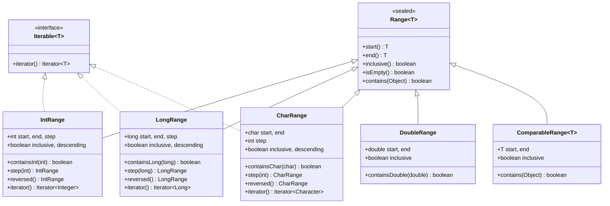

# BIP031: First-class ranges (`range`), modulo (`mod`) and integer division (`//`)

| | |
|---|---|
| **BIP** | 031 |
| **Date** | 2026-11-24 |
| **Status** | Implemented (`BIP031-Q1`–`Q8` → `BIP031-D1`–`D8` settled; `BIP031-I1`–`I3` implemented; `Range<T>` is a `public sealed interface` implemented by Java `record`s `IntRange`, `LongRange`, `CharRange`, `DoubleRange`, `ComparableRange`) |
| **Depends on** | `java.base`-only runtime boundary ([bip006_module-sources-and-aot.md](bip006_module-sources-and-aot.md)), static typing & generics ([bip008_static-typing.md](bip008_static-typing.md), [bip010_type-checker-simplification.md](bip010_type-checker-simplification.md)), core scalars & collections ([bip011_core-types.md](bip011_core-types.md)), predicate-free single-bracket `()` grammar ([bip012_grammar-improvements.md](bip012_grammar-improvements.md)), `for` loops & iterators ([bip013_iterators.md](bip013_iterators.md)), decoupled `HIR`, `-O1` Nanopass & `-O2` SSA `MIR` ([bip014_optimization-passes.md](bip014_optimization-passes.md), [bip027_tackling-complexity-in-the-compiler.md](bip027_tackling-complexity-in-the-compiler.md)), pure-by-default effects, `@TERMINATING` & structured axioms ([bip007_effects.md](bip007_effects.md), [bip016_consolidating-effect-annotations.md](bip016_consolidating-effect-annotations.md), [bip019_refactoring-axioms.md](bip019_refactoring-axioms.md), [bip030_axiom-nullability-and-inferred-effects.md](bip030_axiom-nullability-and-inferred-effects.md)), WebAssembly alignment ([bip025_compile-to-wasm.md](bip025_compile-to-wasm.md)), `.batest.md` v2 & IR goldens ([bip029_batest-v2-and-ir-goldens.md](bip029_batest-v2-and-ir-goldens.md)) |
| **Enables** | Range and `in`-membership patterns in [BIP038](bip038_pattern-matching.md) (`match`) |
| **Scope** | First-class immutable covariant `range of T` core type (`lo..hi` inclusive, `lo..<hi` half-open) across all ordered types for `.contains(x)` and interval queries, discrete `byte`/`short`/`int`/`long`/`char` `Iterable` progressions with `(lo..hi).step(k)` (`(3..<10).step(5)` → `3, 8`; the unparenthesized `3..<10.step(5)` gets a hint to parenthesize) and `.reversed()`, the floored binary `mod` modulo and `//` integer division operators on integral scalars (`byte`/`short`/`int`→`int`, `long`→`long`; `Math.floorMod` / `Math.floorDiv` semantics, so `a == b * (a // b) + a mod b`) with `a.mod(b)` / `a.floorDiv(b)` operator methods and `//=` compound assignment, `@TERMINATING` certification and zero-allocation counted-loop lowering for `for i in lo..hi` / `lo..<hi` / `(lo..<hi).step(k)`; across `Babble.g4`, `Formatter`, `BabbleSession.classify`, `OperatorTypes`/`TypeChecker`/`EffectChecker`/`LoweringAnalyzer`, `org.babblelang.runtime` (`Operators`, `Range`, `IntRange`, `LongRange`, `CharRange`, `DoubleRange`, `ComparableRange`), `src/main/java/org/babblelang/axioms/`, `Interpreter`, `HirExpr.Range`/`HirExpr.BinaryOp.MOD`/`HirExpr.BinaryOp.FLOOR_DIV`/`HirExpr.For`, `HirEmitter`, `-O1` passes, and `-O2` SSA `MIR` (`MirLowerer`, `MirEmitter`) |

---

## 1. Summary & Motivation

### 1.1 What Babble has today

`BIP013` gave Babble `for x in iterable then (...)` loops over arrays, `java.lang.Iterable`, `java.util.Iterator`, and custom Babble iterables, yet Babble has **no built-in range syntax, no `range` type, and no modulo or integer division operator**:

1. **No idiomatic counted `for` loops.** Loops over `0 .. n - 1` either fall back to `while` with a manually mutated counter or define ad-hoc wrapper classes — as `examples/raytracer-argon/lib/range.ba` explicitly notes (*"Integer Ranges for `for` Loops (Babble has no built-in range)"*).
2. **Allocator and virtual-dispatch overhead for ad-hoc ranges.** User-defined range iterators allocate a range object and an iterator object on every loop entry, whereas a core `range` construct lets the compiler lower `for i in 0..<n` (and `for i in (3..<10).step(5)`) directly to a primitive JVM counted loop (and Wasm `i32`/`i64` loop) with **zero allocation**.
3. **No first-class interval abstraction for containment and pattern matching.** Interval checks (`lo <= x and x < hi`) are repeated by hand across validation code, benchmarks, and ray-tracer hit tests (`Interval` in `examples/raytracer-argon/lib/interval.ba`), and [BIP038](bip038_pattern-matching.md) needs a clean, uniform `range of T` type to back `case lo..hi`, `case lo..<hi`, `case (3..<10).step(5)`, and `case in r`.
4. **No built-in modulo or integer division.** `Operators` defines only `+`, `-`, `*`, and `/`, and `/` always divides in floating point (`7 / 2 == 3.5`, `1 / 0` is `Infinity`). Integer code therefore reaches for `int(a / b)` (which truncates toward zero and fails only later, in `int`, on a zero divisor's infinite quotient; `long(a / b)` also loses precision above 2^53), `java.lang.Math.floorDiv` / `floorMod`, or `a - int(a / b) * b`. A floored `mod` and `//` pair fills that gap with one consistent, exact integer division. Both stay purely arithmetic: stepping a range is the `.step(k)` method, not `mod`.

### 1.2 What this proposal introduces

`BIP031` introduces the core `range of T` type, two binary range operators — inclusive `lo..hi` and half-open `lo..<hi` — and the floored binary `mod` and `//` operators in Babble's predicate-free `PredictionMode.SLL` grammar:

```babble
;; 1. Zero-allocation counted `for` loops over discrete ranges (byte, short, int, long, char)
var sum = 0
for i in 0..<10 then (
    sum += i
)
assert(sum == 45)

;; Inclusive, stepped (`.step`), and reversed discrete ranges
def stepped = (3..<10).step(5)       ;; contains 3, 8
;; 3..<10.step(5) is an error : it calls step on 10 (parenthesize the range)
assert(stepped.contains(3) and stepped.contains(8))
assert(not stepped.contains(5) and not stepped.contains(13))

for i in (3..<10).step(5) then (
    println(i)                       ;; 3, 8
)
for i in (0..10).step(2) then (
    println(i)                       ;; 0, 2, 4, 6, 8, 10
)
for i in (0..<5).reversed() then (
    println(i)                       ;; 4, 3, 2, 1, 0
)
for ch in 'a'..'z' then (
    ;; iterates 'a' through 'z'
)

;; 2. Floored modulo (`mod`) and integer division (`//`), as Math.floorMod / Math.floorDiv
assert(10 mod 3 == 1)
assert(-1 mod 5 == 4)                ;; takes the divisor's sign : wrap-around indices just work
assert(7 // 2 == 3)
assert(-7 // 2 == -4)                ;; rounds down, not toward zero
assert(-7 == 2 * (-7 // 2) + -7 mod 2)
assert(1 + 5 mod 3 == 3)             ;; multiplicative precedence (`*`, `/`, `//`, `mod`)
assert(7 / 2 == 3.5)                 ;; `/` still divides in floating point
var n = 17
n //= 5
assert(n == 3)

;; 3. First-class immutable `range of T` values across all ordered types
def digits: range of char = '0'..'9'
assert(digits.contains('5'))
assert(not digits.isEmpty())

def unit: range of double = 0.0..<1.0
assert(unit.contains(0.5))
assert(not unit.contains(1.0))

def words: range of string = "alpha".."omega"
assert(words.contains("beta"))
```

### 1.3 Goals and non-goals

**Goals:**
1. **Minimal, SLL-pure syntax (`BIP031-D1`, `BIP031-D7`, `BIP031-D8`):** Two keywords (`range` and `mod`, both exempted in `memberName`), the `//` operator (with `//=`), and two binary range operators `..` (inclusive) and `..<` (half-open) binding tightly (below member access, unary `-` and `as`, above `*`/`/`/`//`/`mod` and `+`/`-`), so `a + 1..b - 1` parses visually as `a + (1..b) - 1` and `1 + 5 mod 3` parses as `1 + (5 mod 3)` at standard multiplicative precedence, while stepping is the ordinary method call `(lo..hi).step(k)` — zero semantic predicates and zero lexer modes (`ParserGrammarTestCase`).
2. **All ordered types for containment; discrete scalars for iteration (`BIP031-D2`, `BIP031-D3`):** `lo..hi` and `lo..<hi` work on all numeric scalars (`byte`..`double`), `char`, `string`, and `Comparable` types for `.contains(x)` / `.isEmpty()` / `.start()` / `.end()` / `.inclusive()`; discrete types (`byte`, `short`, `int`, `long`, `char`) are iterable in `for` with `.step(k)` and `.reversed()` and reject non-discrete iteration at compile time.
3. **Floored integer modulo and division (`BIP031-D7`, `BIP031-D8`):** `a mod b` and `a // b` follow `Math.floorMod` / `Math.floorDiv` on integral scalars (`byte`/`short`/`int` → `int`, with `long` → `long`; rejecting `float`/`double`), always satisfying `a == b * (a // b) + a mod b`; they dispatch `a.mod(b)` / `a.floorDiv(b)` on Babble instances and are not defined on `range of T` (`(3..<10).step(5)` steps a range).
4. **Zero-allocation counted loops & `@TERMINATING` certification (`BIP031-D4`, `BIP031-D5`):** Direct `for i in lo..hi` / `lo..<hi` (including `.step(k)` and `.reversed()`) lower to pure primitive JVM counted loops in `HirEmitter` and SSA `MIR` (`-O2`) with overflow-safe `MAX_VALUE` handling and static `@TERMINATING`/`nothrow` certification.
5. **Strict `java.base`-only runtime & `BIP019`/`BIP030` axioms (`BIP031-D6`):** Zero dependencies outside `java.base` (`RuntimeBoundaryTestCase`), primitive-specialized `Range` subclasses in `org.babblelang.runtime`, and all range method contracts declared in `src/main/java/org/babblelang/axioms/`.

**Non-goals:**
- **Pattern matching (`match` / `case` / `case lo..hi` / `case (3..<10).step(5)` / `case in r`):** Specified in [BIP038](bip038_pattern-matching.md), which builds directly on `BIP031`'s `range of T` type and `..`/`..<` operators.
- **General `x in expr` binary expression operator:** Kept out of `BIP031`; outside `BIP038`'s `case in expr`, users call `r.contains(x)`.
- **Unbounded/open-ended ranges (`..10`, `0..`):** Deferred; binary `lo..hi` and `lo..<hi` cover counted loops, intervals, and `BIP038` range patterns (where `< 10` / `>= 0` already express one-sided bounds).
- **Slice indexing syntax (`xs[1..3]`):** Deferred alongside general indexing syntax in the backlog (`BIP008` §5.1).
- **Truncated division and remainder, floating-point `//`/`mod`, and `mod=`:** Not provided. `int(a / b)` still truncates, `java.lang.Math` covers the rest through Java interop, and `x = x mod k` spells the missing compound form.

---

## 2. State of the Art

| Language | Inclusive | Half-open (exclusive upper) | Step / stride syntax | Modulo / integer division | First-class type | Counted-loop lowering |
|---|---|---|---|---|---|---|
| **Kotlin 1.9+** | `a..b` | `a..<b` | `a..<b step k` (`infix`) | `%`, `/` (truncated); `.mod()`, `floorDiv()` (floored) | `ClosedRange<T>` / `OpenEndRange<T>` / `IntRange` | Lowered to primitive `for` loop (`0..<n`) |
| **Swift** | `a...b` | `a..<b` | `stride(from:to:by:)` | `%`, `/` (truncated) | `ClosedRange<Bound>` / `Range<Bound>` | Inlined to primitive loop |
| **Rust** | `a..=b` | `a..b` | `(a..b).step_by(k)` | `%`, `/` (truncated); `rem_euclid`, `div_euclid` | `RangeInclusive<T>` / `Range<T>` | LLVM optimizes iterator to counted loop |
| **Python** | — | `range(a, b, step)` | 3rd argument | `%`, `//` (floored) | `range` (`int` only) | Bytecode `FOR_ITER` over `range` object |
| **Babble (`BIP031`)** | `a..b` | `a..<b` | `(a..<b).step(k)` | `mod`, `//` (floored, multiplicative precedence with `*`/`/`) | `range of T` (immutable, covariant) | Direct zero-alloc primitive counted loop in HIR & `-O2` SSA `MIR` |

Kotlin 1.9+ and Swift converged on `a..b` (inclusive) + `a..<b` (half-open), avoiding Rust's `..` vs `..=` off-by-one confusion, and Babble adopts the same two spellings. Babble deliberately **diverges on precedence**: Kotlin, Swift, and Rust all bind range operators *below* `+`/`-` (so `0..<n - 1` means `0..<(n - 1)` there), whereas `BIP031-D1` binds `..`/`..<` *above* `*`/`/`/`mod` and `+`/`-`. This matches the no-spaces visual convention (`1..b` binds tighter than spaces-around `+`/`-`) and keeps `mod` at standard multiplicative precedence alongside `*` and `/`. Babble neither overloads `mod` for ranges nor reserves a Kotlin-style infix `step` keyword: stepping is the ordinary method `(a..<b).step(k)`, like Rust's `(a..b).step_by(k)`. Since member access binds tighter than any binary operator, `a..<b.step(k)` calls `step` on `b`; the parentheses are required, and the diagnostic for the unparenthesized form suggests them (§3.4). The cost is that arithmetic bounds need parentheses (`0..<(n - 1)`, `(i + 1)..<n`, `0..<(n * 2)`); unparenthesized forms are type errors rather than silent misparses (§3.2), and their diagnostic suggests the parenthesized form.

On integer division, Babble follows Python's floored pair (`%` / `//`) and Kotlin's `.mod()` / `floorDiv()` (and Haskell's `mod` / `div`) rather than the JVM's truncated `IDIV`/`IREM`: the result of `a mod b` takes the sign of `b`, so `(i - 1) mod n` wraps a negative index back into `0..<n` and `a mod 2 == 1` tests oddness for negative `a` too, and `a // b` rounds toward negative infinity so the identity `a == b * (a // b) + a mod b` holds. Floored division also maps power-of-two divisors exactly onto masks and arithmetic shifts (§4.4.1). `//` reuses Python's spelling (Babble comments are `;;`, so the token is free), `mod` keeps its mathematical keyword, and `/` keeps its floating-point meaning.

---

## 3. Syntax, Grammar, Formatting & REPL (`BIP031-D1`, `BIP031-D7`, `BIP031-D8`)

### 3.1 Keyword and token audit

| Token | Lexeme | Grammar role | In `memberName`? | Corpus collisions |
|---|---|---|---|---|
| `RANGE_KW` | `'range'` | Core type keyword in `coreTypeKeyword` (`range of T`) | Yes | **1** local helper `def range = fn (...)` in `src/test/babble/OptionalArguments.ba:97` (renamed to `span`; `examples/raytracer-argon/lib/range.ba` uses capitalized `Range` and does not collide) |
| `MOD` | `'mod'` | Binary floored modulo operator (`a mod b`, integral scalars and `a.mod(b)` operator methods; not defined on ranges) | Yes | **1** local variable `def mod = import("dce_mod.ba")` in `src/test/batest/compiler/hir_dce_refs_and_rewriter.batest.md:102` (renamed to `m`; `bi.mod(bi2)` on `BigInteger` continues working via `memberName`) |
| `FLOOR_DIV` | `'//'` | Binary floored integer division (`a // b`) | N/A | **0** (comments are `;;`; `//` only occurs inside strings and comments, such as URLs) |
| `FLOOR_DIV_ASSIGN` | `'//='` | Compound floored division (`n //= k`) | N/A | **0** |
| `RANGE_EXCL` | `'..<'` | Half-open range binary operator (before `RANGE` in lexer) | N/A | **0** |
| `RANGE` | `'..'` | Inclusive range binary operator (after `ELLIPSIS` `'...'` and `RANGE_EXCL` `'..<'`) | N/A | **0** |

**Lexer maximal-munch verification:**
- `DOUBLE_LIT` requires `[0-9]+ '.' [0-9]+`. On `1..10`, the character after `.` is `.` (not `[0-9]`), so `DOUBLE_LIT` does not match; `1..10` lexes cleanly as `INT("1")`, `RANGE("..")`, `INT("10")`.
- `1.0..10.0` lexes as `DOUBLE_LIT("1.0")`, `RANGE("..")`, `DOUBLE_LIT("10.0")`.
- Ordering `ELLIPSIS: '...'`, `RANGE_EXCL: '..<'`, `RANGE: '..'`, `DOT: '.'` disambiguates all four tokens via ANTLR4 maximal munch with zero lexer predicates or modes.
- Likewise `FLOOR_DIV_ASSIGN: '//='`, `FLOOR_DIV: '//'`, `DIV_ASSIGN: '/='`, `DIV: '/'`: `a // b` is one token, `n //= 5` is `//=`, and `a / b` and `n /= 2` are unchanged.

### 3.2 Grammar rules (`Babble.g4`)

```antlr
coreTypeKeyword: coreScalarKeyword | coreCollectionKeyword | RANGE_KW | EXCEPTION | ANY | VOID;

memberName: ... | MOD;
```
(`memberName` already includes `coreTypeKeyword`, so `.range` and `.mod` both continue to work as member names automatically.)

In `expression`, `RANGE`/`RANGE_EXCL` bind **tighter than `*`/`/`/`//`/`mod` and `+`/`-`** (directly below unary `-` and `as`), and `FLOOR_DIV` and `MOD` sit at standard **multiplicative precedence** alongside `*` and `/`, left-associative (`BIP031-D1`, `BIP031-D7`, `BIP031-D8`):

```antlr
          | '-' operand=expression                                       # negate
          | left=expression AS NL* right=type                            # asExpression
          | left=expression op=(RANGE | RANGE_EXCL) NL* right=expression # rangeExpression
          | left=expression op=('*' | '/' | FLOOR_DIV | MOD) NL* right=expression # binaryOp
          | left=expression op=('+' | '-') NL* right=expression          # binaryOp
          | left=expression IS NL* right=type                            # isExpression
          | left=expression op=('<' | '<=' | '==' | NEQ
                       | '>=' | '>') NL* right=expression                # binaryOp
          ...
          | <assoc=right> lhs=expression op=('=' | '+=' | '-=' | '*=' | '/='
                       | FLOOR_DIV_ASSIGN) NL* value=expression          # assignExpression
```

Precedence examples:
- `a + 1..b - 1` parses as `(a + (1..b)) - 1`, matching the visual grouping of no-space `1..b` versus spaced `+`/`-`. It is a type error since `+(int, range of int)` is not defined, and `TypeChecker` words it with a hint: `Operator + : int and range of int. Parenthesize arithmetic range bounds : (a + 1)..(b - 1)` (likewise for `-`, `*`, `/`, and `//` with a range operand). Write `(a + 1)..(b - 1)` when endpoints are arithmetic expressions.
- `-5..5` parses as `(-5)..5` and `0..-1` parses as `0..(-1)` (unary `-` binds tighter than `..`/`..<`).
- `1 + 5 mod 3` parses as `1 + (5 mod 3)` (`== 3`, standard multiplicative precedence for `mod`).
- `7 // 2 * 2` parses as `(7 // 2) * 2` (`== 6`), and `a // b mod c` as `(a // b) mod c` (left-associative).
- `0..<n // 2` parses as `(0..<n) // 2`, a type error with the parenthesizing hint: write `0..<(n // 2)`.
- `0..<(a mod b)` uses explicit parentheses for a modulo bound; `0..<n mod 2` parses as `(0..<n) mod 2`, a type error with the same parenthesizing hint (`mod` is not defined on ranges).
- `(3..<10).step(5)` is the stepped range containing `3, 8`, and `for i in (3..<10).step(5) then (...)` iterates it.
- `3..<10.step(5)` parses as `3..<(10.step(5))`, because member access (`selector`) binds tighter than every binary operator; it is rejected with a hint to parenthesize the range (§3.4).
- `1..10 is range of int` parses as `(1..10) is range of int`.
- `a..b..c` parses as `(a..b)..c` (left-associative) and is rejected, since a range and its element type are not comparable: `Not comparable : range of int and int`.
- `NL*` after `..`, `..<`, `//`, `//=`, and `mod` matches all other binary operators in `Babble.g4`.

### 3.3 Canonical formatting (`Formatter`) & REPL (`BabbleSession.classify`)

- **`Formatter`:** Formats `lo..hi` and `lo..<hi` with **no spaces** around `..` and `..<` (`0..<n`, `'a'..'z'`, `(a + 1)..(b - 1)`), and formats `mod`, `//`, and `//=` with a single space on each side (`10 mod 3`, `(i - 1) mod n`, `7 // 2`, `n //= 5`), idempotent to a fixed point (`FormatterTestCase`).
- **`BabbleSession.classify` (`BIP004`):** A dangling range, `mod`, `//`, or `//=` operator before `EOF` (`1..`, `1..<`, `10 mod`, `7 //`, `n //=`) classifies as **`INCOMPLETE`**, matching `+`, `-`, `*`, `/` continuations.

### 3.4 Unparenthesized range method calls

Member access binds tighter than `..`/`..<`, so `1..10.step(5)` parses as `1..(10.step(5))` and `0..<n.reversed()` as `0..<(n.reversed())`. The grammar has no special rule for them (it stays predicate-free `SLL`), and they fail to type-check. As it does for arithmetic bounds (§3.2), `TypeChecker` words the error with a hint: when a member access (or a call on one) is the unparenthesized right operand of a `rangeExpression`, its receiver's type lacks the member, and `range of T` has it (`step`, `reversed`, `contains`, `isEmpty`, `start`, `end`, `inclusive`), the missing-member error gains the parenthesized form:

```
Error : No such member : step. Parenthesize the range : (1..10).step(5)
```

Both modes report the same message (the snippet goes in `DifferentialTestCase` and the golden in `TypeCheckerTestCase`). When the bound's type does have the member (`0..<s.length()` with `s: string`), the expression is well-typed and no hint applies.

---

## 4. Type System, Operations & Effects (`BIP031-D2`, `BIP031-D3`, `BIP031-D4`)

### 4.1 Type `range of T`

`range` is a built-in immutable, **covariant** core type (`Type.CoreRange(Type element)` or parameterized `Type.Java(Range.class, List.of(T))` with covariant variance registered in `TypeAlgebra` alongside `entry` and `Optional` per `BIP011-D8`). Because `range of T` is strictly immutable:
- `range of Sub <: range of Super` holds soundly. Immutability removes the mutation hole, and the one member taking a `T`, `contains`, tests its argument's type at run time and returns `false` for a value that is not a `T`, as `java.util.Collection.contains(Object)` does. A `range of int` seen as a `range of any` therefore answers `false` to `.contains("x")` instead of failing.
- `frozen (range of T)` simplifies to `range of (frozen T)` (and stays `range of int` for scalar `T`, per `BIP007-D7`).

**Typing `lo..hi` and `lo..<hi`:**
1. Both `lo` and `hi` must be non-null (nullable endpoints are a compile error: `Range bound cannot be null : <type>`).
2. Element type `T` is resolved by:
   - **Numeric scalars (`byte`..`double`):** common widened numeric type per `BIP011-D4` (e.g., `0..10L` → `range of long`; `0..<1.5` → `range of double`; contextual narrowing applies when an expected type like `range of byte` is supplied and both literals fit in `byte`).
   - **`char`:** `char..char` → `range of char` (strictly non-numeric per `BIP011-D4`, never widens with `int`).
   - **`string` and `Comparable` types:** if `OperatorTypes.comparable(lo, hi)` holds (both numeric, or a common type `T` whose Java class implements `java.lang.Comparable`, such as `string`, `char`, `java.math.BigDecimal`, or `java.time.LocalDate`), result is `range of T`. Babble classes have no comparison operator methods today (`Operators.method` maps only arithmetic operators), so `BIP031` does not range over Babble instances; adding `lt`/`lte`/`gt`/`gte` operator methods is left to a separate proposal, which would extend `OperatorTypes.comparable` and `ComparableRange` together.
   - Otherwise: compile error (`Not comparable : <lo> and <hi>`).

### 4.2 Core members on `range of T`

All members are exposed via `org.babblelang.runtime.Range` and declared in `src/main/java/org/babblelang/axioms/` (`BIP019`, `BIP030`):

| Member | Signature | Semantics |
|---|---|---|
| `start()` | `fn nothrow (): T` | Lower bound as written (`.reversed()` keeps it: `(0..<5).reversed().start() == 0`). |
| `end()` | `fn nothrow (): T` | Upper bound. |
| `inclusive()` | `fn nothrow (): bool` | `true` for `..`, `false` for `..<`. |
| `isEmpty()` | `fn nothrow (): bool` | `start > end` (inclusive) or `start >= end` (half-open); `true` if either float/double bound is `NaN`. |
| `contains(value: T)` | `fn (value: T): bool` | `start <= value and value <= end` (`..`) or `start <= value and value < end` (`..<`). The parameter is statically typed `T`, but at run time a value of another type (reachable through covariance, §4.1) yields `false`. For stepped discrete ranges (`step > 1`, e.g., `(3..<10).step(5)`), also checks that `value - start` is a multiple of `step` (so `(3..<10).step(5)` contains `3` and `8`), computed without overflow: in `long` arithmetic for `byte`/`short`/`int`/`char` ranges and with `Long.remainderUnsigned` on the non-negative unsigned distance for `long` ranges (so `(Integer.MIN_VALUE..Integer.MAX_VALUE).step(3)` and `(Long.MIN_VALUE..Long.MAX_VALUE).step(3)` answer correctly). Reversal never changes `contains`. |
| `equals` / `hashCode` / `toString` | Standard protocol | Structural equality on `(start, end, inclusive, step, descending)` as written, so `0..<10 != 0..9` (they describe the same elements, but `start()`/`end()`/`inclusive()` differ) and two empty ranges are equal only if their fields are; `r.contains`-level equivalence is not equality. `toString()` renders the source form: `"1..10"`, `"0..<10"`, `"(3..<10).step(5)"`, and `"(0..<5).reversed()"` for a reversed range. |

### 4.3 Discrete iteration (`for i in r`), `.step(k)` and `.reversed()`

A `range of T` is **discrete** iff `T` is one of `byte`, `short`, `int`, `long`, or `char`:

- **Iterable contract:** Discrete ranges are valid iterables in `for x in r then (...)` (loop variable `x` has unboxed primitive type `T`) and are subtypes of `java.lang.Iterable of T` (so they pass cleanly to any Java or Babble function expecting `Iterable of int`). An annotated loop variable widens each element as for any iterable (`BIP013`'s `subsumes` check and `NumericCoercion`): `for i: long in 0..<n` keeps an `int` counter and widens it when binding `i`, while a narrowing annotation such as `for b: byte in 0..<n` is a type error.
- **Non-discrete ranges (`float`, `double`, `string`, arbitrary `Comparable`):** Trying to iterate in `for x in 0.0..1.0` or call `.step(k)` / `.reversed()` is a **compile-time error**: `Not iterable : range of <T> is not discrete`.
- **Stepped ranges (`r.step(k)`):**
  - `(lo..hi).step(k)` and `(lo..<hi).step(k)` (or `r.step(k)` on any discrete `r: range of T`) select elements `start, start + k, start + 2k, ...` within the range bounds. For example, **`(3..<10).step(5)` contains `3, 8`** (starting at `3`, stepping by `5`, stopping before `10`), and **`(0..10).step(2)` contains `0, 2, 4, 6, 8, 10`**. The parentheses are required (§3.4).
  - `k: int` for `byte`/`short`/`int`/`char` ranges; `k: long` (widening from `int`) for `long` ranges.
  - Requires `k > 0`; throws `BabbleException("Range step must be positive : " + k)` if `k <= 0`. Direction comes only from `.reversed()`, so a negative step would be a second spelling of the same progression; Kotlin's `step` likewise requires a positive value and spells descent `downTo`.
  - Returns a new immutable `range of T` progression with the given step.
- **`.reversed()`:**
  - Returns a new immutable `range of T` progression iterating from the last included element down to `start` (e.g., `(0..<5).reversed()` yields `4, 3, 2, 1, 0`; `(3..<10).step(5).reversed()` yields `8, 3`).
  - Keeps `start()`, `end()`, `inclusive()`, the step, and `contains` unchanged and only flips the iteration order (the `descending` flag), so `r.reversed().reversed() == r`.
- **Overflow safety:** Every progression computes its **last element** once, before iterating, in `long` or unsigned arithmetic (Kotlin's `getProgressionLastElement`): the largest `start + j * k` within the bounds, or none when the range is empty. Iteration then runs up to and including that element and stops by comparing with it (`i == last`), never by testing `i + k` against the bound. So `0..java.lang.Integer.MAX_VALUE`, `0L..java.lang.Long.MAX_VALUE`, and `'\u0000'..'\uffff'` stop after yielding their upper bound, and a stepped range such as `(0..<java.lang.Integer.MAX_VALUE).step(1000000000)` yields `0`, `1000000000`, `2000000000` and stops, where `2000000000 + 1000000000` would otherwise wrap to a negative number below the bound and loop forever. Reversed progressions start from that last element and stop at `start`. The runtime `Iterator`s, the counted loops of §5.2, and Wasm all use this scheme.

### 4.4 Floored `mod` and integer division `//` (`BIP031-D7`, `BIP031-D8`)

`a mod b` and `a // b` are dispatched uniformly in `OperatorTypes` / `Operators` across these operand shapes. Neither is defined on `range of T`: `(0..<10) mod 2` and `r // k` are type errors (with the §3.2 parenthesizing hint when the range comes from an unparenthesized bound), and a range is stepped with `.step(k)` (§4.3).

1. **Integral scalars (`byte`, `short`, `int`, `long`):** `(int, int): int`, promoting `byte`/`short`/`int` operands to `int` (and, if either operand is `long`, both to `long`) per `BIP011-D4`, with **floored** semantics, exactly `java.lang.Math.floorMod` / `floorDiv`:
   - `a // b` rounds the exact quotient toward negative infinity: `7 // 2 == 3`, `-7 // 2 == -4`, `7 // -2 == -4`, `-7 // -2 == 3`.
   - `a mod b` takes the sign of the divisor and lies in `0..<b` for `b > 0` (and in `(b + 1)..0` for `b < 0`): `10 mod 3 == 1`, `-1 mod 5 == 4`, `10 mod -3 == -2`, `-10 mod -3 == -1`.
   - The two always agree: `a == b * (a // b) + a mod b` for every `b != 0`, including `MIN_VALUE // -1 == MIN_VALUE` (wrapping like `IDIV`, never throwing) and `MIN_VALUE mod -1 == 0`.
   - Divisor `0` throws `java.lang.ArithmeticException` (`/ by zero`, as `Math.floorDiv` / `floorMod` do).
   - Floating-point operands (`float`, `double`) are **rejected at compile time** (`Not an integer : <operand>`); `/` remains the floating-point division.
   - Compiled mode calls the `java.base` intrinsic-friendly `Math.floorMod(II)I` / `(JJ)J` and `Math.floorDiv` (HotSpot inlines them into `IDIV`/`IREM` plus a sign fix-up), and the optimizer emits bare `IREM`/`IDIV` (`LREM`/`LDIV`) when the dividend is statically non-negative and the divisor a positive constant, where floored and truncated division coincide (§4.4.1).
2. **Babble instances:** `a mod b` calls the operator method `a.mod(b)` and `a // b` calls `a.floorDiv(b)` (`Operators.method("mod") -> "mod"`, `Operators.method("//") -> "floorDiv"`, alongside `plus`, `minus`, `times`, and `div` for `/`; overload sets supported via `BIP021`). Because `MOD` is in `memberName`, calling `.mod(...)` directly on Java classes such as `java.math.BigInteger` (`bi.mod(bi2)`) continues working unchanged; `BigInteger` and `BigDecimal` operands are not integral scalars, so `bi mod bi2` is a type error and they keep their own methods.
3. **Compound assignment:** `n //= k` is `n = n // k`, with the target's receiver evaluated once (`Operators.compound("//=") -> "//"`), on `var` bindings and fields only (`BIP034`). `mod` has no compound form.

#### 4.4.1 Algebraic & E-graph properties of `mod` and `//` (`BIP031-D7`, `BIP031-D8`)

`ENode.Op` gains `MOD` and `FLOOR_DIV`, and `AlgebraicRules.optimizerRules()` / `verifierRules()` (`org.babblelang.ir.egraph`) register the following sound rules for integral floored `mod` and `//` (with exact exception-preserving guards):

| Law / Rewrite | Soundness & guard | Where expressed |
|---|---|---|
| **Repeated-divisor idempotence:** `(a mod b) mod b` → `a mod b` (`a mod b mod b` parses left-associatively as `(a mod b) mod b`) | Always sound for all `int`/`long` values (a floored `a mod b` already lies in the divisor's residue range, including for negatives, `MIN_VALUE`, and `b == 0` where both sides throw on the inner `a mod 0`) when `b` is pure, `nothrow`, and deterministic (guaranteed inside `EGraph`). Also lets `AlgebraicVerifier` certify `fn idempotent (x: int): int -> (x mod k)` for any non-zero constant `k`. | `AlgebraicRules::integralModRules` (`optimizerRules` + `verifierRules`) |
| **Unit divisor:** `a mod 1` → `0` (and `a mod -1` → `0`) | Always sound for all `int`/`long` values (`Math.floorMod(MIN_VALUE, -1) == 0`, no overflow, never throws). The `EGraph` rewrite applies when `a` is pure, `nothrow`, and `@TERMINATING`; otherwise the optimizer keeps evaluating `a` for its effects and only replaces the result with `0`. | `AlgebraicRules::integralModRules` (`optimizerRules` + `verifierRules`) |
| **Zero dividend:** `0 mod a` → `0` (and `a mod a` → `0`) | **Only sound when `a` is statically proven non-zero** (`a != 0` — e.g. a non-zero constant, `SccpPass` non-zero lattice fact, or inside an `a != 0` / `a > 0` / `a < 0` branch) and pure/`nothrow`/`@TERMINATING`! Without a non-zero proof, rewriting `0 mod a` → `0` would unsoundly suppress `ArithmeticException` when `a == 0`. | `AlgebraicRules::integralModRules` (non-zero constant `a` in `EGraph`) + `-O2` `SccpPass` (when `a` is proven non-zero) |
| **Unit divisor for `//`:** `a // 1` → `a`, `a // -1` → `-a` | Always sound (`Math.floorDiv(MIN_VALUE, -1) == MIN_VALUE == -MIN_VALUE` in wrapping `int`/`long` arithmetic, never throws). | `AlgebraicRules::integralModRules` |
| **Zero dividend for `//`:** `0 // a` → `0`, `a // a` → `1` | Only when `a` is proven non-zero, exactly as for `0 mod a`. | `AlgebraicRules::integralModRules` + `-O2` `SccpPass` |
| **Factor cancellation:** `x * a // a` → `x` (and `a * x // a` → `x`) | Sound when `a` is proven non-zero (otherwise both sides differ: the left throws) **and** `x * a` is proven not to overflow. Babble's `int`/`long` multiplication wraps, so without that proof the rewrite is wrong: for `x = 2^30` and `a = 4`, `x * a` wraps to `0` and `0 // 4 == 0`. No overflow is guaranteed when both factors are constants that fold without overflow, when both are `byte` or `short` values widened to `int` (`|x * a| <= 32768 * 32768 == 2^30 < 2^31`; `char` is not numeric, `BIP011-D4`), when the product is computed in `long` from `int` or narrower factors (`|x * a| <= 2^62`), or when `-O2` `SccpPass` bounds them. `x` is still evaluated for its effects; `EGraph` equivalence guarantees both `a`s are the same pure value. | `AlgebraicRules::integralModRules` (non-overflowing constants, widened `byte`/`short` factors, and `long` products of `int` factors) + `-O2` `SccpPass` (bounded factors) |
| **Division identity:** `b * (a // b) + a mod b` → `a` | Sound for pure `a` and `b` proven non-zero (it holds in wrapping arithmetic for every `a`, `MIN_VALUE // -1` included). Lets `AlgebraicVerifier` reason about digit and index decompositions. | `AlgebraicRules::integralModRules` (`verifierRules`) |
| **Power-of-two strength reduction:** `a mod 2^k` → `a & (2^k - 1)`, `a // 2^k` → `a >> k` | Exact for **every** `a`, negatives included, because floored division by a positive power of two *is* the arithmetic shift and its remainder *is* the low-bit mask (truncated `%` and `/` would need extra sign fix-ups). Babble has no bitwise operators, so this is a code-generation rule, not an `EGraph` equivalence. | `ControlAndOpEmitter`, `MirEmitter` (`IAND`/`ISHR`, `LAND`/`LSHR`), Wasm `i32.and` / `i32.shr_s` |
| **Non-negative dividend:** floored `mod` / `//` → truncated `IREM` / `IDIV` | Sound when the dividend is statically non-negative (a non-negative constant, a `size()`/`length` result, or a counted-loop index with a non-negative start and positive step) and the divisor a positive constant, where the two roundings agree. | `ControlAndOpEmitter`, `MirEmitter`, `SccpPass` |
| **Zero divisor:** `a mod 0` and `a // 0` → raise `java.lang.ArithmeticException` | **Yes — expressible outside pure `EGraph` value equivalences** across three existing compiler layers: (1) **`EffectChecker`** marks `a mod 0` and `a // 0` as definitely throwing (rejecting them at compile time inside `fn nothrow`); (2) **`TypeChecker`** emits a non-fatal `analysisWarn` (`Modulo by zero : always throws java.lang.ArithmeticException`, or `Division by zero : always throws java.lang.ArithmeticException` for `//`) for literal `0` divisors (keeping `try (x mod 0) catch : java.lang.ArithmeticException` legal in every mode); (3) **`HirEGraphSimplifyPass` (`-O1`) & `SccpPass` (`-O2`)** fold `a mod 0` and `a // 0` (including after constant propagation, e.g. `def d = 0 ; x mod d`) to evaluate any side-effecting `a` and then execute `HirExpr.Throw(new ArithmeticException("/ by zero"))` / `MirTerminator.Throw` (`Type.NOTHING`), enabling `HirDcePass` / `MirDcePass` to prune unreachable code after it. | `EffectChecker`, `TypeChecker` (`analysisWarn`), `HirEGraphSimplifyPass` (`HirExpr.Throw`), `-O2` `SccpPass` (`MirTerminator.Throw`) |

### 4.5 Effects, purity & `@TERMINATING` (`BIP031-D4`)

- `lo..hi` / `lo..<hi` on scalars is **`pure nothrow @TERMINATING`** (on custom `Comparable` types, inherits the effects of `compareTo`).
- `a mod b` and `a // b` on integral scalars are **`pure`** (they may throw `ArithmeticException` on divisor `0`, and are **`nothrow`** when the divisor is a non-zero compile-time constant). This makes them the first scalar arithmetic operators that can throw (Babble's `/` always yields `float`/`double` and never throws), so a non-constant divisor removes `nothrow` from the enclosing function's inferred effects. That in turn keeps `BIP024-D7`'s *Recursion without a base case* error, `BIP007-D8`'s *Unused pure expression* diagnostic, and `HirDcePass` from treating such code as non-throwing; guard the divisor (`if k != 0 then (x mod k)`, likewise for `x // k`) or use a non-zero constant where `nothrow` matters.
- `.contains(x)`, `.isEmpty()`, `.start()`, `.end()`, `.inclusive()`, `.reversed()` are **`pure nothrow`** on scalar ranges; `.step(k)` is **`pure`** (may throw if `k <= 0`, or **`nothrow`** when `k` is a positive compile-time constant!).
- **`for i in r` termination (`BIP027-I6` integration):** Iterating any discrete `range of T` in a `for` loop is statically certified **`@TERMINATING`** (and `nothrow` when the loop body is `nothrow` and any step is statically positive), so a pure unused `for i in 0..<n then (i + 1)` triggers `BIP007-D8`'s `Unused pure expression` diagnostic cleanly and qualifies for `HirDcePass` elimination!

---

## 5. Runtime, HIR/MIR & Zero-Allocation Bytecode Lowering (`BIP031-D5`, `BIP031-D6`)

### 5.1 `java.base`-only runtime hierarchy (`org.babblelang.runtime`)

All runtime classes live in `org.babblelang.runtime` with zero external dependencies (`RuntimeBoundaryTestCase`):



- `IntRange` backs `byte`, `short`, and `int` (recording element kind for `Iterable` boxing of `Byte`/`Short`/`Integer`).
- `DoubleRange` backs `float` and `double` (primitive IEEE-754 bounds checks, handling `NaN` cleanly).
- `Operators.mod(Object a, Object b, OpSite site)` handles dynamic/interpreted scalar `Math.floorMod` and Babble instance `.mod(b)` (ranges are stepped by the ordinary method `Range.step`); `Operators.floorDiv(Object a, Object b, OpSite site)` handles scalar `Math.floorDiv` and Babble instance `.floorDiv(b)`. `Operators.method`, `Operators.compound`, and `Operators.arithmetic` learn `mod`, `//`, and `//=`.
- `Range` axioms are declared in `src/main/java/org/babblelang/axioms/org/babblelang/runtime/curated.ba` (never hardcoded in `EffectChecker` or `JavaNullability`, preserving `AxiomsTestCase`!).

### 5.2 Decoupled `HIR` & counted-loop lowering

1. **`HirExpr.Range`, `HirExpr.BinaryOp.MOD` & `HirExpr.BinaryOp.FLOOR_DIV`** (in `org.babblelang.ir.hir.HirExpr`):
   ```java
   record Range(
       HirExpr start,
       HirExpr end,
       boolean inclusive,
       PrimitiveKind elemKind,
       ExprMeta meta
   ) implements HirExpr {}
   ```
   `HirExpr.BinaryOp` gains `MOD("mod")` and `FLOOR_DIV("//")`, emitting `INVOKESTATIC Math.floorMod` / `Math.floorDiv` (or the mask, shift, and bare `IREM`/`IDIV` forms of §4.4.1) in `ControlAndOpEmitter` and `MirEmitter`. `//=` lowers through the existing compound-assignment path.
2. **Zero-allocation counted `for` loop (`HirExpr.For`):**
   `LoweringAnalyzer` decides the counted form once, as a new `ForKind.COUNTED_RANGE` on the existing `LoweringTargets.ForLoopTarget` that `HirExpr.For` already carries (alongside the array and iterator kinds), so the `Interpreter`, `HirEmitter`, `MirLowerer`, and the Wasm backend all read the same analysis result instead of `HirBuilder` re-recognizing syntax. It applies when the iterable of `for i in <iterable> then (<body>)` is directly:
   - `lo..hi` or `lo..<hi`, OR
   - `(lo..hi).step(k)` / `(lo..<hi).step(k)` / `(lo..hi).reversed()` / `(lo..<hi).reversed()` (and their compositions, such as `(lo..<hi).step(k).reversed()`)
   on a discrete scalar (`byte`, `short`, `int`, `long`, `char`); `HirBuilder` then lowers the bound expressions into a `CountedRangeLoop(HirExpr start, HirExpr end, HirExpr step, boolean inclusive, boolean descending, PrimitiveKind elemKind)` attached to `HirExpr.For`. As with any `for` iterable (`BIP013`), `start`, `end`, and `step` are evaluated exactly once, left to right, before the first iteration: reassigning a `var` bound inside the body does not change the loop's trip count.
   - **`HirEmitter` (`-O0` / `-O1`)** emits a pure primitive counted loop with **zero `Range` allocation and zero `Iterator` boxing**. Before entry it validates `k > 0` (when `k` is not a constant) and computes `last` as in §4.3, exiting at once on an empty range; the loop is then `loop: <body>; if i == last goto exit; i += k; goto loop`, which never overflows whatever the bounds, inclusiveness, step, or direction (`i -= k` when reversed). `i += k` is `IINC` only for a constant step that fits in 16 bits, `ILOAD`/`IADD`/`ISTORE` otherwise, and `LLOAD`/`LADD`/`LCMP` on `long` ranges.
   - **`MirLowerer` & `MirEmitter` (`-O2`, `BIP014-I3`)** lower `CountedRangeLoop` directly to an SSA loop header block carrying the unboxed induction variable as a block parameter, with the same precomputed `last` and `i == last` exit, enabling `SccpPass`, `LicmPass`, `GvnCsePass`, and `MirDcePass` to optimize counted loops at full speed!
   - **Range expression value (`def r = (3..<10).step(5)`):** Lowers to direct `INVOKESTATIC Range.ofInt(3, 10, false, 5)` (or `ofLong`/`ofChar`/`ofDouble`/`ofComparable`), and `r.contains(x)` on a known `HirExpr.Range` expression can be folded by `HirEGraphSimplifyPass` (`-O1`) straight to `3 <= x and x < 10 and (x - 3) mod 5 == 0` without allocating `Range`!
3. **`HirCanonicalPrinter` & `MirCanonicalPrinter` (`BIP029`):**
   - `HirCanonicalPrinter` renders `(range .. lo hi)` / `(range ..< lo hi)`, `(mod a b)`, `(// a b)`, and `(for-range i ..< lo hi [step k] body)`.
   - `MirCanonicalPrinter` renders `range_new .. %lo, %hi`, `mod %a, %b`, `floordiv %a, %b`, and clean SSA counted-loop blocks.
4. **`BIP025` WebAssembly alignment:**
   - `HirExpr.BinaryOp.MOD` and `FLOOR_DIV` lower to `i32.rem_s` / `i32.div_s` (and `i64`) plus the floored sign fix-up, after an explicit zero-divisor check that throws the same `ArithmeticException` as the JVM (Wasm traps instead) and a `MIN_VALUE // -1` check that yields `MIN_VALUE` (where `div_s` traps but `IDIV` wraps).
   - `HirExpr.For` with `CountedRangeLoop` lowers directly to a plain Wasm `i32`/`i64` `loop` + `br_if` on the precomputed `last` element, with zero heap allocation; first-class `Range` values lower to WasmGC immutable structs with runtime helpers emitted next to `WasmCollectionOpsGen` / `WasmStringOpsGen`, and `WasmPortabilityChecker` rejects only ranges over Java `Comparable` classes.

---

## 6. Implementation Plan & Phases

`BIP031` is structured into **three** incremental phases, each keeping `mvn package` and `-PO2` green across all execution modes (`interpret`, `compile -O0`, `compile -O1`, `compile -O2`, and `wasm-js -O1`, where `WasmBatestTestCase` runs every portable `.batest.md` case), `ParserGrammarTestCase`, `RuntimeBoundaryTestCase`, `ArchitectureBoundaryTestCase`, `AxiomsTestCase`, and `-format -check`:

| Phase | Scope | Key deliverables & verification |
|---|---|---|
| **`BIP031-I1`** | **Grammar, `Formatter`, REPL `classify`, `Range`/`Operators.mod`/`Operators.floorDiv` runtime & axioms** | Add `RANGE_KW`, `MOD`, `FLOOR_DIV`, `FLOOR_DIV_ASSIGN`, `RANGE`, `RANGE_EXCL` to `Babble.g4` (pure `SLL`, zero predicates; rename `OptionalArguments.ba:97` `range` and `hir_dce_refs_and_rewriter.batest.md:102` `mod` locals); implement `Formatter` & `BabbleSession.classify`; implement `Operators.mod`, `Operators.floorDiv`, and the `java.base`-only `Range` hierarchy in `org.babblelang.runtime` + `curated.ba` axioms; unit tests in `ParserGrammarTestCase`, `FormatterTestCase`, `ReplTestCase`, `AxiomsTestCase`, `RuntimeBoundaryTestCase`. |
| **`BIP031-I2`** | **Type checking, `mod`, `//`, `Interpreter`, `HIR`/`MIR` & zero-alloc counted `for` loops** | Core `range of T` typing & covariance in `TypeAlgebra`/`TypeChecker`, `mod` and `//` typing in `OperatorTypes` (integral scalars, `a.mod(b)` / `a.floorDiv(b)` operator methods, `//=` compound assignment; rejecting ranges and `float`/`double`), `.step(k)`/`.reversed()` typing with non-discrete `for`/`.step` rejection, the §3.4 parenthesizing hint for `1..10.step(5)` (`TypeCheckerTestCase`, `DifferentialTestCase`), floored-semantics tests (negative operands, `MIN_VALUE // -1`, zero divisors) in every mode, `@TERMINATING` certification in `EffectChecker`, `Interpreter` execution, `HirExpr.Range` + `HirExpr.BinaryOp.MOD`/`FLOOR_DIV` + `CountedRangeLoop` lowering in `HirBuilder`/`HirVerifier`/`HirEmitter` and `-O2` `MirLowerer`/`MirVerifier`/`MirEmitter`, overflow-safe `MAX_VALUE` tests, `BIP025` Wasm lowering (`MOD`/`FLOOR_DIV` → `rem_s`/`div_s` with floored fix-up and explicit zero / `MIN_VALUE // -1` checks, `COUNTED_RANGE` → `loop` + `br_if`, `Range` values as WasmGC runtime helpers next to `WasmCollectionOpsGen` / `WasmStringOpsGen` (as `BIP025-I3` shipped the portable core), `WasmPortabilityChecker` rejecting only `ComparableRange` over Java classes), and portable `.batest.md` specs (`src/test/batest/control/ranges.batest.md`) passing in `wasm-js -O1`. |
| **`BIP031-I3`** | **`-O1`/`-O2` optimizations, `BIP029` IR goldens, showcase & docs** | `AlgebraicRules::integralModRules` (`a mod b mod b` → `a mod b`, `a mod ±1` → `0`, `a // ±1`, non-zero-guarded `0 mod a` / `0 // a`, overflow-guarded `x * a // a` → `x`, the division identity, `AlgebraicVerifier` `idempotent` support), power-of-two mask/shift and non-negative-dividend `IREM`/`IDIV` strength reduction, `HirEGraphSimplifyPass` & `-O2` `SccpPass` constant `mod`/`//`, `a mod 0` / `a // 0` → `Throw(ArithmeticException)` folding, constant range & `.contains()` deforestation (including `(3..<10).step(5)`), `HirDcePass` pure unused `Range`, `mod` (non-zero divisor) and counted `for` loop elimination, `HirCanonicalPrinter` & `MirCanonicalPrinter` goldens (`hir -O0`, `hir -O1`, `mir -O2` before/after) and `wat` goldens for `mod`, `//`, and counted loops in `src/test/batest/compiler/`, full `mvn -q verify -Pbatest` (`>= 80%` line & branch gate across all 6 scopes), `src/test/babble/Ranges.ba`, and doc updates (`README.md`, `AGENTS.md`, `docs/ARCHITECTURE.md`). |

---

## 7. Settled Decisions

| ID | Question | Decision |
|---|---|---|
| **`BIP031-D1`** | `Q1` — Range syntax & tokens | Core type keyword `range` (in `coreTypeKeyword` and `memberName`) and binary operators `..` (inclusive, `RANGE`) and `..<` (half-open, `RANGE_EXCL`), binding tighter than `*`/`/`/`//`/`mod` and `+`/`-` (directly below member access, unary `-` and `as`, so `a + 1..b - 1` parses as `(a + (1..b)) - 1` and `-5..5` as `(-5)..5`), pure `SLL` with zero predicates. |
| **`BIP031-D2`** | `Q2` — Supported element types & variance | Immutable covariant `range of T` across all ordered types (`byte`..`double`, `char`, `string`, `Comparable`) for `.start()`, `.end()`, `.inclusive()`, `.isEmpty()`, and `.contains(x)`; `contains` returns `false` for a value of another type, keeping covariance sound. |
| **`BIP031-D3`** | `Q3` — Discrete iteration, `.step(k)` & `.reversed()` | Discrete scalar ranges (`byte`, `short`, `int`, `long`, `char`) are iterable in `for` (subtypes of `Iterable of T`) with positive `.step(k)` (e.g., `(3..<10).step(5)` contains `3, 8`) and `.reversed()`; stepping is a method, never `mod`, and since member access binds tighter than `..`/`..<`, the unparenthesized `1..10.step(5)` calls `step` on `10` and is rejected with `No such member : step. Parenthesize the range : (1..10).step(5)` (§3.4); and overflow-safe `MAX_VALUE` termination; iterating or stepping non-discrete ranges is a compile-time error. |
| **`BIP031-D4`** | `Q4` — Effects & termination | Scalar range creation and queries are `pure nothrow @TERMINATING`; `for i in r` over any discrete range is statically certified `@TERMINATING` (`BIP027-I6` / `BIP007-D8`); integral `a mod b` and `a // b` are `pure` (`nothrow` for a non-zero constant divisor). |
| **`BIP031-D5`** | `Q5` — Zero-allocation counted-loop lowering | Direct `for i in lo..hi` / `lo..<hi` (including `.step(k)` and `.reversed()`) lowers via `HirExpr.For` `CountedRangeLoop` to pure primitive JVM loops in `HirEmitter` and SSA block-parameter loops in `-O2` `MirLowerer`/`MirEmitter`, with zero `Range` or `Iterator` allocation; target-neutral for `BIP025` Wasm. |
| **`BIP031-D6`** | `Q6` — Runtime boundary & axioms | Primitive-specialized `Range` subclasses (`IntRange`, `LongRange`, `CharRange`, `DoubleRange`, `ComparableRange`) and `Operators.mod` / `Operators.floorDiv` live in `org.babblelang.runtime` (`java.base`-only) with all range contracts declared in `src/main/java/org/babblelang/axioms/`. |
| **`BIP031-D7`** | `Q7` — `mod` operator precedence, semantics & algebraic laws | Keyword `mod` (exempted in `memberName`) sits at standard multiplicative precedence alongside `*`, `/`, and `//` (`-` / `as` > `..`/`..<` > `*`/`/`/`//`/`mod` > `+`/`-` > `is` > `<`/`==`), so `1 + 5 mod 3` parses as `1 + (5 mod 3)`. On integral scalars (`byte`/`short`/`int` → `int`, with `long` → `long`; rejecting `float`/`double`) `mod` is **floored** (`Math.floorMod`: the result takes the divisor's sign, `-1 mod 5 == 4`), matching Python's `%`, Kotlin's `.mod()`, and Haskell's `mod` rather than the JVM's truncated `IREM`; on Babble instances it calls `a.mod(b)`; it is not defined on `range of T` (ranges are stepped with `.step(k)`, `BIP031-D3`). Algebraic laws (§4.4.1): repeated-divisor idempotence `a mod b mod b` → `a mod b` and unit divisor `a mod ±1` → `0` in `AlgebraicRules` (`optimizerRules` + `verifierRules`), non-zero-guarded `0 mod a` → `0` (never suppressing `0 mod 0`), power-of-two masks in code generation, and `a mod 0` expressed via `EffectChecker` (rejects `nothrow`), `TypeChecker` (`analysisWarn`), and `HirEGraphSimplifyPass` / `-O2` `SccpPass` folding to `HirExpr.Throw` / `MirTerminator.Throw` (`ArithmeticException`). |
| **`BIP031-D8`** | `Q8` — Integer division | A new `//` operator (`FLOOR_DIV`, with `//=`) at the same multiplicative precedence, left-associative, computes **floored** integer division (`Math.floorDiv`: `-7 // 2 == -4`) on the same integral operands as `mod`, so `a == b * (a // b) + a mod b` always holds; `/` keeps its floating-point meaning. A zero divisor throws `ArithmeticException`, `MIN_VALUE // -1` wraps to `MIN_VALUE`, floating-point operands are rejected, and Babble instances implement it as `a.floorDiv(b)`. Same effects (`pure`, `nothrow` for a non-zero constant divisor), laws (§4.4.1: `a // 1` → `a`, `a // -1` → `-a`, guarded `0 // a`, `x * a // a` → `x` when `a != 0` and `x * a` provably cannot overflow (§4.4.1), the division identity, power-of-two arithmetic shifts), and lowering (`Math.floorDiv`, bare `IDIV` on non-negative dividends, Wasm `div_s` with explicit zero and overflow checks) as `mod`. |
