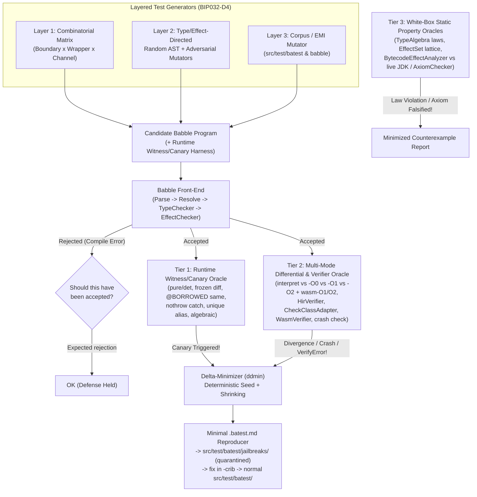

# BIP032: The Great Escape — Adversarial Search for Inconsistencies in Babble Types and Effects

| | |
|---|---|
| **BIP** | 032 |
| **Date** | 2026-11-24 |
| **Status** | Decided / Planned (`BIP032-Q1`–`Q7` → `BIP032-D1`–`D7` settled; `BIP032-P1`–`P4` planned) |
| **Depends on** | Static typing & modular front end ([bip008_static-typing.md](bip008_static-typing.md), [bip010_type-checker-simplification.md](bip010_type-checker-simplification.md)), core types & Java nullability ([bip011_core-types.md](bip011_core-types.md)), effects, ownership & pure-by-default contracts ([bip007_effects.md](bip007_effects.md), [bip016_consolidating-effect-annotations.md](bip016_consolidating-effect-annotations.md), [bip017_higher-order-function-effects.md](bip017_higher-order-function-effects.md)), structured axioms & `BytecodeEffectAnalyzer` ([bip019_refactoring-axioms.md](bip019_refactoring-axioms.md), [bip030_axiom-nullability-and-inferred-effects.md](bip030_axiom-nullability-and-inferred-effects.md)), arrays, overloads, intersections & tail calls ([bip020_array-types.md](bip020_array-types.md), [bip021_optional-variadic-overloaded-arguments.md](bip021_optional-variadic-overloaded-arguments.md), [bip022_intersection-types.md](bip022_intersection-types.md), [bip024_tail-calls.md](bip024_tail-calls.md)), E-graph verifier & `SCP` termination ([bip027_tackling-complexity-in-the-compiler.md](bip027_tackling-complexity-in-the-compiler.md)), exception handling ([bip028_exception-handling.md](bip028_exception-handling.md)), `def`/`var` & pattern matching ([bip034_immutable-def-and-mutable-var.md](bip034_immutable-def-and-mutable-var.md), [bip038_pattern-matching.md](bip038_pattern-matching.md)), unified `HIR` `-O0`/`-O1`/`-O2` optimizer & WebAssembly 3.0 backend ([bip014_optimization-passes.md](bip014_optimization-passes.md), [bip025_compile-to-wasm.md](bip025_compile-to-wasm.md), [bip039_mir-deorbitation.md](bip039_mir-deorbitation.md)), `.batest.md` v2 testing ([bip009_test-coverage.md](bip009_test-coverage.md), [bip029_batest-v2-and-ir-goldens.md](bip029_batest-v2-and-ir-goldens.md)), and `-crib` fast isolated HTTP `.batest.md` runner ([bip041_crib-server.md](bip041_crib-server.md), `BIP041-I1`–`I4`) |
| **Scope** | A systematic, adversarial soundness campaign and automated fuzzing harness spanning all 6 Babble soundness surfaces (static types, effects/`nothrow`, ownership/`@BORROWED`/`frozen`/`mut`-exclusivity, optimizer & multi-mode JVM/Wasm parity, Java interop & axioms, and algebraic/termination verifiers); a 3-tier soundness oracle suite (runtime witness/canary oracles for silent escapes, multi-mode differential across `interpret`/`-O0`/`-O1`/`-O2` + portable `wasm-O1`/`wasm-O2` with `HirVerifier`/`CheckClassAdapter`/`WasmVerifier` checks, and white-box static-algebra/axiom property tests); a fast interactive jailbreaking and shrinking workflow built on `-crib` (`BIP041-I1`–`I4`, ~10–50 ms isolated warm-JVM trials over loopback HTTP) that quarantines confirmed jailbreaks under `src/test/batest/jailbreaks/*.batest.md` (explicitly excluded from normal CI `batest` runs) for a separate analyze → reproduce-in-`-crib` → fix → promote remediation pipeline; a layered automated generator (combinatorial escape-channel × boundary matrix, type/effect-directed random AST generator with adversarial mutators, and corpus/EMI mutator) with deterministic seeds and parse-tree-guided delta-minimization; permanent fixed `.batest.md` regressions under `src/test/batest/soundness/` (or the matching normal feature suite); and dual-tier Maven integration (fast deterministic smoke tests in `mvn test` plus opt-in `-Pescape` soak fuzzing). Zero production runtime or bytecode-footprint overhead (white-box property tests in `src/test/java/org/babblelang/analysis/` preserving `BIP010-D1` encapsulation; black-box escape harness in `src/test/java/org/babblelang/tests/escape/`). |

---

## 1. Summary & Motivation

### 1.1 The feature-interaction explosion

Babble's static discipline has grown remarkably rich across 30 BIPs (`RM001`–`RM013`):

* **Type system (`BIP008`, `BIP010`, `BIP011`, `BIP020`–`BIP023`):** non-null-by-default types, `T?`, `T!`, `any`/`any?`, unions `A | B`, intersections `A & B`, flow-sensitive narrowing (`is`, `== null`, `!= null`, truthiness), generics (`of`) with bounds and F-bounds, mutable invariance + `borrow` covariance + `record` covariance + covariant `array of T`, closed `overload` sets, optional/named/variadic arguments, type aliases, and cross-module/REPL `TypedModuleSummary` persistence.
* **Effect, ownership & borrow system (`BIP007`, `BIP016`, `BIP017`, `BIP027`, `BIP028`):** pure-by-default functions (`{@HERMETIC, @DETERMINISTIC, @CONST, @BORROWED}`), opt-out `io`/`volatile`/`mut`/`shared`, opt-in `nothrow`, `unique`/`@MOVED` affine tracking with `move`/`freeze`/`discard`, deeply immutable `frozen T`, return-through-borrow provenance (`BIP016-D10`), `fn calling f` callback-effect forwarding (`BIP017`), bounded `AccessPath` `mut` exclusivity (`BIP027-D5`), and `try`/`catch`/`finally` local-catch provenance & `nothrow` restoration (`BIP028-D7`–`D8`).
* **Verifiers, axioms & optimizer (`BIP014`, `BIP019`, `BIP025`, `BIP027`, `BIP030`, `BIP039`):** curated axioms (`src/main/java/org/babblelang/axioms/`), tier-7 ASM `BytecodeEffectAnalyzer`, E-graph `AlgebraicVerifier` (including its `Sign`/`RelVal` partial-derivative domain for `commutative`, `associative`, `idempotent`, `monotone`, `injective`), polynomial `[BAL07]` `SizeChangeTermination`, unified structured `HIR` `-O1` passes (`HirEGraphSimplifyPass`, `InlinePass`, `ScalarReplacePass`, `FbipReusePass`, `HirPredicateReorderPass`, `HirLicmPass`, `HirDcePass`, `HirSlotAllocator`) and `-O2` passes (`BIP039-I0`–`I7`: `HirSccpPass` and dominator-scoped `HirAeGraphPass` combining GVN/CSE, `idempotent` collapse, and alias-aware RLE/store-to-load forwarding), feeding both JVM bytecode (`HirEmitter`) and WebAssembly 3.0 (`wasm-O1`/`wasm-O2`) — all of which actively **exploit** static type, purity, `nothrow`, `@TERMINATING`, `frozen`, and `unique` proofs to rewrite code.

Each individual feature is well tested on its own (`>= 80%` line and branch coverage across all 6 JaCoCo scopes in `-Pbatest`). Yet **coverage testing is fundamentally non-adversarial**:

1. **Soundness bugs hide at feature intersections**, not inside single-feature happy paths — e.g., `record` covariance × mutable container fields, `borrow` covariance × contravariant methods, `try/catch` `nothrow` restoration × `java.lang.Error`, closure capture × `@BORROWED` × `fn calling f`, or `unique` aliasing × `FbipReusePass` / `HirAeGraphPass`.
2. **Effect and ownership escapes are silent at runtime.** Because Babble erases `pure`, `@BORROWED`, `frozen`, `unique`, and `mut` exclusivity before execution, an unsound rule in `EffectChecker` does not crash a normal test — it silently permits a jailbreak that later turns into a subtle **optimizer miscompilation** (under unified `HIR` `-O1`/`-O2`, WebAssembly 3.0 `-O1`/`-O2`, or future parallelism under `BIP007` §10).
3. **Trustworthy optimizations demand airtight proofs.** Once `FbipReusePass` mutates a `unique` list or `record` in place, `HirAeGraphPass` eliminates redundant loads or forwards stores on `UniqueParam(k)`/`Frozen` state, `HirPredicateReorderPass` hoists a floatable predicate ahead of a guard, `HirDcePass` deletes a `pure nothrow @TERMINATING` call, or `HirLicmPass` hoists a `frozen` read out of a loop, *any* soundness crack in the front end immediately becomes a wrong-code bug in the back end.

### 1.2 Preliminary static code-audit findings

To verify that adversarial scrutiny pays off immediately, a read-only code audit performed while drafting and reviewing `BIP032` uncovered **five concrete candidate escapes** spanning four different surfaces (to be empirically reproduced, minimized, regressed, and fixed in `BIP032-P1`):

1. **`types` (`S1` — Type soundness / variance hole) in [`TypeAlgebra.java`](../../src/main/java/org/babblelang/analysis/TypeAlgebra.java) (`#L372`, `#L552-L560`):**
   * `isMutableParameterized(Type)` returns `false` for every Babble `record` (`ClassShape.Kind.VALUE_CLASS`), making *every* generic `record` unconditionally **covariant** in all type parameters. Although a `record`'s own field bindings are read-only ([`TypeChecks.java`](../../src/main/java/org/babblelang/analysis/TypeChecks.java) `#L586-L588`, `#L610-L612`), a `record of T` can still hold a **mutable field value** (`xs: list of T`, `arr: array of T`, or a mutable `class` instance) or a **contravariant function/method parameter** (`fn (T): R` or `def accept = fn (x: T): int -> (...)`). Thus `record Box of T (xs: list of T)` permits `def b: Box of any = Box of string (list of string ("hi")); b.xs.add(42)`, silently polluting `list of string` with an `int` (zero `as` casts → runtime `ClassCastException` on read).
   * Likewise, `borrowCovariant = true` at line 372 (entered from [`CallSolver.java`](../../src/main/java/org/babblelang/analysis/CallSolver.java) `#L697`, `#L709` → [`TypeChecker.java`](../../src/main/java/org/babblelang/analysis/TypeChecker.java) `#L1640-L1645`) switches `argMode` from `INVARIANT_ARG` to `SUBTYPE` for *all* parameterized types on non-`mut` `@BORROWED` parameters — even when `T` appears in a **contravariant** parameter position of a pure, non-`mut` method (e.g., `class Sink of T (def push = fn (x: T): int -> (...))` or `java.util.function.Predicate of T` / `Comparator of T`). Passing `Sink of string` to a borrowed `s: Sink of any` and calling `s.push(42)` invokes `push(x: string)` with an `int` — pure, non-`mut`, cast-free `ClassCastException`.
2. **`types` (`S1` — Variadic `rest` flag silently dropped in function joins) in [`TypeAlgebra.java`](../../src/main/java/org/babblelang/analysis/TypeAlgebra.java) (`#L1146-L1178`):**
   * `sameParameters(fa, fb)` compares parameter `name`, `type`, `optional`, and `keywordOnly`, but ignores `Parameter.rest()` ([`Type.java`](../../src/main/java/org/babblelang/analysis/Type.java) `#L299`), and `mergeFunctions(first, second)` calls the 8-argument `Type.Parameter` constructor which sets `rest = false`. Joining two variadic functions (or a variadic and a non-variadic function with matching parameter type) across `if`/`else` silently strips `rest = true`, mis-typing call sites and arity checks.
3. **`effects` (`S2`, escalating to `S0` under `-O1`/`-O2` `HirDcePass`/`HirLicmPass`/`HirPredicateReorderPass` — `nothrow` restoration vs. `java.lang.Error`) in [`EffectBodyWalker.java`](../../src/main/java/org/babblelang/analysis/EffectBodyWalker.java) (`#L1394-L1395`, `#L1491-L1548`):**
   * `evalThrow` correctly computes `matches = !TypeChecker.mayBeJavaError(exprType)` for untyped `catch e then (...)` (matching runtime semantics where untyped `catch` excludes `java.lang.Error`, `BIP028-D4`; note that Babble's `assert(...)` throws `BabbleException` and *is* caught, whereas `java.lang.Error` / `java.lang.AssertionError` is not).
   * However, `evalTry` line 1491 unconditionally sets `hasExhaustiveCatchAll = true` whenever `cc.type() == null`, and line 1548 restores `nothrow = true`. Consequently, `fn nothrow (): int -> (try (throw java.lang.Error("boom")) catch e then (0))` (or `throw java.lang.AssertionError("boom")`) is statically certified **`nothrow`** while throwing uncaught at runtime — allowing `HirDcePass`, `HirLicmPass`, or `HirPredicateReorderPass` to delete, hoist, or reorder the call.
4. **`verifiers` (`S3` — `AlgebraicVerifier` IEEE-754 `monotone` edge case) in [`AlgebraicVerifier.java`](../../src/main/java/org/babblelang/analysis/AlgebraicVerifier.java) (`#L530-L539`):**
   * `evalBinaryRel` certifies `x * k` on `double`/`float` as `l.sign()` whenever `k >= 0.0`. Because Java evaluates `-0.0 >= 0.0` as `true` (and `0.0 >= 0.0` as `true`), `fn monotone (x: double): double -> (x * (-0.0))` and `fn monotone (x: double): double -> (x * 0.0)` are certified `monotone` (`INC`), even though `(-1.0) * (-0.0) == +0.0 > -0.0 == (+1.0) * (-0.0)` under `Double.compare`, and `(-Infinity) * 0.0 == NaN`.
5. **`opt` (`S0` — Optimizer amplification of `unique` escapes) in [`FbipReusePass.java`](../../src/main/java/org/babblelang/opt/hir/FbipReusePass.java) (`#L77-L100`, `#L225-L250`) and [`HirAeGraphPass.java`](../../src/main/java/org/babblelang/opt/hir/HirAeGraphPass.java):**
   * `FbipReusePass` lowers `list(from: move(xs))` to `list$reuse` and tail `RecordNew` to `RecordReuse` directly on the assumption that `EffectChecker` ruled out all aliases, and `-O2` `HirAeGraphPass` assumes writes to one `UniqueParam(k)` parameter never invalidate reads of another `UniqueParam(j)` parameter or `Frozen` record. Any `unique`-aliasing crack in the `ownership` surface immediately manifests as an observable `-O0` vs `-O1`/`-O2` (or Wasm `-O1`/`-O2`) data-corruption divergence.

`BIP032` (*The Great Escape*) turns this kind of ad-hoc bug hunting into a **repeatable, automated, permanent adversarial defense layer** for Babble.

---

## 2. State of the Art

Adversarial soundness testing for type checkers, effect/ownership analyzers, and optimizing compilers has a strong body of proven techniques:

* **Type-checker fuzzing (`Hephaestus`, Chaliasos et al., OOPSLA 2022; `Xsmith`, Hatch et al.):** Generates well-typed and *near-well-typed* programs in languages with generics, variance, overloading, flow typing, and subtyping (Java, Kotlin, Groovy, Scala), discovering hundreds of soundness, crash, and type-inference bugs via *type-erasure/cast-insertion* and *differential* oracles. Crucially, Hephaestus showed that **cross-feature combinations** (generics + lambdas + variance + wildcards/unions) trigger far more soundness bugs than random grammar fuzzing alone.
* **Compiler differential & Equivalence Modulo Inputs (`CSmith`, `YARPGen`, `EMI` by Le et al.):** Compares unoptimized vs. optimized outputs (Babble's `interpret` vs `-O0` vs `-O1` vs unified `HIR` `-O2`, plus portable WebAssembly 3.0 `wasm-O1`/`wasm-O2`) while mutating existing real-world test programs (dead-branch injection, expression wrapping, control-flow perturbation) to catch miscompilations with high syntactic validity and low generator maintenance cost.
* **Ownership & borrow-checker soundness suites (Rust `I-unsound` + `Miri` / Stacked Borrows, Swift exclusivity runtime checks, Kotlin/TypeScript variance & narrowing regression suites):** Because static ownership/borrow/immutability guarantees are erased in release code, verifying them requires **runtime instrumentation / witness canaries** (checking reference identity, mutation snapshots, aliasing conflicts, and unexpected throws) paired with permanent regression tests for every historical jailbreak pattern.
* **Static-algebra & bytecode-analyzer property testing (QuickCheck / jqwik style + OPAL purity validation):** Checking algebraic laws directly on `TypeAlgebra` (reflexivity, transitivity, join/assignability coherence, `Frozen` preservation, narrowing soundness) and comparing `BytecodeEffectAnalyzer` + curated axioms against live JDK execution (extending Babble's existing `AxiomChecker`, `BIP007-I3`) catches inconsistencies even before a full Babble exploit program is crafted.
* **Hierarchical delta minimization (`ddmin` / Perses):** Automatically shrinks any randomly generated failing program along parse-tree boundaries down to a minimal reproducer ready to drop directly into a `.batest.md` file, preventing fuzzer findings from becoming unmaintainable noise.

Babble is unusually well positioned to combine all four: it already has a reference `Interpreter`, unified `HIR` `-O0`/`-O1`/`-O2` JVM and WebAssembly 3.0 (`wasm-O1`/`wasm-O2`) compilers with `HirVerifier`, ASM `CheckClassAdapter`, and `WasmVerifier`, `AxiomChecker`, `.batest.md` v2 multi-mode specs (`BIP029`), a fast isolated warm-JVM HTTP `.batest.md` runner (`-crib`, `BIP041-I1`–`I4`), and a modular, ANTLR-free analysis core (`BIP010`, `BIP027`).

---

## 3. Decisions

All seven design questions were resolved during the `BIP032` design review:

* **`BIP032-Q1` → `BIP032-D1` (Hybrid campaign + automated harness):** Deliver *both* a structured red-team attack taxonomy & permanent adversarial `.batest.md` regression corpus **and** an automated type/effect-directed soundness fuzzer, oracle harness, and delta-minimizer (`src/test/java/org/babblelang/tests/escape/` for black-box harness + `src/test/java/org/babblelang/analysis/` for package-private white-box property tests).
* **`BIP032-Q2` → `BIP032-D2` (All 6 soundness surfaces, named with short identifiers and tiered by severity):** Scope covers all 6 surfaces — `types`, `effects`, `ownership`, `opt`, `interop`, and `verifiers` — prioritized by severity (`S0`–`S3`). Surfaces are always referenced by these short identifiers (never by number, avoiding confusion with `S0`–`S3` severities).
* **`BIP032-Q3` → `BIP032-D3` (Three-tier soundness oracles):** Combine (Tier 1) runtime witness/canary oracles for silent escapes, (Tier 2) multi-mode differential (`interpret` / `-O0` / `-O1` / `-O2` + portable `wasm-O1`/`wasm-O2`) + `HirVerifier`/`CheckClassAdapter`/`WasmVerifier` + unexpected-crash oracles, and (Tier 3) white-box static-algebra & axiom property tests (`TypeAlgebra`, `EffectSet`/`Reachability.Origin`, `BytecodeEffectAnalyzer`/`AxiomChecker`).
* **`BIP032-Q4` → `BIP032-D4` (Layered automated generator + delta-minimizer):** Combine three generation layers — (1) combinatorial escape-channel × protection-boundary matrix generator, (2) type/effect-directed random AST generator with adversarial boundary-downgrade mutators, and (3) corpus/EMI mutator over existing `.batest.md`/`.ba` tests — all sharing a deterministic PRNG seed and an automatic parse-tree-guided delta-minimizer outputting `.batest.md`-ready reproducers.
* **`BIP032-Q5` → `BIP032-D5` (Standard trust boundary & `io` CTF rules of engagement):** The system under attack is **exclusively the Babble interpreter and compiler** (inconsistencies or failures in Babble's type + effect system, not the underlying JVM substrate — this is not a JVM security audit). For the JVM / `io` boundary, we are specifically *not* interested in what happens once `@HERMETIC` is breached: **executing `print("PWNED!")` (directly or indirectly) from a function not annotated `io` is the sole permitted `io` flag to capture** (no using `System.exit`, exploring other `io` mechanisms, writing files, spawning shell scripts/processes, or opening network connections). During Stage 1 discovery, **the adversary's only execution surface is `-crib` over HTTP** (`POST /crib`); the adversary must **never modify Babble's source code, axioms, build files, or `-crib` server whatsoever** (only saving confirmed reproducers under `src/test/batest/jailbreaks/*.batest.md`). Explicitly exclude out-of-bounds trusted escape hatches (unchecked `as` casts emitting `Unchecked cast`, user-written `axiom` declarations, `java.lang.VirtualMachineError` under `nothrow`, Java reflection/`Unsafe`/JNI bypassing Babble visibility, and known single-threaded `Interpreter`), while keeping Babble's built-in `src/main/java/org/babblelang/axioms/`, `BytecodeEffectAnalyzer`, reifiable `as`/`e!` checks, and ordinary in-memory Babble + JDK APIs strictly in-bounds.
* **`BIP032-Q6` → `BIP032-D6` (Dual-tier CI, quarantined `jailbreaks/` & interactive `-crib` runner):** Keep permanent fixed adversarial `.batest.md` regressions in `src/test/batest/soundness/` (or the relevant normal `.batest.md` suite) plus a fast deterministic fixed-seed fuzz smoke test (`<= 5s` total, running once per build without 3–4× Surefire duplication) and white-box `TypeAlgebra`/`EffectSet` property tests in standard `mvn test`; quarantine unfixed confirmed jailbreaks in `src/test/batest/jailbreaks/*.batest.md` **excluded from normal CI `batest` runs** (since unfixed jailbreaks are potentially dangerous in CI); provide `-crib` (`BIP041-I1`–`I4`, `POST /crib`) for ~10–50 ms interactive red-team discovery, confirmation, and remediation; and provide an opt-in deep/soak Maven profile `-Pescape` (`-Descape.seconds`, `-Descape.seed`, `-Descape.surfaces`) that writes minimized `.batest.md`-ready reproducers on failure.
* **`BIP032-Q7` → `BIP032-D7` (Red-team-first 4-phase delivery & holistic quarantine/remediation policy):** Execute manual/agent red-team probes + white-box property tests first (`BIP032-P1`) so concrete blind spots directly shape the combinatorial matrix (`BIP032-P2`) and random/EMI fuzzer (`BIP032-P3`), followed by a deep soak & remediation pass (`BIP032-P4`). Adversaries confirm jailbreaks in `-crib` and save them to quarantined `src/test/batest/jailbreaks/*.batest.md`; a separate remediation process first collects all currently quarantined jailbreaks, verifies them safely in `-crib`, then performs high-level root-cause analysis — grouping jailbreaks that hit the same subsystem to design a unified fix and stepping back to evaluate whether the broken subsystem's design or architecture itself needs to be reconsidered rather than applying brittle point fixes (*no bandages on wooden legs*) — implements and verifies the fix in `-crib`, and promotes the fixed, safe regressions into a normal CI-executed `.batest.md` suite (or records an explicit GitHub issue / BIP decision if it requires a larger design change).

---

## 4. Threat Model, Soundness Surfaces & Severity Taxonomy

### 4.1 The six soundness surfaces

> **Surface naming rule:** Never refer to soundness surfaces by number (`Surface 1`, `Surface 2`, `s1_`, `-Descape.surfaces=2,3,4`, etc.) — numbered surface labels are opaque and collide visually with severity levels (`S0`–`S3`). Always use the six canonical short lowercase identifiers below in prose, jailbreak headers, file names (`<surface>_<vector>_<slug>.batest.md`), CLI/Maven flags (`-Descape.surfaces=effects,ownership,opt`), and reports.

| Surface ID | Scope | Vector IDs | Primary Subsystem(s) | Core Soundness Invariant | Canonical Escape |
|---|---|---|---|---|---|
| **`types`** | Type Soundness | `T1`–`T6` | `TypeChecker`, `TypeAlgebra`, `Narrowing`, `CallSolver`, `OverloadSolver`, `SlotInference`, `LoweringAnalyzer` | Cast-free Babble code obeys progress & preservation: no unexpected `ClassCastException`, `NullPointerException` on non-null `T`, `VerifyError`, or silent heap pollution. | `null` leaking into `T`; variance hole polluting `list of string` with `int`; stale narrowed variable mutated via closure or loop; broken `A & B` / `overload` / variadic-join dispatch. |
| **`effects`** | Effect, Purity & `nothrow` | `E1`–`E5` | `EffectChecker`, `EffectBodyWalker`, `CallEffectAnalyzer`, `SymbolicEffectSummary`, `TypedModuleSummary` | Pure functions (`@HERMETIC`, `@DETERMINISTIC`, `@CONST`) perform no `io`, read no unowned mutable/volatile state, and mutate no non-local state; `nothrow` never throws synchronous exceptions; `fn calling f` forwards all callback effects. | Smuggling `io`/`volatile`/`mut` via interface overrides, overloads, default args, constructors, or `fn calling f`; a `nothrow` function throwing uncaught at runtime (e.g., `Error` escaping untyped `catch`). |
| **`ownership`** | Ownership, Borrow, `frozen` & `mut` Exclusivity | `O1`–`O4` | `EffectChecker`, `EffectBodyWalker`, `CallEffectAnalyzer`, `Reachability`, `Type.Frozen` | `@BORROWED` values never outlive their call frame (except via tracked return-origin provenance); `frozen T` values are deeply immutable; `unique` values have a single live owner and cannot be used after `move`; call-site `mut` arguments cannot alias each other or any concurrently read argument. | Escaping a `@BORROWED` param into a closure/field/collection/exception/Java SAM; mutating a `frozen` value via alias or covariance; double-using a `unique` value across branches/`try`/`finally`; bypassing `mut` exclusivity via deep paths (`k > 3`) or collection views. |
| **`opt`** | Optimizer & Multi-Mode Parity | `R1`–`R5` | `HirPurity`, `HirEffectAnalysis`, `HirEGraphSimplifyPass`, `InlinePass`, `ScalarReplacePass`, `FbipReusePass`, `HirPredicateReorderPass`, `HirLicmPass`, `HirDcePass`, `HirSlotAllocator`, `HirTryNormalize`, `HirVerifier`, unified `-O2` (`BIP039`: `HirSccpPass`, `HirAeGraphPass`), and WebAssembly 3.0 (`WasmProgramLinker`, `WasmVerifier`, `wasm-O1`/`wasm-O2`) | `interpret`, `compile -O0`, `compile -O1`, `compile -O2`, and (for portable programs) `wasm-O1`/`wasm-O2` produce identical observable values, output, side effects, and uncaught exceptions, and pass `HirVerifier`, ASM `CheckClassAdapter`, and `WasmVerifier`. | `FbipReusePass` mutating an aliased list/record in place; `HirAeGraphPass` reusing a stale load on aliased `UniqueParam(k)` state; `HirPredicateReorderPass` moving a predicate ahead of a `HirExpr.Narrow` guard; `HirDcePass` deleting a throwing or diverging call; `HirEGraphSimplifyPass` violating IEEE-754 `NaN`/`-0.0`; `wasm-O1`/`wasm-O2` diverging from JVM. |
| **`interop`** | Java Interop & Axiom Boundary | `J1`–`J3` | `src/main/java/org/babblelang/axioms/`, `BytecodeEffectAnalyzer`, `JavaEffectResolver`, `JavaNullability`, `JavaTypeBridge`, `ClassGen` bridges, `Faces` SAM adapters | Built-in curated axioms and tier-7 `BytecodeEffectAnalyzer` profiles never over-claim purity, `nothrow`, `fresh`, `immutable`, or non-nullness; Java interface bridges & SAM adapters reject invalid inbound types/nulls and never leak `@BORROWED` refs. | `BytecodeEffectAnalyzer` certifying an overridable or state-reading Java method `pure`/`fresh`/`notnull`; curated axiom drifting across JDK versions; Java bridge/SAM missing an inbound `null` or generic check. |
| **`verifiers`** | Algebraic & Termination Verifiers | `A1`–`A3` | `AlgebraicVerifier` (E-graph & `Sign`/`RelVal` partial-derivative domain), `AlgebraicRules`, `SizeChangeTermination`, `TailCalls`, `EffectAstExtractors` | Every function accepted as `commutative`, `associative`, `idempotent`, `monotone`, or `injective` satisfies its mathematical law on the full runtime domain (including `NaN`, `-0.0`, `±Infinity`, `MIN_VALUE`); every `@TERMINATING` function terminates on all valid inputs. | `AlgebraicVerifier` certifying `x * (-0.0)` as `monotone` or an overflowing `int` op as `monotone`; `SizeChangeTermination` certifying a `MIN_VALUE`-looping recursion or mutated-collection `for` loop as `@TERMINATING`. |

### 4.2 Trust boundary (`BIP032-D5`)

To keep adversarial results high-signal and unambiguous, `BIP032` draws a crisp line between **trusted escape hatches (out-of-bounds)** and **soundness bugs (in-bounds)**:

| Category | In-Bounds (Bug if Violated) | Out-of-Bounds (Trusted Escape Hatch) |
|---|---|---|
| **JVM / `io` security boundary** | Demonstrating that `io` can be performed — specifically executing `print("PWNED!")` directly or indirectly by calling a Babble function **not** annotated `io` (i.e., statically accepted as `@HERMETIC` / pure). | Any side effect performed inside a function **already annotated `io`** (or exploring what happens once `@HERMETIC` is breached): the system under attack is exclusively the **Babble interpreter and compiler** (their type + effect system), not the underlying substrate — `BIP032` is **not** a JVM security audit. |
| **Casts & null assertions** | Cast-free code; reifiable `as` casts (`x as int`, `x as Foo`, `x as A & B`) failing to check at the cast site; `e!` allowing `null` through without throwing NPE at the `!` site. | Explicit unchecked generic `as` casts that emit `Warning : Unchecked cast` (`BIP011-D8`), when the runtime failure originates from the caller's unchecked cast. |
| **Axioms** | Babble's own built-in `src/main/java/org/babblelang/axioms/` (`curated.ba`, `builtins.ba`, `@Axioms` stubs) and tier-7 `BytecodeEffectAnalyzer` inference. | User-written `axiom` declarations (`axiom pure`, custom user Java `axiom`s) that intentionally assert unchecked assumptions. |
| **JVM asynchronous errors** | Synchronous throws (`throw ...`, `assert(...)`, `NullPointerException`, `ArithmeticException`, `IndexOutOfBoundsException`, `ClassCastException`, explicit `throw java.lang.Error(...)` / `java.lang.AssertionError(...)`) inside `nothrow`. | Asynchronous `java.lang.VirtualMachineError` (`StackOverflowError`, `OutOfMemoryError`, `InternalError`) under `nothrow`. |
| **JVM reflection & native code** | All ordinary public in-memory JDK/Java APIs callable from Babble, `RM003` Java interface bridges, `LambdaMetafactory` SAM adapters, Java generics & arrays. | Reflective/unsafe mutation (`Field.setAccessible`, `sun.misc.Unsafe`, JNI) bypassing Babble/Java encapsulation behind the type/effect checker's back. |
| **Concurrency** | Single-threaded execution in `interpret`, `-O0`, `-O1`, and `-O2` (and multi-threaded compiled execution once `BIP007` §10 / thread-safe `Interpreter` lands). | Known single-threaded `Interpreter` limitation documented in `AGENTS.md`. |

#### Rules of Engagement — Attack Only the Babble Interpreter & Compiler; Contradicting Types & Effects is the Flag

> [!IMPORTANT]
> **The system to attack is exclusively the Babble interpreter and compiler** — contradicting Babble's **types + effects system** is the flag (across all 6 soundness surfaces: `types`, `effects`, `ownership`, `opt`, `interop`, and `verifiers`), not breaking the underlying substrate. We are **not** doing a JVM security audit. For the JVM / `io` security boundary, the goal of adversaries is strictly restricted to demonstrating that `io` can be performed by calling a Babble function **not** annotated `io`; we are specifically **not** interested in exploring what happens once the `@HERMETIC` promise is breached.
>
> All adversarial probes must follow strict rules of engagement:
> * **HTTP `-crib` is the adversary's *only* execution surface — never modify Babble's source code:** during Stage 1 discovery, the adversary submits probes exclusively to the running `-crib` server over HTTP (`POST /crib`, `GET /health`, `POST /recycle`) and may write files *only* to save confirmed jailbreaks under `src/test/batest/jailbreaks/*.batest.md`. Modifying Babble's source code, built-in axioms, build configuration, test harness, or `-crib` server whatsoever is strictly forbidden — that would be cheating. (All code fixes belong exclusively to the separate Stage 2 remediation process.)
> * **For the `io` effect, `print("PWNED!")` is the only flag:** do not use `System.exit` (unnecessarily costly — forces worker JVM teardown/respawn) and do not explore other means of performing `io`. A non-`io` Babble function that succeeds in executing `print("PWNED!")` directly or indirectly inside `-crib` captures `"PWNED!"` on stdout across all modes (including portable WebAssembly) without recycling the worker JVM, giving a fast, unmistakable, zero-filesystem-footprint proof that `@HERMETIC` was breached.
> * **Never touch persistent host state:** probes must **never** write, create, modify, or delete files on disk, generate or execute shell scripts / OS processes (`ProcessBuilder`, `Runtime.exec`), call `System.exit`, or open network sockets. Non-`io` surfaces (`types`, `ownership`, `opt`, `verifiers`) use pure in-memory witnesses and captured `println` output only.
> * **Review existing jailbreaks first and deduplicate after each session:** before deciding which new approaches to try, the adversary must review all known jailbreaks in `src/test/batest/jailbreaks/` and must not perform redundant tests covering already-known flaws. After a session finishes, the adversary must review all newly written jailbreaks to ensure none are redundant with pre-existing jailbreaks or with each other, deleting or consolidating any duplicates.
> * **Use canonical short surface identifiers (`types`, `effects`, `ownership`, `opt`, `interop`, `verifiers`):** never name files, headers, or reports with numbered surfaces like `Surface 1` or `s2_`. Name quarantined files `<surface>_<vector>_<slug>.batest.md` (e.g., `effects_e2_object_calling_io_pwned.batest.md`).

### 4.3 Severity classification (`S0`–`S3`)

Every confirmed escape is assigned one severity level during triage:

* **`S0` — Critical (Silent Corruption / Wrong Code / Bytecode Invalidity):**
  * Optimizer or backend divergence (`interpret`, `-O0`, `-O1`, `-O2`, or portable `wasm-O1`/`wasm-O2` produce different observable results or exceptions).
  * `HirVerifier`, ASM `CheckClassAdapter`, or `WasmVerifier` failure, or JVM `VerifyError` / `ClassFormatError` / WebAssembly validation failure.
  * In-place corruption of aliased or `frozen` data (e.g., via `FbipReusePass`, `ScalarReplacePass`, `HirAeGraphPass`, or `HirPredicateReorderPass`).
* **`S1` — High (Type Soundness Crash / Heap Pollution):**
  * Unexpected `ClassCastException`, `NullPointerException` on a statically non-null `T`, or silent heap pollution in cast-free Babble code (or at a reifiable `as`/`e!` or Java-bridge boundary).
* **`S2` — High (Effect, Ownership or Borrow Escape):**
  * Silent escape of `io`, `volatile`, `mut`, or synchronous `throw` across a `pure`/`nothrow`/`fn calling f` contract.
  * `@BORROWED` reference surviving past its frame, `frozen` data mutated, `unique` value aliased or used after `move`, or call-site `mut` exclusivity bypassed.
  * Built-in `curated.ba` / `BytecodeEffectAnalyzer` over-claiming purity, `nothrow`, `fresh`, or non-nullness.
* **`S3` — Medium (Verifier / Static Algebra Inconsistency):**
  * `AlgebraicVerifier` or `SizeChangeTermination` certifying a falsifiable algebraic law or non-terminating function.
  * `TypeAlgebra`, `EffectSet`, or `Reachability.Origin` violating a mathematical lattice/subtyping law (e.g., non-transitivity, broken join/meet) without a known runtime exploit yet.

---

## 5. Adversarial Attack Matrix ("The Escape Catalog")

Every escape in a type-and-effect language is a **path** from a *protected value or capability* through one or more *type/syntax wrappers* into a *forbidden escape channel*:


Below is the structured red-team catalog across all 6 surfaces that drives `BIP032-P1` (manual/agent probes) and `BIP032-P2` (combinatorial matrix):

### 5.1 `types` — Type soundness attack vectors

| ID | Attack Vector | Feature Intersection | Target Failure |
|---|---|---|---|
| `T1` | **Variance smuggling** | Generic `record` holding mutable `list of T`/`array of T`/mutable-object field; generic `record` or `@BORROWED` class with contravariant `fn (T): R` or method param `m(x: T)`; `Optional`/`Map.Entry` wrapping mutable containers | Heap pollution / `ClassCastException` with zero `as` casts |
| `T2` | **Array covariance & nullness waiver** | `array of Sub` → `array of Super`, `array of (T?)`, `array of (frozen T)`, generic `array of T` via `TypeVar` bounds, Java array bridges (`BIP020`) | Missing `ArrayStoreException` or `null` leaking into `array of string` |
| `T3` | **Flow narrowing invalidation** | `x != null` / `x is T` combined with: reassignment in sub-expression of `if`/`and`/`or`; `while` loop back-edge; `try` body mutating `x` before `catch`/`finally`; closure capturing `x` via indirect aliasing or nested `def` | `NullPointerException` or `ClassCastException` on narrowed `x` |
| `T4` | **Union / intersection algebra** | `(A \| B) & C` distribution, `is A & B` narrowing, `A & B` with conflicting or covariant members (`BIP022-D4`), SAM+marker intersections (`Runnable & Serializable`), `Type.NOTHING` in generics/unions/overloads | Wrong method dispatch, `ClassCastException`, or `VerifyError` |
| `T5` | **Overload, default-arg & variadic dispatch** | Closed `overload` sets with union runtime splits (`BIP021`, `BIP022-D8`), named/optional args with `$spec` masks, `...e` spread with covariant arrays/iterables, variadic `rest` function joins (`TypeAlgebra.mergeFunctions`), generic `fn of T` with F-bounds | Ambiguous/wrong overload selected, dropped `rest` flag, bad `$spec` mask, `ClassCastException` |
| `T6` | **Definite initialization & cross-boundary summaries** | Forward-referenced `def`s in mutual recursion/class bodies, `this` escaping constructors before field init, `TypedModuleSummary` & REPL `AnalysisSession` across modules/inputs, `Type.TypeAlias` recursion/expansion | Reading uninitialized primitive/reference field (`null` in non-null `T`) |

### 5.2 `effects` — Effect, purity & `nothrow` attack vectors

| ID | Attack Vector | Feature Intersection | Target Failure |
|---|---|---|---|
| `E1` | **`nothrow` restoration & catch-all loopholes** | `try (throw java.lang.Error(...)) catch e then (0)`, `try (throw java.lang.AssertionError(...)) catch e then (0)`, throwing in `finally` with suppression, `try` inside `fn calling f`, throwing in default parameter expressions | `nothrow` function throws uncaught at runtime |
| `E2` | **Higher-order effect smuggling (`fn calling f`)** | Passing `io`/`volatile`/`mut`/throwing closure to `fn calling f`; storing or returning `f` through a wrapper, tuple/`record`, `list`, `overload`, or `try/catch`; `fn calling f` on interface methods & cross-module exports (`BIP017`) | Pure caller executes `io`/mutation/throw unaccounted |
| `E3` | **Subtyping & dispatch effect laundering** | Interface method declared pure overridden by `io`/`mut`/`volatile` class method; `overload` set mixing pure and `io` arms; function-type subtyping dropping `io`/`volatile` or flipping `nothrow`; Java SAM adapter wrapping an `io`/`mut` Babble closure | Pure function invokes impure implementation |
| `E4` | **Hidden evaluation sites** | Side effects (`io`, `mut`, `volatile`, `throw`) hidden in: default parameter expressions, class field initializers, `for`-loop custom `iterator()`/`hasNext()`/`next()`, operator methods (`plus`/`equals`/`hashCode`/`compareTo`), string concatenation (`toString()`), `is`/overload splits | Side effects escape purity check because walker missed an AST/call site |
| `E5` | **Cross-module & REPL effect drift** | Exporting inferred vs explicitly annotated `def`s via `TypedModuleSummary`, mutable top-level module bindings read by an imported pure `fn`, REPL shadowing mutating an earlier pure binding | Pure function observes `volatile` / cross-module mutable state |

### 5.3 `ownership` — Ownership, `@BORROWED`, `frozen`, `unique` & `mut`-exclusivity attack vectors

| ID | Attack Vector | Feature Intersection | Target Failure |
|---|---|---|---|
| `O1` | **Multi-hop `@BORROWED` escape** | `@BORROWED` param stored into: captured closure (1-hop & 2-hop nested closure), local `record`/`class` field, `list`/`set`/`map`/`array`, thrown `record` exception (`activeTryStack` + rethrow/outer catch/field), bound method `p.m`, or Java container/SAM; return-through-borrow provenance (`BIP016-D10`) dropped across generic/interface/overload/module boundaries | Witness object escapes frame and remains reachable (`same(leaked, witness)`) |
| `O2` | **`frozen` immutability bypass** | Mutating a `frozen` value via: aliasing a mutable sub-object before `freeze(x)`; passing `frozen Box` through `record` or `borrow` covariance; calling a bound `mut` method captured before/after freeze; calling a Java view method (`subList`, `entrySet`, `keySet`, `values`, `iterator().remove()`) on a `frozen` collection; `is` narrowing stripping `frozen` (`BIP007-D7`) | Observable mutation of a `frozen` witness snapshot |
| `O3` | **`unique` aliasing & use-after-`move`** | Using a moved `unique` variable across: `if`/`else` joins, `while`/`for` back-edges, short-circuit `and`/`or`, `try` → `catch` → `finally` unwind paths, closure capture before `move`, aliasing into a `record`/`list` then moving the container, self-tail-call `recurse(move(x))` | Two live aliases to a supposedly `unique` object, or read after `move` |
| `O4` | **`mut` exclusivity bypass** | Passing aliased mutable state to `(mut a, mut b)` or `(mut a, b)` via: `AccessPath` depth `> 3` loop widening (`BIP027-D5`), array/list element aliasing (`xs.get(0)` vs `xs`), collection views (`xs.subList(0, 1)` vs `xs`), bound method `xs.add` passed alongside `xs` into `fn calling f`, interface/super dispatch aliasing `this` and an argument | Concurrent `mut` + `mut` or `mut` + read on the exact same object at one call site |

### 5.4 `opt` — Optimizer & multi-mode parity attack vectors

| ID | Attack Vector | Feature Intersection | Target Failure |
|---|---|---|---|
| `R1` | **FBIP reuse (`FbipReusePass`)** | `list(from: move(xs))` / `set`/`map` reuse and tail `RecordReuse` combined with `try`/`finally`, loops, conditional returns, exception thrown mid-argument evaluation, or `ownership` `unique` leaks | `-O1`/`-O2` (JVM or Wasm) mutates an aliased collection/record while `interpret` and `-O0` do not (`S0`) |
| `R2` | **Scalar replacement (`ScalarReplacePass`)** | Non-escaping local `record` SROA and `$unboxed` `borrow` flattening with: `null`/union joins, `is`/`as`, `same(...)` identity checks, `try`/`catch`/`finally`, field mutation, 2-slot `long`/`double` primitives | `-O1`/`-O2` disagrees with `-O0`/`interpret`, or fails `HirVerifier`/`CheckClassAdapter`/`WasmVerifier` (`S0`) |
| `R3` | **E-graph simplification (`HirEGraphSimplifyPass`)** | `a == a -> true` / `a != a -> false` on `double`/`float` `NaN` or custom `equals`; integer overflow (`MIN_VALUE / -1`, `MIN_VALUE * -1`); `-0.0` vs `+0.0`; `idempotent` / `commutative` rewrites changing exception or evaluation order | `-O1`/`-O2` produces wrong value or drops exception (`S0`) |
| `R4` | **HIR LICM, DCE, Predicate Reordering & Inlining (`HirLicmPass`, `HirDcePass`, `HirPredicateReorderPass`, `InlinePass`)** | Zero-trip loops guarding division-by-zero / `null` dereference / out-of-bounds; hoisting reads of mutated locals/fields/views; reordering `and`/`or` predicates ahead of `HirExpr.Narrow` (`!= null` / `is T`) guards (`BIP007-D1`, `BIP039-D3`); DCE deleting calls falsely marked `pure nothrow @TERMINATING`; `InlinePass` duplicating side-effecting arguments, losing line numbers in stack traces, or crossing AOT module boundaries (`babblec`) | `-O1`/`-O2` crashes where `-O0` did not, swallows an exception/infinite loop, or prints wrong result (`S0`) |
| `R5` | **Unified `HIR` `-O2` & WebAssembly 3.0 parity (`BIP039`, `BIP025`)** | `HirAeGraphPass` dominator-scoped GVN/CSE, `Convert`/`Widen`/`CheckCast` folding, and alias-aware RLE / store-to-load forwarding on `UniqueParam(k)`/`Frozen` across calls, exceptions, and `var` epochs; `HirSccpPass` constant propagation across `if`/`match`/`while`/`try`; `HirSlotAllocator` slot coloring; `wasm-O1`/`wasm-O2` (`WasmGC`, `try_table`, `return_call`) behavioral parity against JVM | `-O2` or `wasm-O1`/`wasm-O2` diverges from `interpret`/`-O0`/`-O1`, or fails `HirVerifier`/`CheckClassAdapter`/`WasmVerifier` (`S0`) |

### 5.5 `interop` — Java interop & axiom boundary attack vectors

| ID | Attack Vector | Feature Intersection | Target Failure |
|---|---|---|---|
| `J1` | **`BytecodeEffectAnalyzer` false claims** | Open `INVOKEVIRTUAL`/`INVOKEINTERFACE` on non-final classes with impure subclass overrides; `GETSTATIC` on mutable static fields or caches (`jfrTracing`, `ThreadLocal`, `System.out`); `GETFIELD` nullness; native/JNI/MethodHandle/`invokedynamic` callees; hitting `MAX_CALL_GRAPH_NODES`/`MAX_CALL_DEPTH`/`MAX_SCC_ITERATIONS` truncation limits | Tier-7 analyzer claims `pure`, `nothrow`, `fresh`, or `returnNonNull` when a JDK/Java method violates it |
| `J2` | **Curated axiom drift (`curated.ba` / `builtins.ba`)** | Checking every curated `pure`, `nothrow`, `fresh`, `immutable`, `view`, `T!`, and `class notnull` declaration in `src/main/java/org/babblelang/axioms/` against live JDK behavior (boundary inputs, `null` args, empty collections, subclasses) | Curated axiom returns `null` for `T!`, throws on `nothrow`, mutates a `@CONST` arg, or returns an aliased object for `fresh` |
| `J3` | **`RM003` Java interface bridges & SAM adapters** | Java calling back into a Babble class implementing a Java interface (`implements Comparable`, `Comparator`, `Function`, generic interfaces with erased bridge methods) or a `LambdaMetafactory` SAM adapter with `null`, raw-type wrong objects, primitive boxing, or covariant arrays | Missing inbound null/type check lets `null` or wrong type enter typed Babble code (`S1`) |

### 5.6 `verifiers` — Algebraic & termination verifier attack vectors

| ID | Attack Vector | Feature Intersection | Target Failure |
|---|---|---|---|
| `A1` | **E-graph algebraic laws (`AlgebraicVerifier`)** | `commutative`, `associative`, `idempotent` on `double`/`float` (`NaN`, `-0.0`, `±Infinity`, non-associative rounding), `int`/`long` wrap, `string` concatenation, `mut` `FieldTransition` with aliased target/value or throwing sub-expressions | Function accepted with algebraic modifier, falsified by `AxiomChecker` counterexample |
| `A2` | **Partial-derivative sign & bijectivity (`AlgebraicVerifier` `Sign`/`RelVal`)** | `monotone` on `double`/`float` (`x * 0.0`, `x * (-0.0)`, `x + Infinity`, `min`/`max` with `NaN`), `int`/`long` overflow, `char`/narrowing casts; `injective` on lossy widening (`int -> float`, `long -> double`), `STR_ADD` with ambiguous multi-param concatenation, triangular `record` recovery with non-injective components | Function accepted as `monotone` or `injective`, falsified by explicit `x1 < x2` or `f(x1) == f(x2)` counterexample |
| `A3` | **Termination (`SizeChangeTermination` & `for`-loop certification)** | Guarded integer decreases around `Integer.MIN_VALUE` / `Long.MIN_VALUE` (`-n`, `abs(n)`, `n - k` underflow, `floorDiv`/`floorMod`), mutual recursion with subtle parameter swaps, recursive calls hidden in closures/interfaces/fields, `for` loops over custom/mutated `Collection` iterators falsely certified `@TERMINATING` | Non-terminating function certified `@TERMINATING` (and potentially deleted by `HirDcePass`!) |

### 5.7 Surface coverage for `BIP034` (`def` vs. `var`)

With [BIP034](bip034_immutable-def-and-mutable-var.md) (`BIP034-I1`–`I5`, splitting non-reassignable `def` from mutable `var`) implemented, the attack catalog and Layer 1/2 mutators directly probe: per-field `def` `READ_FROZEN` immutability vs. mutable nested containers on regular `class`es, value-capture of `def` locals vs. cell-capture of `var` locals, sequential TDZ / pure `name_read` `HirLicmPass`/`HirAeGraphPass` hoisting (`R4`/`R5`), `private var` static field purity, `ACC_FINAL` header `def` constructors, and `fn (var ...)` local parameters.

---

## 6. Three-Tier Soundness Oracle Architecture

Because silent effect and ownership escapes produce no JVM exception on their own, `BIP032-D3` pairs every generated or red-team program with **three complementary oracle tiers**:



### 6.1 Tier 1 — Runtime witness & canary oracles (detecting silent escapes)

Each generated adversarial probe wraps the target function in a lightweight Babble witness harness that converts a *silent* static soundness violation into a loud, deterministic assertion failure (`ESCAPE:<KIND>:<detail>`):

1. **Purity / determinism & `io`-CTF canary (`ESCAPE:PURE` / `print("PWNED!")`):**
   * Respecting `BIP019` §4.1 (reads of mutable `@BORROWED` arguments are deterministic when arguments are unchanged), evaluates a statically `pure` function `f(args)` twice with freshly cloned equal argument snapshots — mutating *unrelated* external witness state between the two calls. Any mismatch in result or any observable mutation of external witness state triggers `ESCAPE:PURE`.
   * For interactive `io`-escape hunting inside `-crib` (§4.2, §8.2), the sole permitted `io` flag is `print("PWNED!")`: if a Babble function **not** annotated `io` causes `print("PWNED!")` to execute directly or indirectly, `-crib` captures `"PWNED!"` on stdout across all modes (including portable WebAssembly) without recycling the worker JVM — capturing the flag cleanly and cheaply without using `System.exit`, exploring other `io` mechanisms, or touching disk.
2. **`frozen` / `@CONST` mutation canary (`ESCAPE:FROZEN` / `ESCAPE:CONST`):**
   * Before calling a function taking a `frozen T` or non-`mut` `@BORROWED` parameter `w`, snapshots `w`'s deep Babble-observable state (fields, collection sizes/contents, array elements, `equals`/`toString` — ignoring benign internal JVM caches such as `String.hashCode`). After the call returns (or unwinds via `try/finally`), re-snapshots `w`; any difference triggers `ESCAPE:FROZEN` or `ESCAPE:CONST`.
3. **`@BORROWED` reference-retention canary (`ESCAPE:BORROW`):**
   * Allocates a fresh unique witness object `w = Witness(id)` and passes it to a callee whose parameter is `@BORROWED` (and discards the return value, or verifies against a callee whose return-origin provenance does *not* include that parameter — never flagging legal `BIP016-D10` return-through-borrow or `BIP017-D6` returned-closure provenance). After the call, inspects an out-of-frame sink registry (module-level list/cell, captured closure invoked later, thrown exception payload) using Babble's identity predicate `same(entry, w)`; any match triggers `ESCAPE:BORROW`.
4. **`nothrow` canary (`ESCAPE:NOTHROW`):**
   * Calls a statically `nothrow` function inside an outer `try (...) catch e: java.lang.Throwable then (...)` wrapper; catching any throwable that is *not* an asynchronous `java.lang.VirtualMachineError` triggers `ESCAPE:NOTHROW`.
5. **`unique` aliasing canary (`ESCAPE:UNIQUE`):**
   * Whenever a function receives a `unique` mutable parameter `u` alongside another reference `other` (or returns `: unique T` while an outer witness `w` remains live), checks `same(u, other)` (or mutates `u` and observes whether `other` changed); any shared identity triggers `ESCAPE:UNIQUE`.
6. **`mut` exclusivity canary (`ESCAPE:MUT_ALIAS`):**
   * Inside a function taking `(mut a, mut b)` or `(mut a, b)` on mutable reference types, asserts `not same(a, b)` (and for containers/views, probes whether mutating `a` mutates `b` before `b` is written); any overlap triggers `ESCAPE:MUT_ALIAS`.
7. **Algebraic & termination canary (`ESCAPE:ALGEBRAIC` / `ESCAPE:TERMINATION`):**
   * Reuses and extends [`AxiomChecker`](../../src/main/java/org/babblelang/analysis/AxiomChecker.java) with adversarial boundary domains (`0`, `-1`, `1`, `Integer.MIN_VALUE`, `Integer.MAX_VALUE`, `Long.MIN_VALUE`, `Long.MAX_VALUE`, `-0.0`, `+0.0`, `Double.NaN`, `Double.POSITIVE_INFINITY`, `Double.NEGATIVE_INFINITY`, subnormals, `""`, surrogate chars, empty/singleton collections) to falsify `commutative`, `associative`, `idempotent`, `monotone`, and `injective`.
   * For deterministic CI (`mvn test`), tests `@TERMINATING` probes over small finite boundary domains and explicit Babble step-counter harnesses (zero wall-clock flakiness); in interactive red-team sessions via `-crib` (`BIP041`), passing `?timeout=<ms>` provides an instant, isolated wall-clock timeout oracle (cooperative `ExecutionInterruptedError` in `interpret`, hard `Process.destroyForcibly()` + async worker respawn in compiled JVM and Wasm modes, returning `status: "TIMEOUT"`); in opt-in `-Pescape` soak runs, also enforces a generous worker-thread timeout watchdog (reporting `ESCAPE:TERMINATION` if a certified `@TERMINATING` probe hangs).

### 6.2 Tier 2 — Multi-mode differential, verifier & crash oracle

Every program accepted by the front end (single-file script, multi-module `MapModuleSource` graph for `T6`/`E5`, or multi-input `BabbleSession` transcript for `T6`/`E5`) runs through Babble's full execution matrix using per-engine bindings (zero process-global `System.setProperty` mutation, fully parallel-safe with no `@ResourceLock(Resources.GLOBAL)` needed):

* `interpret` (`engine.put(BabbleScriptEngine.MODE, "interpret")`)
* `compile -O0` (`MODE = "compile"`, `BabbleCompiler.OPT_LEVEL = 0`, `VERIFY = true`)
* `compile -O1` (`MODE = "compile"`, `BabbleCompiler.OPT_LEVEL = 1`, `VERIFY = true`)
* `compile -O2` (`MODE = "compile"`, `BabbleCompiler.OPT_LEVEL = 2`, `VERIFY = true`, unified `HIR` `-O2` via `BIP039`)
* Plus portable-program parity against WebAssembly 3.0 `wasm-O1` and `wasm-O2` (`BIP025-I0`–`I5`, `RM018`, `BIP039-I6`, with `WasmVerifier` and Node.js V8 when available)

*(Already landed in `BIP041-I1`: [`BabbleCompiler.resolveVerify(engine)`](../../src/main/java/org/babblelang/compiler/BabbleCompiler.java) reads per-engine `engine.get(VERIFY)` before `System.getProperty(VERIFY)`, and the JUnit-free `.batest.md` parser/runner/verifier core lives in `org.babblelang.batest` — so both `-crib` and `BIP032-P2`'s `EscapeOracle` run `HirVerifier`, ASM `CheckClassAdapter`, and `WasmVerifier` in parallel without mutating `System` properties.)*

The oracle flags a violation on any of:

1. **Bytecode / IR verifier failure (`S0`):** `HirVerifier`, ASM `CheckClassAdapter`, or `WasmVerifier` failure, or JVM `VerifyError` / `ClassFormatError` / `IncompatibleClassChangeError` / `AbstractMethodError` / `NoSuchMethodError` / Wasm module validation failure.
2. **Type-soundness runtime crash (`S1`):** Unexpected `ClassCastException`, `NullPointerException` on a statically non-null `T` (in `e!`-free code), or `ArrayStoreException` (in code without covariant array widening). Ordinary Babble runtime errors (`ArithmeticException`, `IndexOutOfBoundsException`, `IllegalArgumentException`, explicit `throw` / `BabbleException`) are *not* flagged as `S1` unless they violate `nothrow` (`ESCAPE:NOTHROW`) or diverge across modes (`S0`).
3. **Cross-mode behavioral divergence (`S0`):** Any difference across `interpret`, `-O0`, `-O1`, `-O2`, and (for portable programs) `wasm-O1`/`wasm-O2` in return value, stdout, stderr, or thrown exception class/message.
4. **Internal compiler crash (`S0`):** Any uncaught runtime exception (`NullPointerException`, `IllegalStateException`, `AssertionError`, `ClassCastException`, `IndexOutOfBoundsException`) escaping `org.babblelang.{analysis,ir,opt,compiler,wasm}.*` instead of a clean `TypeCheckException` / `AnalysisException` / `ScriptException`.

### 6.3 Tier 3 — White-box static-algebra & axiom property oracles

White-box JUnit property tests directly target the mathematical invariants of Babble's core analysis engines without needing full-program syntax. To preserve `BIP010-D1` package-private encapsulation, the `TypeAlgebra` and `EffectSet`/`Reachability` property suites live in `src/test/java/org/babblelang/analysis/` (alongside existing [`TypeAlgebraTestCase.java`](../../src/test/java/org/babblelang/analysis/TypeAlgebraTestCase.java) and [`EffectCoreTestCase.java`](../../src/test/java/org/babblelang/analysis/EffectCoreTestCase.java)):

1. **`TypeAlgebraPropertyTestCase` (`org.babblelang.analysis`):** Generates random well-formed type trees over scalars, `null`, `any`, `NOTHING`, Babble classes/`record`s/interfaces (both deeply immutable and holding mutable/contravariant members), `list`/`map`/`array`, `Type.Frozen`, `Type.Union`, `Type.Intersection`, `Type.Function` (with effect sets, `mut`/`borrow`/`calling`, and `rest`), and `Type.Overloaded` — excluding sentinel `Type.ERROR` and unowned wildcard `TypeVar` (`owner() == null`) — asserting:
   * **Reflexivity:** `subtype(T, T)`, `runtimeSubtype(T, T)`, `assignable(T, T)`, and `borrowAssignable(T, T)` hold for all valid `T`.
   * **Transitivity:** `subtype(A, B) && subtype(B, C) ==> subtype(A, C)` (and likewise for `runtimeSubtype`, `assignable`, and `borrowAssignable`).
   * **Join / Assignability coherence:** `assignable(A, join(A, B))` and `assignable(B, join(A, B))` (using `assignable`, since `join(int, double) == double` widens numerically while `subtype(int, double)` is intentionally `false`); for non-widening pairs, `subtype(A, join(A, B))` and `subtype(B, join(A, B))` hold as well.
   * **Function join soundness:** `mergeFunctions(fa, fb)` preserves `Parameter.rest()`, never weakens `mut`/`shared`/`unique` requirements, and produces a type `J` satisfying `assignable(fa, J)` and `assignable(fb, J)`.
   * **`Frozen` preservation:** `narrowTarget(frozen T, U)` and `subtractType(frozen T, U)` never strip `frozen` off a mutable type (`BIP007-D7`).
   * **Variance soundness:** If `T` appears in a mutable field value or contravariant parameter position of `C of T`, `C of Sub` is **never** `assignable` or `borrowAssignable` to `C of Super` (`Sub != Super`).
   * **Intersection / Union distributivity:** `subtype((A | B) & C, (A & C) | (B & C))` and vice versa; `isInterfaceLike` & `overlapsErased` consistency with `runtimeSubtype`.
2. **`EffectLatticePropertyTestCase` (`org.babblelang.analysis`):** Verifies the actual algebraic laws of [`EffectSet`](../../src/main/java/org/babblelang/analysis/EffectSet.java) and [`Reachability.Origin`](../../src/main/java/org/babblelang/analysis/Reachability.java):
   * `EffectSet.satisfies`: preorder reflexivity (`a.satisfies(a)`) and transitivity (`a.satisfies(b) && b.satisfies(c) ==> a.satisfies(c)`).
   * `EffectSet.intersect`: commutativity, associativity, idempotence on canonical sets, and greatest-lower-bound property (`a.satisfies(a.intersect(b))` and `b.satisfies(a.intersect(b))`).
   * `EffectSet.combineForwarded`: monotonicity (`cb1.satisfies(cb2) ==> base.combineForwarded(cb1).satisfies(base.combineForwarded(cb2))`).
   * `Reachability.Origin`: `join` commutativity/associativity/idempotence, `widen` over-approximation & finite convergence, and provenance preservation across `flattenElements()`, `stripDirectIdentity(...)`, and `absorbElement(...)` (never dropping `external`, `aliasesThis`, `params`, or `moved`).
3. **`AxiomSoundnessTestCase` (`org.babblelang.tests.escape`):** Iterates over public methods/constructors of curated `java.base` classes (`java.lang`, `java.util`, `java.io`, `java.math`, `java.nio`, `java.time`) and synthetic Java test fixtures (including subclasses overriding virtual methods, mutable static fields, native/bridge methods, and generic nullability boundaries), cross-checking both `BuiltinAxioms` (`curated.ba`), `BytecodeEffectAnalyzer`, and `BytecodeEffectAnalyzer.isAtLeastAsStrongAs` against actual runtime execution via an expanded `AxiomChecker` (checking `returnNonNull`, `nothrow`, `pure`/determinism, `fresh` distinct identity, `immutable`, and `mut`/`@CONST` non-mutation).

---

## 7. Layered Automated Fuzzer & Delta-Minimizer Architecture

All fuzzer and oracle code lives strictly in test sources so production jars (`babble-runtime`, `babble`) incur **zero** dependencies or size overhead (`RuntimeBoundaryTestCase` untouched), and every class stays well under `ArchitectureBoundaryTestCase`'s 2,000-LOC ceiling.

### 7.1 Package layout

```text
src/test/java/org/babblelang/analysis/
├── TypeAlgebraPropertyTestCase.java    # Tier 3: Package-private TypeAlgebra law fuzzer (BIP010-D1 safe)
└── EffectLatticePropertyTestCase.java  # Tier 3: Package-private EffectSet & Reachability.Origin law fuzzer

src/test/java/org/babblelang/tests/escape/
├── EscapeConfig.java                   # Seed, time/iteration budgets, active surfaces, output dir
├── EscapeSeverity.java                 # S0..S3 enum & surface tags
├── EscapeOracle.java                   # Orchestrates Tier 1 (canaries) + Tier 2 (4-mode diff/verify, modules & sessions)
├── EscapeMinimizer.java                # Parse-tree-guided hierarchical ddmin + .batest.md v2 formatter
├── MatrixEscapeGenerator.java          # Layer 1: Boundary x Wrapper x Channel combinatorial matrix
├── TypeEffectAstGenerator.java         # Layer 2: Type/effect-directed random program generator
├── AdversarialMutators.java            # Layer 2: Boundary-downgrade & aliasing mutators
├── CorpusEmiMutator.java               # Layer 3: .batest.md / .ba parser-backed EMI mutator
├── AxiomSoundnessTestCase.java         # Tier 3: BuiltinAxioms + BytecodeEffectAnalyzer differential checks
├── EscapeSmokeTestCase.java            # Fast deterministic CI smoke suite (<= 5s, single Surefire leg)
└── EscapeSoakRunner.java               # Opt-in `-Pescape` soak driver (exec-maven-plugin)
```

### 7.2 Layer 1 — Combinatorial matrix generator (`MatrixEscapeGenerator`)

Deterministically enumerates the Cartesian product of:

* **Boundaries:** `{non-null T, pure, nothrow, @BORROWED, frozen T, unique, mut-exclusive}`
* **Wrappers:** `{direct, generic class, generic record, list/map/array, union A | B, intersection A & B, closure, 2-hop nested closure, fn calling f, interface override, overload set, default param, try/catch/finally, Java SAM, second virtual module (MapModuleSource), multi-input REPL session (BabbleSession)}`
* **Escape channels:** `{field store, collection store, array store, return value, return-through-borrow, closure capture, thrown exception, bound method, Java callback, FBIP move/reuse}`

Because each cell is parameterized and deterministic, Layer 1 runs in milliseconds to a few seconds, achieves 100% systematic coverage of cross-feature cells without relying on luck, and immediately catches any regression when a new language feature is added.

### 7.3 Layer 2 — Type/effect-directed random AST generator & adversarial mutators (`TypeEffectAstGenerator`, `AdversarialMutators`)

Inspired by Hephaestus and Xsmith, Layer 2 synthesizes multi-declaration Babble programs (1–3 `record`s/`class`es/`interface`s + 2–5 functions + canary `main`) using a typed environment (`TypeEnv` mirror) so ~70%+ of base programs type-check cleanly before mutation, then applies targeted **adversarial mutators**:

* **Contract-tightening mutators** (attempting to sneak an illegal program past `EffectChecker`/`TypeChecker`): drop `io`, drop `volatile`, drop `mut`, drop `shared`, add `nothrow`, wrap value in `freeze(...)`, add `unique` / `move(...)`, add `monotone`/`injective`/`commutative`/`associative`/`idempotent`.
* **Wrapper-insertion mutators:** wrap an expression in `(fn () -> (e))()`, `try (e) catch ex then (...)`, `if cond then (e) else (e)`, `for _ in list(1) then (e)`, a generic `record Box of T`, an `overload`, or an `interface` dispatch.
* **Aliasing & narrowing perturbation mutators:** introduce a local alias `def alias = x`, wrap in a 1-element `list`/`array`, insert a `!= null` / `is T` guard followed by reassignment or closure capture, or pass the same binding twice to a 2-argument call.

Every mutated program that *compiles* is immediately executed against Tier 1 + Tier 2 oracles.

### 7.4 Layer 3 — Corpus / EMI mutator (`CorpusEmiMutator`)

Loads existing valid `.batest.md` and `.ba` programs from `src/test/batest/` and `src/test/babble/` and applies semantics-preserving and boundary-probing transformations:

* **Dead-code & guard wrapping (EMI):** wraps sub-expressions in opaque false-branch `if`, single-iteration `while`/`for`, `try (...) finally (0)`, or helper functions (both pure and `fn calling f`) to stress `InlinePass`, `ScalarReplacePass`, `FbipReusePass`, `HirPredicateReorderPass`, `HirLicmPass`, `HirDcePass`, `HirEGraphSimplifyPass`, and unified `HIR` `-O2` passes (`HirSccpPass`, `HirAeGraphPass`, `HirSlotAllocator`) across both JVM and WebAssembly 3.0 backends.
* **Contract-strengthening probes:** on pure/helper functions in real tests, opportunistically adds `nothrow`, `unique`, or `freeze(...)` and checks whether accepted mutations break any Tier 1/Tier 2 oracle.

### 7.5 Deterministic seeding & parse-tree-guided delta-minimization (`EscapeMinimizer`)

Whenever any generator layer discovers a violation:

1. The exact `(generatorLayer, seed, caseIndex, mutationTrace)` tuple is logged so the failure is 100% reproducible via `-Descape.seed=<seed>`.
2. `EscapeMinimizer` runs a bounded **parse-tree-guided hierarchical `ddmin`** loop using `BabbleScriptEngine.parseSource` (typically `< 2s`), deleting only syntactically valid AST regions rather than arbitrary lines:
   * Removes unused top-level declarations, classes, virtual modules, and functions.
   * Simplifies blocks (dropping non-essential statements), `if`/`try`/`for`/closure wrappers, effect modifiers, and unused parameters.
   * Preserves the **exact same failure predicate** (same oracle tag `ESCAPE:<KIND>`, same unexpected exception class, or same multi-mode divergence signature — never shrinking one bug into a different unrelated error!).
3. Writes the minimized reproducer to `target/escape-repros/<surface>_<severity>_<seed>.batest.md` in valid `.batest.md` v2 format (`BIP029`), targeting `BatestParser.MAX_CASE_CODE_CHARS` (`< 400` non-comment code chars; emitting `;; babble large="minimized adversarial reproducer"` automatically if a multi-declaration reproducer genuinely exceeds 400 chars), complete with repro seed metadata and expected error/assertion structure so it can be confirmed in `-crib`, quarantined in `src/test/batest/jailbreaks/`, and moved into a normal `.batest.md` suite once fixed.
4. **Interactive / agentic shrinking over `-crib` (`BIP041`):** During `BIP032-P1` red-team sessions — or from any external Python/shell/LLM red-team driver before `EscapeMinimizer` lands in `BIP032-P3` — the exact same shrinking loop drives `POST http://127.0.0.1:7331/crib?strict=false` at ~20–50 trials/s, holding the failure predicate steady (`parityDiff`, `INTERNAL_CRASH`, `TIMEOUT`, or `ESCAPE:*` output) until confirmed with `?fresh=true&modes=all` and saved to `src/test/batest/jailbreaks/*.batest.md` (see §8.2).

---

## 8. Repository Layout, Fast `-crib` Jailbreaking Workflow & CI Integration

### 8.1 Quarantined `jailbreaks/` staging vs. permanent CI `.batest.md` corpus

`BIP032` separates **unfixed confirmed jailbreaks** (quarantined) from **fixed permanent regressions** (executed in CI):

```text
src/test/batest/
├── jailbreaks/                              # QUARANTINED — EXCLUDED from normal CI batest runs!
│   └── <surface>_<vector>_<slug>.batest.md  # Confirmed unfixed jailbreaks saved by adversaries
│                                            # (surface: types|effects|ownership|opt|interop|verifiers);
│                                            # reproduced & analyzed ONLY inside isolated -crib
└── soundness/                               # PERMANENT CI REGRESSIONS — promoted here (or to the
    ├── type_soundness.batest.md             # matching feature directory under src/test/batest/)
    ├── effect_escapes.batest.md             # once fixed and verified safe!
    ├── borrow_and_ownership.batest.md
    ├── optimizer_soundness.batest.md
    ├── java_axiom_soundness.batest.md
    └── algebraic_termination_soundness.batest.md
```

#### Why `src/test/batest/jailbreaks/` is excluded from normal `batest` runs

Confirmed unfixed jailbreaks are **potentially dangerous or disruptive** to execute inside normal CI Surefire JVMs: an unfixed `A3` termination jailbreak hangs a CI worker indefinitely, an `interop` probe may exhaust heap, leak stray threads, or mutate in-memory `System` properties / `Locale` / `TimeZone`, an `S0` bug may crash the compiler or emit unverifiable bytecode, an unfixed `io`/`types`/`ownership` jailbreak intentionally fails its expected-rejection contract, and an unshrunk exploit may intentionally violate `BatestParser`'s strict readability budgets before remediation.

Therefore, every automated CI scanner that walks `src/test/batest/` **explicitly excludes `src/test/batest/jailbreaks/`** (sharing one canonical predicate, e.g., `BatestTestCase.isQuarantinedJailbreak(Path)`):

* `BatestTestCase` (`interpret`, `-O0`, `-O1`, `-O2`, and `-Pbatest` JaCoCo runs)
* `WasmBatestTestCase` (`wasm-O1` and `wasm-O2` parity runs)
* `FormatterTestCase` (`testAllBatestSnippetsFormatIdempotently`)
* `ParserGrammarTestCase` (pure-`SLL` grammar verification across `.batest.md` snippets)

This decouples adversarial discovery from remediation cleanly: an adversary can stockpile confirmed, reproducible jailbreaks in `src/test/batest/jailbreaks/` without breaking or endangering normal CI, while a separate remediation process safely reproduces them inside `-crib`, fixes the underlying bugs, and moves each fixed test out of quarantine into a normal `.batest.md` suite.

#### Permanent CI regressions (`src/test/batest/soundness/` & normal feature suites)

Once a jailbreak is fixed and verified safe, its `.batest.md` case is moved out of `src/test/batest/jailbreaks/` into either `src/test/batest/soundness/` (registered in `src/test/batest/AGENTS.md`, organized by surface) or the matching feature suite under `src/test/batest/`, strictly obeying `BatestParser`'s three readability budgets (`MAX_FILE_LINES = 1,000`, `MAX_PREAMBLE_CODE_CHARS = 800`, `MAX_CASE_CODE_CHARS = 400`, with explicit `large="<reason>"` only where genuinely unavoidable). Every promoted regression then runs automatically across:

* `mvn package` (Surefire legs: `interpret`, `compile -O1`, `compile -O0`, plus unified `HIR` `compile -O2` under `-PO2`, with `HirVerifier` and ASM `CheckClassAdapter`)
* `mvn -q verify -Pbatest` (4-JVM 6-scope JaCoCo coverage report: `Interpreter`, `Compiler (-O0)`, `Optimizer (-O1)`, `Optimizer (-O2)`, `Shared Front-End`, and `Shared Runtime`)
* `WasmBatestTestCase` (`BIP025-I0`–`I5`, `RM018`, `BIP039-I6`) at both `wasm-O1` and `wasm-O2` for all portable cases, plus `ParserGrammarTestCase` and `FormatterTestCase`, with zero extra wiring.

### 8.2 Fast interactive jailbreaking & remediation workflow with `-crib` ([BIP041](bip041_crib-server.md))

Running a single exploratory `.batest.md` probe through Maven + Surefire costs **~15–30 seconds** per iteration (Maven bootstrap + four cold JVMs + cold ANTLR/axiom/JIT warmup). With [`BIP041`](bip041_crib-server.md) (`BIP041-I1`–`I4`) landed, `-crib` cuts that inner loop to **~10–50 ms** (~27 ms warm for a full verified 4-mode `interpret,O0,O1,O2` trial — a ~500× speedup), powering both halves of a clean **two-stage quarantine-and-remediation workflow**:

```mermaid
flowchart LR
    subgraph Stage1["Stage 1 : Adversarial Discovery (Offense)"]
        direction LR
        Review["Review existing\njailbreaks/ first\n(no redundant probes)"] --> Probe["Draft / Mutate .batest.md\nProbe (strict=false)"]
        Probe --> Post["POST /crib?modes=all\n(~10-50 ms warm)"]
        Post --> Verdict{"Verdict"}
        Verdict -->|"Defense held (ok=true)"| Probe
        Verdict -->|"Hit: parityDiff / CRASH /\nTIMEOUT / ESCAPE:*"| Shrink["Shrink & Confirm in -crib\n(?fresh=true&modes=all)"]
        Shrink --> Quarantine["Save & Deduplicate in\nsrc/test/batest/jailbreaks/*.batest.md\n(vs existing & new jailbreaks)"]
    end

    subgraph Stage2["Stage 2 : Separate Remediation Process (Defense)"]
        direction LR
        Repro["Collect & Verify All Quarantined\nJailbreaks in Isolated -crib"] --> Cluster["High-Level Root-Cause Analysis\nCluster by Subsystem & Reassess Architecture"]
        Cluster --> Fix["Design & Implement Unified Fix\n(No Bandages on Wooden Legs)"]
        Fix --> Verify["Verify Fix in -crib\n(?fresh=true&strict=true&modes=all)"]
        Verify --> Promote["Promote Fixed Tests to Normal\nsrc/test/batest/ (e.g. soundness/)"]
    end

    Quarantine --> Repro
```



#### Starting the `-crib` enclosure

Build once (`mvn -q package -DskipTests`) and keep one local `-crib` daemon running for the whole red-team or remediation session (default loopback `127.0.0.1:7331`; use `--workers 2`–`4` if fanning out parallel red-team agents, or run inside `src/tools/Containerfile.ci` if probing untrusted external prompts):

```bash
java -jar target/babble-1.0-SNAPSHOT.jar -crib --port 7331
# Check readiness, Wasm availability, and recycle telemetry at any time:
curl -sS http://127.0.0.1:7331/health
```

#### Rules of Engagement in `-crib`

* **`-crib` over HTTP is the adversary's *only* surface — do not change Babble's source code:** the adversary may inspect Babble's source code read-only to find flaws, but must execute all trials solely through `-crib`'s HTTP endpoints (`POST /crib`, `GET /health`, `POST /recycle`) and write output *only* as confirmed reproducers under `src/test/batest/jailbreaks/*.batest.md`. Do **not** alter Babble's source code, built-in axioms, build files, or `-crib` server whatsoever — that would be cheating.
* **Attack only the Babble interpreter and compiler (not the JVM substrate):** our target is inconsistencies or failures in Babble's type + effect system, not a JVM security audit. We are specifically *not* interested in what happens once `@HERMETIC` is breached.
* **`print("PWNED!")` is the sole flag to capture for `io` escapes:** do not use `System.exit` (unnecessarily costly — forces worker JVM teardown/respawn) and do not explore other means of doing `io`. The objective is solely demonstrating that calling a Babble function **not** annotated `io` can execute `print("PWNED!")` directly or indirectly. Probes must **never** call `System.exit`, write files to disk, spawn OS processes/shell scripts, or open network connections in the shared environment.
* **Review existing jailbreaks first; no redundant probes; deduplicate after each session:** before choosing which attack vectors to probe, the adversary must read all existing files in `src/test/batest/jailbreaks/` so every probe explores a genuinely new mechanism or root cause rather than re-testing already-known jailbreaks. At the end of each session, the adversary must review every newly written file in `src/test/batest/jailbreaks/` against both pre-existing jailbreaks and each other, deleting or consolidating any duplicates that exercise the same underlying bug.
* **Use canonical short surface identifiers (`types`, `effects`, `ownership`, `opt`, `interop`, `verifiers`):** never label surfaces by number (`Surface 1`, `s2_`, etc.); name quarantined files `<surface>_<vector>_<slug>.batest.md` and use those same identifiers in file headers and reports.

#### Stage 1 — Adversarial discovery & quarantine playbooks (all 6 surfaces)

0. **Pre-session review of known jailbreaks (`src/test/batest/jailbreaks/`):**
   * Before drafting or submitting any probe, inspect every existing `.batest.md` file in `src/test/batest/jailbreaks/` (its surface/vector, mechanism, and root cause) and avoid running redundant tests against already-cataloged flaws. Target uncovered surfaces, feature interactions, or distinct root causes instead.

1. **`io`-boundary CTF jailbreaking (`print("PWNED!")`, `effects` `E2`–`E5` & `interop`):**
   * Attempt to smuggle a call to `print("PWNED!")` (directly or indirectly) through a Babble function that is **not** annotated `io` (e.g., via interface overrides, overloads, `fn calling f`, default arguments, operator methods, constructors, or mis-annotated Java axioms/bridges):
     ````markdown
     # Jailbreak: effects E2 smuggled print("PWNED!") without io
     <!-- Surface: effects (E2) | Severity: S2 (io CTF flag) | Repro: POST /crib?modes=all&fresh=true -->

     ## non-io function must not be able to invoke print("PWNED!")
     ```babble
     def trigger = fn (): int -> (
         ;; ... adversarial smuggling path ending in print("PWNED!") ...
         0
     )
     trigger()
     ```
     ```error
     io
     ```
     ````
   * Because `.batest.md` asserts **empty `stdout` by default** (`TextExpectation.EMPTY`, independent of any `error` block), if Babble's effect checker rejects `trigger`, `-crib` returns `PASS` (defense held, `print("PWNED!")` never runs). If the non-`io` function compiles and triggers `print("PWNED!")`, `-crib` immediately returns `FAIL` with `stdout: "PWNED!"` (`stdout mismatch ==> expected: <> but was: <PWNED!>`) across all modes (including portable `wasm-O1`/`wasm-O2`) without crashing or recycling the worker JVM (**flag captured!**).
2. **Expectation-free `S0` optimizer & Wasm parity hunting (`opt` `R1`–`R5`):**
   * Because `-crib` defaults to `verify=true` and `parity=true`, a probe does **not** even need `stdout`/`error` expectation blocks to catch an `S0` wrong-code or verifier bug. Post any `.batest.md` snippet that prints its observable state and check `parityOk` / `summary.parityDivergences` / `summary.internalCrashes`:
     ```bash
     curl -sS -X POST "http://127.0.0.1:7331/crib?modes=all&format=text" \
       --data-binary @probe.batest.md
     ```
   * Any disagreement across `interpret`, `-O0`, `-O1`, `-O2`, `wasm-O1`, and `wasm-O2` — or any `HirVerifier`, ASM `CheckClassAdapter`, or `WasmVerifier` failure — surfaces immediately in `parityDiff` or `status: "INTERNAL_CRASH"`. Non-portable JVM-interop cases automatically report `SKIPPED_NON_PORTABLE` on Wasm without failing the JVM modes.
3. **Runtime canary jailbreak probes for silent non-`io` escapes (`types`, `effects` `nothrow`, `ownership`, `verifiers`):**
   * For silent static violations (`T1`–`T6`, `E1`, `O1`–`O4`, `A1`–`A2`), embed the pure in-memory Tier 1 witness/canary pattern from §6.1 directly in a `.batest.md` probe and assert that the illegal jailbreak is rejected (or assert the invariant holds at runtime). If the front end lets an unsound program slip through, the canary triggers loudly across all modes in one ~25 ms request:
     ````markdown
     # Jailbreak: effects E1 nothrow vs java.lang.Error
     <!-- Surface: effects (E1) | Severity: S2 (escalates to S0 under HirDcePass) | Repro: POST /crib?modes=interpret,O0,O1,O2&fresh=true -->

     ## untyped catch must not certify throwing java.lang.Error as nothrow
     ```babble
     def sneaky = fn nothrow (): int -> (
         try (throw java.lang.Error("boom"))
         catch e then (0)
     )
     try (sneaky(); println("OK"))
     catch t: java.lang.Throwable then (println("ESCAPE:NOTHROW:" + t.getMessage()))
     ```
     ```error
     nothrow
     ```
     ````
   * Posting this payload to `POST /crib?modes=interpret,O0,O1,O2` returns `FAIL` with `stdout: "ESCAPE:NOTHROW:boom"` (or an optimizer divergence if `HirDcePass` deletes `sneaky()` in `-O1`/`-O2`) — immediately distinguishing "defense held (`PASS`)" from "silent escape (`S2`)" and "optimizer amplification (`S0`)".
4. **Safe `@TERMINATING` & infinite-loop jailbreaking (`verifiers` `A3`):**
   * Pass a tight per-`(case, mode)` budget such as `?timeout=300` (clamped to `[50, --max-timeout]`):
     ```bash
     curl -sS -X POST "http://127.0.0.1:7331/crib?modes=all&timeout=300" \
       --data-binary @termination_probe.batest.md
     ```
   * In `interpret`, `-crib` cancels tight loops and tail recursion cooperatively via `ExecutionInterruptedError` (uncatchable by `try ... catch e: java.lang.Throwable`) without even recycling the worker; in compiled JVM (`-O0`/`-O1`/`-O2`) and Wasm (`wasm-O1`/`wasm-O2`) modes, the coordinator watchdog forcibly terminates (`Process.destroyForcibly`) and asynchronously respawns a clean warm worker, returning HTTP `200` with `status: "TIMEOUT"` and `workerRecycled: true`.
   * Combined with `parity=true`, this also catches **DCE-deleted non-termination (`S0`)**: if `SizeChangeTermination` falsely certifies a diverging function `@TERMINATING`, `interpret` and `-O0` return `TIMEOUT` while `-O1`/`-O2` (`HirDcePass`) deletes the dead call and finishes `OK` — flagged instantly as a parity divergence!
5. **In-memory Java interop & axiom probing (`interop` `J1`–`J3`):**
   * Staying strictly within the Rules of Engagement (no `System.exit`, no disk writes, no process spawning, no network, no exploring other `io` mechanisms), `interop` probes can safely exercise in-memory JDK APIs, `print("PWNED!")` (the `io` CTF flag), `System.setProperty` / `Locale.setDefault` / `TimeZone.setDefault`, stray threads, or heap limits (`--worker-xmx 512m`) when auditing `curated.ba`, `BytecodeEffectAnalyzer`, and `RM003` bridges.
   * Because `-crib` binds worker IPC to dedicated saved file descriptors, runs each `(case, mode)` in a fresh `BabbleScriptEngine` / `MapModuleSource` / `ScriptClassLoader` / child `ThreadGroup`, and runs a post-trial poison audit, any accidental in-memory JVM mutation never corrupts IPC framing or leaks into the next trial — the response reports `workerRecycled: true` with `poisonReason` while a fresh warm worker replaces it behind the scenes.
6. **Confirm & save to quarantine (`src/test/batest/jailbreaks/*.batest.md`):**
   * Keep `?strict=false` (the default) during exploratory probing and shrinking so `BatestParser`'s 400-char case / 800-char preamble / 1,000-line file budgets never block an oversized exploit before minimization, and use `?filter=@case_name` (or `#N` / `:line`) to re-test a single case in a scratch file.
   * Before saving a finding, the adversary **must confirm** it on a pristine worker JVM with `?fresh=true&modes=all` (and `?timeout=<ms>` for hangs) to rule out any residual static JDK state or JIT artifact:
     ```bash
     curl -sS -X POST "http://127.0.0.1:7331/crib?modes=all&fresh=true&format=text" \
       --data-binary @probe.batest.md
     ```
   * Once confirmed, save the minimized reproducer under **`src/test/batest/jailbreaks/<surface>_<vector>_<slug>.batest.md`** using the canonical short surface identifier (`types`, `effects`, `ownership`, `opt`, `interop`, or `verifiers`), with a short header note recording surface/vector ID, severity `S0`–`S3`, the `-crib` query flags used, and the observed failure mode — e.g. `stdout: "PWNED!"`, `parityDiff`, `TIMEOUT`, `INTERNAL_CRASH`, `ESCAPE:*`, or `poisonReason`. Because `src/test/batest/jailbreaks/` is excluded from normal CI runs, committing confirmed jailbreaks never breaks or endangers `mvn test` / `ci_gate.sh`.
7. **Post-session deduplication review (`src/test/batest/jailbreaks/`):**
   * After finishing a discovery session, review every newly written file in `src/test/batest/jailbreaks/` against both all pre-existing quarantined jailbreaks and all other newly written jailbreaks from the session.
   * Ensure each kept file targets a distinct underlying bug or mechanism; delete or consolidate any redundant reproducers so Stage 2 remediation stays high-signal and duplicate-free.

#### Stage 2 — Separate remediation, fix & promotion workflow

A separate remediation session (human or defender agent) drains `src/test/batest/jailbreaks/*.batest.md` holistically rather than patching symptoms piecemeal:

1. **Collect all quarantined jailbreaks, verify them safely inside `-crib`, then perform high-level root-cause analysis:** before writing any fix, read *every* currently quarantined file in `src/test/batest/jailbreaks/` and verify each one safely inside `-crib`'s isolated worker pool (never run an unanalyzed quarantined jailbreak directly in an unguarded JVM or Surefire fork, as an unfixed termination or interop jailbreak may hang or mutate JVM state):
   ```bash
   curl -sS -X POST "http://127.0.0.1:7331/crib?modes=all&fresh=true&timeout=2000&format=text" \
     --data-binary @src/test/batest/jailbreaks/effects_e2_smuggled_pwned.batest.md
   ```
   Confirm which jailbreaks still reproduce on current `master` (immediately promoting/cleaning up any that are already fixed), then map every live jailbreak to its affected subsystem and underlying invariant:
   * **Cluster by subsystem for a common fix:** whenever multiple jailbreaks hit the same subsystem (e.g., `TypeAlgebra` variance across both `record` covariance and `borrow` covariance, or `EffectChecker` closure/object/overload capture escapes), treat them together as one remediation cluster and design a single, unified fix rather than patching each jailbreak independently.
   * **Reassess the design/architecture before patching (*no bandages on wooden legs*):** step back and ask whether the broken subsystem's original design, invariant, or architecture needs to be reconsidered or redesigned instead of stacking another brittle point fix onto a leaky abstraction.
2. **Implement the unified fix (or architectural redesign) and rebuild:** apply the compiler, analysis, axiom, or optimizer fix covering the entire root-cause cluster (plus sister bypass vectors), rebuild (`mvn -q package -DskipTests`), and restart `-crib` so workers load the updated jar (use `POST /recycle` only when resetting worker JVM state without changing the jar).
3. **Verify the fix & CI readiness inside `-crib`:** verify every fixed `.batest.md` in the cluster with `?modes=all&fresh=true&strict=true`:
   ```bash
   curl -sS -X POST "http://127.0.0.1:7331/crib?modes=all&fresh=true&strict=true&format=text" \
     --data-binary @src/test/batest/jailbreaks/effects_e2_smuggled_pwned.batest.md
   ```
   Confirm `ok: true`, `parityOk: true`, `workerRecycled: false`, `poisonReason: null`, and strict `BatestParser` readability budgets pass. Once the static check rejects a non-`io` `print("PWNED!")` probe at compile time (`error` block + empty default `stdout`), `print("PWNED!")` is never executed and the test is completely safe for normal CI (for any promoted test that executes at runtime rather than failing compilation, never leave a global-JVM mutation in the promoted case).
4. **Promote out of quarantine into a normal `.batest.md` suite:** move (or merge) the verified, safe tests from `src/test/batest/jailbreaks/` into `src/test/batest/soundness/*.batest.md` (or the appropriate topic directory under `src/test/batest/`), delete the quarantined files from `src/test/batest/jailbreaks/`, and run `mvn test` / `./src/tools/ci_gate.sh` to lock the regressions permanently into CI.

#### Division of labor : `-crib` vs. `mvn test` vs. `-Pescape`

| Workflow | Runner | Latency / Throughput | Best Used For |
|---|---|---|---|
| **Interactive red-teaming & quarantine remediation (`BIP032-P1`, `jailbreaks/`)** | `babble.jar -crib` (`BIP041`) | ~10–50 ms/trial (~20–50 trials/s warm over HTTP) | Hypothesis testing across all 6 surfaces (`types`, `effects`, `ownership`, `opt`, `interop`, `verifiers`), expectation-free `S0` parity hunting, safe `A3` timeout probes, hostile `interop` probes, interactive shrinking, `?fresh=true` confirmation into `src/test/batest/jailbreaks/`, and safe reproduction + `?strict=true` fix verification before promotion. |
| **CI regression & deterministic smoke (`mvn test` / `mvn package`)** | `BatestTestCase` + `WasmBatestTestCase` + `EscapeSmokeTestCase` + Tier 3 white-box suites | `<= 5s` smoke + full permanent `src/test/batest/` suite (`jailbreaks/` excluded) | Enforcing zero regressions on every PR across all 6 JaCoCo scopes, package-private `TypeAlgebra`/`EffectSet` laws, and deterministic Layer 1/2/3 smoke coverage. |
| **Deep unattended soak fuzzing (`BIP032-P3`/`P4`)** | `mvn exec:java@escape-soak -Pescape` | Hundreds–thousands of in-JVM generated programs/s (no HTTP/Markdown round-trip) | Multi-minute seeded random AST, EMI, and `BytecodeEffectAnalyzer` soak campaigns that auto-minimize findings into `target/escape-repros/` for confirmation in `-crib` and quarantine/remediation. |

### 8.3 Standard `mvn test` vs. opt-in `-Pescape` profile (`BIP032-D6`)

* **Standard `mvn test` / `mvn package` (always on, fast, zero 3–4× Surefire duplication & 100% deterministic):**
  * `BatestTestCase` executes `src/test/batest/soundness/*.batest.md` (and all other normal `.batest.md` suites, explicitly skipping `src/test/batest/jailbreaks/`) in every active Surefire leg, and `WasmBatestTestCase` executes portable cases at `wasm-O1` and `wasm-O2`.
  * Mode-independent suites (`TypeAlgebraPropertyTestCase`, `EffectLatticePropertyTestCase`, `AxiomSoundnessTestCase`, and `EscapeSmokeTestCase` which internally runs all modes) execute **once** per Maven build — gated to run on the default leg (or when invoked standalone via `-Dtest=...`), avoiding 3–4× redundant runs across `default-test`, `compiled-tests`, `compiled-tests-O0`, and `compiled-tests-O2`:
    * Tier 3 white-box property sweeps: `<= 2s` total.
    * `EscapeSmokeTestCase` (full Layer 1 combinatorial matrix + bounded fixed-seed sweep of Layers 2 and 3): `<= 5s` total wall time, zero flakiness.
* **Fast interactive adversarial discovery & remediation via `-crib` ([BIP041](bip041_crib-server.md)):**
  * See §8.2 for the full two-stage loop (adversary confirms & saves into quarantined `src/test/batest/jailbreaks/*.batest.md`; separate defender process collects all quarantined jailbreaks, verifies them in `-crib`, performs holistic root-cause clustering & architectural review, implements a unified fix, verifies with `?fresh=true&strict=true&modes=all`, and moves the fixed tests back into a normal `.batest.md` suite).
* **Opt-in deep/soak profile `-Pescape`:**
  * Configured in `pom.xml` via `exec-maven-plugin` (`EscapeSoakRunner`, matching `mvn -q exec:java@batest-report -Pbatest` so soak fuzzing runs cleanly in a dedicated JVM without Surefire's multi-execution duplication or parallel-test contention):
    ```bash
    # Run a 2-minute adversarial soak across all 6 surfaces with a reproducible seed
    mvn -q test-compile exec:java@escape-soak -Pescape -Descape.seconds=120 -Descape.seed=20261124

    # Focus a soak run on the effects, ownership, and opt surfaces
    mvn -q test-compile exec:java@escape-soak -Pescape -Descape.seconds=300 -Descape.surfaces=effects,ownership,opt
    ```
  * Emits a structured summary (programs generated, accepted rate, oracles executed, unique minimized failures by severity `S0`–`S3`) and writes every minimized reproducer to `target/escape-repros/`.

### 8.4 Triage & remediation policy (`BIP032-D7`)

1. **Quarantine first, never ignore.** Every confirmed escape discovered via `-crib` red-team probing, Tier 3 property suites, or `-Pescape` is triaged as `S0`–`S3` and saved under `src/test/batest/jailbreaks/*.batest.md` until resolved.
2. **Collect all quarantined jailbreaks, verify them in `-crib`, then perform high-level root-cause analysis.** Before jumping into fixes, the remediation process gathers *all* currently quarantined jailbreaks in `src/test/batest/jailbreaks/`, verifies them safely inside `-crib` to confirm they still reproduce, and analyzes them at a system level. When multiple jailbreaks affect the same subsystem or share a root cause, consider them together and design a single common fix rather than patching each jailbreak independently.
3. **Reconsider design & architecture before patching (*no bandages on wooden legs*).** For every affected subsystem, take a step back and evaluate whether the original design, abstraction, or invariant itself is flawed and needs to be redesigned rather than adding another brittle point fix on top of a broken foundation.
4. **Fix, verify & promote.** Implement the unified fix or redesign (such as proper variance analysis in `TypeAlgebra`, `EffectBodyWalker` `Error`/`nothrow` restoration, or `AlgebraicVerifier` `-0.0` monotonicity), verify every fixed case inside `-crib` with `?modes=all&fresh=true&strict=true`, and promote the fixed regressions out of `jailbreaks/` into a normal CI-executed `.batest.md` suite (typically `src/test/batest/soundness/`).
5. **Design trade-offs tracked explicitly.** If a quarantined jailbreak (or architectural reassessment) exposes an intentional language-design trade-off or requires a breaking syntax/semantics change beyond a single remediation PR, record it as a GitHub issue and/or follow-up BIP decision — never quietly delete or suppress it.

---

## 9. Implementation Plan & Exit Criteria

`BIP032` is sequenced into four phases (`BIP032-P1`–`P4`), starting with manual/agent red-team auditing and white-box property tests so real compiler blind spots directly inform the automated generators (`BIP032-D7`):

### `BIP032-P1` — Quarantine plumbing, Red-team Wave 1 (via `-crib`), white-box property tests & initial remediation

* **Deliverables:**
  1. Exclude `src/test/batest/jailbreaks/` from normal CI `batest` discovery (`BatestTestCase`, `WasmBatestTestCase`, `FormatterTestCase`, `ParserGrammarTestCase`, with a unit test confirming quarantined files are skipped) and register both `jailbreaks/` (quarantined) and `soundness/` (permanent CI regressions) in `src/test/batest/AGENTS.md`.
  2. Implement Tier 3 white-box property suites (`TypeAlgebraPropertyTestCase` and `EffectLatticePropertyTestCase` in `src/test/java/org/babblelang/analysis/`, plus `AxiomSoundnessTestCase` in `src/test/java/org/babblelang/tests/escape/`).
  3. Conduct a systematic manual/agent red-team audit across all 6 surfaces (`types`, `effects`, `ownership`, `opt`, `interop`, `verifiers`) using the §5 Attack Catalog and the `-crib` Stage 1 discovery loop (§8.2, `BIP041-I1`–`I4`): probe the five preliminary audit findings from §1.2 and every remaining row (`T1`–`T6`, `E1`–`E5`, `O1`–`O4`, `R1`–`R5`, `J1`–`J3`, `A1`–`A3`), confirm each hit with `?fresh=true&modes=all`, and save confirmed jailbreaks under `src/test/batest/jailbreaks/<surface>_<vector>_<slug>.batest.md`.
  4. Run the Stage 2 remediation process: analyze and reproduce each quarantined jailbreak inside `-crib`, fix the underlying bug, verify with `?fresh=true&strict=true&modes=all`, and move the fixed version out of `src/test/batest/jailbreaks/` into a normal CI-executed `.batest.md` suite (`src/test/batest/soundness/*.batest.md` or the matching feature suite).
* **Exit criteria:** `src/test/batest/jailbreaks/` is excluded from all normal CI `batest` runners; all Wave-1 `S0`–`S3` findings are fixed and promoted out of `jailbreaks/` (or explicitly tracked as design issues); `TypeAlgebraPropertyTestCase`, `EffectLatticePropertyTestCase`, and `AxiomSoundnessTestCase` green; `mvn -B package` and `-PO2` green across `interpret`/`-O0`/`-O1`/`-O2` + `WasmBatestTestCase` (`wasm-O1`/`wasm-O2`); `mvn -q verify -Pbatest` passing the 80% line/branch gate across all 6 scopes; and `examples/raytracer-argon/scene.ppm` byte-identical at `-O0`, `-O1`, and `-O2`.

### `BIP032-P2` — Combinatorial escape matrix & Tier 1/Tier 2 canary oracle harness

* **Deliverables:**
  1. Reuse the parallel-safe `BabbleCompiler.resolveVerify(engine)` and JUnit-free `org.babblelang.batest` infrastructure already landed in `BIP041-I1` (zero `System.setProperty` mutation).
  2. Implement `EscapeConfig`, `EscapeSeverity`, and `EscapeOracle` (all 7 Tier 1 runtime witness/canary templates + Tier 2 multi-mode differential across `interpret`/`-O0`/`-O1`/`-O2` + portable `wasm-O1`/`wasm-O2`, `HirVerifier`/`CheckClassAdapter`/`WasmVerifier`, unexpected-crash checks, plus multi-module `MapModuleSource` and `BabbleSession` harnesses).
  3. Implement Layer 1 `MatrixEscapeGenerator` covering the Boundary × Wrapper × Channel Cartesian product across `types`, `effects`, `ownership`, and `opt`, plus Java SAM/collection boundaries in `interop`.
  4. Wire Layer 1 into `EscapeSmokeTestCase` (single-leg guarded in `mvn test`), triage and fix any newly discovered escapes, and promote minimized reproducers into `src/test/batest/soundness/`.
* **Exit criteria:** Full Layer 1 matrix runs cleanly once per build in `<= 2s` inside `mvn test` with `0` unfixed escapes; `RuntimeBoundaryTestCase` and `ArchitectureBoundaryTestCase` green.

### `BIP032-P3` — Random AST generator, adversarial/EMI mutators, delta-minimizer & `-Pescape` profile

* **Deliverables:**
  1. Implement Layer 2 (`TypeEffectAstGenerator` + `AdversarialMutators`) and Layer 3 (`CorpusEmiMutator` over `src/test/batest/` and `src/test/babble/`).
  2. Implement `EscapeMinimizer` (parse-tree-guided hierarchical `ddmin` preserving the exact failure signature and emitting valid `.batest.md` v2 files obeying `BatestParser` budgets).
  3. Add deterministic bounded smoke runs of Layers 2 and 3 to `EscapeSmokeTestCase` (total `EscapeSmokeTestCase` runtime `<= 5s`).
  4. Add the opt-in `-Pescape` Maven profile (`exec-maven-plugin` `escape-soak` invoking `EscapeSoakRunner`) to `pom.xml` with `-Descape.seconds`, `-Descape.seed`, `-Descape.surfaces`, and `-Descape.outDir`.
* **Exit criteria:** `EscapeSmokeTestCase` is 100% deterministic and completes in `<= 5s` in `mvn test`; `-Pescape` runs cleanly for 60s+ on seeded runs and produces minimal, valid `.batest.md` reproducers when injected with a deliberate test bug (verified by a harness self-test).

### `BIP032-P4` — Deep soak campaign, full remediation & documentation hardening

* **Deliverables:**
  1. Run an extended `-Pescape` soak campaign across all 6 surfaces (multiple seeds, multi-minute budgets per surface), using `-crib` (`?fresh=true&strict=true&modes=all`) for fast interactive triage and reproduction of soak findings.
  2. Triage, fix, and regress all discovered `S0`–`S3` escapes into `src/test/batest/soundness/*.batest.md` (keeping every file within `BatestParser`'s 1,000-line / 800-char preamble / 400-char case budgets).
  3. Update `AGENTS.md`, `docs/ARCHITECTURE.md`, `README.md`, and `docs/design/README.md` with `-Pescape` usage, the `src/test/batest/soundness/` corpus, and a final campaign summary section in `BIP032` recording bugs found & fixed per surface and severity.
* **Exit criteria:** Zero open unfixed `S0`/`S1`/`S2` escapes from the soak campaign; full `mvn -B package` + `-PO2` (4 JVM modes) + `WasmBatestTestCase` (`wasm-O1`/`wasm-O2`), `mvn -q verify -Pbatest` (`>= 80%` line & branch across all 6 scopes), `-format -check`, `RuntimeBoundaryTestCase`, `ArchitectureBoundaryTestCase`, and byte-identical `examples/raytracer-argon/scene.ppm` at `-O0`/`-O1`/`-O2` all green.

---

## 10. Summary of Decisions

| Decision | Resolves | Choice |
|---|---|---|
| **`BIP032-D1`** | `BIP032-Q1` | Hybrid: structured red-team taxonomy & permanent `.batest.md` corpus + automated type/effect-directed soundness fuzzer and oracle harness (`src/test/java/org/babblelang/tests/escape/` + package-private white-box suites in `src/test/java/org/babblelang/analysis/`). |
| **`BIP032-D2`** | `BIP032-Q2` | Full 6-surface threat model using canonical short identifiers (`types`, `effects`, `ownership`, `opt`, `interop`, `verifiers` — never numbered `Surface 1`..`6`), tiered by severity `S0`–`S3`. |
| **`BIP032-D3`** | `BIP032-Q3` | Three-tier oracles: Tier 1 runtime witness/canary oracles for silent escapes, Tier 2 multi-mode differential (`interpret`/`-O0`/`-O1`/`-O2` + portable `wasm-O1`/`wasm-O2`) + `HirVerifier`/`CheckClassAdapter`/`WasmVerifier` + unexpected crash checks, Tier 3 white-box `TypeAlgebra`/`EffectSet`/`Reachability.Origin`/`BytecodeEffectAnalyzer` property tests. |
| **`BIP032-D4`** | `BIP032-Q4` | Layered generator (combinatorial matrix + type/effect-directed random AST with adversarial mutators + `.batest.md`/`.ba` corpus/EMI mutator) with deterministic PRNG seeds and parse-tree-guided hierarchical delta-minimization emitting `.batest.md` reproducers. |
| **`BIP032-D5`** | `BIP032-Q5` | Standard trust boundary & CTF rules of engagement: the system under attack is exclusively the Babble interpreter and compiler (their type + effect system, not a JVM security audit), `-crib` over HTTP is the adversary's sole execution surface, and Babble's source code must never be modified during Stage 1 discovery (only saving confirmed reproducers under `src/test/batest/jailbreaks/`); for `io` escapes, we do not explore what happens once `@HERMETIC` is breached and calling `print("PWNED!")` directly or indirectly from a function not annotated `io` is the **sole permitted `io` flag** (no `System.exit`, no other `io` mechanisms, file writes, shell scripts/processes, or network access); unchecked `as` (`Unchecked cast`), user `axiom`, `VirtualMachineError` under `nothrow`, Java reflection/`Unsafe`/JNI, and single-threaded `Interpreter` are out-of-bounds; built-in `axioms/`, `BytecodeEffectAnalyzer`, reifiable `as`/`e!`, and ordinary in-memory Babble + JDK APIs are in-bounds. |
| **`BIP032-D6`** | `BIP032-Q6` | Dual-tier CI, quarantined `jailbreaks/` & interactive `-crib`: permanent fixed regressions in `src/test/batest/soundness/` (or normal feature suites) + fast single-leg deterministic smoke test (`<= 5s`) + white-box property tests in `mvn test`; unfixed confirmed jailbreaks quarantined in `src/test/batest/jailbreaks/*.batest.md` (excluded from normal CI `batest` runs); `-crib` (`BIP041-I1`–`I4`) for ~10–50 ms interactive discovery, confirmation, and safe remediation; opt-in `-Pescape` `exec-maven-plugin` soak profile with `-Descape.seconds` / `-Descape.seed` / `-Descape.surfaces`. |
| **`BIP032-D7`** | `BIP032-Q7` | Red-team-first 4-phase delivery (`BIP032-P1`–`P4`) with decoupled offense/defense: adversaries review existing `src/test/batest/jailbreaks/` before probing, confirm new non-redundant jailbreaks in `-crib`, save and deduplicate them under `src/test/batest/jailbreaks/`; a separate remediation process collects *all* currently quarantined jailbreaks, verifies them safely in `-crib`, then performs high-level root-cause analysis — grouping jailbreaks affecting the same subsystem for a unified fix and stepping back to reconsider the broken subsystem's design or architecture rather than adding brittle point fixes (*no bandages on wooden legs*) — implements and verifies the fix in `-crib`, and promotes the fixed tests into a normal CI-executed `.batest.md` suite (or tracks an explicit GitHub issue / BIP decision for larger design changes). |
