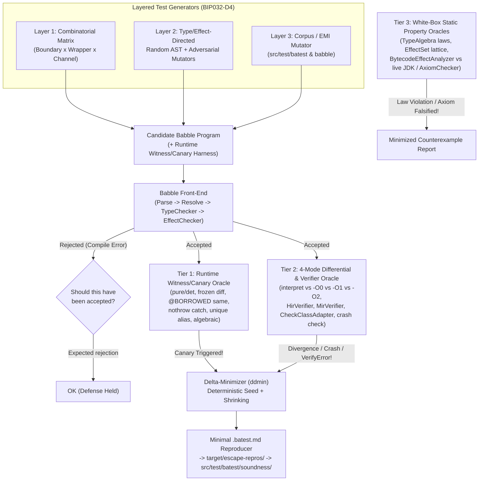

# BIP032: The Great Escape — Adversarial Search for Inconsistencies in Babble Types and Effects

| | |
|---|---|
| **BIP** | 032 |
| **Date** | 2026-11-24 |
| **Status** | Decided / Planned (`BIP032-Q1`–`Q7` → `BIP032-D1`–`D7` settled; `BIP032-P1`–`P4` planned) |
| **Depends on** | Static typing & modular front end ([bip008_static-typing.md](bip008_static-typing.md), [bip010_type-checker-simplification.md](bip010_type-checker-simplification.md)), core types & Java nullability ([bip011_core-types.md](bip011_core-types.md)), effects, ownership & pure-by-default contracts ([bip007_effects.md](bip007_effects.md), [bip016_consolidating-effect-annotations.md](bip016_consolidating-effect-annotations.md), [bip017_higher-order-function-effects.md](bip017_higher-order-function-effects.md)), structured axioms & `BytecodeEffectAnalyzer` ([bip019_refactoring-axioms.md](bip019_refactoring-axioms.md), [bip030_axiom-nullability-and-inferred-effects.md](bip030_axiom-nullability-and-inferred-effects.md)), arrays, overloads, intersections & tail calls ([bip020_array-types.md](bip020_array-types.md), [bip021_optional-variadic-overloaded-arguments.md](bip021_optional-variadic-overloaded-arguments.md), [bip022_intersection-types.md](bip022_intersection-types.md), [bip024_tail-calls.md](bip024_tail-calls.md)), E-graph verifier & `SCP` termination ([bip027_tackling-complexity-in-the-compiler.md](bip027_tackling-complexity-in-the-compiler.md)), exception handling ([bip028_exception-handling.md](bip028_exception-handling.md)), HIR/optimizer passes ([bip014_optimization-passes.md](bip014_optimization-passes.md)), and `.batest.md` v2 testing ([bip009_test-coverage.md](bip009_test-coverage.md), [bip029_batest-v2-and-ir-goldens.md](bip029_batest-v2-and-ir-goldens.md)) |
| **Scope** | A systematic, adversarial soundness campaign and automated fuzzing harness spanning all 6 Babble soundness surfaces (static types, effects/`nothrow`, ownership/`@BORROWED`/`frozen`/`mut`-exclusivity, optimizer & 4-mode parity, Java interop & axioms, and algebraic/termination verifiers); a 3-tier soundness oracle suite (runtime witness/canary oracles for silent escapes, 4-mode differential across `interpret`/`-O0`/`-O1`/`-O2` + `HirVerifier`/`MirVerifier`/`CheckClassAdapter` checks, and white-box static-algebra/axiom property tests); a layered generator (combinatorial escape-channel × boundary matrix, type/effect-directed random AST generator with adversarial mutators, and corpus/EMI mutator) with deterministic seeds and delta-minimization; permanent `.batest.md` regressions under `src/test/batest/soundness/`; and dual-tier Maven integration (fast deterministic smoke tests in `mvn test` plus opt-in `-Pescape` soak fuzzing). Zero production runtime or bytecode-footprint overhead (test-scoped harness under `src/test/java/org/babblelang/tests/escape/`). |

---

## 1. Summary & Motivation

### 1.1 The feature-interaction explosion

Babble's static discipline has grown remarkably rich across 30 BIPs (`RM001`–`RM013`):

* **Type system (`BIP008`, `BIP010`, `BIP011`, `BIP020`–`BIP023`):** non-null-by-default types, `T?`, `T!`, `any`/`any?`, unions `A | B`, intersections `A & B`, flow-sensitive narrowing (`is`, `== null`, `!= null`, truthiness), generics (`of`) with bounds and F-bounds, mutable invariance + `borrow` covariance + `record` covariance + covariant `array of T`, closed `overload` sets, optional/named/variadic arguments, type aliases, and cross-module/REPL `TypedModuleSummary` persistence.
* **Effect, ownership & borrow system (`BIP007`, `BIP016`, `BIP017`, `BIP027`, `BIP028`):** pure-by-default functions (`{@HERMETIC, @DETERMINISTIC, @CONST, @BORROWED}`), opt-out `io`/`volatile`/`mut`/`shared`, opt-in `nothrow`, `unique`/`@MOVED` affine tracking with `move`/`freeze`/`discard`, deeply immutable `frozen T`, return-through-borrow provenance (`BIP016-D10`), `fn calling f` callback-effect forwarding (`BIP017`), bounded `AccessPath` `mut` exclusivity (`BIP027-D5`), and `try`/`catch`/`finally` local-catch provenance & `nothrow` restoration (`BIP028-D7`–`D8`).
* **Verifiers, axioms & optimizer (`BIP014`, `BIP019`, `BIP027`, `BIP030`):** curated axioms (`src/main/java/org/babblelang/axioms/`), tier-7 ASM `BytecodeEffectAnalyzer`, E-graph `AlgebraicVerifier` + `RelSignDomain` (`commutative`, `associative`, `idempotent`, `monotone`, `injective`), polynomial `[BAL07]` `SizeChangeTermination`, `-O1` HIR passes (`HirEGraphSimplifyPass`, `InlinePass`, `HirDcePass`, `HirLicmPass`, `ScalarReplacePass`, `FbipReusePass`), and `-O2` SSA `MIR` passes (`BIP014-I3`: `SccpPass`, `GvnCsePass`, `AliasRlePass`, `LicmPass`, `MirDcePass`, `PredicateReorderPass`) that actively **exploit** static type, purity, `nothrow`, `@TERMINATING`, `frozen`, and `unique` proofs to rewrite bytecode.

Each individual feature is well tested on its own (`>= 80%` line and branch coverage across all 6 JaCoCo scopes in `-Pbatest`). Yet **coverage testing is fundamentally non-adversarial**:

1. **Soundness bugs hide at feature intersections**, not inside single-feature happy paths — e.g., `record` covariance × mutable fields, `borrow` covariance × contravariant methods, `try/catch` `nothrow` restoration × `java.lang.Error`, closure capture × `@BORROWED` × `fn calling f`, or `unique` aliasing × `FbipReusePass` / `AliasRlePass`.
2. **Effect and ownership escapes are silent at runtime.** Because Babble erases `pure`, `@BORROWED`, `frozen`, `unique`, and `mut` exclusivity before execution, an unsound rule in `EffectChecker` does not crash a normal test — it silently permits a jailbreak that later turns into a subtle **optimizer miscompilation** (under `-O1`, `-O2` SSA `MIR` `BIP014-I3`, `BIP014-P5` `aegraph`, or future parallelism under `BIP007` §10).
3. **Trustworthy optimizations demand airtight proofs.** Once `FbipReusePass` mutates a `unique` list or `record` in place, `AliasRlePass` eliminates redundant loads on `unique mut` state, `HirDcePass`/`MirDcePass` deletes a `pure nothrow @TERMINATING` call, or `HirLicmPass`/`LicmPass` hoists a `frozen` read out of a loop, *any* soundness crack in the front end immediately becomes a wrong-code bug in the back end.

### 1.2 Preliminary static code-audit findings

To verify that adversarial scrutiny pays off immediately, a brief read-only code audit performed while drafting `BIP032` already uncovered **four concrete candidate escapes** spanning four different surfaces (to be empirically reproduced, minimized, regressed, and fixed in `BIP032-P1`):

1. **Surface 1 (`S1` — Type soundness / variance hole) in [`TypeAlgebra.java`](../../src/main/java/org/babblelang/analysis/TypeAlgebra.java) (`#L372`, `#L552-L560`):**
   * `isMutableParameterized(Type)` returns `false` for every Babble `record` (`ClassShape.Kind.VALUE_CLASS`), making *every* generic `record` unconditionally **covariant** in all type parameters — even when it holds a mutable `list of T` / `array of T` / reassigned `def` field or a **contravariant** `fn (T): R` field. Thus `record Box of T (xs: list of T)` permits `def b: Box of any = Box of string (list of string ("hi")); b.xs.add(42)`, silently polluting `list of string` with an `int` (zero `as` casts → runtime `ClassCastException` on read).
   * Likewise, `borrowCovariant = true` at line 372 switches `argMode` from `INVARIANT_ARG` to `SUBTYPE` for *all* parameterized types on non-`mut` `@BORROWED` parameters — even when `T` appears in a **contravariant** parameter position of a pure, non-`mut` method (e.g., `class Sink of T (def push = fn (x: T): int -> (...))` or `java.util.function.Predicate of T` / `Comparator of T`). Passing `Sink of string` to a borrowed `s: Sink of any` and calling `s.push(42)` invokes `push(x: string)` with an `int` — pure, non-`mut`, cast-free `ClassCastException`.
2. **Surface 2 (`S2`, escalating to `S0` under `-O1`/`-O2` DCE/LICM — `nothrow` restoration vs. `java.lang.Error`) in [`EffectBodyWalker.java`](../../src/main/java/org/babblelang/analysis/EffectBodyWalker.java) (`#L1394-L1395`, `#L1491-L1548`):**
   * `evalThrow` correctly computes `matches = !TypeChecker.mayBeJavaError(exprType)` for untyped `catch e then (...)` (matching runtime semantics where untyped `catch` excludes `java.lang.Error`, `BIP028-D4`).
   * However, `evalTry` line 1491 unconditionally sets `hasExhaustiveCatchAll = true` whenever `cc.type() == null`, and line 1548 restores `nothrow = true`. Consequently, `fn nothrow (): int -> (try (throw java.lang.Error("boom")) catch e then (0))` (or `try (assert(false)) catch e then (0)`) is statically certified **`nothrow`** while throwing uncaught at runtime — allowing `HirDcePass`/`MirDcePass` or `HirLicmPass`/`LicmPass` to delete or hoist the call.
3. **Surface 6 (`S3` — `AlgebraicVerifier` IEEE-754 `monotone` edge case) in [`AlgebraicVerifier.java`](../../src/main/java/org/babblelang/analysis/AlgebraicVerifier.java) (`#L530-L539`):**
   * `evalBinaryRel` certifies `x * k` on `double`/`float` as `l.sign()` whenever `k >= 0.0`. Because Java evaluates `-0.0 >= 0.0` as `true` (and `0.0 >= 0.0` as `true`), `fn monotone (x: double): double -> (x * (-0.0))` and `fn monotone (x: double): double -> (x * 0.0)` are certified `monotone` (`INC`), even though `(-1.0) * (-0.0) == +0.0 > -0.0 == (+1.0) * (-0.0)` under `Double.compare`, and `(-Infinity) * 0.0 == NaN`.
4. **Surface 4 (`S0` — Optimizer amplification of `unique` escapes) in [`FbipReusePass.java`](../../src/main/java/org/babblelang/opt/hir/FbipReusePass.java) (`#L77-L100`, `#L225-L250`):**
   * `FbipReusePass` lowers `list(from: move(xs))` to `list$reuse` and tail `RecordNew` to `RecordReuse` directly on the assumption that `EffectChecker` ruled out all aliases (and `-O2` `AliasRlePass` likewise relies on `unique mut` non-aliasing). Any `unique`-aliasing crack in Surface 3 immediately manifests as an observable `-O0` vs `-O1`/`-O2` data-corruption divergence.

`BIP032` (*The Great Escape*) turns this kind of ad-hoc bug hunting into a **repeatable, automated, permanent adversarial defense layer** for Babble.

---

## 2. State of the Art

Adversarial soundness testing for type checkers, effect/ownership analyzers, and optimizing compilers has a strong body of proven techniques:

* **Type-checker fuzzing (`Hephaestus`, Chaliasos et al., OOPSLA 2022; `Xsmith`, Hatch et al.):** Generates well-typed and *near-well-typed* programs in languages with generics, variance, overloading, flow typing, and subtyping (Java, Kotlin, Groovy, Scala), discovering hundreds of soundness, crash, and type-inference bugs via *type-erasure/cast-insertion* and *differential* oracles. Crucially, Hephaestus showed that **cross-feature combinations** (generics + lambdas + variance + wildcards/unions) trigger far more soundness bugs than random grammar fuzzing alone.
* **Compiler differential & Equivalence Modulo Inputs (`CSmith`, `YARPGen`, `EMI` by Le et al.):** Compares unoptimized vs. optimized outputs (Babble's `interpret` vs `-O0` vs `-O1` vs `-O2` SSA `MIR`) while mutating existing real-world test programs (dead-branch injection, expression wrapping, control-flow perturbation) to catch miscompilations with high syntactic validity and low generator maintenance cost.
* **Ownership & borrow-checker soundness suites (Rust `I-unsound` + `Miri` / Stacked Borrows, Swift exclusivity runtime checks, Kotlin/TypeScript variance & narrowing regression suites):** Because static ownership/borrow/immutability guarantees are erased in release code, verifying them requires **runtime instrumentation / witness canaries** (checking reference identity, mutation snapshots, aliasing conflicts, and unexpected throws) paired with permanent regression tests for every historical jailbreak pattern.
* **Static-algebra & bytecode-analyzer property testing (QuickCheck / jqwik style + OPAL purity validation):** Checking algebraic laws directly on `TypeAlgebra` (reflexivity, transitivity, join/meet upper/lower bounds, `Frozen` preservation, narrowing soundness) and comparing `BytecodeEffectAnalyzer` + curated axioms against live JDK execution (extending Babble's existing `AxiomChecker`, `BIP007-I3`) catches inconsistencies even before a full Babble exploit program is crafted.
* **Hierarchical delta minimization (`ddmin` / Perses):** Automatically shrinks any randomly generated failing program down to a 5–20 line minimal reproducer ready to drop directly into a `.batest.md` file, preventing fuzzer findings from becoming unmaintainable noise.

Babble is unusually well positioned to combine all four: it already has a reference `Interpreter`, `-O0`, `-O1`, and `-O2` compilers with `HirVerifier`, `MirVerifier`, and ASM `CheckClassAdapter`, `AxiomChecker`, `.batest.md` v2 multi-mode specs (`BIP029`), and a modular, ANTLR-free analysis core (`BIP010`, `BIP027`).

---

## 3. Decisions

All seven design questions were resolved during the `BIP032` design review:

* **`BIP032-Q1` → `BIP032-D1` (Hybrid campaign + automated harness):** Deliver *both* a structured red-team attack taxonomy & permanent adversarial `.batest.md` regression corpus **and** an automated type/effect-directed soundness fuzzer, oracle harness, and delta-minimizer under `src/test/java/org/babblelang/tests/escape/`.
* **`BIP032-Q2` → `BIP032-D2` (All 6 soundness surfaces, tiered by severity):** Scope covers all 6 surfaces: (1) Type soundness, (2) Effect/purity/`nothrow`, (3) Ownership/`@BORROWED`/`frozen`/`unique`/`mut`-exclusivity, (4) Optimizer & 4-mode parity (`interpret`/`-O0`/`-O1`/`-O2`), (5) Java interop & axioms/`BytecodeEffectAnalyzer`, and (6) Algebraic & termination verifiers — prioritized by severity (`S0`–`S3`).
* **`BIP032-Q3` → `BIP032-D3` (Three-tier soundness oracles):** Combine (Tier 1) runtime witness/canary oracles for silent escapes, (Tier 2) 4-mode differential (`interpret` / `-O0` / `-O1` / `-O2`) + `HirVerifier`/`MirVerifier`/`CheckClassAdapter` + unexpected-crash oracles, and (Tier 3) white-box static-algebra & axiom property tests (`TypeAlgebra`, `EffectSet`, `BytecodeEffectAnalyzer`/`AxiomChecker`).
* **`BIP032-Q4` → `BIP032-D4` (Layered automated generator + delta-minimizer):** Combine three generation layers — (1) combinatorial escape-channel × protection-boundary matrix generator, (2) type/effect-directed random AST generator with adversarial boundary-downgrade mutators, and (3) corpus/EMI mutator over existing `.batest.md`/`.ba` tests — all sharing a deterministic PRNG seed and an automatic delta-minimizer outputting `.batest.md`-ready reproducers.
* **`BIP032-Q5` → `BIP032-D5` (Standard trust boundary):** Explicitly exclude out-of-bounds trusted escape hatches (unchecked `as` casts emitting `Unchecked cast`, user-written `axiom` declarations, `java.lang.VirtualMachineError` under `nothrow`, Java reflection/`Unsafe`/JNI bypassing Babble visibility, and known single-threaded `Interpreter`), while keeping Babble's built-in `src/main/java/org/babblelang/axioms/`, `BytecodeEffectAnalyzer`, reifiable `as`/`e!` checks, and ordinary Babble + JDK APIs strictly in-bounds.
* **`BIP032-Q6` → `BIP032-D6` (Dual-tier CI & Maven integration):** Keep permanent adversarial `.batest.md` regressions in `src/test/batest/soundness/` plus a fast deterministic fixed-seed fuzz smoke test (`<= 5s` total) and white-box `TypeAlgebra`/`EffectSet` property tests in standard `mvn test`; provide an opt-in deep/soak Maven profile `-Pescape` (`-Descape.seconds`, `-Descape.seed`, `-Descape.surfaces`) that writes minimized `.batest.md`-ready reproducers on failure.
* **`BIP032-Q7` → `BIP032-D7` (Red-team-first 4-phase delivery & remediation policy):** Execute manual/agent red-team probes + white-box property tests first (`BIP032-P1`) so concrete blind spots directly shape the combinatorial matrix (`BIP032-P2`) and random/EMI fuzzer (`BIP032-P3`), followed by a deep soak & remediation pass (`BIP032-P4`). Every confirmed escape is either fixed with a permanent `.batest.md` regression test or explicitly tracked in a GitHub issue / BIP decision if it requires a language-design trade-off.

---

## 4. Threat Model, Soundness Surfaces & Severity Taxonomy

### 4.1 The six soundness surfaces

| Surface | Primary Subsystem(s) | Core Soundness Invariant | Canonical Escape |
|---|---|---|---|
| **1. Type Soundness** | `TypeChecker`, `TypeAlgebra`, `Narrowing`, `CallSolver`, `OverloadSolver`, `SlotInference`, `LoweringAnalyzer` | Cast-free Babble code obeys progress & preservation: no unexpected `ClassCastException`, `NullPointerException` on non-null `T`, `VerifyError`, or silent heap pollution. | `null` leaking into `T`; variance hole polluting `list of string` with `int`; stale narrowed variable mutated via closure or loop; broken `A & B` / `overload` dispatch. |
| **2. Effect, Purity & `nothrow`** | `EffectChecker`, `EffectBodyWalker`, `CallEffectAnalyzer`, `SymbolicEffectSummary`, `TypedModuleSummary` | Pure functions (`@HERMETIC`, `@DETERMINISTIC`, `@CONST`) perform no `io`, read no unowned mutable/volatile state, and mutate no non-local state; `nothrow` never throws ordinary exceptions; `fn calling f` forwards all callback effects. | Smuggling `io`/`volatile`/`mut` via interface overrides, overloads, default args, constructors, or `fn calling f`; a `nothrow` function throwing uncaught at runtime (e.g., `Error` escaping untyped `catch`). |
| **3. Ownership, Borrow, `frozen` & `mut` Exclusivity** | `EffectChecker`, `EffectBodyWalker`, `CallEffectAnalyzer`, `Reachability`, `Type.Frozen` | `@BORROWED` values never outlive their call frame (except via tracked return-origin provenance); `frozen T` values are deeply immutable; `unique` values have a single live owner and cannot be used after `move`; call-site `mut` arguments cannot alias each other or any concurrently read argument. | Escaping a `@BORROWED` param into a closure/field/collection/exception/Java SAM; mutating a `frozen` value via alias or covariance; double-using a `unique` value across branches/`try`/`finally`; bypassing `mut` exclusivity via deep paths (`k > 3`) or collection views. |
| **4. Optimizer & 4-Mode Parity** | `HirPurity`, `HirEGraphSimplifyPass`, `InlinePass`, `HirDcePass`, `HirLicmPass`, `ScalarReplacePass`, `FbipReusePass`, `HirTryNormalize`, `HirVerifier`, and `-O2` SSA `MIR` (`BIP014-I3`: `MirLowerer`, `MirVerifier`, `SccpPass`, `GvnCsePass`, `AliasRlePass`, `LicmPass`, `MirDcePass`, `PredicateReorderPass`, `MirEmitter`) | `interpret`, `compile -O0`, `compile -O1`, and `compile -O2` produce identical observable values, output, side effects, and uncaught exceptions, and pass `HirVerifier`, `MirVerifier` (`-O2`), and ASM `CheckClassAdapter`. | `FbipReusePass` mutating an aliased list/record in place; `AliasRlePass` reusing a stale load on aliased `unique mut` state; `PredicateReorderPass` moving a predicate ahead of its guard; `HirDcePass`/`MirDcePass` deleting a throwing or diverging call; `HirEGraphSimplifyPass` violating IEEE-754 `NaN`/`-0.0`. |
| **5. Java Interop & Axiom Boundary** | `src/main/java/org/babblelang/axioms/`, `BytecodeEffectAnalyzer`, `JavaEffectResolver`, `JavaNullability`, `JavaTypeBridge`, `ClassGen` bridges, `Faces` SAM adapters | Built-in curated axioms and tier-7 `BytecodeEffectAnalyzer` profiles never over-claim purity, `nothrow`, `fresh`, `immutable`, or non-nullness; Java interface bridges & SAM adapters reject invalid inbound types/nulls and never leak `@BORROWED` refs. | `BytecodeEffectAnalyzer` certifying an overridable or state-reading Java method `pure`/`fresh`/`notnull`; curated axiom drifting across JDK versions; Java bridge/SAM missing an inbound `null` or generic check. |
| **6. Algebraic & Termination Verifiers** | `AlgebraicVerifier`, `RelSignDomain`, `AlgebraicRules`, `SizeChangeTermination`, `TailCalls`, `EffectAstExtractors` | Every function accepted as `commutative`, `associative`, `idempotent`, `monotone`, or `injective` satisfies its mathematical law on the full runtime domain (including `NaN`, `-0.0`, `±Infinity`, `MIN_VALUE`); every `@TERMINATING` function terminates on all valid inputs. | `AlgebraicVerifier` certifying `x * (-0.0)` as `monotone` or an overflowing `int` op as `monotone`; `SizeChangeTermination` certifying a `MIN_VALUE`-looping recursion or mutated-collection `for` loop as `@TERMINATING`. |

### 4.2 Trust boundary (`BIP032-D5`)

To keep adversarial results high-signal and unambiguous, `BIP032` draws a crisp line between **trusted escape hatches (out-of-bounds)** and **soundness bugs (in-bounds)**:

| Category | In-Bounds (Bug if Violated) | Out-of-Bounds (Trusted Escape Hatch) |
|---|---|---|
| **Casts & null assertions** | Cast-free code; reifiable `as` casts (`x as int`, `x as Foo`, `x as A & B`) failing to check at the cast site; `e!` allowing `null` through without throwing NPE at the `!` site. | Explicit unchecked generic `as` casts that emit `Warning : Unchecked cast` (`BIP011-D8`), when the runtime failure originates from the caller's unchecked cast. |
| **Axioms** | Babble's own built-in `src/main/java/org/babblelang/axioms/` (`curated.ba`, `builtins.ba`, `@Axioms` stubs) and tier-7 `BytecodeEffectAnalyzer` inference. | User-written `axiom` declarations (`axiom pure`, custom user Java `axiom`s) that intentionally assert unchecked assumptions. |
| **JVM asynchronous errors** | Synchronous throws (`throw ...`, `assert(...)`, `NullPointerException`, `ArithmeticException`, `IndexOutOfBoundsException`, `ClassCastException`, explicit `throw java.lang.Error(...)`) inside `nothrow`. | Asynchronous `java.lang.VirtualMachineError` (`StackOverflowError`, `OutOfMemoryError`, `InternalError`) under `nothrow`. |
| **JVM reflection & native code** | All ordinary public JDK/Java APIs callable from Babble, `RM003` Java interface bridges, `LambdaMetafactory` SAM adapters, Java generics & arrays. | Reflective/unsafe mutation (`Field.setAccessible`, `sun.misc.Unsafe`, JNI) bypassing Babble/Java encapsulation behind the type/effect checker's back. |
| **Concurrency** | Single-threaded execution in `interpret`, `-O0`, `-O1` (and multi-threaded compiled execution once `BIP007` §10 / thread-safe `Interpreter` lands). | Known single-threaded `Interpreter` limitation documented in `AGENTS.md`. |

### 4.3 Severity classification (`S0`–`S3`)

Every confirmed escape is assigned one severity level during triage:

* **`S0` — Critical (Silent Corruption / Wrong Code / Bytecode Invalidity):**
  * Optimizer divergence (`interpret`, `-O0`, and `-O1` produce different observable results or exceptions).
  * `HirVerifier` failure, ASM `CheckClassAdapter` failure, or JVM `VerifyError` / `ClassFormatError`.
  * In-place corruption of aliased or `frozen` data (e.g., via `FbipReusePass` or `ScalarReplacePass`).
* **`S1` — High (Type Soundness Crash / Heap Pollution):**
  * Unexpected `ClassCastException`, `NullPointerException` on a statically non-null `T`, or silent heap pollution in cast-free Babble code (or at a reifiable `as`/`e!` or Java-bridge boundary).
* **`S2` — High (Effect, Ownership or Borrow Escape):**
  * Silent escape of `io`, `volatile`, `mut`, or synchronous `throw` across a `pure`/`nothrow`/`fn calling f` contract.
  * `@BORROWED` reference surviving past its frame, `frozen` data mutated, `unique` value aliased or used after `move`, or call-site `mut` exclusivity bypassed.
  * Built-in `curated.ba` / `BytecodeEffectAnalyzer` over-claiming purity, `nothrow`, `fresh`, or non-nullness.
* **`S3` — Medium (Verifier / Static Algebra Inconsistency):**
  * `AlgebraicVerifier` or `SizeChangeTermination` certifying a falsifiable algebraic law or non-terminating function.
  * `TypeAlgebra` or `EffectSet` violating a mathematical lattice/subtyping law (e.g., non-transitivity, broken join/meet) without a known runtime exploit yet.

---

## 5. Adversarial Attack Matrix ("The Escape Catalog")

Every escape in a type-and-effect language is a **path** from a *protected value or capability* through one or more *type/syntax wrappers* into a *forbidden escape channel*:


Below is the structured red-team catalog across all 6 surfaces that drives `BIP032-P1` (manual/agent probes) and `BIP032-P2` (combinatorial matrix):

### 5.1 Surface 1 — Type soundness attack vectors

| ID | Attack Vector | Feature Intersection | Target Failure |
|---|---|---|---|
| `T1` | **Variance smuggling** | Generic `record` with mutable `list of T`/`array of T`/`def` field; generic `record` or `@BORROWED` class with contravariant `fn (T): R` or method param `m(x: T)`; `Optional`/`Map.Entry` wrapping mutable containers | Heap pollution / `ClassCastException` with zero `as` casts |
| `T2` | **Array covariance & nullness waiver** | `array of Sub` → `array of Super`, `array of (T?)`, `array of (frozen T)`, generic `array of T` via `TypeVar` bounds, Java array bridges (`BIP020`) | Missing `ArrayStoreException` or `null` leaking into `array of string` |
| `T3` | **Flow narrowing invalidation** | `x != null` / `x is T` combined with: reassignment in sub-expression of `if`/`and`/`or`; `while` loop back-edge; `try` body mutating `x` before `catch`/`finally`; closure capturing `x` via indirect aliasing or nested `def` | `NullPointerException` or `ClassCastException` on narrowed `x` |
| `T4` | **Union / intersection algebra** | `(A \| B) & C` distribution, `is A & B` narrowing, `A & B` with conflicting or covariant members (`BIP022-D4`), SAM+marker intersections (`Runnable & Serializable`), `Type.NOTHING` in generics/unions/overloads | Wrong method dispatch, `ClassCastException`, or `VerifyError` |
| `T5` | **Overload, default-arg & variadic dispatch** | Closed `overload` sets with union runtime splits (`BIP021`, `BIP022-D8`), named/optional args with `$spec` masks, `...e` spread with covariant arrays/iterables, generic `fn of T` with F-bounds | Ambiguous/wrong overload selected, bad `$spec` mask, `ClassCastException` |
| `T6` | **Definite initialization & cross-boundary summaries** | Forward-referenced `def`s in mutual recursion/class bodies, `this` escaping constructors before field init, `TypedModuleSummary` & REPL `AnalysisSession` across modules/inputs, `Type.TypeAlias` recursion/expansion | Reading uninitialized primitive/reference field (`null` in non-null `T`) |

### 5.2 Surface 2 — Effect, purity & `nothrow` attack vectors

| ID | Attack Vector | Feature Intersection | Target Failure |
|---|---|---|---|
| `E1` | **`nothrow` restoration & catch-all loopholes** | `try (throw java.lang.Error(...)) catch e then (0)`, `try (assert(false)) catch e then (0)`, throwing in `finally` with suppression, `try` inside `fn calling f`, throwing in default parameter expressions | `nothrow` function throws uncaught at runtime |
| `E2` | **Higher-order effect smuggling (`fn calling f`)** | Passing `io`/`volatile`/`mut`/throwing closure to `fn calling f`; storing or returning `f` through a wrapper, tuple/`record`, `list`, `overload`, or `try/catch`; `fn calling f` on interface methods & cross-module exports (`BIP017`) | Pure caller executes `io`/mutation/throw unaccounted |
| `E3` | **Subtyping & dispatch effect laundering** | Interface method declared pure overridden by `io`/`mut`/`volatile` class method; `overload` set mixing pure and `io` arms; function-type subtyping dropping `io`/`volatile` or flipping `nothrow`; Java SAM adapter wrapping an `io`/`mut` Babble closure | Pure function invokes impure implementation |
| `E4` | **Hidden evaluation sites** | Side effects (`io`, `mut`, `volatile`, `throw`) hidden in: default parameter expressions, class field initializers, `for`-loop custom `iterator()`/`hasNext()`/`next()`, operator methods (`plus`/`equals`/`hashCode`/`compareTo`), string concatenation (`toString()`), `is`/overload splits | Side effects escape purity check because walker missed an AST/call site |
| `E5` | **Cross-module & REPL effect drift** | Exporting inferred vs explicitly annotated `def`s via `TypedModuleSummary`, mutable top-level module bindings read by an imported pure `fn`, REPL shadowing mutating an earlier pure binding | Pure function observes `volatile` / cross-module mutable state |

### 5.3 Surface 3 — Ownership, `@BORROWED`, `frozen`, `unique` & `mut`-exclusivity attack vectors

| ID | Attack Vector | Feature Intersection | Target Failure |
|---|---|---|---|
| `O1` | **Multi-hop `@BORROWED` escape** | `@BORROWED` param stored into: captured closure (1-hop & 2-hop nested closure), local `record`/`class` field, `list`/`set`/`map`/`array`, thrown `record` exception (`activeTryStack` + rethrow/outer catch/field), bound method `p.m`, or Java container/SAM; return-through-borrow provenance (`BIP016-D10`) dropped across generic/interface/overload/module boundaries | Witness object escapes frame and remains reachable (`same(leaked, witness)`) |
| `O2` | **`frozen` immutability bypass** | Mutating a `frozen` value via: aliasing a mutable sub-object before `freeze(x)`; passing `frozen Box` through `record` or `borrow` covariance; calling a bound `mut` method captured before/after freeze; calling a Java view method (`subList`, `entrySet`, `keySet`, `values`, `iterator().remove()`) on a `frozen` collection; `is` narrowing stripping `frozen` (`BIP007-D7`) | Observable mutation of a `frozen` witness snapshot |
| `O3` | **`unique` aliasing & use-after-`move`** | Using a moved `unique` variable across: `if`/`else` joins, `while`/`for` back-edges, short-circuit `and`/`or`, `try` → `catch` → `finally` unwind paths, closure capture before `move`, aliasing into a `record`/`list` then moving the container, self-tail-call `recurse(move(x))` | Two live aliases to a supposedly `unique` object, or read after `move` |
| `O4` | **`mut` exclusivity bypass** | Passing aliased mutable state to `(mut a, mut b)` or `(mut a, b)` via: `AccessPath` depth `> 3` loop widening (`BIP027-D5`), array/list element aliasing (`xs.get(0)` vs `xs`), collection views (`xs.subList(0, 1)` vs `xs`), bound method `xs.add` passed alongside `xs` into `fn calling f`, interface/super dispatch aliasing `this` and an argument | Concurrent `mut` + `mut` or `mut` + read on the exact same object at one call site |

### 5.4 Surface 4 — Optimizer & 4-mode parity attack vectors

| ID | Attack Vector | Feature Intersection | Target Failure |
|---|---|---|---|
| `P1` | **FBIP reuse (`FbipReusePass`)** | `list(from: move(xs))` / `set`/`map` reuse and tail `RecordReuse` combined with `try`/`finally`, loops, conditional returns, exception thrown mid-argument evaluation, or Surface 3 `unique` leaks | `-O1`/`-O2` mutates an aliased collection/record while `interpret` and `-O0` do not (`S0`) |
| `P2` | **Scalar replacement (`ScalarReplacePass`)** | Non-escaping local `record` SROA and `$unboxed` `borrow` flattening with: `null`/union joins, `is`/`as`, `same(...)` identity checks, `try`/`catch`/`finally`, field mutation, 2-slot `long`/`double` primitives | `-O1`/`-O2` disagrees with `-O0`/`interpret`, or fails `HirVerifier`/`MirVerifier`/`CheckClassAdapter` (`S0`) |
| `P3` | **E-graph simplification (`HirEGraphSimplifyPass`)** | `a == a -> true` / `a != a -> false` on `double`/`float` `NaN` or custom `equals`; integer overflow (`MIN_VALUE / -1`, `MIN_VALUE * -1`); `-0.0` vs `+0.0`; `idempotent` / `commutative` rewrites changing exception or evaluation order | `-O1`/`-O2` produces wrong value or drops exception (`S0`) |
| `P4` | **HIR LICM, DCE & Inlining (`HirLicmPass`, `HirDcePass`, `InlinePass`)** | Zero-trip loops guarding division-by-zero / `null` dereference / out-of-bounds; hoisting reads of mutated locals/fields/views; DCE deleting calls falsely marked `pure nothrow @TERMINATING`; `InlinePass` duplicating side-effecting arguments, losing line numbers in stack traces, or crossing AOT module boundaries (`babblec`) | `-O1`/`-O2` crashes where `-O0` did not, swallows an exception/infinite loop, or prints wrong result (`S0`) |
| `P5` | **SSA `MIR` `-O2` passes (`BIP014-I3`)** | `AliasRlePass` redundant-load elimination on `unique mut` state when aliased or across calls/exceptions; `PredicateReorderPass` reordering `and`/`or` predicates ahead of `!= null` / `is T` narrowing guards (`BIP007-D1`); `SccpPass`/`GvnCsePass`/`LicmPass`/`MirDcePass` across `try`/`catch`/`finally`, `SelfTailCall` loops, and 2-slot primitives; `MirEmitter` typed-call unboxing | `-O2` diverges from `interpret`/`-O0`/`-O1`, or fails `MirVerifier`/`CheckClassAdapter` (`S0`) |

### 5.5 Surface 5 — Java interop & axiom boundary attack vectors

| ID | Attack Vector | Feature Intersection | Target Failure |
|---|---|---|---|
| `J1` | **`BytecodeEffectAnalyzer` false claims** | Open `INVOKEVIRTUAL`/`INVOKEINTERFACE` on non-final classes with impure subclass overrides; `GETSTATIC` on mutable static fields or caches (`jfrTracing`, `ThreadLocal`, `System.out`); `GETFIELD` nullness; native/JNI/MethodHandle/`invokedynamic` callees; hitting `MAX_CALL_GRAPH_NODES`/`MAX_CALL_DEPTH`/`MAX_SCC_ITERATIONS` truncation limits | Tier-7 analyzer claims `pure`, `nothrow`, `fresh`, or `returnNonNull` when a JDK/Java method violates it |
| `J2` | **Curated axiom drift (`curated.ba` / `builtins.ba`)** | Checking every curated `pure`, `nothrow`, `fresh`, `immutable`, `view`, `T!`, and `class notnull` declaration in `src/main/java/org/babblelang/axioms/` against live JDK behavior (boundary inputs, `null` args, empty collections, subclasses) | Curated axiom returns `null` for `T!`, throws on `nothrow`, mutates a `@CONST` arg, or returns an aliased object for `fresh` |
| `J3` | **`RM003` Java interface bridges & SAM adapters** | Java calling back into a Babble class implementing a Java interface (`implements Comparable`, `Comparator`, `Function`, generic interfaces with erased bridge methods) or a `LambdaMetafactory` SAM adapter with `null`, raw-type wrong objects, primitive boxing, or covariant arrays | Missing inbound null/type check lets `null` or wrong type enter typed Babble code (`S1`) |

### 5.6 Surface 6 — Algebraic & termination verifier attack vectors

| ID | Attack Vector | Feature Intersection | Target Failure |
|---|---|---|---|
| `A1` | **E-graph algebraic laws (`AlgebraicVerifier`)** | `commutative`, `associative`, `idempotent` on `double`/`float` (`NaN`, `-0.0`, `±Infinity`, non-associative rounding), `int`/`long` wrap, `string` concatenation, `mut` `FieldTransition` with aliased target/value or throwing sub-expressions | Function accepted with algebraic modifier, falsified by `AxiomChecker` counterexample |
| `A2` | **Partial-derivative sign & bijectivity (`RelSignDomain`)** | `monotone` on `double`/`float` (`x * 0.0`, `x * (-0.0)`, `x + Infinity`, `min`/`max` with `NaN`), `int`/`long` overflow, `char`/narrowing casts; `injective` on lossy widening (`int -> float`, `long -> double`), `STR_ADD` with ambiguous multi-param concatenation, triangular `record` recovery with non-injective components | Function accepted as `monotone` or `injective`, falsified by explicit `x1 < x2` or `f(x1) == f(x2)` counterexample |
| `A3` | **Termination (`SizeChangeTermination` & `for`-loop certification)** | Guarded integer decreases around `Integer.MIN_VALUE` / `Long.MIN_VALUE` (`-n`, `abs(n)`, `n - k` underflow, `floorDiv`/`floorMod`), mutual recursion with subtle parameter swaps, recursive calls hidden in closures/interfaces/fields, `for` loops over custom/mutated `Collection` iterators falsely certified `@TERMINATING` | Non-terminating function certified `@TERMINATING` (and potentially deleted by `HirDcePass`/`MirDcePass`!) |

---

## 6. Three-Tier Soundness Oracle Architecture

Because silent effect and ownership escapes produce no JVM exception on their own, `BIP032-D3` pairs every generated or red-team program with **three complementary oracle tiers**:



### 6.1 Tier 1 — Runtime witness & canary oracles (detecting silent escapes)

Each generated adversarial probe wraps the target function in a lightweight Babble witness harness that converts a *silent* static soundness violation into a loud, deterministic assertion failure (`ESCAPE:<KIND>:<detail>`):

1. **Purity / determinism canary (`ESCAPE:PURE`):**
   * Evaluates a statically `pure` function `f(args)` twice before and after mutating external witness state (and with freshly cloned equal inputs); any mismatch in result or mutation of external witness state triggers `ESCAPE:PURE`.
2. **`frozen` / `@CONST` mutation canary (`ESCAPE:FROZEN` / `ESCAPE:CONST`):**
   * Before calling a function taking a `frozen T` or non-`mut` `@BORROWED` parameter `w`, snapshots `w`'s deep observable state (fields, collection sizes/contents, array elements). After the call returns (or unwinds via `try/finally`), re-snapshots `w`; any difference triggers `ESCAPE:FROZEN` or `ESCAPE:CONST`.
3. **`@BORROWED` reference-retention canary (`ESCAPE:BORROW`):**
   * Allocates a fresh unique witness object `w = Witness(id)` and passes it to a callee whose parameter is `@BORROWED` (and whose return-origin provenance does *not* include that parameter, or where the return value is discarded). Inspects an out-of-frame sink registry (module-level list/cell, captured closure, thrown exception payload) using Babble's identity predicate `same(entry, w)`; any match triggers `ESCAPE:BORROW`.
4. **`nothrow` canary (`ESCAPE:NOTHROW`):**
   * Calls a statically `nothrow` function inside an outer `try (...) catch e: java.lang.Throwable then (...)` wrapper; catching any throwable that is *not* an asynchronous `VirtualMachineError` triggers `ESCAPE:NOTHROW`.
5. **`unique` aliasing canary (`ESCAPE:UNIQUE`):**
   * Whenever a function receives a `unique` parameter `u` alongside another reference `other` (or returns `: unique T` while an outer witness `w` remains live), checks `same(u, other)` (or mutates `u` and observes whether `other` changed); any shared identity triggers `ESCAPE:UNIQUE`.
6. **`mut` exclusivity canary (`ESCAPE:MUT_ALIAS`):**
   * Inside a function taking `(mut a, mut b)` or `(mut a, b)`, explicitly asserts `not same(a, b)` (and for containers/views, probes whether mutating `a` mutates `b` before `b` is written); any overlap triggers `ESCAPE:MUT_ALIAS`.
7. **Algebraic & termination canary (`ESCAPE:ALGEBRAIC` / `ESCAPE:TERMINATION`):**
   * Reuses and extends [`AxiomChecker`](../../src/main/java/org/babblelang/analysis/AxiomChecker.java) with adversarial boundary domains (`0`, `-1`, `1`, `Integer.MIN_VALUE`, `Integer.MAX_VALUE`, `Long.MIN_VALUE`, `Long.MAX_VALUE`, `-0.0`, `+0.0`, `Double.NaN`, `Double.POSITIVE_INFINITY`, `Double.NEGATIVE_INFINITY`, subnormals, `""`, surrogate chars, empty/singleton collections) to falsify `commutative`, `associative`, `idempotent`, `monotone`, and `injective`.
   * Executes `@TERMINATING` functions with a step/wall-time watchdog (e.g., 500 ms per probe on a worker thread, reporting `ESCAPE:TERMINATION` if a statically certified `@TERMINATING` function fails to terminate).

### 6.2 Tier 2 — 4-mode differential, verifier & crash oracle

Every program accepted by the front end runs through Babble's full execution matrix:

* `interpret` (`-Dbabble.mode=interpret`)
* `compile -O0` (`-Dbabble.mode=compile`, `babble.opt=0`, `babble.verify=true`)
* `compile -O1` (`-Dbabble.mode=compile`, `babble.opt=1`, `babble.verify=true`)
* `compile -O2` (`-Dbabble.mode=compile`, `babble.opt=2`, `babble.verify=true`, SSA `MIR` via `BIP014-I3`)
* *(Extensible to `wasm` under `BIP025`.)*

The oracle flags a violation on any of:

1. `HirVerifier`, `MirVerifier` (`-O2`), or ASM `CheckClassAdapter` failure, or JVM `VerifyError` / `LinkageError`.
2. Unexpected `ClassCastException`, `NullPointerException`, or `ArrayStoreException` in a cast-free, `e!`-free, non-covariant-array-store program (classified `S1`).
3. Any behavioral divergence across `interpret`, `-O0`, `-O1`, and `-O2` in return value, stdout, stderr, or thrown exception class/message (classified `S0`).
4. Internal compiler crash (`NullPointerException`, `IllegalStateException`, `AssertionError`, `ClassCastException` inside `org.babblelang.analysis.*`, `org.babblelang.ir.*`, `org.babblelang.opt.*`, or `org.babblelang.compiler.*`).

### 6.3 Tier 3 — White-box static-algebra & axiom property oracles

White-box JUnit property tests directly target the mathematical invariants of Babble's core analysis engines without needing full-program syntax:

1. **`TypeAlgebraPropertyTestCase`:** Generates random type trees over scalars, `null`, `any`, `NOTHING`, Babble classes/`record`s/interfaces (both mutable and deeply immutable), `list`/`map`/`array`, `Type.Frozen`, `Type.Union`, `Type.Intersection`, `Type.Function` (with effect sets and `mut`/`borrow`/`calling`), and `Type.Overloaded`, asserting:
   * **Reflexivity:** `subtype(T, T)` and `assignable(T, T)` hold for all valid `T`.
   * **Transitivity:** `subtype(A, B) && subtype(B, C) ==> subtype(A, C)` (and similarly for `runtimeSubtype`, `assignable`, and `borrowAssignable`!).
   * **Join / Meet coherence:** `subtype(A, join(A, B))` and `subtype(B, join(A, B))`; `subtype(A, C) && subtype(B, C) ==> subtype(join(A, B), C)` (up to documented widening rules).
   * **`Frozen` preservation:** `narrowTarget(frozen T, U)` and `subtractType(frozen T, U)` never strip `frozen` off a mutable type (`BIP007-D7`).
   * **Variance soundness:** If `T` appears in a mutable field or contravariant parameter position of `C of T`, `C of Sub` must **never** be assignable or `borrowAssignable` to `C of Super` (`Sub != Super`).
   * **Intersection / Union distributivity:** `subtype((A | B) & C, (A & C) | (B & C))` and vice versa; `isInterfaceLike` & `overlapsErased` consistency with `runtimeSubtype`.
2. **`EffectLatticePropertyTestCase`:** Verifies `EffectSet` join/meet associativity, commutativity, idempotence, absorption, `isAtLeastAsStrongAs` transitivity (matching `BIP030` fixes), and `Reachability.Origin` join/flatten/strip monotonicity.
3. **`AxiomAndBytecodeSoundnessTestCase`:** Iterates over public methods/constructors of curated `java.base` classes (`java.lang`, `java.util`, `java.io`, `java.math`, `java.nio`, `java.time`) and synthetic Java test fixtures (including subclasses overriding virtual methods, mutable static fields, native/bridge methods, and generic nullability boundaries), cross-checking both `BuiltinAxioms` (`curated.ba`) and `BytecodeEffectAnalyzer` against actual runtime execution via an expanded `AxiomChecker` (checking `returnNonNull`, `nothrow`, `pure`/determinism, `fresh` distinct identity, `immutable`, and `mut`/`@CONST` non-mutation).

---

## 7. Layered Automated Fuzzer & Delta-Minimizer Architecture

All fuzzer and oracle code lives strictly in test sources (`src/test/java/org/babblelang/tests/escape/`) so production jars (`babble-runtime`, `babble`) incur **zero** dependencies or size overhead (`RuntimeBoundaryTestCase` untouched), and every class stays well under `ArchitectureBoundaryTestCase`'s 2,000-LOC ceiling.

### 7.1 Package layout

```text
src/test/java/org/babblelang/tests/escape/
├── EscapeConfig.java                # Seed, time/iteration budgets, active surfaces, output dir
├── EscapeSeverity.java              # S0..S3 enum & surface tags
├── EscapeOracle.java                # Orchestrates Tier 1 (canaries) + Tier 2 (4-mode diff/verify)
├── EscapeMinimizer.java             # Hierarchical ddmin shrinking + .batest.md formatter
├── MatrixEscapeGenerator.java       # Layer 1: Boundary x Wrapper x Channel combinatorial matrix
├── TypeEffectAstGenerator.java      # Layer 2: Type/effect-directed random program generator
├── AdversarialMutators.java         # Layer 2: Boundary-downgrade & aliasing mutators
├── CorpusEmiMutator.java            # Layer 3: .batest.md / .ba parser-backed EMI mutator
├── TypeAlgebraPropertyTestCase.java # Tier 3: White-box TypeAlgebra & EffectSet property tests
├── AxiomSoundnessTestCase.java      # Tier 3: BuiltinAxioms + BytecodeEffectAnalyzer differential checks
├── EscapeSmokeTestCase.java         # Fast deterministic CI smoke suite (<= 5s in `mvn test`)
└── EscapeSoakRunner.java            # Opt-in `-Pescape` soak driver dumping minimized reproducers
```

### 7.2 Layer 1 — Combinatorial matrix generator (`MatrixEscapeGenerator`)

Deterministically enumerates the Cartesian product of:

* **Boundaries:** `{non-null T, pure, nothrow, @BORROWED, frozen T, unique, mut-exclusive}`
* **Wrappers:** `{direct, generic class, generic record, list/map/array, union A | B, intersection A & B, closure, 2-hop nested closure, fn calling f, interface override, overload set, default param, try/catch/finally, Java SAM, second virtual module}`
* **Escape channels:** `{field store, collection store, array store, return value, return-through-borrow, closure capture, thrown exception, bound method, Java callback, FBIP move/reuse}`

Because each cell is parameterized and deterministic, Layer 1 runs in milliseconds to a few seconds, achieves 100% systematic coverage of cross-feature cells without relying on luck, and immediately catches any regression when a new language feature is added.

### 7.3 Layer 2 — Type/effect-directed random AST generator & adversarial mutators (`TypeEffectAstGenerator`, `AdversarialMutators`)

Inspired by Hephaestus and Xsmith, Layer 2 synthesizes multi-declaration Babble programs (1–3 `record`s/`class`es/`interface`s + 2–5 functions + canary `main`) using a typed environment (`TypeEnv` mirror) so ~70%+ of base programs type-check cleanly before mutation, then applies targeted **adversarial mutators**:

* **Contract-tightening mutators** (attempting to sneak an illegal program past `EffectChecker`/`TypeChecker`): drop `io`, drop `volatile`, drop `mut`, drop `shared`, add `nothrow`, wrap value in `freeze(...)`, add `unique` / `move(...)`, add `monotone`/`injective`/`commutative`/`associative`/`idempotent`.
* **Wrapper-insertion mutators:** wrap an expression in `(fn () -> (e))()`, `try (e) catch ex then (...)`, `if cond then (e) else (e)`, `for _ in list(1) then (e)`, a generic `record Box of T`, an `overload`, or an `interface` dispatch.
* **Aliasing & narrowing perturbation mutators:** introduce a local alias `def alias = x`, wrap in a 1-element `list`/`array`, insert a `!= null` / `is T` guard followed by reassignment or closure capture, or pass the same binding twice to a 2-argument call.

Every mutated program that *compiles* is immediately executed against Tier 1 + Tier 2 oracles.

### 7.4 Layer 3 — Corpus / EMI mutator (`CorpusEmiMutator`)

Loads existing valid `.batest.md` and `.ba` programs from `src/test/batest/` and `src/test/babble/` and applies semantics-preserving and boundary-probing transformations:

* **Dead-code & guard wrapping (EMI):** wraps sub-expressions in opaque false-branch `if`, single-iteration `while`/`for`, `try (...) finally (0)`, or helper functions (both pure and `fn calling f`) to stress `InlinePass`, `ScalarReplacePass`, `FbipReusePass`, `HirLicmPass`, `HirDcePass`, and `HirEGraphSimplifyPass`.
* **Contract-strengthening probes:** on pure/helper functions in real tests, opportunistically adds `nothrow`, `unique`, or `freeze(...)` and checks whether accepted mutations break any Tier 1/Tier 2 oracle.

### 7.5 Deterministic seeding & hierarchical delta-minimization (`EscapeMinimizer`)

Whenever any generator layer discovers a violation:

1. The exact `(generatorLayer, seed, caseIndex, mutationTrace)` tuple is logged so the failure is 100% reproducible via `-Descape.seed=<seed>`.
2. `EscapeMinimizer` runs a bounded hierarchical `ddmin` loop (typically `< 2s`):
   * Removes unused top-level declarations, classes, and functions.
   * Simplifies blocks (dropping non-essential statements), `if`/`try`/`for` wrappers, and unused parameters.
   * Preserves the **exact same failure predicate** (same oracle tag `ESCAPE:<KIND>`, same unexpected exception class, or same `-O0` vs `-O1` divergence signature — never shrinking one bug into a different unrelated error!).
3. Writes the minimized reproducer to `target/escape-repros/<surface>_<severity>_<seed>.batest.md` in valid `.batest.md` v2 format (`BIP029`), complete with repro seed metadata and expected error/assertion structure so a developer can triage, fix, and move it straight into `src/test/batest/soundness/`.

---

## 8. Repository Layout, Maven Profiles & CI Integration

### 8.1 Permanent adversarial `.batest.md` corpus

Confirmed escapes and red-team regressions live under a dedicated `src/test/batest/soundness/` directory, organized by surface and strictly obeying `BIP029`'s `<= 1,000`-line file cap and `src/test/batest/AGENTS.md` conventions:

```text
src/test/batest/soundness/
├── type_soundness.batest.md                 # Surface 1: variance, narrowing, unions/intersections, overloads, init
├── effect_escapes.batest.md                 # Surface 2: purity, nothrow, fn calling f, overrides, hidden eval sites
├── borrow_and_ownership.batest.md           # Surface 3: @BORROWED escapes, frozen mutation, unique/move, mut exclusivity
├── optimizer_soundness.batest.md            # Surface 4: FBIP, SROA, E-graph, HIR/MIR -O2 passes (+ HIR/MIR goldens)
├── java_axiom_soundness.batest.md           # Surface 5: curated axioms, BytecodeEffectAnalyzer, RM003 bridges & SAMs
└── algebraic_termination_soundness.batest.md # Surface 6: AlgebraicVerifier, RelSignDomain, SizeChangeTermination
```

Because `BatestTestCase` automatically discovers every `.batest.md` file under `src/test/batest/`, every regression added here runs automatically across:

* `mvn package` (Surefire legs: `interpret`, `compile -O1`, `compile -O0`, plus `compile -O2` under `-PO2`, with `HirVerifier`, `MirVerifier`, and `CheckClassAdapter`)
* `mvn -q verify -Pbatest` (4-JVM 6-scope JaCoCo coverage report: `Interpreter`, `Compiler (-O0)`, `Optimizer (-O1)`, `SSA MIR (-O2)`, `Shared Front-End`, and `Shared Runtime`)
* Future Wasm (`BIP025`) legs with zero extra wiring.

### 8.2 Standard `mvn test` vs. opt-in `-Pescape` profile (`BIP032-D6`)

* **Standard `mvn test` / `mvn package` (always on, fast & 100% deterministic):**
  * `BatestTestCase` executes `src/test/batest/soundness/*.batest.md`.
  * `TypeAlgebraPropertyTestCase` and `AxiomSoundnessTestCase` run fixed-seed white-box property sweeps (`<= 2s`).
  * `EscapeSmokeTestCase` runs the full Layer 1 combinatorial matrix + a bounded fixed-seed sweep of Layer 2 and Layer 3 (`<= 5s` total wall time, zero flakiness).
* **Opt-in deep/soak profile `-Pescape`:**
  * Configured in `pom.xml` to invoke `EscapeSoakRunner` with configurable system properties:
    ```bash
    # Run a 2-minute adversarial soak across all 6 surfaces with a reproducible seed
    mvn -q test -Pescape -Descape.seconds=120 -Descape.seed=20261124

    # Focus a soak run on Surfaces 2, 3, and 4 (effects, ownership, optimizer)
    mvn -q test -Pescape -Descape.seconds=300 -Descape.surfaces=2,3,4
    ```
  * Emits a structured summary (programs generated, accepted rate, oracles executed, unique minimized failures by severity `S0`–`S3`) and writes every minimized reproducer to `target/escape-repros/`.

### 8.3 Triage & remediation policy (`BIP032-D7`)

1. **No silent ignores.** Every confirmed escape produced by either the red-team audit or `-Pescape` must be triaged as `S0`–`S3`.
2. **Fix + regress by default.** Bugs in existing rules (like the `TypeAlgebra` variance holes, `EffectBodyWalker` `Error`/`nothrow` restoration, or `AlgebraicVerifier` `-0.0` monotonicity) are fixed in the corresponding remediation phase alongside a permanent `.batest.md` regression in `src/test/batest/soundness/`.
3. **Design trade-offs tracked explicitly.** If a discovered escape exposes an intentional language-design trade-off or requires a breaking syntax/semantics change beyond a localized bug fix, it is recorded as a GitHub issue and/or follow-up BIP decision — never quietly suppressed in the fuzzer.

---

## 9. Implementation Plan & Exit Criteria

`BIP032` is sequenced into four phases (`BIP032-P1`–`P4`), starting with manual/agent red-team auditing and white-box property tests so real compiler blind spots directly inform the automated generators (`BIP032-D7`):

### `BIP032-P1` — Red-team Wave 1, white-box static property tests & initial remediation

* **Deliverables:**
  1. Implement Tier 3 white-box property suites (`TypeAlgebraPropertyTestCase`, `EffectLatticePropertyTestCase`, `AxiomSoundnessTestCase`).
  2. Conduct a systematic manual/agent red-team audit across all 6 surfaces using the §5 Attack Catalog, starting by verifying and fixing the preliminary audit findings from §1.2 (`TypeAlgebra` `record`/`borrowCovariant` variance holes, `EffectBodyWalker` `Error` vs untyped `catch` `nothrow` restoration, `AlgebraicVerifier` `x * (-0.0)` / `x * 0.0` `monotone` check) and probing every remaining row (`T1`–`T6`, `E1`–`E5`, `O1`–`O4`, `P1`–`P5`, `J1`–`J3`, `A1`–`A3`).
  3. Create `src/test/batest/soundness/*.batest.md` with permanent regressions for every Wave-1 escape (both compile-rejection cases and runtime canary cases).
* **Exit criteria:** All Wave-1 `S0`–`S3` findings fixed (or explicitly tracked as design issues), `TypeAlgebraPropertyTestCase` and `AxiomSoundnessTestCase` green, `mvn -B package` and `-PO2` green across `interpret`/`-O0`/`-O1`/`-O2`, `mvn -q verify -Pbatest` passing the 80% line/branch gate across all 6 scopes, and `examples/raytracer-argon/scene.ppm` byte-identical at `-O0`, `-O1`, and `-O2`.

### `BIP032-P2` — Combinatorial escape matrix & Tier 1/Tier 2 canary oracle harness

* **Deliverables:**
  1. Implement `EscapeConfig`, `EscapeSeverity`, and `EscapeOracle` (all 7 Tier 1 runtime witness/canary templates + Tier 2 4-mode differential across `interpret`/`-O0`/`-O1`/`-O2`, `HirVerifier`/`MirVerifier`/`CheckClassAdapter`, and unexpected-crash checks).
  2. Implement Layer 1 `MatrixEscapeGenerator` covering the Boundary × Wrapper × Channel Cartesian product across Surfaces 1–4 and Java SAM/collection boundaries in Surface 5.
  3. Wire Layer 1 into `EscapeSmokeTestCase` under standard `mvn test`, triage and fix any newly discovered escapes, and promote minimized reproducers into `src/test/batest/soundness/`.
* **Exit criteria:** Full Layer 1 matrix runs cleanly in `<= 2s` inside `mvn test` with `0` unfixed escapes; `RuntimeBoundaryTestCase` and `ArchitectureBoundaryTestCase` green.

### `BIP032-P3` — Random AST generator, adversarial/EMI mutators, delta-minimizer & `-Pescape` profile

* **Deliverables:**
  1. Implement Layer 2 (`TypeEffectAstGenerator` + `AdversarialMutators`) and Layer 3 (`CorpusEmiMutator` over `src/test/batest/` and `src/test/babble/`).
  2. Implement `EscapeMinimizer` (hierarchical `ddmin` preserving the exact failure signature and emitting valid `.batest.md` v2 files).
  3. Add deterministic bounded smoke runs of Layers 2 and 3 to `EscapeSmokeTestCase` (total `EscapeSmokeTestCase` runtime `<= 5s`).
  4. Add the opt-in `-Pescape` Maven profile (`EscapeSoakRunner`) to `pom.xml` with `-Descape.seconds`, `-Descape.seed`, `-Descape.surfaces`, and `-Descape.outDir`.
* **Exit criteria:** `EscapeSmokeTestCase` is 100% deterministic and completes in `<= 5s` in `mvn test`; `-Pescape` runs cleanly for 60s+ on seeded runs and produces minimal, valid `.batest.md` reproducers when injected with a deliberate test bug (verified by a harness self-test).

### `BIP032-P4` — Deep soak campaign, full remediation & documentation hardening

* **Deliverables:**
  1. Run an extended `-Pescape` soak campaign across all 6 surfaces (multiple seeds, multi-minute budgets per surface).
  2. Triage, fix, and regress all discovered `S0`–`S3` escapes into `src/test/batest/soundness/*.batest.md` (keeping every file `<= 1,000` lines).
  3. Update `AGENTS.md`, `docs/ARCHITECTURE.md`, `README.md`, and `docs/design/README.md` with `-Pescape` usage, the `src/test/batest/soundness/` corpus, and a final campaign summary section in `BIP032` recording bugs found & fixed per surface and severity.
* **Exit criteria:** Zero open unfixed `S0`/`S1`/`S2` escapes from the soak campaign; full `mvn -B package` + `-PO2` (4 modes), `mvn -q verify -Pbatest` (`>= 80%` line & branch across all 6 scopes), `-format -check`, `RuntimeBoundaryTestCase`, `ArchitectureBoundaryTestCase`, and byte-identical `examples/raytracer-argon/scene.ppm` at `-O0`/`-O1`/`-O2` all green.

---

## 10. Summary of Decisions

| Decision | Resolves | Choice |
|---|---|---|
| **`BIP032-D1`** | `BIP032-Q1` | Hybrid: structured red-team taxonomy & permanent `.batest.md` corpus + automated type/effect-directed soundness fuzzer and oracle harness in `src/test/java/org/babblelang/tests/escape/`. |
| **`BIP032-D2`** | `BIP032-Q2` | Full 6-surface threat model (Types, Effects/`nothrow`, Ownership/Borrow/`frozen`/`mut`, Optimizer/4-mode parity, Java interop/axioms/`BytecodeEffectAnalyzer`, Algebraic/Termination verifiers), tiered by severity `S0`–`S3`. |
| **`BIP032-D3`** | `BIP032-Q3` | Three-tier oracles: Tier 1 runtime witness/canary oracles for silent escapes, Tier 2 4-mode differential (`interpret`/`-O0`/`-O1`/`-O2`) + `HirVerifier`/`MirVerifier`/`CheckClassAdapter` + unexpected crash checks, Tier 3 white-box `TypeAlgebra`/`EffectSet`/`BytecodeEffectAnalyzer` property tests. |
| **`BIP032-D4`** | `BIP032-Q4` | Layered generator (combinatorial matrix + type/effect-directed random AST with adversarial mutators + `.batest.md`/`.ba` corpus/EMI mutator) with deterministic PRNG seeds and hierarchical delta-minimization emitting `.batest.md` reproducers. |
| **`BIP032-D5`** | `BIP032-Q5` | Standard trust boundary: unchecked `as` (`Unchecked cast`), user `axiom`, `VirtualMachineError` under `nothrow`, Java reflection/`Unsafe`/JNI, and single-threaded `Interpreter` are out-of-bounds; built-in `axioms/`, `BytecodeEffectAnalyzer`, reifiable `as`/`e!`, and ordinary Babble + JDK APIs are in-bounds. |
| **`BIP032-D6`** | `BIP032-Q6` | Dual-tier CI: `src/test/batest/soundness/` + fast deterministic smoke test (`<= 5s`) + white-box property tests in `mvn test`; opt-in `-Pescape` soak profile with `-Descape.seconds` / `-Descape.seed` / `-Descape.surfaces`. |
| **`BIP032-D7`** | `BIP032-Q7` | Red-team-first 4-phase delivery (`BIP032-P1`–`P4`); every confirmed escape is fixed with a permanent `.batest.md` regression (or explicitly tracked as a GitHub issue / BIP decision if it requires a language-design trade-off). |
