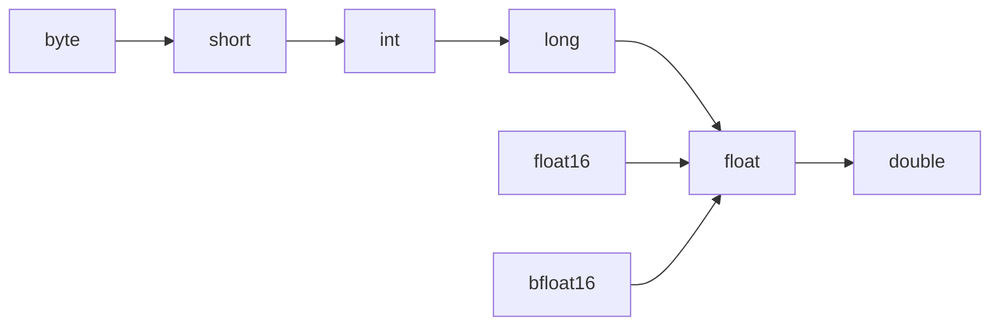
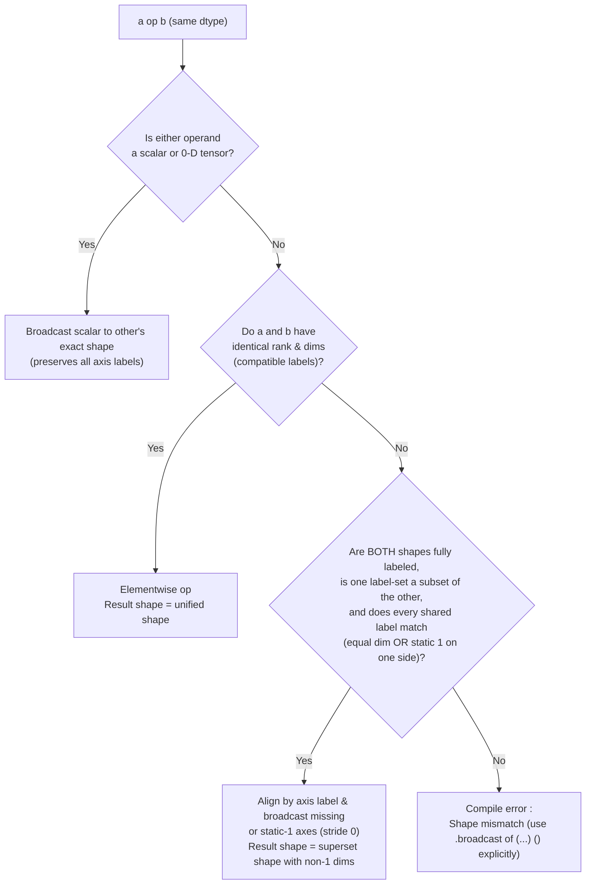
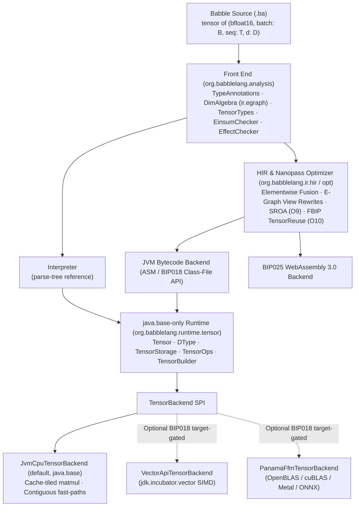

# BIP033: Tensors as core types with dimensional safety

| | |
|---|---|
| **BIP** | 033 |
| **Date** | 2026-11-25 |
| **Status** | Draft / Decided (`BIP033-D1`–`D13` settled; `BIP033-P1`–`P6` planned) |
| **Depends on** | Core scalar types & 8-primitive unboxing ([bip011_core-types.md](bip011_core-types.md), `RM005`), predicate-free single-bracket `()` grammar ([bip012_grammar-improvements.md](bip012_grammar-improvements.md), `RM006`), `for` loops & static factories ([bip013_iterators.md](bip013_iterators.md), `RM009`), ANTLR-free `HIR`, Nanopass optimizer, SSA `MIR`, `ScalarReplacePass` & `FbipReusePass` ([bip014_optimization-passes.md](bip014_optimization-passes.md), `BIP014-I0`–`I4`), pure-by-default effects, `unique`/`frozen` ownership & HOF `calling f` forwarding ([bip007_effects.md](bip007_effects.md), [bip016_consolidating-effect-annotations.md](bip016_consolidating-effect-annotations.md), [bip017_higher-order-function-effects.md](bip017_higher-order-function-effects.md)), structured axioms ([bip019_refactoring-axioms.md](bip019_refactoring-axioms.md), [bip030_axiom-nullability-and-inferred-effects.md](bip030_axiom-nullability-and-inferred-effects.md)), `array of T` ([bip020_array-types.md](bip020_array-types.md)), generic functions, bounds & overloads ([bip021_optional-variadic-overloaded-arguments.md](bip021_optional-variadic-overloaded-arguments.md)), intersection types ([bip022_intersection-types.md](bip022_intersection-types.md)), type aliases ([bip023_type-aliases.md](bip023_type-aliases.md)), WebAssembly 3.0 backend ([bip025_compile-to-wasm.md](bip025_compile-to-wasm.md), `RM018`), shared `org.babblelang.ir.egraph` core & modular analysis ([bip027_tackling-complexity-in-the-compiler.md](bip027_tackling-complexity-in-the-compiler.md)), exception handling ([bip028_exception-handling.md](bip028_exception-handling.md)), `.batest.md` v2 differential & HIR/MIR/wat golden testing ([bip029_batest-v2-and-ir-goldens.md](bip029_batest-v2-and-ir-goldens.md)), immutable `def` & mutable `var` bindings ([bip034_immutable-def-and-mutable-var.md](bip034_immutable-def-and-mutable-var.md)); coordinates with multi-JDK SIMD/FFM ([bip018_tracking-java-improvements.md](bip018_tracking-java-improvements.md)) |
| **Scope** | Promoting `float16` and `bfloat16` to core scalar types across the language (expanding Babble from 9 to 11 core scalars); adding immutable, dimensionally-safe `tensor of (DType, ...)` core types with positional shapes, static integer constants, symbolic `dim` variables (usable as read-only `int` values in expressions), rank-polymorphic `...Shape` spreads, dynamic `dyn`/`...dyn`, optional nominal axis labels, and E-graph-backed algebraic dimension expressions (`+`, `-`, `*`, `/`, `==`); scalar and labeled-subset broadcasting; `matmul`, `matmulAccum`, `dot`, and compile-time checked `einsum`/`contract`; strict linear `unique` ownership on immutable tensors for `BIP014-I4` FBIP in-place buffer reuse; a `java.base`-only strided runtime behind a pluggable `TensorBackend` SPI; `HIR`/optimizer lowering (fusion, algebraic view rewrites, SROA, FBIP); and functional autograd readiness |

---

## 1. Summary & Motivation

### 1.1 Why tensors as core types in Babble

Machine learning and deep-learning workloads suffer from a notorious class of bugs that ordinary static type systems do not catch:

1. **Silent shape mismatches and axis swaps.** Multiplying `(B, T, D)` by `(F, D)` instead of `(D, F)` only fails at runtime — and swapping two axes that happen to have the same numeric length (e.g., `Batch = 32` and `Heads = 32`, `SeqQ = 512` and `SeqK = 512`, or `Height = 224` and `Width = 224`) does not even fail at runtime; it silently trains garbage.
2. **Silent broadcasting bugs.** In NumPy and PyTorch, adding a `(B, 1)` tensor to a `(B,)` tensor silently outer-broadcasts to `(B, B)`, turning a missing `.squeeze()` into an `O(B^2)` memory explosion and a wrong gradient.
3. **Aliasing and in-place mutation hazards.** Mutable tensors with zero-copy strided views (`transpose`, `slice`, `reshape`) create subtle aliasing bugs and invalidate values saved for backpropagation.
4. **Silent precision blowups.** In mixed-precision training (`bfloat16` / `float16` activations with `float` master weights), accidentally adding a `float` scalar or mismatched tensor silently upcasts gigabytes of activations to `float32`.
5. **Library-level shape typing hits a ceiling.** Plain generics (`array of (array of float)`) cannot check matrix multiplication dimensions, track `concat` (`T1 + T2`) or causal slicing (`T - 1`), enforce head-splitting (`D == H * K`), validate `einsum` subscripts at compile time, or fuse elementwise pipelines without intermediate allocations.

Babble is unusually well-positioned to solve all five cleanly because of capabilities that have already landed:

* **Pure-by-default effects & `unique` ownership (`BIP007`, `BIP016`, `BIP017`)** enable immutable, alias-free tensor values whose backing buffers are still safely reused in place when uniquely owned (`BIP014-I4` `FbipReusePass`).
* **Zero-dependency `org.babblelang.ir.egraph` (`BIP027-I2`)** already lives in the compiler and can power deterministic algebraic dimension equivalence (`H + 2 * 1 - 3 + 1 == H`, `D == H * K`) without pulling in an external SMT solver.
* **ANTLR-free `HIR` & Nanopass optimizer (`BIP014-I1`–`I4`)** provide a clean place for elementwise loop fusion, view simplification, small-tensor SROA (`O9`), and future functional source-to-source automatic differentiation.
* **`BIP011` / `BIP020` core types & `BIP023` type aliases** establish the exact `of`-generic, predicate-free `SLL`, `java.base`-only runtime idiom that `tensor`, `float16`, and `bfloat16` extend.

### 1.2 A taste of dimensionally-safe ML in Babble

```babble
;; Reusable aliases (BIP023)
def Vec of (T, N: dim) = type tensor of (T, N)
def Mat of (T, M: dim, N: dim) = type tensor of (T, M, N)

;; Rank-polymorphic linear layer: works on (D), (B, D), (B, T, D), (B, H, T, D)
def linear of (Batch: shape, In: dim, Out: dim) = fn (
    x: tensor of (bfloat16, ...Batch, In),
    w: tensor of (bfloat16, In, Out),
    b: tensor of (bfloat16, Out)
): tensor of (bfloat16, ...Batch, Out) -> (
    x.matmul(w) + b.broadcast of (...Batch, Out) ()
)

;; Multi-head causal self-attention with nominal axis labels & algebraic dim constraint
def selfAttention of (B: dim, T: dim, H: dim, K: dim, D: dim == H * K) = fn (
    x: tensor of (bfloat16, batch: B, seq: T, d: D),
    wq: tensor of (bfloat16, d: D, proj: D),
    wk: tensor of (bfloat16, d: D, proj: D),
    wv: tensor of (bfloat16, d: D, proj: D),
    wo: tensor of (bfloat16, proj: D, d: D),
    causalMask: tensor of (bfloat16, seqQ: T, seqK: T)
): tensor of (bfloat16, batch: B, seq: T, d: D) -> (
    def q = x.matmul(wq).reshape of (batch: B, seqQ: T, heads: H, headDim: K) ()
    def k = x.matmul(wk).reshape of (batch: B, seqK: T, heads: H, headDim: K) ()
    def v = x.matmul(wv).reshape of (batch: B, seqK: T, heads: H, headDim: K) ()

    ;; Compile-time checked einsum; scores : tensor of (bfloat16, batch: B, heads: H, seqQ: T, seqK: T)
    ;; K is an in-scope dim parameter, readable as a read-only int in value expressions
    def scale = bfloat16(1.0 / java.lang.Math.sqrt(double(K)))
    def scores = tensor.einsum("bqhd,bkhd->bhqk", q, k) * scale

    ;; Labeled-subset implicit broadcast: (seqQ: T, seqK: T) broadcasts into (batch: B, heads: H, seqQ: T, seqK: T)
    def masked = scores + causalMask

    ;; Softmax over "seqK" (in float32 for numerical stability; labeled-subset broadcast needs no keepDims)
    def logits = masked.cast of float ()
    def shifted = logits - logits.max(axis: "seqK")
    def exps = shifted.exp()
    def probs = (exps / exps.sum(axis: "seqK")).cast of bfloat16 ()

    ;; Context contraction & head merge back to D == H * K (wo's inner label `proj: D` checked statically!)
    def ctx = tensor.einsum("bhqk,bkhd->bqhd", probs, v)
    ctx.reshape of (batch: B, seq: T, proj: D) ().matmul(wo)
)

;; Dynamic runtime batch bridged cleanly into static symbolic dims
def inferBatch = fn (
    raw: tensor of (bfloat16, dyn, dyn, 768),
    wq: tensor of (bfloat16, d: 768, proj: 768),
    wk: tensor of (bfloat16, d: 768, proj: 768),
    wv: tensor of (bfloat16, d: 768, proj: 768),
    wo: tensor of (bfloat16, proj: 768, d: 768)
): tensor of (bfloat16, dyn, dyn, 768) -> (
    raw.withDims(fn of (B: dim, T: dim) (x: tensor of (bfloat16, B, T, 768)) -> (
        def labeled = x.relabel of (batch: B, seq: T, d: 768) ()
        def mask = (tensor of (bfloat16, seqQ: T, seqK: T)).zeros()
        selfAttention of (B, T, 12, 64, 768) (labeled, wq, wk, wv, wo, mask)
    ))
)

;; In-place SGD weight update via BIP016 unique + BIP014-I4 FBIP reuse (zero array copy!)
def sgdStep of (S: shape) = fn (
    unique w: tensor of (float, ...S),
    grad: tensor of (float, ...S),
    lr: float
): unique tensor of (float, ...S) -> (
    move(w) - lr * grad
)
```

### 1.3 Goals and non-goals

**Goals:**

* Catch rank mismatches, dimension mismatches, axis-swap bugs, invalid `reshape`/`slice`/`concat`/`einsum` shapes, silent unlabeled outer-broadcasting, and accidental mixed-precision upcasts **at compile time**.
* Promote `float16` and `bfloat16` to first-class core scalar types across Babble alongside dense `tensor` support.
* Keep Babble's grammar 100% predicate-free, zero `@parser::members`, single-bracket `()`, pure `PredictionMode.SLL`, and zero-breakage on the existing test corpus.
* Preserve Babble's `java.base`-only runtime boundary (`RuntimeBoundaryTestCase`) and deterministic multi-mode parity (`Interpreter`, `-O0`, `-O1`, `-O2`, and `BIP025` WebAssembly 3.0), while exposing a clean internal `TensorBackend` SPI for optional SIMD/FFM/GPU acceleration (`BIP018`).
* Pair immutable tensor value semantics with strict linear `unique` tracking (`BIP016`) and `BIP014-I4` FBIP reuse so pure functional ML code runs without redundant copies.

**Non-goals (explicitly deferred to follow-on BIPs):**

* **Automatic differentiation (`grad`, `valueAndGrad`, `vjp`, `jvp`):** lives in a dedicated follow-up BIP (`BIP033-D13`); this proposal guarantees the core `Tensor` representation and `HIR` nodes are AD-ready with zero mutable `.grad` baggage.
* **High-level neural network library (`std/nn`):** activations (`relu`, `gelu`, `softmax`), normalizations (`layerNorm`, `rmsNorm`), layers (`Conv2d`, `MultiHeadAttention`), losses, and optimizers (`AdamW`) live in `std/nn` on top of BIP033's core primitives (`BIP033-D10`).
* **Sub-byte / quantized packed storage dtypes (`uint8`, `int4`, `fp8`) and sparse/ragged tensors:** deferred as clean extensions once the core dense tensor model lands (§11).
* **Static device placement types (`on gpu`):** execution placement stays inside the `TensorBackend` SPI, not in static tensor types (`BIP033-D11`).
* **General inequality / Presburger SMT proving (`0 <= i < N`):** index bounds and non-constant slice validity remain runtime checks (§5.2).

---

## 2. Settled Design Decisions

| ID | Topic | Decision |
|---|---|---|
| **`BIP033-D1`** | Target workload | **ML & deep-learning first:** optimize core tensor semantics, dtypes, broadcasting, contractions, and optimization/autograd hooks around neural-network workloads (while naturally serving general numerical/linear-algebra code). |
| **`BIP033-D2`** | Dimensional-safety paradigm | **Positional shapes with static constants, symbolic `dim` vars, dynamic `dyn`/`...dyn`, rank-polymorphic `...Shape` prefixes, and optional nominal axis labels:** axis order is explicit (matching memory layout and `matmul`), symbolic vars and labels prevent accidental swaps even on equal numeric sizes, and named contractions/broadcasts build directly on top. |
| **`BIP033-D3`** | Dimension arithmetic & solver | **Algebraic dimension expressions (`+`, `-`, `*`, `/`) with deterministic canonicalization + E-graph equality saturation** (reusing `org.babblelang.ir.egraph`, `BIP027-I2`) and explicit equality constraints (`D == H * K`, `M * N == P * Q`). Zero external SMT dependencies; covers `concat`, slicing, head splitting/flattening, and conv/pool output formulas. |
| **`BIP033-D4`** | Dynamic dimensions & bridging | **Strict one-way subtyping + explicit narrowing + existential capture / `withDims`:** static dims widen to `dyn` (fixed rank widens to `...dyn`); `dyn` never silently narrows to a static dim (compile error; requires `is`/`as` or `withDims`). Unconstrained single-occurrence fresh `dim` params may capture `dyn` at call sites (widening escaping dims back to `dyn`), while multi-tensor equality (`B` shared across `q` and `k`) requires explicit `withDims` + `as`/`is`. `TypeAlgebra` remains 100% type-level (zero value-dependent local bindings). |
| **`BIP033-D5`** | Grammar & surface syntax | **Flat core keyword syntax in Babble's single-bracket `()` pure-`SLL` grammar:** `tensor of (float, B, T, D)`, `tensor of float` (0-D), `tensor of (float, batch: B, seq: T)`, `tensor of (float, ...Batch, In)`, `tensor of (float, dyn, 768)`, kinded params `of (Batch: shape, B: dim, D: dim == H * K)`, and `of (...)` for shape/type-transforming methods (`reshape of (...) ()`, `broadcast of (...) ()`, `relabel of (...) ()`, `cast of U ()`). Only `tensor`, `float16`, `bfloat16` are new reserved lexer tokens (`memberName`-exempted); `dim`, `shape`, `dyn` stay contextual identifiers (zero breakage on existing corpus). Zero new operator tokens (no `@`). |
| **`BIP033-D6`** | Optional nominal axis labels | **Directional + label-preserving generics:** distinct labels never match (`h: 224 != w: 224`); labeled axes widen to unlabeled parameters, and polymorphic `dim`/`shape` vars (`...S`, `N`) preserve captured labels into return types; unlabeled axes require explicit `.relabel of (...) ()` (or `as`/factory) to enter a labeled parameter. |
| **`BIP033-D7`** | Element dtypes & `float16`/`bfloat16` scalars | **Promote `float16` and `bfloat16` to full core scalar types** across Babble (expanding core scalars from 9 to 11; unboxed `short` carrier, `Float16`/`BFloat16 extends Number` wrappers, contextual literals + `f16`/`bf16` suffixes). Valid tensor dtypes are the 9 non-null dense primitives `{byte, short, int, long, float16, bfloat16, float, double, bool}`. Scalar widening forms a DAG `float16 -> float -> double` and `bfloat16 -> float -> double` (never between `float16` and `bfloat16`); **tensor-tensor ops require identical dtypes** (explicit `.cast of U ()`), while numeric literals and matching scalars contextually adapt to the tensor's dtype. |
| **`BIP033-D8`** | Mutability, views & ownership | **Immutable value semantics by default** (like `string`/`record`/JAX): value `==`/`!=`, `frozen tensor` simplifies to `tensor`, zero-copy strided views (`slice`, `transpose`, `reshape`, `broadcast`, `unfold`, `relabel`) are always `pure deterministic` and alias-safe, while `EffectChecker` still tracks strict linear `unique`/`MOVED` ownership on tensors so `BIP014-I4` FBIP (`O10`) safely reuses contiguous non-view buffers in place, paired with `.fromUnique(move(arr))` and `.builder()` for zero-copy imperative construction. |
| **`BIP033-D9`** | Operators, broadcasting & contractions | **Elementwise `+`, `-`, `*`, `/` + unary `-`** (plus `+=`/`-=`/`*=`/`/=` on `BIP034` `var` bindings); `==`/`!=` are scalar `bool` value equality; elementwise `.eq`/`.lt`/`.gt`/`.le`/`.ge` return `tensor of (bool, ...)`. **Scalar + labeled-subset implicit broadcast** (including same-label static `1` expansion on fully labeled shapes, e.g., `seqK: 1` → `seqK: T`), while unlabeled rank/size-1 mismatches require explicit `.broadcast of (...) ()`. Method-based `x.matmul(w)`, `x.matmulAccum of Acc (w)`, `.dot(w)`, and compile-time checked `tensor.einsum(...)` / `tensor.contract(...)`. |
| **`BIP033-D10`** | Core primitives vs. `std/nn` | **Minimal, complete core primitive set on `tensor`** (factories, structural views including `unfold`/`relabel`, elementwise math/comparisons, reductions, `matmul`, `matmulAccum`, `dot`, `einsum`, `contract`, `gather`, `where`, `cast`, `withDims`, `for` iteration); high-level ML ops (`relu`, `gelu`, `softmax`, `layerNorm`, `conv2d`, `attention`, losses, optimizers) live in Babble `std/nn` with optional `TensorBackend` fast-paths. |
| **`BIP033-D11`** | Runtime storage & `TensorBackend` SPI | **Pure `java.base`-only strided primitive-array baseline** (`Tensor`, `TensorStorage`, `TensorShapeException`, `JvmCpuTensorBackend`) guaranteeing 100% parity across `Interpreter`, `-O0`/`-O1`/`-O2`, `babblec`, and `BIP025` Wasm, behind an internal `TensorBackend` SPI so target-gated accelerators (`BIP018` Vector API SIMD, Panama FFM BLAS/GPU) plug in cleanly without static device types. |
| **`BIP033-D12`** | Execution & optimization model | **Eager execution semantics everywhere** (identical across modes, exact error lines), paired with `BIP014` HIR/MIR compile-time elementwise loop fusion, E-graph tensor view simplification, static shape-check elimination, small fixed-shape SROA (`O9`), and `BIP014-I4` FBIP buffer reuse (`O10`). |
| **`BIP033-D13`** | Automatic differentiation | **Dedicated follow-up BIP:** zero mutable `.grad` / `requiresGrad` fields on core `Tensor`; immutable pure tensors and structured `HIR` tensor nodes are designed upfront for clean functional JAX-style AD (`grad`, `valueAndGrad`, `vjp`, `jvp`). |

---

## 3. New Core Scalar Types: `float16` and `bfloat16` (`BIP033-D7`)

ML training and inference rely heavily on 16-bit floating-point formats: IEEE-754 binary16 (`float16`, high 10-bit precision for inference/graphics) and Google Brain float16 (`bfloat16`, full `float32` exponent range for stable deep-learning training). Promoting both to full core scalar types expands Babble's scalar roster from 9 (`BIP011`) to 11 (`byte`, `short`, `int`, `long`, `float16`, `bfloat16`, `float`, `double`, `bool`, `char`, `string`), making scalar math, tensor element extraction (`t.get(...)`), constants, and user-defined ML helpers completely uniform.

### 3.1 Bit formats and exact arithmetic

| Type | Format | Sign / Exp / Mantissa | Range | JDK 21 `java.base` Conversion |
|---|---|---|---|---|
| `float16` | IEEE-754 binary16 | 1 / 5 / 10 | $\pm 65504$, min normal $6.10 \times 10^{-5}$ | `Float.float16ToFloat(short)` / `Float.floatToFloat16(float)` (hardware F16C/FP16 intrinsics on JDK 21+) |
| `bfloat16` | Brain float16 | 1 / 8 / 7 | $\pm 3.39 \times 10^{38}$ (matches `float`) | `Float.intBitsToFloat((bits & 0xFFFF) << 16)` and round-to-nearest-even bit-twiddle preserving quiet NaN |

**Exact single-rounding arithmetic property:** For both `float16` (11-bit significand) and `bfloat16` (8-bit significand), binary32 (`float`, 24-bit significand) satisfies $24 > 2p + 1$ ($24 > 23$ and $24 > 17$). Consequently, widening both operands to `float`, computing `+`, `-`, `*`, `/`, or `sqrt` in `float`, and rounding back once to `float16` / `bfloat16` produces the **bit-exact** IEEE-754 / bfloat16 rounded result with zero double-rounding error across every hardware platform (`Interpreter`, JVM bytecode, and Wasm).

### 3.2 Literals, conversions, and numeric promotion DAG

* **Suffix literals:** `1.5f16` / `1.5F16` (`FLOAT16_LIT`) and `1.5bf16` / `1.5BF16` (`BFLOAT16_LIT`), placed ahead of `FLOAT_LIT` and `DOUBLE_LIT` in `Babble.g4` so longest-match lexing resolves them unambiguously with zero predicates.
* **Contextual numeric literals (`BIP011-D3`):** Just as `def b: byte = 10` adapts integer literals to `byte`, `def x: bfloat16 = 1.5`, `def y: float16 = 0`, and `t * 0.5` (where `t: tensor of (bfloat16, ...)`) adapt numeric literals directly to `bfloat16` / `float16` at compile time, reporting an overflow error if a constant literal exceeds `float16`'s finite range ($\pm 65504$).
* **Explicit conversions (`BIP011-D3`):** `float16(x)` and `bfloat16(x)` join `byte(x)`..`string(x)` in `builtins.ba`, accepting any numeric scalar (`byte | short | int | long | float16 | bfloat16 | float | double | java.lang.Number`) or decimal `string` (`pure`, `nothrow` for numeric inputs). Existing scalar conversion axioms in `builtins.ba` (`byte`, `short`, `long`, `float`) add `float16 | bfloat16` to their parameter unions.
* **Scalar widening DAG:** Extends `BIP011-D4`'s linear chain into a small join-semilattice with `float` as the least upper bound of both 16-bit formats:



  * `float16` and `bfloat16` **never implicitly convert to each other** (neither is a precision/range superset of the other; `float16(x)` or `bfloat16(x)` must be written explicitly).
  * Binary arithmetic between `float16` and `float16` yields `float16`; between `bfloat16` and `bfloat16` yields `bfloat16`; between `float16` and `bfloat16` is a **type error** (`Cannot mix float16 and bfloat16 : convert explicitly`); between either 16-bit float and `float`/`double` widens to `float`/`double` (and with `byte`/`short`/`int`/`long` widens to `float`, preserving integer precision rather than silently losing bits in `bfloat16`'s 7-bit mantissa).
  * In `org.babblelang.analysis.PrimitiveKind`, binary promotion replaces the linear `numericRank()` lookup with `PrimitiveKind.binaryPromote(PrimitiveKind a, PrimitiveKind b)` reflecting this DAG directly.
* **Strict tensor mixed-dtype rule:** Unlike scalars, **tensor-tensor binary operations and contractions require identical element dtypes**:

```babble
def a: tensor of (bfloat16, 4, 8) = ...
def b: tensor of (float, 4, 8) = ...
;; a + b                       ;; Type error : tensor dtype mismatch (bfloat16 vs float ; use .cast of float ())
def c = a.cast of float () + b ;; OK : tensor of (float, 4, 8)
def d = a * 0.5                ;; OK : contextual literal 0.5 adapts to bfloat16 -> tensor of (bfloat16, 4, 8)
def s: bfloat16 = 2.0bf16
def e = a * s                  ;; OK : matching scalar -> tensor of (bfloat16, 4, 8)
```

### 3.3 JVM representation, `PrimitiveKind` & `Bootstrap` disambiguation

* **Boxed wrappers (`java.base` only):** `org.babblelang.runtime.Float16` and `org.babblelang.runtime.BFloat16` (`public final class ... extends Number implements Comparable<...>`) hold `private final short bits` and provide `fromBits(short)`, `rawBits()`, `floatValue()`, `doubleValue()`, and Babble total-order `==`/`compareTo` (`Float.compare` parity). Extending `java.lang.Number` integrates automatically with `Values.hash`, `Values.same` (`isPlain`), `Values.toDouble`, and `Values.isBuiltin` (`"float16"` / `"bfloat16"`), while remaining fully compatible with JEP 401 Valhalla value classes (`BIP018-P4`).
* **Unboxed storage (`RM001` / `BIP011-D13`):** `PrimitiveKind` gains `FLOAT16` and `BFLOAT16` (10 unboxed JVM kinds total), both carried unboxed in JVM `short` (`S`) locals, compiled class/record fields, direct/static/`$spec`/interface `bm$<name>$spec` calls, `SelfTailCall`s, and `Float16Cell` / `BFloat16Cell` closure cells in `org.babblelang.runtime`.
* **Disambiguating `short`, `float16`, and `bfloat16` across the `S` JVM descriptor:**
  * Because `short`, `float16`, and `bfloat16` all use JVM descriptor `S`, naive `MethodHandle.asType` conversion in `Bootstrap.TypedCallCache`'s generic fallback or `Bootstrap.SelectCache`'s field getter would box raw `short` bits into `java.lang.Short` instead of `Float16` / `BFloat16` (and fail unboxing with `ClassCastException`).
  * Therefore:
    1. **Direct static calls, interface `$spec` calls, `record` constructors/fields, locals, cells, and tail calls** know the exact `PrimitiveKind` at compile time and pass/store raw `short` (`S`) bits directly with zero boxing.
    2. **Compiled overload sets (`BIP021`)** that differentiate two `S`-carried kinds mangle `$spec` method names with kind tags (e.g., `$spec$f16`, `$spec$bf16`).
    3. **Dynamic `invokedynamic` call/select sites (`Bootstrap.typedCall`, `Bootstrap.select`):** when a higher-order `typedCall` site has any `FLOAT16` or `BFLOAT16` parameter or return, `CallEmitter` emits `Bootstrap.typedCallTagged` with a constant kind-tag string so `TypedCallCache`'s generic fallback boxes/unboxes through `Float16.fromBits`/`rawBits` and `BFloat16.fromBits`/`rawBits` (never `java.lang.Short`). Likewise, `ClassShape` records field `PrimitiveKind` so `SelectCache` wraps `FLOAT16`/`BFLOAT16` fields on dynamic reads.
* **E-graph & constant pool alignment (`BIP027-I2`):** `ENode.isFloating()` adds `FLOAT16` and `BFLOAT16`, and `ENode.literalHash` / `literalEquals` compare `Float16.rawBits()` / `BFloat16.rawBits()` to preserve `-0.0` vs. `+0.0` and NaN fidelity; `ENode.isReflexiveEq()` holds automatically via `kind.isPrimitive()`.
* **Arrays vs. tensors (`BIP020` alignment):** `array of short` is JVM `short[]`. To keep `is array of short` vs. `is array of float16` vs. `is array of bfloat16` runtime-exact without colliding on `[S`, `array of float16` erases to `Float16[]` and `array of bfloat16` erases to `BFloat16[]` (becoming flattened in Valhalla `BIP018-P4`), whereas `tensor of (float16, ...)` and `tensor of (bfloat16, ...)` store **dense unboxed `short[]`** inside `TensorStorage` tagged with `DType.FLOAT16` / `DType.BFLOAT16` — zero per-element boxing in tensors on JDK 21 today.

---

## 4. Grammar & Surface Syntax (`BIP033-D5`)

Babble's grammar invariants (`BIP012`) are non-negotiable: **zero `@parser::members`, zero semantic predicates, single bracket type `()`, and pure `PredictionMode.SLL`** across every `.ba` and `.batest.md` file (`ParserGrammarTestCase`).

### 4.1 Keyword budget and corpus compatibility

Scanning the entire repository (`src/test/babble/`, `src/test/batest/`, `examples/`, `src/main/java/org/babblelang/axioms/`) confirms that `dyn` is heavily used as a test helper (`def dyn = fn (v: any): any -> (v)`) and `shape` is used as a local variable (`src/test/babble/AnyAndCasts.ba`), whereas `tensor`, `float16`, and `bfloat16` have **zero** collisions.

Therefore:

* **Only 3 new reserved lexer tokens:** `TENSOR: 'tensor'`, `FLOAT16_KW: 'float16'`, `BFLOAT16_KW: 'bfloat16'` — all three exempted in `memberName` (so `.tensor`, `.float16`, `.bfloat16` remain valid member names). `FLOAT16_KW` and `BFLOAT16_KW` join `coreScalarKeyword` (automatically available in `coreTypeKeyword`, `axiomTarget`, and `# coreScalarRef`); `TENSOR` joins `coreCollectionKeyword` (automatically available in `coreTypeKeyword` and `# coreCollection`, where `CallSolver.applyTypes` dispatches `"tensor"` to `TensorTypes` for variable-arity `of` application).
* **Zero breakage from `dim`, `shape`, `dyn`:** `dim`, `shape`, and `dyn` are **NOT** reserved lexer keywords. They remain ordinary `ID` tokens recognized contextually by `TypeAnnotations` inside kind annotations (`B: dim`, `Batch: shape`) and `dimExpr` positions (`tensor of (float, dyn, 768)`, `...dyn`). Existing `def dyn = ...`, `def shape: Shape = ...`, `t.shape()`, and `t.dim(0)` work untouched.
* **Zero new operator tokens:** matrix multiplication uses `x.matmul(w)` (`BIP033-D9`); no `@` token is added.

### 4.2 Exact `Babble.g4` additions and `SLL` disjointness proof

```antlr
// 1. Core keywords (all exempted in memberName via coreTypeKeyword)
coreScalarKeyword: BYTE | SHORT | INT_KW | LONG_KW | FLOAT16_KW | BFLOAT16_KW
                 | FLOAT_KW | DOUBLE_KW | BOOL_KW | CHAR_KW | STRING_KW;

coreCollectionKeyword: LIST | SET | SORTEDSET | MAP | SORTEDMAP | ENTRY | ARRAY | TENSOR;

// 2. Half-precision float literals (placed BEFORE FLOAT_LIT and DOUBLE_LIT in lexer;
//    added alongside LONG_LIT / FLOAT_LIT / DOUBLE_LIT in `expression`)
FLOAT16_LIT: ([0-9]+ '.' [0-9]+ ([eE] [+-]? [0-9]+)? | [0-9]+ ([eE] [+-]? [0-9]+)) ('f16' | 'F16')
           | [0-9]+ ('f16' | 'F16');
BFLOAT16_LIT: ([0-9]+ '.' [0-9]+ ([eE] [+-]? [0-9]+)? | [0-9]+ ([eE] [+-]? [0-9]+)) ('bf16' | 'BF16')
            | [0-9]+ ('bf16' | 'BF16');

expression: ...
          | FLOAT16_LIT                                       # float16Literal
          | BFLOAT16_LIT                                      # bfloat16Literal
          ... ;

// 3. Kinded type parameters and algebraic dimension constraints
typeParam: ID (':' type ('==' NL* dimExpr)?)?                 # namedTypeParam
         | dimExpr '==' NL* dimExpr                           # dimConstraintParam
         ;

// 4. Unified type & dimension arguments (used in both types and `expression OF typeArguments`)
typeArguments: '(' NL* typeArg (NL* ',' NL* typeArg)* NL* ')'
             | nonParenNullableType
             | INT
             ;

typeArg: ELLIPSIS ID                                          # shapeSpreadArg
       | label=ID ':' NL* dimExpr                             # labeledDimArg
       | dimExprNonType                                       # dimExprArg
       | type                                                 # typeOrDimRefArg
       ;

// Full precedence-exact dim expressions (* and / tighter than + and -; NL* only after operators):
dimExpr: dimMul (op=('+' | '-') NL* dimMul)*;
dimMul:  dimAtom (op=('*' | '/') NL* dimAtom)*;
dimAtom: INT
       | ID
       | '(' NL* dimExpr NL* ')'
       ;

// Precedence-exact dim expressions GUARANTEED disjoint from `type`
// (every derived string contains at least one INT or one +, -, *, / operator):
dimExprNonType: dimMulNonType (op=('+' | '-') NL* dimMul)*
              | dimAtomId (op=('+' | '-') NL* dimMul)+
              ;

dimMulNonType:  dimAtomNonType (op=('*' | '/') NL* dimAtom)*
              | dimAtomId (op=('*' | '/') NL* dimAtom)+
              ;

dimAtomNonType: INT
              | '(' NL* dimExprNonType NL* ')'
              ;

dimAtomId:      ID
              | '(' NL* dimAtomId NL* ')'
              ;

// 5. nonParenNullableType uses `typeArg` inside `OF '(' ... ')'` (and `INT` for 1-dim generics)
nonParenNullableType: frozen=FROZEN? typeName
                      ( OF ( '(' NL* typeArg (NL* ',' NL* typeArg)* NL* ')' nullMod=('?' | '!')?
                           | nonParenNullableType
                           | INT nullMod=('?' | '!')? )
                      | nullMod=('?' | '!')? )                # simpleType
                    | ...
                    ;
```

**Formal `PredictionMode.SLL` disjointness proof:**

1. **`typeParam`:** `namedTypeParam` has `ID` followed by `:`, `,`, `)`, or `NL`, whereas `dimConstraintParam` either starts with `INT` / `(` or has `ID` followed by `+`, `-`, `*`, `/`, or `==` (`NL*` is permitted only *after* operators, never before, matching `Babble.g4`). The two alternatives are strictly LL(2)-disjoint. Thus `of (B: dim, H: dim, K: dim, D: dim == H * K)` and `of (M: dim, N: dim, P: dim, Q: dim, M * N == P * Q)` parse deterministically with zero `where` keyword.
2. **`typeArg`:** The four alternatives recognize strictly disjoint token languages:
   * `shapeSpreadArg` starts with `...` (`ELLIPSIS`), which never starts `type` or `dimExpr`.
   * `labeledDimArg` starts with `ID ':'`, which never starts `type` or `dimExpr` (`fn (...)` starts with `FN`).
   * `dimExprArg` (`dimExprNonType`): by structural induction, every string in $L(\text{dimExprNonType})$ contains at least one token in `{INT, '+', '-', '*', '/'}` and contains zero `OF` tokens; conversely, no `OF`-free string in $L(\text{type})$ contains any token in `{INT, '+', '-', '*', '/'}` (types use only `|` and `&`). Hence $L(\text{dimExprNonType}) \cap L(\text{type}) = \emptyset$. Within `dimExprNonType` and `dimMulNonType`, `dimAtomNonType` vs. `dimAtomId` are likewise disjoint, while preserving exact arithmetic precedence (`2 + 3 * N` parses as `2 + (3 * N)`, `A * B + C` as `(A * B) + C`, and `(H + 2 * P - K) / S + 1` as `((H + (2 * P) - K) / S) + 1`).
   * `typeOrDimRefArg` (`type`) parses all types AND bare `ID` / `(ID)` atoms (`B`, `dyn`, `float`), which `TypeAnnotations` classifies as `Type` vs. `DimExpr` using the target parameter's kind (`type` vs. `dim`).
3. **Uniform `of` application:** Because `nonParenNullableType` and `typeArguments` share `typeArg`, both type annotations (`Vec of (float, 3)`, `Mat of (bfloat16, H * K, Out)`, `Linear of (768, 3072)`, `SquareMatrix of 4`) and expression-level type/shape applications (`(tensor of (float, B, T + 1)).zeros()`, `x.reshape of (batch: B, seq: T, d: D) ()`, `b.broadcast of (...Batch, Out) ()`, `x.relabel of (batch: B, seq: T, d: 768) ()`, `masked.cast of float ()`, `makeCausalMask of 64 ()`) parse through one unified rule with zero expression-grammar hacks.

### 4.3 Formatting and REPL `classify`

* **Formatter:** `tensor of (float, B, T, D)`, `tensor of (float, batch: B, seq: T + 1)`, `tensor of (float, ...Batch, In)`, `of (B: dim, H: dim, K: dim, D: dim == H * K)`, `x.reshape of (batch: B, seq: T) ()`, `masked.cast of float ()` — single space around `of`, binary dim ops (`+`, `-`, `*`, `/`, `==`), and after `:` and `,`; no space between `...` and `Batch`.
* **REPL `classify`:** No new unmatched delimiters are introduced (`()` only), so `BabbleSession.classify` works unchanged.

---

## 5. Dimensional Type System & Algebraic Solver (`BIP033-D2`, `D3`, `D4`, `D6`)

All dimensional type structures live in `org.babblelang.analysis` (ANTLR-free, respecting `BIP027-D3` and the 2,000-LOC ceiling of `BIP027-D9` via dedicated collaborators `DimAlgebra`, `TensorTypes`, and `EinsumChecker`).

### 5.1 Type representation

```java
// Inside org.babblelang.analysis (ANTLR-free):
record Tensor(Type element, Shape shape) implements Type { ... }
record CoreTensor(Type element, Shape shape) implements Type { ... } // `tensor of (...)` factory value

record Shape(List<ShapeItem> items) { ... }

sealed interface ShapeItem {
    record Axis(String label /* nullable */, DimExpr dim) implements ShapeItem {}
    record Spread(ShapeVar var /* null means ...dyn */) implements ShapeItem {}
}

record DimVar(Type.SymbolId owner, String name, int index) {}
record ShapeVar(Type.SymbolId owner, String name, int index) {}
record DimConstraint(DimExpr left, DimExpr right) {}

sealed interface DimExpr {
    record Const(long value) implements DimExpr {}          // >= 0
    record Var(DimVar var) implements DimExpr {}            // symbolic dim parameter
    record Dyn() implements DimExpr {}                      // runtime-known single axis
    record Add(DimExpr left, DimExpr right) implements DimExpr {}
    record Sub(DimExpr left, DimExpr right) implements DimExpr {}
    record Mul(DimExpr left, DimExpr right) implements DimExpr {}
    record Div(DimExpr left, DimExpr right) implements DimExpr {}  // floor-div for conv/pool
}
```

* **`Type.Tensor` validity rules:**
  * `element` must be one of the 9 tensor dtypes (`byte`, `short`, `int`, `long`, `float16`, `bfloat16`, `float`, `double`, `bool`) or an in-scope `TypeVar` (rejected at instantiation if bound to a non-dtype such as `string`, `char`, `T?`, or a class).
  * Bare `tensor` without `of` in a type annotation is rejected (`tensor requires at least a dtype argument : tensor of (T, ...)`).
  * At most one `Spread` (`...Batch` or `...dyn`) may appear in a single `Shape` (prevents ambiguous split unification such as `(...A, ...B)` matching `(3, 4, 5)`).
  * Duplicate non-null axis labels in the same `Shape` are a **compile error** (`Duplicate axis label in tensor shape : seq`).
  * Constant dim expressions evaluating to `< 0` (e.g., `2 - 5`) are a compile error (`Negative tensor dimension : -3`); `0` is allowed for empty tensors. Constant division by zero (e.g., `N / 0`) is a compile error (`Division by zero in tensor dimension`).
  * `Type.Frozen(Type.Tensor(...))` simplifies directly to `Type.Tensor(...)` (`BIP033-D8`, `BIP007-D7`).
  * **Intersections (`BIP022`):** `tensor of ...` is a concrete final value type (not an interface), so it cannot be an operand of `&` (`Only interfaces intersect`).

### 5.2 Algebraic dimension canonicalizer & E-graph solver (`BIP033-D3`)

Dimension equivalence (`d1 == d2`) is checked by a deterministic two-layer solver in `DimAlgebra` with **zero external dependencies**:

1. **Polynomial + rational/floor-div normal form (fast path, covers >95% of checks in nanoseconds):**
   * Every `Add`/`Sub`/`Mul` expression expands and flattens into a canonical sorted sum-of-monomials $\sum_i c_i \prod_j v_{ij}^{e_{ij}} + c_0$ with integer coefficients (`long`, checked for overflow).
   * Constant-fold identities simplify immediately: `x + 0 -> x`, `x - x -> 0`, `x * 1 -> x`, `x * 0 -> 0`, `(a * b) / a -> b` (when $a$ is a positive constant or positive-constrained dim), `(x + c * k) / k -> x / k + c` (for constant $k > 0$), and constant `Div(a, b) -> Math.floorDiv(a, b)`.
   * Example (ResNet same-padding Conv2d): `((H + 2 * 1 - 3) / 1) + 1` normalizes directly to `H`.
   * Example (concat & slice): `(T - 1) + 1` normalizes to `T`; `A + B` equals `B + A`; `(H * K) * B` equals `B * H * K`.
2. **Scoped E-graph equality saturation (`org.babblelang.ir.egraph`, `BIP027-I2`):**
   * When a function, class, or record declares explicit equality constraints — e.g., `of (B: dim, T: dim, H: dim, K: dim, D: dim == H * K)` or `of (M: dim, N: dim, P: dim, Q: dim, M * N == P * Q)` — `DimAlgebra` seeds a small bounded `org.babblelang.ir.egraph.EGraph` (`PrimitiveKind.LONG` `CONST`/`OPAQUE`/`ADD`/`SUB`/`MUL`/`DIV` nodes with a dedicated non-negative dim rewrite rule set, separate from `AlgebraicRules.hirRules()`) with those equalities plus ring/div rewrite rules (`commutativity`, `associativity`, `distributivity`, cancellation) and checks `egraph.areEquivalent(id1, id2)`.
   * Bounds: hard saturation cap (e.g., 512 e-nodes / 8 iterations) guarantees microsecond termination on every input.
   * For `x.reshape of (...) ()`, `DimAlgebra` computes the product of all static dims on both sides and checks `prod(oldShape) == prod(newShape)` in the scoped E-graph (if either side contains `dyn` or `...dyn`, the compiler emits a single runtime element-count / divisibility check).
3. **Unification in `CallSolver`:**
   * Structural matching solves `Var = d` directly.
   * Linear/monomial matching handles common ML splits such as matching `tensor of (float, 768)` against `tensor of (float, H * 64)` → solves `H = 12` (exact integer division; rejects if non-divisible).
   * Matching `(...Batch, In)` against `(B, T, 768)` aligns from the right (suffix `In = 768`, prefix `Batch = (B, T)`); prefix-spread + suffix-axis matching is unique because at most one `Spread` is allowed per `Shape`.
   * Side constraints (`D == H * K`) are verified at every call site once type/dim arguments are solved (`Dimension constraint failed : expected D == H * K, got 768 == 12 * 32`).

### 5.3 Optional nominal axis labels (`BIP033-D6`)

Nominal axis labels give NamedTensor-level protection against axis swaps while keeping positional layout explicit:

| Source axis | Target axis | Static relation |
|---|---|---|
| `batch: B` | `batch: B` | **Exact match** |
| `batch: B` | `seq: B` | **Compile error** (`Axis label mismatch : expected seq, got batch`) — even if `B` is the same constant `32`! |
| `batch: B` | `B` (unlabeled) | **Allowed** (covariant label erasure when passing to concrete unlabeled param; **label-preserving** when bound to a polymorphic `dim` or `shape` var!) |
| `B` (unlabeled) | `batch: B` | **Compile error** (`Missing axis label : expected batch: B, got unlabeled B — use .relabel of (...) ()`) |

**Label preservation through generics:** When `def relu of (T, S: shape) = fn (x: tensor of (T, ...S)): tensor of (T, ...S)` is called with `tensor of (float, batch: B, seq: T, d: 768)`, `S` captures `(batch: B, seq: T, d: 768)` *with its labels*, so the return type is `tensor of (float, batch: B, seq: T, d: 768)`. Similarly, `def linear of (Batch: shape, In: dim, Out: dim)` preserves all labels inside `Batch`. Explicit `x.relabel of (batch: B, seq: T, d: 768) ()` (zero-copy, pure `nothrow`, compile-time no-op at runtime!) attaches, renames, or strips labels (`x.relabel of (B, T, 768) ()`).

### 5.4 Dynamic dimensions, narrowing, overloads & existential bridging (`BIP033-D4`)

Because `tensor` is immutable (`BIP033-D8`), shape widening is sound in **all** positions (fields, returns, parameters, collections):

* **One-way subtyping:**
  * For every static `DimExpr d`, `d <: dyn` (and `label: d <: label: dyn <: dyn`).
  * Any fixed-rank `Shape` (and any `Shape` with `...Batch`) is a subtype of `(...dyn)`.
  * **`dyn` is NEVER a subtype of any static constant `768` or in-scope symbolic `B`.** Passing `tensor of (float, dyn, 768)` to `fn (x: tensor of (float, 32, 768))` is a compile error (`Dimension mismatch : expected 32, got dyn — narrow with 'is' or 'as'`).
* **Runtime narrowing (`is` and `as`) and `BIP020-D9` unchecked-cast parity:**
  * `x is tensor of (float, 32, 768)` checks runtime dtype, rank (`== 2`), and exact dimensions (`shape[0] == 32 && shape[1] == 768`), narrowing `x` flow-sensitively in the `then` branch (`Narrowing`) with **zero** unchecked warning.
  * `x as tensor of (float, B, dyn, 768)` checks runtime dtype, rank (`== 3`), `shape[0] == B` (using the reified runtime `int` value of in-scope `B`, §8.3), and `shape[2] == 768`, throwing `TensorShapeException` (a subclass of `BabbleException`, catchable via `catch e: exception` per `BIP028-D2`) on mismatch.
  * Because axis labels are erased at runtime (zero runtime overhead), `x is tensor of (float, batch: 32, d: 768)` and `x as tensor of (float, batch: 32, d: 768)` check dtype, rank, and numeric dims at runtime and emit an `Unchecked cast` warning for the erased labels (matching `BIP020-D9` for erased array nullness/generics), unless `x`'s static type already carries those labels; prefer narrowing unlabeled `x as tensor of (float, B, 768)` followed by `.relabel of (batch: B, d: 768) ()` for warning-free code.
* **Overload sets (`BIP021-D10`, `D11`):**
  * Tensors with differing dtypes, ranks, or statically unequal concrete dims (`(float, 3, 4)` vs. `(float, 4, 3)`) are statically disjoint; `(float, dyn, 4)` overlaps `(float, 3, 4)`.
  * Runtime union splits (`BIP021-D11`) distinguish tensors by dtype, rank, and concrete numeric dims, never by erased axis labels.
* **Call-site existential capture (ergonomic single-tensor path):**
  * When calling `f of (B: dim, T: dim)` with `raw: tensor of (float, dyn, dyn, 768)`, if `B` and `T` are each bound by **a single `dyn` argument position** and appear in **no unchecked multi-argument equality constraint**, `CallSolver` binds fresh existential dims `B#1`, `T#1` for the call (passing `raw.dim(0)` and `raw.dim(1)` as runtime dim arguments), and widens any occurrence of `B#1` / `T#1` in the return type back to `dyn`.
  * If **two** `dyn` positions both bind the **same** dim variable `B` (e.g., `crossAttention(rawQ, rawK)` where both `q` and `k` have `dyn` batch), call-site capture is **rejected** (`Cannot unify distinct dyn dimensions for dim B : unpack with .withDims(...) and narrow with 'as'`)!
* **Scoped `withDims` combinator (zero-allocation multi-tensor path):**
  * `raw.withDims(fn of (B: dim, T: dim) (t: tensor of (float, B, T, 768)) -> ( ... ))` binds fresh symbolic `dim` variables to `raw`'s runtime `dyn` positions inside the callback scope, forwarding callback effects via `BIP017` `calling f` (so `withDims` is `pure` when the callback is `pure`, and `-O1` `InlinePass` inlines the `borrow` lambda to zero allocation!).
  * Any symbolic dim introduced by `withDims` that would escape the callback's return type widens cleanly back to `dyn`.
* **Runtime-checked dynamic ops:** When both operands of `+`, `matmul`, `concat`, etc. have `dyn` on a checked axis (e.g., `tensor of (float, dyn, dyn).matmul(tensor of (float, dyn, dyn))`), the operation compiles cleanly and emits a runtime shape check throwing `TensorShapeException` on mismatch.

### 5.5 In-scope `dim` parameters as read-only `int` expressions

In ML code, functions frequently need the numeric value of a symbolic `dim` parameter inside expressions (e.g., `double(K)` for attention scaling $1/\sqrt{K}$, `T - 1` for causal slicing, or `tensor.arange(0, T)`):

* Every in-scope `dim` parameter `K` is bound in `BlockScopes` / `Resolver` as a **read-only `int` value** in expression positions (as well as a `DimVar` in type/dim positions).
* Reassigning a `dim` parameter (`K = 4`) is a compile error (`Cannot reassign dim parameter : K`), matching `for`-loop variables (`BIP013`).
* Reading `K` in a value expression marks `K` as **runtime-needed** in `LoweringAnalyzer` (§8.3).
* In `slice(axis, start, end, step)` and `tensor.arange(start, end, step)`, arguments built purely from `INT` literals, in-scope `dim` parameters, and `+`, `-`, `*`, `/` are extracted directly as static `DimExpr`s by `TensorTypes` (so `x.slice(1, 0, T - 1)` statically has dim `T - 1` and `tensor.arange(0, T)` statically has dim `T`), falling back cleanly to `dyn` for arbitrary runtime `int` expressions.
* By contrast, a `shape` parameter (`Batch: shape`) is NOT an `int` expression; its runtime dims are accessed via a tensor carrying it (`x.shape()`, `x.rank()`) or reified automatically inside `of (...Batch, ...)` factories and `.broadcast of (...Batch, ...) ()` (§8.3).

### 5.6 Cross-module & interactive session persistence (`BIP004`, `BIP005`, `BIP010-D3`)

`DimVar` and `ShapeVar` are keyed by `Type.SymbolId` (identical to `Type.TypeVar` in `BIP010-D3`). `TypedModuleSummary` and `AnalysisSession` persist `DimVar`/`ShapeVar` parameter lists, `List<DimConstraint>`, and `LoweringAnalyzer`'s runtime-needed `reifiedDimMask` / `reifiedShapeMask` alongside function, class, record, interface, and `BIP023` type-alias summaries — completely AST-detached and lock-free.

---

## 6. Immutability, Ownership, Views & `BIP016` Effects (`BIP033-D8`)

### 6.1 Immutable value semantics

`tensor of (T, ...)` is an **immutable value type**, just like `string` and immutable `record`s:

* **Equality, `same`, & hashing:** `a == b` (and `!=`) compares dtype, shape, and elements by value (using Babble's `==` on each scalar, matching `BIP020-D17` NaN / signed-zero semantics). `a.equals(b)` and `a.hashCode()` match `==`, so tensors work safely as `map` keys, `set` elements, and `record` fields. `same(a, b)` checks object identity (as for records); because FBIP reuse (§6.3) only mutates a buffer when zero aliases can exist, `same` remains completely sound.
* **Printing:** `print`/`println`/`toString()` render dtype, shape, and formatted nested slices (truncating cleanly with `...` for large tensors > 1,000 elements so REPL/debugging never floods stdout).
* **`frozen` simplification:** `frozen tensor of (T, ...)` simplifies to `tensor of (T, ...)`. A tensor can always be shared freely across threads (`BIP007` §10) and captured by `pure` closures.

### 6.2 Zero-copy strided views

Because the underlying buffer of an immutable `Tensor` is never mutated while any alias exists, structural operations return **O(1) zero-copy views** sharing the same `TensorStorage` with adjusted `offset`, `shape`, and `strides`:

* `transpose`, `permute`, `slice`, `index`, `broadcast`, `unsqueeze`, `squeeze`, `unfold`, `relabel`, and contiguous `reshape` / `flatten` allocate **zero element storage** and copy **zero bytes**.
* Every view operation is **`pure deterministic`** (`nothrow` whenever static dimensions guarantee validity, such as `transpose`, `permute`, `relabel`, `unsqueeze`, `squeeze` on static `1`, and `broadcast` on static dims).
* Unlike PyTorch, views can **never** silently corrupt another tensor or invalidate a tensor saved for backpropagation.

### 6.3 Strict linear `unique` tracking on immutable tensors & FBIP reuse

Immutable semantics do **not** mean copying 100 MB weight tensors on every SGD/Adam update or intermediate activation. Babble already has `unique`/`MOVED` ownership (`BIP007-I2`, `BIP016`) and `FbipReusePass` (`BIP014-I4`, `O10`), with one critical precision refinement in `EffectChecker`:

* **Splitting `isDeeplyImmutable` in `EffectChecker`:**
  Today, `EffectBodyWalker` and `Reachability.Origin` treat `isDeeplyImmutable(type)` as doing two different things at once: (1) making reads always `pure deterministic` (`recordTargetRead` is a no-op), and (2) collapsing `Origin` to `Origin.IMMUTABLE` (which disables `move(x)` and lets aliased values satisfy `unique` parameters — why `FbipReusePass` had to restrict `RecordReuse` to non-deeply-immutable records). For `Type.Tensor`, those two concerns are split cleanly:
  1. **`readsAreDeterministic(type)` → `true` for `Type.Tensor`:** Reading tensor elements is always `pure deterministic`, and `frozen tensor` simplifies to `tensor`.
  2. **`tracksLinearUniqueness(type)` → `true` for `Type.Tensor`:** `EffectBodyWalker` and `CallEffectAnalyzer` track `Origin.unique`, `uniqueOwner`, `MOVED`, and alias demotion **strictly** on tensors!
     * Fresh tensor producers (`.zeros()`, `a + b`, `matmul`, `.fromUnique(move(arr))`, `.builder().build()`) return an unattached `Origin.unique = true` tensor.
     * Binding `def w = (tensor of (float, 3, 4)).zeros()` gives `w` `Origin.ofUnique(w, w, false)`.
     * **Aliasing `w` without `move(w)`** (`def alias = w`, passing `w` to a `shared` param, or taking a zero-copy view `def v = w.transpose(0, 1)`) **demotes `w` to non-unique immutable** (`demoteUniqueOwner(w, Origin.IMMUTABLE)`). Aliasing remains 100% legal — it simply removes `unique` permission so `w` can no longer be moved or reused in place!
     * **Zero-copy view ops** (`transpose`, `slice`, `reshape`, `broadcast`, `unfold`, `index`) demote their receiver and return a **non-unique** view origin (`isView = true` at runtime), so a buffer shared with a view is never overwritten in place.
     * **`move(w)`** succeeds iff `w` is still `unique` (zero live aliases and zero views), marks `w` as `MOVED`, and passes sole buffer ownership into a `unique` parameter or elementwise consumer.
     * **`unique` parameter checking** for `Type.Tensor` strictly requires `orig.unique && orig.uniqueOwner == null` (never bypassing via `isDeeplyImmutable`).
* **`FbipReusePass` (`BIP014-I4`, `O10`) extension (`TensorReuse`):**
  * When an elementwise op (`a + b`, `move(w) - lr * grad`, `x.exp()`, `x.clamp(...)`) consumes a statically `unique` operand (`move(w)`, a fresh intermediate expression, or a reassigned `var` local `w -= lr * grad` whose prior binding is statically unaliased and dead), `FbipReusePass` sets `reuseFirstUnique = true` on `HirExpr.TensorElemOp` / `HirExpr.TensorFusedKernel`.
  * At runtime, `TensorOps.*Reuse(dst, ...)` verifies `!dst.isView && dst.contiguous` (static `EffectChecker` uniqueness guarantees zero live aliases — no runtime reference counting is needed!) and writes the result directly into `dst`'s existing primitive array.
  * In `def sgdStep`: `move(w) - lr * grad` fuses `lr * grad` and writes `w[i] - lr * grad[i]` straight into `w`'s `float[]` — **zero allocation, zero copy, 100% pure functional surface syntax**.
* **Zero-copy imperative construction:**
  * **`(tensor of (float, 3, 4)).fromUnique(move(arr))`** (or 1-D `tensor.fromUnique(move(arr))` returning `unique tensor of (T, dyn)`): transfers a `unique array of T` (`BIP020`) directly into a `unique tensor` with **zero array copy** (`move(arr)` statically invalidates `arr` in `EffectChecker`, guaranteeing no mutable alias survives; checks `arr.size() == prod(dims)` at runtime).
  * **`(tensor of (float, 3, 4)).builder()`:** returns a `unique` mutable `TensorBuilder` (`mut .set(...)`, `mut .fill(...)`, consuming `unique .build(): unique tensor of (float, 3, 4)`) for imperative construction inside `pure` functions (just like local `unique list` mutation in `BIP007-D6`), transferring the backing primitive array with zero copy on `.build()` and introducing zero new reserved keywords.

### 6.4 Effect and algebraic-property profile (`BIP016` / `BIP019`)

| Operation category | `BIP016` Effects | Return ownership | Notes |
|---|---|---|---|
| `.shape()`, `.rank()`, `.size()`, `.dim(axis)`, `.relabel of (...) ()` | `pure nothrow` | fresh / preserves receiver | Fixed metadata; `dim(axis)` `nothrow` when static axis index/label is in range |
| `.transpose`, `.permute`, `.unsqueeze`, `.broadcast of (...) ()` (static), `.flatten` (static) | `pure nothrow` | non-unique view | Zero-copy O(1); demotes receiver's uniqueness |
| `.reshape of (...) ()`, `.slice`, `.index`, `.get`, `.item`, `.squeeze`, `.unfold` | `pure` (`nothrow` if statically proved in-bounds / product-equal) | non-unique view / scalar | Throws `TensorShapeException` or `IndexOutOfBoundsException` on dynamic invalid args |
| `+`, `-`, `*`, `/`, unary `-`, math ufuncs, comparisons, reductions, `matmul`, `matmulAccum`, `dot`, `einsum`, `contract`, `concat`, `stack`, `gather`, `where`, `cast of U ()` | `pure` (`nothrow` when static shapes are non-`dyn` & non-empty where required) | `unique` | Eligible for `-O1` fusion & FBIP `TensorReuse` |
| `.zeros()`, `.ones()`, `.full(v)`, `.of(...)`, `.fromArray(a)`, `.fromUnique(move(a))`, `.arange`, `.eye`, `.builder()` | `pure` (`nothrow` on static non-negative dims) | `unique` | `fromArray` reads `a`; `fromUnique` consumes `move(a)` |
| `tensor.rand(rng)` (seeded PRNG) | `pure` (`mut rng`) | `unique` | Deterministic given explicit seed/PRNG |
| `tensor.rand()` (unseeded) | `volatile` | `unique` | Explicitly marks non-determinism per `BIP016` |
| `.withDims(f)` | `fn calling f` (`BIP017`) | forwards `f`'s result | Zero-allocation once inlined |

---

## 7. Operations, Broadcasting, Contractions & `std/nn` Boundary (`BIP033-D9`, `D10`)

### 7.1 Factories and creation

Consistent with `BIP011` collections and `BIP020` arrays (`CoreCollection` + `HasMembers`), tensor factories support both explicit `of` type/shape application and expected-type inference:

```babble
def a = (tensor of (float, 3, 4)).zeros()
def b: tensor of (bfloat16, 3, 4) = tensor.ones()              ;; shape & dtype from expected type
def c = (tensor of (float, batch: B, d: D)).full(0.5)          ;; runtime dims B, D passed implicitly
def d = tensor.of(1.0f, 2.0f, 3.0f)                            ;; tensor of (float, 3)
def e = (tensor of (bfloat16, 3)).of(1.0, 2.0, 3.0)            ;; contextual literal adaptation + count check
def f = (tensor of (float, 2, 2)).of(1.0, 2.0, 3.0, 4.0)       ;; flat row-major init (checks 4 == 2 * 2)
def m = tensor.of(tensor.of(1, 2), tensor.of(3, 4))            ;; nested init : tensor of (int, 2, 2)
def eye = (tensor of (float, N, N)).eye()                      ;; identity matrix
def idx = tensor.arange(0, T)                                  ;; tensor of (int, T) (or dyn if runtime end)
def t1 = (tensor of (float, 2, 3)).fromArray(arr)              ;; copies & checks arr.size() == 6
def t2 = (tensor of (float, 2, 3)).fromUnique(move(arr))       ;; zero-copy ownership transfer
def t3 = tensor.fromUnique(move(arr))                          ;; 1-D zero-copy : tensor of (T, dyn)
def bld = (tensor of (float, 2, 3)).builder()                  ;; mutable TensorBuilder -> .build()
```

*(Note on symbolic dims & shapes at runtime: whenever a factory like `(tensor of (float, B, D)).zeros()` or `(tensor of (float, ...Batch, D)).ones()` uses in-scope symbolic `dim`/`shape` variables, the compiler passes their reified runtime `int`/`int[]` values automatically — see §8.3.)*

### 7.2 Structural, view & iteration operations

Axis arguments accept either a **compile-time constant `int` index** (`0`, `1`, `-1` for last axis) OR a **compile-time constant `string` axis label** (`"seqK"`, `"batch"`) when the tensor carries that label (a non-constant `string` variable is a compile error; an unknown label is a compile error `Unknown axis label : nope in ...`). Shape/label-transforming methods use Babble's standard `of (...) ()` type-argument syntax (§4.2).

| Operation | Signature / Shape transformation | Zero-copy? |
|---|---|---|
| `t.shape()` / `t.rank()` / `t.size()` / `t.dim(axis)` | `array of int` / `int` / `long` / `int` | Metadata |
| `t.relabel of (...) ()` | Attaches, renames, or strips static axis labels (same rank & dims) | Yes (compile-time no-op) |
| `t.reshape of (...) ()` | Checks `prod(oldDims) == prod(newDims)` in `DimAlgebra` (allows at most one `dyn` wildcard solved at runtime) | Yes if contiguous, else copy |
| `t.flatten(start, end)` | Replaces axes `[start..end]` with their algebraic product `D_start * ... * D_end` | Yes if contiguous |
| `t.transpose(a, b)` / `t.permute(p0, p1, ...)` | Swaps axes `a, b` / permutes all axes (preserving labels!) | Yes |
| `t.unsqueeze(axis)` / `t.squeeze(axis)` | Inserts an axis of dim `1` / removes an axis statically proved `== 1` (or checks `== 1` on `dyn`) | Yes |
| `t.broadcast of (...) ()` | Explicitly expands size-`1` or prepended axes to target shape (checked statically) | Yes (stride `0`) |
| `t.slice(axis, start, end, step = 1)` | For constant/dim-extractable `start`/`end` and static `step > 0`, replaces axis dim `N` with `((end - start) + step - 1) / step` (e.g., `slice(1, 0, T - 1)` → `T - 1`), else `dyn` | Yes |
| `t.index(axis, i)` | Removes `axis` (rank - 1); runtime bounds check `0 <= i < dim` | Yes |
| `t.get(i0, i1, ...)` / `t.item()` | Scalar element readout (`T`): requires exact `rank` `int` indices (variadic `int...` on `...dyn`); `t.item()` (or `t.get()`) reads a 0-D scalar tensor | Direct array read |
| `tensor.concat(axis, t1, t2, ...)` | Requires all non-`axis` dims equal; output axis dim is `D1 + D2 + ...` | Allocates contiguous |
| `tensor.stack(axis, t1, t2, ...)` | Requires identical shapes; inserts new axis of constant dim `k` (number of inputs) | Allocates contiguous |
| `t.unfold(axis, size, step)` | Sliding window view (`size >= 1`, `step >= 1`) replacing `axis` (dim `N`) with two axes: `((N - size) / step) + 1` (preserving `axis`'s label) and `size` (unlabeled) — enables dimensionally-safe `conv2d` & pooling in `std/nn`! | Yes (strided view) |
| `t.contiguous()` | Returns `t` unchanged if already C-contiguous, else a contiguous copy | If already contiguous |
| `for x in t then (...)` (`BIP013`) | Iterates slices along axis `0` (yielding `tensor of (T, ...Rest)` for rank $\ge 2$, or scalar `T` for 1-D; 0-D rejected statically as non-iterable) | Zero-copy slice views |

### 7.3 Broadcasting rules (`BIP033-D9`)

Elementwise binary operations (`+`, `-`, `*`, `/`, `.eq`, `.ne`, `.lt`, `.le`, `.gt`, `.ge`, `.max`, `.min`, `.pow`) follow a strict, bug-preventing broadcasting decision rule:



**Why this rule is ideal for ML:**

* `2.0f * x` and `x + 1.0` work effortlessly.
* `(batch: B, seq: T, d: D) + (d: D)` (bias addition), `(batch: B, heads: H, seqQ: T, seqK: T) + (seqQ: T, seqK: T)` (causal attention mask), `logits - logits.max(axis: "seqK")` (missing reduced label), AND `logits - logits.max(axis: "seqK", keepDims: true)` (same label `seqK: 1` → `seqK: T`) all work **implicitly and unambiguously** because every axis identity is explicit.
* `(B, 1) + (B,)` (unlabeled!) is a **compile error**, completely eliminating the infamous silent `(B, B)` outer-product bug; if an outer product is genuinely intended, the programmer writes `a.broadcast of (B, B) () + b.unsqueeze(0).broadcast of (B, B) ()` or uses `tensor.einsum("i,j->ij", a, b)`.

### 7.4 Contractions (`matmul`, `matmulAccum`, `dot`, and compile-time checked `einsum` / `contract`)

* **`.matmul(other)`** (and **`.matmulAccum of Acc (other)`** for explicit mixed-precision accumulation, e.g. `a.matmulAccum of float (b)` accumulating inner products in `float32` while returning `a`'s dtype `bfloat16`/`float16`):
  * 2-D: `(M, K) × (K, N) → (M, N)`.
  * Batched N-D: `(...Batch, M, K) × (...Batch, K, N) → (...Batch, M, N)` (and unbatched weights `(...Batch, M, K) × (K, N) → (...Batch, M, N)`, matching standard ML linear projections).
  * 1-D matrix-vector and vector-matrix forms: `(M, K) × (K) → (M)` and `(K) × (K, N) → (N)`.
  * **Axis label discipline:** the contracted inner axis `K` checks label compatibility (matching labels such as `d: D` × `d: D`, or one/both unlabeled; conflicting labels like `d: D` × `proj: D` are a **compile error**, catching accidental `x.matmul(wo)`!); the output preserves batch labels (`...Batch`), `M`'s label from the left operand, and `N`'s label from the right operand.
* **`.dot(other)` / `.dotScalar(other)`:** 1-D inner product `(K) × (K) → tensor of T` (0-D tensor) or scalar `T`.
* **Compile-time checked `tensor.einsum(spec, t1, t2, ...)`:**
  * `spec` must be a **compile-time constant `string` literal** (e.g., `"bqhd,bkhd->bhqk"`, `"ij,jk->ik"`, `"btd->bd"`).
  * `EinsumChecker` parses `spec` during type checking, verifies that each input term's letter count matches its tensor's rank (supporting `...` ellipsis for rank-polymorphic batch prefixes), unifies every repeated subscript letter across all inputs via `DimAlgebra` (checking both dim equality and label compatibility — catching e.g. `q` having `headDim: 64` and `k` having `headDim: 32` at compile time!), and synthesizes the exact output `Shape` (preserving axis labels when uniquely determined).
  * **Named-axis contraction shorthand:** When inputs have nominal axis labels, `tensor.contract(q, k, "headDim")` (or variadic `tensor.contract(q, k, "heads", "headDim")`) contracts matching labeled axes directly without needing a letter string.

### 7.5 Reductions, indexing, selection, and `cast`

* **Reductions:** `.sum(axis, keepDims = false)`, `.mean(...)`, `.max(...)`, `.min(...)`, `.prod(...)`, `.argmax(axis)` (returns `tensor of (int, ...)`). Omitting `axis` (e.g., `t.sum()`) reduces over all elements to a 0-D scalar tensor `tensor of T` (or `tensor of int` for `argmax`). When `keepDims: true`, the reduced axis stays in place with static dim `1` (preserving its label).
* **Conditional & indexing ops:**
  * `tensor.where(cond: tensor of (bool, ...S), x: tensor of (T, ...S), y: tensor of (T, ...S)): tensor of (T, ...S)` (also supports scalar / labeled-subset broadcast).
  * `t.gather(axis, indices: tensor of (int | long, ...))` (embedding lookup & sparse selection, checking non-axis dims statically).
  * `t.cast of U ()`: converts dtype `T` → `U` while preserving exact `Shape` and all axis labels.

### 7.6 Clean boundary with `std/nn` (`BIP033-D10`)

The core `tensor` type stays lean and composable. Higher-level ML building blocks live in Babble `std/nn` modules (once `std/` lands), written in pure Babble with full dimensional safety:

* **Activations:** `relu`, `silu`, `gelu`, `sigmoid`, `leakyRelu`, `softmax`, `logSoftmax`
* **Normalization:** `layerNorm`, `rmsNorm`, `batchNorm`
* **Layers:** `Linear`, `Embedding`, `MultiHeadAttention`, `Conv2d` (using `.unfold` + `.matmul`, statically proving output spatial dimensions `((H + 2*P - K) / S) + 1`), `MaxPool2d`, `AvgPool2d`, `Dropout`
* **Losses & optimizers:** `mseLoss`, `crossEntropy`, `sgd`, `adamW` (using `unique` / `move(w)` for zero-copy FBIP updates!)

Where performance matters (e.g., fused `softmax`, `flashAttention`, or im2col-free `conv2d`), `TensorBackend` may expose optional internal kernel hooks that `std/nn` dispatches to when available, falling back seamlessly to the portable pure-Babble implementation.

---

## 8. Runtime Representation, `TensorBackend` SPI & Acceleration (`BIP033-D11`)

### 8.1 Architecture overview



### 8.2 `java.base`-only runtime representation (`org.babblelang.runtime.tensor`)

To satisfy `RuntimeBoundaryTestCase` (zero external dependencies, runs inside standalone `babblec` AOT jars on JDK 21) and guarantee 100% deterministic parity across `Interpreter`, `-O0`, `-O1`, and `-O2`:

```java
// All in org.babblelang.runtime.tensor (java.base only):
public enum DType { BYTE, SHORT, INT, LONG, FLOAT16, BFLOAT16, FLOAT, DOUBLE, BOOL }

public final class TensorShapeException extends BabbleException { ... }

public final class TensorStorage {
    final DType dtype;
    final Object backingArray; // byte[], short[], int[], long[], float[], double[], boolean[]
    // Optional opaque backend handle for accelerator-resident buffers (null on CPU baseline)
}

public final class Tensor {
    final TensorStorage storage;
    final int offset;
    final int[] shape;     // defensive / immutable copy
    final int[] strides;   // stride 0 for broadcasted axes!
    final boolean contiguous;
    final boolean isView;  // true for views sharing storage; FBIP reuse requires !isView && contiguous
}
```

* **Zero boxing of elements:** Every element lives in a primitive JVM array (`short[]` for `FLOAT16` and `BFLOAT16`, `float[]` for `FLOAT`, `double[]` for `DOUBLE`, `boolean[]` for `BOOL`, etc.).
* **Stride-0 broadcasting:** `.broadcast of (...) ()` sets the expanded axis's stride to `0` — zero memory allocation, zero copies.
* **`JvmCpuTensorBackend` (default):**
  * Fast contiguous linear-loop paths when `a.contiguous && b.contiguous` (eliminating multi-dimensional index div/mod arithmetic).
  * Cache-blocked / tiled `matmul` (e.g., 64×64×64 L1-friendly micro-tiles with `ikj` loop order so HotSpot C2 auto-vectorizes the inner loop into AVX2/NEON instructions even on plain JDK 21).
  * Deterministic reduction ordering so `Interpreter`, `-O0`, `-O1`, and `-O2` produce bit-identical results.
* **Pluggable `TensorBackend` SPI:**
  * Internal `TensorBackend` interface (`matmul`, `einsum`, `elementwise`, `reduce`, `conv2d`, `allocate`, `materialize`) discovered via `ServiceLoader` or explicit `BabbleScriptEngine` configuration, defaulting to `JvmCpuTensorBackend`.
  * Enables `BIP018` editions (`babble-25`, `babble-28`, `babble-29+`) to drop in a `Vector API` SIMD backend or a `java.lang.foreign` (Panama FFM) BLAS / Metal / CUDA backend without altering a single line of Babble syntax or static types.
* **WebAssembly 3.0 portability (`BIP025`):** Because `Tensor` is a plain immutable struct over flat primitive arrays (`$FloatArray`, `$ShortArray`, `$IntArray`, etc.) and `JvmCpuTensorBackend` uses zero reflection or native code, `BIP025` can lower `Tensor` directly to WasmGC structs + primitive arrays (and leverage Wasm Relaxed SIMD when enabled).

### 8.3 Reified runtime `dim` and `shape` parameters

Polymorphic functions such as:

```babble
def zerosLikeBatch of (Batch: shape, D: dim) = fn (
    x: tensor of (float, ...Batch, D)
): tensor of (float, ...Batch, D) -> (
    (tensor of (float, ...Batch, D)).zeros()
)
```

need the runtime `int` value of `D` and `int[]` values of `Batch` inside their bodies (for `.zeros()`, `as` shape checks, `reshape of (...) ()`, `broadcast of (...) ()`, or expression reads like `double(K)`), even though `D` and `Batch` are type-level parameters.

* **Implicit erased-or-reified lowering:** `LoweringAnalyzer` inspects each polymorphic function / class / record to determine which `dim` and `shape` parameters are **runtime-needed** (used in a factory, `as`/`is` check, `reshape`, `broadcast`, a value expression like `double(K)`, or forwarded to a callee that needs them) vs. **erased** (only used for static checking).
* **Argument-derived extraction optimization:** Whenever a runtime-needed `dim` or `shape` parameter already appears at a fixed position on a non-`...dyn` parameter (e.g., `Batch` in `x: tensor of (float, ...Batch, In)`), the callee can read it directly from `x.dim(i)` / `Arrays.copyOf(x.shape, x.rank() - 1)` with **zero** extra call parameters.
* **Hidden leading parameters when not parameter-derivable:** For remaining runtime-needed `dim` / `shape` parameters (e.g., `H` and `K` in `selfAttention` or `T` in `makeCausalMask of (T: dim) = fn (): ...`), `HirBuilder` emits hidden leading unboxed `int` (for `dim`) and `int[]` (for `shape`) parameters on `$spec` / `$direct` (and stores `final int` / `final int[]` fields on compiled generic classes/records), supplied automatically at every call site from compile-time constants (`BIPUSH`/`SIPUSH`/`LDC`), enclosing `dim`/`shape` parameters, or `arg.dim(axis)`!
* Functions whose `dim`/`shape` parameters are never needed at runtime (`def add of (S: shape) = fn (a, b) -> (a + b)`) pass **zero** hidden arguments.

### 8.4 Java interoperability & axioms (`BIP019`, `BIP030`)

* `Tensor` exposes clean `java.base` conversion helpers (`toFloatArray()`, `toDoubleArray()`, `toFloatBuffer()`, `fromFloatArray(float[], int...)`) so Java libraries can exchange buffers cleanly.
* On JDK 25+ (`BIP018`), `std/foreign` can bridge `TensorStorage` with `java.lang.foreign.MemorySegment` for zero-copy C/BLAS/ONNX/GPU handoff.
* **Axiom placement (`AxiomsTestCase`):**
  * Top-level scalar conversion built-ins `float16` and `bfloat16` (and updated unions for `byte`, `short`, `long`, `float`) live in `src/main/java/org/babblelang/axioms/builtins.ba`.
  * Java-side contracts for `org.babblelang.runtime.Float16`, `BFloat16`, and `org.babblelang.runtime.tensor.Tensor` live in `curated.ba` (so `AxiomsTestCase` stays green with `BuiltinAxioms.EMPTY`!).
  * Core `tensor` type members and factories follow `BIP020` `array`'s core-type profile pattern in `TensorTypes` / `CallEffectAnalyzer` / `HirPurity`.

---

## 9. Compiler Lowering, Optimizations & Autograd Readiness (`BIP033-D12`, `D13`)

### 9.1 `HIR` representation

`org.babblelang.ir.hir.HirExpr` gains compact, target-neutral nodes (following `BIP014-I1` and `BIP025-I0` target neutrality):

* `HirExpr.Float16Conv` / `HirExpr.BFloat16Conv` / `HirExpr.HalfArith` — lowered to `Float.float16ToFloat` / `Float.floatToFloat16` and inline bit-ops for `bfloat16` (zero wrapper allocation).
* `HirExpr.TensorFactory(DType, FactoryKind, List<HirExpr> dims, List<HirExpr> args)`
* `HirExpr.TensorElemOp(TensorOpKind, DType, List<HirExpr> operands, boolean reuseFirstUnique)` — structured elementwise node enabling fusion and FBIP reuse.
* `HirExpr.TensorFusedKernel(DType, FusedDag dag, List<HirExpr> inputs, boolean reuseFirstUnique)` — emitted by `TensorFusionPass` at `-O1`.
* `HirExpr.TensorViewOp(ViewKind, HirExpr target, ...)` — structured zero-copy view node enabling algebraic simplification.
* `HirExpr.TensorContract(ContractKind /* MATMUL, DOT, EINSUM */, String einsumSpec, DType accumDType, List<HirExpr> operands)`
* `HirExpr.TensorReduce(ReduceKind, HirExpr target, int[] axes, boolean keepDims)`
* `HirExpr.TensorShapeCheck(HirExpr target, DType, int expectedRank, List<HirExpr> expectedDims)` — emitted for `is`/`as` and dynamic boundary checks.

All nodes integrate with `HirVerifier`, `HirCanonicalPrinter` (`.batest.md` `-O0`/`-O1` HIR goldens, `BIP029`), and `HirRewriter`.

### 9.2 `-O1` and `-O2` compiler optimizations

1. **Elementwise loop fusion (`TensorFusionPass`, `-O1`):**
   * Chains of pure `TensorElemOp` nodes with single-use `unique` intermediates (e.g., `((x * scale) + bias).exp()`) fuse into a **single `HirExpr.TensorFusedKernel`** (lowering to one tight contiguous primitive loop with zero intermediate array allocations — turning 3 full memory round-trips into 1).
   * Preserves exact IEEE-754 / `bfloat16` eager rounding semantics (no reassociation across floating-point ops).
2. **E-graph tensor view & algebraic simplification (`HirEGraphSimplifyPass`, `-O1`):**
   * Reuses `org.babblelang.ir.egraph` (`BIP027-I2`) for sound view identities:
     * `transpose(transpose(x, a, b), a, b) -> x`
     * `permute(permute(x, p1), p2) -> permute(x, compose(p1, p2))`
     * `reshape(reshape(x, s1), s2) -> reshape(x, s2)`
     * `x.cast of T () -> x` (identity cast)
     * `x.contiguous()` on a known-contiguous `unique` producer → `x`
     * `x.dim(i)` / `x.rank()` / `x.size()` on statically known shapes → compile-time `int`/`long` constants!
   * *(Note: `x.relabel of (...) ()` carries purely static axis labels and is erased directly in `HirBuilder` to `x`, incurring zero runtime cost even at `-O0`.)*
3. **Static shape-check elimination (`-O1`):**
   * Drops redundant runtime shape/dtype assertions when `Type.Tensor` already proves exact static dims (`dyn`-free ops execute with zero runtime shape-validation overhead).
4. **FBIP in-place buffer reuse (`FbipReusePass` `O10`, `-O1`):**
   * Sets `reuseFirstUnique = true` on `TensorElemOp` and `TensorFusedKernel` whenever an operand is statically `unique` and dead after the operation (e.g., `move(w) - lr * grad`), reusing the backing primitive array in place with zero heap allocation (`!dst.isView && dst.contiguous`).
5. **Small fixed-shape SROA (`ScalarReplacePass` `O9`, `-O1`/`-O2`):**
   * Non-escaping small fixed-shape tensors (e.g., `Vec of (double, 3)` or `Mat of (float, 4, 4)` with $\le 16$ static elements) can be scalar-replaced into unboxed primitive locals — giving ray-tracer/physics code `record Vec3`-level performance (`BIP014-I4`) directly with `tensor`.

### 9.3 Functional automatic differentiation readiness (`BIP033-D13`)

Automatic differentiation is intentionally left to a dedicated follow-up BIP, and BIP033's design ensures it slots in with zero breaking changes to `Tensor`:

* **No mutable `.grad` or `requiresGrad` fields on `Tensor`:** Core `Tensor` stays a lean, pure, immutable value object.
* **Functional JAX-style AD (`grad(f)`, `valueAndGrad(f)`, `vjp(f, x)`, `jvp(f, x, v)`):** Because Babble functions are pure by default (`BIP016`), tensors are immutable (`BIP033-D8`), and every core tensor primitive has a clean, structured `HIR` node (§9.1) with well-defined vector-Jacobian product (VJP) rules (including `matmul`, `einsum`, `reshape`, `transpose`, `slice`, `concat`, `unfold`, `sum`, `where`, `gather`), a future AD BIP can implement **compile-time source-to-source reverse-mode AD directly on `HIR`** (or a lightweight VJP tracing pass) that preserves 100% static dimensional safety on gradients (`grad` of `fn (x: tensor of (T, ...S)): tensor of T` is statically typed as returning `tensor of (T, ...S)`) and automatically feeds the generated backward pass through `-O1` fusion and FBIP reuse.

---

## 10. Phased Implementation Plan & Verification

Each phase keeps `mvn -B package -PO2` green across all execution modes (`interpret`, `compile -O1`, `compile -O0`, `compile -O2`, and `wasm-js -O1`), `ParserGrammarTestCase` (pure `SLL`), `RuntimeBoundaryTestCase` (`java.base`-only), `ArchitectureBoundaryTestCase`, `AxiomsTestCase`, `-format -check`, and `-Pbatest` (`>= 80%` line and branch coverage across all 6 JaCoCo scopes).

| Phase | Scope | Key Deliverables & Exit Criteria |
|---|---|---|
| **`BIP033-P1`** | Core `float16` & `bfloat16` scalars | Grammar (`FLOAT16_KW`, `BFLOAT16_KW`, `FLOAT16_LIT`, `BFLOAT16_LIT`), `Formatter`, `Float16`/`BFloat16 extends Number` wrappers & cells in `org.babblelang.runtime`, `PrimitiveKind.binaryPromote` DAG, unboxed `short` lowering with `Bootstrap.typedCallTagged` / `ClassShape` / `$spec` disambiguation, `ENode` floating/bit-equality updates, contextual literals, `float16(x)`/`bfloat16(x)`, `array of float16`/`bfloat16`, `builtins.ba` & `curated.ba` axioms, `.batest.md` 3-mode tests + HIR goldens. |
| **`BIP033-P2`** | Grammar, `Type.Tensor` & `DimAlgebra` front end | `TENSOR` keyword, unified precedence-exact `SLL` `typeArg` & `typeParam` (`dim`, `shape`, `dyn`, `...Spread`, `label: dim`, `D == H * K`), `DimAlgebra` (polynomial canonicalizer + `org.babblelang.ir.egraph` equality saturation), `TensorTypes`, directional nominal labels, `dyn` one-way subtyping, `is`/`as` narrowing (with unchecked-label warnings), call-site existential capture & `withDims`, in-scope `dim` params as read-only `int` expressions, `TypedModuleSummary` / `AnalysisSession` persistence, `TypeCheckerTestCase` diagnostics goldens, `ParserGrammarTestCase` pure `SLL` verification. |
| **`BIP033-P3`** | `java.base` Tensor runtime, factories, views & ownership | `org.babblelang.runtime.tensor` (`DType`, `TensorStorage`, `Tensor` with `isView`, `TensorShapeException extends BabbleException`, `TensorBackend`, `JvmCpuTensorBackend`, `TensorBuilder`), reified `dim` (`int`) & `shape` (`int[]`) lowering, factories (`zeros`, `ones`, `full`, `of`, `fromArray`, `fromUnique`, `arange`, `eye`, `rand`, `builder`), all structural views (`reshape of (...) ()`, `flatten`, `transpose`, `permute`, `relabel of (...) ()`, `broadcast of (...) ()`, `unsqueeze`, `squeeze`, `slice`, `index`, `get`, `item`, `concat`, `stack`, `unfold`, `contiguous`), `BIP013` `for`-loop axis-0 iteration, value equality/printing, `EffectChecker` split (`readsAreDeterministic` vs. `tracksLinearUniqueness`), 3-mode `.batest.md` specs. |
| **`BIP033-P4`** | Arithmetic, broadcasting, math, reductions, `matmul` & `einsum` | Elementwise `+`, `-`, `*`, `/`, unary `-`, comparisons & math ufuncs, scalar + labeled-subset (+ same-label-1) broadcasting, reductions (`sum`, `mean`, `max`, `min`, `argmax`, `prod` by `int` index or constant `string` axis label), `gather`, `where`, `cast of U ()`, cache-tiled batched `matmul` & `matmulAccum of U`, `dot`/`dotScalar`, compile-time checked `EinsumChecker` + `tensor.einsum(...)` & labeled `tensor.contract(...)`, 3-mode `.batest.md` specs covering all positive & compile-error cases. |
| **`BIP033-P5`** | `HIR` tensor nodes & `-O1`/`-O2` optimizations | Structured `HirExpr.Tensor*` + `HirExpr.Half*` nodes + `HirVerifier`/`HirCanonicalPrinter`, `TensorFusionPass` (`TensorFusedKernel`), E-graph view & shape-metadata folding in `HirEGraphSimplifyPass`, static shape-check elimination, `FbipReusePass` (`O10`) `TensorReuse` on `unique` tensors, small fixed-shape `ScalarReplacePass` (`O9`), `.batest.md` `-O0`/`-O1` HIR goldens & `Benchmarks` entries. |
| **`BIP033-P6`** | End-to-end ML milestone & benchmarks | A self-contained, dimensionally-safe Babble micro-Transformer forward pass (multi-head causal self-attention + MLP + `bfloat16` / `float32` softmax + `withDims` dynamic batching + `unique` SGD step) in `examples/`, compiled & verified via `ExamplesTestCase` and `babblec` AOT jar with byte-identical numerical output across `interpret`, `-O0`, and `-O1` + throughput/allocation benchmarks. |

---

## 11. Deferred Follow-Ups

* **Functional Automatic Differentiation BIP:** Compile-time `HIR` reverse-mode / forward-mode AD (`grad`, `valueAndGrad`, `vjp`, `jvp`, `stopGradient`) leveraging `BIP033`'s immutable pure tensors and structured `HIR` ops.
* **Quantized & Packed Storage Dtypes:** Adding sub-byte / unsigned storage formats (`uint8`, `int4`, `fp8_e4m3`, `fp8_e5m2`) as tensor dtypes with dequantizing `matmul` kernels for LLM inference.
* **Accelerated `TensorBackend` Implementations (`BIP018`):** Target-gated `jdk.incubator.vector` SIMD backend (once Vector API graduates post-Valhalla) and `java.lang.foreign` Panama FFM backends (OpenBLAS / Apple Accelerate / cuBLAS / Metal / WebGPU) plugged into `BIP033`'s `TensorBackend` SPI.
* **`std/nn` Standard Library Module:** High-level neural network layers, activations, normalizations, `Conv2d`, losses, and optimizers built in pure Babble on top of `BIP033` once the module search path & `std/` BIP lands.
* **Indexing & Slicing Sugar (`BIP008` §5.1):** If Babble later adopts concise indexing syntax for `array`, `list`, `map`, and `string`, it lowers uniformly to `tensor.get(...)` / `tensor.slice(...)`.
