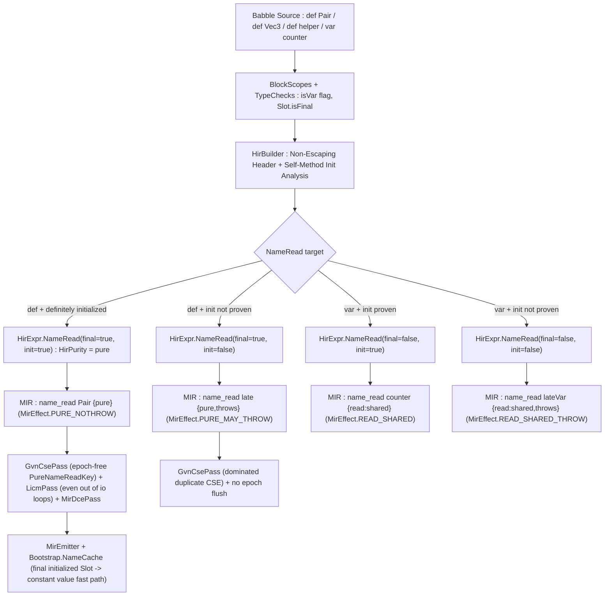

# BIP034: Immutable `def` and Mutable `var` Bindings

| | |
|---|---|
| **BIP** | 034 |
| **Date** | 2026-11-25 |
| **Status** | Draft (`BIP034-Q1`–`BIP034-Q10` open ; `BIP034-P1`–`BIP034-P5` planned) |
| **Depends on** | Object model ([bip002_object-model.md](bip002_object-model.md)), interactive sessions ([bip004_repl.md](bip004_repl.md)), modules ([bip005_modules.md](bip005_modules.md)), effects & ownership ([bip007_effects.md](bip007_effects.md), [bip016_consolidating-effect-annotations.md](bip016_consolidating-effect-annotations.md)), predicate-free grammar ([bip012_grammar-improvements.md](bip012_grammar-improvements.md)), HIR & SSA MIR optimizer ([bip014_optimization-passes.md](bip014_optimization-passes.md)) |
| **Scope** | Splitting Babble's single `def` declaration into non-reassignable `def` and explicitly reassignable `var` across locals, top-level bindings, exports, class/object/static/interface members, and `class` parameters ; making function and non-member constructor parameters immutable ; retiring whole-file `reassigned` scans and `AnalysisSession.reassigned` ; making reads of top-level `def` function and class/record/interface definitions genuinely pure (`MirEffect.PURE_NOTHROW` / `{pure}`, `HirPurity.isPureNothrowTerminating`, epoch-free GVN/LICM, and constant-folding `Bootstrap.NameCache` / `SelectCache` fast paths) ; upgrading per-field immutability on regular `class`es in `EffectChecker`, `HIR`, and `MIR` ; and migrating existing `.ba` / `.batest.md` / test sources via a deterministic AST-backed migrator |

---

## 1. Summary

Today, Babble has a single declaration keyword, `def`, and **every `def` binding is implicitly reassignable** — including top-level function and class definitions (`def foo = fn ...`, `def Pair = record ...`), local bindings, class fields, static fields, and function parameters. Only `record` members (`BIP002`), `for` loop variables (`BIP013-D7`), `catch` parameters (`BIP028-D5`), methods, and module exports viewed from outside (`BIP005`) are protected from reassignment.

This proposal splits binding mutability into two explicit keywords:

* **`def`** — **non-reassignable binding** (like `val` in Kotlin/Scala, `let` in Swift/Rust, `const` in JS/TS, or `final` in Java). Once initialized, the binding can never be assigned to (`x = ...` or `x += ...` is a compile-time error).
* **`var`** — **reassignable binding** (like `var` in Kotlin/Scala/Swift). Reassignment is explicitly opted into at the declaration site.

Just as in Kotlin, Scala, Swift, and Java, `def` vs. `var` governs **binding rebindability**, not deep object immutability (`BIP007-I2` `frozen` and `BIP002` `record` already handle deep immutability):

```babble
;; Immutable bindings (the common case — ~90%+ of real Babble code)
def Pair = record (a: int, b: int) (
    def swap = fn (): Pair -> ( Pair(this.b, this.a) )
)
def xs = list.of(1, 2)        ;; binding `xs` cannot be rebound; list contents can still mutate under `mut` rules
def stop = 10

;; Explicitly mutable bindings
var acc = 0
var i = 0
while i < stop then (
    acc += i
    i += 1
)

;; Regular classes distinguish immutable `def` fields from mutable `var` fields
export def RangeCursor = class (private var cur: int, private def stop: int) (
    def hasNext = fn (): bool -> ( this.cur < this.stop )
    def next = fn mut (): int -> ( def v = this.cur ; this.cur += 1 ; v )
)
```

### Key side goal: reading a function or class definition becomes pure

Because a top-level `def` (such as `def Pair = record ...`, `def Vec3 = record ...`, or `def helper = fn ...`) can **never** be reassigned — neither inside its module, nor through an `io` callback, nor in a later REPL session input — pairing `def` immutability with a richer non-escaping module-header initialization check makes accessing a function or class definition **genuinely pure** across the entire compiler stack:

```text
;; Before BIP034 (even after tightening NameRead from {impure} to {read:shared})
fn use(v0: int, v1: int) -> any:
  bb0:
    v2: any = opaque.NameRead(Pair) {read:shared}      ;; flushed by writes/io; {read:shared,throws} after import(...)
    v5: any = record_new Pair[v2](v0, v1) {pure}
    ret v5

;; After BIP034
fn use(v0: int, v1: int) -> any:
  bb0:
    v2: any = name_read Pair {pure}                    ;; PURE! Epoch-free GVN, LICM out of io loops, constant-folded in NameCache
    v5: any = record_new Pair[v2](v0, v1) {pure}
    ret v5
```

---

## 2. Motivation

Auditing the current repository exposes six coupled problems caused by mutable-by-default `def`:

1. **Over 90% of bindings are never reassigned, yet none can declare that fact.**
   Scanning the codebase today:
   * `examples/`: **662 `def`s** across 26 files, with only ~79 assignment statements across 15 files (`examples/raytracer-argon`: 391 `def`s, ~25 assignments; `examples/raytracer-fable`: 271 `def`s, ~28 assignments).
   * `src/test/babble/`: **599 `def`s** across 26 files, with only ~67 assignment statements across 12 files.
   * `src/test/batest/`: **9,578 `def`s** across 171 `.batest.md` files, with ~1,541 assignment statements across 133 files.
   * `src/main/java/org/babblelang/axioms/`: 100% immutable declarations.

   Yet nothing prevents `def foo = fn (a: int): int -> ( a + 2 )` or `def Pair = record ...` from being accidentally reassigned later, and a reader scanning a class like `Sphere`, `BVHNode`, or `RangeCursor` cannot tell which fields mutate (`cur`, `seed`) and which are fixed for the lifetime of the instance (`stop`, `center`, `radius`, `albedo`, `bbox`).

2. **Accessing a top-level function or class definition is still not pure in HIR or MIR.**
   In `src/test/batest/compiler/inline_and_alpha_rename.batest.md` (`InlinePass.inlineExpr : identity-order named args on record method skip inlining`), reading `Pair` inside a method lowered to `opaque.NameRead() {impure}`, and even after tightening `MirLowerer.opaqueEffect` to `MirEffect.READ_SHARED` (`{read:shared}`) for the leading pure prefix:
   * `NameRead(Pair)` is still classified as `Kind.READ` on `AliasClass.SHARED`, so every `WRITE_SHARED`, `NameAssign`, `StoreField`, or `IMPURE` (`io`) call flushes its GVN epoch and blocks `LicmPass` from hoisting it out of any loop with side effects.
   * In `examples/raytracer-argon/lib/vec3.ba`, `export def Vec3 = record (...) (...) static (...)` appears *after* `def math = import("math.ba")` and `def Rng = import("rng.ba").Rng`, and defines a `static ( ... )` block (`def zero: Vec3 = this(0.0, 0.0, 0.0)`). Consequently, `NameRead(Vec3)` inside `Vec3.plus` / `Vec3.minus` / `Vec3.times` still degrades all the way to `{read:shared,throws}` — neither hoistable nor dead-code-eliminable!
   * In `HirPurity.isPureNothrowTerminating`, standalone `HirExpr.NameRead` still returns `false` (only special-cased inside `DirectBabbleCall` and `RecordNew`).

3. **A soundness hole in interactive sessions (`BIP004`) regarding effect determinism.**
   Today, `TypeChecker` computes `reassigned` over the current input plus `session.reassigned`, and `EffectBodyWalker` treats a non-reassigned outer `def` as deterministic:
   ```babble
   ;; REPL input 1
   def x = 1
   def f = fn (): int -> ( x )   ;; checked as pure & deterministic (x not reassigned in input 1)

   ;; REPL input 2
   x = 2                         ;; succeeds! Now f() returns 2 instead of 1, violating f's pure contract!
   ```
   Making `def` permanently non-reassignable closes this hole cleanly: input 2 cannot assign to `x` (`Cannot assign to def : x`), while `var x = 1` in input 1 immediately requires `fn volatile` on `f` before input 1 commits.

4. **Duplicated whole-file `reassigned` pre-passes across 5 compiler subsystems.**
   Because mutability is not syntactic, `TypeChecks`, `TypeChecker`, `AnalysisSession`, `HirPurity`, and `MirLowerer` each scan the entire AST or HIR to compute their own `reassigned` set before answering basic questions: *"is `Shape` a static interface name?"*, *"is `m` a static module?"*, *"can `f` be a self-tail-call target?"*, *"does narrowing survive into this closure?"*, *"is this outer binding deterministic?"*, *"can `NameRead` be CSE'd?"*.

5. **Immutable fields on regular `class`es are treated as mutable everywhere.**
   `EffectBodyWalker.readsMutableBabbleMember` treats **every** field of a non-`record` class as mutable (`inst.node().kind != ClassShape.Kind.VALUE_CLASS`). Similarly, `HirLicmPass`, `MirLowerer`, and `AliasRlePass` only grant `READ_FROZEN` to `record` fields or `frozen` receivers. In `examples/raytracer-argon`, `Sphere`, `BVHNode`, `Lambertian`, `Metal`, `Dielectric`, `Camera`, and `RangeCursor.stop` are all regular classes with immutable `def` fields that currently miss `READ_FROZEN` RLE/LICM, non-volatile effect precision, JVM `ACC_FINAL` (`BIP018-P2`), and WasmGC immutable `(field ...)` (`BIP025-D11`).

6. **Unnecessary `Cell` heap allocations for captured immutable locals and uncached `NameCache` / `SelectCache` reads.**
   * `Resolver` allocates a mutable `Cell` (`IntCell`/`DoubleCell`/`BoolCell`/`Cell`) for *every* captured local — even immutable `def`s, `fn` parameters, and `for` loop variables.
   * `Bootstrap.NameCache` must call `r.slot.get()` (checking `if (set)` and dereferencing `Slot.value`) on every read because `Slot.isFinal` is currently always `false` in `Namespace.declare`.
   * `Bootstrap.SelectCache` has no fast path for immutable static `def` reads like `Vec3.zero` (one of the two follow-ups noted in `BIP014` §9.4).

---

## 3. State of the Art

| Language | Immutable binding | Mutable binding | Function params | Class header fields | Interface properties | Notes |
|---|---|---|---|---|---|---|
| **Kotlin** | `val` | `var` | Always immutable (no `var` params) | `class C(val x: Int, var y: Int, z: Int)` | `val` (covariant, implemented by `val` or `var`); `var` (invariant, `var` only) | Closest match to Babble's existing `class (def x: int, z: int)` syntax. |
| **Scala 3** | `val` / `def` | `var` | Always immutable | `class C(val x: Int, var y: Int, z: Int)` | `val` / `var` abstract members | `def` is method/by-name; Babble already uses `def` for all non-mutable definitions. |
| **Swift** | `let` | `var` | Always immutable (`SE-0003` removed `var` params to avoid confusion with `inout`) | `let` / `var` stored properties | `{ get }` vs `{ get set }` | `SE-0003` directly parallels Babble's `mut` parameter modifier vs local reassignment. |
| **Rust** | `let` | `let mut` | `mut x: T` allowed locally (distinct from `&mut T`) | Mutability inherited from binding (`let mut s`) | N/A | Babble already separates binding mutability (`def`/`var`) from deep immutability (`frozen`/`record`) and parameter mutation (`mut`). |
| **TypeScript / JS** | `const` | `let` | Reassignable | `readonly` fields | `readonly` properties | Module `export let` is a read-only live binding to importers, mutable inside defining module. |
| **Java** | `final` (opt-in) | default | Reassignable unless `final` | `final` fields (`JEP 500` / `JEP 539` trusted final) | `static final` constants only | `BIP018` §4 highlights that Babble's immutable `def` fields can emit `ACC_FINAL` / `ACC_STRICT_INIT` systematically for HotSpot C2 constant folding. |

Babble's existing vocabulary (`def`, `mut`, `frozen`, `record`, `lazy def`, `scoped def` in `BIP018` §8) aligns cleanly with **Kotlin's semantics using `def` / `var`**:

* Keeping **`def`** as the immutable default minimizes churn (~90%+ of existing declarations stay untouched!) and harmonizes with `BIP018`'s read-only `lazy def` and `scoped def`.
* Introducing **`var`** makes every mutable binding and mutable field visually unmistakable at its declaration site.

---

## 4. Language Semantics & Grammar

### 4.1 `def` vs. `var` across every declaration site

| Declaration site | `def` | `var` | Initializer `= expr` |
|---|---|---|---|
| **Local block / `fn` body** | Immutable local binding; cannot be reassigned. | Mutable local binding; assignable via `x = ...` / `x op= ...`. | Required on `def` (`BIP034-Q3`); optional on `var` (defaults to `null` if nullable/inferred). |
| **File top-level** | Immutable module/script binding (also immutable across subsequent REPL inputs). | Mutable module/script binding (reading in a `fn` requires `volatile`; writing requires `io`). | Required on `def`; optional on `var`. |
| **Module export (`export`)** | Immutable export; non-reassignable inside and outside module. | Mutable inside defining module; **read-only** from importers (`Cannot assign to an export : x`), and marked mutable in `TypedModuleSummary` (`BIP034-Q4`). | Required on `def`; optional on `var`. |
| **`class` header parameter** | `def x: T` / `private def x: T` — immutable instance field (`ClassShape` without `MUTABLE`). | `var x: T` / `private var x: T` — mutable instance field (`ClassShape.MUTABLE`). | Optional default parameter value (`= defaultExpr`). |
| **Bare `class` header parameter** (`x: T`) | Constructor-only parameter (not a member). **Always immutable** (`BIP034-Q2`). | N/A (writing `var x` declares a mutable field, not a constructor-only local). | Optional default parameter value. |
| **`class` / `object` body member** | `def x = expr` — immutable field; `def m = fn ...` / `overload (...)` — method (`ClassShape.METHOD`). | `var x = expr` — mutable field (`ClassShape.MUTABLE`); `var cb = fn ...` — mutable **field** holding a function value, **not** a method (`BIP034-Q5`). | Required on `def`; optional on `var`. |
| **`record` header & body** | Every header parameter is an immutable field (`def` stays allowed with existing redundancy warning); body `def` fields & methods are immutable. | **Forbidden** at member level (`Value class members cannot be var : x`). Allowed for local variables *inside* record methods. | Standard `record` rules. |
| **`static ( ... )` block** (on `class`, `record`, `interface`) | Immutable static field or static method (`ClassShape` without `MUTABLE`). | Mutable static field (`ClassShape.MUTABLE`); reading requires `volatile`, writing requires `io`. `var m = fn ...` is a mutable static field, not a static method. | Required on `def`; optional on `var`. |
| **`interface` body** | `def m: fn ...` / `def x: T` — required read-only member (covariant; satisfied by `def` or `var`); `def m = fn ...` — default method. | `var x: T` — required mutable member (invariant; satisfied **only** by `var`, never `def` or `record`) (`BIP034-Q8`). `var m = fn ...` default is **forbidden**. | Forbidden on required members (`def x: T`, `var x: T`); required on default methods. |
| **`fn` parameter (`fn (x: T)`)** | Always immutable (`Cannot assign to parameter : x`) (`BIP034-Q2`). | **Forbidden** on `fnParam` (declare `var cur = x` in body). | Optional default parameter value. |
| **`for` loop variable** | Always immutable (`Cannot assign to loop variable : x`, `BIP013-D7`). | N/A. | Supplied by iterable. |
| **`catch` parameter** | Always immutable (`Cannot assign to catch parameter : e`, `BIP028-D5`). | N/A. | Supplied by caught exception. |
| **Generic declaration (`of T`)** | Allowed (`def id of T = fn ...`, `def Box of T = class ...`). | **Forbidden** (`Type parameters only apply to def : x`). | Per kind. |
| **Type alias (`= type T`)** | Allowed (`def Num = type int \| double`, `BIP023`). | **Forbidden** (`Type alias must be declared with def : x`). | Required. |
| **Axiom member (`axiom ...`)** | `def m: fn ...` / `def *: fn ...` (unchanged). | **Forbidden** in `axiomMember`. | N/A. |

### 4.2 Grammar (`Babble.g4`)

The grammar change adds a single token (`VAR: 'var';`), keeps `Babble.g4` 100% LL(1), zero `@parser::members`, zero semantic predicates, and pure `PredictionMode.SLL`:

```antlr
memberName: ID | coreTypeKeyword | effectModifier | AXIOM | RECORD | OF | UNIQUE | FROZEN
          | IN | BREAK | CONTINUE | CALLING | TYPE | OVERLOAD | AND | OR | NOT | FOREVER
          | TRY | CATCH | FINALLY | THROW | VAR;

expression:
          ifExpr                                              # ifExpression
          | (EXPORT | PRIVATE)? (DEF | VAR) name=ID (OF typeParameters)? (':' type)?
                     ('=' NL* value=expression)?              # defExpression
          ...

classParam: PRIVATE? (DEF | VAR)? paramModifier* ID (':' type)? ('=' NL* defaultValue=expression)?;

// Lexer
DEF: 'def';
VAR: 'var';
```

* **Zero identifier conflicts in the repository:** A scan of every `.ba` file in `examples/`, `src/test/babble/`, `src/main/java/org/babblelang/axioms/`, and every `babble` fenced block in `src/test/batest/` found **0** occurrences of `var` as an identifier.
* **Member/named-arg safety:** Including `VAR` in `memberName` keeps `obj.var`, `foo(var: 1)`, and Java fields/methods named `var` valid without escaping.
* **Context-sensitive validation in `BlockScopes`:** Keeping `(DEF | VAR)` unified in `defExpression` and `classParam` yields precise semantic errors (e.g., `Value class members cannot be var : x`, `Type alias must be declared with def : T`) rather than generic parse failures.

### 4.3 Formatting (`Formatter.java`)

* `visitDefExpression` emits `var` when `ctx.VAR() != null` and `def` otherwise, preserving all existing modifier order (`export var`, `private var`, `export def`, `private def`) and spacing (`var x: int = 0`).
* `visitClassParam` emits `var` when `ctx.VAR() != null`, `def` when `ctx.DEF() != null`, and nothing for bare constructor parameters (`private var cur: int`, `private def stop: int`, `fuzzIn: double = 0.0`).
* No changes to newline, indentation, or `shape()` normalization rules.

### 4.4 Diagnostics

All diagnostics follow Babble's space-before-colon convention and match between compile-time analysis and runtime boundaries (`Slot`, `Members`):

| Situation | Message | Where reported |
|---|---|---|
| Reassigning a lexical `def` | `Cannot assign to def : <name>` | `TypeChecks` (compile time) & `Slot.set` (runtime defense-in-depth) |
| Reassigning a `fn` or bare `class` parameter | `Cannot assign to parameter : <name>` | `TypeChecks` |
| Reassigning a `def` instance or static member | `Cannot assign to def member : <name>` | `TypeChecks`, `TypeChecker`, and `Members.cannotAssignDef` (`BabbleType`, `InterpretedInstance`, `BabbleObjects`) |
| Reassigning a `record` member | `Value members are read-only : <name>` | Existing message (preserved) |
| Reassigning a `for` / `catch` / `export` / method | Existing messages (`Cannot assign to loop variable : ...`, `Cannot assign to catch parameter : ...`, `Cannot assign to an export : ...`, `Cannot assign to method : ...`) | Preserved unchanged |
| `var` in a `record` header or body | `Value class members cannot be var : <name>` | `BlockScopes` |
| `def` without `= value` outside interface | `Immutable def requires an initializer : <name>` | `BlockScopes` (`BIP034-Q3`) |
| `var` with `of typeParameters` | `Type parameters only apply to def : <name>` | `BlockScopes` |
| `var T = type ...` | `Type alias must be declared with def : <name>` | `BlockScopes` |
| `var m = fn ...` default in interface | `An interface default cannot be var : <name>` | `BlockScopes` |
| Class implements interface `var x` with `def x` (or `record` member) | `Cannot implement mutable member <name> with immutable def` | `TypeChecks` |
| Class implements interface `var x: T` with non-identical type `U` | `Type error : mutable member <name> must have exact type <T>, got <U>` | `TypeChecker` (`BIP034-Q8`) |

---

## 5. Making Function & Class Definition Reads Pure (Side Goal)

A central goal of `BIP034` is that **accessing a function or class/record/interface definition becomes genuinely pure** — not `{impure}`, and not `{read:shared}` / `{read:shared,throws}` — in both HIR and MIR, and constant-folded at runtime.



### 5.1 Why `NameRead` could not be `{pure}` before `BIP034`

Two separate obstacles prevented `MirLowerer` and `HirPurity` from treating `NameRead(Pair)` or `NameRead(Vec3)` as `MirEffect.PURE_NOTHROW` (`{pure}`):

1. **Lack of binding immutability (`AliasClass.SHARED`):** Without `def` vs. `var`, a top-level `def` could be mutated by `NameAssign`, by a callback, or by a later REPL input. Therefore `MirLowerer` had to classify `NameRead` as `Kind.READ` on `AliasClass.SHARED` — causing every `WRITE_SHARED`, `StoreField`, `NameAssign`, or `IMPURE` (`io`) call to flush the GVN epoch and block LICM.
   With `BIP034`, a `def` slot is **write-once forever** (`Slot.isFinal == true`, statically enforced across the entire module and all future REPL inputs). Once initialized, no store, `NameAssign`, or `io` callback can ever change its value.
2. **Temporal Dead Zone (`Name used before definition`):** Top-level statements in a Babble script execute sequentially, while all top-level names are hoisted as unset slots at scope entry. Reading a top-level `def` *before* its `def` statement has run throws `Name used before definition : <name>`. In particular, a naive "leading prefix of `fn`/`const`/`class` without `static`" check stopped before `def math = import("math.ba")` and before `export def Vec3 = record (...) static ( def zero = this(0.0, 0.0, 0.0) ... )`, leaving `Vec3` as `throws` in `examples/raytracer-argon/lib/vec3.ba`!

### 5.2 Non-escaping module header & self-method definite-initialization analysis

To prove `definitelyDefined = true` (`nothrow = true`) for real-world modules like `examples/raytracer-argon/lib/vec3.ba` **without** breaking Babble's existing TDZ tests (`BabbleScopesTestCase:78` `println(1) ; def println = fn ...` and `values_and_operators.batest.md:600` `def C = class () () static ( def getB = fn () -> ( C.b ) ; def a = C.getB() ; def b = 1 )`), `HirBuilder` (and `MirLowerer`) computes two sound static facts:

1. **Non-escaping module header (`headerInitializedDefs`):**
   Walk `module.topLevelStatements()` in order. A statement `s` preserves the *"no function or method defined in this module has been invoked or escaped yet"* invariant if `s` is:
   * `def x = fn ...` (constructing a function value never runs its body),
   * `def x = overload (fn ..., ...)` (all operands are function literals),
   * `def x = const` (literal constant),
   * `def x = type ...` (type alias, evaluates to `null`),
   * `def x = import("other.ba")` or `def x = import("other.ba").Export` (or `import("java.pkg")`), provided `other.ba` does **not** transitively import the current module (non-cyclic static import, already tracked by `ModuleInterface` dependencies — `other.ba` cannot possibly hold a reference to any callable of this module!),
   * `def C = class/record (...) (...)` with `staticBlock == null`, **or** with a **pure non-calling `staticBlock`** whose top-level statements consist solely of `def`/`var` declarations initialized by `const`, `fn`/`overload` literals, or `this(...)` constructions of a `fastRecord` (empty constructor body — like `Vec3.zero = this(0.0, 0.0, 0.0)` and `Interval.empty = this(...)` in `examples/raytracer-argon`!),
   * `def I = interface (...)` with `staticBlock == null` or a `const`/`fn`-only `staticBlock`,
   * `var x = const` (does not invoke any module callable; recorded in header initialized set, though as `finalBinding = false`),
   * `axiom ...`.

   Every `def X` encountered before the first statement that breaks this invariant is **definitely initialized before ANY function or method of this module can ever be entered**.
   * In `examples/raytracer-argon/lib/vec3.ba`, `math`, `Rng`, and `Vec3` are ALL in `headerInitializedDefs`!
   * In `values_and_operators.batest.md:600`, `C`'s `static` block calls `C.getB()`, so it is **not** a pure non-calling static block — it breaks the header before `C`, keeping `NameRead(C)` as `{pure,throws}` and preserving `Name used before definition : C`!
   * In `BabbleScopesTestCase:78` (`println(1) ; def println = fn ...`), top-level `println(1)` executes at module top-level (not inside a function body) before `def println = ...`, preserving `Name used before definition : println`!

2. **Committed REPL inputs (`AnalysisSession`):**
   Every `def` declared in an earlier REPL input whose evaluation **completed normally** (did not throw mid-input) is already initialized in the parent `Namespace` before the new input compiles. `AnalysisSession` records whether each committed input finished cleanly; `def`s from cleanly completed inputs get `finalBinding = true, definitelyDefined = true` (`{pure}`), while `def`s from a partially-failed input stay `finalBinding = true, definitelyDefined = false` (`{pure,throws}`), preserving `ReplTestCase:131` and `ReplTestCase:425`.

3. **Self-class initialization for instance methods:**
   Even if a `class` / `record` `C` appears *after* an arbitrary top-level statement in a script (e.g., `def x = compute() ; def Pair = record (a: int, b: int) ( def swap = fn () -> ( Pair(this.b, this.a) ) )`), an instance method `C.m` can only be called after at least one instance of `C` exists. Provided `C`'s constructor body and `C`'s `static` block do not call any method or escape `this`, `def C` itself (and every `def` preceding `C` in the module!) is guaranteed to have completed before `C.m` runs!

4. **Built-in & implicit names:**
   Built-in prelude functions (`print`, `println`, `assert`, `classof`, `int`, `double`, `string`, `bool`, etc.) that are **not** shadowed by a file-level declaration are always bound in the root `Namespace` before any script executes (`finalBinding = true, definitelyDefined = true` → `{pure}`).

### 5.3 HIR & MIR Effect Matrix and Optimizer Payoff

| Target of `NameRead(name)` | `finalBinding` | `definitelyDefined` | `HirPurity.isPureNothrowTerminating` | `MirEffect` | Canonical MIR tag | GVN / LICM / DCE behavior |
|---|---|---|---|---|---|---|
| Top-level `def` (fn, class, record, interface, const, non-cyclic import, or clean REPL `def`) | `true` | `true` | **`true`** | **`PURE_NOTHROW`** | **`{pure}`** | **Epoch-free GVN** across `StoreField`/`NameAssign`/`io` calls; **LICM out of any loop** (including `io` loops); **DCE if unused**. |
| Top-level `def` (late / after arbitrary top-level call / active `static` block / failed REPL input) | `true` | `false` | `false` | **`PURE_MAY_THROW`** | **`{pure,throws}`** | Never flushes alias epochs; **dominated duplicate CSE** (once an earlier dominating `NameRead(name)` succeeds, the slot is initialized and final forever). |
| Top-level `var` (definitely initialized) | `false` | `true` | `false` | `READ_SHARED` | `{read:shared}` | Epoch-scoped GVN (`NameReadKey(name, kind, epoch)`); LICM out of pure/read-only loops; DCE if unused. |
| Top-level `var` (init not proven) | `false` | `false` | `false` | `READ_SHARED_THROW` | `{read:shared,throws}` | Preserves TDZ exception; does not act as a write barrier for unrelated loads. |

Additionally, in `GvnCsePass`:
* **`PureNameReadKey(String name, PrimitiveKind kind)`** (no `epoch` field!) is used for `PURE_NOTHROW` `NameRead`s, so `def` reads are deduplicated across the entire dominator tree regardless of intervening mutations or `io` calls.
* For `PURE_MAY_THROW` `NameRead`s, recording `(name, kind) -> resultId` in the dominator-scoped GVN table *after* the instruction executes lets any strictly dominated second `NameRead(name)` reuse the first SSA value (sound because the first read already proved the `def` initialized, and a `def` can never change thereafter!).

### 5.4 Runtime & JIT Fast Paths (`Slot`, `Bootstrap.NameCache`, `Bootstrap.SelectCache`)

`Slot<T>` (`src/main/java/org/babblelang/runtime/Slot.java`) **already** has a `private final boolean isFinal` field — it is simply hardcoded to `false` in `Namespace.declare` today!

1. **`Namespace.declare` sets `isFinal = true` for `def`s and `false` for `var`s** (and `defineParameter` sets `isFinal = true`).
2. **`Bootstrap.NameCache` constant fast path:**
   When `Bootstrap.NameCache.lookup(Namespace)` resolves a `Slot` with `slot.isFinal() && slot.isSet()`, the `Resolution` record stores the resolved `Object value` directly (instead of calling `r.slot.get()` and testing `if (set)` on every access):
   ```java
   private record Resolution(Namespace namespace, Slot<Object> slot, Object finalValue, boolean hasFinalValue, int epoch) {}

   Object lookup(Namespace namespace) {
       Resolution r = last;
       if (r != null && r.namespace == namespace && r.epoch == Namespace.epoch()) {
           return r.hasFinalValue ? r.finalValue : r.slot.get();
       }
       int epoch = Namespace.epoch();
       Slot<Object> slot = namespace.resolve(name);
       Object value = slot.get(); // throws if unset
       last = new Resolution(namespace, slot, value, slot.isFinal(), epoch);
       return value;
   }
   ```
   (Even further, a `MutableCallSite` specialization on a monomorphic `(namespace, epoch)` pair with `slot.isFinal()` can bind `MethodHandles.constant(Object.class, value)` behind the `(ns == cachedNs && Namespace.epoch() == cachedEpoch)` guard so HotSpot C2 folds `Vec3` / `Pair` / `math` directly into compiled machine code!)
3. **`Bootstrap.SelectCache` static `def` fast path (`Vec3.zero`):**
   `BIP014` §9.4 noted that static member reads like `Vec3.zero` have no inline-cache fast path and perform a `HashMap` lookup in `ClassShape.staticIndex` on every read. With `ClassShape.MUTABLE`, any static `def` (`!shape.isStaticMutable(index)`) that is initialized (`value != Undefined.UNDEFINED`) is immutable for that `BabbleType` instance. `SelectCache` can guard on `receiver == cachedType` and return `MethodHandles.constant(Object.class, value)` directly (or index `statics[idx]` for `var` statics), eliminating the `HashMap` lookup on every `Vec3.zero` / `Interval.empty` / `AABB.empty` read across all optimization levels!

---

## 6. Type Checking, Effects, and Object Model Integration

### 6.1 Retiring whole-file `reassigned` scans and `AnalysisSession.reassigned`

Once binding mutability is a local syntactic fact (`isVar(decl)`):

* **`TypeChecks`**: drops its `Set<ParserRuleContext> reassigned` completely. `resolveDefinition`, `moduleOf`, `exportedModule`, and `staticClassOf` simply test `!isVar(def)`. Any `PendingAssignment` targeting a non-`var` binding is immediately rejected with `Cannot assign to def : <name>` or `Cannot assign to parameter : <name>`.
* **`AnalysisSession`**: drops `final Set<ParserRuleContext> reassigned`. Earlier REPL inputs' `def`s can never be reassigned in later inputs, permanently fixing the §2.3 REPL determinism soundness hole!
* **`TypeChecker`**: `reassigned` reduces to `isVar(decl)` (or tracking which `var`s are actually assigned for `SlotInference` widening). `TypeEnv.enterCallable` only evicts `var` bindings — flow-sensitive narrowing on `def` bindings (`if s != null then ( fn () -> ( s.length() ) )`) is locally known to survive closure capture and REPL input boundaries without a whole-file pre-scan.
* **`StaticRefs`, `TypeAnnotations`, `LoweringAnalyzer`, `TailCalls`**: all `!checker.isReassigned(def)` checks become direct `!isVar(def)` checks.

### 6.2 Interface member variance & `TypedModuleSummary`

* **Interface required members (`BIP034-Q8`):**
  * `def x: T` in an interface is **read-only** through the interface, so an implementing class/record/object may provide `def x: U` or `var x: U` with `U <: T` (**covariant**, matching read-only property subtyping).
  * `var x: T` in an interface is **read-write** through the interface, so an implementing class/object must provide `var x: T` with **exact invariant type** `U == T` (matching mutable collection invariance in `BIP011-D10` and `BIP020`).
* **Cross-module `TypedModuleSummary`:**
  * Records `boolean mutable` on exported top-level bindings and on class/interface/static members so importers immediately know whether `mod.x`, `obj.field`, or `Cls.staticField` is `def` (immutable) or `var` (mutable) without re-analyzing the imported AST.

### 6.3 `EffectChecker` precision improvements

1. **Per-field immutability on regular `class`es and `object`s:**
   `EffectBodyWalker.readsMutableBabbleMember(Type recvType, String fieldName)` checks whether `fieldName` is declared `var` (`member.isMutable()`) on any concrete `Type.Instance` / `Type.Interface` in `recvType`, rather than assuming every non-`record` class is completely mutable.
   * Reading `this.stop` (`private def stop: int`) on `RangeCursor` or `s.radius` (`def radius: double`) on `Sphere` no longer taints `readsThis` or `readParams`!
   * Reading `this.cur` (`private var cur: int`) on `RangeCursor` still accurately taints `readsThis` (so `hasNext` accurately tracks its read dependency on `this`).
2. **Static `def` determinism:**
   In `EffectBodyWalker` (line 846), `if (sm != null && (sm.isMutable() || !isImmutableConstantValue(resType)))` immediately recognizes static `def` fields of immutable types (e.g., `Vec3.zero`, `Interval.empty`) without relying on whole-file reassignment scanning.
3. **Captured local `def`s:**
   In `EffectBodyWalker` (line 781), an `escapedCapturedLocal` only degrades `deterministic = false` if it is a `var`; a captured `def` of an immutable value is always deterministic even when captured by an escaping closure.
4. **`AlgebraicVerifier` & `SizeChangeTermination` (`EffectAstExtractors`):**
   Parameters and `def`s are guaranteed never reassigned, removing all `isReassigned(p)` / `isReassigned(decl)` bailout checks.

### 6.4 `ClassShape.MUTABLE` & Runtime Enforcement

* `ClassShape` adds `public static final int MUTABLE = 4;` alongside `METHOD = 1` and `PRIVATE = 2`, with `isMutable(int index)` and `isStaticMutable(int index)`. Because `ClassShape.encode`/`decode` already serializes `flags[]` and `staticFlags[]` as integers, the wire format for compiled classes and `babblec` AOT jars stays completely compatible.
* `BabbleType.setMember`, `InterpretedInstance.setMember`, and `BabbleObjects.setMember` enforce `!shape.isMutable(index)` → `Members.cannotAssignDef(name)` (`Cannot assign to def member : <name>`) for dynamically typed (`any`) receivers, maintaining 100% behavioral parity between compile-time diagnostics and runtime checks in both backends.

### 6.5 Synergy with HIR/MIR & Downstream Backends

* **`def` fields on regular `class`es become `READ_FROZEN` in MIR and hoistable in `HirLicmPass`:**
  Generalizing `HirExpr.ThisFieldGet.recordField()` → `immutableField()` (true for all `record` fields **and** all `def` fields on regular `class`/`object`s) unlocks `MirEffect.READ_FROZEN`, `AliasRlePass` redundant-load elimination, and `HirLicmPass`/`LicmPass` loop hoisting on regular classes (`Sphere`, `BVHNode`, `Lambertian`, `RangeCursor.stop`) — not just `record`s!
  *(Soundness note: inside the class's own constructor `cls$N$Name`, `this.defField` is only marked `definitelyDefined = true` for header `def` parameters, which are initialized before the constructor body starts, or once initialized — preserving `Member used before definition` for body `def`s read before their definition line!)*
* **Value-capture for immutable `def` locals (`BIP034-P5`):**
  In `Resolver` (`use()`), a captured variable that is a definitely-initialized `def` (including `fn` parameters, `for` loop vars, `catch` params, and local `def`s whose declaration dominates the closure creation — excluding self-recursive or mutually-recursive local `def` closures initialized later) does **not** need a heap-allocated `Cell` / `IntCell` / `DoubleCell` / `BoolCell` wrapper! Capturing the raw value directly eliminates closure-cell allocation and indirection.
* **Alignment with `BIP018` (Java improvements):**
  * `BIP018-P2` (`ACC_FINAL` emission for `JEP 500` / HotSpot trusted-final constant folding) and `BIP018-P4` (`ACC_STRICT_INIT` on `JEP 539`) apply directly to every `def` header field of every `class` and `record`.
  * `BIP018` §8.1 (`lazy def`) and §8.2 (`scoped def`) already assume `def` is strictly read-only — `BIP034` makes that universal.
* **Alignment with `BIP025` (WebAssembly 3.0 / `WasmGC`):**
  `BIP025-D11` emits immutable `(field ...)` for `record` fields and `(field (mut ...))` for mutable fields; with `BIP034`, every `def` field on regular `class`es also becomes an immutable WasmGC `(field ...)`!

---

## 7. Open Questions

Each open question below carries a recommended answer to be settled into `BIP034-D1`–`BIP034-D10` before implementation begins.

* **`BIP034-Q1` — Should `var` be allowed in `memberName`?**
  * *Recommendation:* **Yes.** Just like `type`, `record`, `of`, `in`, `calling`, `try`, `catch`, `unique`, and `frozen`, allowing `VAR` in `memberName` preserves `.var` member access (especially for Java interop and named arguments) with zero grammar ambiguity.

* **`BIP034-Q2` — Should `fn` parameters and bare (non-member) `class` parameters be immutable, without allowing `var` on `fnParam`?**
  * *Options:*
    1. **(Recommended — Kotlin / Scala / Swift `SE-0003`):** Function parameters and non-member constructor parameters are always immutable (`Cannot assign to parameter : x`). To mutate a local copy, write `var cur = x` in the body.
    2. Allow `fn (var x: int)` as syntactic sugar for a local reassignable parameter.
  * *Rationale for Option 1:* Babble already has `mut x: T` on parameters to mean *"the callee mutates the object passed by the caller"*. Allowing `var x: T` in a function signature risks confusing callers into thinking `var` is pass-by-reference (the exact reason Swift removed `var` parameters in `SE-0003`), leaks an implementation detail into the signature, and complicates `ScalarReplacePass` and `AlgebraicVerifier`. Consistency with `for` (`BIP013-D7`) and `catch` (`BIP028-D5`) parameters is also cleaner.

* **`BIP034-Q3` — What should happen for uninitialized declarations (`def x: T` / `var x: T` without `= expr`) outside `interface` bodies?**
  * *Options:*
    1. **(Recommended):** **Forbid** `def` without `= expr` outside `interface` bodies (`Immutable def requires an initializer : x`) — a permanently-null `def` without `= null` is virtually always a mistake, and Babble's expression-oriented `if`/`try` (`def x = if c then ( 1 ) else ( 2 )`) eliminates the need for Java-style blank `final`. **Keep** optional `= expr` (defaulting to `null`) on `var x: T?` (or `var x` inferred from assignments).
    2. Forbid omitted `= expr` on *both* `def` and `var` outside `interface` bodies (always require `var x: T? = null`).
    3. Support Java/Kotlin-style definite-assignment analysis for blank `def x: T`.
  * *Rationale for Option 1 (with Option 2 as a very clean stricter alternative):* Zero `examples/` or `src/test/babble/` files write uninitialized non-interface `def`s today. Option 1 catches accidental uninitialized `def`s immediately while keeping `var x: T?` concise; Option 2 is even simpler if explicit `= null` is preferred everywhere.

* **`BIP034-Q4` — Should `export var` be allowed?**
  * *Options:*
    1. **(Recommended):** **Allow `export var`** with live read-only visibility from importers (`m.count = 1` remains `Cannot assign to an export : count`, matching `BIP005`), mutable inside the defining module, and tagged `mutable = true` in `TypedModuleSummary` so importers reading `m.count` require `volatile`.
    2. **Forbid `export var`** (`export` only applies to `def`; modules encapsulate mutable state behind private `var` + exported `fn volatile` / `fn io` accessors).
  * *Trade-off:* Option 1 preserves full backwards compatibility with `BIP005` and existing tests like `src/test/batest/effects/call_and_body_effects.batest.md` (`export def mutCounter = 0`); Option 2 enforces stricter module encapsulation at the cost of rewriting `export var` tests to getter/setter functions.

* **`BIP034-Q5` — What should `var f = fn (...) -> (...)` mean at the top level of a `class`, `object`, or `static` body?**
  * *Options:*
    1. **(Recommended):** A **mutable field** (`ClassShape.MUTABLE`, **not** `ClassShape.METHOD`) initialized to a function value — assignable via `this.f = otherFn` / `obj.f = otherFn`, and able to capture `this` lexically as any closure inside a class body does. Only `def m = fn ...` (or `def m = overload (...)`) declares a class method (`ClassShape.METHOD`).
    2. Reject `var f = fn ...` in a class/static body unless given an explicit function type annotation (or forbid altogether).
  * *Rationale for Option 1:* Clean, uniform semantics — `def m = fn ...` is a method, `var cb = fn ...` is a reassignable callback field, with zero special-case surprises.

* **`BIP034-Q6` — For top-level `def f = fn ...` and `def C = class/record/interface ...`, should Babble keep sequential TDZ semantics + non-escaping header analysis, or hoist-and-initialize them at module entry?**
  * *Options:*
    1. **(Recommended):** **Keep Babble's uniform sequential TDZ semantics**, and use §5.2's **non-escaping module header + self-method definite-initialization analysis** to prove `{pure}` (`MirEffect.PURE_NOTHROW`) for all real-world function/class/record/interface definitions (including `vec3.ba` after `import(...)` and pure `static` blocks).
    2. **Hoist-and-initialize** top-level capture-free `def f = fn ...` and `def C = class/record/interface` (without `static` block) before top-level statements execute (like Java methods/classes or Rust items).
  * *Comparison:*

    | Aspect | Option 1 (TDZ + non-escaping header) | Option 2 (Hoist-and-initialize) |
    |---|---|---|
    | `NameRead(Pair)` / `NameRead(Vec3)` / `NameRead(helper)` in real modules | **`{pure}`** (`PURE_NOTHROW`) | **`{pure}`** (`PURE_NOTHROW`) |
    | `def bad = f() ; def f = fn () -> ( 1 )` | Throws `Name used before definition : f` (preserves `BabbleScopesTestCase:78`) | Calls `f()` before its line (breaks `BabbleScopesTestCase:78`) |
    | `def C = class () () static ( def a = C.getB() ; ... )` | Preserves `Name used before definition : C` (`values_and_operators.batest.md:600`) | Still needs TDZ for `static`-block classes anyway |
    | Interpreter vs. compiler simplicity | Both backends keep identical sequential evaluation | Both backends must run a pre-init pass at module entry |

    Option 1 achieves the `{pure}` side goal for every well-structured module and script with **zero** breakage of existing scoping tests and **zero** semantic divergence between top-level functions and top-level values.

* **`BIP034-Q7` — Should `NameRead` (and `NameAssign`) be promoted from `MirInst.OpaqueExpr` to first-class MIR instructions?**
  * *Options:*
    1. **(Recommended):** Promote `NameRead` (and `NameAssign`) to first-class `MirInst.NameRead(MirVal result, String name, boolean finalBinding, MirEffect effect, int line)` and `MirInst.NameAssign(MirVal result, String name, MirVal value, MirEffect effect, int line)` in `BIP034-P3`, printed canonically as `v2: any = name_read Pair {pure}` and `v3: int = name_assign counter, v1 {write:shared}`.
    2. Keep them inside `MirInst.OpaqueExpr` (`opaque.NameRead(Pair) {pure}`).
  * *Rationale for Option 1:* `OpaqueExpr` is meant for rare unlowered HIR templates, whereas `NameRead` appears in almost every function that constructs a `record` or calls a sibling function. Making it first-class removes `op.template() instanceof HirExpr.NameRead` pattern-matching in `GvnCsePass`, `MirLowerer`, and `MirCanonicalPrinter`, and aligns with `SlotRead`/`SlotWrite` and `LoadField`/`StoreField`.

* **`BIP034-Q8` — Should `interface` bodies support `var x: T` mutable required members?**
  * *Options:*
    1. **(Recommended):** Yes — `def x: T` declares a read-only covariant required member (satisfied by `def` or `var`), while `var x: T` declares a read-write invariant required member (satisfied only by `var`, never `def` or `record`).
    2. Restrict `interface` bodies to `def` only (mutable state accessed via `fn mut` setter methods).
  * *Rationale for Option 1:* Babble interfaces already support data members (`def HasVal = interface ( def x: int )`); allowing `var x: T` completes the symmetry with `class`es and Kotlin interfaces cleanly.

* **`BIP034-Q9` — Should value-capture of immutable `def` locals (skipping `Cell` allocation) be part of `BIP034` (`BIP034-P5`) or deferred?**
  * *Recommendation:* Include as a self-contained final phase **`BIP034-P5`** (can land in a separate PR after `BIP034-P1`–`P4` are merged and green).

* **`BIP034-Q10` — Migration strategy for existing `.ba` / `.batest.md` / `.java` test sources?**
  * *Options:*
    1. **(Recommended):** **Hard cutover in `BIP034-P1`** using a deterministic AST-backed migration tool (running `BlockScopes` + `TypeChecks` to collect exact ANTLR token offsets of every reassigned `def` and rewriting only those tokens to `var`, plus handling `fn` parameter reassignments like `Test1.ba:26` by introducing `var`), followed by `-format -w` and `-Dbatest.updateIr=true`.
    2. Temporary deprecation warning for reassigning `def` before turning it into an error.
  * *Rationale for Option 1:* Matches every prior Babble grammar/syntax migration (`BIP012`, `BIP016`, `BIP026-I1`, `BIP030`), keeps the codebase free of temporary compatibility branches, and ensures the entire test suite immediately validates `def` vs. `var` semantics.

---

## 8. Implementation Plan

Each phase keeps `mvn -B package -PO2` green across all four execution modes (`interpret`, `compile -O0`, `compile -O1`, `compile -O2`), passes `ArchitectureBoundaryTestCase` / `RuntimeBoundaryTestCase` / `ParserGrammarTestCase`, and maintains `-format -check` cleanliness.

### `BIP034-P1` — Grammar, Front-End Enforcement, Runtime Metadata & Repository Migration
* Add `VAR: 'var'` (and `VAR` in `memberName`) to `Babble.g4`; update `defExpression` and `classParam`.
* Update `Formatter` to emit `def` / `var` verbatim in definitions and `class` parameters.
* Add `ClassShape.MUTABLE = 4` (with `isMutable` / `isStaticMutable` and `encode`/`decode` support); update `Slot.set` (`Cannot assign to def : ...`), `Namespace.declare` / `defineParameter` (`isFinal`), and runtime `BabbleType`/`InterpretedInstance`/`BabbleObjects`/`Members` (`Cannot assign to def member : ...`).
* Update `BlockScopes`, `TypeChecks`, `TypeChecker`, `TypedModuleSummary`, `AnalysisSession`, `StaticRefs`, `TypeAnnotations`, `LoweringAnalyzer`, and `TailCalls`:
  * Enforce all §4.1 & §4.4 rules (`def` vs. `var`, immutable parameters, `record` `var` rejection, interface `def`/`var` variance and conformance).
  * Retire whole-file `reassigned` scans in `TypeChecks` and `AnalysisSession.reassigned`.
  * Update `TypeEnv.enterCallable` to evict only `var` bindings.
* Run a deterministic ANTLR-token migration script over `examples/`, `src/test/babble/`, `src/test/batest/`, and `src/test/java/` to convert reassigned `def`s to `var` (and parameter reassignments such as `Test1.ba:26` to local `var`s), format with `-format -w`, and add dedicated `def`/`var` positive & error tests across all declaration sites.

### `BIP034-P2` — `EffectChecker` Precision & REPL Soundness
* Close the §2.3 REPL determinism hole (verified in `ReplTestCase` and `EffectsTestCase`).
* Upgrade `EffectBodyWalker.readsMutableBabbleMember` to check per-field `member.isMutable()` on regular `class`es, `object`s, and `interface`s.
* Simplify static `def` checks, `escapedCapturedLocals` (`var`-only), and `EffectAstExtractors` (`AlgebraicVerifier` / `SizeChangeTermination`).
* Add `.batest.md` tests under `src/test/batest/effects/` covering `def` vs. `var` fields on regular `class`es, `export def` vs. `export var`, static `def` vs. `var`, and REPL determinism.

### `BIP034-P3` — Pure Function & Class `NameRead` + Immutable `class` Field Loads in HIR & MIR
* Implement §5.2's non-escaping module header, clean-REPL-input, and self-class definite-initialization analysis in `HirBuilder` (and `MirLowerer`).
* Add `boolean mutable` to `HirVar`, `(boolean finalBinding, boolean definitelyDefined)` to `HirExpr.NameRead`, and generalize `HirExpr.ThisFieldGet.recordField()` → `immutableField()` (covering `record` fields and `def` fields on regular `class`es).
* Update `HirPurity.isPureNothrowTerminating` (`NameRead` returns `finalBinding && definitelyDefined`), `HirLicmPass`, and `HirDcePass`.
* Update `MirLowerer` to assign `PURE_NOTHROW` (`{pure}`), `PURE_MAY_THROW` (`{pure,throws}`), `READ_SHARED`, or `READ_SHARED_THROW` per §5.3, and `READ_FROZEN` for definitely-defined `def` fields on regular `class`es; promote `NameRead` / `NameAssign` to first-class `MirInst`s (`BIP034-Q7`).
* Update `GvnCsePass` with epoch-free `PureNameReadKey` and dominated `PURE_MAY_THROW` duplicate CSE; verify `LicmPass` hoists `{pure}` `NameRead`s out of `io`/mutating loops.
* Regenerate canonical HIR/MIR goldens (`-Dbatest.updateIr=true`) and verify `inline_and_alpha_rename.batest.md` (`name_read Pair {pure}`) and `vec3.ba` (`name_read Vec3 {pure}`).

### `BIP034-P4` — Runtime Inline-Cache Fast Paths (`NameCache` & `SelectCache`)
* Upgrade `Bootstrap.NameCache` to cache the value of initialized final `Slot`s directly (§5.4).
* Add a fast path in `Bootstrap.SelectCache` for immutable static `def` members (`Vec3.zero`, `Interval.empty`, `AABB.empty`) on `BabbleType` (§5.4).
* Benchmark `examples/raytracer-argon` and `Benchmarks` across `-O0`, `-O1`, and `-O2` (separate JVMs with `-Xms1g -Xmx1g -XX:+UseParallelGC`) and record before/after measurements.

### `BIP034-P5` — Value-Capture for Immutable `def` Locals & `ACC_FINAL` Readiness
* Update `Resolver`, `HirBuilder`, and `HirEmitter` so captured definitely-initialized `def` locals (including `fn` parameters, `for` vars, and `catch` params) are captured by value rather than allocating a mutable `Cell` / `IntCell` / `DoubleCell` / `BoolCell`.
* Emit `ACC_FINAL` on immutable header `def` fields in `ClassGen` (aligning with `BIP018-P2` / `JEP 500` and `BIP025-D11`).

---

## 9. Testing & Verification Criteria

1. **Grammar & formatting:**
   * `ParserGrammarTestCase` passes with zero semantic predicates and 100% pure `SLL` across all `.ba` and `.batest.md` sources.
   * `FormatterTestCase` verifies fixed-point formatting for `def` and `var` across all declaration sites; `-format -check src/test/babble examples src/main/java/org/babblelang/axioms` passes clean.
2. **Differential & IR golden parity:**
   * `mvn -B package -PO2` green across all 4 modes (`interpret`, `compile -O0`, `compile -O1`, `compile -O2` with `HirVerifier`, `MirVerifier`, and `CheckClassAdapter`).
   * `MirCanonicalPrinterTestCase` and `src/test/batest/compiler/*.batest.md` confirm `name_read Pair {pure}`, `name_read Vec3 {pure}` (after `import(...)` and pure `static` block), `name_read late {pure,throws}` (after arbitrary top-level call / active `static` block), `name_read counter {read:shared}`, epoch-free GVN across `io` calls, LICM out of `io` loops, and `load_field` `{read:frozen}` on regular `class` `def` fields.
   * `ReplTestCase` verifies that reassigning an earlier input's `def` fails with `Cannot assign to def : <name>`, while reading an earlier input's `var` requires `volatile` and reading an earlier clean input's `def` is `{pure}`.
   * `BabbleModulesTestCase` and `BabblecTestCase` verify `export def` vs. `export var` and AOT jar serialization of `ClassShape.MUTABLE`.
   * `ArchitectureBoundaryTestCase` and `RuntimeBoundaryTestCase` stay green (zero `ir` → `opt` or `runtime` → front-end violations, LOC ceilings intact).
3. **Coverage & end-to-end verification:**
   * Full 4-JVM 6-scope `mvn -q verify -Pbatest` passes `>= 80%` line and `>= 80%` branch coverage on all 6 scopes with 0 divergences.
   * `examples/raytracer-argon/raytracer.ba` renders byte-identical `examples/raytracer-argon/scene.ppm` (`1,021,340` bytes) across `-O0`, `-O1`, and `-O2`, with `Benchmarks` confirming improved or neutral runtime and compile-time performance.
