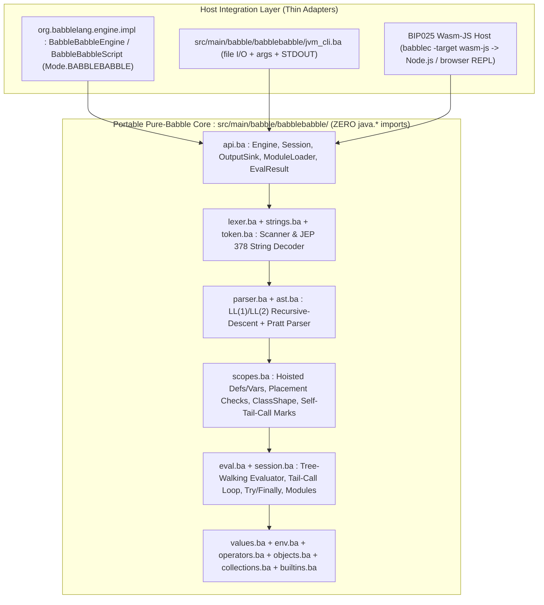
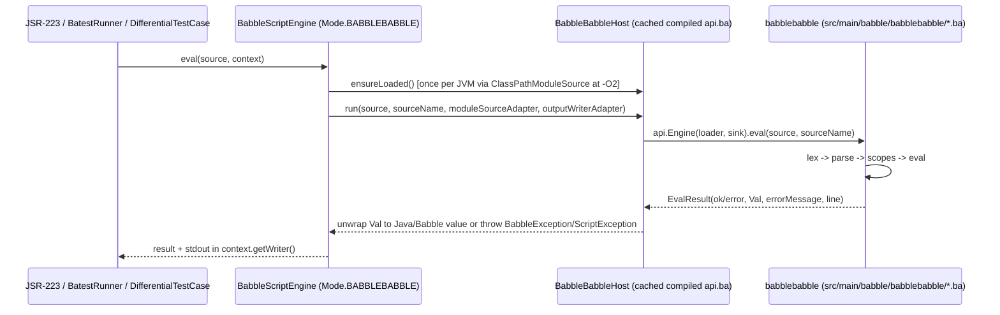

# BIP035: `babblebabble` — A Babble Interpreter Written in Babble

| | |
|---|---|
| **BIP** | 035 |
| **Date** | 2026-11-25 |
| **Status** | Draft (`BIP035-Q1`–`BIP035-Q11` open ; `BIP035-P1`–`BIP035-P6` planned) |
| **Depends on** | Object model ([bip002_object-model.md](bip002_object-model.md)), interactive sessions ([bip004_repl.md](bip004_repl.md)), modules ([bip005_modules.md](bip005_modules.md)), module sources & runtime boundary ([bip006_module-sources-and-aot.md](bip006_module-sources-and-aot.md)), static typing & core types ([bip008_static-typing.md](bip008_static-typing.md), [bip011_core-types.md](bip011_core-types.md)), `.batest.md` differential harness ([bip009_test-coverage.md](bip009_test-coverage.md), [bip029_batest-v2-and-ir-goldens.md](bip029_batest-v2-and-ir-goldens.md)), predicate-free LL(1)/LL(2) grammar ([bip012_grammar-improvements.md](bip012_grammar-improvements.md)), iterators & loop control ([bip013_iterators.md](bip013_iterators.md)), unified `HIR` optimizer ([bip014_optimization-passes.md](bip014_optimization-passes.md), [bip039_mir-deorbitation.md](bip039_mir-deorbitation.md)), front-end options analysis ([bip015_down-with-the-ants.md](bip015_down-with-the-ants.md)), pure-by-default effects & HOF forwarding ([bip016_consolidating-effect-annotations.md](bip016_consolidating-effect-annotations.md), [bip017_higher-order-function-effects.md](bip017_higher-order-function-effects.md)), arrays, optional/variadic/overloaded arguments, intersections, type aliases & self tail calls ([bip020_array-types.md](bip020_array-types.md), [bip021_optional-variadic-overloaded-arguments.md](bip021_optional-variadic-overloaded-arguments.md), [bip022_intersection-types.md](bip022_intersection-types.md), [bip023_type-aliases.md](bip023_type-aliases.md), [bip024_tail-calls.md](bip024_tail-calls.md)), WebAssembly Portable Core ([bip025_compile-to-wasm.md](bip025_compile-to-wasm.md)), multiline & raw strings ([bip026_multiline-strings-and-string-templates.md](bip026_multiline-strings-and-string-templates.md)), exception handling ([bip028_exception-handling.md](bip028_exception-handling.md)), ranges (`mod`, `//`; [bip031_ranges.md](bip031_ranges.md)), immutable `def` / mutable `var` bindings ([bip034_immutable-def-and-mutable-var.md](bip034_immutable-def-and-mutable-var.md)), pattern matching ([bip038_pattern-matching.md](bip038_pattern-matching.md)), and `init` constructors ([bip040_constructors.md](bip040_constructors.md)) |
| **Scope** | A first-class Babble interpreter written in **100% portable pure Babble** under `src/main/babble/babblebabble/`, featuring a hand-written lexer, JEP 378 string decoder, LL(1)/LL(2) recursive-descent + Pratt parser, static scope/placement/tail-call pre-pass, and tree-walking evaluator implementing Babble's full pure-Babble runtime semantics while erasing static type and effect annotations at parse time (with an optional later phase `BIP035-P6` for a self-hosted static type checker) ; wired into `BabbleScriptEngine` (`babble.mode=babblebabble`), `DifferentialTestCase`, and `BatestTestCase` through a thin JVM host adapter in `org.babblelang.engine.impl` without touching `babble-runtime.jar` ; culminating in byte-identical `examples/raytracer-argon/scene.ppm`, meta-circular "`babblebabblebabble`" self-hosting, and zero-modification `BIP025` WebAssembly playground compilation |

---

## 1. Summary

Today, Babble executes scripts through three Java-hosted backends:

1. The reference tree-walking [`Interpreter`](../../src/main/java/org/babblelang/engine/impl/Interpreter.java) (1,895 lines) walking ANTLR4 parse trees (`babble.mode=interpret`).
2. The unified `HIR` JVM bytecode compiler (`babble.mode=compile`, `-O0`/`-O1`/`-O2`, and `babblec` AOT jars; `BIP039` retired the separate SSA `MIR` tier).
3. The WebAssembly 3.0 (`WasmGC`) AOT backend (`babblec -target wasm-js` / `wasm-bare`, `-O1`/`-O2`, `BIP025-I0`–`I5`, `RM018`, `BIP039`).

This proposal introduces **`babblebabble`** — a **first-class Babble interpreter backend written in Babble itself**, living under `src/main/babble/babblebabble/`:

* **100% portable pure-Babble core:** Zero `java.*` or `javax.*` imports anywhere in the core modules. `babblebabble` is built exclusively from Babble's Portable Core (`byte`..`string`, `list`, `set`, `sortedset`, `map`, `sortedmap`, `entry`, `array`, `range`, `record`, `class`, `interface`, `object`, `exception`, closures, `for`/`while`, `match`, `try`/`catch`/`finally`/`throw`, `recurse`, `def`/`var`, `init`, modules, and pluggable `OutputSink` / `ModuleLoader` interfaces) — verified directly by `BIP025`'s `WasmPortabilityChecker`.
* **Full self-hosted pure-Babble pipeline:** Hand-written scanner + `BIP026-I1` string decoder, hand-written LL(1)/LL(2) recursive-descent + Pratt parser (zero ANTLR4), pre-evaluation scope / `def`-vs-`var` / placement / self-tail-call pass, and tree-walking evaluator covering Babble's full pure-Babble runtime semantics (`BIP002`–`BIP040`), erasing static type and effect annotations at parse time in `BIP035-P1`–`BIP035-P5` (with an optional self-hosted static type checker in `BIP035-P6`).
* **First-class engine & test integration:** Loaded via [`ClassPathModuleSource`](../../src/main/java/org/babblelang/engine/ClassPathModuleSource.java) (or build-time AOT compilation, `BIP035-Q2`), bridged by a thin host adapter in `org.babblelang.engine.impl` (keeping `babble-runtime.jar` and [`RuntimeBoundaryTestCase`](../../src/test/java/org/babblelang/tests/RuntimeBoundaryTestCase.java) completely untouched), selectable via `-Dbabble.mode=babblebabble`, and differential-tested against `interpret`, `-O0`, `-O1`, `-O2`, and `wasm-js -O1`/`-O2` in [`DifferentialTestCase`](../../src/test/java/org/babblelang/tests/DifferentialTestCase.java) and [`BatestTestCase`](../../src/test/java/org/babblelang/tests/batest/BatestTestCase.java).
* **Three concrete self-hosting milestones:**
  1. **Portable corpus parity** across Babble's pure-Babble `.ba` examples and `.batest.md` specification suite (`193` files / `3,581` cases, excluding quarantined `jailbreaks/`).
  2. **Real-world program parity:** `babblebabble` (compiled at `-O2` on the JVM) interprets all 15 files of [`examples/raytracer-argon/`](../../examples/raytracer-argon/) and renders byte-identical `scene.ppm` (`1,021,340` bytes).
  3. **Meta-circular tower ("`babblebabblebabble`") & Wasm playground:** Compiled `babblebabble` interprets `babblebabble`'s own source code, which in turn interprets Babble programs and produces identical results — and the same unmodified core compiles via `babblec -target wasm-js` (`BIP025-I0`–`I5`) into a zero-backend browser/Node.js Babble REPL.

---

## 2. Motivation & Strategic Synergies

Babble's existing flagship applications ([`examples/raytracer-argon/`](../../examples/raytracer-argon/) and [`examples/raytracer-fable/`](../../examples/raytracer-fable/)) are numeric, tight-loop geometry programs. While they drove major language and compiler breakthroughs (`RM001`, `RM008`, `RM009`, `RM010`, `RM013`, `RM018`), they barely touch symbolic, allocation-rich, polymorphic workloads. Writing a Babble interpreter in Babble delivers five high-leverage benefits simultaneously:

1. **A symbolic systems stress test for Babble and its `-O1`/`-O2` & Wasm compilers:**
   An interpreter is the canonical *non-numeric* workload: recursive AST `interface` + `record` hierarchies, megamorphic `is` / `match` type-dispatch chains, character-by-character scanning and `string` slicing, `map`-heavy lexical environments, closures, `try`/`catch`/`finally` unwinding, dynamic overload resolution, and multi-module graphs. Compiling `babblebabble` itself (~4,000–6,000 LOC across ~15 modules) with `HirVerifier`, `CheckClassAdapter`, and `WasmVerifier` stress-tests Babble's entire compiler stack on real-world object-oriented and functional code.
2. **An independent executable specification and differential oracle:**
   Today, Babble's JVM and Wasm compilers are differential-tested against the Java `Interpreter`, but all three share ANTLR4, `StringLiterals`, `BlockScopes`, and `TypeChecker`. An independent interpreter written from scratch in Babble exposes hidden coupling to ANTLR4 CST quirks, implicit runtime coercions, and underspecified edge cases across `DifferentialTestCase` and `BatestTestCase`.
3. **Live pathfinder for `BIP015` (*Down with the ants*):**
   Following `BIP012` (`RM006`), `BIP031`, `BIP034`, `BIP038`, and `BIP040`, [`Babble.g4`](../../src/main/antlr4/org/babblelang/parser/Babble.g4) is a 368-line, zero-predicate LL(1)/LL(2) grammar parsed in pure `PredictionMode.SLL`. Implementing a hand-written lexer + recursive-descent + Pratt parser in `babblebabble` directly exercises `BIP015` Option 6 against every `.ba` and `.batest.md` file in the repository, validating exact newline rules, LL(2) lookahead points, and REPL `classify` behavior before committing the Java front end to a migration.
4. **An immediate zero-backend browser Babble REPL via `BIP025` (`RM018`):**
   Now that `BIP025-I0`–`I5` (`RM018`) has shipped, Babble already compiles portable programs to WebAssembly 3.0 (`babblec -target wasm-js`). Because `babblebabble`'s core obeys `BIP025-D6` and `BIP025-D12`'s strict Portable Core boundary (zero `java.*` imports, pluggable `OutputSink` and `ModuleLoader`), compiling `src/main/babble/babblebabble/` with `babblec -target wasm-js` immediately produces an interactive in-browser Babble interpreter and teaching playground with zero JVM and zero backend server — directly serving Babble's founding teaching objective ([`README.md`](../../README.md)).
5. **Language ergonomics dogfooding:**
   Just as writing `raytracer-argon` produced the *lessons from the ray tracer* checklist (and directly motivated `BIP013`, `BIP016`, `BIP017`, and `BIP034`), building and maintaining `babblebabble` inside the main repository ensures Babble's core ergonomics (sum-type dispatch, string building, collection APIs, `BIP034` `def`/`var` hygiene, effect ergonomics, and diagnostics) are tested daily by Babble's own codebase.

---

## 3. High-Level Architecture & Module Layout

### 3.1 Layered Pipeline

`babblebabble` enforces a strict separation between its **100% portable pure-Babble core** (`src/main/babble/babblebabble/`) and thin **host adapters** (JVM `BabbleScriptEngine` bridge, JVM CLI runner, and `BIP025` Wasm-JS host):



### 3.2 Module Inventory (`src/main/babble/babblebabble/`)

Every module is a focused, pure-by-default (`BIP016`), `def`/`var`-hygienic (`BIP034`) Babble module kept cleanly structured and formatted under `FormatterTestCase`:

| Module | Role | Key Exported Abstractions | Portable Core Only? |
|---|---|---|---|
| `token.ba` | Lexer token kinds & source locations | `TokenKind` integer constants, `Span(line, col)`, `Token(kind, text, line, col)` | Yes (0 `java.*`) |
| `strings.ba` | Exact port of [`StringLiterals.java`](../../src/main/java/org/babblelang/parser/StringLiterals.java) (`BIP026-I1`) | `decodeString`, `decodeRaw`, `decodeMultiline`, `decodeChar`, `validateUnterminated`, `StringBuf` | Yes (0 `java.*`) |
| `lexer.ba` | Hand-written scanner for all [`Babble.g4`](../../src/main/antlr4/org/babblelang/parser/Babble.g4) tokens | `Lexer`, `lex(source)`, `LexError`, significant `NL`, `;;` / `;;( ... ;;)` comments, REPL `classify` token probe | Yes (0 `java.*`) |
| `ast.ba` | Immutable AST node hierarchy | `Expr`, `TypeAst`, `ParamAst`, `ClassParamAst`, `CatchAst`, `CallArgAst`, ~38 `record` node variants | Yes (0 `java.*`) |
| `parser.ba` | Hand-written LL(1)/LL(2) recursive-descent + Pratt parser | `Parser`, `parseFile(source)`, `ParseError(message, line, col, atEnd)` | Yes (0 `java.*`) |
| `scopes.ba` | Pre-evaluation structural, `def`/`var` & tail-call analysis | `ScopeInfo`, `ClassMeta`, `InterfaceMeta`, hoisted per-block `def`/`var` decls, placement & immutability validation, `BIP024` self-tail-call sites | Yes (0 `java.*`) |
| `values.ba` | Guest runtime value model | `Val` interface + `record` / `class` variants for all 9 scalars, `null`, closures, classes, interfaces, instances, arrays, collections, modules, exceptions | Yes (0 `java.*`) |
| `env.ba` | Lexical environments & TDZ slots | `Slot(name, value, isSet, isFinal)`, `Env` lexical chain (`declare`, `set`, `assign`, `lookup`, `child`) | Yes (0 `java.*`) |
| `operators.ba` | Exact operator, equality, truthiness & conversion semantics | 6-tier JLS numeric promotion, `/` float/double rules, cross-numeric `==` & `hashVal`, `Truth`, `same`, `classof`, `byte`..`string` conversions, dynamic `is`/`as` | Yes (0 `java.*`) |
| `objects.ba` | Guest object model & argument/overload dispatch | `ClassVal`, `InterfaceVal`, `InstanceVal`, `BoundMethodVal`, `OverloadVal`, `super(I)` resolution, `record` structural equality/`toString`, `BIP021` argument binder | Yes (0 `java.*`) |
| `collections.ba` | Guest arrays, core collections, `string` methods & iterators | `ArrayVal` (reified `set` check, deep equality/format), `list`/`set`/`sortedset`/`map`/`sortedmap`/`entry` factories (`from:`, `capacity:`, `comparator:`, `.of(...)`), portable `string` methods, `for` iteration protocol | Yes (0 `java.*`) |
| `builtins.ba` | Guest implicit bindings & prelude functions | `print`/`println`/`affiche`/`afficherc` (`to:`), `assert`/`suppose`, `same`, `classof`, `move`/`freeze`/`discard`, `import`/`importe`, `STDOUT`, `exception`, conversions | Yes (0 `java.*`) |
| `eval.ba` | Tree-walking evaluator, control flow & modules | `Evaluator`, self-tail-call trampoline, `try`/`catch`/`finally`/`throw` unwinding, cyclic-safe module loader, error line tracking | Yes (0 `java.*`) |
| `session.ba` | Nested REPL sessions & input classification (`BIP004`) | `Session` (`eval(source, name)`), `classify(source)` -> `EMPTY` / `INCOMPLETE` / `COMPLETE` | Yes (0 `java.*`) |
| `api.ba` | Public portable facade (single entry point for hosts & meta-circular runs) | `OutputSink`, `BufferSink`, `ModuleLoader`, `MapModuleLoader`, `EvalResult`, `Engine`, `run(...)` | Yes (0 `java.*`) |
| `jvm_cli.ba` | Thin JVM command-line file runner (not imported by `api.ba`) | Reads files via `java.nio.file.Files`, wires `STDOUT` + `args`, runs scripts via `api.Engine` | Thin JVM wrapper |

### 3.3 Architectural & Repository Boundaries

* **Zero `java.*` core invariant:** Verified both statically (zero `java.` / `javax.` references outside `jvm_cli.ba`) and directly via `BIP025`'s `WasmPortabilityChecker` (`BIP035-Q10`), guaranteeing `api.ba` and every module it imports remain 100% Wasm-portable.
* **Grammar & formatter enforcement:** [`ParserGrammarTestCase`](../../src/test/java/org/babblelang/tests/ParserGrammarTestCase.java) and [`FormatterTestCase`](../../src/test/java/org/babblelang/tests/FormatterTestCase.java) are extended to scan `src/main/babble/` alongside `examples/` and `src/test/batest/`, ensuring every `babblebabble` module parses in pure `PredictionMode.SLL` and stays formatter-clean (`-format -check`).
* **Runtime boundary untouched:** `babble-runtime.jar` (`org.babblelang.runtime/**` and `org.babblelang.engine.impl.natives/**`) never depends on `babblebabble` or its host adapter; [`RuntimeBoundaryTestCase`](../../src/test/java/org/babblelang/tests/RuntimeBoundaryTestCase.java) and [`ArchitectureBoundaryTestCase`](../../src/test/java/org/babblelang/tests/ArchitectureBoundaryTestCase.java) remain 100% green.

---

## 4. Hand-Written Lexer, String Decoder & LL(1)/LL(2) Pratt Parser

### 4.1 Lexer & `BIP026-I1` String Decoder (`token.ba`, `strings.ba`, `lexer.ba`)

`Babble.g4` already has **zero `@lexer::members`** and **zero lexer modes**, making a hand-written scanner direct and small (~450–550 lines):

* **Comments & whitespace:** `[ \t]+` skipped; `\r?\n` emitted as `NL`; `;;` line comments skipped to end of line; `;;( ... ;;)` multiline comments skipped with the exact longest-match rule from `Babble.g4` (if `;;(` closes on the same line and is followed by code, note `Babble.g4`'s longest-match semantics — matched identically).
* **Numbers:** Distinguishes `INT`, `LONG_LIT` (`[0-9]+[lL]`), `FLOAT_LIT` (`...f`/`F`), and `DOUBLE_LIT` (`[0-9]+.[0-9]+`, exponents `[eE][+-]?[0-9]+`, or `[dD]` suffix), requiring a leading digit before `.` so `.foo` on a new line lexes as `DOT` + `ID`.
* **Strings & chars (`strings.ba`):** Mirrors [`StringLiterals.java`](../../src/main/java/org/babblelang/parser/StringLiterals.java) (427 lines) line-for-line in pure Babble:
  * Single-line `"..."` (`\b`, `\t`, `\n`, `\f`, `\r`, `\"`, `\'`, `\\`, `\0`, `\uXXXX`, rejecting raw newlines).
  * Raw single-line `r"..."` (literal backslashes, no newlines; `r` followed by anything other than `"` or `"""` lexes as `ID`).
  * JEP 378 `"""..."""` and `r"""..."""`: mandatory `[ \t]*\r?\n` after opening delimiter, common-prefix dedenting anchored on the closing `"""`, mixed leading tab/space rejection (`mixed tabs and spaces in multiline string indentation`), uniform trailing horizontal whitespace stripping, `\s`, and `\<newline>` line continuation.
  * Unterminated multiline string validation producing `atEnd = true` when the prefix typed so far is valid — feeding `session.ba`'s `classify(source)` directly (`BIP026-D3`).
* **Keywords:** Single static `map of (string, int)` mapping all reserved keywords (`if`, `then`, `else`, `def`, `var`, `return`, `forever`, `break`, `continue`, `try`, `catch`, `finally`, `throw`, `while`, `for`, `in`, `and`, `or`, `null`, `not`, `true`, `false`, `recurse`, `object`, `class`, `record`, `type`, `interface`, `implements`, `extends`, `is`, `as`, `this`, `super`, `private`, `static`, `export`, `fn`, `overload`, `of`, `calling`, `axiom`, `pure`, `volatile`, `io`, `mut`, `shared`, `unique`, `frozen`, `nothrow`, `idempotent`, `commutative`, `associative`, `monotone`, `injective`, and core scalar/collection/exception/any/void keywords).

### 4.2 AST Representation (`ast.ba`)

Babble does not have `sealed` or `enum` syntax yet, so AST nodes use an `interface Expr` (with an integer `tag(): int` and `line(): int` for fast dispatch or `is` narrowing) implemented by immutable `record`s:

```babble
export def Span = record (line: int, col: int) ()

export def Expr = interface (
    def line: fn (): int
    def col: fn (): int
)

export def IntLit = record (value: int, lineNum: int, colNum: int) implements Expr (
    def line = fn (): int -> (this.lineNum)
    def col = fn (): int -> (this.colNum)
)

export def BinaryExpr = record (
    op: string,
    left: Expr,
    right: Expr,
    leftText: string,
    rightText: string,
    lineNum: int,
    colNum: int
) implements Expr (
    def line = fn (): int -> (this.lineNum)
    def col = fn (): int -> (this.colNum)
)
```

Notice `leftText` / `rightText` (or source span slices `(startOffset, endOffset)` over the original source string!) — storing `(startOffset, endOffset)` on `Expr` nodes lets `babblebabble` slice exact source texts on error paths (`Not a number : x`, `CallSite` argument texts) with **zero allocation on the happy path**!

Type annotations (`TypeAst`) are parsed faithfully into lightweight `record`s (`SimpleTypeAst`, `NullableTypeAst`, `NonNullTypeAst`, `UnionTypeAst`, `IntersectionTypeAst`, `FnTypeAst`, `OverloadTypeAst`, `NullTypeAst`, `FrozenTypeAst`) so that:
1. Runtime `is T`, `as T`, `catch e: A | B`, `(array of T)(n)`, and `class ... implements I` / `interface extends I` have exact structured type descriptors.
2. Optional store-time numeric widening (e.g., `def x: double = 1`, `BIP035-Q7`) has access to declared scalar annotations.
3. Optional Phase `BIP035-P6` (self-hosted static type checker) consumes the exact same `ast.ba` without re-parsing.

### 4.3 LL(1)/LL(2) Recursive-Descent & Pratt Parser (`parser.ba`)

Because `Babble.g4` is predicate-free LL(1)/LL(2), the parser is a textbook recursive-descent parser for declarations/control flow paired with a Pratt loop for expressions:

| Precedence (low → high) | Operators / Forms | Associativity | Newline Rule |
|---|---|---|---|
| 1 (prefix) | `return e`, `forever e`, `break [e]`, `continue`, `throw e` | Prefix | `NL` terminates bare `break` |
| 2 | `=`, `+=`, `-=`, `*=`, `/=` | Right | `NL*` allowed after operator |
| 3 | `or` | Left | `NL*` allowed after `or` |
| 4 | `and` | Left | `NL*` allowed after `and` |
| 5 (prefix) | `not e` | Prefix | No `NL` before operand required |
| 6 | `<`, `<=`, `==`, `!=`, `<>`, `>=`, `>` | Left | `NL*` allowed after operator |
| 7 | `e is Type` | Postfix/Type | `NL*` allowed after `is` |
| 8 | `+`, `-` | Left | `NL*` allowed after operator |
| 9 | `*`, `/` | Left | `NL*` allowed after operator |
| 10 | `e as Type` | Postfix/Type | `NL*` allowed after `as` |
| 11 (prefix) | `-e` (unary minus; folds `-2147483648` to `int` literal) | Prefix | **Never** crosses a preceding `NL` from a previous expr |
| 12 (postfix) | `.m`, `?.m`, `!`, `of TypeArgs`, `(CallArgs)` | Left | `NL*` allowed **before** `.`/`?.`; **never** before `(` |

The only LL(2) lookahead sites in the entire language are:
1. Named call arguments: `isMemberName(peek(0)) and peek(1) == COLON` (before `...` spread or expression).
2. Optional parameter names in function types: `peek(0) == ID and peek(1) == COLON`.
3. `if ... then (...) else if ...` vs. `else (...)` (after skipping `NL*`).
4. `def` / `var` / `export def` / `private def` / `private var` / `axiom` / `type` prefixes.
5. `super(Qualifier)` vs. bare `super`.

---

## 5. Pre-Evaluation Static Pass (`scopes.ba`)

Before evaluating a file or REPL input, `scopes.ba` runs a single fast AST walk mirroring the runtime-relevant parts of Java's `BlockScopes`, `TypeChecks`, and `TailCalls` (without full type/effect inference):

1. **Per-block hoisted `def` / `var` declarations (`BIP034`):** Collects every `def` (`isFinal = true`) and `var` (`isFinal = false`) declared directly inside each file, function, `if` branch, `while`/`for` body, `try`/`catch`/`finally` block, and block expression. At runtime, entering a block pre-declares those slots as *unset*, reproducing Babble's exact TDZ error (`Name used before definition : <name>`) and immutability diagnostics (`Cannot assign to def : <name>`, `Cannot assign to parameter : <name>`, `Cannot assign to def member : <name>`).
2. **Placement, `def`/`var` & structural validation:**
   * `return` outside a function, `break`/`continue` outside `while`/`for`, `this`/`super` outside class/object/interface, `export` outside file top level.
   * `return`/`break`/`continue` escaping a `finally` block (`BIP028-D6`).
   * `BIP034` rules: mandatory `= expr` on `def`/`var` outside interfaces (`Declaration requires an initializer : <name>`), no `export var` (`Cannot export a var : <name>`), `def`-only interfaces (`Interface members cannot be var : <name>`), `private var`-only statics (`Public static members cannot be var : <name>`), `var` forbidden in `record`s (`Value class members cannot be var : <name>`), `var f = fn ...` as a mutable field rather than a method, and local-only `fn (var ...)` parameters.
   * `private` only inside class/object/static bodies; duplicate parameter/member names.
3. **Class & interface shapes:** Builds `ClassMeta` / `InterfaceMeta` tables (constructor parameter list, `keywordOnlyStart`, header `def`/`var` fields, body fields, `private` and `mutable` flags, methods vs. fields, static members, `isRecord`, `isObject`).
4. **Self-tail-call detection (`BIP024`):** Identifies tail-position calls within each `FnExpr` targeting `recurse(...)`, the function's own `def`, or `this.m(...)` inside method `m` (never inside `try`/`finally` where cleanup must run), marking those `CallExpr` nodes so `eval.ba` executes them via a constant-stack `while` trampoline.

---

## 6. Runtime Value Model, Semantics & Evaluator

### 6.1 Guest Value Model (`values.ba`)

Under the recommended tagged representation (`BIP035-Q4`), every guest value implements `interface Val`:

| Guest Category | Babble Representation | Notes |
|---|---|---|
| Scalars (`byte`..`char`, `string`) | `ByteVal(v: byte)`, `ShortVal(v: short)`, `IntVal(v: int)`, `LongVal(v: long)`, `FloatVal(v: float)`, `DoubleVal(v: double)`, `BoolVal(v: bool)`, `CharVal(v: char)`, `StrVal(v: string)` | Exact 9-scalar fidelity (`byte(1)` vs `int(1)` vs `long(1)` vs `float(1)` vs `double(1)`); singleton `TRUE_VAL`, `FALSE_VAL` |
| `null` | Singleton `NULL_VAL` | Avoids conflating guest `null` with host `Val?` sentinel (`UNSET` / `MISSING`) |
| Functions & Overloads | `FnVal(ast, closureEnv, ownerClass, selfName)`, `BoundMethodVal(receiver, fn)`, `OverloadVal(alts)`, `NativeVal(name, handler)` | Captures lexical `Env` by reference; supports `recurse` binding and `BIP024` tail trampoline |
| Object Model | `ClassVal(meta, closureEnv, interfaces, staticSlots)`, `InterfaceVal(meta, supers, defaults, staticSlots)`, `InstanceVal(cls, slots, definedFlags)` | `record` equality/hashing/`toString` implemented directly in `objects.ba`; `Member used before definition` via `definedFlags` |
| Arrays & Collections | `ArrayVal(elemType, items: list of Val)`, `ListVal`, `SetVal`, `SortedSetVal`, `MapVal`, `SortedMapVal`, `EntryVal` | Backed directly by host Portable Core collections; reified element checks on `ArrayVal.set`; deep content equality and `[a, b]` formatting |
| Modules & Exceptions | `ModuleVal(key, exports: map of (string, Slot))`, `ExceptionVal(message, suppressed: list of Val)`, `OutputSinkVal(sink)` | `ModuleVal` is read-only (`Cannot assign to an export : ...`); guest `throw` accepts either `ExceptionVal` or any nominal `InstanceVal` (`BIP028-D2`) |

### 6.2 Operators, Equality, Truthiness & Dynamic Type Checks (`operators.ba`)

`operators.ba` reproduces Babble's exact runtime contracts from [`Operators.java`](../../src/main/java/org/babblelang/runtime/Operators.java), [`Truth.java`](../../src/main/java/org/babblelang/runtime/Truth.java), [`Values.java`](../../src/main/java/org/babblelang/runtime/Values.java), and [`ConvertFunction.java`](../../src/main/java/org/babblelang/engine/impl/natives/ConvertFunction.java):

* **Operator methods first:** If the left operand of `+`, `-`, `*`, `/` (or operand of unary `-`) is an `InstanceVal`, dispatch to its public `plus`/`minus`/`times`/`div`/`neg` method (failing with `No such member : <method>` if absent).
* **String concatenation:** `StrVal + x` concatenates `formatVal(x)` (calling guest `toString()` on `InstanceVal`, `[...]` on `ArrayVal`, `"null"` on `NULL_VAL`).
* **6-tier JLS numeric promotion:**
  * `+`, `-`, `*`: `{byte, short, int} × {byte, short, int} -> int` (32-bit wrap-around); else with `long -> long` (64-bit wrap-around); else with `float -> float`; else `double`.
  * `/`: `float` if at least one operand is `float` and neither is `double` or `long`; otherwise `double` (IEEE-754 infinity / `NaN`, never divide-by-zero error).
  * Unary `-`: sub-`int` -> `int`, `long` -> `long`, `float` -> `float`, `double` -> `double`.
* **Equality & hashing:** Cross-numeric equality (`1 == 1.0`, `1L == 1.0`, `-0.0 == 0.0`, `NaN != NaN`), `char` strictly non-numeric (`'a' != 97`), structural equality for `record`s and `array`s, reference identity for regular `class`/`object` instances (unless custom `equals` — matching Babble's `record` vs `class` rules), and consistent `hashVal` so `record`s and numeric keys work in guest `set`/`map`.
* **Compound assignment (`+=`, `-=`, `*=`, `/=`):** Evaluates target receiver exactly once, reads current value before evaluating RHS, applies the operator, and stores back.
* **Dynamic `is` & `as`:** Evaluates `TypeAst` against `Val` — covering all 9 scalars, `null`, `any`, `list`..`entry`, `array of T` (reified element type), `exception`, nominal `ClassVal` / `InterfaceVal` (transitively over `implements`/`extends`), unions `A | B`, intersections `A & B`, and nullables `T?`.
* **Conversions (`byte(x)`..`string(x)`):** Exact range checking, truncation toward zero on `double`/`float` -> integral, string parsing with whitespace stripping, and `Out of the <T> range : ...` / `Not a <T> : ...` diagnostics.

### 6.3 Evaluator, Tail Calls, Exceptions & Modules (`eval.ba`, `builtins.ba`, `session.ba`)

* **Lexical scoping (`env.ba`):** Every block with declarations pushes a child `Env` pre-populated with unset `Slot`s. Loops (`while`, `for`) push a fresh `Env` per iteration so closures created in different iterations capture distinct slots.
* **Argument binding (`objects.ba`):** Mirrors [`Arguments.java`](../../src/main/java/org/babblelang/runtime/Arguments.java) — positional arguments, C#-rule named arguments (`foo(b: 2, a: 1)`), keyword-only separator `...`, default parameter expressions evaluated lazily in the callee's scope, variadic rest parameters `xs: T...` packed into iterable views, and `...expr` spread arguments (`BIP021`).
* **Self-tail-call trampoline (`BIP024`):** Inside `callFunction(fn, receiver, args, names)`, the body runs inside a `while true` loop. When a marked self-tail-call executes, it evaluates its arguments and returns a `TailCallBounce(args, names)` (without growing the host JVM/Wasm stack); the loop rebinds the parameter frame and continues in $O(1)$ stack space.
* **Exception handling (`BIP028`):** `try`/`catch`/`finally`/`throw` tracks active guest exceptions with source line numbers, runs `finally` unconditionally across normal completion, `return`, `break`, `continue`, and `throw` (appending secondary throws via suppressed exception lists), matches `catch` clauses against `TypeAst` (untyped `catch` matches any non-internal guest throw), and never allows user `catch` to intercept `return`/`break`/`continue`.
* **Modules (`BIP005`) & Sessions (`BIP004`):**
  * `Engine` maintains a per-eval `map of (string, ModuleVal)` keyed by `ModuleLoader.resolve(name, fromKey)`. A module's `ModuleVal` (backed by its live root `Env` export slots) is registered **before** its body runs so circular imports work identically to the Java runtime.
  * `Session` chains nested `Env` frames per input and preserves one loaded-module cache for the lifetime of the session, exposing `classify(source)` (`EMPTY` / `INCOMPLETE` / `COMPLETE`) using `lexer.ba` + `parser.ba`.

---

## 7. First-Class Host Engine, Build & Test-Suite Integration

### 7.1 Host Adapter & Engine Wiring

A thin Java host bridge in `org.babblelang.engine.impl` connects `BabbleScriptEngine` to the pure-Babble `api.ba` facade:



Key design properties of the host bridge:
* **Compile once, reuse everywhere:** `BabbleBabbleHost` compiles `src/main/babble/babblebabble/api.ba` (and all its static imports) **once** per JVM using Babble's own JVM compiler (`-O1` or `-O2`, configurable via `-Dbabble.babblebabble.hostOpt=2`), caching the compiled `BabbleScript` / `Module` in a thread-safe static holder. Because compiled Babble code is thread-safe (unlike the Java `Interpreter`), `babblebabble` runs safely under JUnit Jupiter's concurrent test execution (`junit-platform.properties`)!
* **New `BabbleScriptEngine.Mode`:**
  ```java
  public enum Mode {
      INTERPRET, COMPILE, BABBLEBABBLE;
      ...
  }
  ```
  Selected with `-Dbabble.mode=babblebabble` or `engine.put(BabbleScriptEngine.MODE, "babblebabble")`.
* **Value marshaling at the boundary:** `BabbleBabbleHost` translates top-level guest `Val` return values back to Java objects (`Integer`, `Double`, `String`, `Boolean`, `null`, formatted strings for guest instances) and guest errors into `BabbleException` / `ScriptException` with matching line numbers so JSR-223 callers, `DifferentialTestCase`, and `BatestRunner` observe identical contracts.
* **`ModuleSource` & `Writer` bridging:** Java's `ModuleSource` (`MapModuleSource`, `FileModuleSource`, `ClassPathModuleSource`) is wrapped into a Babble `ModuleLoader` callback object, and `ScriptContext.getWriter()` into a Babble `OutputSink` callback object — zero `java.*` leakage into `babblebabble`'s core!

### 7.2 Maven Packaging (`pom.xml`)

`src/main/babble` is added to `<build><resources>` in [`pom.xml`](../../pom.xml) (just like `org/babblelang/axioms/**/*.ba`):

```xml
<resource>
    <directory>src/main/babble</directory>
    <includes>
        <include>babblebabble/**/*.ba</include>
    </includes>
</resource>
```

*(See `BIP035-Q2` for the trade-off between classpath `.ba` resources compiled lazily vs. build-time `babblec` AOT precompilation into `target/classes`.)*

### 7.3 `DifferentialTestCase` & `BatestTestCase` Integration

Babble's test suites currently contain (after `BIP037` retired `src/test/babble/` in favor of `.batest.md`):
* `193` `.batest.md` files (`3,581` cases, excluding quarantined `jailbreaks/`) across `14` categories, including:
  * **Portable pure-Babble runtime/syntax/control/object/collection/module/session suites** (`primitives/`, `control/`, `functions/`, `objects/`, `modules/`, `sessions/`, `syntax/`, `runtime/`, plus non-Java cases of `types/`, `soundness/`, and `compiler/` — already classified for `WasmBatestTestCase` under `BIP025-I5`).
  * **Java interop suites** (`java/` and snippets importing `java.*`/`javax.*`).
  * **Static-only type & effect error suites** (`effects/`, compile-time type-error cases in `types/`).

Integration works cleanly at two layers:
1. **`DifferentialTestCase`:** Runs portable snippets across `interpret`, `compile`, **and** `babblebabble` (comparing result, stdout, and error parity).
2. **`BatestTestCase`:** Recognizes `babble.mode=babblebabble`, skips IR/`wat` golden checks (just like `interpret` mode), and reuses `BIP025`'s transparent, deterministic **portable-case classification** (skipping `java.*`-interop cases, and — until `BIP035-P6` lands unless `hostCheck=true` per `BIP035-Q3` — static-type/effect-only error cases). Zero silent passes: every skipped case is counted and reported explicitly, and every portable pure-Babble case must pass with **0 divergences**.

---

## 8. Self-Hosting Milestones & Benchmarking

| Milestone | Description | Success Criterion |
|---|---|---|
| **M1 — Parser & Portable Suite Parity** | `babblebabble` parses every `.ba` & `.batest.md` file in the repo and passes all portable pure-Babble `DifferentialTestCase` + `BatestTestCase` cases | 100% parse parity; 0 behavioral divergences on all portable pure-Babble cases |
| **M2 — `examples/raytracer-argon`** | Compiled `babblebabble` (`-O2`) interprets all 15 files of `examples/raytracer-argon` | Small test render passes in CI; full render produces byte-identical `scene.ppm` (`1,021,340` bytes) |
| **M3 — Meta-Circular Tower ("`babblebabblebabble`")** | Compiled `babblebabble` interprets `src/main/babble/babblebabble/*.ba` from source, which interprets a guest Babble test program exercising closures, `record`s, `interface`s, `for` loops, `match`, `init`, `BIP024` tail recursion, `BIP028` `try`/`catch`/`finally`, `BIP034` `def`/`var`, and modules | Exact output & result parity between direct execution, Level-1 `babblebabble`, and Level-2 `babblebabblebabble` |
| **M4 — Symbolic Optimizer Benchmarks** | Add `babblebabble` rows to `Benchmarks.java` (lex/parse `raytracer-argon`, interpret fib/objects/collections under host `-O0` / `-O1` / `-O2`) | Reproducible before/after timings guiding `BIP014` optimizations on polymorphic AST workloads |
| **M5 — WebAssembly Playground (`BIP025-I0`–`I5`)** | Compile `src/main/babble/babblebabble/api.ba` directly with `babblec -target wasm-js` | Zero source changes to `babblebabble` core; passes `WasmVerifier` and runs guest Babble snippets on Node.js (V8) / browser |

---

## 9. Open Questions (`BIP035-Q1`–`BIP035-Q11`)

These eleven design questions should be settled into `BIP035-D1`–`BIP035-D11` before implementation of `BIP035-P1` begins:

* **`BIP035-Q1` — Execution engine architecture: tree-walking AST evaluator vs. bytecode VM?**
  * *Option A (Recommended):* **Tree-walking AST evaluator** over immutable `record` AST nodes. Directly mirrors Java's `Interpreter.java` (1,895 LOC), keeps `babblebabble` transparent and didactic, maps 1-to-1 to `BIP015` Option 6, and makes debugging/line attribution trivial.
  * *Option B:* Compile AST to compact linear bytecode and run a stack/register VM in Babble. Potentially faster for hot guest loops (like `raytracer-argon`), at the cost of significantly more code (bytecode compiler, constant pools, exception tables, line-number tables) and less direct parity with `Interpreter.java`.
  * *(Note: Option A does not preclude adding an optional bytecode tier later once the tree-walker passes 100% parity.)*

* **`BIP035-Q2` — Build & loading model for `src/main/babble/babblebabble/`?**
  * *Option A (Recommended):* Package `src/main/babble/babblebabble/*.ba` as classpath resources in `babble.jar`, lazily compiled once per JVM via `ClassPathModuleSource` at `-O1`/`-O2` and cached in `BabbleBabbleHost`. Zero Maven build-plugin bootstrap complexity (no chicken-and-egg compiling Babble with itself during `mvn compile`), trivial edit-test loop, and ~100–250 ms one-time warmup per JVM.
  * *Option B:* Precompile `src/main/babble/babblebabble/` AOT into `target/classes/babble/babblebabble/*.class` during Maven `process-classes` using `babblec`. Eliminates startup compile time (~0 ms cold start) and ships pre-verified `.class` files in `babble.jar`, at the cost of a two-stage Maven build lifecycle.

* **`BIP035-Q3` — Static analysis boundary when running under `BabbleScriptEngine.Mode.BABBLEBABBLE`?**
  * *Option A:* **Strictly standalone** — `babble.mode=babblebabble` never invokes ANTLR4 or Java's `BlockScopes`/`TypeChecker`/`EffectChecker`; `BatestTestCase` and `DifferentialTestCase` skip static-only type/effect-error cases until `BIP035-P6` lands.
  * *Option B (Recommended):* **Standalone by default, with opt-in `-Dbabble.babblebabble.hostCheck=true`.** Default `babble.mode=babblebabble` runs 100% self-hosted (zero ANTLR4/Java front end, proving true independence); setting `hostCheck=true` optionally runs Java's front-end type/effect checker first so `babblebabble` can also be validated on the full non-Java `.batest.md` suite (including static-error tests) prior to `BIP035-P6`.
  * *Option C:* Always run Java's `TypeChecker`/`EffectChecker` in `Mode.BABBLEBABBLE` and use `babblebabble` only as the runtime evaluator (weakens self-hosting because ANTLR4 remains on the critical path).

* **`BIP035-Q4` — Guest value representation in `values.ba`?**
  * *Option A (Recommended):* **Tagged `interface Val` + `record` wrappers** (`IntVal`, `DoubleVal`, `StrVal`, `NullVal`, `InstanceVal`, ...). Completely type-safe under Babble's strict static typing (`BIP008`), preserves exact 9-scalar identity (`byte(1)` vs `int(1)` vs `double(1)`), isolates guest `null`/`exception`/`InstanceVal` cleanly from host values, avoids unsafe `as` casts, and compiles cleanly to `BIP025` WasmGC.
  * *Option B:* **Host-native `any?` sharing** for scalars and `string` (only wrapping guest `Fn`/`Class`/`Instance`). Reduces boxing allocation on numeric guest operations, at the cost of heavier `as` casts, subtle `null`/sentinel collisions (`UNSET`, `MISSING`), and blurred host/guest `equals`/`toString` semantics.

* **`BIP035-Q5` — Control-flow unwinding (`return`, `break`, `continue`, `throw`) in `eval.ba`?**
  * *Option A:* **`BIP028` Babble `throw`/`try`/`catch` signals** (`record ReturnSignal(v: Val)`, `record BreakSignal(v: Val)`, `record ContinueSignal()`). Concise and zero-overhead on straight-line code (mirroring Java `Interpreter`'s `ControlFlowSignal`), but constructs a host JVM `ThrownException` stack trace on every guest `return`/`break`/`continue` unless `BIP028` adds stackless/lightweight throw optimization.
  * *Option B (Recommended to benchmark early):* **Explicit lightweight `EvalControl` / tagged return value** (e.g., returning `Val` directly on the happy path and checking `v is FlowSignal` only at block/loop/function boundaries — where `FlowSignal` implements `Val` internally as a private sentinel!). Zero JVM stack-trace construction on `return`/`break`/`continue`/`TailCall`, while still using `BIP028` `throw`/`try`/`catch` (or a `ThrowSignal` sentinel) for guest exceptions!

* **`BIP035-Q6` — CI Surefire execution strategy in `pom.xml`?**
  * *Option A (Recommended):* Run dedicated `BabbleBabbleTestCase` (parser corpus parity, portability check, meta-circular tower, and core `DifferentialTestCase` parity) inside default `mvn package`, and add a full `babblebabble-tests` Surefire execution running the entire portable `BatestTestCase` suite either under an opt-in `-Pbabblebabble` profile (mirroring `-PO2`) or directly in default `mvn package` once runtime overhead is benchmarked (`< 15 s` target).
  * *Option B:* Add a mandatory Surefire execution (`babblebabble-tests`) to default `mvn package` from day one.

* **`BIP035-Q7` — Dynamic overload resolution & type-directed numeric widening without a static type checker (`BIP035-P1`–`BIP035-P5`)?**
  * In compiled/Java-interpreted Babble, `TypeChecker` resolves `overload (...)` statically (inserting union splits only for union types) and records static widening sites (`def d: double = 1` widens `1` to `1.0`; `fn (x: double)` widens call argument `1` to `1.0`).
  * *Proposed approach:*
    1. For declared scalar annotations (`def x: double = e`, `var x: double = e`, `fn (x: double)`, `record (x: double)`, `fn (): double`), `eval.ba` applies **annotation-directed widening** using the parsed `TypeAst` (`byte -> short -> int -> long -> float -> double`) when storing/passing/returning a numeric `Val`.
    2. For `overload (...)` calls, `objects.ba` performs **dynamic specificity resolution** over runtime argument types (matching [`Overloads.java`](../../src/main/java/org/babblelang/runtime/Overloads.java): exact match > narrowest numeric widening > subtype specificity > variadic).
  * Should `babblebabble` also enforce runtime `TypeAst` checks on annotated `def`/`var` / parameter / return boundaries (catching type mismatches dynamically even before `BIP035-P6`), or keep type annotations purely for widening/`is`/`as`/`array` creation?

* **`BIP035-Q8` — Efficient string building in 100% pure portable Babble?**
  * Lexing, string unescaping, multiline dedenting, `array`/`record` formatting, and `BufferSink` build strings incrementally. Without `java.lang.StringBuilder`, naive `s = s + c` in a loop is $O(n^2)$.
  * *Option A (Recommended for `BIP035-P1`):* Implement a small pure-Babble `StringBuf` class in `strings.ba` backed by a `list of string` (flushing chunks via binary divide-and-conquer concatenation in $O(n \log n)$ with zero `java.*` imports, and slicing contiguous unescaped runs via `source.substring(start, end)` so most tokens do **zero** per-character concatenation!).
  * *Option B:* Introduce a new portable core type (e.g. `stringbuilder`) in Babble itself (extending `BIP025`'s Portable Core on both JVM and Wasm), requiring a small language/prelude addition outside `BIP035`.

* **`BIP035-Q9` — Syntax error diagnostic parity vs. ANTLR4's `BailErrorStrategy`?**
  * Runtime errors (`Name used before definition : x`, `Not a number : x`, `No such member : foo`, `Assertion failed : ...`, `Out of the int range : ...`, `Cannot assign to def : x`) must match Java `Interpreter` **verbatim**.
  * Syntax errors from ANTLR4's `BailErrorStrategy` currently have the form `Syntax error : unexpected <token>` (or `Lexical error at line L:C : ...`). Should `babblebabble`'s hand-written parser match ANTLR4's exact `Syntax error : unexpected <token>` phrasing (ensuring 100% `.batest.md` syntax-error parity) or permit richer messages normalized by `BatestRunner`? *(Recommended: match `Syntax error : unexpected <token>` and `Lexical error at line L:C : ...` verbatim!)*

* **`BIP035-Q10` — WebAssembly (`BIP025`) portability gate & Node.js playground CI verification?**
  * Now that `BIP025-I0`–`I5` (`RM018`) has landed with `WasmPortabilityChecker`, `babblec -target wasm-js`, and pooled Node.js (V8) test workers (`NodeWasmRunner`), `babblebabble`'s core can be verified against the real Wasm backend continuously rather than by string-scanning alone.
  * *Option A (Recommended):* Gate every phase (`BIP035-P1` onward) on `WasmPortabilityChecker` + `babblec -target wasm-js` compilation with `WasmVerifier`, and run a Node.js (V8) Wasm smoke test of `babblebabble` in `BIP035-P4`/`BIP035-P5` CI (plus an optional static HTML browser playground demo alongside `examples/`).
  * *Option B:* Restrict CI to `WasmPortabilityChecker` only and keep full `wasm-js` compilation/execution manual until `BIP035-P5` finishes.

* **`BIP035-Q11` — Scope & priority of optional Phase `BIP035-P6` (self-hosted static type checker)?**
  * *Option A (Recommended):* Keep `BIP035-P6` explicitly scoped as a **follow-up phase** targeting core `BIP008` + `BIP011` + `BIP020`–`BIP023` + `BIP028` + `BIP031` + `BIP034` + `BIP038` + `BIP040` static typing in `src/main/babble/babblebabble/typechecker.ba` (leaving `BIP016`/`BIP017` effect checking and any future self-hosted compiler to a separate BIP if desired).
  * *Option B:* Make a full static type + effect checker mandatory for `BIP035` completion.

---

## 10. Phased Implementation Plan (`BIP035-P1`–`BIP035-P6`)

Each phase keeps `mvn -B package -PO2` green across all existing modes (`interpret`, `-O0`, `-O1`, `-O2`, `wasm-js -O1`/`-O2`), passes `ParserGrammarTestCase`, `FormatterTestCase`, `RuntimeBoundaryTestCase`, `ArchitectureBoundaryTestCase`, and `BabbleBabblePortabilityTestCase`, and adds incremental tests.

### `BIP035-P1` — Hand-Written Lexer, String Decoder, AST & LL(1)/LL(2) Pratt Parser
* Add `src/main/babble/babblebabble/` modules: `token.ba`, `strings.ba` (`StringBuf` + full `BIP026-I1` `StringLiterals` port), `lexer.ba`, `ast.ba`, and `parser.ba` (covering the full `Babble.g4` grammar including `BIP031` ranges/`mod`/`//`, `BIP034` `def`/`var`, `BIP038` `match`, and `BIP040` `init`).
* Wire `src/main/babble` as a Maven resource in `pom.xml`; extend `ParserGrammarTestCase` and `FormatterTestCase` to include `src/main/babble/`.
* Add `BabbleBabblePortabilityTestCase` (verifying zero `java.*`/`javax.*` imports and passing `BIP025`'s `WasmPortabilityChecker` across all core modules).
* Add `BabbleBabbleParserTestCase`: runs `babblebabble`'s lexer & parser over every `.ba` file in `examples/`, `src/main/babble/`, and every valid `babble` block across all `.batest.md` files (plus syntax/lexical error cases and `BIP026-I1` multiline edge cases), verifying **100% parse parity** with ANTLR4.

### `BIP035-P2` — Core Evaluator, Scopes, Scalars, Closures, Control Flow, Tail Calls & Exceptions
* Implement `scopes.ba`, `values.ba`, `env.ba`, `operators.ba`, `builtins.ba`, and `eval.ba` covering:
  * All 9 scalars, 6-tier JLS promotion, `/`, `//`, `mod`, unary `-`, comparisons, cross-numeric `==` & hashing, `Truth`, `same`, `classof`, `byte`..`string` conversions, string concatenation, and compound assignment.
  * Block scoping, hoisted `def`/`var` TDZ (`Name used before definition`), `BIP034` `def` immutability (`Cannot assign to def`, `Cannot assign to parameter`, mandatory initializers), closures, recursion (`recurse`), `BIP024` self-tail-call trampoline, `forever`.
  * `if`/`else if`/`else`, `match` (`BIP038`), `while`, `break [expr]`, `continue`, `return`, `BIP028` `try`/`catch`/`finally`/`throw` (including suppressed exceptions and `ControlFlowSignal` isolation).
  * Core built-ins (`print`/`println`/`affiche`/`afficherc` with `to:`, `assert`/`suppose`, `move`/`freeze`/`discard`, `STDOUT`, `exception`).
* Add `BabbleBabbleCoreTestCase` verifying parity against Java `Interpreter` across all expression, closure, tail-call, and exception cases.

### `BIP035-P3` — Object Model, Collections, Iterators & Overloads
* Implement `objects.ba` and `collections.ba`:
  * `class`, `record` (auto `equals`/`hashCode`/`toString`, read-only members), `object`, `interface` (`extends`, default methods, `super.m()`/`super(I).m()`, `def`-only bodies), `BIP040` `init` constructors and `this(...)` delegation, `private` and `def`/`var` member enforcement (`ClassMeta` mutability, `private var`-only statics, `var f = fn ...` as mutable field), `static` blocks, `Member used before definition`, operator methods (`plus`/`minus`/`times`/`div`/`floorDiv`/`mod`/`neg`), safe navigation `?.`, non-null `!`, and dynamic `is`/`as` (scalars, unions `|`, intersections `&`, nullables `?`, nominal types, arrays, `exception`).
  * `BIP021` argument binding (positional, named, keyword-only `...`, optional defaults, variadic `xs: T...`, spread `...e`) and dynamic `overload (...)` dispatch.
  * `BIP020` `array of T` (size, `.of(...)`, `from:`, `size`/`get`/`set`, reified store checks, deep equality/formatting), `BIP031` `range of T` (`lo..hi`, `lo..<hi`, `.step`, `.reversed`), `BIP011` `list`/`set`/`sortedset`/`map`/`sortedmap`/`entry` + portable `string` methods, and `BIP013` `for` loops across arrays, ranges, core collections, and custom guest iterables/iterators.

### `BIP035-P4` — Modules, Sessions, Portable API & First-Class Engine / Test Integration
* Implement `session.ba` (`Session` nested scopes + `classify`), `api.ba` (`Engine`, `OutputSink`, `BufferSink`, `ModuleLoader`, `MapModuleLoader`, `EvalResult`), and thin `jvm_cli.ba`.
* Add `BabbleScriptEngine.Mode.BABBLEBABBLE` and the thin JVM host adapter (`org.babblelang.engine.impl.BabbleBabbleHost`, `BabbleBabbleScript`, `BabbleBabbleSession`) compiling and caching `api.ba` once per JVM.
* Wire `babblebabble` into `DifferentialTestCase` (portable snippets) and `BatestTestCase` / `BatestRunner` (all portable pure-Babble `.batest.md` cases), plus `Main` CLI `-Dbabble.mode=babblebabble`.

### `BIP035-P5` — Self-Hosting Milestones, Wasm Playground & Benchmarks
* Verify **M2 (`examples/raytracer-argon`)**: run small render in automated tests and full render by hand confirming byte-identical `examples/raytracer-argon/scene.ppm` (`1,021,340` bytes).
* Verify **M3 (Meta-circular "`babblebabblebabble`")**: add a dedicated test loading `src/main/babble/babblebabble/*.ba` into a `MapModuleLoader`, executing `babblebabble` inside compiled `babblebabble`, and running a comprehensive guest Babble program at nesting level 2.
* Verify **M5 (`BIP025` WebAssembly playground)**: compile `src/main/babble/babblebabble/api.ba` via `babblec -target wasm-js`, verify with `WasmVerifier`, and run guest Babble snippets through the compiled `.wasm` via `NodeWasmRunner`.
* Add `babblebabble` benchmark rows to `Benchmarks.java` across host `-O0` / `-O1` / `-O2`, profile hotspots, and record actionable language/compiler lessons in [`README.md`](../../README.md) and this BIP.

### `BIP035-P6` (Optional Follow-Up) — Self-Hosted Static Type Checker
* Add `typechecker.ba` implementing bidirectional static type checking (`BIP008`, `BIP011`, `BIP020`–`BIP023`, `BIP028`, `BIP031`, `BIP034`, `BIP038`, `BIP040`) over `ast.ba` and `scopes.ba`.
* Enable standalone `babble.mode=babblebabble` to pass static type-error `.batest.md` cases with zero Java `TypeChecker` involvement.

---

## 11. Verification & Parity Criteria

1. **Portability & repository invariants:**
   * `BabbleBabblePortabilityTestCase`: 0 `java.*` / `javax.*` references across every core module in `src/main/babble/babblebabble/`, passing `BIP025`'s `WasmPortabilityChecker`.
   * `ParserGrammarTestCase`: every `.ba` file in `src/main/babble/` parses in pure `PredictionMode.SLL`.
   * `FormatterTestCase`: `-format -check src/main/babble examples src/main/java/org/babblelang/axioms` passes clean.
   * `RuntimeBoundaryTestCase` & `ArchitectureBoundaryTestCase`: 0 boundary or LOC-ceiling regressions; `babble-runtime.jar` stays untouched.
2. **Differential & specification parity:**
   * `mvn -B package -PO2` green across all existing modes (`interpret`, `-O0`, `-O1`, `-O2`, `wasm-js -O1`/`-O2` with `HirVerifier`, `CheckClassAdapter`, and `WasmVerifier`) plus `babblebabble` tests.
   * 100% parse parity on all `.ba` files and `.batest.md` cases.
   * 0 behavioral divergences on all portable pure-Babble `DifferentialTestCase` and `BatestTestCase` cases (`stdout`, `stderr`, result, and normalized user errors).
3. **Self-hosting proof points:**
   * `examples/raytracer-argon/raytracer.ba` executed by `babblebabble` renders byte-identical `scene.ppm` (`1,021,340` bytes).
   * Meta-circular "`babblebabblebabble`" test (Level-2 self-interpretation) passes deterministically in CI.
   * `babblec -target wasm-js` compiles `babblebabble` core cleanly and executes guest Babble scripts on Node.js (V8).
   * `Benchmarks` reports reproducible `-O0` / `-O1` / `-O2` host speedups running `babblebabble`.
