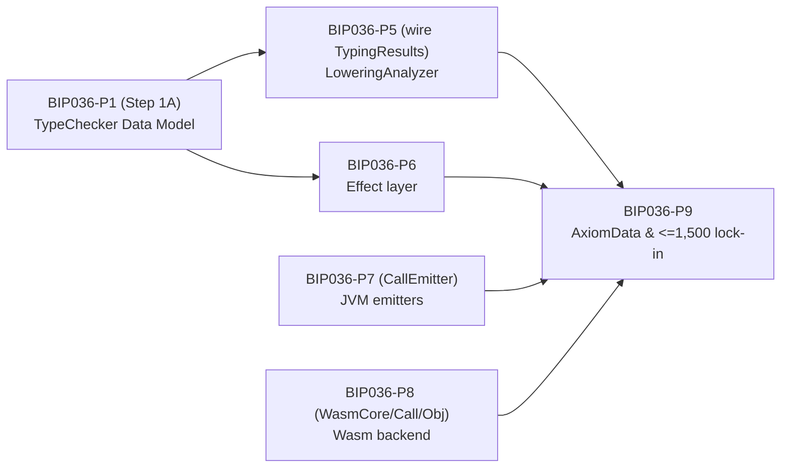
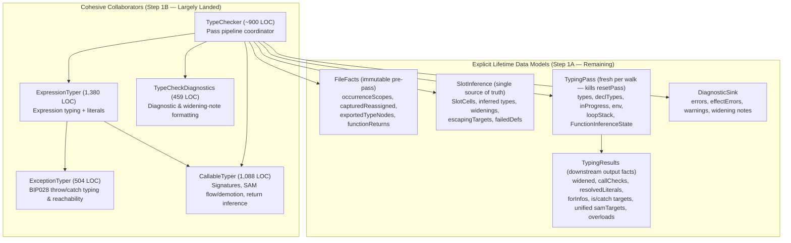
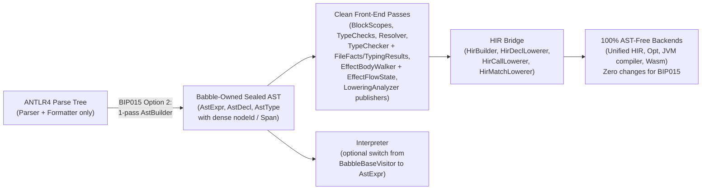

# BIP036: Compiler Simplification, Front-End Data-Model Redesign, and God-Class Splits

| | |
|---|---|
| **BIP** | 036 |
| **Date** | 2026-11-25 |
| **Status** | Decided / Partially superseded (`BIP036-D1`–`BIP036-D6` settled ; `BIP036-P2`/`P4` retired by `BIP039` ; `BIP036-P3`/`P5` and `HirEmitter`/`WasmFuncEmitter`/`WasmRuntimeGen`/`ScalarReplacePass` splits landed in `BIP039-I0` and periodic refactors ; `BIP036-P1` Step 1A, `BIP036-P6`, `BIP036-P7` `CallEmitter`, `BIP036-P8` `WasmCoreEmitter`/`WasmCallEmitter`/`WasmObjectSystem`, and `BIP036-P9` `AxiomData` + `<= 1,500`-LOC lock-in remain planned) |
| **Depends on** | Type-checker simplification (`RM004`, [bip010_type-checker-simplification.md](bip010_type-checker-simplification.md)), unified structured `HIR` optimizer (`RM010`/`RM013`, [bip014_optimization-passes.md](bip014_optimization-passes.md), [bip039_mir-deorbitation.md](bip039_mir-deorbitation.md)), compiler modularity & structural ceilings (`RM012`, [bip027_tackling-complexity-in-the-compiler.md](bip027_tackling-complexity-in-the-compiler.md)), WebAssembly backend (`RM018`, [bip025_compile-to-wasm.md](bip025_compile-to-wasm.md)), exception handling ([bip028_exception-handling.md](bip028_exception-handling.md)), `.batest.md` v2 & IR goldens ([bip029_batest-v2-and-ir-goldens.md](bip029_batest-v2-and-ir-goldens.md)), immutable `def` / mutable `var` ([bip034_immutable-def-and-mutable-var.md](bip034_immutable-def-and-mutable-var.md)) ; prepares clean seams for [bip015_down-with-the-ants.md](bip015_down-with-the-ants.md) Option 2 |
| **Scope** | Pure internal refactoring and data-model simplification across `org.babblelang.analysis`, `org.babblelang.compiler`, and `org.babblelang.wasm` : fixing the lifetime/state data model in `TypeChecker` (`resetPass()` retirement) and `EffectBodyWalker`, decomposing the remaining `> 2,000`-LOC grandfathered files (`WasmCoreEmitter`, `EffectBodyWalker`, `WasmCallEmitter`, `CallEmitter`, `CallEffectAnalyzer`) and remaining `> 1,500`-LOC multi-responsibility classes (`EffectAstExtractors`, `WasmObjectSystem`, `AxiomData`, etc.), and tightening `ArchitectureBoundaryTestCase`'s universal `<= 2,000`-LOC ceiling (with shrinking `GRANDFATHERED_CEILINGS` ratchet) to a universal `<= 1,500`-LOC ceiling across `src/main/java`. Zero surface-syntax, diagnostic, IR, `.wasm`, or `babble-runtime` behavioral changes. |

---

## 1. Summary & Motivation

### 1.1 Why a structural pause is needed (and what already landed)

When `BIP036` was drafted after `RM018` (`master` at `aeeb1a8`, 106,514 LOC in `src/main/java`), `ArchitectureBoundaryTestCase` only capped a manual 3-file list (`CallSolver`, `HirEmitter`, `EffectChecker`), allowing `TypeChecker`, `MirLowerer`, and `WasmFuncEmitter` to exceed 2,000 LOC.

Since then, several major structural improvements have already landed alongside `BIP031` (ranges), `BIP037` (test hygiene), `BIP038` (`match`), `BIP039` (MIR deorbitation), `BIP040` (`init` constructors), and `BIP041` (`-crib`):

* **`BIP039` retired the entire MIR stack** (`org.babblelang.ir.mir.*`, `org.babblelang.opt.mir.*`, `MirEmitter`, `MirSlotAllocator`, `MirAbiBridge` — retiring `BIP036-P2` and `BIP036-P4` completely).
* **`BIP039-I0` and periodic refactors cleared several `BIP036` targets:** `HirBuilder` (1,995 → 1,190 LOC via `HirDeclLowerer`, `HirCallLowerer`, `HirMatchLowerer`, registered in `HIR_BRIDGE_CLASSES`), `HirEmitter` (1,836 → 1,301 LOC via `FrameVarEmitter`, `MethodEntryEmitter`), `ScalarReplacePass` (1,369 → 1,240 LOC via `RecordLayout`, `RecordBetaReducer`, `UnboxedBorrowSpecializer`), `LoweringAnalyzer` (1,756 → 950 LOC via `DispatchTargetDeriver`), `WasmFuncEmitter` (2,360 → 1,238 LOC via `WasmVarAndDefEmitter`, `WasmControlAndTypeEmitter`), `WasmRuntimeGen` (1,628 → 1,152 LOC via `WasmNumericRuntimeGen`, `WasmValueRuntimeGen`, `WasmRuntimeOpsGen`), and `TypeChecker` collaborator extractions (`ExpressionTyper`, `ExceptionTyper`, `CallableTyper`, `TypeCheckDiagnostics`, bringing `TypeChecker.java` from 3,852 → 1,636 LOC).
* **[`ArchitectureBoundaryTestCase.java`](../../src/test/java/org/babblelang/tests/ArchitectureBoundaryTestCase.java) now enforces a universal `HARD_MAX_LOC = 2_000` ceiling** across all production `*.java`/`*.g4`/`*.ba` files under `src/main`, with a shrinking `GRANDFATHERED_CEILINGS` ratchet (`5` entries remaining).

What remains is the highest-leverage core of `BIP036`: retiring `TypeChecker.resetPass()` via explicit lifetime-separated data models (`BIP036-P1` Step 1A), breaking up the 5 remaining `> 2,000`-LOC grandfathered classes (`WasmCoreEmitter`, `EffectBodyWalker`, `WasmCallEmitter`, `CallEmitter`, `CallEffectAnalyzer`), isolating `AxiomData` from ANTLR (`BIP036-P9`), and tightening the repo-wide ceiling from `2,000` to `<= 1,500` LOC ahead of [`BIP015`](bip015_down-with-the-ants.md) Option 2 and [`BIP033`](bip033_tensors.md).

### 1.2 Quantitative Baseline (Refreshed: 158,776 LOC across 367 files in `src/main/java`)

Package breakdown : `analysis` 55,514 (74 files), `wasm` 32,759 (34), `opt` 15,941 (25), `compiler` 15,155 (25), `ir` 14,438 (37), `runtime` 11,122 (71), `engine` 5,484 (33), `crib` 3,216 (9), `batest` 2,239 (6), others 2,908 (53).

#### Tier 1 — Remaining `> 2,000`-LOC Grandfathered Monoliths (11,470 LOC across 5 files)

| File | LOC | Grandfathered Ceiling | Root Structural / Data-Model Symptoms |
|---|---:|---:|---|
| [`WasmCoreEmitter.java`](../../src/main/java/org/babblelang/wasm/WasmCoreEmitter.java) | **2,463** | 2,463 | Grew across `BIP031` ranges, `BIP038` `match`, and `BIP040` constructors alongside core collection/string/array lowering in one emitter. |
| [`EffectBodyWalker.java`](../../src/main/java/org/babblelang/analysis/EffectBodyWalker.java) | **2,360** | 2,365 | Mutable control-flow, alias/loop/try state, symbolic HOF matrices, and summary accumulators tangled on one mutable object; also imports `java.lang.reflect.*` directly. |
| [`WasmCallEmitter.java`](../../src/main/java/org/babblelang/wasm/WasmCallEmitter.java) | **2,323** | 2,323 | Fuses direct/self/tail calls, dynamic calls & direct built-ins, `$generic_F` and bound-method trampolines, `BIP021-I5` overload dispatch, and portable `JavaConstructorCall` lowering. |
| [`CallEmitter.java`](../../src/main/java/org/babblelang/compiler/CallEmitter.java) | **2,186** | 2,195 | Mixes core-collection lowering, Babble/super/tail calls, Java calls, bound-argument marshaling, and overload-set creation/dispatch. |
| [`CallEffectAnalyzer.java`](../../src/main/java/org/babblelang/analysis/CallEffectAnalyzer.java) | **2,138** | 2,146 | Fuses core-collection/array effects, Java call reflection & SAM propagation, Babble HOF symbolic instantiation & forwarding, and exclusivity checking. |

#### Tier 2 — Remaining `1,500–2,000`-LOC Files (17 files) & Targeted Simplifications

| File | LOC | Notes / Simplification Opportunity |
|---|---:|---|
| [`TypeChecker.java`](../../src/main/java/org/babblelang/analysis/TypeChecker.java) | **1,636** | Down from 3,852 LOC after extracting `ExpressionTyper` (1,380), `CallableTyper` (1,088), `ExceptionTyper` (504), and `TypeCheckDiagnostics` (459), but still retains `resetPass()` and tangled pass lifetimes (`BIP036-P1` Step 1A). |
| [`WasmObjectSystem.java`](../../src/main/java/org/babblelang/wasm/WasmObjectSystem.java) | **1,965** | Two phases in one class : Phase 1 declares every interface & class layout, Phase 2 emits constructors, vtable hooks, itables, and `init_objects`. |
| [`AxiomData.java`](../../src/main/java/org/babblelang/analysis/AxiomData.java) | **1,855** | Split ANTLR axiom parsing & canonical-order checking (`AxiomParser`) from the AST-free model & lookup table (`AxiomData` → add to `ANTLR_FREE_ANALYSIS_CORES`), shrinking `BIP015` Option 2 surface area. |
| [`EffectAstExtractors.java`](../../src/main/java/org/babblelang/analysis/EffectAstExtractors.java) | **1,837** | Fuses two unrelated AST extractors : pure/mutating algebraic term extraction and polynomial SCP termination extraction (`ScpWalker`). |
| Other `1,500–2,000`-LOC files (`13` files) | 1,507–1,966 | `CallSolver` (1,966), `InlinePass` (1,921), `Interpreter` (1,895), `EffectChecker` (1,884), `TypeAlgebra` (1,827), `JavaTypeBridge` (1,805), `MatchTyper` (1,794), `WasmRuntimeOpsGen` (1,751), `WasmArrayOpsGen` (1,735), `WasmMemberEmitter` (1,716), `BytecodeEffectAnalyzer` (1,707), `BlockScopes` (1,659), `HirCanonicalPrinter` (1,507) — trim or split as needed before `BIP036-P9` locks in `<= 1,500` LOC (or keep `<= 1,500` on refactored modules while keeping `HARD_MAX_LOC` aligned with `periodic-refactor`). |

Test files (`TypeCheckerTestCase.java`, `BatestCoverageReporter.java`) and `BytecodeEffectAnalyzer.analyzeSingleMethod` (deferred to `BIP018-P1` per `BIP027-D7`) are explicitly out of scope.

---

## 2. Root-Cause Diagnosis

### 2.1 Why `TypeChecker.java` (and `EffectBodyWalker.java`) accumulate complexity: a data-model problem

Merely slicing methods out of `TypeChecker.java` without fixing its underlying state model leaves a thinner façade over the same mutable blackboard. Four concrete data-model flaws explain the friction :

1. **Struct-of-Arrays keyed by raw ANTLR `ParserRuleContext`:** Because analysis operates directly on generated ANTLR parse-tree nodes (which cannot carry fields or dense IDs), every new language feature (`for`, `is`, overloads, SAM adapters, `try`/`catch`, `match`, `init`) adds external `IdentityHashMap<ParserRuleContext, ...>` fields to `TypeChecker` and `.clear()` lines to `resetPass()`. `LoweringAnalyzer` then copies those facts a second time into `ScopeAnalysis` for `HirBuilder`.
2. **Four distinct lifetimes tangled on one mutable object:** `resetPass()` exists because one class mixes :
   - *Immutable whole-file pre-pass facts* (never cleared) : `occurrenceScopes`, `capturedReassigned`, `exportedTypeNodes`, `functionReturns`.
   - *Cross-round converged inference state* (persists across `resetPass()`) : `inferredDefs`/`Members`/`Params`, `def`/`member`/`paramWidenings`, `escapingTargets`, `p7Params`.
   - *Per-walk transient scratch & recursion stacks* (wiped every pass) : `types`, `declarationTypes`, `inProgress`, `env`, `loopStack`, `inferenceStack`, `inferringResult`, `recursiveFunctions`, `provisionalResults`, `contextual*`, `nextEscapingTargets`, `failedDefs`.
   - *Downstream output facts & separate diagnostic buckets* : `widened`, `callChecks`, `resolvedLiterals`, `forInfos`, `isTargetTypes`, `catchTargetTypes`, SAM maps, overload maps, plus `diagnostics`, `effectDiagnostics`, `warnings`, `demoteDiagnostics`.
3. **Duplicated shadow state across collaborators:** `SlotInference` already owns `SlotCell(value, widenedLine)` for every `def`, member, and parameter, and then copies those values back into **6 shadow maps on `TypeChecker`** (`inferredDefs`, `inferredMembers`, `inferredParams`, `defWidenings`, `memberWidenings`, `paramWidenings`). Similarly, SAM adaptations are split across 3 separate maps (`samTargets`, `forElemSamTargets`, `asSamTargets`) for the same concept.
4. **Star-hub coupling (`new Collaborator(this)`):** Collaborators (`CallSolver`, `SlotInference`, `TypeAnnotations`, `MemberTypes`, `OperatorTypes`, `Narrowing`, `TypedProgram`, `LoweringAnalyzer`, `TypedModuleSummary`, `ExpressionTyper`, `ExceptionTyper`, `CallableTyper`) hold `TypeChecker this` as a service locator and mutable blackboard, making `TypeChecker` the default dumping ground for any shared state.

`EffectBodyWalker.java` exhibits the same pattern : dozens of mutable fields on one object mixing immutable callable configuration, control-flow environments (`env`, `activeForIterables`, `loopBreakOrigins`, `activeTryStack`), symbolic HOF flow matrices (`calledCallbacks`, `symParamFlow`/`symThisFlow`/`symExtFlow`), and accumulated summary output flags.

### 2.2 Historical note on `MirLowerer` (retired by `BIP039`)

*Superseded by [`BIP039`](bip039_mir-deorbitation.md):* `MirLowerer.java` and `MirEmitter.java` were originally targeted by `BIP036-P2` and `BIP036-P4`. `BIP039` subsequently deorbited the entire `org.babblelang.ir.mir` / `org.babblelang.opt.mir` / `MirEmitter` tier in favor of unified structured `HIR` (`HirSccpPass` + dominator-scoped `HirAeGraphPass`), eliminating those files altogether.

### 2.3 Why the Wasm backend grew god classes

`BIP025` reached byte-for-byte Argon parity by growing emitters along the JVM backend's lines before `ArchitectureBoundaryTestCase` enforced a repo-wide 2,000-LOC ceiling : `WasmFuncEmitter` and `WasmRuntimeGen` have since been split, while `WasmCoreEmitter` (2,463 LOC), `WasmCallEmitter` (2,323 LOC), and `WasmObjectSystem` (1,965 LOC) remain oversized. The backend is HIR-only (it imports `org.babblelang.ir.hir.*`, `LoweringTargets`, `PrimitiveKind`, and `CompilationTarget`, never the parser), so these splits are independent of the front-end work and of `BIP015`.

---

## 3. Architectural Decisions (`BIP036-D1`–`BIP036-D6`)

* **`BIP036-D1` — Option A lifetime-separated front-end data model now, `BIP015` Option 2 soon after :** Refactor `TypeChecker` (`BIP036-P1`) and `EffectBodyWalker` (`BIP036-P6`) around explicit lifetime-scoped model objects (`FileFacts`, single-source-of-truth `SlotInference`, fresh-per-walk `TypingPass` + `TypingResults`, `DiagnosticSink`, `EffectFlowState`) without introducing throwaway ANTLR wrapper hierarchies. Every container stays minimal and cleanly keyed so migrating `ParserRuleContext` keys to Babble's owned Java 21 sealed-record AST in [`BIP015`](bip015_down-with-the-ants.md) Option 2 is mechanical.
* **`BIP036-D2` — Strict 100% behavioral & IR parity :** `BIP036` changes zero Babble syntax, runtime semantics, diagnostic text/`line:column` coordinates, HIR/`wat` canonical goldens, emitted `.wasm` bytes, or `babble-runtime` classes (`RuntimeBoundaryTestCase`).
* **`BIP036-D3` — Cohesive stage/domain collaborators targeting `<= 1,200` LOC :** Every split extracts package-private collaborators along a single named responsibility (never arbitrary `Part1`/`Part2` slicing) with zero public API churn. Newly extracted or refactored classes target `<= 1,200` LOC to leave headroom for future proposals.
* **`BIP036-D4` — Explicit AST→HIR bridge allowlist *(implemented in `BIP039-I0`)* :** `ArchitectureBoundaryTestCase.HIR_BRIDGE_CLASSES` already allows the explicit HIR bridge classes (`HirBuilder`, `HirDeclLowerer`, `HirCallLowerer`, `HirMatchLowerer`, plus `BabbleCompiler`), keeping every other class in `org.babblelang.ir.*`, `org.babblelang.opt.*`, `org.babblelang.compiler.*`, and `org.babblelang.wasm.*` strictly AST-free and `ScopeAnalysis`-free.
* **`BIP036-D5` — Keep `MirLowerer` purely structural *(retired by `BIP039`)* :** `BIP039` retired `org.babblelang.ir.mir.*` and `org.babblelang.opt.mir.*` and moved dominator-scoped `aegraph` rewriting directly onto structured `HIR` (`HirAeGraphPass`).
* **`BIP036-D6` — Universal repo-wide `<= 1,500`-LOC ceiling :** Upon completing the remaining `BIP036` phases, tighten `ArchitectureBoundaryTestCase.HARD_MAX_LOC` (currently `2,000` with 5 `GRANDFATHERED_CEILINGS` exemptions) to `<= 1,500` LOC across `src/main/java/**/*.java` with zero exemptions, add `AxiomData` to `ANTLR_FREE_ANALYSIS_CORES`, and extend `effectCheckerIsolatesReflection` to cover `EffectBodyWalker`.

---

## 4. Implementation Plan (`BIP036-P1`–`BIP036-P9`)

`BIP036-P2` and `BIP036-P4` were retired by `BIP039`; `BIP036-P3` (`HirBuilder`), `HirEmitter` (`P7` half), `WasmFuncEmitter`/`WasmRuntimeGen` (`P8` half), and `ScalarReplacePass` (`P9` half) already landed in `BIP039-I0` and periodic refactors. Among the remaining phases, `BIP036-P1` comes first because `BIP036-P5` (wiring `TypingResults`) and `BIP036-P6` consume `TypingResults`; `BIP036-P7` (`CallEmitter`) and `BIP036-P8` touch disjoint packages and can run in any order or in parallel. `BIP036-P9` locks in the ceiling last.

### `BIP036-P1` — `TypeChecker` Data-Model Redesign & Split (1,636 LOC → ~900 LOC ; down from 3,852 LOC after Step 1B extractions)

Execute **Step 1A** to fix the data model inside `org.babblelang.analysis` and retire `resetPass()` (most of **Step 1B**'s collaborator extractions have already landed).

**Step 1A — Data-model cleanup (remaining):**
1. **Single source of truth in [`SlotInference.java`](../../src/main/java/org/babblelang/analysis/SlotInference.java) :** Query `inferredType(kind, decl)` and `widening(kind, decl)` directly from `SlotCell` instead of mirroring into `TypeChecker`'s 6 shadow maps (`inferredDefs`/`Members`/`Params`, `def`/`member`/`paramWidenings`), and move `escapingTargets`, `nextEscapingTargets`, `p7Params`, and `failedDefs` into `SlotInference`.
2. **`FileFacts.java` (~110 LOC) :** Immutable pre-pass value built once via `FileFacts.collect(pass, file)` owning `occurrenceScopes`, `capturedReassigned`, `exportedTypeNodes`, and `functionReturns` (moving `ReturnFinder` here).
3. **`TypingPass.java` (~160 LOC) + `TypingResults.java` (~180 LOC) :** Instantiate a fresh `TypingPass` per walk to **delete `resetPass()` completely**. `TypingPass` owns transient walk state (`types`, `declarationTypes`, `inProgress`, `env`, `loopStack`, `functions`, `functionLiterals`, contextual/recursive inference state) ; `TypingResults` owns the read-only output tables consumed by `TypedProgram` and `LoweringAnalyzer` (`widened`, `resolvedLiterals`, `callChecks`, `isTargetTypes`, `catchTargetTypes`, `forInfos`, overload maps, and unified SAM targets consolidating `samTargets` / `forElemSamTargets` / `asSamTargets`).
4. **`DiagnosticSink.java` (~150 LOC) :** Unifies `diagnostics`, `effectDiagnostics`, `warnings`, `demoteDiagnostics` flush/merge alongside `TypeCheckDiagnostics`.

**Step 1B — Collaborator extraction (package-private in `org.babblelang.analysis`) — *largely landed* :**
`ExpressionTyper.java` (1,380 LOC), `CallableTyper.java` (1,088 LOC), `ExceptionTyper.java` (504 LOC), and `TypeCheckDiagnostics.java` (459 LOC) have already been extracted from `TypeChecker.java` (shrinking it from 3,852 → 1,636 LOC). Completing **Step 1A** above finishes retiring `resetPass()` and trims `TypeChecker.java` below 1,200 LOC.

---

### `BIP036-P2` — `MirLowerer` Decomposition *(Retired by `BIP039`)*

*Retired:* [`BIP039`](bip039_mir-deorbitation.md) deorbited `org.babblelang.ir.mir.*` completely, deleting `MirLowerer` and its collaborators in favor of unified structured `HIR`.

---

### `BIP036-P3` — `HirBuilder` AST→HIR Bridge Decomposition *(Landed in `BIP039-I0`)*

*Landed:* `HirBuilder.java` (1,995 → 1,190 LOC) was decomposed into `HirBuilder`, `HirDeclLowerer`, `HirCallLowerer`, and `HirMatchLowerer`, all registered in `ArchitectureBoundaryTestCase.HIR_BRIDGE_CLASSES` (`BIP036-D4`).

---

### `BIP036-P4` — `MirEmitter` Stage Split *(Retired by `BIP039`)*

*Retired:* [`BIP039`](bip039_mir-deorbitation.md) deleted `MirEmitter`, `MirSlotAllocator`, and `MirAbiBridge`, promoting JVM-category-segregated slot coloring into `HirSlotAllocator` for `HirEmitter`.

---

### `BIP036-P5` — `LoweringAnalyzer` Publisher Split *(Split landed; `TypingResults` wiring follows `BIP036-P1`)*

*Partially landed:* `DispatchTargetDeriver.java` (1,109 LOC) has already been extracted from `LoweringAnalyzer.java` (1,756 → 950 LOC). Once `BIP036-P1` introduces `TypingResults`, switch `LoweringAnalyzer` and `DispatchTargetDeriver` to consume `TypingResults` directly (optionally extracting `HierarchyPublisher` / `RuntimeCheckPublisher` if needed).

---

### `BIP036-P6` — AST Effect-Layer Data-Model Cleanup & Split (`EffectBodyWalker` 2,360 + `CallEffectAnalyzer` 2,138 + `EffectAstExtractors` 1,837 LOC)

1. **Split [`EffectAstExtractors.java`](../../src/main/java/org/babblelang/analysis/EffectAstExtractors.java) (1,837 LOC → 2 files) :**
   - `AlgebraicAstExtractor.java` : pure/mutating expression term extraction into `AlgebraicVerifier`.
   - `ScpAstExtractor.java` : `ParamDesc`, `ScpPathEnv`, `ScpWalker`, and `SizeChangeTermination` graph extraction.
2. **Decompose [`EffectBodyWalker.java`](../../src/main/java/org/babblelang/analysis/EffectBodyWalker.java) (2,360 LOC → ~1,000 LOC) :**
   - **`EffectFlowState.java` :** Mutable control-flow state (`env`, `mergeEnvs`, `widenEnvs`, `envsEqual`, `activeForIterables`, `loopBreakOrigins`, `activeTryStack`, `TryFrame`, `ActiveForLoop`), symbolic HOF flow matrices (`calledCallbacks`, `symParamFlow`/`symThisFlow`/`symExtFlow`, `buildSymbolicSummary`), and accumulated summary flags.
   - **`EffectEscapeTracker.java` :** Mutation, storage, escape, and closure-capture checks (`recordTargetMutation`, `markStoredIntoTarget`, `markStoredOrigin`, `markParamEscaped`, `recordReturnOrigin`, `checkClosureCaptureEscape`, `readsMutableBabbleMember`, `isImmutableOuterBinding`), delegating field-reflection queries to `JavaEffectResolver` so `EffectBodyWalker` has zero `java.lang.reflect.*` imports.
   - **`EffectBodyWalker.java` :** Focused strictly on AST statement/expression walking.
3. **Decompose [`CallEffectAnalyzer.java`](../../src/main/java/org/babblelang/analysis/CallEffectAnalyzer.java) (2,138 LOC → ~950 LOC) :**
   - **`JavaCallEffectAnalyzer.java` :** Core-collection/array call effects (`evalCoreCollectionCall`, `evalArrayOfCall`, `evalArrayMethodCall`) and Java call / SAM callback effect propagation (`applyJavaCall`, `propagateSamCallbackEffects`, `samInterfaceForJavaType`).
   - **`CallEffectAnalyzer.java` :** Babble callable dispatch, symbolic HOF instantiation, `fn calling f` forwarding, return-origin derivation, and exclusivity checks.

---

### `BIP036-P7` — JVM Backend Emitter Trim (`CallEmitter` 2,186 LOC ; `HirEmitter` split landed)

1. **From [`CallEmitter.java`](../../src/main/java/org/babblelang/compiler/CallEmitter.java) (2,186 LOC → ~1,000 LOC) :**
   - Extract **`OverloadAndCollectionEmitter.java`** (or `CoreCollectionEmitter` + `OverloadCallEmitter`) for `emitCoreCollectionCall`, array creation/ops, `emitMakeOverloadSet`, `emitOverloadSetMetaAndCreate`, `emitOverloadDispatch`, and spread adaptation.
2. **[`HirEmitter.java`](../../src/main/java/org/babblelang/compiler/HirEmitter.java) *(landed in `BIP039-I0`)* :** `FrameVarEmitter.java` and `MethodEntryEmitter.java` have already been extracted, bringing `HirEmitter.java` from 1,836 → 1,301 LOC.

---

### `BIP036-P8` — Wasm Backend Split (`WasmCoreEmitter` 2,463 + `WasmCallEmitter` 2,323 + `WasmObjectSystem` 1,965 LOC ; `WasmFuncEmitter` & `WasmRuntimeGen` splits landed)

All new classes are package-private in `org.babblelang.wasm`, follow the existing `WasmMemberEmitter` / `WasmMatchEmitter` sibling pattern, and stay ASM-free (`wasmBackendFreeOfAsm`) and AST-free. Byte-identical `.wasm` output is checked by `WasmBatestTestCase`'s `wat` goldens and Argon's `scene.ppm`.

*Already landed:*
* [`WasmFuncEmitter.java`](../../src/main/java/org/babblelang/wasm/WasmFuncEmitter.java) (2,360 → 1,238 LOC) via `WasmVarAndDefEmitter.java` and `WasmControlAndTypeEmitter.java`.
* [`WasmRuntimeGen.java`](../../src/main/java/org/babblelang/wasm/WasmRuntimeGen.java) (1,628 → 1,152 LOC) via `WasmNumericRuntimeGen.java`, `WasmValueRuntimeGen.java`, `WasmRuntimeOpsGen.java`, `WasmListOpsGen.java`, `WasmMapSetOpsGen.java`, and `WasmRangeOpsGen.java`.

*Remaining splits:*
1. **From [`WasmCoreEmitter.java`](../../src/main/java/org/babblelang/wasm/WasmCoreEmitter.java) (2,463 LOC → ~1,100 LOC) :** Extract cohesive emitters along collection/range/string-op boundaries (e.g., `WasmCollectionEmitter` / `WasmRangeEmitter`).
2. **From [`WasmCallEmitter.java`](../../src/main/java/org/babblelang/wasm/WasmCallEmitter.java) (2,323 LOC → ~1,050 LOC) :**
   - **`WasmOverloadEmitter.java` :** `BIP021-I5` overloads (`emitOverloadDispatch`, `getOrCreateOverloadGenericCall`).
   - **`WasmTrampolineGen.java` :** `$generic_F` and bound-method trampolines (`emitGenericTrampoline`, `emitBoundMethodTrampoline`).
   - Break `emitDynamicCall` into per-callee-kind helpers.
3. **From [`WasmObjectSystem.java`](../../src/main/java/org/babblelang/wasm/WasmObjectSystem.java) (1,965 LOC → ~900 LOC) :** Extract **`WasmDispatchTableGen.java`** for Phase 2 (constructors, generic constructor trampolines, member hooks, itable thunks, `init_objects`), leaving Phase 1 layout declaration, `IfaceInfo`/`ClassInfo`, and interface-bitset `is` / intersection tests.

---

### `BIP036-P9` — `AxiomData` AST Isolation & Repo-Wide Ceiling Lock-In (`ScalarReplacePass` split landed)

1. **Split [`AxiomData.java`](../../src/main/java/org/babblelang/analysis/AxiomData.java) (1,855 LOC) :**
   - Extract **`AxiomParser.java`** (ANTLR parsing + canonical-order validation) so **`AxiomData.java`** becomes **100% ANTLR-free** and joins `ANTLR_FREE_ANALYSIS_CORES`.
2. **[`ScalarReplacePass.java`](../../src/main/java/org/babblelang/opt/hir/ScalarReplacePass.java) *(landed in `BIP039-I0`)* :** `RecordLayout.java`, `RecordBetaReducer.java`, and `UnboxedBorrowSpecializer.java` have already been extracted, bringing `ScalarReplacePass.java` from 1,369 → 1,240 LOC.
3. **Harden [`ArchitectureBoundaryTestCase.java`](../../src/test/java/org/babblelang/tests/ArchitectureBoundaryTestCase.java) (`BIP036-D6`) :**
   - Drain all 5 remaining entries in `GRANDFATHERED_CEILINGS` and tighten `HARD_MAX_LOC` from `2,000` to `<= 1,500` LOC across every `src/main/java/**/*.java` file (splitting any remaining `1,500–2,000`-LOC Tier 2 files first).
   - Add `AxiomData` to `ANTLR_FREE_ANALYSIS_CORES`.
   - Extend `effectCheckerIsolatesReflection` to cover `EffectBodyWalker`.
4. **Docs sync :** Update [`docs/ARCHITECTURE.md`](../ARCHITECTURE.md) collaborator lists and mark remaining `BIP036-P*` phases implemented as they land.

---

## 5. Bridge to `BIP015` Option 2

Executing `BIP036` ahead of [`BIP015`](bip015_down-with-the-ants.md) Option 2 (keeping ANTLR4 behind a Babble-owned Java 21 sealed-record AST) directly minimizes the migration blast radius :

* **Zero-touch packages/cores in `BIP015` Option 2 :** All of `org.babblelang.ir.*` outside the explicit `HIR_BRIDGE_CLASSES` allowlist, all of `org.babblelang.opt.*`, all of `org.babblelang.compiler.*` (outside `BabbleCompiler`), all of `org.babblelang.wasm.*` (32,759 LOC that only consume HIR and `LoweringTargets`), all of `org.babblelang.runtime.*`, and the expanded `ANTLR_FREE_ANALYSIS_CORES` (now including `AxiomData` alongside `TypeAlgebra`, `JavaTypeBridge`, `OverloadSolver`, `Reachability`, `JavaEffectResolver`, `EffectFixpointDriver`, `SymbolicEffectSummary`, `ModalKindTable`, `Purity`, `HostEffects`, `AlgebraicVerifier`, `SizeChangeTermination`, and `MatchExhaustiveness`).
* **Mechanical front-end key swap :** With `TypeChecker`'s scattered state containers consolidated into `FileFacts`, `SlotInference`, and `TypingResults` (and `EffectBodyWalker`'s state into `EffectFlowState`), swapping `ParserRuleContext` keys to owned `AstNode` / dense `nodeId` handles happens in a handful of small, single-responsibility containers instead of inside sprawling monoliths.

---

## 6. Verification & Exit Criteria

**After every remaining phase (`BIP036-P1`, `P6`–`P9`) :**
1. `mvn test -PO2 -Dtest=ArchitectureBoundaryTestCase,RuntimeBoundaryTestCase`
2. Targeted fast unit suites for the touched subsystem (`TypeCheckerTestCase`, `EffectsTestCase`, `OptimizerTestCase`, `BabbleCompilerTestCase`, `DifferentialTestCase`, `AxiomsTestCase`, and for `BIP036-P8` `WasmCompilerTestCase`, `WasmWriterTestCase`, `WasmBatestTestCase`).
3. `mvn -q test -PO2 -Dtest=BatestTestCase` (4-way behavioral & canonical `HIR` golden parity across `interpret`, `-O0`, `-O1`, `-O2`).

**Milestone exit criteria (before opening PR) :**
1. Full `mvn -B package -PO2` green across all 4 JVM modes (`interpret`, `-O0`, `-O1`, `-O2`, with `HirVerifier` and ASM `CheckClassAdapter`) and the Wasm suite (`wasm-js -O1`/`-O2` with Node.js 22+ on `PATH`).
2. Full 4-JVM 6-scope `mvn -q verify -Pbatest` green (`>= 80.0%` line and branch coverage across all 6 scopes, `0` divergences).
3. `ArchitectureBoundaryTestCase` enforces `<= 1,500` LOC across **every** `.java` file in `src/main/java`.
4. `examples/raytracer-argon` renders `scene.ppm` byte-for-byte identically on the JVM and through `-target wasm-js`.
5. `-format -check examples src/main/java/org/babblelang/axioms` passes.
