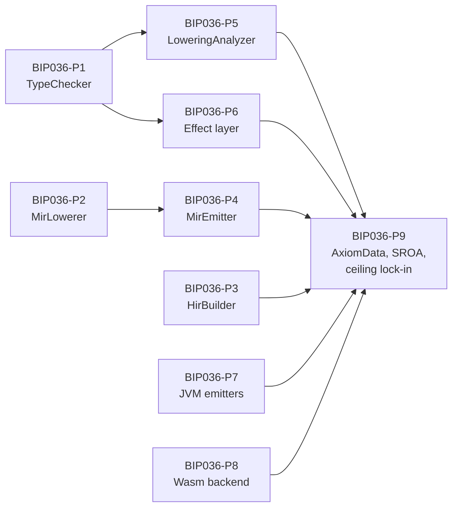
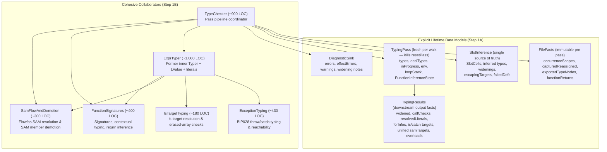
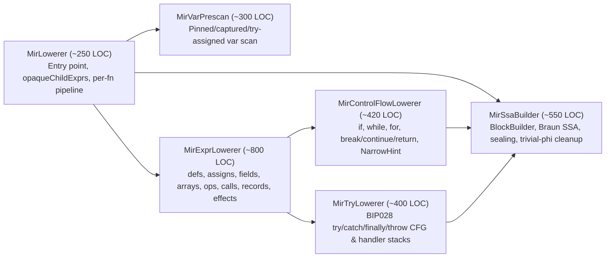
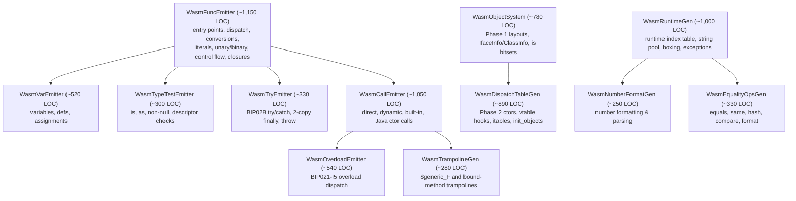

# BIP036: Compiler Simplification, Front-End Data-Model Redesign, and God-Class Splits

| | |
|---|---|
| **BIP** | 036 |
| **Date** | 2026-11-25 |
| **Status** | Draft / Planned (`BIP036-D1`–`BIP036-D6` settled ; `BIP036-P1`–`BIP036-P9` planned) |
| **Depends on** | Type-checker simplification (`RM004`, [bip010_type-checker-simplification.md](bip010_type-checker-simplification.md)), decoupled HIR & SSA MIR optimizer (`RM010`/`RM013`, [bip014_optimization-passes.md](bip014_optimization-passes.md)), compiler modularity & structural ceilings (`RM012`, [bip027_tackling-complexity-in-the-compiler.md](bip027_tackling-complexity-in-the-compiler.md)), WebAssembly backend (`RM018`, [bip025_compile-to-wasm.md](bip025_compile-to-wasm.md)), exception handling ([bip028_exception-handling.md](bip028_exception-handling.md)), `.batest.md` v2 & IR goldens ([bip029_batest-v2-and-ir-goldens.md](bip029_batest-v2-and-ir-goldens.md)), immutable `def` / mutable `var` ([bip034_immutable-def-and-mutable-var.md](bip034_immutable-def-and-mutable-var.md)) ; prepares clean seams for [bip015_down-with-the-ants.md](bip015_down-with-the-ants.md) Option 2 |
| **Scope** | Pure internal refactoring and data-model simplification across `org.babblelang.analysis`, `org.babblelang.ir.hir`, `org.babblelang.ir.mir`, `org.babblelang.opt.hir`, `org.babblelang.compiler`, and `org.babblelang.wasm` : fixing the lifetime/state data model in `TypeChecker` and `EffectBodyWalker`, decomposing every `> 2,000`-LOC file (`TypeChecker`, `MirLowerer`, `WasmFuncEmitter`) and multi-responsibility god class (`HirBuilder`, `EffectBodyWalker`, `HirEmitter`, `LoweringAnalyzer`, `MirEmitter`, `CallEmitter`, `CallEffectAnalyzer`, `EffectAstExtractors`, `WasmCallEmitter`, `WasmObjectSystem`, `WasmRuntimeGen`, `AxiomData`, `ScalarReplacePass`), and replacing `ArchitectureBoundaryTestCase`'s 3-file ceiling list with a universal repo-wide `<= 1,500`-LOC ceiling across `src/main/java`. Zero surface-syntax, diagnostic, IR, `.wasm`, or `babble-runtime` behavioral changes. |

---

## 1. Summary & Motivation

### 1.1 Why a structural pause is needed now

Since `RM012` (`BIP027`), Babble shipped `BIP028` (`try`/`catch`/`finally`/`throw`), `BIP029` (`.batest.md` v2 & IR goldens), `BIP030` (axiom nullability & inferred effects), `RM013` (`BIP014-I4` `record` SROA/FBIP & `BIP014-I3` SSA `MIR` under `-O2`), `BIP034` (immutable `def` and mutable `var`), and `RM018` (`BIP025-I0`–`I5`, whole-program WebAssembly 3.0). The main source tree has grown from **63,275 LOC** (post-`RM011`) to **106,514 LOC** (`master` at `aeeb1a8`) ; the new `org.babblelang.wasm` package alone accounts for **19,133 LOC across 25 files**.

In `BIP027-D9`, [`ArchitectureBoundaryTestCase.java`](../../src/test/java/org/babblelang/tests/ArchitectureBoundaryTestCase.java) introduced a `2,000`-LOC ceiling (`MAX_REFACTORED_LOC`), but only applied it to a manual 3-file list (`CallSolver`, `HirEmitter`, `EffectChecker`). As a result, three files crossed `2,000` LOC unchecked and eleven more accumulated into the `1,373–1,995` LOC god-class tier — right ahead of migrating the front end to a Babble-owned sealed-record AST ([`BIP015`](bip015_down-with-the-ants.md) Option 2) and SSA `aegraph` mid-end rewrites (`BIP014-P5` Half B).

### 1.2 Quantitative Baseline (`aeeb1a8`, 106,514 LOC in `src/main/java`)

Package breakdown : `analysis` 38,255 (62 files), `wasm` 19,133 (25), `ir` 14,117 (39), `compiler` 11,255 (19), `runtime` 8,628 (64), `opt` 7,940 (20), `engine` 4,463 (32), others 2,723. Field counts below count instance-field declarations at class depth.

#### Tier 1 — Strict `> 2,000`-LOC Monoliths (8,999 LOC across 3 files)

| File | LOC | Methods | Root Structural / Data-Model Symptoms |
|---|---:|---:|---|
| [`TypeChecker.java`](../../src/main/java/org/babblelang/analysis/TypeChecker.java) | **3,852** | 139 | Regrew +79% since `BIP010` (2,154 → 3,852 LOC). Holds **58 flat instance fields** — 44 state containers spanning 4 distinct lifetimes (requiring a **32-statement `resetPass()`** with 30 `.clear()` calls), 6 `new Collaborator(this)` fields, 8 configuration/flag fields — including 6 shadow maps duplicating `SlotInference.SlotCell`, 3 separate SAM maps, 4 diagnostic buckets, star-hub coupling across 9 classes, a **1,202-LOC inner `Typer`** (L2216–L3417), a 268-LOC `BIP028` exception validator (L3418–L3685), a 250-LOC SAM demotion/flow engine, and a 300-LOC function-signature/return-inference engine. Not in `SIZE_CAPPED_SOURCES`. |
| [`MirLowerer.java`](../../src/main/java/org/babblelang/ir/mir/MirLowerer.java) | **2,787** | 1 inner giant | Virtually the entire file is one **2,655-LOC inner `FunctionLowerer`** (L133–end) fusing var pre-scan/pinning (`scanExpr` 205 LOC), Braun SSA + block-parameter sealing + trivial-phi cleanup (`eliminateTrivialBlockParams` 95 LOC), control-flow & `BIP028` `try`/`catch`/`finally` lowering (`lowerTry` 290 LOC), narrowing anchors, expression/field/call lowering, and effect helpers — already delineated by 13 section banners. Not in `SIZE_CAPPED_SOURCES`. |
| [`WasmFuncEmitter.java`](../../src/main/java/org/babblelang/wasm/WasmFuncEmitter.java) | **2,360** | 84 | New with `BIP025`. The per-function HIR → Wasm instruction emitter fuses module-init/function entry points (`emitFunction` 151 LOC), expression dispatch, stack conversions, literals, variables/defs/assignments (L672–L1189, `emitDef` 139 LOC), unary/binary/logic, `is`/`as`/non-null descriptor checks (`emitDescCheck` 120 LOC), control flow, `BIP028` `try`/`catch`/2-copy `finally`/`throw` (L1882–L2207, `emitTry` 158 LOC), and closures. Its siblings (`WasmCoreEmitter`, `WasmCallEmitter`, `WasmMemberEmitter`) reach back through `fe.ctx()`, the same star-hub pattern as `TypeChecker`. Not in `SIZE_CAPPED_SOURCES`. |

#### Tier 2 — Imminent `2,000`-LOC & Multi-Responsibility God Classes (18,790 LOC across 11 files)

| File | LOC | Root Structural / Data-Model Symptoms |
|---|---:|---|
| [`HirBuilder.java`](../../src/main/java/org/babblelang/ir/hir/HirBuilder.java) | **1,995** | **5 lines shy of 2,000 LOC**, 33 fields. Sole AST→HIR bridge ; mixes discovery (`discoverAll` 85 LOC), class/interface/function declaration lowering (`lowerClass` 121 LOC), expression lowering (`lowerExprCore` 244 LOC), and a 366-LOC `lowerCall()`. |
| [`WasmCallEmitter.java`](../../src/main/java/org/babblelang/wasm/WasmCallEmitter.java) | **1,862** | Fuses direct/self/tail calls, dynamic calls & direct built-ins (L217–L953, `emitDynamicCall` 235 LOC), `$generic_F` and bound-method trampolines (L954–L1233), `BIP021-I5` overload dispatch (L1234–L1770, `emitOverloadDispatch` 159 LOC), and portable `JavaConstructorCall` lowering. |
| [`HirEmitter.java`](../../src/main/java/org/babblelang/compiler/HirEmitter.java) | **1,836** | Already size-capped at 2,000 LOC ; regrew +338 LOC since `BIP027` (1,498 → 1,836 LOC), 36 fields. Mixes module orchestration/`run` chunking, function/method entry-point generation (L395–L951), frame-variable/cell plumbing (L952–L1280), and literal/closure/class value emission. |
| [`EffectBodyWalker.java`](../../src/main/java/org/babblelang/analysis/EffectBodyWalker.java) | **1,813** | **47 instance fields** tangling immutable callable config, flow-sensitive alias/loop/try state, symbolic HOF matrices, and summary accumulators on one mutable object ; also imports `java.lang.reflect.*` directly. |
| [`LoweringAnalyzer.java`](../../src/main/java/org/babblelang/analysis/LoweringAnalyzer.java) | **1,756** | 196-LOC `run()` fusing 4 distinct post-convergence publishers : runtime checks/descriptors, static call/selection/overload/array targets, class/interface hierarchy publication, and catch/`is` targets. |
| [`MirEmitter.java`](../../src/main/java/org/babblelang/compiler/MirEmitter.java) | **1,682** | Fuses 3 independent backend stages : pure-analysis SSA liveness + alias coalescing + rematerialization/fusion/stack-forwarding + slot coloring (`resolveAliasesAndAllocateSlots` 204 LOC, `selectRematerializedAndFused` 109 LOC), parallel-copy/terminator lowering, and instruction + delegated ABI emission. |
| [`WasmObjectSystem.java`](../../src/main/java/org/babblelang/wasm/WasmObjectSystem.java) | **1,667** | Two phases in one class : Phase 1 declares every interface & class layout (L230–L685, `declareAll` 204 LOC), Phase 2 emits constructors, vtable hooks, itables and `init_objects` (L686–L1572, `emitITableThunk` 156 LOC), plus interface-bitset `is` / intersection tests. |
| [`CallEmitter.java`](../../src/main/java/org/babblelang/compiler/CallEmitter.java) | **1,664** | Mixes core-collection lowering (`emitCoreCollectionCall` 161 LOC), Babble/super/tail calls, Java calls, bound-argument marshaling, and overload-set creation/dispatch (`emitOverloadDispatch` 127 LOC). |
| [`WasmRuntimeGen.java`](../../src/main/java/org/babblelang/wasm/WasmRuntimeGen.java) | **1,628** | A 262-LOC constructor registering **48 `public final int fn*` runtime-function indices** (86 fields in all) that 10 sibling classes read directly, plus string-pool, number formatting/parsing, boxing, numeric, equality/hash/format, and exception/print generators in one class. |
| [`CallEffectAnalyzer.java`](../../src/main/java/org/babblelang/analysis/CallEffectAnalyzer.java) | **1,514** | 243-LOC `evalCallLike()` fusing core-collection/array effects, Java call reflection & SAM propagation, Babble HOF symbolic instantiation & forwarding, and exclusivity checking. |
| [`EffectAstExtractors.java`](../../src/main/java/org/babblelang/analysis/EffectAstExtractors.java) | **1,373** | Fuses two unrelated AST extractors : pure/mutating algebraic term extraction (~680 LOC) and polynomial SCP termination extraction (`ScpWalker`, ~655 LOC). |

#### Tier 3 — Targeted High-Value Simplifications

| File | LOC | Simplification Opportunity |
|---|---:|---|
| [`AxiomData.java`](../../src/main/java/org/babblelang/analysis/AxiomData.java) | **1,435** | Split ANTLR axiom parsing & canonical-order checking (`AxiomParser`) from the AST-free model & lookup table (`AxiomData` → add to `ANTLR_FREE_ANALYSIS_CORES`), shrinking `BIP015` Option 2 surface area. |
| [`ScalarReplacePass.java`](../../src/main/java/org/babblelang/opt/hir/ScalarReplacePass.java) | **1,369** | Split its 3 already-delineated sub-passes (`RecordLayout` + projection beta-reduction, `$unboxed` borrow entry-point specialization, non-escaping local record scalarization). |

Files between 1,400 and 1,500 LOC that stay whole (`TypeAlgebra` 1,493, `WasmMemberEmitter` 1,489, `CallSolver` 1,484, `BytecodeEffectAnalyzer` 1,431, `JavaTypeBridge` 1,412) fit under the `BIP036-D6` ceiling. Test files (`TypeCheckerTestCase.java`, `BatestCoverageReporter.java`) and `BytecodeEffectAnalyzer.analyzeSingleMethod` (deferred to `BIP018-P1` per `BIP027-D7`) are explicitly out of scope.

---

## 2. Root-Cause Diagnosis

### 2.1 Why `TypeChecker.java` (and `EffectBodyWalker.java`) regrew: a data-model problem

Merely slicing methods out of `TypeChecker.java` without fixing its underlying state model would leave a thinner façade over the same 58-field mutable blackboard. Four concrete data-model flaws explain why `TypeChecker` regrew from 2,154 LOC (`BIP010`) to 3,852 LOC :

1. **Struct-of-Arrays keyed by raw ANTLR `ParserRuleContext`:** Because analysis operates directly on generated ANTLR parse-tree nodes (which cannot carry fields or dense IDs), every new language feature (`for`, `is`, overloads, SAM adapters, `try`/`catch`) adds 1–3 external `IdentityHashMap<ParserRuleContext, ...>` fields to `TypeChecker` (44 state containers today, keyed by expression, declaration, or function literal) and 1–3 `.clear()` lines to `resetPass()`. `LoweringAnalyzer` then copies those facts a second time into `ScopeAnalysis` for `HirBuilder`.
2. **Four distinct lifetimes tangled on one mutable object:** `resetPass()` (L517–L552) runs **32 reset statements** (30 `.clear()` calls) because one class mixes :
   - *Immutable whole-file pre-pass facts* (never cleared) : `occurrenceScopes`, `capturedReassigned`, `exportedTypeNodes`, `functionReturns`.
   - *Cross-round converged inference state* (persists across `resetPass()`) : `inferredDefs`/`Members`/`Params`, `def`/`member`/`paramWidenings`, `escapingTargets`, `p7Params`.
   - *Per-walk transient scratch & recursion stacks* (wiped every pass) : `types`, `declarationTypes`, `inProgress`, `env`, `loopStack`, `inferenceStack`, `inferringResult`, `recursiveFunctions`, `provisionalResults`, `contextual*`, `nextEscapingTargets`, `failedDefs`.
   - *Downstream output facts & 4 separate diagnostic buckets* : `widened`, `callChecks`, `resolvedLiterals`, `forInfos`, `isTargetTypes`, `catchTargetTypes`, 3 SAM maps, 3 overload maps, plus `diagnostics`, `effectDiagnostics`, `warnings`, `demoteDiagnostics`.
3. **Duplicated shadow state across collaborators:** `SlotInference` already owns `SlotCell(value, widenedLine)` for every `def`, member, and parameter, and then copies those values back into **6 shadow maps on `TypeChecker`** (`inferredDefs`, `inferredMembers`, `inferredParams`, `defWidenings`, `memberWidenings`, `paramWidenings`). Similarly, SAM adaptations are split across 3 separate maps (`samTargets`, `forElemSamTargets`, `asSamTargets`) for the same concept.
4. **Star-hub coupling (`new Collaborator(this)`):** Nine collaborators (`CallSolver`, `SlotInference`, `TypeAnnotations`, `MemberTypes`, `OperatorTypes`, `Narrowing`, `TypedProgram`, `LoweringAnalyzer`, `TypedModuleSummary`) all hold `TypeChecker this` as a service locator and mutable blackboard, making `TypeChecker` the default dumping ground for any shared state.

`EffectBodyWalker.java` exhibits the same pattern : **47 mutable fields** on one object mixing immutable callable configuration, control-flow environments (`env`, `activeForIterables`, `loopBreakOrigins`, `activeTryStack`), symbolic HOF flow matrices (`calledCallbacks`, `symParamFlow`/`symThisFlow`/`symExtFlow`), and accumulated summary output flags.

### 2.2 Why `MirLowerer` is a structural split (not an e-graph candidate)

`MirLowerer.java` (2,787 LOC) does not perform algebraic optimization ; its bulk is structural lowering from tree-based HIR to a flat SSA CFG (variable pinning pre-scan, Braun block-parameter SSA + sealing + trivial-phi cleanup, loop/short-circuit wiring, and `BIP028` `try`/`catch`/`finally` handler tables). E-graphs rewrite equivalence classes of **pure value expressions**, not CFG construction or exception-table layout. Keeping MIR lowering simple and cleanly decomposed prepares canonical SSA for `BIP014-P5` Half B (`aegraph` rewriting over `org.babblelang.opt.mir`), where e-graphs directly unify pure GVN/CSE, algebraic rewrites, and LICM.

### 2.3 Why the Wasm backend grew god classes

`BIP025` reached byte-for-byte Argon parity by growing four classes along the JVM backend's lines, but without the `BIP027-D9` ceiling : `WasmFuncEmitter` became the Wasm counterpart of the pre-`BIP027` `HirEmitter`, `WasmCallEmitter` of `CallEmitter`, and `WasmRuntimeGen` a registry-plus-generator whose 48 public index fields act as a shared blackboard for 10 sibling classes. The backend is HIR-only (it imports `org.babblelang.ir.hir.*`, `LoweringTargets`, `PrimitiveKind`, and `CompilationTarget`, never the parser), so these splits are independent of the front-end work and of `BIP015`.

---

## 3. Architectural Decisions (`BIP036-D1`–`BIP036-D6`)

* **`BIP036-D1` — Option A lifetime-separated front-end data model now, `BIP015` Option 2 soon after :** Refactor `TypeChecker` (`BIP036-P1`) and `EffectBodyWalker` (`BIP036-P6`) around explicit lifetime-scoped model objects (`FileFacts`, single-source-of-truth `SlotInference`, fresh-per-walk `TypingPass` + `TypingResults`, `DiagnosticSink`, `EffectFlowState`) without introducing throwaway ANTLR wrapper hierarchies. Every container stays minimal and cleanly keyed so migrating `ParserRuleContext` keys to Babble's owned Java 21 sealed-record AST in [`BIP015`](bip015_down-with-the-ants.md) Option 2 is mechanical.
* **`BIP036-D2` — Strict 100% behavioral & IR parity :** `BIP036` changes zero Babble syntax, runtime semantics, diagnostic text/`line:column` coordinates, HIR/MIR/`wat` canonical goldens, emitted `.wasm` bytes, or `babble-runtime` classes (`RuntimeBoundaryTestCase`).
* **`BIP036-D3` — Cohesive stage/domain collaborators targeting `<= 1,200` LOC :** Every split extracts package-private collaborators along a single named responsibility (never arbitrary `Part1`/`Part2` slicing) with zero public API churn. Newly extracted or refactored classes target `<= 1,200` LOC to leave headroom for future proposals.
* **`BIP036-D4` — Explicit 4-file AST→HIR bridge allowlist :** Splitting `HirBuilder` (`BIP036-P3`) replaces the single-class exemption in `ArchitectureBoundaryTestCase` with an explicit 4-class `HIR_BRIDGE_CLASSES` allowlist (`HirBuilder`, `HirDiscovery`, `HirDeclLowerer`, `HirCallLowerer`), keeping every other class in `org.babblelang.ir.*`, `org.babblelang.opt.*`, `org.babblelang.compiler.*`, and `org.babblelang.wasm.*` strictly AST-free and `ScopeAnalysis`-free.
* **`BIP036-D5` — Keep `MirLowerer` purely structural :** Split `MirLowerer` cleanly along its lowering stages (`BIP036-P2`) without entangling e-graph simplification into lowering ; SSA `aegraph` rewriting stays in `org.babblelang.opt.mir` under `BIP014-P5` Half B.
* **`BIP036-D6` — Universal repo-wide `<= 1,500`-LOC ceiling :** Upon completing `BIP036-P1`–`BIP036-P9`, replace `ArchitectureBoundaryTestCase.SIZE_CAPPED_SOURCES` with a full scan of every `src/main/java/**/*.java` file enforcing `<= 1,500` LOC (the largest remaining unsplit file is `TypeAlgebra.java` at 1,493 LOC), add `AxiomData` to `ANTLR_FREE_ANALYSIS_CORES`, and extend `effectCheckerIsolatesReflection` to cover `EffectBodyWalker`.

---

## 4. Implementation Plan (`BIP036-P1`–`BIP036-P9`)

`BIP036-P1` comes first because `BIP036-P5` and `BIP036-P6` consume `TypingResults` ; `BIP036-P2`, `BIP036-P3`, `BIP036-P7`, and `BIP036-P8` touch disjoint packages and can run in any order or in parallel. `BIP036-P9` locks in the ceiling last.

### `BIP036-P1` — `TypeChecker` Data-Model Redesign & Split (3,852 LOC → ~900 LOC, 58 fields → ~8 fields)

Execute in two strictly ordered steps : **Step 1A** fixes the data model inside `org.babblelang.analysis` ; **Step 1B** extracts the cohesive semantic collaborators against the clean model.

**Step 1A — Data-model cleanup:**
1. **Single source of truth in [`SlotInference.java`](../../src/main/java/org/babblelang/analysis/SlotInference.java) :** Query `inferredType(kind, decl)` and `widening(kind, decl)` directly from `SlotCell` instead of mirroring into `TypeChecker`'s 6 shadow maps (`inferredDefs`/`Members`/`Params`, `def`/`member`/`paramWidenings`), and move `escapingTargets`, `nextEscapingTargets`, `p7Params`, and `failedDefs` into `SlotInference` (removes **10 fields** from `TypeChecker`).
2. **`FileFacts.java` (~110 LOC) :** Immutable pre-pass value built once via `FileFacts.collect(pass, file)` owning `occurrenceScopes`, `capturedReassigned`, `exportedTypeNodes`, and `functionReturns` (moving `ReturnFinder`, L554, here).
3. **`TypingPass.java` (~160 LOC) + `TypingResults.java` (~180 LOC) :** Instantiate a fresh `TypingPass` per walk to **delete `resetPass()` (L517–L552) completely**. `TypingPass` owns transient walk state (`types`, `declarationTypes`, `inProgress`, `env`, `loopStack`, `functions`, `functionLiterals`, contextual/recursive inference state) ; `TypingResults` owns the read-only output tables consumed by `TypedProgram` and `LoweringAnalyzer` (`widened`, `resolvedLiterals`, `callChecks`, `isTargetTypes`, `catchTargetTypes`, `forInfos`, overload maps, and unified SAM targets consolidating `samTargets` / `forElemSamTargets` / `asSamTargets`).
4. **`DiagnosticSink.java` (~150 LOC) :** Unifies `diagnostics`, `effectDiagnostics`, `warnings`, `demoteDiagnostics` flush/merge, and widening-note formatting (`wideningNote`, `findWideningNote`, `assignmentWideningNote`, `noteForName`).

**Step 1B — Collaborator extraction (package-private in `org.babblelang.analysis`) :**
5. **`ExceptionTyping.java` (~430 LOC) :** `BIP028` throw/catch validation (L3418–L3685) + `visitThrowExpression` / `visitTryExpression` (L3253–L3417), keeping pure `Type`-level predicates (`isThrowableType`, `isValidCatchIntersection`, `flattenCatchUnion`, `mayBeJavaError`, `isCatchSubtype`) static and AST-free.
6. **`SamFlowAndDemotion.java` (~300 LOC) :** `coerceSam`, `resolveSamTargetForFlow`, `resolveSamTargetForAs`, `demoteSamMemberFields`, `maybeDemoteSamMember`, `isSamAdapterFieldType`, `demoteMemberToField`, `collectJavaParents`, `hasBabbleDefault`.
7. **`FunctionSignatures.java` (~400 LOC) :** `signature`, `recursiveSignature`, `effectiveTypeParams`, `literalEffectSet`, `isInferrableCallable`, `functionParameters`, `restElementType`, `typeDefaultValues`, `applyContextualType`, `expectedReturnType`, `inferFunctionResult`, `computeBodyResult`, `checkResult`.
8. **`IsTargetTyping.java` (~180 LOC) :** `resolveIsTarget`, `isArrayTypeErasedAtRuntime`, `containsErasedArray`, `isUncheckedArrayCheck`.
9. **`ExprTyper.java` (~1,000 LOC) :** Promotes inner `Typer` (L2216–L3252, i.e. without try/throw) + `LValue` (L2201) + numeric-literal range checkers (`checkIntLiteral` L3114 .. `checkDoubleLiteral`).
10. **Slim `TypeChecker.java` (~850–900 LOC, ~8 fields) :** Pipeline coordinator (`pass`, `fileFacts`, `slots`, `algebra`, `modalKinds`, `diagnostics`, `currentPass`, and collaborators).

---

### `BIP036-P2` — `MirLowerer` Decomposition (2,787 LOC → ~250 LOC)

Promote the 2,655-LOC inner `FunctionLowerer` into 5 ANTLR-free package-private collaborators in `org.babblelang.ir.mir`, following its existing section banners :

1. **`MirVarPrescan.java` (~300 LOC) :** Pure pre-pass (`scanVarsAndPinning`, `scanExpr`, banner L292) returning an immutable `PinnedVars` record.
2. **`MirSsaBuilder.java` (~550 LOC) :** `BlockBuilder`, `EdgeRef`, `IncompletePhi`, `PendingTerm`, Braun SSA `readSsaVar`/`writeVar`/`sealBlock`/`createEdge`/`emitDefaultConstIn` (banner L575), `buildBlocks()`, and `eliminateTrivialBlockParams()` (banner L2655).
3. **`MirTryLowerer.java` (~400 LOC) :** `FinallyContext`, `finallyStack`, `lowerTry` (split internally into `lowerCatchDispatch`, `lowerNormalFinally`, `lowerAbnormalFinally`), `lowerThrow`, `emitEnclosingFinallys` (banner L1793).
4. **`MirControlFlowLowerer.java` (~420 LOC) :** `LoopContext`, `loopStack`, `NarrowHint`, `extractNarrowHint` (banner L2465), `lowerIf`, `lowerWhile`, `lowerFor`, `lowerBreak`, `lowerContinue`, `lowerReturn` (banner L1477).
5. **`MirExprLowerer.java` (~800 LOC) :** `lowerStatements`, `lowerExpr`, defs/assignments, fields/arrays, unary/binary/logic/types, calls & records, effect/type helpers.
6. **`MirLowerer.java` (~250 LOC) :** Public façade + `opaqueChildExprs` + concise per-function lowering pipeline.

---

### `BIP036-P3` — `HirBuilder` AST→HIR Bridge Decomposition (1,995 LOC → ~750 LOC)

Split the sole AST→HIR bridge into 4 package-private classes in `org.babblelang.ir.hir` and register `HIR_BRIDGE_CLASSES` in `ArchitectureBoundaryTestCase` (`BIP036-D4`) :

1. **`HirDiscovery.java` (~300 LOC) :** Pass 1 (`discoverAll`, stable owner/class/interface/function ID & JVM-name tables, `collectAllTypeHierarchies`, `implementableJavaInterfaces`, `implementedInterfaces`).
2. **`HirDeclLowerer.java` (~380 LOC) :** Pass 2 declarations (`lowerFunction`, `lowerClass`, `isFastRecordClass`, `lowerInterface`, `lowerStaticBlock`, `lowerTypeList`, `lowerTypeRef`).
3. **`HirCallLowerer.java` (~520 LOC) :** Breaks up the 366-LOC `lowerCall()` by target kind + `lowerCallArgs`, `lowerPositionalArgs`, `wrapSpreadAdapt`, `lowerOperatorOverload`, `tryLowerDirectMethod`.
4. **`HirBuilder.java` (~750 LOC) :** Orchestrates Pass 1 → Pass 2 → `HirNameInitAnalysis` and owns expression lowering (`lowerExprCore`, `lowerTryExpr`, `lowerIfExpr`, `lowerSelector`, `lowerAssign`, `lowerBlock`).

---

### `BIP036-P4` — `MirEmitter` Stage Split (1,682 LOC → ~850 LOC)

1. **`MirSlotAllocator.java` (~550 LOC) :** Pure analysis pass over `(MirFunction, MirCfg, MethodEmitContext)` with zero `MethodVisitor` bytecode emission : `ensurePinnedSlots`, alias-chain resolution, rematerializable constants, `BrIf` condition fusion, single-use operand-stack forwarding, zero-use discard detection, backward CFG bit-set liveness, and JVM-category-segregated slot coloring → immutable `MirAllocationPlan`.
2. **`MirParallelCopy.java` (~230 LOC) :** `MoveOp`, cycle-safe `emitParallelCopy`, edge-copy trampolines, and terminator emission (`emitTerminator`, `emitBrIfFused`, `emitBrIf`).
3. **`MirEmitter.java` (~850 LOC) :** RPO block emission loop, merged contiguous `visitTryCatchBlock` ranges, instruction emission, and `mirOverrides` ABI delegation.

---

### `BIP036-P5` — `LoweringAnalyzer` Publisher Split (1,756 LOC → ~250 LOC)

1. **`HierarchyPublisher.java` (~380 LOC) :** `publishClassLoweringFacts`, `publishTypeHierarchies`, `buildTypeHierarchyInfo`, `collectAncestorInterfaces`, `collectJavaInterfaces`, `collectInterfaceMembers`, `buildMemberSpec`, `uninstantiatedSignature`.
2. **`RuntimeCheckPublisher.java` (~300 LOC) :** `recordChecksTree`, `recordCheck`, `publishDefinitelyDefined`, `descriptor`, `primitiveKind`, `uniqueSamTargetForParam`, `isGuaranteedJavaThrowable`, `buildCatchTarget`, `intersectionIsTargets`.
3. **`DispatchTargetDeriver.java` (~750 LOC) :** `deriveTargets`, `deriveSelection`, `fieldReadTarget`, `deriveCall`, `deriveOperatorMethodCall`, `deriveDirectClassMethodCall`, `deriveOverloadCall`, `publishOperatorOverloadDispatch`, `deriveArgumentBinding`, `deriveArray*`, `deriveJava*`, `deriveBabbleCall`, `deriveInterfaceCall`, `publishForLoopTarget`.
4. **`LoweringAnalyzer.java` (~250 LOC) :** Thin coordinator `publish(pass, file, checker)` invoking the three publishers in order against `TypingResults`.

---

### `BIP036-P6` — AST Effect-Layer Data-Model Cleanup & Split (`EffectBodyWalker` 1,813 + `CallEffectAnalyzer` 1,514 + `EffectAstExtractors` 1,373 LOC)

1. **Split [`EffectAstExtractors.java`](../../src/main/java/org/babblelang/analysis/EffectAstExtractors.java) (1,373 LOC → 2 files) :**
   - `AlgebraicAstExtractor.java` (~680 LOC) : pure/mutating expression term extraction into `AlgebraicVerifier`.
   - `ScpAstExtractor.java` (~660 LOC) : `ParamDesc`, `ScpPathEnv`, `ScpWalker`, and `SizeChangeTermination` graph extraction.
2. **Decompose [`EffectBodyWalker.java`](../../src/main/java/org/babblelang/analysis/EffectBodyWalker.java) (1,813 LOC, 47 fields → ~900 LOC, ~12 fields) :**
   - **`EffectFlowState.java` (~300 LOC) :** Mutable control-flow state (`env`, `mergeEnvs`, `widenEnvs`, `envsEqual`, `activeForIterables`, `loopBreakOrigins`, `activeTryStack`, `TryFrame`, `ActiveForLoop`), symbolic HOF flow matrices (`calledCallbacks`, `symParamFlow`/`symThisFlow`/`symExtFlow`, `buildSymbolicSummary`), and accumulated summary flags.
   - **`EffectEscapeTracker.java` (~360 LOC) :** Mutation, storage, escape, and closure-capture checks (`recordTargetMutation`, `markStoredIntoTarget`, `markStoredOrigin`, `markParamEscaped`, `recordReturnOrigin`, `checkClosureCaptureEscape`, `readsMutableBabbleMember`, `isImmutableOuterBinding`), delegating field-reflection queries to `JavaEffectResolver` so `EffectBodyWalker` has zero `java.lang.reflect.*` imports.
   - **`EffectBodyWalker.java` (~900 LOC) :** Focused strictly on AST statement/expression walking.
3. **Decompose [`CallEffectAnalyzer.java`](../../src/main/java/org/babblelang/analysis/CallEffectAnalyzer.java) (1,514 LOC → ~780 LOC) :**
   - **`JavaCallEffectAnalyzer.java` (~550 LOC) :** Core-collection/array call effects (`evalCoreCollectionCall`, `evalArrayOfCall`, `evalArrayMethodCall`) and Java call / SAM callback effect propagation (`applyJavaCall`, `propagateSamCallbackEffects`, `samInterfaceForJavaType`).
   - **`CallEffectAnalyzer.java` (~780 LOC) :** Babble callable dispatch, symbolic HOF instantiation, `fn calling f` forwarding, return-origin derivation, and exclusivity checks.

---

### `BIP036-P7` — JVM Backend Emitter Trim (`CallEmitter` 1,664 LOC & `HirEmitter` 1,836 LOC)

1. **From [`CallEmitter.java`](../../src/main/java/org/babblelang/compiler/CallEmitter.java) (1,664 LOC → ~950 LOC) :**
   - Extract **`OverloadAndCollectionEmitter.java` (~650 LOC)** (or `CoreCollectionEmitter` + `OverloadCallEmitter`) for `emitCoreCollectionCall`, array creation/ops, `emitMakeOverloadSet`, `emitOverloadSetMetaAndCreate`, `emitOverloadDispatch`, and spread adaptation.
2. **From [`HirEmitter.java`](../../src/main/java/org/babblelang/compiler/HirEmitter.java) (1,836 LOC → ~1,100 LOC) :**
   - Extract **`FrameVarEmitter.java` (~350 LOC)** for frame variables, closure cells (`IntCell`..`CharCell`), value-captured locals, and `$defined` tracking (L952–L1280).
   - Extract **`FunctionEntryEmitter.java` (~400 LOC)** for `fn$N$name` / `$spec` / `$call` adapters, `compiledMethodField`, `cachedMethodOverloadField`, and parameter binding (L395–L951).

---

### `BIP036-P8` — Wasm Backend Split (`WasmFuncEmitter` 2,360 + `WasmCallEmitter` 1,862 + `WasmObjectSystem` 1,667 + `WasmRuntimeGen` 1,628 LOC)

All new classes are package-private in `org.babblelang.wasm`, follow the existing `WasmCoreEmitter` / `WasmMemberEmitter` sibling pattern, and stay ASM-free (`wasmBackendFreeOfAsm`) and AST-free. Byte-identical `.wasm` output is checked by `WasmBatestTestCase`'s `wat` goldens and Argon's `scene.ppm`.

1. **From [`WasmFuncEmitter.java`](../../src/main/java/org/babblelang/wasm/WasmFuncEmitter.java) (2,360 LOC → ~1,150 LOC) :**
   - **`WasmVarEmitter.java` (~520 LOC) :** variables, defs & assignments (L672–L1189), breaking up `emitDef` (139 LOC).
   - **`WasmTypeTestEmitter.java` (~300 LOC) :** `is`, `as`, non-null and `emitDescCheck` (L1445–L1735).
   - **`WasmTryEmitter.java` (~330 LOC) :** `BIP028` `try`/`catch`/2-copy `finally`/`throw` (L1882–L2207, `BIP025-D13`), with `emitTry` (158 LOC) split into catch dispatch and the two `finally` copies, mirroring `MirTryLowerer`.
2. **From [`WasmCallEmitter.java`](../../src/main/java/org/babblelang/wasm/WasmCallEmitter.java) (1,862 LOC → ~1,050 LOC) :**
   - **`WasmOverloadEmitter.java` (~540 LOC) :** `BIP021-I5` overloads (L1234–L1770 : `emitOverloadDispatch`, `getOrCreateOverloadGenericCall`).
   - **`WasmTrampolineGen.java` (~280 LOC) :** `$generic_F` and bound-method trampolines (L954–L1233 : `emitGenericTrampoline`, `emitBoundMethodTrampoline`).
   - Break the 235-LOC `emitDynamicCall` into per-callee-kind helpers.
3. **From [`WasmObjectSystem.java`](../../src/main/java/org/babblelang/wasm/WasmObjectSystem.java) (1,667 LOC → ~780 LOC) :** Extract **`WasmDispatchTableGen.java` (~890 LOC)** for Phase 2 (L686–L1572 : constructors, generic constructor trampolines, member hooks, itable thunks, `init_objects`), leaving Phase 1 layout declaration, `IfaceInfo`/`ClassInfo`, and interface-bitset `is` / intersection tests.
4. **From [`WasmRuntimeGen.java`](../../src/main/java/org/babblelang/wasm/WasmRuntimeGen.java) (1,628 LOC → ~1,000 LOC) :**
   - **`WasmNumberFormatGen.java` (~250 LOC) :** number formatting & parsing (L686–L931 : `emitDoubleToStr`, `emitParseLong`, …), alongside the existing `WasmStringOpsGen`.
   - **`WasmEqualityOpsGen.java` (~330 LOC) :** equals / same / hash / compare / format (L1156–L1481).
   - **Data model :** each extracted generator owns the indices of the functions it generates ; the 48 `public final int fn*` fields that stay in `WasmRuntimeGen` are grouped by family (strings, boxing, numerics, exceptions) so that the 262-line constructor becomes a short sequence of family registrations.

---

### `BIP036-P9` — `AxiomData`, `ScalarReplacePass`, & Repo-Wide Ceiling Lock-In

1. **Split [`AxiomData.java`](../../src/main/java/org/babblelang/analysis/AxiomData.java) (1,435 LOC) :**
   - Extract **`AxiomParser.java` (~760 LOC)** (ANTLR parsing + canonical-order validation) so **`AxiomData.java` (~660 LOC)** becomes **100% ANTLR-free** and joins `ANTLR_FREE_ANALYSIS_CORES`.
2. **Split [`ScalarReplacePass.java`](../../src/main/java/org/babblelang/opt/hir/ScalarReplacePass.java) (1,369 LOC) :**
   - Extract **`RecordUnboxSpecializer.java` (~450 LOC)** (Sub-pass 2 : `$unboxed` borrow entry points) and **`LocalRecordScalarizer.java` (~580 LOC)** (Sub-pass 3 : non-escaping local record SROA), leaving `ScalarReplacePass.java` (~340 LOC) with layout discovery, projection beta-reduction, and orchestration.
3. **Harden [`ArchitectureBoundaryTestCase.java`](../../src/test/java/org/babblelang/tests/ArchitectureBoundaryTestCase.java) (`BIP036-D6`) :**
   - Replace `SIZE_CAPPED_SOURCES` with a repo-wide scan of every `src/main/java/**/*.java` file enforcing `<= 1,500` LOC.
   - Add `AxiomData` to `ANTLR_FREE_ANALYSIS_CORES`.
   - Extend `effectCheckerIsolatesReflection` to cover `EffectBodyWalker`.
4. **Docs sync :** Update [`docs/ARCHITECTURE.md`](../ARCHITECTURE.md) collaborator lists and mark `BIP036-P1`–`BIP036-P9` implemented (`BIP036-I1`–`BIP036-I9`) as each phase lands.

---

## 5. Bridge to `BIP015` Option 2

Executing `BIP036` ahead of [`BIP015`](bip015_down-with-the-ants.md) Option 2 (keeping ANTLR4 behind a Babble-owned Java 21 sealed-record AST) directly minimizes the migration blast radius :

* **Zero-touch packages/cores in `BIP015` Option 2 :** All of `org.babblelang.ir.*` outside the 4 explicit HIR bridge files, all of `org.babblelang.opt.*`, all of `org.babblelang.compiler.*`, all of `org.babblelang.wasm.*` (19,133 LOC that only consume HIR and `LoweringTargets`), all of `org.babblelang.runtime.*`, and the expanded `ANTLR_FREE_ANALYSIS_CORES` (now including `AxiomData` alongside `TypeAlgebra`, `JavaTypeBridge`, `OverloadSolver`, `Reachability`, `JavaEffectResolver`, `EffectFixpointDriver`, `SymbolicEffectSummary`, `ModalKindTable`, `Purity`, `HostEffects`, `AlgebraicVerifier`, and `SizeChangeTermination`).
* **Mechanical front-end key swap :** With `TypeChecker`'s 44 scattered state containers consolidated into `FileFacts`, `SlotInference`, and `TypingResults` (and `EffectBodyWalker`'s state into `EffectFlowState`), swapping `ParserRuleContext` keys to owned `AstNode` / dense `nodeId` handles happens in a handful of small, single-responsibility containers instead of inside 3,852-LOC and 1,813-LOC monoliths.

---

## 6. Verification & Exit Criteria

**After every phase (`BIP036-P1`–`BIP036-P9`) :**
1. `mvn test -PO2 -Dtest=ArchitectureBoundaryTestCase,RuntimeBoundaryTestCase`
2. Targeted fast unit suites for the touched subsystem (`TypeCheckerTestCase`, `EffectsTestCase`, `OptimizerTestCase`, `BabbleCompilerTestCase`, `DifferentialTestCase`, `AxiomsTestCase`, and for `BIP036-P8` `WasmCompilerTestCase`, `WasmWriterTestCase`, `WasmBatestTestCase`).
3. `mvn -q test -PO2 -Dtest=BatestTestCase` (4-way behavioral & canonical HIR/MIR golden parity across `interpret`, `-O0`, `-O1`, `-O2`).

**Milestone exit criteria (before opening PR) :**
1. Full `mvn -B package -PO2` green across all 4 JVM modes (`interpret`, `-O0`, `-O1`, `-O2`, with `HirVerifier`, `MirVerifier`, and ASM `CheckClassAdapter`) and the Wasm suite (with Node.js 22+ on `PATH`).
2. Full 4-JVM 6-scope `mvn -q verify -Pbatest` green (`>= 80.0%` line and branch coverage across all 6 scopes, `0` divergences).
3. `ArchitectureBoundaryTestCase` enforces `<= 1,500` LOC across **every** `.java` file in `src/main/java`.
4. `examples/raytracer-argon` renders `scene.ppm` byte-for-byte identically on the JVM and through `-target wasm-js`.
5. `-format -check src/test/babble examples src/main/java/org/babblelang/axioms` passes.
