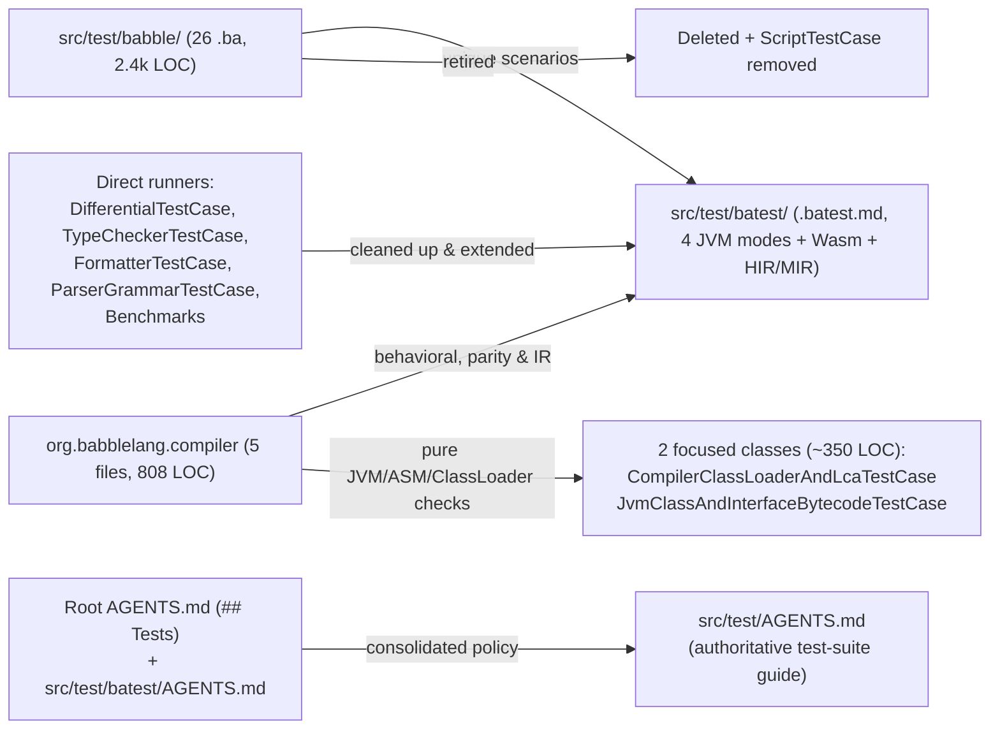

# BIP037: Babble Test Hygiene

| | |
|---|---|
| **BIP** | 037 |
| **Date** | 2026-11-26 |
| **Status** | Implemented (`BIP037-D1`–`BIP037-D5` settled ; `BIP037-I1`–`BIP037-I4` implemented) |
| **Depends on** | Systematic `.batest` coverage ([bip009_test-coverage.md](bip009_test-coverage.md)), `.batest.md` v2 format & unified HIR/MIR goldens ([bip029_batest-v2-and-ir-goldens.md](bip029_batest-v2-and-ir-goldens.md)), WebAssembly 3.0 4th-mode `.batest.md` parity (`RM018`, [bip025_compile-to-wasm.md](bip025_compile-to-wasm.md)), JVM interfaces & plain compiled classes (`RM003`, [bip020_array-types.md](bip020_array-types.md)) |
| **Scope** | Refactoring **only the test suite** and its testing guidelines (zero changes under `src/main/`): consolidating test-suite authoring guidelines into `src/test/AGENTS.md` (with slimmed root `AGENTS.md` and updated `src/test/batest/AGENTS.md`), retiring `src/test/babble/` (26 `.ba` scripts, 2,392 LOC) and `ScriptTestCase` by migrating every unique scenario to `src/test/batest/`, migrating behavioral/parity/IR-verifiable tests out of `src/test/java/org/babblelang/compiler/` (5 phase-named classes, 808 LOC) into `.batest.md` with HIR/MIR goldens while consolidating surviving purely JVM-internal/ASM/ClassLoader assertions into 2 feature-named classes, updating direct runners (`DifferentialTestCase`, `TypeCheckerTestCase`, `FormatterTestCase`, `ParserGrammarTestCase`, `Benchmarks`), and extending `FormatterTestCase` to check idempotent formatting of `.batest.md` snippets. |

---

## 1. Summary & Motivation

Since `BIP009`, `BIP029`, and `RM018`, Babble's `.batest.md` specification corpus (`175` files, `69.6k` LOC under `src/test/batest/`) has become the highest-leverage test surface in the repository. A single `.batest.md` case automatically verifies:

1. **4 JVM execution modes** (`interpret`, `compile -O0`, `compile -O1`, and `compile -O2` under `-PO2`/`-Pbatest`) with `HirVerifier`, `MirVerifier`, and ASM `CheckClassAdapter`.
2. **WebAssembly 3.0 parity** (`WasmBatestTestCase`, `wasm-js -O1`) for every portable case, plus `wat` goldens.
3. **Canonical compiler IR invariants** (`hir -O0`, `hir -O1`, `mir -O2` before/after passes) verifying inferred types, effects, optimizations, and lowering (`BIP029`).
4. **Front-end grammar & formatting hygiene** — pure `PredictionMode.SLL` parsing (`ParserGrammarTestCase`) and, with this BIP, idempotent formatting (`FormatterTestCase`).
5. **6-scope JaCoCo coverage gating** (`>= 80%` line and `>= 80%` branch across interpreter, `-O0`, `-O1`, `-O2`, shared front end, and shared runtime via `mvn -q verify -Pbatest`).

Yet two older test surfaces still duplicate features already specified in `src/test/batest/`:

- **`src/test/babble/` (`26` `.ba` scripts, `2,392` LOC)** — early end-to-end scripts driven by `ScriptTestCase`, `DifferentialTestCase#testFile`, `TypeCheckerTestCase#testTheScriptsCheckCleanly`, `FormatterTestCase#testEveryScript`, `ParserGrammarTestCase`, and `Benchmarks.java`. Unlike `.batest.md`, `.ba` scripts cannot assert compile-time errors, warnings, or HIR/MIR goldens, do not run on WebAssembly 3.0, and do not feed `-Pbatest` coverage reporting.
- **`src/test/java/org/babblelang/compiler/` (`5` phase-named classes, `808` LOC)** — `Bip020P1PlainClassesTestCase`, `Rm003P1CompilerTestCase`, `Rm003P2CompilerTestCase`, `Rm003P3JavaImplementsTestCase`, and `Rm003P4SamMetafactoryTestCase`. They mix genuine JVM-internal unit/ASM/reflection assertions with large behavioral and 3-mode parity tests that duplicate `.batest.md`.

In addition, agentic testing guidance is split between a dense, partially outdated `## Tests` inventory in root `AGENTS.md` (which still instructs contributors to add `.ba` files under `src/test/babble/` and snippets to `DifferentialTestCase`) and format-level rules in `src/test/batest/AGENTS.md`, with no overarching `src/test/AGENTS.md`.

---

## 2. Decisions (`BIP037-D1`–`BIP037-D5`)

### `BIP037-D1` — Consolidate test-suite guidelines in `src/test/AGENTS.md`

Create [`src/test/AGENTS.md`](../../src/test/AGENTS.md) as the single authoritative policy guide for Babble's test suite, cleanly separating concerns across three files:

1. **Root [`AGENTS.md`](../../AGENTS.md)** — keeps concise overview, build/test commands, and a short pointer to `src/test/AGENTS.md` (mirroring how it delegates architectural detail to `docs/ARCHITECTURE.md`), updating stale `-format -check` and language-change testing rules.
2. **[`src/test/AGENTS.md`](../../src/test/AGENTS.md)** — establishes the **`.batest.md`-first (spec-driven) policy**, an explicit decision matrix for when Java JUnit tests are warranted (JVM bytecode/ASM/reflection/ClassLoader internals, exact `line:column` diagnostic goldens, exact formatter layout, CLI/AOT/REPL/filesystem harnesses, internal data-structure & architecture-boundary unit tests), a freeze on adding new behavioral tests to legacy JUnit suites or reintroducing `src/test/babble/`, the test directory map, JUnit concurrency (`@ResourceLock(Resources.GLOBAL)`) & feature-naming rules, and verification commands.
3. **[`src/test/batest/AGENTS.md`](../../src/test/batest/AGENTS.md)** — stays focused on `.batest.md` format mechanics, size budgets, IR golden directives, and the 4th-level manual review checklist, cross-linked with `../AGENTS.md` and updated to mention `-O2`, WebAssembly 3.0 (`WasmBatestTestCase` + `wat`), pure-`SLL`, and formatter idempotence checks.

### `BIP037-D2` — Retire `src/test/babble/` completely with zero coverage loss

Audit all 26 `.ba` files line-by-line against `src/test/batest/`, migrate every unique scenario and regression into the matching `.batest.md` topic file (respecting all `src/test/batest/AGENTS.md` readability budgets: file `<= 1,000` lines, preamble/modules `< 800` code chars, cases `< 400` code chars, zero new `large=` overrides), and delete `src/test/babble/` and `ScriptTestCase.java`.

`Benchmarks.java` inlines its `Stack` microbenchmark source as a private text block constant, matching how `fib`, `loop`, `sum`, `Counter.ba`, `ArrayList`, and all optimizer microbenchmarks are already written there.

### `BIP037-D3` — Split `org.babblelang.compiler` tests along the behavioral/IR vs JVM-internal boundary

For the 5 phase-named classes in `src/test/java/org/babblelang/compiler/`:

- **Migrate to `.batest.md`**:
  - `Bip020P1PlainClassesTestCase#testCompiledRecordEqualsHashCodeAndToStringParity` → `objects/records.batest.md` (3 focused `< 400`-char cases covering all 8 primitives, `NaN`, `-0.0 != 0.0`, `Box(1) == Box(1.0)`, custom `toString`, and closure-created distinct record classes).
  - `Bip020P1PlainClassesTestCase#testStaticAsCastEmitsInstanceofAndCheckcastWithParity` behavioral positive + HIR/MIR lowering → `compiler/jvm_interfaces.batest.md`; runtime mismatch and null cast error parity → `types/types_and_casts.batest.md`.
  - `Bip020P1PlainClassesTestCase#testIntersectionDispatchWorksOnPlainCompiledClasses` → already covered in `types/intersections.batest.md` & `types/arrays_generics_and_effects.batest.md`.
  - `Rm003P1CompilerTestCase` multi-hop module `interface extends` propagation (`pkg/lib.ba` → `pkg/mid.ba` → main) → `compiler/jvm_interfaces.batest.md` with HIR/MIR goldens (REPL session propagation is already covered in `sessions/typed_sessions_and_modules.batest.md`).
- **Keep ONLY purely JVM/API-internal assertions in Java**, consolidated into 2 feature-named classes in `org.babblelang.compiler` (retaining package-private access to `CompositeClassLoader` and `ScriptClassWriter`):
  1. `CompilerClassLoaderAndLcaTestCase` — unit tests for `CompositeClassLoader` flattening/precedence, `ScriptClassWriter.getCommonSuperClass` graph LCA matrix, and synthetic child-`ClassLoader` SAM `Proxy` fallback (from `Rm003P1` + `Rm003P4`).
  2. `JvmClassAndInterfaceBytecodeTestCase` — ASM opcode and JVM reflection assertions that `.batest.md` cannot observe directly: plain `Object` superclass & zero `HasMembers`, `INSTANCEOF`/`CHECKCAST` on `as`, deterministic `interfaceJvmNames()`, `INVOKEINTERFACE`/`INVOKESPECIAL`/no-`invokedynamic`/no-`Values.is`/no-`Supers.call`, cross-module/session `$I0$` JVM interface class sharing, and zero-`Proxy` direct Java interface implementation (from `Bip020P1`, `Rm003P1`, `Rm003P2`, `Rm003P3`).

### `BIP037-D4` — Clean up direct runners and extend `FormatterTestCase` to `.batest.md`

- Remove `ScriptTestCase.java`.
- Remove `DifferentialTestCase#files()` / `testFile(String)` (keeping inline `snippets()`, `typedSnippets()`, and `strictSnippets()` untouched in this BIP).
- Remove `TypeCheckerTestCase#scripts()` / `testTheScriptsCheckCleanly(String)` and point `testAllScriptsCompileCleanly()` at `ExamplesTestCase.scripts()`.
- Update `ParserGrammarTestCase` to walk `examples/` and `src/test/batest/` (dropping `src/test/babble/`).
- Update `FormatterTestCase#testEveryScript()` to walk `examples/` and `src/main/java/org/babblelang/axioms/`, and add `FormatterTestCase#testAllBatestSnippetsFormatIdempotently()` walking every valid `.batest.md` preamble, virtual module, and non-syntax/lexical-error case (mirroring `ParserGrammarTestCase`) so formatter coverage strictly grows.

### `BIP037-D5` — Execution discipline : guidelines first, parallel disjoint slices, narrow tests before full Maven

Because full multi-JVM Maven runs (`mvn -B package -PO2` and `mvn -q verify -Pbatest`) are expensive:

1. **Guidelines first (`BIP037-I1`)** — land `src/test/AGENTS.md`, `AGENTS.md`, and `src/test/batest/AGENTS.md` before parallel work starts so every parallel worker follows the updated rules.
2. **Parallel file-disjoint authoring (`BIP037-I2`, `BIP037-I3`, `BIP037-I4`)** — execute non-compiler `.batest.md` migrations, compiler `.batest.md` + `org.babblelang.compiler` consolidation, and `src/test/babble/` removal + runner updates in parallel with zero overlapping files.
3. **Narrow verification first** — run fast filtered `BatestTestCase`/`WasmBatestTestCase` (`-Dbatest.filter=...`) and targeted single-class JUnit runs per slice (never running concurrent Maven processes against the same `target/` directory), blessing and manually reviewing new HIR/MIR goldens under `compiler/`.
4. **Single full verification pass** — run `mvn -B package -PO2`, `mvn -q verify -Pbatest`, `-format -check examples src/main/java/org/babblelang/axioms`, and `git diff --stat -- src/main/` once all narrow slices are green.

---

## 3. Audit Matrix : `src/test/babble/` → `src/test/batest/`

| Legacy `.ba` file (LOC) | Existing `.batest.md` coverage | Unique scenarios migrated | Target `.batest.md` |
|---|---|---|---|
| `Counter.ba` (26), `Exceptions.ba` (80), `Intersections.ba` (119), `Iterators.ba` (147), `MultilineStrings.ba` (67), `Overloads.ba` (117), `Test1.ba` (135) | Fully covered across topic directories | None | — |
| `AnyAndCasts.ba` (102) | `types/types_and_casts.batest.md`, `types/narrowing.batest.md` | `int`→`double` widening on `if` & early `return` checked with `is double` | `types/inference_and_widening.batest.md` |
| `Arrays.ba` (186) | `types/arrays.batest.md`, `types/arrays_generics_and_effects.batest.md` | Named `index:`/`value:` on `get`/`set`, `array of (Shape & Named)` & `Matrix of T` alias, `Arrays.sort`, `toArray`/`asList`, `String.format` with `array of any` | `types/arrays.batest.md` |
| `Effects.ba` (154) | `effects/hof_calling_*.batest.md`, `effects/algebraic_properties.batest.md` | Non-inlined `fn calling f` method (`Bag.visit`) unused-statement DCE preservation with HIR/MIR goldens | `compiler/hir_purity_calls_and_members.batest.md` |
| `Forward.ba` (30) | `functions/recursion.batest.md` | Unannotated-parameter mutually recursive `fib`/`fib2` | `functions/recursion.batest.md` |
| `Generics.ba` (268) | `types/generics*.batest.md`, `functions/generic_functions.batest.md` | `Pair.swap` + widening, `Mapper.mapPair` generic method on non-generic class, `Tagged of T` static block, contextual `optOrNull()` | `types/generics.batest.md` |
| `Java.ba` (53) | `java/packages_and_classes.batest.md`, `java/overloads_and_varargs.batest.md` | `import("org")`, static inner classes (`Internal1`/`Internal3`), `java.sql.DriverManager`, `demo.nullable(null)` | `java/packages_and_classes.batest.md` |
| `Modules.ba` (37) + `modules/*.ba` (68) | `modules/exports_and_imports.batest.md`, `modules/cycles_and_errors.batest.md` | Cyclic mutual recursion via shared typed holder (`parity`/`even`/`odd`); transitive module identity (`corner is Vec`) + local alias | `modules/cycles_and_errors.batest.md`, `modules/exports_and_imports.batest.md` |
| `Numbers.ba` (101) | `primitives/conversions.batest.md`, `objects/operators_and_compound.batest.md` | Compound assignment on captured closure `var` and record-typed field (`this.position += d`) | `objects/operators_and_compound.batest.md` |
| `OptionalArguments.ba` (141) | `functions/optional_and_named.batest.md` | `super(Greeter).withDefault(b: b, a: a)`, safe call `?.` with named arg, captured `Cell` forward-ref default, all-keyword-only & optional-before-`...` | `functions/optional_and_named.batest.md` |
| `Stack.ba` (99) | Not directly mirrored (`Benchmarks.java` also reads it) | Generic `Stack of T` with recursive `clear` (`this.pop(); recurse()`) & truthiness `while`; inline `Stack` source in `Benchmarks.java` | `functions/recursion.batest.md`, `Benchmarks.java` |
| `TailCalls.ba` (100) | `functions/tail_calls.batest.md` | `deep = 1000000` cases for `return recurse(...)` inside `while`/`for`, boxed `int?`, `double`+`bool` `else if`, closure-capture `collect` | `functions/tail_calls.batest.md` |
| `TypeAliases.ba` (51) | `types/type_aliases.batest.md` | Multiline type alias (`def Wide = type\n ...`) | `types/type_aliases.batest.md` |
| `UnionsAndNullables.ba` (178) | `types/unions_and_nullables.batest.md`, `types/safe_navigation.batest.md` | `null`→`int?`/`double?` reassignment widening; multiline `?.`, `int`→`double?` from `?.`, union `?.`, generic method ref `a1?.id` | `types/inference_and_widening.batest.md`, `types/safe_navigation.batest.md` |
| `Varargs.ba` (133) | `functions/varargs_and_spread.batest.md`, `java/overloads_and_varargs.batest.md` | `print("v=", ...list(1, 2, 3), to: sw)` spread with named `to:` | `functions/varargs_and_spread.batest.md` |

---

## 4. Implementation Phases

| Phase | Scope | Verification |
|---|---|---|
| **`BIP037-I1`** | **Testing guidelines consolidation (runs first)** : create `src/test/AGENTS.md`, slim and update root `AGENTS.md`, cross-link and update `src/test/batest/AGENTS.md`. | Manual review of all three `AGENTS.md` files for consistency and zero stale `src/test/babble/` references. |
| **`BIP037-I2`** | **Non-compiler `.batest.md` migrations** : add every unique scenario from `src/test/babble/` and `Bip020P1` (record equality/hashCode/toString + `as` runtime error parity) to the 15 target `.batest.md` files under `functions/`, `types/`, `objects/`, `java/`, `modules/`. | Narrow filtered `BatestTestCase` + `WasmBatestTestCase` across 4 JVM modes (`-PO2`) + Wasm 3.0. |
| **`BIP037-I3`** | **Compiler `.batest.md` IR goldens & `org.babblelang.compiler` consolidation** : add `Bag.visit` DCE preservation (`compiler/hir_purity_calls_and_members.batest.md`) and `as` cast + multi-hop module interface lowering (`compiler/jvm_interfaces.batest.md`) with `hir -O0`/`-O1` and `mir -O2` goldens ; replace the 5 phase-named classes in `src/test/java/org/babblelang/compiler/` with `CompilerClassLoaderAndLcaTestCase` and `JvmClassAndInterfaceBytecodeTestCase`. | Bless (`-Dbatest.updateIr=true`), manually inspect `git diff`, and re-verify the 2 compiler `.batest.md` files (`-PO2`) plus both new Java test classes. |
| **`BIP037-I4`** | **Retire `src/test/babble/`, clean up runners & final verification** : delete `src/test/babble/` (26 files) and `ScriptTestCase.java`; update `DifferentialTestCase`, `TypeCheckerTestCase`, `FormatterTestCase` (adding `testAllBatestSnippetsFormatIdempotently()`), `ParserGrammarTestCase`, and `Benchmarks.java`; run narrow runner tests, then one full `mvn -B package -PO2`, `mvn -q verify -Pbatest`, `-format -check examples src/main/java/org/babblelang/axioms`, and verify `src/main/` has zero changes. | Narrow runner suite, followed by full 4-mode `mvn -B package -PO2` + 6-scope JaCoCo gate (`>= 80%` line & branch) + formatter check. |

---

## 5. Out of Scope (Potential Future Follow-Ups)

Consistent with keeping this refactoring tightly bounded and low-risk, legacy JUnit suites under `src/test/java/org/babblelang/tests/` (such as `Babble*TestCase`, `Bip019*TestCase`, `Bip020P2*`–`P4*TestCase`, `DifferentialTestCase#snippets`, `TailCallsTestCase`, `EffectsTestCase`, `OwnershipTestCase`, `TypeCheckerTestCase`, `OptimizerTestCase`, `BabbleCompilerTestCase`, `WasmCompilerTestCase`) and `src/test/java/org/babblelang/analysis/` are **not** migrated in `BIP037`. The policy in `src/test/AGENTS.md` freezes behavioral additions to those legacy suites so future cleanup can retire them incrementally if desired.
