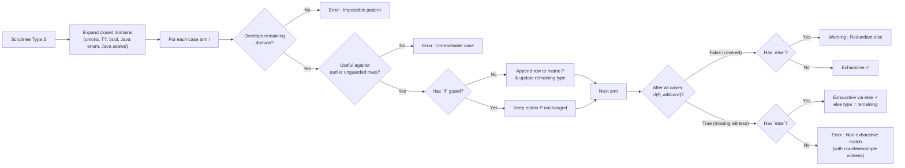
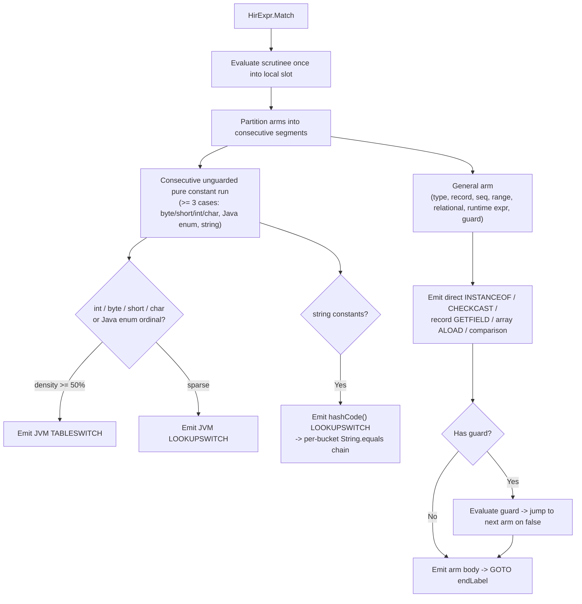

# BIP038: Pattern matching (`match`)

| | |
|---|---|
| **BIP** | 038 |
| **Date** | 2026-11-25 |
| **Status** | Decided (`BIP038-Q1`–`Q10` → `BIP038-D1`–`D10` settled; `BIP038-P1`–`P5` planned) |
| **Depends on** | Object model & `record`s ([bip002_object-model.md](bip002_object-model.md), `RM003`, `RM006`), interactive mode ([bip004_repl.md](bip004_repl.md)), `java.base`-only runtime boundary ([bip006_module-sources-and-aot.md](bip006_module-sources-and-aot.md)), static typing, unions, narrowing & `Type.NOTHING` ([bip008_static-typing.md](bip008_static-typing.md), [bip010_type-checker-simplification.md](bip010_type-checker-simplification.md)), core types & collections ([bip011_core-types.md](bip011_core-types.md)), predicate-free single-bracket `()` grammar ([bip012_grammar-improvements.md](bip012_grammar-improvements.md)), `for` loops & `break`/`continue` ([bip013_iterators.md](bip013_iterators.md)), decoupled `HIR`, `-O1` Nanopass & `-O2` SSA `MIR` ([bip014_optimization-passes.md](bip014_optimization-passes.md), [bip027_tackling-complexity-in-the-compiler.md](bip027_tackling-complexity-in-the-compiler.md)), pure-by-default effects, ownership & axioms ([bip007_effects.md](bip007_effects.md), [bip016_consolidating-effect-annotations.md](bip016_consolidating-effect-annotations.md), [bip017_higher-order-function-effects.md](bip017_higher-order-function-effects.md), [bip019_refactoring-axioms.md](bip019_refactoring-axioms.md)), arrays ([bip020_array-types.md](bip020_array-types.md)), named arguments ([bip021_optional-variadic-overloaded-arguments.md](bip021_optional-variadic-overloaded-arguments.md)), intersection types ([bip022_intersection-types.md](bip022_intersection-types.md)), type aliases ([bip023_type-aliases.md](bip023_type-aliases.md)), self tail calls ([bip024_tail-calls.md](bip024_tail-calls.md)), WebAssembly alignment ([bip025_compile-to-wasm.md](bip025_compile-to-wasm.md), `RM018`), expression-oriented `try`/`catch` ([bip028_exception-handling.md](bip028_exception-handling.md)), `.batest.md` v2 & IR goldens ([bip029_batest-v2-and-ir-goldens.md](bip029_batest-v2-and-ir-goldens.md)), first-class `range of T` ([bip031_ranges.md](bip031_ranges.md), `RM019`), immutable `def` bindings ([bip034_immutable-def-and-mutable-var.md](bip034_immutable-def-and-mutable-var.md)) |
| **Scope** | Expression-oriented `match` / `case` / `else` pattern matching (arbitrary expression value patterns, `is T` / `def x: T` type & binding patterns, binding-free OR-patterns `p1 \| p2`, `if` guards, Babble & Java `record` positional/named/partial destructuring, `is list(...)` / `is array(...)` sequence destructuring with trailing `...` rest slices, relational `<`/`<=`/`>`/`>=`/`!=`/`==`, `BIP031` range `lo..hi`/`lo..<hi`, and `in expr` membership patterns); across `Babble.g4`, `Formatter`, `BabbleSession.classify`, `BlockScopes`/`Resolver`/`TypeChecker`/`Narrowing`/`MatchExhaustiveness`/`TailCalls`/`EffectChecker`/`SizeChangeTermination`/`LoweringAnalyzer`, `Interpreter`, `HirExpr.Match`/`HirPattern`, `MatchEmitter` (`TABLESWITCH`/`LOOKUPSWITCH`/string hash-switch/AOT enum switch-map/direct `INSTANCEOF`), `BIP014` `-O1` Nanopass passes, and `-O2` SSA `MIR` (`MirLowerer`, `MirTerminator.Switch`, `MirVerifier`, `SccpPass`, `MirEmitter`) |

---

## 1. Summary & Motivation

### 1.1 What Babble has today

Babble already provides the building blocks for expressive, statically typed data modeling:

- Immutable structural `record` types (`BIP002`, `RM006`) and transparent generic `type` aliases (`BIP023`), making algebraic data types natural to declare (`def Shape = type Circle | Rect`).
- First-class union types `A | B`, nullables `T?`, intersection types `A & B`, `is` type checks, and flow-sensitive `Narrowing` (`BIP008`, `BIP022`).
- Expression-oriented control flow (`if ... then (...) else (...)`, `while ... then (...)`, `for ... in ... then (...)`, `try (...) catch ... then (...) finally (...)`) inside Babble's single-bracket `()`, predicate-free `PredictionMode.SLL` grammar (`BIP012`, `BIP013`, `BIP028`).
- First-class `range of T` intervals (`lo..hi`, `lo..<hi`, [BIP031](bip031_ranges.md)) and immutable `def` bindings ([BIP034](bip034_immutable-def-and-mutable-var.md)).

Yet multi-way data inspection remains verbose and error-prone:

1. **Multi-way branching requires cascading `if`/`else if` chains.** Dispatching on an integer tag, string command, Java `enum`, union `Circle | Rect | Point`, or nested `record` tree forces repeated scrutinee comparisons (`if x == 1 then (...) else if x == 2 then (...)`), repeated field accesses (`if s is Circle then (def r = s.r ; ...)`), and manual `else` branches with **no static exhaustiveness check** when a new union member or Java `enum` constant is added.
2. **No JVM jump-table dispatch.** Even a dense 12-way dispatch on `int`, `char`, `string`, or a Java `enum` compiles to a linear chain of `IF_ICMPNE` / `Objects.equals` tests instead of `TABLESWITCH` or `LOOKUPSWITCH`.

### 1.2 What this proposal introduces

`BIP038` adds the expression-oriented **`match`** construct (`match <expr> case <pattern> [if <guard>] then (<block>) ... [else [def x then] (<block>)]`), where **every variable binding uses `def`** and **every type or destructuring pattern starts with `is` or `def x:`**, leaving bare expressions completely unambiguous for value comparisons:

```babble
;; 1. Union ADT + record destructuring + mandatory compile-time exhaustiveness (no else needed!)
def Circle = record (r: double) ()
def Rect = record (w: double, h: double) ()
def Shape = type Circle | Rect

def area = fn (s: Shape): double -> (
    match s
        case is Circle(def r) then (3.141592653589793 * r * r)
        case is Rect(def w, def h) then (w * h)
)

;; 2. Value, OR, relational, BIP031 range, in-membership, guard, and else-binding patterns
def classify = fn (n: int, target: int, specials: set of int): string -> (
    match n
        case 0 then ("zero")
        case 1 | 2 | 3 then ("tiny")
        case target + 1 then ("just above target")
        case < 0 then ("negative")
        case 4..<10 then ("single digit")
        case 10..99 if n mod 10 == 0 then ("round")
        case in specials then ("special")
        else def other then ("large : " + other)
)

;; 3. Nested record destructuring (positional & partial named) + sequence destructuring
def Point = record (x: int, y: int) ()
def Line = record (start: Point, finish: Point) ()

def describeLine = fn (l: Line): string -> (
    match l
        case is Line(is Point(0, 0), is Point(def x, def y)) then ("from origin to " + x + "," + y)
        case is Line(start: is Point(x: 0)) then ("starts on y-axis")
        case def whole: Line(is Point(def x1, _), is Point(def x2, _)) if x1 == x2 then ("vertical : " + whole)
        else ("general")
)

def sumList = fn (xs: list of int): int -> (
    match xs
        case is list() then (0)
        case is list(def head, ...def tail) then (head + recurse(tail))
)
```

### 1.3 Goals and non-goals

**Goals:**
1. **Idiomatic, SLL-pure, single-bracket `()` syntax (`BIP038-D1`, `BIP038-D2`, `BIP038-D4`, `BIP038-D5`):** Only two new keywords (`match`, `case`, both exempted in `memberName`), zero `@parser::members`, zero semantic predicates, pure `PredictionMode.SLL` (`ParserGrammarTestCase`), zero ambiguity between variable bindings (`def x`), type/destructuring patterns (`is T(...)` / `def x: T(...)`), and arbitrary expression value patterns (`case x + 1`).
2. **Mandatory compile-time exhaustiveness & sound reachability (`BIP038-D3`, `BIP038-D8`):** Compile errors for non-exhaustive matches, unreachable `case` arms, and statically impossible patterns; non-fatal warning for redundant `else`; exact type narrowing and subtraction across arms.
3. **Rich pattern vocabulary with crisp boundaries (`BIP038-D4`–`D7`):** Constants & runtime expressions, `is T` / `def x: T`, binding-free OR-patterns, `if` guards, Babble & Java `record` positional/named/partial destructuring, `is list(...)` / `is array(...)` with trailing `...` fresh rest slices, relational `<`/`<=`/`>`/`>=`/`!=`/`==`, `BIP031` range `lo..hi`/`lo..<hi`, and `in expr` membership.
4. **Full compiler, effect, ownership, termination & optimizer integration (`BIP038-D9`, `BIP038-D10`):** Read-only narrowable `def` bindings (aligned with `BIP034`), `frozen` preservation, `@BORROWED`/`@UNIQUE` ownership, `BIP024` self tail calls in arm bodies, `BIP027` structural-descent `SCP` termination through record destructuring, dedicated `HirExpr.Match` / `HirPattern` + `-O2` `MirTerminator.Switch` lowered to `TABLESWITCH`/`LOOKUPSWITCH`/string hash-switch/AOT enum switch-map/direct `INSTANCEOF`, `-O1` constant folding & `ScalarReplacePass` SROA + `-O2` `SccpPass` constant `Switch` folding, and `interpret` / `-O0` / `-O1` / `-O2` / `wasm-js -O1` parity.

**Non-goals (explicitly deferred to separate BIPs):**
- **First-class `range of T` (`lo..hi`, `lo..<hi`) and counted `for` loops:** Specified in [BIP031](bip031_ranges.md), which `BIP038` builds on for range and `in`-membership patterns.
- **Babble `sealed interface` and `enum` declarations:** Deferred to a dedicated future BIP (`BIP038-D3`). `BIP038` exhausts Babble union types (`A | B`, `T?`, `type` ADTs), `bool`, Java `enum`s, and Java `sealed` classes/interfaces, and structures `MatchExhaustiveness` around a `permittedSubtypes(Type)` hook so Babble `sealed interface` and `enum` plug in cleanly later.
- **Plain `class` destructuring and custom `unapply` extractors:** Object destructuring is intentionally restricted to Babble `record`s and Java `record`s (`BIP038-D6`) to preserve encapsulation and side-effect-free component reads.
- **Standalone destructuring `def` / `for` bindings** (`def Point(x, y) = p`, `for (k, v) in m`, tracked in the backlog under `BIP005-D3` / `BIP013` §8).
- **Bindings inside OR-patterns** (`case is Left(def v) | is Right(def v)`): disallowed in `BIP038` (`BIP038-D5`).
- **Leading or middle `...` rest in sequence patterns** (`is list(...def init, def last)`): trailing `...` only in `BIP038` (`BIP038-D7`).

---

## 2. State of the Art

| Language | Keyword & form | Constant vs. binding disambiguation | Catch-all | Guard | Record / seq destructuring | Ranges | Exhaustiveness |
|---|---|---|---|---|---|---|---|
| **Java 21+** (JEP 440/441) | `switch (e) { case ... -> ... }` | Typed `case String s` only; bare `case FOO` is constant | `default` | `when cond` | Java `record` positional (`Point(int x, int y)`), no seq | No | Required on expressions (`enum`, `sealed`) |
| **Kotlin 2.0** | `when (e) { ... -> ... }` | Arbitrary exprs; no destructuring bindings in `when` | `else ->` | `if cond` (2.1+) | No (`is T` only) | `a..b`, `a..<b`, `in r` | Required on expressions (`enum`, `sealed`, `Boolean`) |
| **Rust** | `match e { pat => ... }` | Resolution (`const` vs binding — typo footgun!) | `_ =>` | `if cond` | Struct positional/named, slice `[h, t @ ..]` | `a..=b`, `a..b` | Always required |
| **Scala 3** | `e match { case pat => ... }` | Case convention (`Foo` vs `foo`, backticks `` `x` ``) | `case _ =>` | `if cond` | `case class`, `unapply`, `Seq(h, t*)` | `Range` library | Warning (strict flag -> error) |
| **Python 3.10+** (PEP 634) | `match e: case pat:` | Dotted names = constant; bare name = binding (footgun!) | `case _:` | `if cond` | Class positional/keyword, `[h, *t]` | No | None (dynamic) |
| **C# 12** | `e switch { pat => ... }` | Relational/constant vs `var x` / `T x` | `_ =>` | `when cond` | Positional/property `{ X: 0 }`, list `[h, ..var t]` | `a..b` (Index/Range) | Warning (throws `SwitchExpressionException`) |
| **Babble (`BIP038`)** | `match e case pat then (...) else (...)` | Explicit **`def x`** for bindings, **`is T(...)` / `def x: T(...)`** for type/destructuring, bare `expr` for values | `else (...)` / `else def x then (...)` | `if cond` | Babble & Java `record` positional/named; `is list(...)` / `is array(...)` with trailing `...` | `BIP031` `a..b`, `a..<b`, `in expr` | **Mandatory compile error** (`bool`, `T?`, `A \| B`, Java `enum`/`sealed`, nested records) |

Key lessons adopted for Babble:
1. **Eliminate the constant-vs-binding footgun completely (`BIP038-D4`).** Rust's resolution rule, Scala's capitalization rule, and Python's dotted-name rule all silently turn a mistyped constant into a catch-all variable binding. Requiring `def` for every binding and `is`/`def x:` for every type or destructuring pattern eliminates the footgun by construction and preserves pure LL(1)/LL(2) `SLL` parsing alongside arbitrary expression patterns (Kotlin `when`'s best feature).
2. **Reuse `else` as the sole top-level catch-all (`BIP038-D2`).** Babble already parenthesizes every control-flow body (`then (...)`), so `else (...)` and `else def x then (...)` have zero dangling-else ambiguity and read naturally next to `if ... then (...) else (...)`.
3. **Restrict object destructuring to `record`s and return fresh slices on `...def tail` (`BIP038-D6`, `BIP038-D7`).** Keeps pattern matching aligned with `BIP016` purity/ownership and `BIP014-I4` `ScalarReplacePass` (SROA).

---

## 3. Syntax, Grammar, Formatting & REPL

### 3.1 Keyword audit

`BIP038` introduces only **two** new lexer keywords (`BIP038-D1`):

| Token | Lexeme | Grammar role | In `memberName`? | Corpus collisions |
|---|---|---|---|---|
| `MATCH` | `'match'` | Starts `matchExpression` | Yes | **0** across all `.batest.md`, `examples/`, and `axioms/` |
| `CASE` | `'case'` | Starts each `caseClause` | Yes | **0** across all `.batest.md`, `examples/`, and `axioms/` |

**Existing tokens reused with zero new keywords:** `ELSE`, `IF`, `THEN`, `DEF`, `IS`, `IN`, `OF`, `PIPE` (`'|'`), `ELLIPSIS` (`'...'`), `<`/`<=`/`>`/`>=`/`==`/`!=`/`<>`, plus `BIP031`'s `RANGE` (`'..'`) and `RANGE_EXCL` (`'..<'`). Wildcard `_` inside destructuring patterns is recognized by checking `ID.getText().equals("_")` (preserving existing `def _ = ...` and `for _ in xs` syntax without reserving a new lexer token).

### 3.2 Grammar rules (`Babble.g4`)

All additions are **100% predicate-free** and parse in `PredictionMode.SLL`:

```antlr
memberName: ... | MATCH | CASE;   // appended to the existing alternatives (including BIP031's MOD)
```

In `expression`:
```antlr
expression:
          ifExpr                                              # ifExpression
          | MATCH NL* scrutinee=expression
            (NL* caseClause)+
            (NL* elseClause)?                                 # matchExpression
          ...
```

Pattern grammar:
```antlr
caseClause: CASE NL* pattern (NL* IF NL* guard=expression)? NL* THEN NL* armBlock=block;

elseClause: ELSE (NL* DEF name=ID NL* THEN)? NL* elseBlock=block;

pattern: atomicPattern ('|' NL* atomicPattern)*;

atomicPattern
    : DEF name=ID (':' patternBindingType patternArgs?)?        # bindingPattern
    | IS NL* patternType patternArgs?                           # typeOrDestructurePattern
    | op=('<' | '<=' | '>' | '>=' | '==' | NEQ) NL* rhs=expression # relationalPattern
    | IN NL* container=expression                               # membershipPattern
    | expr=expression                                           # valuePattern
    ;

// Type inside `is ...` stops before `|` so `|` unambiguously forms OR-patterns:
//   - `case is A | is B`             -> OR of two `is` patterns
//   - `case is A | null`             -> OR of `is A` and `null`
//   - `case is A & B`                -> intersection type pattern
//   - `case is (A | B)`              -> parenthesized union type pattern
//   - `case is Point(def x, def y)`  -> record destructuring
//   - `case is list(def h, ...def t)` -> sequence destructuring
patternType: nullableType ('&' NL* nullableType)*;

// Type inside `def x: T` allows full union `T` when no destructuring args follow;
// semantic pass checks that `patternArgs` is only attached to a single record/list/array type.
patternBindingType: type;

patternArgs
    : '(' NL* ')'
    | '(' NL* patternArg (NL* ',' NL* patternArg)* (NL* ',' NL* restPattern)? NL* ')'
    | '(' NL* restPattern NL* ')'
    ;

patternArg: (memberName ':')? pattern;

restPattern: ELLIPSIS (DEF name=ID)?;
```

#### SLL proof & value-pattern expressions

0. **Value patterns are plain `expression`s, with `bindingPattern` first.** A restricted copy of the left-recursive `expression` rule would duplicate its ~40 alternatives and their precedence, so `valuePattern`, `relationalPattern`, and `membershipPattern` reuse `expression`. The one overlap is `DEF`: `case def x` could start either `bindingPattern` or a `defExpression` value pattern. SLL resolves the conflict deterministically by alternative order (`bindingPattern` is listed first), and this order is part of the grammar's contract; `ParserGrammarTestCase` only checks that sources parse under SLL, so a `FormatterTestCase`/`ParserGrammarTestCase` golden pins `case def x if x > 0` to `bindingPattern`. `BlockScopes` then rejects declaration and control forms in value position (`def`, `var`, `if`, `match`, `while`, `for`, `try`, `return`, `break`, `continue`, `throw`, `fn`, `class`, `record`, `interface`, `object`, `type`, `axiom`) with `Not a value pattern : <form>. Parenthesize it or bind it with def first`; a parenthesized `(if c then (1) else (2))` is a `blockExpression` and is accepted.
1. **`IF` guard disambiguation:** `IF` is a prefix-only keyword in `Babble.g4`, so no expression can continue with `if`: seeing `IF` after a complete `pattern` always starts the guard clause in LL(1).
2. **Range patterns via `BIP031`'s `rangeExpression` (and `.step(k)`):** Because `lo..hi`, `lo..<hi`, and stepped `(lo..<hi).step(k)` (`BIP031`, e.g., `(3..<10).step(5)`) are already `expression`s, `valuePattern` parses them in pure LL(1)/SLL with zero ambiguity or backtracking! In `TypeChecker` / `HirBuilder`:
   - A bare `BIP031` range expression (`lo..hi`, `lo..<hi`, or `(lo..hi).step(k)` / `(lo..<hi).step(k)`) in `valuePattern` acts as a **zero-allocation range-membership pattern** (`lo <= v and v <= hi` / `< hi`, plus `(v - lo) mod k == 0` when stepped) whenever the scrutinee is an ordered element type (not itself a `range` type), and as **`range` equality** (`v == (lo..hi)`) when the scrutinee's static type is `range of T`.
   - The choice is static: when the scrutinee's remaining type `S` is `any`, `any?`, or a union that includes both a range type and an ordered element type (`int | range of int`), a bare range pattern is a compile error (`Ambiguous range pattern : <S>. Use case in lo..hi or case == (lo..hi)`), so an `any` scrutinee holding a range at runtime is never compared with `<=`. Explicit range equality is written `case == (1..10)`, and membership `case in 1..10` (or `case in r` against a runtime `r: range of int` variable); `in` on an `any` scrutinee tests membership and simply fails to match a value that is not comparable with the range's elements.
3. **Destructuring `patternArgs` vs `patternType`:** `LPAREN` immediately after `patternType` / `patternBindingType` is LL(1)-unambiguous (no call expression can follow a type).
4. **Named `patternArg` (`x: pattern`) vs `pattern`:** LL(2) lookahead (`memberName ':'`) — identical to `callParameter` in `Babble.g4:151`.
5. **No dangling `case` or `else`:** Every `caseClause` and `elseClause` ends in a parenthesized `block` (`(...)`), strictly enclosing nested `match` or `if` expressions.

### 3.3 Canonical formatting (`Formatter`) & REPL (`BabbleSession.classify`)

- **Multi-line `match` (canonical form):** `case` and `else` clauses are indented one level (+4 spaces) under `match`:
  ```babble
  def label = match n
      case 0 then ("zero")
      case 1 | 2 | 3 then ("small")
      case def k: int if k > 10 then (
          def d = k * 2
          "big : " + d
      )
      else ("other")
  ```
- **Spacing:** OR-patterns use `1 | 2 | 3` (single space around `|`), relational patterns use `< 0`, `>= 10` (single space after operator), and bindings/destructuring use `def x: int`, `is Point(def x, def y)`, `is Point(x: 0, y: def py)`, `is list(def h, ...def t)` (no space after `...`).
- **REPL `BabbleSession.classify` (`BIP004`):** `match x` with zero `case` clauses or an unclosed `then (` block classifies as **`INCOMPLETE`**; a closed `match x case 1 then ("a")` classifies as **`COMPLETE`** (matching `if` and `try`/`catch`).

---

## 4. Pattern Forms & Static Semantics

### 4.1 Scrutinee evaluation & result typing

1. **Single evaluation:** The scrutinee `e` is evaluated **exactly once** into a fresh unnamed temporary slot before any pattern or guard runs.
2. **Bidirectional result typing (`TypeChecker`):**
   - If the `match` has an `expected` type, every arm block (`case` and `else`) is checked against `expected` (propagating contextual literal narrowing, `int`→`double` widening, and lambda parameter types).
   - Otherwise, each arm block is synthesized and joined across all reachable non-`Type.NOTHING` arms (identical to `if`/`else` and `try`/`catch`); if every arm diverges, the `match` type is `Type.NOTHING`.
   - `BIP024` self tail calls: every arm block of a `match` in tail position is in **tail position**.

### 4.2 Complete pattern semantics table

Given current remaining scrutinee type `S` (starting from the scrutinee's static type and narrowing as earlier unguarded arms are subtracted):

| Pattern syntax | Meaning | Static type check against remaining `S` | Binding(s) introduced | Contributes to subtraction / exhaustiveness? |
|---|---|---|---|---|
| `expr` (value pattern) | `Operators.eq(v, eval(expr))` (numeric widening, `NaN != NaN`, `record.equals`, `null == null`) | Must overlap `S` (impossible e.g. `"hi"` against `int`, or `null` against non-null `T` → compile error) | None | Yes iff compile-time constant (`true`, `false`, `null`, Java `enum` constant; see §5) |
| `lo..hi` / `lo..<hi` (`BIP031` range pattern) | If `S` is not `range`: `lo <= v and v <= hi` (`< hi`); if `S` is `range`: `v == (lo..hi)` | `lo`, `hi` must be comparable with `S` (`OperatorTypes.comparable`) | None | No (duplicate constant range shadowing still checked in §5.2) |
| `< e`, `<= e`, `> e`, `>= e` | `v < eval(e)`, etc., with exactly the semantics of Babble's binary `<`/`<=`/`>`/`>=` (numeric scalars and Java `Comparable`, `OperatorTypes.comparable`) | `S` and `type(e)` must be comparable (non-null; if `S` is `T?`, `null` does not match) | None | No |
| `== e`, `!= e`, `<> e` | Explicit equality / inequality (`Operators.eq` / `!Operators.eq`) | `type(e)` must overlap `S` | None | No |
| `in expr` | Membership test (`BIP031` `range.contains`, `Collection.contains`, `Map.containsKey`, `ArraySupport.contains`) | `expr` must be `range of E`, `Collection of E`, `Map of (K, _)`, or `array of E` with `E`/`K` overlapping `S` | None | No |
| `is T` | Runtime type test (`Types.matches` / `INSTANCEOF`, including `A & B` chained `INSTANCEOF` per `BIP022-D6`, `null` check, `frozen` preservation per `BIP007-D7`) | `T` must overlap `S`; `is frozen T` rejected (same as `e is frozen T`, `BIP007-D7`); erased generic checks match `e is T` | None (narrows scrutinee variable if narrowable) | Yes (when unguarded): subtracts `T` from `S` |
| `def x: T` | Same runtime test as `is T`, binding read-only `x` of type `narrowTarget(S, T)` | Same as `is T` | `x: narrowTarget(S, T)` | Yes (when unguarded): subtracts `T` from `S` |
| `def x` (untyped) | Always matches current remaining `S` | **Forbidden** at top-level `case` without an `if` guard (`BIP038-D2`; use `else def x then (...)`); **allowed** with `if` guard at top level, and anywhere inside destructuring (`Point(def x, def y)`) | `x: S` | No at top level (guarded); irrefutable inside destructuring |
| `_` | Always matches (discards value) | **Forbidden** as bare top-level `case _` (`BIP038-D2`; use `else (...)`); **allowed** anywhere inside destructuring (`is Point(_, def y)`) | None | Irrefutable inside destructuring |
| `is R(args...)` / `def p: R(args...)` | Record destructuring (`BIP038-D6`): tests `v is R`, then matches each field sub-pattern left-to-right | `R` must be a Babble `record` or Java `record` overlapping `S`; positional/named args validated against `R`'s fields | `p: narrowTarget(S, R)` (if `def p:`) + nested `def` bindings | Yes iff all field sub-patterns exhaust their field types (see §5.1) |
| `is list(args...)` / `is array(args...)` (and `def s: list(...)`) | Sequence destructuring (`BIP038-D7`): tests `v is list`/`array`, checks length (`== N` or `>= N` with trailing `...`), matches elements left-to-right, slices fresh tail if `...def tail` | Scrutinee must overlap `list` / `array`; at most one trailing `...` rest | `s` (if `def s:`), nested element bindings, `tail: list of E` / `array of E` | Yes, by length: `is list(...)` alone covers `list`, and a set of unguarded arms whose element sub-patterns are irrefutable covers `list` when their lengths cover every `n >= 0` (e.g. `is list()` + `is list(def h, ...def t)`, see §5.2); the same holds for `array` |
| `p1 \| p2 \| ...` | OR-pattern: short-circuit left-to-right match | Every `pi` must be valid against `S` and **must not contain any `def` binding** (`BIP038-D5`) | None | Yes: subtracts union of all unguarded `pi` coverages |

### 4.3 Record destructuring rules (`BIP038-D6`)

`is R(args...)` and `def p: R(args...)` accept **Babble `record`s** (`Type.Instance` with `isRecord == true`) and **Java `record`s** (`Type.Java` where `Class.isRecord()` is true). Passing a non-record `class` or `interface` is a compile error: `Not a record type : <R>`.

- **Component order:** Declared `classParameters` order for Babble `record`s; `Class.getRecordComponents()` order for Java `record`s (read via component accessor methods).
- **Positional, named, and partial matching:**
  - Positional arguments match components `0, 1, ...`; named arguments (`fieldName: subPattern`) match by name (error on unknown or duplicate field). Positional must precede named (`BIP021` rule).
  - Purely positional `is Point(p0, p1)` requires **full arity** (using `_` to ignore a slot) **unless** trailing `...` (`is Point(0, ...)`) explicitly ignores remaining fields.
  - Named `is Point(x: 0)` allows **partial matching** (omitted fields default to `_`).
- **Generic records:** Automatically instantiate type parameters from remaining `S` (`Box of int` → `v: int`; `Box of int | Box of string` → `v: int | string`; `any` → `v: any?`).
- **`frozen` propagation (`BIP007-D7`):** Destructuring a `frozen` record wraps non-scalar component bindings in `frozen`.

### 4.4 Sequence destructuring rules (`BIP038-D7`)

`is list(...)` and `is array(...)` (plus `def xs: list(...)` / `def arr: array(...)`, and explicit type args like `is (array of int)(...)` when narrowing from `any`):

- **Element type inference:** Preserves `E` from `list of E` / `array of E` (with `frozen` propagation when matching a `frozen` collection); on `any`, `is list(...)` checks `instanceof java.util.List` (`E = any?`) and `is array of int(...)` checks `instanceof int[]` via `BIP020`.
- **Trailing rest only:** `...` (discard) or `...def tail` may appear **only as the last element** (`Rest pattern must be last` otherwise).
- **Fresh slice semantics:** `...def tail` allocates a fresh `ArrayList` slice (`CoreCollections.listSlice(xs, start)`) for `list` and `Arrays.copyOfRange` for `array` (all 8 primitive array types + `Object[]`, zero boxing), avoiding `List.subList` aliasing hazards under `BIP016`.
- **Evaluation order:** Type check → length check → elements `0 .. N-1` left-to-right → slice allocation (only if all preceding element patterns succeed).

### 4.5 Guard clauses (`if <expr>`) and flow-sensitive narrowing

- **Scope & narrowing:** A guard `if cond` sees all `def` bindings introduced by its arm's pattern plus the scrutinee variable narrowed to the arm's matched type.
- **Guard-to-body narrowing:** `Narrowing.extractRefinement(guard)` propagates refinements proved by the guard (e.g., `case is Box(def v) if v != null then (v.length())`) into `armBlock`.
- **Scrutinee narrowing across arms:** If the scrutinee is a narrowable binding `x`, unguarded `case` patterns subtract their matched type from `x` for all subsequent arms and for `else` / `else def rest`; guarded `case` arms do **not** subtract.

### 4.6 Scoping, shadowing, and read-only bindings (`BIP038-D9`)

- Each `caseClause` and `elseClause` introduces its own lexical `ScopeNode` in `BlockScopes` (identical to `CatchClauseContext` in `BIP028`).
- Duplicate `def` binding names within the same `case` pattern (e.g. `case is Point(def x, def x)`) are a compile error (`Duplicate pattern variable : x`).
- Pattern bindings are **read-only** (`Cannot assign to pattern variable : x` on `x = ...` or `x += ...`), mirroring `for` (`BIP013-D7`) and `catch` (`BIP028-D5`) and aligning directly with `BIP034`'s non-reassignable `def` bindings ([bip034_immutable-def-and-mutable-var.md](bip034_immutable-def-and-mutable-var.md)).
- Pattern bindings may be captured by closures inside the guard or arm block (read-only value capture, no `Cell` boxing required).

---

## 5. Exhaustiveness, Reachability & Diagnostics (`BIP038-D3`, `BIP038-D8`)

### 5.1 Decision-matrix exhaustiveness algorithm (Maranget-style)

Exhaustiveness and reachability are checked by a dedicated, AST-detached package-private analyzer `org.babblelang.analysis.MatchExhaustiveness` (respecting `BIP027-D9`'s 2,000-LOC ceiling) implementing Maranget's *usefulness* algorithm (`U(P, q)`):



### 5.2 Closed domains & `permittedSubtypes(Type)` extension hook

A type `T` has a finite static decomposition into disjoint constructors/subtypes `Σ(T)` when:

1. **`Type.Union(m1, ..., mk)`** (including `T? = T | null` and `BIP023` ADT aliases `def Shape = type Circle | Rect`): decomposed into its union members `m1, ..., mk`.
2. **`Type.BOOL`**: closed 2-element domain `{true, false}`.
3. **`Type.NULL`**: closed 1-element domain `{null}`.
4. **Java `enum`** (`Type.Java` where `Class.isEnum()`): closed finite set of all declared enum constants (`Class.getEnumConstants()`).
5. **Java `sealed` class or interface** (`Type.Java` where `Class.isSealed()`): recursively decomposed into `Class.getPermittedSubclasses()` (with cycle guard; any `non-sealed` permitted subtype remains an open leaf requiring `is OpenSub`).
6. **Babble `record` / Java `record` `R(f1: T1, ..., fk: Tk)`**: single constructor `R` of arity `k`; usefulness recurses into the `k`-column sub-matrix of field types `(T1, ..., Tk)` so nested exhaustive matches like `Pair(true, true)` / `Pair(true, false)` / `Pair(false, _)` require no `else`.
7. **`list of E` / `array of E` by length:** sequence patterns decompose a non-null `list`/`array` into the constructors *exact length `k`* (`is list(p1, ..., pk)`) and *length `>= k`* (`is list(p1, ..., pk, ...)`), the classic nil/cons split generalized to arbitrary prefixes. `is list()` + `is list(def head, ...def tail)` is therefore exhaustive, as is `is list()` + `is list(_)` + `is list(_, _, ...)`; usefulness recurses into the element columns `(E, ..., E)` like record fields, so `is list(true, ...)` + `is list(false, ...)` + `is list()` over `list of bool` is exhaustive too. Counterexample witnesses name the shortest uncovered length (`missing list(_, _)`).
8. **Future hook (`permittedSubtypes(Type)`):** When a future BIP introduces Babble `sealed interface` and Babble `enum`, registering their closed members in `permittedSubtypes(Type)` automatically enables top-level and nested exhaustiveness, counterexample witnesses, and unreachable-arm detection with zero changes to the core algorithm.

On open domains (`int`, `double`, `string`, open `class`/`interface`, `any`, and `list`/`array` element values), duplicate constant/sub-range detection still flags exact shadowed duplicates (e.g. `case 1` followed by `case 1`, or `case 0..10` followed by `case 5` / `case 2..8` for constant bounds).

### 5.3 Exact diagnostics (`BIP038-D8`)

| Condition | Severity | Message format |
|---|---|---|
| Missing cases and no `else` | **Compile error** | `Non-exhaustive match : missing <witness>` (or `Non-exhaustive match : add an else branch`) |
| Arm shadowed by earlier unguarded arm(s) | **Compile error** | `Unreachable case : already matched by earlier case` |
| Pattern cannot match remaining scrutinee type | **Compile error** | `Impossible pattern : <scrutineeType> cannot match <patternSummary>` |
| `else` present after exhaustive cases | **Non-fatal warning** (`analysisWarn`) | `Redundant else : match is already exhaustive` |
| Bare `case _` at top level | **Compile error** | `Wildcard _ is not allowed as a top-level case : use else (...)` |
| Unguarded bare `case def x` at top level | **Compile error** | `Unconditional binding in case : use else def x then (...) or add a type or guard` |
| `def` binding inside OR-pattern | **Compile error** | `Pattern binding not allowed in OR-pattern : <name>` |
| Non-record destructuring `is C(...)` | **Compile error** | `Not a record type : <C>` |
| Assignment to pattern variable | **Compile error** | `Cannot assign to pattern variable : <name>` |
| Declaration or control form as a value pattern (`case def x = 1`, `case if c then (1) else (2)`) | **Compile error** | `Not a value pattern : <form>. Parenthesize it or bind it with def first` |
| Bare range pattern on `any` or a union mixing ranges and elements | **Compile error** | `Ambiguous range pattern : <S>. Use case in lo..hi or case == (lo..hi)` |

**Runtime defense-in-depth:** For an exhaustive-without-`else` match over an external Java `enum` or Java `sealed` hierarchy, the implicit fallback throws `new BabbleException("No matching case : " + value)` if the external library adds a new variant at runtime without recompiling the `babblec` jar.

---

## 6. Effect, Ownership, Provenance & Termination Integration (`BIP038-D9`)

### 6.1 `BIP016` / `BIP017` effect inference (`EffectChecker` & `EffectBodyWalker`)

1. **Scrutinee** is evaluated once; its effects contribute unconditionally.
2. **Patterns & guards:** Constant literals, `is T`, Babble `record` destructuring, and scalar `BIP031` range patterns are `pure nothrow`. Java `record` component accessors consult `JavaEffectResolver` / `AxiomTable` (`BIP019` tier-7 bytecode analysis infers `pure nothrow` automatically). Runtime expression patterns (`case f()`), `in container`, and guards (`if g(x)`) contribute their effects (including `io`, `volatile`, `mut`, throwing, and `fn calling f` forwarding). Sequence destructuring reads `size()`/`get(i)` (`@BORROWED` `@CONST`, `nothrow` once length-checked) and `...def tail` produces a `@UNIQUE` fresh slice.
3. **Arm bodies:** Joined conservatively across all reachable arms (identical to `if`/`else`). A discarded `match` triggers `BIP007-D8` `Unused pure expression` iff scrutinee, all reachable patterns/guards, and all reachable arms are `pure nothrow @TERMINATING`.

### 6.2 Ownership (`unique`, `frozen`, `@BORROWED`, `BIP016-D10`)

- **Borrowing scrutinee (`match x`):** Does not consume `x`; pattern bindings inherit `@BORROWED` provenance pointing back to `x` so returning a destructured field works via `BIP016-D10` return-through-borrow without viral `shared`.
- **Consuming scrutinee (`match move(x)`):** Consumes `x` once into the scrutinee slot; top-level bindings (`case def y: T`, `else def y`) receive `@UNIQUE` ownership inside the winning arm.
- **Moves in guards & arms:** Moving a local `u` inside a guard marks `u` `@MOVED` for the arm body and all later arms; moving `u` in an arm body joins conservatively across arms (identical to `if`/`else`).
- **`frozen` preservation (`BIP007-D7`):** Destructuring a `frozen` record, `list`, or `array` preserves `frozen` on every non-scalar binding.

### 6.3 Structural-descent termination (`BIP027-I6` `SizeChangeTermination`)

Extending `SizeChangeTermination` to record every binding `def f` extracted by `is Record(def f, ...)` as strictly structurally smaller than the scrutinee record (`f < scrutinee`) automatically certifies recursive `match`-based evaluators (AST walkers, tree traversals, expression reducers) as **`@TERMINATING`**.

---

## 7. Backend Lowering, `HIR`, `MIR`, Optimizer & WebAssembly (`BIP038-D10`)

### 7.1 `Interpreter` parity

`Interpreter.visitMatchExpression` evaluates the scrutinee once, then evaluates each `caseClause` sequentially via a `matchPattern(Object value, PatternContext pat)` helper that binds fresh read-only slots in the arm's lexical `Scope` (isolating slots on partial destructuring or guard failure), evaluates the optional `if` guard, and runs the winning `armBlock` (or `elseClause` with optional `else def x` binding).

### 7.2 Decoupled `HIR` representation (`org.babblelang.ir.hir`)

A new `HirExpr.Match` variant plus a sealed `HirPattern` hierarchy (all immutable Java 21 `record`s, zero ANTLR imports):

```java
// In HirExpr:
record Match(
    HirExpr scrutinee,
    HirVar scrutineeVar,          // unnamed local holding evaluated scrutinee
    List<MatchArm> arms,
    MatchElse elseArm,            // nullable when statically exhaustive without else
    boolean exhaustive,           // drives defensive throw vs unreachable
    ExprMeta meta
) implements HirExpr {}

// Sealed HirPattern hierarchy:
public sealed interface HirPattern permits
    HirPattern.Const,              // compile-time int/long/double/bool/char/string/null/enum const
    HirPattern.ValueExpr,          // arbitrary runtime HirExpr compared via ==
    HirPattern.TypeTest,           // is T (single class/interface/primitive or intersection chain)
    HirPattern.Bind,               // def x (: optional inner HirPattern)
    HirPattern.Wildcard,           // _ (nested only)
    HirPattern.Or,                 // p1 | p2 | ... (binding-free)
    HirPattern.Relational,         // < <= > >= == != against HirExpr
    HirPattern.RangeTest,          // BIP031 lo..hi or lo..<hi bounds check (zero allocation)
    HirPattern.Membership,         // in container (Range / Collection / Map / Array)
    HirPattern.RecordDestructure,  // Babble or Java record + field sub-patterns
    HirPattern.SequenceDestructure // list or array + element sub-patterns + optional rest Var
{}
```

### 7.3 JVM bytecode lowering (`MatchEmitter`)

To respect `BIP027-D9`'s 2,000-LOC ceiling on `HirEmitter`, `match` emission lives in a package-private collaborator `org.babblelang.compiler.MatchEmitter` alongside `ControlAndOpEmitter`:



Key bytecode lowering guarantees:
1. **Strict top-to-bottom evaluation order:** Jump-table runs (`TABLESWITCH`/`LOOKUPSWITCH`) are formed **only** across consecutive unguarded pure constant arms (`HirPattern.Const` or `HirPattern.Or` of `HirPattern.Const`). Any runtime expression pattern (`case f()`), guard (`if cond`), or non-constant pattern breaks the run, preserving exact evaluation order and side effects.
2. **Nullable scrutinee + jump table:** Emits a single `IFNULL` check before unboxing or calling `ordinal()`/`hashCode()`, routing to `case null` if present or skipping the jump table.
3. **Zero-allocation `record` destructuring:** Reads Babble `record` fields via direct `GETFIELD` (unboxed primitive fields per `RM001`) and Java `record` components via direct `INVOKEVIRTUAL` accessor calls.
4. **Java `enum` ordinal switch:** Switches on `Enum.ordinal()` with `TABLESWITCH`, using a `<clinit>` synthetic `int[]` switch-map table for external enums compiled AOT via `babblec` (matching `javac`, resilient to JDK/library enum reordering).
5. **Stack-frame & verifier cleanliness:** Passes `HirVerifier`, `MirVerifier`, and ASM `CheckClassAdapter` across `-O0`, `-O1`, and `-O2`, including inside compound expressions (`1 + match x ...`) and `try`/`finally` (`BIP028-D9`).

### 7.4 `BIP014` `-O1` Nanopass, `-O2` SSA `MIR` & `BIP029` IR goldens

- **`HirRewriter` & `HirVerifier`:** Traverse `HirExpr.Match` and `HirPattern`, verifying exhaustiveness flags, slot definitions before reads, and primitive kinds.
- **`HirEGraphSimplifyPass` (`-O1`):** Folds constant-scrutinee `Match` expressions directly to the winning arm; simplifies `if true` guards (drops guard) and `if false` guards (prunes arm).
- **`InlinePass` (`-O1`):** Costs `Match` accurately so small helper functions (`area(shape)`, `sign(n)`) inline cleanly into callers.
- **`ScalarReplacePass` (`O9`, `-O1`):** Recognizes `match RecordNew(...) case is R(def x, def y)` (especially after `InlinePass` inlines `area(Circle(r))`) and eliminates the temporary `record` allocation completely.
- **`HirDcePass` (`-O1`):** Eliminates pure unused `Match` expressions.
- **SSA `MIR` (`-O2`, `BIP014-I3` / `RM013`):**
  - `MirTerminator` gains `MirTerminator.Switch(MirVal key, int[] keys, int[] targetBlocks, List<List<MirVal>> targetArgs, int defaultBlock, List<MirVal> defaultArgs, int line)` alongside `Br` and `BrIf`.
  - `MirLowerer` lowers pure constant `int`/`byte`/`short`/`char`/Java `enum` ordinal and `string` hash-switch runs directly to `MirTerminator.Switch` basic-block dispatch (and general patterns to explicit CFG blocks with `MirTerminator.BrIf`).
  - `SccpPass` folds constant-key `MirTerminator.Switch` terminators straight to unconditional `MirTerminator.Br`, pruning dead arm blocks before `GvnCsePass`, `LicmPass`, and `MirDcePass`.
  - `MirEmitter` emits `TABLESWITCH`/`LOOKUPSWITCH` directly from `MirTerminator.Switch`.
- **`HirCanonicalPrinter` & `MirCanonicalPrinter` (`BIP029`):** Print `(match scrutinee (case <pat> [if <guard>] <body>) ... [(else [v] <body>)])` and `switch %k [0 -> bb1, ...] default -> bbD` cleanly for `.batest.md` `-O0`/`-O1` HIR and `-O2` before/after MIR goldens.

### 7.5 `BIP025` WebAssembly alignment

`HirExpr.Match` remains 100% JVM-agnostic:
- Constant integer/char/enum `TABLESWITCH` runs (and `MirTerminator.Switch`) map directly to Wasm `br_table`.
- `HirPattern.TypeTest` and `HirPattern.RecordDestructure` map directly to WasmGC `ref.test`, `ref.cast`, and `struct.get`.
- String constant runs hash the `(array i16)` `$String` with a Wasm-side `hashCode` helper in `WasmStringOpsGen` (the same `s[0]*31^(n-1) + ...` value as `java.lang.String.hashCode`, so bucket layout is shared with the JVM) before a per-bucket equality chain; `is list(...)` / `is array(...)` read the portable collection and `$RefArray` length helpers, and `...def tail` slices with `array.copy`.
- Java `enum` and Java `sealed` / Java `record` patterns are JVM-only: `WasmPortabilityChecker` rejects them with its usual portability diagnostic, so `.batest.md` cases that use them are marked non-portable.

---

## 8. Implementation Plan & Phases

`BIP038` is structured into **five** incremental phases (building on [BIP031](bip031_ranges.md) for range and `in`-membership patterns), each keeping `mvn package` and `-PO2` green across all execution modes (`interpret`, `compile -O0`, `compile -O1`, `compile -O2`, and `wasm-js -O1`, where `WasmBatestTestCase` runs every portable `.batest.md` case), `ParserGrammarTestCase`, `RuntimeBoundaryTestCase`, `ArchitectureBoundaryTestCase`, `AxiomsTestCase`, and `-format -check`:

| Phase | Scope | Key deliverables & verification |
|---|---|---|
| **`BIP038-P1`** | **Grammar, `Formatter` & REPL `classify`** | Add `MATCH` and `CASE` to `Babble.g4` with the full predicate-free `SLL` pattern grammar (`matchExpression`, `caseClause`, `elseClause`, `pattern`, `patternArgs`, `restPattern`); implement `Formatter` and `BabbleSession.classify`; unit tests in `ParserGrammarTestCase`, `FormatterTestCase`, `ReplTestCase`. |
| **`BIP038-P2`** | **Core `match` (values, `is T`, `def x: T`, OR, relational, `BIP031` range, `in`, guards, `else`)** | `BlockScopes`, `Resolver`, `TypeChecker`, `Narrowing` (arm narrowing & type subtraction), `TailCalls` (`BIP024`), `Interpreter`, `HirExpr.Match` / `HirPattern`, `MatchEmitter` (`TABLESWITCH`/`LOOKUPSWITCH`/string hash-switch/AOT enum switch-map + sequential lowering), `MirTerminator.Switch` + `MirLowerer`/`MirVerifier`/`MirEmitter` (`-O2`), `BIP025` Wasm lowering of `HirExpr.Match` (`br_table`, string hash helper, `ref.test`) with `WasmPortabilityChecker` rejecting Java `enum`/`sealed` patterns, and core `match` `.batest.md` specs passing in `wasm-js -O1`. |
| **`BIP038-P3`** | **Record & sequence destructuring (`is R(...)`, `is list(...)`, `is array(...)`)** | Positional/named/partial Babble & Java `record` destructuring, generic instantiation & `frozen` propagation, trailing `...` / `...def tail` fresh slices on `list` & `array`, `Interpreter` + `MatchEmitter` + `MirLowerer` direct `GETFIELD`/`ALOAD`/slice lowering, Wasm `struct.get` / `array.copy` lowering, and destructuring `.batest.md` specs. |
| **`BIP038-P4`** | **Exhaustiveness engine, reachability diagnostics & effects/ownership/SCP** | AST-detached `MatchExhaustiveness` (Maranget usefulness across `bool`, `T?`, `A \| B`, Java `enum`/`sealed`, nested records, `permittedSubtypes` hook, counterexample witnesses), compile errors for non-exhaustive / unreachable / impossible patterns & warning for redundant `else`, full `EffectChecker` (`@BORROWED`/`@UNIQUE`/`frozen`/`nothrow`) & `SizeChangeTermination` structural descent through record destructuring. |
| **`BIP038-P5`** | **`BIP014` `-O1`/`-O2` optimizations, `BIP029` HIR/MIR goldens, showcase & docs** | `HirEGraphSimplifyPass` constant-scrutinee & constant-guard folding, `InlinePass` costing, `ScalarReplacePass` SROA on `match RecordNew(...)`, `HirDcePass`, `-O2` `SccpPass` constant `Switch` folding, `HirCanonicalPrinter` & `MirCanonicalPrinter` goldens (`hir -O0`, `hir -O1`, `mir -O2` before/after) and `wat` goldens for `br_table` dispatch in `src/test/batest/compiler/`, full `mvn -q verify -Pbatest` (`>= 80%` line & branch gate across all 6 scopes), end-to-end showcase `.batest.md` specs under `src/test/batest/control/` (per `BIP037`), and doc updates (`README.md`, `AGENTS.md`, `docs/ARCHITECTURE.md`). |

---

## 9. Settled Decisions

| ID | Question | Decision |
|---|---|---|
| **`BIP038-D1`** | `Q1` — Primary keyword & structure | `match <expr>` with flat `case <pattern> [if <guard>] then (<block>)` clauses (no outer parens, no extra separator keyword); reserves `match` and `case` (both in `memberName`). |
| **`BIP038-D2`** | `Q2` — Catch-all fallback syntax | `else (...)` and `else def x then (...)` (binding the remaining narrowed type) are the sole top-level catch-all; bare top-level `case _` and unguarded bare `case def x` are compile errors (`_` and bare `def x` are valid inside destructuring; `case def x if guard` is valid at top level). |
| **`BIP038-D3`** | `Q3` — Exhaustiveness & closed hierarchies | Mandatory compile-time exhaustiveness on every `match` (`else ()` for side-effecting matches ignoring other cases). Exhausts `bool`, `T?`, `A \| B` unions, Java `enum`s, Java `sealed` classes/interfaces, and nested record fields. Babble `sealed interface` and `enum` declarations are deferred to a future BIP via a `permittedSubtypes(Type)` hook. |
| **`BIP038-D4`** | `Q4`–`Q6` — Value patterns vs. bindings & destructuring disambiguation | Variable bindings always use `def` (`def x`, `def x: T`, `def p: Point(...)`, `...def tail`); type/destructuring patterns always begin with `is` or `def x:`; bare value patterns accept arbitrary runtime expressions (`case x + 1`, `case foo(1, 2)`) compared with Babble `==`; `BIP031` `lo..hi`/`lo..<hi` and `in expr` patterns test range/collection/map/array membership. Pure LL(1)/LL(2) `SLL` with zero semantic predicates. |
| **`BIP038-D5`** | `Q7`–`Q8` — Guards & OR-pattern bindings | Guard clauses use `if <expr>` (zero new keywords) and do not contribute to exhaustiveness or type subtraction. OR-patterns (`p1 \| p2`) disallow `def` bindings inside alternatives (union bindings use `case def x: A \| B`). |
| **`BIP038-D6`** | `Q9` — Object destructuring scope | Strictly Babble `record`s and Java `record`s (positional full-arity or with trailing `...`, named & partial named, mixed positional-then-named). Plain `class`es and custom `unapply` extractors are out of scope. |
| **`BIP038-D7`** | `Q10` — Sequence destructuring scope | `is list(...)` and `is array(...)` with **trailing `...` rest only** (`...` discard or `...def tail`), where `...def tail` produces a fresh `list of T` / `array of T` slice. |
| **`BIP038-D8`** | Diagnostics for unreachable / impossible / redundant arms | Unreachable `case` arms and statically impossible patterns are compile-time errors; redundant `else` after exhaustive cases emits a non-fatal warning (`analysisWarn`). |
| **`BIP038-D9`** | Binding mutability, ownership & termination | Pattern-bound variables are read-only (matching `for`/`catch` and `BIP034` immutable `def`), narrowable, `frozen`-preserving, `@BORROWED` when matching a borrowed scrutinee (`@UNIQUE` under `match move(x)`), and structurally smaller than the scrutinee record for `BIP027` `SizeChangeTermination`. |
| **`BIP038-D10`** | HIR, MIR, JVM bytecode & optimizer strategy | Dedicated `HirExpr.Match` (`HirPattern`) and `-O2` `MirTerminator.Switch`; consecutive pure constant runs lower to JVM `TABLESWITCH`/`LOOKUPSWITCH`/string hash-switch/AOT enum switch-map, general patterns to direct `INSTANCEOF`/field/index checks preserving strict top-to-bottom order; `-O1` constant folding + `ScalarReplacePass` SROA + `-O2` `SccpPass` constant `Switch` folding; target-neutral for `BIP025` Wasm. |
