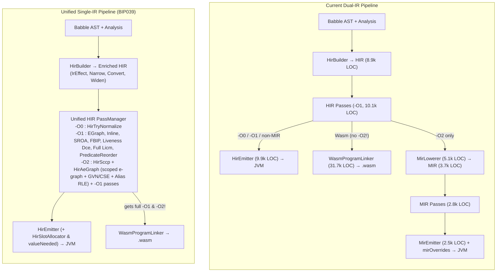
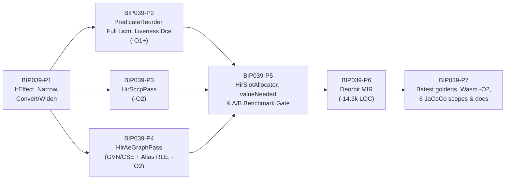

# BIP039: MIR Deorbitation

| | |
|---|---|
| **BIP** | 039 |
| **Date** | 2026-11-26 |
| **Status** | Decided (`BIP039-D1`–`D10` settled ; `BIP039-P1`–`P7` planned) |
| **Depends on** | Typed `HIR`, `-O1` Nanopass & `-O2` SSA `MIR` (`RM010`, `RM012`, `RM013`, [bip014_optimization-passes.md](bip014_optimization-passes.md)), WebAssembly 3.0 backend (`RM018`, [bip025_compile-to-wasm.md](bip025_compile-to-wasm.md)), compiler modularity & shared `egraph` ([bip027_tackling-complexity-in-the-compiler.md](bip027_tackling-complexity-in-the-compiler.md)), exception handling ([bip028_exception-handling.md](bip028_exception-handling.md)), `.batest.md` v2 & IR goldens ([bip029_batest-v2-and-ir-goldens.md](bip029_batest-v2-and-ir-goldens.md)), ranges & `mod`/`//` (`RM019`, [bip031_ranges.md](bip031_ranges.md)), immutable `def` & mutable `var` ([bip034_immutable-def-and-mutable-var.md](bip034_immutable-def-and-mutable-var.md)), compiler simplification ([bip036_compiler-simplification-and-god-class-splits.md](bip036_compiler-simplification-and-god-class-splits.md)), test hygiene ([bip037_babble-test-hygiene.md](bip037_babble-test-hygiene.md)), pattern matching (`RM024`, [bip038_pattern-matching.md](bip038_pattern-matching.md)) |
| **Scope** | Unifying Babble's two compiler IRs (`HIR` and `MIR`) into a single enriched structured `HIR` : promoting `IrEffect`/`AliasClass`, `HirExpr.Narrow` guard anchors, and explicit `HirExpr.Convert`/`HirExpr.Widen` nodes into `HIR` at all `-O` levels ; promoting linear-time wins (`HirSlotAllocator` local-slot coloring, `valueNeeded` dead-result suppression, `HirPredicateReorderPass`, upgraded header/alias `HirLicmPass`, and backward-liveness `HirDcePass`) to default `-O1` ; building a dominator-scoped `HirAeGraphPass` (unifying algebraic rules, `Convert`/`Widen`/`CheckCast` folding, GVN/CSE, `idempotent` collapse, and alias-aware RLE + store-to-load forwarding in one dominator walk) alongside `HirSccpPass` at `-O2` ; unlocking `-O2` optimizations and `-PO2` parity testing for WebAssembly 3.0 ; delivering the `aegraph` engine half of `BIP014-P5` Half B on structured `HIR` ; cancelling `BIP036-P4` (`MirEmitter` split) ahead of `BIP036` ; and cleanly deorbiting `org.babblelang.ir.mir.*`, `org.babblelang.opt.mir.*`, `MirEmitter`, and `IrTier.MIR` after a same-commit A/B parity and benchmark gate (~10,900 net LOC removed). |

---

## 1. Summary & Motivation

### 1.1 The Dual-IR Asymmetry Today

`BIP014` introduced a progressive two-tier compiler IR: structured high-level `HIR` (`RM010`, `-O0`/`-O1`) followed by a per-function flat SSA CFG `MIR` (`RM013`, `-O2`). Since then, Babble added `BIP025` WebAssembly 3.0 (`RM018`), `BIP028` `try`/`catch`/`finally`/`throw`, `BIP031` ranges and floored `mod`/`//` (`RM019`), `BIP034` immutable `def` / mutable `var`, and `BIP038` `match` pattern matching (`RM024`). Measuring the actual codebase today (post-Spotless `AOSP` formatting on `master`) reveals a stark structural asymmetry:

| Subsystem | Files | LOC | Role today |
|---|---:|---:|---|
| `org.babblelang.ir.hir` | 19 | 8,941 | Structured typed IR (`HirExpr`, `HirBuilder`, `HirVerifier`, printers, `HirNameInitAnalysis`) |
| `org.babblelang.opt` + `opt.hir` | 12 | 10,099 | `-O1` passes (`HirEGraphSimplify`, `Inline`, `ScalarReplace`, `FbipReuse`, `HirDce`, `HirLicm`, `HirTryNormalize`) |
| `HirEmitter` + 6 sub-emitters | 7 | 9,879 | JVM bytecode emitter (**still mandatory at `-O2`** for namespace scopes & ABI delegation) |
| `org.babblelang.wasm` | 31 | 31,736 | WebAssembly 3.0 backend (**consumes structured HIR directly**, never sees MIR) |
| **`org.babblelang.ir.mir`** | **18** | **8,849** | Flat SSA CFG IR (`MirLowerer` + 5 lowerer collaborators 5,115, `MirInst` 1,586, `MirCanonicalPrinter` 747, `MirCfg` 295, `MirTerminator` 294, `MirVerifier` 267, `MirEffect` 158, …) |
| **`org.babblelang.opt.mir`** | **8** | **2,786** | The 6 actual `-O2` optimization passes |
| **`MirEmitter.java`** | **1** | **2,472** | Second JVM emitter (delegates ABI ops back to `HirEmitter` via `MethodEmitContext.mirOverrides`) |

The **6 MIR optimization passes are only 2,786 LOC**, while the **scaffolding required to sustain MIR** (`ir.mir` + `MirEmitter`) is **11,321 LOC** — a **4.1 : 1 scaffolding-to-pass ratio**, totaling **14,107 LOC** across 27 files (plus `MethodEmitContext.mirOverrides`, `MirCanonicalPrinterTestCase`, and parallel `;; mir` goldens across 62 `.batest.md` files).

### 1.2 Four Compounding Costs of Keeping Two IRs

1. **Double lowering tax on every new language feature :** Every construct added to Babble (`try`/`catch`/`finally`, `range`, counted `for`, `def`/`var` init tracking, `match` jump tables, and upcoming `BIP026-P2`–`P5` string templates and `BIP033-P1`–`P6` tensors) must be implemented and maintained in both `HirBuilder` → `HirEmitter` and `MirLowerer` (6 files) → `MirEmitter`, plus `Wasm*Emitter` and `Interpreter`.
2. **Unremovable duplication in the JVM backend :** `MirEmitter` cannot replace `HirEmitter`. `MirLowerer` skips all `namespace-scoped` functions (top-level `run()`, class constructors, static blocks, interface bodies) and wraps 22 `HirExpr` variants in `MirInst.OpaqueExpr` that delegate right back into `HirEmitter` via `MethodEmitContext.mirOverrides`. Meanwhile, `MirEmitter` had to re-implement comparison branch fusion, `IAND`/`ISHR`/`IREM`/`IDIV` non-negative strength reduction, constant rematerialization, and stack forwarding just to recover parity with `HirEmitter`'s natural tree-based stack emission (`BIP014` §9.4).
3. **WebAssembly 3.0 is locked out of `-O2` :** WebAssembly 3.0 is a structured-control-flow target (`block`/`loop`/`if`/`br`/`br_table`/`try_table`), so `org.babblelang.wasm` (31,736 LOC) compiles directly from `HIR`. Keeping SCCP, GVN/CSE, Alias RLE, full LICM, liveness DCE, and Predicate Reordering on flat-CFG `MIR` means WebAssembly gets none of them without writing a Relooper/Stackifier and rewriting the Wasm backend.
4. **Maintenance surface, compile time, and test friction :** `MirEmitter` (2,472 LOC) remains a >2,000-LOC monolith (driving `BIP036-P4`), and `MirLowerer` plus its 5 extracted collaborators total 5,115 LOC solely to convert `HIR` into `MIR`. Lowering a second IR adds ~25–30% warm compile time on Argon (`BIP014` §9.4 : `152.1 ms` vs `117.8 ms`) and requires maintaining dual `hir` + `mir` goldens in 62 compiler `.batest.md` files.

### 1.3 Why Structured HIR Can Absorb All of MIR

Two properties of Babble make a flat unstructured CFG unnecessary for Babble's optimizer:

1. **Babble has no `goto` :** Every Babble control-flow construct (`Block`, `If`, `Match`, `While`, `For`, `Try`, `Break`, `Continue`, `Return`, `Throw`, `SelfTailCall`) is strictly structured. Its lexical nesting tree **is** a reducible dominator tree, and its natural loops **are** `While` and `For` nodes.
2. **`BIP034` made local bindings immutable by default :** Almost all Babble locals are non-reassignable `def`s — already SSA by language semantics. Only explicit `var`s can be reassigned, so tracking a lightweight `(varId, version)` epoch during forward passes recovers exact SSA value numbering without Braun phi construction or basic-block lowering.



---

## 2. Complete Feature-Parity Audit : MIR vs. HIR

Deorbiting MIR must lose **zero** optimization capability or runtime performance. Every capability currently exclusive to MIR falls into one of three categories:

### 2.1 IR Representation Primitives

| Capability | Current MIR | Current HIR | Resolution in `BIP039` |
|---|---|---|---|
| **Single-assignment identity** | `MirVal` + Braun block params for non-pinned locals | Mutable `HirVar` (`Def` + `VarAssign`); `BIP034` `def`s are already single-assignment | Lightweight `varEpoch` map `(varId -> version)` inside forward passes (`BIP039-D5`) |
| **Memory-effect & alias lattice** | `MirEffect` (`PURE`/`READ`/`WRITE`/`IMPURE`) + `AliasClass` (`None`/`Frozen`/`UniqueParam(k)`/`Shared`) + `isMemoryBarrierFor` | `ExprMeta` (`EffectSet`, `deeplyImmutable`, `frozen`, `unique`) + scattered `HirPurity` checks; no per-parameter `UniqueParam(k)` tracking | Promote `MirEffect` → `IrEffect` & `AliasClass` + shared `HirEffectAnalysis` (`BIP039-D2`) |
| **Narrowing guard anchor** | `MirInst.Narrow(NON_NULL \| IS_TYPE)` zero-cost value dependency blocking unsafe motion/reordering | Only `HirExpr.Logic.rightNarrowed`; `If`/`Match` narrowing is implicit | Add zero-cost `HirExpr.Narrow` with `guardId` in `HirBuilder` (`BIP039-D3`) |
| **Explicit box/unbox & widening** | First-class `MirInst.Convert` & `MirInst.Widen` (`unbox(box(a)) -> a`, `box(unbox(a)) -> a`, widening chains) | Implicit boxing/unboxing at emission; `ExprMeta.wideningRank()` attribute | Materialize `HirExpr.Convert` & `HirExpr.Widen` in `HirBuilder` at all `-O` levels (`BIP039-D4`) |
| **CFG, dominators & natural loops** | `MirCfg` (RPO, CHK dominators, natural loops) | Structured tree (`Block`, `If`, `Match`, `While`, `For`, `Try`) | Lexical nesting *is* the dominator tree; `While`/`For` *are* the natural loops |

### 2.2 Optimization Passes (`opt.mir` vs. Unified `opt.hir`)

| Optimization | Legacy MIR pass (LOC) | What MIR achieves | Unified HIR destination | Tier |
|---|---|---|---|---|
| **Predicate Reorder (`O11`)** | `PredicateReorderPass` (317) | Cost-based reordering of `and`/`or` & nested `BrIf` chains, structurally guarded by `Narrow` | `HirPredicateReorderPass` directly on `HirExpr.Logic` & nested `HirExpr.If` (~150 LOC) | **`-O1`+** |
| **LICM (`O6`)** | `LicmPass` (253) | Hoists pure ops, `frozen` reads, and un-clobbered `unique#k`/`shared` reads out of **both loop body and loop header condition** (`while cond`) | Upgraded `HirLicmPass` : hoist from `While.cond()` + body, `AliasClass` loop barriers, `ArrayLen`/`NameRead`/`LoadExport`, loop-local `Narrow` guard | **`-O1`+** |
| **Liveness DCE (`O4`)** | `MirDcePass` (342) | Backward mark-sweep eliminating **dead `VarAssign` stores** and **dead loop-carried variables** | Upgraded `HirDcePass` with shared backward `BitSet` liveness over `HirVar`s | **`-O1`+** |
| **SCCP (`O1`+`O4`)** | `SccpPass` (798) | 3-level lattice (`TOP < CONST < BOTTOM`) + reachability across reassigned `var`s, `If`/`Match` joins, loops, `Switch`, zero-divisor `Throw` | `HirSccpPass` (structured forward lattice + loop fixpoint + constant `Match` folding) | **`-O2`** |
| **GVN / CSE (`O5`+`O3`) + Alias RLE (`O7`)** | `GvnCsePass` (740) + `AliasRlePass` (210) | Dominator-scoped GVN/CSE, commutative ops/calls, `ArrayLen`/`LoadExport`/`NameRead`/`SlotRead`/`LoadField`, `Convert`/`Widen`/`CheckCast` chains, cross-stmt `idempotent`, and `StoreField`/`StoreJavaField`→load forwarding across disjoint `unique#k`/`frozen` writes | **`HirAeGraphPass`** : dominator-scoped `aegraph` (extending `org.babblelang.ir.egraph` + `AlgebraicRules`) unifying algebraic simplification, `Convert`/`Widen` chains, GVN/CSE, `idempotent`, and store-to-load forwarding in **one** dominator walk | **`-O2`** |

### 2.3 JVM Codegen Optimizations (`MirEmitter` vs. `HirEmitter`)

`ControlAndOpEmitter` **already** implements comparison/negation jump fusion (`emitCondition`), power-of-two and counted-range non-negative `MOD`/`FLOOR_DIV` strength reduction (`IAND`/`ISHR`/`IREM`/`IDIV`), and `HirEmitter` already caches `Bootstrap.name` reads at `-O1`. The two genuine `MirEmitter` codegen wins missing from `HirEmitter` are promoted to **`-O1`+**:

1. **Backward liveness + JVM-category-segregated local slot coloring (`HirSlotAllocator`) :** `MethodEmitContext.newLocal()` allocates a fresh JVM local index monotonically for every `HirVar`, inlined temp, block temp, and loop temp. Coloring non-overlapping `HirVar` live ranges by JVM slot category (`CAT1_INT`, `CAT1_FLOAT`, `CAT1_REF`, `CAT2_LONG`, `CAT2_DOUBLE`) shrinks stack frames, unlocks 1-byte `iload_0..3`/`dload_0..3`/`aload_0..3`, and keeps hot methods under HotSpot C2's 325-byte `FreqInlineSize` threshold (which drove `-O2`'s 1.83× win on `record Vec3 dot loop` and smaller Argon bytecode in `BIP014` §9.4).
2. **Statement-position dead-result suppression (`valueNeeded = false`) :** `ControlAndOpEmitter` currently allocates and initializes a `result` local (`ACONST_NULL; ASTORE`) for every `While` and `For` loop even when the loop sits in statement position and its value is discarded, and emits `DUP`/`POP` around statement-position assignments. Threading `boolean valueNeeded` eliminates this overhead directly.

### 2.4 Things MIR Does *Not* Actually Do Today

Confirming what we are **not** giving up:
- **No arbitrary CFG transforms :** MIR does not perform general jump-threading, tail-duplication, or loop unrolling. (`MirDcePass`'s identical-target `BrIf` folding and empty-trampoline threading only clean up synthetic CFG blocks created by `MirLowerer` itself.)
- **No guarded may-throw LICM :** `LicmPass.isHoistable` strictly requires `nothrow == true`. (And if guarded LICM is ever desired later, `if cond then (def $h = inv; do-while ...)` is simpler to express on structured HIR than CFG loop-peeling.)
- **No `SelfTailCall` loop LICM :** `MirTerminator.TailCall.successorIds()` is empty, so `MirCfg` does not treat self tail calls as natural loops.
- **No namespace-scoped lowering :** Top-level scripts, class bodies, static blocks, and interface bodies already bypass MIR completely.

---

## 3. Architectural Options Considered

| Option | Description | Pros | Cons |
|---|---|---|---|
| **Option A : Enriched Structured HIR + Scoped `aegraph` *(Selected)*** | Promote `IrEffect`/`AliasClass`, `Narrow`, and `Convert`/`Widen` to `HIR`; promote linear-time passes + slot coloring to `-O1`; build `HirSccpPass` + unified dominator-scoped `HirAeGraphPass` (subsuming GVN/CSE + Alias RLE) at `-O2`; retire MIR. | Removes ~10,900 net LOC; eliminates `ir.mir` (8.8k) & `MirEmitter` (2.5k); unlocks full `-O2` for Wasm 3.0; delivers the `aegraph` engine of `BIP014-P5` Half B immediately; zero rewrite of `Inline`/`ScalarReplace`/`FbipReuse`. | Re-blessing `-O0`/`-O1` HIR goldens once for explicit `Convert`/`Widen`/`Narrow`; lazy `$cse` materialization in `HirAeGraphPass` needs careful scoping discipline. |
| **Option B : Structured SSA-with-Regions (MLIR `scf` / RVSDG)** | Keep structured `If`/`While`/`For`/`Match`/`Try` regions, but replace all mutable `HirVar`s with SSA region parameters and results. | Pure SSA def-use chains everywhere while staying Wasm-friendly. | Requires rewriting `HirBuilder`, all 6 existing `opt.hir` passes (~8.1k LOC), `HirEmitter` (9.9k LOC), and `WasmFuncEmitter`; encoding `break expr`/`continue`/`return`/`throw` + `finally` through region yields is complex. |
| **Option C : MIR-only JVM backend** | Delete `HirEmitter` and lower everything through `MirLowerer` → `MirEmitter`. | Would leave one JVM emitter. | **Fails to unify the IRs :** HIR must still exist for `Inline`/`ScalarReplace`/`FbipReuse` and all 31.7k LOC of Wasm 3.0; `MirLowerer` would have to absorb namespace-scoped bodies and all 22 `OpaqueExpr` ABI emitters. Net LOC would stay flat or grow. |

---

## 4. Settled Architectural Decisions (`BIP039-D1`–`D10`)

- **`BIP039-D1` — Single canonical IR (`HIR`) across JVM and WebAssembly 3.0 :** Retire `org.babblelang.ir.mir.*`, `org.babblelang.opt.mir.*`, and `org.babblelang.compiler.MirEmitter` completely once all passes and codegen upgrades pass the `BIP039-D9` gate on `HIR`. Every optimization pass in `org.babblelang.opt.hir` operates on `HirModule` and benefits both JVM and WebAssembly 3.0 targets (subject only to explicit target guards such as `FbipReusePass`'s `RecordReuse` skip on WasmGC per `BIP025-D11`).
- **`BIP039-D2` — Unified `IrEffect` & `AliasClass` on `HIR` :** Move `MirEffect` (`PURE`, `READ`, `WRITE`, `IMPURE` + `AliasClass`: `None`, `Frozen`, `UniqueParam(k)`, `Shared`) to `org.babblelang.ir.hir.IrEffect` and compute per-function alias maps and expression effects through a single shared `HirEffectAnalysis` helper, unifying effect queries across `HirPurity`, `HirLicmPass`, `HirAeGraphPass`, `HirDcePass`, and `HirPredicateReorderPass`.
- **`BIP039-D3` — Explicit zero-cost `HirExpr.Narrow` guard anchors in `HirBuilder` :** Add `HirExpr.Narrow(HirExpr operand, NarrowKind kind, int guardId, String targetDesc, ExprMeta meta)` emitted by `HirBuilder` wrapping narrowed reads inside `If`, `Logic`, `While`, and `Match` guard scopes. Both `HirEmitter` and `WasmFuncEmitter` emit `operand` directly (zero runtime cost), while `guardId` lets `HirLicmPass`, `HirAeGraphPass`, and `HirPredicateReorderPass` structurally block hoisting/reordering above an enclosing guard while still allowing loop-external narrowed reads to hoist out of inner loops.
- **`BIP039-D4` *(resolves `BIP039-Q1`)* — Explicit `HirExpr.Convert` & `HirExpr.Widen` materialized in `HirBuilder` at all `-O` levels :** Materialize boxing/unboxing (`HirExpr.Convert`) and numeric widening (`HirExpr.Widen`) directly in `HirBuilder` for `-O0`, `-O1`, and `-O2` (retiring implicit `ExprMeta.wideningRank()` emission guesswork). This simplifies both `HirEmitter` and `WasmFuncEmitter`, lets `HirVerifier` enforce exact `PrimitiveKind` matching across all nodes, and lets both `-O1` `HirEGraphSimplifyPass` and `-O2` `HirAeGraphPass` eliminate `unbox(box(a)) -> a`, sound `box(unbox(a)) -> a`, `box(nonnull(a)) -> a`, lossless widening chains, and redundant exact-primitive casts. Existing HIR goldens are re-blessed once and manually reviewed in `BIP039-P1`.
- **`BIP039-D5` — Dominator-scoped `HirAeGraphPass` unifying `aegraph`, GVN/CSE, and Alias RLE at `-O2` :** Build `HirAeGraphPass` directly on `org.babblelang.ir.egraph` + `AlgebraicRules` using a single lexical-dominator preorder walk with:
  - `(varId, varEpoch)` versioning for mutable `var`s (immutable `BIP034` `def`s never bump),
  - `EpochState` (`sharedEpoch`, `uniqueEpochs[k]`, `FROZEN = 0`) for memory reads/writes,
  - scoped e-class hash-consing for pure ops, commutative ops/calls, `Convert`/`Widen`/`CheckCast` chains, cross-statement `idempotent` collapse, and alias-epoch-protected loads (`ThisFieldGet`, `JavaFieldGet`, `ArrayLen`, `NameRead`, `LoadExport`),
  - **unified store-to-load forwarding** (`ThisFieldAssign`/`JavaFieldAssign` recording `(eclass(recv), field) -> eclass(rhs)` right in the dominator walk and invalidating overlapping entries via `IrEffect.isMemoryBarrierFor`), so store-forwarded values immediately join e-classes and unlock algebraic simplification in a single saturation round, and
  - **sound lazy `$cse` materialization** inserting `Def($cseN, expr)` before the dominating first occurrence only when a dominated second hit occurs (never hoisting out of short-circuit RHS or non-dominating sub-scopes).
  To respect `BIP036`'s `<= 1,500`-LOC ceiling from day one, `HirAeGraphPass` is decomposed into cohesive package-private collaborators (`AeGraphState`, `AeGraphBuilder`, `AeGraphExtractor`).
- **`BIP039-D6` *(resolves `BIP039-Q2`)* — Three clean optimization tiers on one IR :**
  - **`-O0` :** Unoptimized `HIR` + mandatory `HirTryNormalize`.
  - **`-O1` (default) :** Fast linear-time `HIR` Nanopass pipeline — `HirEGraphSimplify` (expression-local), `Inline`, `ScalarReplace`, `FbipReuse`, upgraded backward-liveness `HirDce`, upgraded header/alias `HirLicm`, and `HirPredicateReorder`, plus `HirEmitter`'s `HirSlotAllocator` slot coloring and `valueNeeded` dead-result suppression.
  - **`-O2` :** Full `HIR` pipeline — replaces expression-local `HirEGraphSimplify` with `HirSccp` + dominator-scoped `HirAeGraph` (GVN/CSE + Alias RLE + store-to-load forwarding) alongside `Inline`, `ScalarReplace`, `FbipReuse`, liveness `HirDce`, full `HirLicm`, and `HirPredicateReorder`, followed by `HirEmitter` (`HirSlotAllocator` + `valueNeeded`) or `WasmProgramLinker`.
- **`BIP039-D7` — Re-target `BIP014-P5` Half B and simplify `BIP036` :**
  - `BIP039` delivers the dominator-scoped `aegraph` engine of `BIP014-P5` Half B directly on `HIR`; `BIP014-P5` Half B then reduces purely to adding `O12` `PipelineRewritePass` rules over `std/` combinators (benefiting both JVM and WebAssembly).
  - `BIP039` lands **before** `BIP036`, deleting `MirEmitter` (2,472 LOC) and the 6-file `MirLowerer` subsystem (5,115 LOC) outright and cancelling `BIP036-P4` (`MirEmitter` split). Every new class introduced by `BIP039` adheres to `BIP036`'s `<= 1,500`-LOC ceiling.
- **`BIP039-D8` *(resolves `BIP039-Q3`, `BIP039-Q4`)* — Hard removal of `IrTier.MIR`, updated goldens, Wasm `-O2` CI, and 6 JaCoCo scopes :**
  - **Hard-remove `IrTier.MIR`** (and `-Dbabble.dumpIr=mir...` in `CliIrDumper`); `IrTier.parse("mir")` fails cleanly with `Unknown IR tier : mir (expected hir or wat)`.
  - **Mandatory `compiler/*.batest.md` golden rule :** Every non-error, non-session case under `src/test/batest/compiler/` must assert `hir -O0`, `hir -O1`, and `hir -O2` (allowing combined headers such as `;; hir -O0,-O1`, `;; hir -O1,-O2`, or `;; hir -O0,-O1,-O2` when outputs match, plus `stage=after:<Pass>` in dedicated optimization suites). Migrate all 62 files with `;; mir` blocks to `;; hir -O2` and rename the 6 `mir_*.batest.md` suites to `opt_*.batest.md`.
  - **WebAssembly `-O2` parity :** Update `WasmBatestTestCase` to run during **both** `compiled-tests` (`-O1`, default `mvn package`) and `compiled-tests-O2` (`-O2`, under `-PO2`), continuously gating Wasm `-O2` parity without slowing default builds.
  - **6 JaCoCo scopes in `-Pbatest` :** Replace the `SSA MIR (-O2)` scope with `Optimizer (-O2)` measuring the `-O2`-only passes (`HirSccpPass`, `HirAeGraphPass` and its package-private helpers) from `jacoco-compile-O2.exec`, while `Optimizer (-O1)` continues measuring `-O1` passes from `jacoco-compile.exec` — keeping both tiers independently gated at `>= 80%` line and `>= 80%` branch coverage.
- **`BIP039-D9` — Same-commit A/B parity & benchmark gate before deleting MIR :** Legacy MIR stays compiled and active under default `-O2` throughout `BIP039-P1`–`P5`, while unified HIR `-O2` is exercised via a temporary `-Dbabble.hirO2=true` switch. Deletion (`BIP039-P6`) proceeds **only after** unified HIR `-O2` passes:
  1. 100% 4-mode differential parity (`interpret`, `-O0`, `-O1`, unified HIR `-O2`) + Wasm 3.0 `-O1` & `-O2` parity (`WasmBatestTestCase`), all with `babble.verify=true` (`HirVerifier` + ASM `CheckClassAdapter` + `WasmVerifier`).
  2. Byte-identical `examples/raytracer-argon/scene.ppm` across `-O0`, `-O1`, unified HIR `-O2`, and `wasm-js -O1`/`-O2`.
  3. Same-commit A/B benchmarks on `org.babblelang.bench.Benchmarks` (separate JVMs, `-Xms1g -Xmx1g -XX:+UseParallelGC`): unified HIR `-O2` matches or beats legacy MIR `-O2` (within noise) on `opt : record Vec3 dot loop`, `mir : header LICM + GVN/CSE + predicate reorder`, `Stack.ba`, `ArrayList`, and `argon` render time + total emitted bytecode size, while strictly beating legacy MIR `-O2` on compile time.
- **`BIP039-D10` — Sequencing ahead of `BIP036` :** Execute `BIP039-P1`–`P7` before starting `BIP036` so no effort is spent splitting `MirLowerer` or `MirEmitter` before deletion, and enforce `<= 1,500` LOC on every file created or refactored in `BIP039`.

---

## 5. Detailed Technical Design

### 5.1 `IrEffect`, `AliasClass`, and `HirEffectAnalysis` (`BIP039-D2`)

Move `org.babblelang.ir.mir.MirEffect` to `org.babblelang.ir.hir.IrEffect` (preserving its exact `Kind` enum and sealed `AliasClass`: `None`, `Frozen`, `UniqueParam(int paramIndex)`, `Shared`, plus `isRemovableIfUnused()`, `isPureFloatable()`, `isReadFloatable()`, `isMemoryBarrierFor(AliasClass)`, and `canonicalTag()`).

`HirEffectAnalysis` computes two immutable per-function views on demand (cached per `HirFunction` inside a pass run):
1. **`Map<Integer, AliasClass> varAliases` :**
   - `HirParam` with `unique() == true` → `AliasClass.uniqueParam(paramIndex)` (when not `frozen`/`deeplyImmutable`).
   - Any `HirVar` whose type/meta is `frozen` or `deeplyImmutable` → `AliasClass.FROZEN`.
   - Propagated through `Def(v, VarRead(u))`, `Move`, `Freeze` (upgrading to `FROZEN`), and `Narrow`.
   - Everything else → `AliasClass.SHARED`.
2. **`IrEffect effectOf(HirExpr expr, HirModule module)` :**
   - Unifies the classification rules previously split between `HirPurity` and `MirLowerer` (e.g., `NameRead(finalBinding, definitelyDefined)` → `PURE_NOTHROW`; `NameRead(finalBinding, !definitelyDefined)` → `PURE_MAY_THROW`; mutable `NameRead` → `READ_SHARED`/`READ_SHARED_THROW`; `ThisFieldGet` on immutable/definitely-defined or `frozen` receiver → `READ_FROZEN`; `ThisFieldGet` on `unique#k` receiver → `read(uniqueParam(k), ...)`; `ThisFieldAssign` on `unique#k` receiver → `write(uniqueParam(k), ...)`).

### 5.2 New `HirExpr` Nodes (`BIP039-D3`, `BIP039-D4`)

```java
// Zero-cost guard dependency anchor (BIP039-D3)
enum NarrowKind { NON_NULL, IS_TYPE }

record Narrow(
        HirExpr operand,
        NarrowKind narrowKind,
        int guardId,
        String targetDesc,
        ExprMeta meta
) implements HirExpr {}

// Explicit boxing / unboxing / primitive adaptation (BIP039-D4)
record Convert(
        HirExpr operand,
        PrimitiveKind targetKind,
        ExprMeta meta
) implements HirExpr {}

// Explicit numeric widening (rank 1..5 : short, int, long, float, double) (BIP039-D4)
record Widen(
        HirExpr operand,
        int wideningRank,
        ExprMeta meta
) implements HirExpr {}
```

- **Guard-scope precision via `guardId` :** Each narrowing guard (`If` condition, `Logic` LHS, `While` condition, `Match` arm pattern) receives a fresh per-function `guardId`. Inside that guarded branch, `HirBuilder` wraps non-reassigned reads of the narrowed `HirVar` with `Narrow(VarRead(v), kind, guardId, desc, meta)`.
  - If `if s != null` wraps a `while` loop, `guardId` is **outside** the loop, so `HirLicmPass` safely hoists `s.length()` out of the loop!
  - If `if s != null` is **inside** a `while` loop, `guardId` is in the loop's `localGuardIds` set, so `HirLicmPass` refuses to hoist `s.length()` above the loop!
  - `HirPredicateReorderPass` refuses to move any expression containing a `Narrow` whose `guardId` belongs to the enclosing `Logic`/`If` guard.
- **`HirVerifier` invariants :** `Narrow.meta().kind() == operand.meta().kind()` ; `Convert.meta().kind() == targetKind` ; `Widen.wideningRank() in 1..5` and operand is numeric/boxed ; `ExprMeta.wideningRank()` is retired once `Widen` is materialized everywhere.
- **`HirEmitter` & `WasmFuncEmitter` :**
  - `Narrow` emits `operand` directly (zero instructions).
  - `Convert` emits `convertStack(operandKind, targetKind)` (JVM) / `adaptValue(...)` (Wasm).
  - `Widen` emits numeric widening (`I2L`, `I2D`, `Values.toDouble`, etc.).
- **`HirCanonicalPrinter` :** `narrow.nonnull(x)`, `narrow.is[T](x)`, `box(x)` / `unbox[int](x)`, `widen[double](x)` (canonicalizing `guardId` deterministically in preorder so goldens stay preamble-independent).

### 5.3 Linear-Time `-O1` Passes (Promoted from MIR)

#### 1. `HirPredicateReorderPass` (`O11`, ~120 LOC)
- Matches `HirExpr.Logic(AND | OR, left, right, rightNarrowed, meta)` : skips if `rightNarrowed == true`, if either side is not `PURE_NOTHROW` + terminating + deterministic, or if `right` contains a `Narrow` anchored to this `Logic` guard. Swaps `left`/`right` when `cost(right) < cost(left)` (matching `PredicateReorderPass.blockCost`: calls = 10, field/array loads = 4, export reads = 3, scalar ops = 1, const/var = 0).
- Also matches nested pure `If(c1, If(c2, thenB, elseB), elseB)` where `elseB` is structurally identical and pure-safe, swapping `c1`/`c2` when `cost(c2) < cost(c1)` and `c2` has no `Narrow` anchored to `c1`.

#### 2. Upgraded `HirLicmPass` (`O6`, ~490 LOC)
- Scans both `While.cond()` and `While.body()` (and `For.body()`) to collect `modifiedVars`, `localGuardIds`, and `List<IrEffect> loopBarriers` (`WRITE` / `IMPURE`).
- Hoists qualifying invariants out of **both `While.cond()` and `While.body()`** into the preheader `Block` immediately before the loop.
- Hoistability rule (exact match to `LicmPass.isHoistable`):
  - Rejects `Narrow` with `guardId in localGuardIds`, `For` iterator internals, and reads of `cell()` or `modifiedVars`.
  - Allows `fx.isPureFloatable()` (including `ArrayLen`, pure `NameRead`, pure `LoadExport`, pure scalar ops and calls) and `fx.isReadFloatable()` whenever no `barrier` in `loopBarriers` satisfies `barrier.isMemoryBarrierFor(fx.alias())` (`FROZEN`, disjoint `UniqueParam(k)`, and un-clobbered `Shared` reads).

#### 3. Upgraded `HirDcePass` (`O4`, ~550 LOC) + Shared `HirLiveness` (~180 LOC)
- Introduces a shared backward `BitSet` liveness analyzer (`HirLiveness`, reused by `HirSlotAllocator` in `HirEmitter`) over non-captured `HirVar`s in frame-scoped functions:
  - Right-to-left statement transfer: `VarRead(v)` sets bit `v`; plain `VarAssign(v, "=", rhs)` drops the store if bit `v` is clear (retaining `rhs` as a bare statement only if `!effectOf(rhs).isRemovableIfUnused()`), and clears bit `v` before visiting `rhs`.
  - `If`/`Match`/`Try` union live-in sets across arms (`Try` unions `tryBody` live-out with `catches` and `finallyBody` live-in).
  - `While`/`For` iterate backward liveness to a fixed point, eliminating dead loop-carried accumulators cleanly.
  - Prunes any `declaredVars` no longer referenced after dead-store removal.

### 5.4 Iterative Whole-Function `-O2` Passes

#### 1. `HirSccpPass` (`O1`+`O4`, ~500 LOC)
Structured forward abstract interpretation over non-namespace-scoped `HirFunction` bodies:
- **Lattice :** `TOP < CONST(v) < BOTTOM` with IEEE-754 bit-exact `sameConst` (`-0.0` vs `+0.0`, `NaN`) + `boolean reachable`.
- **Transfer rules :**
  - `Def(v, rhs)` / `VarAssign(v, "=", rhs)` updates `env[v]` (pinned `cell()` vars stay `BOTTOM`; compound assignments evaluate `op(env[v], rhs)`).
  - `If(cond, thenB, elseB)` : if `cond` is `CONST(truthy)`, prunes the dead branch; if `BOTTOM`, evaluates both branches on cloned environments and `meet`s modified vars.
  - `Match(scrutinee, arms, elseArm)` : when `scrutinee` is `CONST`, statically folds constant value/relational/range/type patterns to the winning arm; otherwise walks reachable arms and `meet`s.
  - `While`/`For` : iterates lattice over `cond` + `body` until fixed point (bounded by lattice height 2 — typically 2 passes per loop); prunes entry-false loops completely.
  - `Try` : walks `tryBody`, then widens `try`-modified vars to `BOTTOM` on entry to `catches` and `finallyBody`.
  - `Binary(MOD | FLOOR_DIV)` with integral zero divisor folds to `Throw(JavaConstructorCall(ArithmeticException))` and marks trailing statements unreachable.
  - Evaluates `BuiltinAxioms`-foldable static JDK calls.

#### 2. `HirAeGraphPass` (`O2`+`O3`+`O5`+`O7` + `BIP014-P5` engine, split into 3 files `<= 1,200` LOC each)
Replaces expression-local `HirEGraphSimplifyPass` at `-O2`, sharing `org.babblelang.ir.egraph` (`EGraph`, `ENode`, `AlgebraicRules`):
- **`AeGraphState` (~300 LOC) :** Scoped lexical-dominator state holding:
  - `Map<Integer, Integer> varEpoch` (bumped on `VarAssign(v)` and on entry/exit of loops/branches for modified vars; immutable `def`s never bump),
  - `EpochState` (`sharedEpoch`, `Map<Integer, Integer> uniqueEpochs`, `FROZEN = 0`),
  - scoped `Map<FieldLoc, Integer> knownFieldEClasses` and `Map<JavaFieldLoc, Integer> knownJavaFieldEClasses` for **unified store-to-load forwarding**, invalidated via `IrEffect.isMemoryBarrierFor` on `WRITE`/`IMPURE` and `invalidateNonFrozen` at loop headers, branch joins, and `Try` handlers,
  - scoped `Map<Integer, DominatingDef> eclassToDef` tracking the dominating immutable `def` or lazy `$cse` candidate for each e-class.
- **`AeGraphBuilder` (~500 LOC) :** Dominator-preorder walk inserting expressions into the function's bounded acyclic e-graph:
  - Pure ops, commutative ops/calls, `Convert`/`Widen`/`CheckCast` chains (with inverse/lossless rules in `AlgebraicRules` plus guaranteed-live soundness check for `box(unbox(a)) -> a`), cross-statement `idempotent` calls (`f(f(x)) -> f(x)`), `ArrayLen`, `NameRead`, `LoadExport`, and epoch-keyed `ThisFieldGet`/`JavaFieldGet`.
  - On `ThisFieldAssign(recv, field, rhs)` / `JavaFieldAssign(...)`: invalidates overlapping `knownFieldEClasses`, then binds `(eclass(recv), field) -> eclass(rhs)` so any dominated `ThisFieldGet` immediately resolves to `eclass(rhs)` and joins saturation in the same pass!
  - Bounded per-function e-node budget (e.g., 512 e-nodes per function, falling back cleanly to expression-local mode if exceeded) so pathological functions never blow compile time.
- **`AeGraphExtractor` (~400 LOC) :** Cost-based extraction + **sound lazy `$cse` materialization**:
  - Picks the lowest-cost canonical representative in each e-class (preferring constants, existing dominating immutable `HirVar`s, and already-materialized `$cse` bindings).
  - Materializes `Def($cseN, extractedExpr)` immediately before the dominating first occurrence's statement **only** when a second dominated site actually selects that e-class — never hoisting out of short-circuit `Logic` RHS or conditional/try sub-scopes.

### 5.5 `HirEmitter` Backend Upgrades (`-O1`+)

1. **`HirSlotAllocator` (~250 LOC) :**
   - Runs before emitting each frame-scoped function body at `-O1`+, reusing `HirLiveness`.
   - Pins function parameters, captured `Cell` vars, and variables live across `Try` exception edges so handler entries never read overwritten slots.
   - Colors non-overlapping frame `HirVar` live intervals independently per JVM slot category (`CAT1_INT`, `CAT1_FLOAT`, `CAT1_REF`, `CAT2_LONG`, `CAT2_DOUBLE`), preferring the lowest free slot index so hot variables hit 1-byte `iload_0..3`/`dload_0..3`/`aload_0..3` instructions.
2. **Statement-position `valueNeeded` flag (~100 LOC) :**
   - Threads `boolean valueNeeded` through `HirEmitter.emitExpr` and `ControlAndOpEmitter`:
     - Non-final statements in `Block`/bodies pass `valueNeeded = false`.
     - `emitWhile` and `emitFor` skip allocating and initializing `resultLocal` when `!valueNeeded` (evaluating and popping side-effecting `break expr` values without storing to a dead local).
     - `emitVarAssign`, `emitThisFieldAssign`, and `emitJavaFieldAssign` omit `DUP` when `!valueNeeded`, eliminating `DUP; STORE; POP` pairs.

### 5.6 WebAssembly 3.0 `-O2` Support (`BIP039-D1`, `BIP039-D8`)

- `WasmFuncEmitter` handles `HirExpr.Narrow` (emit `operand`), `HirExpr.Convert` (existing `adaptValue`), and `HirExpr.Widen` (existing numeric widening).
- `WasmCompiler` / `BabbleCompiler.buildAndOptimizeHir` already runs `PassManager.defaultFor(optLevel)`, so `-O1` and `-O2` automatically optimize WebAssembly 3.0 output.
- `WasmBatestTestCase` changes its opt-level gate from `optLevel != 1` to `optLevel == 0`, running full Wasm parity at `-O1` in default `mvn package` and at both `-O1` and `-O2` under `-PO2`.

---

## 6. Incremental Implementation Roadmap (`BIP039-P1`–`P7`)

MIR stays intact throughout `BIP039-P1`–`P5` behind default `-O2`, while unified HIR `-O2` runs under `-Dbabble.hirO2=true` for direct same-commit A/B verification before deletion in `BIP039-P6`.



| Phase | Scope | Verification Gate |
|---|---|---|
| **`BIP039-P1`** | **HIR foundation :** Add `IrEffect`/`AliasClass` + `HirEffectAnalysis`, `HirExpr.Narrow` (with `guardId`), `HirExpr.Convert`, and `HirExpr.Widen` in `HirBuilder` at all `-O` levels ; simplify implicit conversions in `HirEmitter` and `WasmFuncEmitter` ; update `HirVerifier`, `HirRewriter`, `HirCanonicalPrinter`, and `HirPrinter` ; re-bless and manually review `-O0`/`-O1` HIR goldens. | `mvn -B package -PO2` + `WasmBatestTestCase` green; zero behavioral changes. |
| **`BIP039-P2`** | **Linear-time `-O1`+ passes :** Add shared `HirLiveness`, implement `HirPredicateReorderPass`, upgrade `HirLicmPass` (header hoisting + `AliasClass` loop barriers + `guardId` `Narrow` check), and upgrade `HirDcePass` (backward-liveness dead-store and dead-loop-var removal). Wire into `-O1`+. | Full differential parity across `interpret`, `-O0`, `-O1`, `-O2`, and Wasm 3.0; re-bless affected `-O1` HIR goldens. |
| **`BIP039-P3`** | **Structured SCCP (`-O2`) :** Implement `HirSccpPass` (3-level lattice, reachability, `If`/`Match`/`While`/`For`/`Try`, zero-divisor `Throw`, foldable JDK axioms) behind `-Dbabble.hirO2=true`. | Parity on all `mir_sccp_and_dce.batest.md` cases + full suite under `-Dbabble.hirO2=true`. |
| **`BIP039-P4`** | **Dominator-scoped `HirAeGraphPass` (`-O2`) :** Implement `AeGraphState`, `AeGraphBuilder`, `AeGraphExtractor`, and `HirAeGraphPass` (all `<= 1,500` LOC) unifying algebraic rules, `Convert`/`Widen`/`CheckCast` folding, GVN/CSE with lazy `$cse` materialization, `idempotent` collapse, and unified store-to-load forwarding behind `-Dbabble.hirO2=true`. | Parity on all `mir_gvn_and_alias_rle.batest.md` & `mir_licm_and_predicates.batest.md` cases + full suite under `-Dbabble.hirO2=true`. |
| **`BIP039-P5`** | **Backend codegen parity & A/B Benchmark Gate (`BIP039-D9`) :** Implement `HirSlotAllocator` (reusing `HirLiveness`) and `valueNeeded` dead-result suppression in `HirEmitter` / `ControlAndOpEmitter` (active at `-O1`+). Run same-commit A/B benchmarks comparing `-O2` (legacy MIR) vs. `-O2 -Dbabble.hirO2=true` (unified HIR) across `Benchmarks`, Argon render/compile/bytecode size, and Wasm 3.0. | **`BIP039-D9` hard gate :** unified HIR `-O2` matches/beats legacy MIR `-O2` on throughput and bytecode size, strictly faster compile time, byte-identical Argon, 0 divergences across JVM & Wasm. |
| **`BIP039-P6`** | **Deorbit MIR :** Make unified HIR `-O2` unconditional and remove `-Dbabble.hirO2` ; delete `org.babblelang.ir.mir.*` (18 files, 8,849 LOC), `org.babblelang.opt.mir.*` (8 files, 2,786 LOC), `MirEmitter.java` (2,472 LOC), `MethodEmitContext.mirOverrides`, `IrTier.MIR`, `CliIrDumper` MIR branches, and `MirCanonicalPrinterTestCase`. | Clean build, `RuntimeBoundaryTestCase`, `ArchitectureBoundaryTestCase`, `ExamplesTestCase`, byte-identical Argon across `-O0`/`-O1`/`-O2`/Wasm. |
| **`BIP039-P7`** | **Tests, Wasm `-O2`, JaCoCo scopes & docs :** Enable `WasmBatestTestCase` at `-O2` under `-PO2` ; update `BatestV2Parser`/`BatestV2HarnessTestCase` to require `hir -O0`, `hir -O1`, `hir -O2` (combined headers allowed) ; migrate all 62 `.batest.md` compiler files from `;; mir -O2` to `;; hir -O2` (renaming `mir_*.batest.md` → `opt_*.batest.md`, blessing with `-Dbatest.updateIr=true` and manually reviewing diffs) ; replace `SSA MIR (-O2)` with `Optimizer (-O2)` in `pom.xml` and `BatestCoverageReporter` ; update `BIP014`, `BIP029`, `BIP036` (retiring `BIP036-P4`), `docs/ARCHITECTURE.md`, `AGENTS.md`, `src/test/AGENTS.md`, and `README.md`. | Full `mvn -B package -PO2` (JVM + Wasm `-O1`/`-O2`), `mvn -q verify -Pbatest` (`>= 80%` line & branch on all 6 scopes), `-format -check`, and byte-identical Argon. |

---

## 7. Expected Net Impact & Cross-BIP Synergies

### 7.1 Estimated Codebase Impact

| Category | Removed LOC | Added LOC | Net LOC |
|---|---:|---:|---:|
| `org.babblelang.ir.mir.*` (18 files) → `IrEffect`, `Narrow`, `Convert`/`Widen`, `HirEffectAnalysis` | −8,849 | +850 | **−7,999** |
| `org.babblelang.opt.mir.*` (8 files) → `HirLiveness`, `HirPredicateReorder`, upgraded `HirLicm`/`HirDce`, `HirSccp`, `HirAeGraph` (3 helpers) | −2,786 | +2,000 | **−786** |
| `MirEmitter` (2,472) + `mirOverrides` (~180) → `HirSlotAllocator` + `valueNeeded` | −2,652 | +450 | **−2,202** |
| **Total (`src/main/java`, Spotless AOSP)** | **−14,287** | **+3,300** | **~−10,987** |

### 7.2 Synergies with Planned BIPs

- **`BIP036` (Compiler simplification) :** Deletes `MirEmitter.java` (2,472 LOC) outright ahead of `BIP036`, retiring `BIP036-P4` by deletion instead of splitting it, and removes the entire 6-file `MirLowerer` subsystem (5,115 LOC).
- **`BIP014-P5` Half B (`aegraph` & `O12` pipeline rewrites) :** `BIP039-P4` delivers the dominator-scoped `aegraph` engine directly on `HIR`; `BIP014-P5` Half B then only adds `O12` pipeline rewrite rules over `std/` combinators (working for both JVM and WebAssembly).
- **`BIP018-P2` (Class-File API backend) :** Replacing ASM with JDK 25's Class-File API only needs to port **one** emitter (`HirEmitter`), not two (`HirEmitter` + `MirEmitter`).
- **`BIP025` (WebAssembly 3.0) :** Gains full `-O1` and `-O2` optimization (SCCP, dominator-scoped `aegraph`, GVN/CSE, Alias RLE, header LICM, liveness DCE, Predicate Reordering) with ~50 LOC of Wasm-side changes and continuous `-PO2` CI parity.
- **`BIP026-P2`–`P5` (String templates) & `BIP033-P1`–`P6` (Tensors) :** New IR nodes and lowering logic are implemented **once** on `HIR` instead of duplicated across `MirLowerer`, `MirInst`, and `MirEmitter`.
