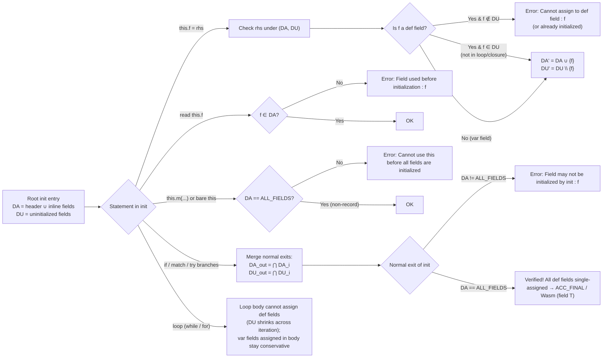
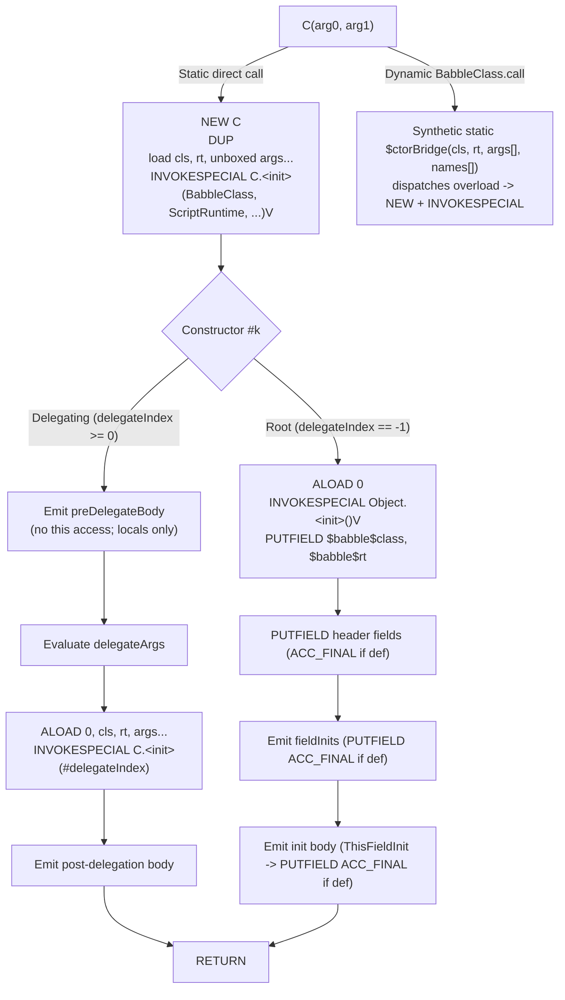

# BIP040: Constructors (`init`)

| | |
|---|---|
| **BIP** | 040 |
| **Date** | 2026-11-27 |
| **Status** | Decided (`BIP040-D1`–`BIP040-D10` settled; `BIP040-P1`–`BIP040-P5` planned) |
| **Depends on** | Object model & `record`s ([bip002_object-model.md](bip002_object-model.md), `RM003`, `RM006`), interactive mode ([bip004_repl.md](bip004_repl.md)), modules & AOT ([bip005_modules.md](bip005_modules.md), [bip006_module-sources-and-aot.md](bip006_module-sources-and-aot.md)), static typing & generics ([bip008_static-typing.md](bip008_static-typing.md), [bip010_type-checker-simplification.md](bip010_type-checker-simplification.md)), predicate-free single-bracket `()` grammar ([bip012_grammar-improvements.md](bip012_grammar-improvements.md), `RM006`), unified structured `HIR` & `-O1`/`-O2` optimizer ([bip014_optimization-passes.md](bip014_optimization-passes.md), [bip039_mir-deorbitation.md](bip039_mir-deorbitation.md)), pure-by-default effects & higher-order `calling` ([bip007_effects.md](bip007_effects.md), [bip016_consolidating-effect-annotations.md](bip016_consolidating-effect-annotations.md), [bip017_higher-order-function-effects.md](bip017_higher-order-function-effects.md)), optional/named/variadic/overloaded calls ([bip021_optional-variadic-overloaded-arguments.md](bip021_optional-variadic-overloaded-arguments.md)), WebAssembly 3.0 backend ([bip025_compile-to-wasm.md](bip025_compile-to-wasm.md), `RM018`), immutable `def` & mutable `var` bindings ([bip034_immutable-def-and-mutable-var.md](bip034_immutable-def-and-mutable-var.md)), pattern matching ([bip038_pattern-matching.md](bip038_pattern-matching.md), `RM024`) |
| **Scope** | Dedicated `init` constructor syntax (`[private] init [effectPrefix] [(fnParameters) ->] ( body )`), declarative `class`/`record`/`object` bodies with uninitialized `def`/`var` fields, primary/explicit/overloaded constructors and `this(...)` delegation with pre-delegation local statements, static definite-initialization and single-assignment `FieldInitAnalysis`, pure-by-default `init` effects (`io`, `volatile`, `nothrow`, `calling f`), `record` & `object` rules, `ClassShape`/`TypedModuleSummary`/`Interpreter` support, `HirClass`/`HirConstructor` lowering, JVM `<init>` emission with `ACC_FINAL` on all `def` fields, `-O1`/`-O2` interaction, and WebAssembly 3.0 local-staged immutable `(field T)` lowering |

---

## 1. Summary & Motivation

### 1.1 What Babble has today

In Babble's current object model ([BIP002](bip002_object-model.md) §4.2), a `class`, `record`, or `object` body doubles as its constructor body: every top-level `def` or `var` inside the body becomes a permanent instance field, and arbitrary executable statements may sit alongside member declarations.

When an object's initialization computes intermediate values shared across multiple fields, Babble offers no constructor-local scope. Authors are forced to store every intermediate value as a `private def` instance field — retaining construction temporaries on the heap for the entire lifetime of every instance:

1. **Permanent temporary fields in real Babble code:**
   - In [`examples/raytracer-argon/lib/camera.ba`](../../examples/raytracer-argon/lib/camera.ba), `Camera` declares **26 fields**, of which **8** (`theta`, `h`, `viewportHeight`, `viewportWidth`, `viewportU`, `viewportV`, `viewportUpperLeft`, `defocusRadius`) are never read again after construction.
   - In [`examples/raytracer-fable/camera.ba`](../../examples/raytracer-fable/camera.ba), **10** of `Camera`'s 26 fields (`theta`, `viewportHeight`, `viewportWidth`, `w`, `u`, `v`, `viewportU`, `viewportV`, `viewportUpperLeft`, `defocusRadius`) are construction-only temporaries.
   - In [`examples/raytracer-argon/lib/hittables.ba`](../../examples/raytracer-argon/lib/hittables.ba), every `Sphere` carries **2** unused temporary fields (`rAbs`, `rVec`) solely to build `bbox` (8 fields instead of 6). Wrapping an inline initializer in a block expression (`private def bbox: AABB = ( def r = ... ; AABB(...) )`, as in `raytracer-fable/sphere.ba`) only helps a single field and cannot share temporaries across multiple fields.
2. **No overloaded constructors or explicit constructor functions:**
   A class can only accept one parameter list in its header `class (params)`. Alternative construction patterns must be pushed into named `static` factories (such as `HitRecord.create(...)` in `examples/raytracer-argon/lib/interfaces.ba` or `AABB.fromPoints(...)`), and there is no way to declare a `private` constructor to make static factories the sole entry point.
3. **No constructor effect annotations:**
   `class (params) (...)` has no syntactic position for `BIP016`/`BIP017` effect modifiers (`io`, `volatile`, `nothrow`, `calling f`).
4. **Body `def` fields cannot be JVM `ACC_FINAL` or WasmGC immutable:**
   Because `ClassGen` emits body initialization in a separate static `$ctor` helper after `<init>` returns, only *header* `def` fields currently receive JVM `ACC_FINAL` (`ClassGen.finalHeaderMemberIndices`), while body `def` fields remain mutable at the bytecode level with `$defined$` bitmasks and `Undefined.UNDEFINED` sentinel writes.

### 1.2 What this proposal introduces

`BIP040` makes `class`, `record`, and `object` bodies **declarative** (containing only fields, methods, and `init` clauses) and introduces a dedicated **`init`** constructor clause in two unambiguous forms:

```babble
;; 1. Header parameters + parameterless `init (...)` (temporaries stay local!)
export def Sphere = class (def center: Vec3, def radius: double, def mat: Material) implements Hittable, Describable (
    private def radiusSq: double = this.radius * this.radius
    private def invRadius: double = 1.0 / this.radius
    private def bbox: AABB

    init (
        def rAbs: double = math.abs(this.radius)
        def rVec: Vec3 = Vec3(rAbs, rAbs, rAbs)
        this.bbox = AABB.fromPoints(this.center - rVec, this.center + rVec)
    )

    def boundingBox = fn (): AABB -> (this.bbox)
    ...
)

;; 2. Empty header `class ()` + overloaded explicit `init (params) -> (...)` + `this(...)` delegation
export def Vec2 = class () (
    def x: double
    def y: double

    init (x: double, y: double) -> (
        this.x = x
        this.y = y
    )

    init (v: double) -> (
        this(v, v)
    )

    init () -> (
        this(0.0, 0.0)
    )
)

;; 3. Record with canonical header, invariant check in `init (...)`, and secondary delegating `init`
export def HitRecord = record (
    p: Vec3,
    normal: Vec3,
    mat: Material,
    t: double,
    frontFace: bool
) (
    init (
        if this.t < 0.0 then (throw exception("Negative hit distance"))
    )

    init (r: Ray, p: Vec3, outwardNormal: Vec3, t: double, mat: Material) -> (
        def frontFace: bool = r.dir.dot(outwardNormal) < 0.0
        def normal: Vec3 = if frontFace then (outwardNormal) else (-outwardNormal)
        this(p, normal, mat, t, frontFace)
    )
)
```

Calling the class or record as a function — `Sphere(c, r, m)`, `Vec2(1.0)`, `HitRecord(r, p, n, t, mat)` — remains the **sole** construction syntax (`BIP040-D3`). `init` is never exposed as a callable member on instances (`obj.init(...)`) or on class values (`Vec2.init(...)`).

### 1.3 Goals and non-goals

**Goals:**
1. **Zero-lifetime construction temporaries (`BIP040-D2`, `BIP040-D6`):** All intermediate locals declared inside `init` live strictly on the constructor stack frame and never become instance fields.
2. **Full constructor functions & overloading (`BIP040-D4`, `BIP040-D5`):** Support parameterless `init (...)` initializers alongside header parameters, explicit parameterized `init (params) -> (...)` constructors on `class ()`, closed `BIP021` constructor overload sets, `this(...)` delegation with flexible pre-delegation local statements, and optional `private init`.
3. **Pure-`SLL`, single-bracket `()` grammar (`BIP040-D1`, `BIP040-D2`):** Only one new keyword (`init`, exempted in `memberName`), zero `@parser::members`, zero semantic predicates, keeping `class () (...)` mandatory (`BIP012-D5`).
4. **Static definite-initialization & single-assignment soundness (`BIP040-D7`):** Statically prove that every field is initialized before read or `this` escape, and every `def` field is written exactly once, unlocking JVM `ACC_FINAL` on all `def` fields (header and body) and WasmGC immutable `(field T)` fields (`BIP040-D10`).
5. **Full `BIP016`/`BIP017` effect integration (`BIP040-D9`):** Pure-by-default `init` clauses with `io`, `volatile`, `nothrow`, `calling f`, and `mut`/`shared`/`unique` parameters.
6. **Preserved `record` ergonomics & optimizations (`BIP040-D8`):** Keep canonical header components for `equals`/`hashCode`/`toString`, `BIP038` destructuring, and `BIP014-I4` `fastRecord`/SROA.

**Non-goals:**
- **Class inheritance / `super(...)` constructor chaining:** Babble intentionally has no class inheritance (`BIP002-D3`); `this(...)` delegates only to another constructor of the same class/record.
- **Eliding `()` on headerless classes (`class (...)`):** Kept as `class () (...)` (`BIP012-D5`); see §4.2 for the exact grammar ambiguity proof (`class () ()` and `NL*` continuation).
- **Callable `C.init(...)` or re-initializable `obj.init(...)`:** Construction is always `C(args)` (`BIP040-D3`).
- **Bare names for own members inside `init` or methods:** Explicit `this.x` remains the rule (`BIP002-D2`); bare member names are tracked separately in the backlog.

---

## 2. State of the Art

| Language | Primary / compact form | Explicit / secondary constructors | Overloading | Delegation | Pre-delegation code | Definite init of `final`/`val` fields |
|---|---|---|---|---|---|---|
| **Java 25** (JEP 513 + records) | `record R(int x) { public R { ... } }` | `ClassName(params) { ... }` | Yes | `this(...)` | **Yes** (JEP 513: statements not referencing `this`) | Compile-time DA/DU check -> `ACC_FINAL` (JEP 500 trusted final) |
| **Kotlin** | `class C(val x: Int) { init { ... } }` | `constructor(params) : this(...) { ... }` | Yes | Required to primary | Expressions in `this(...)` args only | Compile-time definite assignment of `val` properties |
| **Swift** | Struct memberwise `init` | `init(params) { ... }`, `convenience init` | Yes | `self.init(...)` | Yes, before `self.init` | Strict two-phase initialization; no `self` use until all stored properties set |
| **Scala 3** | `class C(val x: Int) { ... }` (body is ctor) | `def this(params) = this(...)` | Yes | First statement `this(...)` | No | Val fields initialized in primary body (same temporary-field pitfall Babble had!) |
| **Python** | `@dataclass` + `__post_init__` | `def __init__(self, ...):` | No (`@classmethod`) | N/A | N/A | Dynamic (`self.x` created on assignment; callable on existing instance) |
| **TypeScript** | `constructor(public x: number)` | `constructor(...)` | Signature overloads + 1 impl | No | N/A | `strictPropertyInitialization` (`readonly` assignable only in ctor) |
| **Rust** | Struct literals + `Self::new(...)` | Named `fn new(...) -> Self` factories | No | Calls `Self::new` | Yes (ordinary function) | Struct literal requires every field at construction time |
| **Babble (`BIP040`)** | `class (def x: T) ( init ( ... ) )`, `record (x: T) ( init ( ... ) )` | `[private] init [effects] (params) -> ( ... )` | **Yes** (closed `BIP021` set) | `this(...)` | **Yes** (JEP 513 / Swift style: no `this` before `this(...)`) | **Strict `FieldInitAnalysis`**: DA + single-assignment `def` -> JVM `ACC_FINAL` & WasmGC `(field T)` |

Key lessons adopted for Babble:
1. **Avoid Scala's class-body-as-constructor pitfall:** Scala's class body turns every non-`private[this]` val/var (and any local captured by a method) into an instance field. Separating declarative member definitions from `init` guarantees constructor temporaries never leak onto the instance layout.
2. **Adopt Java 25 JEP 513 flexible pre-delegation bodies:** Requiring `this(...)` to be the literal first statement forces awkward static helper methods whenever a secondary constructor must compute two interdependent values (such as `frontFace` and `normal` in `HitRecord`) before delegating. Allowing arbitrary `this`-free local statements before `this(...)` keeps delegation completely natural and maps directly to JVM 21 `<init>` bytecode verification.
3. **Adopt Swift's two-phase `this` safety:** Disallowing method calls on `this` and `this` escape until *every* field is definitely initialized eliminates the entire class of half-initialized-object bugs (`NullPointerException` / `Undefined` reads from virtual dispatch during construction) and lets JVM and WasmGC emit immutable `final` / `(field T)` storage for every `def` field.

---

## 3. Decisions (`BIP040-D1`–`BIP040-D10`)

| # | Question | Decision |
|---|---|---|
| **`BIP040-D1`** | Constructor keyword | Reserve **`init`** (`INIT: 'init'`) and exempt it in `memberName`. Zero collisions in `examples/` and `axioms/`; 6 local/param renames in `src/test/batest/`. |
| **`BIP040-D2`** | Clause syntax & `class () (...)` | Two dedicated forms inside `class`/`record`/`object` bodies: parameterless `init [effectPrefix] ( body )` (no `->`) and parameterized `[private] init [effectPrefix] (fnParameters) -> ( body )` (with `->`). Keep mandatory `classParameters` (`class () (...)`, `BIP012-D5`) to avoid `class () ()` and `NL*` ambiguities in pure `SLL`. |
| **`BIP040-D3`** | Calling surface & `private init` | Construct exclusively via `C(args)` (or `this(args)` in `static` blocks / delegating constructors). `init` is not a member: `obj.init(...)` and `C.init(...)` fail with `No such member : init`. Optional `private init` restricts direct construction to `static` blocks/methods of the same class. |
| **`BIP040-D4`** | Primary, explicit & overloaded constructors | On `class ()`, explicit `init (params) -> (...)` clauses define the class's constructor(s) directly; multiple clauses form a closed `BIP021` overload set. On `class (params)`, the header is the primary constructor (with optional parameterless `init (...)` body), and any `init (params) -> (...)` is a secondary overloaded constructor that must delegate to `this(...)`. |
| **`BIP040-D5`** | Delegation (`this(...)`) | Inside a parameterized `init (...) -> (...)`, `this(args)` delegates to another constructor of the same class (or the primary header constructor). Statements before `this(...)` are allowed if they do not reference `this`. Delegation must be acyclic, outside loops, and reached on every normal exit path for secondary constructors. |
| **`BIP040-D6`** | Declarative class/record/object bodies | Bare executable statements directly inside `class`, `record`, or `object` bodies are rejected at compile time. Bodies allow only field declarations (`def`/`var`, with optional `= expr` or mandatory `: T` when uninitialized), method declarations, and `init` clauses. Inline field initializers run once, in declaration order, before the root constructor's `init` body. |
| **`BIP040-D7`** | Definite & single assignment (`FieldInitAnalysis`) | Every uninitialized field must be definitely assigned (`this.x = expr`) on all non-throwing paths of every root constructor. Immutable `def` fields are single-assignment (never assigned twice, in a loop, or inside a nested closure). Reading `this.x` before `x` is definitely initialized, or calling methods on / escaping `this` before all fields are initialized, is a compile error. `return` and `recurse` inside `init` are compile errors. |
| **`BIP040-D8`** | `record` & `object` rules | `record (params)` keeps canonical header components (`equals`/`hashCode`/`toString`, `BIP038` destructuring, `BIP014-I4` `fastRecord`/SROA), allows an optional parameterless `init [effects] (...)` (pure/hermetic/deterministic, no `this` escape) for validation and derived `def` fields, and allows secondary delegating `init [effects] (params) -> (... ; this(...))` constructors (no post-delegation field writes). `object (...)` allows at most one parameterless `init [effects] (...)` and forbids parameterized `init`. |
| **`BIP040-D9`** | Effects & ownership | Explicit `init` clauses are pure by default (`BIP016`), supporting `io`, `volatile`, `nothrow`, `calling f`, and `mut`/`shared`/`unique` parameter modifiers. Writing `this.<field>` during `init` does not require `mut`. `record` `init` rejects `io`/`volatile`. Header-only classes without explicit `init` keep inferred constructor effects. `@UNIQUE` return inference is preserved. |
| **`BIP040-D10`** | HIR, JVM `ACC_FINAL` & WasmGC lowering | `HirClass` separates `fieldInits` and `List<HirConstructor> constructors`, with direct typed call lowering. JVM emits root/delegating constructors as real `<init>` methods (`INVOKESPECIAL` delegation), marking **all** `def` fields (header and body) `ACC_FINAL` (except FBIP-reused records) and retiring `$defined$` bitmasks. Wasm 3.0 emits typed `$ctor_<cls>_<k>` functions staging fields in locals before `struct.new` so **all** `def` fields remain immutable `(field T)` when `this` does not escape. |

---

## 4. Syntax, Grammar, Formatting & REPL

### 4.1 Keyword audit (`BIP040-D1`)

`BIP040` introduces **one** new lexer keyword:

| Token | Lexeme | Grammar role | In `memberName`? | Corpus collisions |
|---|---|---|---|---|
| `INIT` | `'init'` | Starts `initExpression` | Yes | **0** in `examples/` and `axioms/`; **6** occurrences in `src/test/batest/` (`call_lowering.batest.md` ×1 local, `opt_gvn_and_alias_rle.batest.md` ×3 params, `member_and_iterable_typing.batest.md` ×1 param, plus 1 `.init` member access in `call_lowering.batest.md` which remains valid via `memberName`) |

Including `INIT` in `memberName` ensures that Java methods/fields named `.init(...)` and Babble named call arguments `foo(init: 1)` continue parsing without change. Because `def` takes `name=(ID | MOD)`, declaring a field or method named `init` (`def init = ...`) is automatically rejected as a syntax error, preventing any collision with constructors.

### 4.2 Grammar rules (`Babble.g4`) & pure-`SLL` verification (`BIP040-D2`)

All additions are **100% predicate-free**, require **zero** `@parser::members`, and parse in `PredictionMode.SLL`:

```antlr
memberName: ID | coreTypeKeyword | effectModifier | AXIOM | RECORD | OF | UNIQUE | FROZEN
          | IN | BREAK | CONTINUE | CALLING | TYPE | OVERLOAD | AND | OR | NOT | FOREVER
          | TRY | CATCH | FINALLY | THROW | VAR | MOD | MATCH | CASE | INIT;
```

In `expression`:

```antlr
expression:
          ifExpr                                                                  # ifExpression
          | MATCH NL* scrutinee=expression
            (NL* caseClause)+
            (NL* elseClause)?                                                     # matchExpression
          | (EXPORT | PRIVATE)? (DEF | VAR) name=(ID | MOD) (OF typeParameters)? (':' type)?
                     ('=' NL* value=expression)?                                  # defExpression
          | PRIVATE? INIT effectPrefix? (fnParameters '->' NL*)? initBlock=block  # initExpression
          ...
```

And in the lexer tokens section:

```antlr
INIT: 'init';
```

**Why `classParameters` stays mandatory (`class () (...)`, `BIP012-D5`):**
Because `()` is Babble's sole delimiter pair, making `classParameters` optional while keeping `class (params) (...)` creates two genuine ambiguities:
1. `class () ()` parses both as a `classExpression` with empty header `()` and empty body `()` (evaluating to a class value) and as a `call` invoking an anonymous headerless `class ()` with `()` (evaluating to an instance).
2. Because `NL*` is allowed before `classBlock`, `def C = class (def x: int = 1)\n(foo())` parses both as a class with header `(def x: int = 1)` and body `(foo())` and as a headerless class followed by a separate statement `(foo())`.

Keeping `class () (...)` mandatory preserves 100% LL(1) class headers and concise header-field classes (`Rng`, `Lambertian`, `Sphere`, `Camera`).

**Why `initExpression` is pure `PredictionMode.SLL`:**
- `PRIVATE` is followed by `DEF | VAR` (in `defExpression`) or `INIT` (in `initExpression`) — disjoint at `LA(2)`.
- `INIT` uniquely starts `initExpression`; `effectPrefix?` begins with `effectWord` or `CALLING`, disjoint from `'('`.
- Between `(fnParameters '->' NL*)? initBlock=block`, the optional `fnParameters` is **always** followed by `'->'`, whereas `block` is **never** followed by `'->'` anywhere in `Babble.g4`. ANTLR4's `PredictionMode.SLL` ATN resolves this deterministically with zero semantic predicates and zero LL fallback.
- Parsing `initExpression` as an `expression` alternative (mirroring `interfaceBlock` in `BlockScopes`) lets `BlockScopes` produce targeted diagnostics (`init is only allowed in a class, record, or object body` and `Executable statements in a class body must be inside an init block`) rather than raw parser mismatches.

### 4.3 Formatting (`Formatter.java`)

`Formatter` formats `initExpression` cleanly and idempotently:
- Parameterless: `init ( ... )` or `init io ( ... )` (inline if single short expression, multi-line indented block otherwise, matching `block` formatting rules).
- Parameterized: `init (x: double, y: double) -> ( ... )` or `private init io (x: int) -> ( ... )` (exact parameter-list and `->` spacing of `functionLiteral`).
- Inside `classBlock` / `createBlock`, a blank line separates field declarations, `init` clause(s), and method declarations when multi-line.

### 4.4 Interactive mode (`BabbleSession.classify`)

`BabbleSession.classify` treats unclosed `init` clauses as `INCOMPLETE`:
- Trailing `init` or `private init` with no opening `(` yet.
- Trailing `init <effectPrefix>` with no `(` yet.
- Trailing `init (params) ->` with no body `(` yet.
- Any unclosed `(` inside `fnParameters` or `initBlock`.

---

## 5. Semantics & Static Analysis

### 5.1 Declarative class, record, and object bodies (`BIP040-D6`)

Inside `classBlock` (of `class` or `record`) and `createBlock` (of `object`), every top-level statement MUST be one of:

1. **Field declaration**: `[private] (def | var) name [: Type] [= expr]`
   - If `= expr` is **present**, `: Type` is optional (inferred from `expr`, or checked against `: Type` if given).
   - If `= expr` is **omitted**, `: Type` is **mandatory** (`Uninitialized field requires a type annotation : <name>`).
   - On `record`, `var` remains forbidden (`Value class members cannot be var : <name>`).
   - On `class`, an uninitialized field is only legal if the class has at least one `init` clause (`Field requires an initializer or an init constructor : <name>`).
2. **Method declaration**: `[private] def name [of TypeParams] = fn ... -> (...)` or `[private] def name = overload (...)`.
3. **Constructor clause**: `[private] init [effectPrefix] [(fnParameters) ->] ( body )`.

Any other top-level expression in `classBlock` or `createBlock` (e.g., `assert(...)`, `if ...`, `while ...`, `print(...)`, assignment) is rejected by `BlockScopes` with:
- `Executable statements in a class body must be inside an init block` (likewise `record body` / `object body`).

### 5.2 Primary, explicit, secondary & overloaded constructors (`BIP040-D3`, `BIP040-D4`)

A `class` expression has two structural modes depending on whether its `classParameters` header is empty or non-empty:

| Class / Record / Object form | Parameterless `init (...)` | Parameterized `init (params) -> (...)` | Constructor set callable via `C(args)` |
|---|---|---|---|
| `class (p1, ...)` (non-empty header) | Allowed (at most 1); body of primary ctor | Allowed (0+); **secondary** ctors — MUST delegate via `this(...)` | Primary header ctor + all secondary `init`s (`BIP021` overload set if ≥ 2) |
| `class ()` with **no** parameterized `init` | Allowed (at most 1); body of 0-arg primary ctor | None | Single 0-arg primary ctor |
| `class ()` with **1+** parameterized `init` | **Forbidden** (`Cannot mix parameterless init block with explicit init constructors on an empty class header`) | Allowed (1+); root or delegating via `this(...)` | Exactly the declared `init`s (`BIP021` overload set if ≥ 2) |
| `record (p1, ...)` (or `record ()`) | Allowed (at most 1); canonical record initializer | Allowed (0+); **secondary** ctors — MUST delegate via `this(...)`, no post-delegation writes | Canonical header ctor + all secondary `init`s |
| `object (...)` | Allowed (at most 1); runs once at singleton creation | **Forbidden** (`object literals cannot have parameterized init constructors`) | Not callable (`object` evaluates directly to its singleton instance) |

Additional rules:
- **Overload resolution & conflict checks:** When a class/record exposes 2 or more constructors (either primary + secondary, or multiple explicit `init`s on `class ()`), `CallSolver` resolves `C(args)` using `BIP021`'s exact closed-overload rules (arity, positional/named/optional/keyword-only/varargs matching, subtype specificity ranking, generic type-parameter inference `Box(42)` across overloads, and compile-time ambiguity diagnostics). Two constructors with indistinguishable signatures are rejected at declaration time (reusing `BIP021`'s overload conflict check).
- **`private init` (`BIP040-D3`):**
  - On a parameterized `init`: `private init (...) -> (...)` makes that overload callable only from inside the class's own `static` block, methods, or other `init` constructors (`this(...)`). External calls fail with `Constructor is private : <ClassName>`.
  - On a parameterless `init`: `private init (...)` makes the primary header constructor private (callable only from `static` blocks/methods or secondary `init`s of the same class).
  - If *all* constructors of a class are `private`, external calls to `C(...)` are rejected, while `C.factory(...)` in `static (...)` calls `this(...)` cleanly.
- **No member exposure:** `init` is NOT added to `ClassShape.members` or `ClassShape.statics`. `obj.init(...)` and `C.init(...)` both fail with `No such member : init`.
- **Generic classes:** Type parameters declared on `def Box of T = class () (...)` are in scope inside every `init` signature and body. `CallSolver` infers `T` from constructor arguments at `Box(42)` identically across primary and explicit `init` constructors.

### 5.3 Initialization order & `this(...)` delegation (`BIP040-D5`)

**Root (non-delegating) constructor execution order:**
1. Bind constructor arguments (header `classParameters` or explicit `init`'s `fnParameters`), evaluating parameter default values in parameter order (default expressions cannot reference `this` when `ACC_FINAL` header init applies, or see only prior parameters).
2. Store header parameter members (`def`/`var` in `classParameters`, or all parameters of `record`) into their fields.
3. Evaluate inline field initializers (`def f = expr`, `var g = expr`) in top-to-bottom declaration order.
   - Note: Inline field initializers may read header parameters (for header constructors) and previously-declared header/inline fields (`this.x`), but NOT uninitialized fields or explicit `init` parameters.
4. Execute the `init` body (if present). All `def`/`var` locals declared inside `init` live strictly on the constructor call frame.
5. Return the initialized `this` instance.

**Delegating constructor execution order (`this(...)`):**
1. Bind the delegating `init`'s parameters.
2. Execute any **pre-delegation statements** (local `def`/`var` computations, validation `if ... then (throw ...)`). These statements MUST NOT reference `this` (`Cannot use this before delegating constructor call`).
3. Execute `this(args)` — resolved by `CallSolver` against the class's other constructors (excluding self). The target constructor runs steps 1–4 (recursively if it also delegates); inline field initializers execute **exactly once**, inside the root constructor.
4. Execute any **post-delegation statements** (allowed on `class`, forbidden on `record` since record fields are read-only and all fields are already initialized by the canonical constructor). Inside post-delegation statements, all fields are already initialized: `def` fields cannot be assigned again, while `var` fields may be updated and methods on `this` may be called.
5. Return `this`.

**Delegation well-formedness rules:**
- **Acyclic delegation graph:** Build the directed call graph among constructors of a class; any cycle (`init (a: int) -> ( this("x") )` calling `init (s: string) -> ( this(1) )`, or self-delegation) is rejected with `Cyclic constructor delegation`.
- **No delegation inside loops or closures:** `this(...)` inside `while`, `for`, or a nested `fn` literal is rejected (`Delegating constructor call cannot appear inside a loop or closure`).
- **Exactly-once delegation:** A constructor either delegates along **every** normal (non-throwing) path (and never delegates twice along any path) or never delegates at all. Mixing delegating and non-delegating paths in the same `init` (e.g., `if cond then (this(1)) else (this.x = 2)`) is rejected (`Constructor must either delegate on all paths or initialize fields directly`).

### 5.4 Definite & single assignment (`FieldInitAnalysis`, `BIP040-D7`)

`FieldInitAnalysis` is a dedicated, ANTLR-free (or cleanly factored) intraprocedural forward dataflow pass run per constructor after `TypeChecker` / `Resolver`. For every program point inside a root `init` body, it tracks two bitsets over the class's field indices `0 .. F-1`:

- **`DA` (Definitely Assigned):** fields guaranteed to have been initialized on *all* paths reaching this point.
- **`DU` (Definitely Unassigned):** fields guaranteed *not* to have been assigned on *any* path reaching this point (used to enforce single-assignment of immutable `def` fields).



**Exact rules enforced by `FieldInitAnalysis`:**
1. **Entry state:** `DA` starts with all header parameter members + all inline-initialized body fields; `DU` starts with all uninitialized body fields.
2. **Compound assignment (`this.f += rhs`):** Reads `this.f` first (requires `f ∈ DA`), then writes `this.f` (therefore forbidden on any `def` field, allowed on `var` fields once `f ∈ DA`).
3. **Branching (`if`/`else`, `match`, `try`/`catch`/`finally`):**
   - A branch ending in `throw` (type `Type.NOTHING`) is unreachable at the join and does not constrain `DA_out` / `DU_out`.
   - For `if` without `else`: the implicit fall-through has `(DA_before, DU_before)`, so `DA_out = DA_before` while `DU_out = DU_then ∩ DU_before` (preventing a later `this.f = ...` from double-assigning a `def` field!).
   - For `try`/`catch`/`finally`: `catch` starts conservatively with `DA_catch = DA_before` and `DU_catch = DU_before \ assignedInTry`; `finally` runs after the merge of `try` and `catch` (and if `finally` initializes a field on all paths, it contributes to `DA_out`).
4. **Loops (`while`, `for`):**
   - Assigning an uninitialized `def` field inside a loop body is always rejected (`Cannot assign to def field in a loop : <name>`), because a loop may execute 0 or >1 times.
   - Assigning a `var` field inside a loop body does not add it to `DA_out` (since a `while`/`for` loop may execute 0 times).
5. **Nested closures (`fn (...) -> (...)`) inside `init`:**
   - Capturing `this` inside a closure before `DA == ALL_FIELDS` is rejected (`Cannot use this before all fields are initialized`).
   - Assigning a `def` field inside a closure is always rejected (`Cannot assign to def : <name>`), even if lexically inside `init`.
6. **Reads & `this` escape:**
   - Reading `this.f` requires `f ∈ DA` (`Field used before initialization : <name>`).
   - Calling a method `this.m(...)`, calling `super.m(...)`, or using bare `this` as a value (passing to a function, storing in a collection, returning, capturing in a closure) requires `DA == ALL_FIELDS` (`Cannot use this before all fields are initialized`).
   - On `record`, `BIP002` §4.6's stricter rule continues to hold: bare `this` escape and method calls on `this` are forbidden *anywhere* inside `record` `init` (only reading already-initialized fields `this.f` and assigning uninitialized `def` fields `this.g = expr` are permitted), guaranteeing acyclic immutable value graphs and terminating generated `equals`/`hashCode`/`toString`.
7. **Forbidden control flow in `init`:**
   - `return expr` -> `return in an init constructor`.
   - `recurse(...)` -> `recurse cannot be used in an init constructor`.

### 5.5 Effects & ownership (`BIP040-D9`)

`EffectChecker` integrates `init` cleanly with `BIP016` and `BIP017`:

- **Explicit `init` clauses** parse their `effectPrefix?` and `fnParam` modifiers (`mut`, `shared`, `unique`) through `EffectModifiers` identically to `fn` literals:
  - Unannotated `init` defaults to `{@HERMETIC, @DETERMINISTIC}` (`BIP016-D3`), with `@NOTHROW` and `@TERMINATING` inferred (`BIP016-D2`).
  - Opt-out annotations: `init io`, `init volatile`, `init nothrow`, `init calling f` / `init calling (f, g)`.
  - Assigning `this.f = expr` inside `init` is treated as fresh-instance construction (`constructingSelf = true`), so it does **not** require `mut` on `init` (writing `init mut` is rejected with `mut is not allowed on init : constructing this is always allowed`).
- **Ownership of `this` inside `init` (`@UNIQUE` vs. aliased fields):**
  - **Reference-unique during construction, graph-`@UNIQUE` modulo stored fields:** At the entry of a root `init`, `this` is a freshly allocated, unaliased reference — no code outside `init` holds a pointer to `this`, and `FieldInitAnalysis` forbids escaping `this` until `DA == ALL_FIELDS`. Accordingly, `this` starts internally as `@UNIQUE` (confining field writes `this.f = ...` to the fresh instance without requiring `mut`). However, in Babble's ownership model (`BIP007-I2`, `BIP016-D5`), `@UNIQUE` is a **deep reachability** property (no external alias exists to *any* mutable state reachable from the value):
    - Storing deeply immutable values (scalars, `record`s like `Vec3`/`AABB`) or freshly allocated / `unique` parameters into `this` keeps `this` deeply `@UNIQUE`.
    - Storing a non-`unique`, non-deeply-immutable parameter `p` into a field of `this` (such as `def mat: Material` in `Sphere`) records `p` in `ctorStoredParams` (matching `EffectChecker.analyzeConstructorBody` and `BIP016-D10` return-through-borrow): it does **not** require `shared` boilerplate on `init (p: Vec3, mat: Material)`, but it taints `this`'s reachability with `p` (so `this` is no longer unconditionally deeply `@UNIQUE` unless the caller supplies a `unique` or deeply immutable argument for `p`, resolved at the call site via `ctorOrigin.absorbElement(argOrigins[i])`).
    - **Non-consumable:** Even when `this` is deeply `@UNIQUE`, `this` is **implicitly returned** by `C(args)` when `init` finishes. Therefore, `this` can never be moved, frozen, or discarded inside `init` (`move(this)`, `freeze(this)`, `discard(this)`, or passing `this` to a `unique` parameter are rejected with `Cannot move or consume this inside init`).
    - **Post-initialization borrowing vs. escape:** Once `DA == ALL_FIELDS` (on a non-`record` class), passing `this` to a `@BORROWED` method or function (`this.validate()`, `check(this)`) preserves `this`'s uniqueness, whereas storing or escaping `this` (e.g. `registry.add(this)` where `registry` is a `mut` parameter, or passing `this` to a `shared`/`io` sink) demotes `this` from `@UNIQUE` so the constructor's inferred return is no longer `@UNIQUE` (`ctorUnique = analyzer.hermetic && analyzer.borrowThis && analyzer.ctorStoredParams.isEmpty()`).
- **Per-overload summaries:** `EffectChecker.summaries` and `visibleSummaries` store a `CallableSummary` per constructor (keyed by `InitExpressionContext` for explicit/secondary constructors, and by `ClassExpressionContext` for the primary header constructor). When `CallSolver` resolves `C(args)` to constructor `k`, `EffectBodyWalker` applies constructor `k`'s exact effect summary (including `calling f` HOF substitution!).
- **`record` constructors:** Both parameterless `init (...)` and secondary delegating `init (...) -> (...)` on a `record` must be `@HERMETIC` and `@DETERMINISTIC`; writing `init io` or `init volatile` on a `record` is rejected (`Record init cannot be io` / `Record init cannot be volatile`).
- **`object` `init`:** Runs at the enclosing evaluation point of the `object (...)` expression; its effects flow into the enclosing function/script just as inline field initializers do today.

### 5.6 Diagnostic message catalog

Following Babble's space-before-colon convention:

| Condition | Message |
|---|---|
| `init` outside `class`/`record`/`object` body | `init is only allowed in a class, record, or object body` |
| Bare executable statement in `class`/`record`/`object` body | `Executable statements in a class body must be inside an init block` (or `record body` / `object body`) |
| Uninitialized field without `: Type` | `Uninitialized field requires a type annotation : <name>` |
| Uninitialized field in a class with no `init` | `Field requires an initializer or an init constructor : <name>` |
| Duplicate parameterless `init (...)` | `Duplicate init initializer` |
| Parameterless `init (...)` + explicit `init (...) -> (...)` on `class ()` | `Cannot mix parameterless init block with explicit init constructors on an empty class header` |
| Parameterized `init` in `object` | `object literals cannot have parameterized init constructors` |
| `init` in `interface` | `An interface cannot declare an init constructor` |
| Calling `private init` from outside its class | `Constructor is private : <ClassName>` |
| Accessing `obj.init` or `C.init` | `No such member : init` |
| `this` read/used before `this(...)` delegation | `Cannot use this before delegating constructor call` |
| Secondary constructor fails to delegate | `Secondary init constructor must delegate to this(...)` |
| Mixed delegating and non-delegating paths | `Constructor must either delegate on all paths or initialize fields directly` |
| Delegation inside a loop or closure | `Delegating constructor call cannot appear inside a loop or closure` |
| Cycle in `this(...)` delegation | `Cyclic constructor delegation` |
| Field not initialized on all normal paths | `Field may not be initialized by init : <name>` |
| Reading `this.f` before initialization | `Field used before initialization : <name>` |
| Reassigning a `def` field in `init` | `Cannot assign to def field : <name>` |
| Assigning a `def` field inside a loop in `init` | `Cannot assign to def field in a loop : <name>` |
| Calling method on / escaping `this` before all fields initialized | `Cannot use this before all fields are initialized` |
| `move(this)` / `freeze(this)` / `discard(this)` / `unique` sink in `init` | `Cannot move or consume this inside init` |
| Post-delegation statements in `record` secondary `init` | `Record delegating init cannot have statements after this(...)` |
| `return` inside `init` | `return in an init constructor` |
| `recurse` inside `init` | `recurse cannot be used in an init constructor` |
| `mut` modifier on `init` | `mut is not allowed on init : constructing this is always allowed` |
| `io`/`volatile` on `record` `init` | `Record init cannot be io` / `Record init cannot be volatile` |

---

## 6. Runtime, Unified HIR, JVM & WebAssembly 3.0 Lowering

### 6.1 `ClassShape` & `TypedModuleSummary`

- **`ClassShape` (`org.babblelang.runtime.ClassShape`):**
  - Retains existing `parameters[]`, `parameterMembers[]`, `requiredParameters`, `keywordOnlyStart` for the primary constructor (or single constructor when there is only one explicit `init`).
  - Adds `ConstructorShape[] constructors` (each carrying parameter names, required count, `keywordOnlyStart`, `variadic`, `isPrivate`, and optional parameter type descriptors for runtime overload dispatch when a class value is invoked dynamically through `BabbleClass.call`).
  - Encodes `constructors` compactly in `ClassShape.encode()` / `decode()` (with zero overhead for single-constructor classes).
- **`TypedModuleSummary`:**
  - Publishes `List<ConstructorSignature>` per exported class/record (parameters, default flags, `keywordOnlyStart`, varargs, `isPrivate`, effect summary) so importing modules resolve overloaded constructors, generic inference, `private init` visibility, and effects identically to local definitions.

### 6.2 `Interpreter`

- `InterpretedClassBody` receives the list of constructors (primary + secondary, or explicit overloads).
- At static call sites, `Interpreter` uses the constructor index resolved by `CallSolver` (`LoweringMetadata`); at dynamic `ClassValue` call sites (`BabbleClass.call`), it dispatches via `Arguments` / `OverloadSet`-style runtime matching against `ClassShape.constructors`.
- `InterpretedInstance` tracks an `initializing` phase flag during construction:
  - While `initializing == true`, `initMember(idx, val)` allows assigning an uninitialized `def` field once (and rejects a second write defensively) and initializes `var` fields.
  - Once the root constructor completes, `initializing` is cleared to `false`, enforcing normal post-construction immutability (`def` and `record` fields read-only).
- For delegating constructors, `InterpretedClassBody` runs pre-delegation statements in a scope where `this` is not yet bound, invokes the target constructor on the same `InterpretedInstance` (which runs inline field initializers once), and then runs post-delegation statements.

### 6.3 HIR (`HirClass` & `HirConstructor`)

`HirClass` is refactored from a single mixed `List<HirExpr> body` into clean, structured constructor metadata:

```java
public record HirConstructor(
        int index,                     // 0 .. N-1 within enclosing HirClass
        boolean isPrimary,             // true for header constructor (or sole 0-arg class () ctor)
        boolean isPrivate,
        List<HirParam> params,
        List<HirVar> declaredVars,     // constructor-local variables (NEVER instance fields!)
        List<HirExpr> preDelegateBody, // statements before this(...) (empty if non-delegating)
        int delegateIndex,             // >= 0 if delegating to constructor #delegateIndex, else -1
        List<HirCallArg> delegateArgs, // evaluated after preDelegateBody, before delegation
        List<HirExpr> body,            // root init body, or post-delegation body
        int line
) {}
```

And on `HirClass`:
- `List<HirExpr> fieldInits`: inline field initializers (`Def(MEMBER, ...)` for fields with `= expr`, plus method `Def`s).
- `List<HirConstructor> constructors`: 1 or more constructors (empty only for `object`, which has a single optional `objectInit` body).
- **Direct typed construction in HIR:**
  - `HirExpr.ThisFieldInit(int memberIndex, HirExpr value, PrimitiveKind kind)` (distinct from `ThisFieldAssign`, valid only inside `HirConstructor` / `fieldInits`) explicitly marks first-time initialization of a field — making `HirVerifier`, `ClassGen` (`ACC_FINAL` `PUTFIELD`), `HirPurity`, and `WasmObjectSystem` completely straightforward!
  - `HirExpr.DirectCtorCall(int classId, int ctorIndex, HirExpr classVal, List<HirCallArg> args, ...)` (or extending `RecordNew` + `DirectBabbleCall`) statically dispatches directly to the chosen constructor overload with unboxed primitive arguments and zero `Object[]` boxing.
- **`HirVerifier`:** verifies valid `delegateIndex` (acyclic, `< constructors.size()`), ensures `ThisFieldInit` never appears outside constructors/fieldInits, and checks type/kind consistency of every constructor parameter and delegation argument.

### 6.4 JVM bytecode lowering (`ClassGen`, `HirEmitter`, `HirSlotAllocator`) (`BIP040-D10`)



**Major JVM wins unlocked by emitting constructors directly inside `<init>`:**
1. **`ACC_FINAL` on ALL `def` fields (header AND body!):** Because `PUTFIELD` on a `final` field is legal anywhere inside `<init>` of the declaring class — and `FieldInitAnalysis` guarantees every `def` field is assigned exactly once on all paths and never reassigned afterward — `ClassGen` marks **every** non-mutable field `ACC_PUBLIC | ACC_FINAL` (unless `fbipReused == true`, where `FbipReusePass` mutates reused record fields in place). This aligns directly with JEP 500 trusted-final optimizations on newer JDKs.
2. **Elimination of `$defined$` bitmasks and `Undefined.UNDEFINED` sentinel writes:** Because `FieldInitAnalysis` statically prevents read-before-initialization and `this`-escape-before-initialization for all fields, compiled classes no longer need per-primitive `$defined$0` bitmask fields, `$babble$isDefined` helpers, or `PUTFIELD Undefined.UNDEFINED` initialization loops in `<init>`!
3. **Zero-overhead `this(...)` delegation:** `this(args)` compiles directly to JVM `INVOKESPECIAL C.<init>(...)V`. Because JVM bytecode verification (`V21`) permits arbitrary local-variable operations before `INVOKESPECIAL <init>` as long as `uninitializedThis` is not read or escaped, pre-delegation statements compile straight into `<init>` without synthetic helper methods!
4. **Overload descriptor disambiguation:** If two Babble constructors share the same erased JVM primitive/reference descriptor (e.g., `init (a: list of int)` vs `init (a: list of string)`, or different named/optional arities with matching erased types), `ClassGen` appends a dummy disambiguator tag parameter (`int $ctorTag` or a static `$new$<k>` factory pair) so JVM method descriptors never collide.
5. **Captured outer variables:** Stored on `BabbleClass.captured()` (passed via `BabbleClass` parameter 1 to `<init>`), identical to today — constructor locals remain strictly JVM method locals (slots in `<init>`), never fields on `C` unless captured by a method of `C` (and header-only plain params used only in `init` are no longer stored as hidden fields!).
6. **Unified structured `HIR` `-O1` & `-O2` optimization (`BIP039`):**
   - `fastRecord` (`HirDeclLowerer.isFastRecordClass`) continues to trigger for method-only records with no `init` (and extends cleanly to records whose `init` is pure/nothrow with no `this` escape so `ScalarReplacePass` / SROA can scalar-replace derived fields too!).
   - All body `def` fields carry `IrEffect.READ_FROZEN` (`AliasClass.Frozen`), unlocking epoch-free GVN/CSE, alias RLE, and loop-invariant hoisting across `HirLicmPass`, `HirSccpPass`, and `HirAeGraphPass` at `-O1` and `-O2` (for both JVM and WebAssembly 3.0).
   - Every constructor body and call site (`DirectCtorCall`) flows directly through the single unified structured `HIR` pipeline (`HirSlotAllocator`, `HirSccpPass`, `HirAeGraphPass`, and `HirEmitter`).

### 6.5 WebAssembly 3.0 lowering (`WasmObjectSystem`, `BIP040-D10`)

- Each constructor `k` of a class/record emits a typed direct Wasm function `$ctor_<cls>_<k>(typed params...) -> (ref $Struct)` (plus a generic wrapper dispatching by overload when called dynamically via `ClassValue`).
- **Local-staged immutable WasmGC `(field T)` for all `def` fields:**
  - When a root constructor does not escape `this` before the end of `init` (true for **100%** of `record`s and almost all `class`es, including `Camera` and `Sphere`), `WasmObjectSystem` allocates a Wasm local `$f_i` for each field `i`, lowers `ThisFieldInit(i, v)` to `local.set $f_i` and `ThisFieldGet(i)` to `local.get $f_i`, and emits a single `struct.new $Struct (local.get $f_0) ...` at constructor exit!
  - Result: **every `def` field** (both header and body!) becomes an **immutable WasmGC `(field T)`** (zero `struct.set`, zero `defMask` field, maximum V8/WasmGC optimization!).
  - When `this` *is* used after all fields are initialized (e.g., calling `this.register()` at the end of `init`), `struct.new $Struct` is emitted right at the point where `DA == ALL_FIELDS` (still keeping all `def` fields immutable `(field T)`!), and post-init statements operate on the already-allocated `(ref $Struct)`.
- **Delegating constructors in Wasm:** `$ctor_<cls>_<k>` runs `preDelegateBody`, evaluates `delegateArgs`, calls `$ctor_<cls>_<delegateIndex>(...)` returning `(ref $Struct)`, runs any post-delegation statements on that struct, and returns it!

---

## 7. Migration Impact

Auditing the entire repository reveals a small, cleanly bounded migration surface:

1. **Identifier `init` collisions (`6` occurrences, all in tests):**
   - `examples/` and `src/main/java/org/babblelang/axioms/`: **0** collisions.
   - `src/test/batest/`: rename 5 local/param bindings named `init` (`call_lowering.batest.md:20`, `opt_gvn_and_alias_rle.batest.md:85,136,244`, `member_and_iterable_typing.batest.md:11`). The single `.init` member access (`call_lowering.batest.md:210`) stays valid because `INIT` is in `memberName`.
2. **Bare executable statements in existing `class`/`record`/`object` bodies:**
   - Wrap bare setup/validation statements in existing `.batest.md` tests (e.g. `def RBody = record (x: int) ( assert(this.x >= 0) ; def y = this.x + 1 )` → `def RBody = record (x: int) ( init ( assert(this.x >= 0) ) ; def y = this.x + 1 )`) inside `init (...)`.
   - Update existing error-message expectations where `Declaration requires an initializer` or `return in a class body` are tested on classes.
3. **Ray tracer showcase refactors (`examples/raytracer-argon/` & `examples/raytracer-fable/`):**
   - Refactor `Camera` (`examples/raytracer-argon/lib/camera.ba`, `examples/raytracer-fable/camera.ba`) to move all 8–10 construction temporaries into `init (...)` (shrinking `Camera` from 26 fields to 18 fields in Argon and 16 in Fable).
   - Refactor `Sphere` (`examples/raytracer-argon/lib/hittables.ba`, `examples/raytracer-fable/sphere.ba`) to compute `bbox` in `init (...)` (shrinking `Sphere` from 8 fields to 6 fields).
   - Refactor `HitRecord` (`examples/raytracer-argon/lib/interfaces.ba`) to demonstrate a secondary delegating `init` constructor alongside `record (...)`.
   - Verify `examples/raytracer-argon/scene.ppm` remains **byte-for-byte identical**.

---

## 8. Phased Implementation Plan (`BIP040-P1`–`BIP040-P5`)

Each phase keeps `mvn -B package -PO2` green across all execution modes (`interpret`, `-O0`, `-O1`, `-O2`, `wasm-js -O1`, `wasm-js -O2`), `ParserGrammarTestCase`, `FormatterTestCase`, `ArchitectureBoundaryTestCase`, `RuntimeBoundaryTestCase`, and `-format -check`:

1. **`BIP040-P1` — Grammar, `Formatter`, REPL `classify` & keyword migration:**
   - Add `INIT: 'init'` to `Babble.g4`, exempt `INIT` in `memberName`, and add `# initExpression` (`PRIVATE? INIT effectPrefix? (fnParameters '->' NL*)? initBlock=block`).
   - Update `Formatter` for both `init (...)` and `[private] init [effects] (params) -> (...)` with idempotence tests.
   - Update `BabbleSession.classify` for multi-line `init` inputs.
   - Rename the 5 test identifiers named `init` in `src/test/batest/` and verify `ParserGrammarTestCase` parses 100% in pure `PredictionMode.SLL`.

2. **`BIP040-P2` — Front-end analysis (`BlockScopes`, `TypeChecks`, `FieldInitAnalysis`, `TypeChecker`, `CallSolver`, `EffectChecker`):**
   - Enforce declarative `class`/`record`/`object` bodies (`BIP040-D6`), uninitialized `def`/`var` fields with mandatory `: Type`, and `init` placement/mode rules (`BIP040-D2`, `BIP040-D4`, `BIP040-D8`).
   - Implement `FieldInitAnalysis` (`BIP040-D7`): definite assignment, single-assignment `def`, read-before-init, `this`-escape check, acyclic `this(...)` delegation with pre-delegation `this`-free verification, and `record` rules.
   - Extend `TypeNode`, `ClassShape`, `TypedModuleSummary`, `TypeChecker`, and `CallSolver` for explicit/overloaded `init` constructors, `this(...)` delegation calls, generic inference across overloads, and `private init` visibility (`BIP040-D3`, `BIP040-D4`).
   - Integrate `init` into `EffectChecker` and `EffectBodyWalker` (`BIP040-D9`): pure-by-default `init`, `io`/`volatile`/`nothrow`/`calling f`, `record` purity enforcement, per-constructor `CallableSummary`, and `@UNIQUE` return inference.
   - Migrate existing `.batest.md` tests that put bare statements in class/record/object bodies to `init (...)`.

3. **`BIP040-P3` — `Interpreter`, unified `HIR`, and JVM `<init>` (`ACC_FINAL`):**
   - Implement multi-constructor / delegating / `init`-body execution in `Interpreter` and `InterpretedInstance` (with `initializing` phase enforcement).
   - Refactor `HirClass` (`HirConstructor`, `fieldInits`, `ThisFieldInit`, `DirectCtorCall`), `HirBuilder`, `HirDeclLowerer`, `HirCallLowerer`, `HirVerifier`, `HirPrinter`, and `HirCanonicalPrinter`.
   - Update `ClassGen`, `HirEmitter`, and `HirSlotAllocator` to emit constructors directly inside JVM `<init>` with `INVOKESPECIAL` delegation, marking **all** `def` fields (header and body) `ACC_FINAL` (except `fbipReused` records) and retiring `$defined$` bitmasks / `Undefined.UNDEFINED` sentinel loops (`BIP040-D10`).

4. **`BIP040-P4` — WebAssembly 3.0 backend & unified `-O1`/`-O2` HIR optimizations:**
   - Update `WasmObjectSystem`, `WasmFuncEmitter`, `WasmMemberEmitter`, and `WasmProgramLinker` to emit typed `$ctor_<cls>_<k>` functions, delegation calls, and local-staged `struct.new` so **all** `def` fields become immutable WasmGC `(field T)` whenever `this` does not escape (`BIP040-D10`).
   - Update `IrEffect` (`READ_FROZEN` for all `def` fields), `HirDcePass`, `HirLicmPass`, `InlinePass`, `ScalarReplacePass`, `FbipReusePass`, `HirSccpPass`, `HirAeGraphPass`, and `HirPurity` for `HirConstructor`, `ThisFieldInit`, and `DirectCtorCall`, preserving `fastRecord` SROA and extending it cleanly where applicable.

5. **`BIP040-P5` — Specification suite, ray tracer refactor, coverage gate & documentation:**
   - Author comprehensive `.batest.md` specifications under `src/test/batest/objects/constructors.batest.md` (primary `init`, explicit `init` on `class ()`, overloaded constructors, `this(...)` delegation with pre-delegation locals, `private init`, `record` & `object` `init`, generics, effects/`calling f`/`@UNIQUE`, all definite-init/single-assignment/cycle/escape compile errors) and `src/test/batest/compiler/constructor_lowering.batest.md` (`hir`/`wat` goldens across `-O0`/`-O1`/`-O2` + JVM `ACC_FINAL` reflection check in `BabbleCompilerTestCase`).
   - Refactor `examples/raytracer-argon/` and `examples/raytracer-fable/` (`Camera`, `Sphere`, `HitRecord`) to use `init` constructors and verify byte-identical `examples/raytracer-argon/scene.ppm`.
   - Pass `mvn -B package -PO2` and `mvn -q verify -Pbatest` (`>= 80%` line & branch coverage across all 6 scopes).
   - Update `README.md`, `AGENTS.md`, `docs/ARCHITECTURE.md`, `docs/design/bip002_object-model.md`, `docs/design/bip034_immutable-def-and-mutable-var.md`, and promote `BIP040-P1`..`P5` to `BIP040-I1`..`I5` via `src/tools/mark_bip_implemented.py`.
