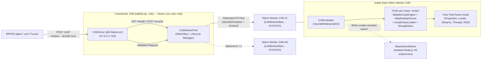
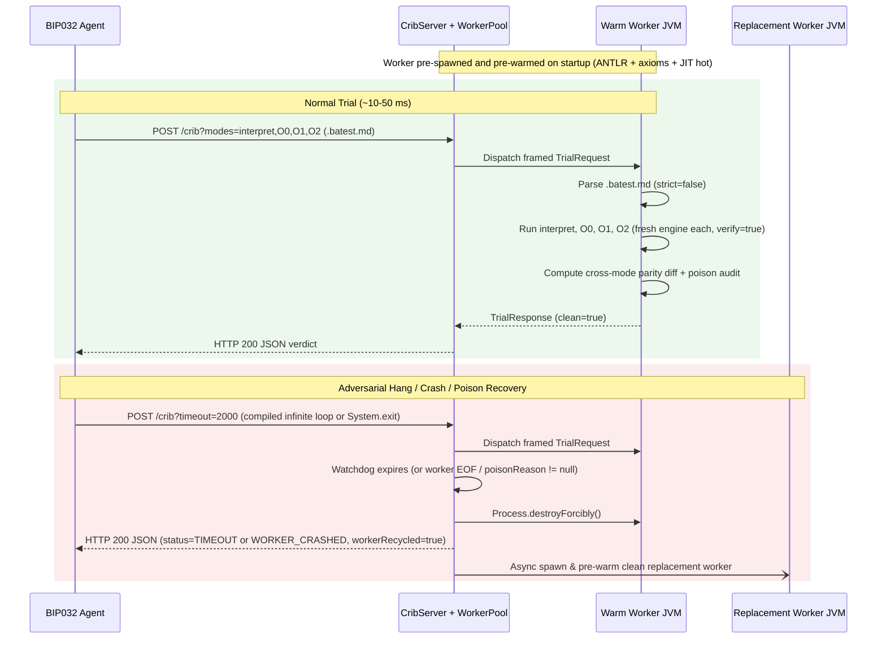

# BIP041: `-crib` — Fast Isolated HTTP `.batest.md` Runner for Adversarial Soundness Testing

| | |
|---|---|
| **BIP** | 041 |
| **Date** | 2026-11-27 |
| **Status** | Implemented (`BIP041-Q1`–`Q8` → `BIP041-D1`–`D8` settled ; `BIP041-I1`–`I4` implemented) |
| **Depends on** | Systematic `.batest` harness ([bip009_test-coverage.md](bip009_test-coverage.md)), `.batest.md` v2 format & unified IR goldens ([bip029_batest-v2-and-ir-goldens.md](bip029_batest-v2-and-ir-goldens.md)), adversarial soundness campaign ([bip032_the-great-escape.md](bip032_the-great-escape.md)), unified `HIR` `-O0`/`-O1`/`-O2` & MIR deorbitation ([bip039_mir-deorbitation.md](bip039_mir-deorbitation.md), [bip014_optimization-passes.md](bip014_optimization-passes.md)), WebAssembly 3.0 backend ([bip025_compile-to-wasm.md](bip025_compile-to-wasm.md), `RM018`), and `java.base`-only runtime boundary ([bip006_module-sources-and-aot.md](bip006_module-sources-and-aot.md)) |
| **Scope** | A `-crib` CLI subcommand on `org.babblelang.Main` serving a loopback HTTP API (`POST /crib?<options>`, `GET /health`, `POST /recycle`) that executes `.batest.md` payloads across `interpret`, `compile -O0`, `compile -O1`, unified `HIR` `compile -O2`, and optional WebAssembly 3.0 (`wasm-O1`, `wasm-O2`) inside a warm, pre-JITted worker JVM pool (~10–50 ms per trial instead of ~15–30 s via Maven) ; defense-in-depth adversarial isolation (dedicated-FD worker IPC, per-trial fresh engine/ClassLoader/module/writer state, static cache-leak fixes, cooperative `Interpreter` interruption, post-trial JVM poison auditing, and hard wall-clock watchdog kill/respawn) ; automatic cross-mode differential parity diffing (`S0` oracle) ; JUnit-free `org.babblelang.batest` extraction into `src/main` without touching `org.babblelang.runtime` ; zero new Maven dependencies (`jdk.httpserver` only). |

---

## 1. Summary & Motivation

### 1.1 The trial-latency bottleneck in `BIP032`

Babble's `.batest.md` format (`BIP029`) is the ideal vehicle for adversarial soundness probes (`BIP032`): a single self-contained Markdown file expresses a preamble, virtual modules, REPL sessions, expected `stdout`/`stderr`/`error` channels, and optional `hir`/`wat` IR assertions.

However, running a single exploratory `.batest.md` file through Maven today is painfully slow for interactive red-teaming and automated shrinking loops:

```bash
mvn -q test -PO2 -Dtest=BatestTestCase -Dbatest.filter=soundness/probe.batest.md
```

Each invocation pays for:
1. Maven startup, POM resolution, lifecycle validation, and Spotless/compiler/ANTLR plugin checks.
2. Surefire startup and **four separate cold JVM launches** (`default-test` `interpret`, `compiled-tests` `-O1`, `compiled-tests-O0` `-O0`, and `compiled-tests-O2` `-O2`), plus a cold Node.js worker spawn if `WasmBatestTestCase` runs.
3. Cold ANTLR4 DFA construction, cold `BuiltinAxioms` / `curated.ba` parsing, cold `BytecodeEffectAnalyzer` bootstrap class-node loading, and un-JITted C1/C2 compilation on every single trial.

The result is **~15–30 seconds per trial** — even for a 10-line probe that runs in `< 5 ms` once the JVM is warm. During a `BIP032` red-team session, an adversarial agent (LLM or automated mutator) iteratively hypothesizes, mutates, checks 4-mode parity, and delta-minimizes dozens to hundreds of candidate escapes. At 20 s/trial, 100 iterations waste over half an hour waiting on Maven and JVM cold starts.

### 1.2 What `-crib` introduces

`BIP041` adds **`-crib`** (a small, fenced, safe enclosure for testing untamed adversarial probes) as a first-class CLI subcommand alongside `-compile`, `-format`, and `-axioms`:

```bash
# Start once after `mvn package`
java -jar target/babble-1.0-SNAPSHOT.jar -crib --port 7331
```

Once running, any adversarial agent, script, or `curl` invocation posts a `.batest.md` document directly over loopback HTTP:

```bash
curl -sS -X POST "http://127.0.0.1:7331/crib?modes=interpret,O0,O1,O2" \
  --data-binary @probe.batest.md
```

`-crib` evaluates every case across the requested execution modes **in-process inside a warm, pre-JITted worker JVM** with `HirVerifier`, ASM `CheckClassAdapter`, and (when `wasm` is requested) `WasmVerifier` enabled by default, automatically cross-checks **behavioral parity across all executed modes** (surfacing `BIP032` `S0` optimizer divergences even on probes that omit `stdout`/`error` blocks), and returns a structured JSON (or optional plain-text) verdict in **~10–50 ms** (~300–500× faster than Maven).

### 1.3 Why naive in-process execution is unsafe for adversarial trials

Running untrusted or adversarial Babble probes inside a long-lived JVM introduces isolation hazards that one-shot Surefire JVMs mask:

1. **Non-termination & uninterruptible compiled loops:** `BIP032` `verifiers` (`A3`) explicitly probes `@TERMINATING` escapes and infinite loops (`while true then ()`, diverging tail recursion). `Thread.stop()` throws `UnsupportedOperationException` on JDK 21+, and instrumenting compiled `-O0`/`-O1`/`-O2` bytecode with cancellation polls would alter the exact bytecode and IR under test.
2. **Process-global JVM mutations via Java interop:** Babble has full `java.*` interop (essential for `BIP032` `interop` axiom/bridge probes). A trial can call `java.lang.System.setProperty(...)`, `System.setOut(...)`, `System.exit(0)`, `Locale.setDefault(...)`, mutate static JDK state, allocate until `OutOfMemoryError`, or spawn stray background threads. `SecurityManager` is deprecated in JDK 21 and permanently disabled in JDK 24+ (JEP 486), so it cannot be relied on.
3. **Long-lived Metaspace & cache leaks:** Auditing `src/main/java/org/babblelang/` revealed real static caches that are harmless in short-lived test JVMs but leak across thousands of trials in a persistent server: strong `Class<?>` keys in `JavaClass.CLASSES` and `JavaTypes.FUNCTIONAL_METHODS` pin `ScriptClassLoader`s, unbounded ephemeral `babble|<Name>|T<N>` keys accumulate in `Types.PARSED`, and `BabbleCompiler.VERIFY` currently reads process-global `System` properties instead of per-engine bindings.
4. **Protocol corruption via `System.out`:** A script calling `java.lang.System.out.println(...)` directly bypasses `ScriptContext.getWriter()` and would corrupt naive stdout-framed worker IPC.

`BIP041` addresses all four with a **two-layer isolation architecture**: strict in-process engine/cache hygiene inside **warm, killable, poison-audited worker JVM subprocesses** managed by a lightweight loopback HTTP coordinator.

---

## 2. Settled Design Decisions (`BIP041-D1`–`D8`)

| Decision | Resolves | Choice |
|---|---|---|
| **`BIP041-D1`** | `BIP041-Q1` | **Warm worker JVM pool behind a loopback HTTP coordinator :** `CribServer` (using JDK's built-in `jdk.httpserver`, zero Maven dependencies) never executes Babble code in its own JVM. Normal trials execute in-process inside a warm pre-JITted worker JVM (~10–50 ms); any worker that times out, calls `System.exit`, hits `OutOfMemoryError`, crashes, leaks threads, or fails the post-trial JVM poison audit is forcibly killed (`Process.destroyForcibly`) and transparently replaced. |
| **`BIP041-D2`** | `BIP041-Q2` | **4 JVM modes + optional Wasm 3.0 (`wasm-O1`/`wasm-O2`), `verify=true` and `parity=true` by default :** Default modes are `interpret,O0,O1,O2`; optional `wasm` (`wasm-O1`), `wasm-O2`, and `all` are selectable via query parameters. `verify=true` (`HirVerifier`, ASM `CheckClassAdapter`, `WasmVerifier`) and `parity=true` (automatic cross-mode behavioral parity diffing across all executed modes) are ON by default. A case's backend-scoped outcome blocks (`# error backend:wasm`, `BIP029-D11`) declare an expected JVM / Wasm difference on that channel : the modes of each backend must still agree, and JVM-vs-Wasm parity skips only the declared channels. |
| **`BIP041-D3`** | `BIP041-Q3` | **Structured JSON response by default, optional `?format=text` :** `POST /crib` returns machine-readable `application/json` by default for `BIP032` agents and automated minimizers, with `?format=text` for human/terminal inspection, plus `GET /health` and `POST /recycle`. |
| **`BIP041-D4`** | `BIP041-Q4` | **Relaxed `.batest.md` size budgets by default, opt-in `?strict=true` :** Exploratory adversarial probes before delta-minimization often exceed `BatestParser`'s 400-char case / 800-char preamble / 1,000-line file budgets. `-crib` relaxes code/line budgets by default (keeping full Markdown/directive syntax validation and HTTP body caps) and provides `?strict=true` to check repository commit readiness. |
| **`BIP041-D5`** | `BIP041-Q5` | **Loopback-only default bind & bounded resources :** Binds strictly to `127.0.0.1` by default (`--port 7331`, or `--port 0` for ephemeral test ports), caps payload size (`--max-body-bytes`, default 1 MiB), enforces per-`(case, mode)` and per-request timeouts (`--timeout`, default `5000` ms, capped by `--max-timeout`), and rejects excess concurrency with HTTP `503`. |
| **`BIP041-D6`** | `BIP041-Q6` | **Zero-duplication `org.babblelang.batest` extraction into `src/main` :** Move the JUnit-free `.batest.md` core (`BatestFile`, `BatestParser`, `BatestV2Parser`, `BatestRunner`, `BatestFilter`, `IrAssertionChecker`) into `src/main/java/org/babblelang/batest/` (strictly outside `org.babblelang.runtime` so `babble-runtime.jar` and `RuntimeBoundaryTestCase` stay untouched), with `src/test/java/org/babblelang/tests/batest/` delegating to it. |
| **`BIP041-D7`** | `BIP041-Q7` | **In-process engine, cache & IPC isolation hardening :** Add per-engine `BabbleCompiler.resolveVerify(engine)`, migrate `JavaClass.CLASSES` and `JavaTypes.FUNCTIONAL_METHODS` to `ClassValue`, bound/skip ephemeral `T<N>` entries in `Types.PARSED`, add cooperative `Thread.isInterrupted()` checks to `Interpreter` loops/tail-calls, enforce `try/finally` `ThreadLocal` hygiene, and bind worker IPC to dedicated saved file descriptors while capturing `System.out`/`System.err`. |
| **`BIP041-D8`** | `BIP041-Q8` | **Isolated `wasm` worker lifecycle :** When `wasm`/`wasm-O1`/`wasm-O2` is requested, compile portable cases via `WasmCompiler` (`WasmVerifier` gated by `verify`) and run in a timeout-enforced, bounded-cache Node.js V8 subprocess (`WasmExecWorker`, killed and respawned on hang/crash). Non-portable JVM-interop cases report `SKIPPED_NON_PORTABLE` unless a `wat` expectation is declared. |

---

## 3. Architecture & Request Lifecycle

### 3.1 Process & component topology

The `-crib` command runs a small **coordinator JVM** that owns the HTTP socket and manages a bounded pool of **warm worker JVMs** (`--workers N`, default `1`). User Babble code **never** executes inside the coordinator JVM:



### 3.2 Warm fast-path vs. adversarial kill/respawn lifecycle



### 3.3 Worker pre-warming

When a worker JVM starts (`CribWorkerMain`), before signaling `{"ready": true}` to the coordinator, it runs a tiny built-in self-warmup snippet across `interpret`, `-O0`, `-O1`, and `-O2` (triggering `BabbleLexer`/`BabbleParser` ATN/DFA init, `BuiltinAxioms.standard()` loading, `BytecodeEffectAnalyzer` bootstrap class loading, and `HirEmitter` class loading). This guarantees that even the **very first** HTTP request — and the first request after a worker recycle — hits warm in-memory compiler metadata.

---

## 4. Adversarial Isolation Threat Model & Defense-in-Depth

Because `BIP032` trials intentionally probe corner cases across types, effects, ownership, optimizer passes, Java interop, and termination, `-crib` enforces **three concentric isolation layers**.

### 4.1 Codebase audit of global state & isolation gaps (`BIP041-D7`)

A read-only audit of `src/main/java/org/babblelang/` identified every piece of static mutable state, global property read, `ThreadLocal`, and cache that affects long-running in-process isolation:

| Component & Location | Current State | Hazard in Persistent `-crib` Worker | Required Fix (`BIP041-I1`) |
|---|---|---|---|
| [`BabbleCompiler.java`](../../src/main/java/org/babblelang/compiler/BabbleCompiler.java#L240), [`#L355`](../../src/main/java/org/babblelang/compiler/BabbleCompiler.java#L355) | Reads `Boolean.getBoolean(VERIFY)` directly from `System` properties | Cannot toggle `verify=true`/`false` per trial without mutating global `System` properties (also blocks `BIP032-P2`) | Add `BabbleCompiler.resolveVerify(BabbleScriptEngine)` checking `engine.get(VERIFY)` before `System.getProperty(VERIFY)` |
| [`JavaClass.java`](../../src/main/java/org/babblelang/engine/impl/natives/java/JavaClass.java#L30) | `ConcurrentHashMap<Class<?>, JavaClass> CLASSES` | Strong key reference pins dynamically generated `ScriptClassLoader` classes forever if `classof(...)` / reflection touches them | Migrate to `ClassValue<JavaClass>` (matching `BabbleObjects.COMPILED` and `Faces.SAM_FACTORIES`) |
| [`JavaTypes.java`](../../src/main/java/org/babblelang/runtime/JavaTypes.java#L33) | `ConcurrentHashMap<Class<?>, Method> FUNCTIONAL_METHODS` | Strong key reference pins dynamically generated Babble interface classes | Migrate to `ClassValue<Method>` |
| [`Types.java`](../../src/main/java/org/babblelang/runtime/Types.java#L24), [`#L265-L270`](../../src/main/java/org/babblelang/runtime/Types.java#L265-L270) | `ConcurrentHashMap<String, Type> PARSED` | Unbounded growth from ephemeral nominal descriptors containing monotonically increasing `TypeNode.IDS` (`babble\|Foo\|T<N>`) | Skip caching ephemeral `T<N>` descriptors (or clear/cap cache at e.g. `4,096` entries) |
| [`Interpreter.java`](../../src/main/java/org/babblelang/engine/impl/Interpreter.java) | Tight `while`/`for`/tail-call loops do not check interruption | Interpreted infinite loops would force a full worker process kill even though cooperative cancellation is free | Check `Thread.currentThread().isInterrupted()` at loop back-edges and tail-call iterations, throwing an internal interruption signal caught by `CribEvaluator` |
| [`BuiltinAxioms.java`](../../src/main/java/org/babblelang/analysis/BuiltinAxioms.java#L50), [`JavaNullability.java`](../../src/main/java/org/babblelang/analysis/JavaNullability.java#L42-L43) | `ThreadLocal` context holders (`ACTIVE`, `LOCAL_AXIOMS`, `BYTECODE_ANALYSIS`) | Already restored in `finally`, but a worker must assert clean thread-local state after `Error` unwinds | Clear/assert clean `ThreadLocal` state, `Thread.interrupted()`, and TCCL in `CribEvaluator`'s `finally` block |
| [`HirPurity.java`](../../src/main/java/org/babblelang/opt/HirPurity.java#L750) | `ThreadLocal<TopLevelCache>` holding `WeakReference<HirModule>` | Already identity-keyed (`==`) and weak-referenced; safe across trials | No behavioral change needed; keep audited |
| [`BytecodeEffectAnalyzer.java`](../../src/main/java/org/babblelang/analysis/BytecodeEffectAnalyzer.java#L160-L168) | `WeakHashMap<ClassLoader, ...>` per loader + `STANDARD_BOOTSTRAP_CACHE` for `java.base` | Safe for `ScriptClassLoader` GC; immutable bootstrap cache accelerates warm workers | Keep warm across trials; never retain user `ScriptClassLoader`s |
| [`NodeWasmRunner.java`](../../src/test/java/org/babblelang/tests/NodeWasmRunner.java#L32) | Unbounded `mjsCache = new Map()` inside persistent Node.js worker; no per-request timeout | Memory growth across thousands of distinct generated `app.mjs` loaders; infinite Wasm loop hangs the Node worker | Bound `mjsCache` (LRU cap, e.g. 64 entries) and enforce hard per-case timeout with `destroyForcibly()` + respawn in `WasmExecWorker` |

### 4.2 Concentric defense matrix

| Threat Vector | Layer 1 : In-Process Engine Isolation | Layer 2 : Worker Poison Audit | Layer 3 : Coordinator Process Isolation |
|---|---|---|---|
| **Babble globals, sessions, virtual modules, caches** | Fresh `BabbleScriptEngine`, `ScriptContext`, `StringWriter`s, `CapturingIrObserver`, `ScriptClassLoader`, and `MapModuleSource` (never `FileModuleSource`) per `(case, mode)`. | Request counter (`--max-requests-per-worker`, default `200`). | Worker recycled automatically on threshold or `?fresh=true`. |
| **Compiled infinite loop (`while true then ()`, broken tail call)** | Per-`(case, mode)` execution thread interrupted on timeout (breaks blocking I/O & `Interpreter` loops cleanly). | If execution thread does not exit within a short grace window (e.g. 50 ms), worker marks itself poisoned. | Coordinator wall-clock watchdog kills worker (`destroyForcibly`) and spawns a fresh warm replacement. |
| **`java.lang.System.exit(n)` or JVM fatal crash** | Cannot be intercepted without deprecated `SecurityManager` (gone in JDK 24+). | Worker process terminates immediately. | Coordinator detects unexpected EOF/exit code, returns `WORKER_CRASHED` verdict (HTTP `200`), and respawns a fresh worker. |
| **`StackOverflowError` / `OutOfMemoryError`** | `StackOverflowError` classified as `USER_ERROR` (`Stack overflow`, matching `BatestRunner`). `OutOfMemoryError` caught at worker boundary and flags worker poisoned. | Heap/Metaspace free-ratio check after every trial. | Bounded worker `-Xmx512m -XX:MaxMetaspaceSize=256m` (plus `-XX:-OmitStackTraceInFastThrow`, so a warm worker never throws message-less preallocated exceptions that would differ across modes); poisoned/OOM worker is killed and replaced without affecting coordinator. |
| **`System.setProperty`, `Locale.setDefault`, `TimeZone.setDefault`** | Zero `System.setProperty` usage by Babble itself (`resolveVerify`, `MODE`, `OPT_LEVEL` all per-engine). | Post-trial audit compares `System.getProperties()` snapshot hash, `Locale.getDefault()`, and `TimeZone.getDefault()` against startup baseline. | Any mutation marks the trial response `workerRecycled: true` with `poisonReason` and recycles the worker before the next trial. |
| **Direct `java.lang.System.out` / `System.err` writes or `System.setOut`** | Worker binds its IPC channel to saved original `FileDescriptor.in`/`FileDescriptor.out` at startup and redirects `System.out`/`System.err` to per-trial bounded capture buffers (`System.in` to empty stream). | Post-trial audit verifies `System.out`/`System.err` references were not replaced by user code. | IPC framing is 100% immune to user `System.out.println(...)`; if `System.setOut` was called, worker is recycled. |
| **Stray threads spawned via `java.lang.Thread` / `ExecutorService`** | Each `(case, mode)` runs inside a dedicated child `ThreadGroup`. | Post-trial audit enumerates active threads in the child `ThreadGroup`; interrupts stragglers and checks after a short grace window. | Any surviving background thread triggers immediate worker poison + `destroyForcibly()`. |
| **Static mutable fields of JDK/third-party classes** | Cannot be introspected generically in Java without bytecode rewriting. | Periodic worker recycling (`--max-requests-per-worker`) bounds exposure; `?fresh=true` guarantees a pristine JVM for exact confirmation. | `POST /recycle` or `?fresh=true` gives zero-shared-state verification whenever a finding is confirmed. |

### 4.3 Explicit security boundary (out of scope)

Like `BIP032-D5`, `-crib` is a **local developer and red-team agent soundness tool**, not a multi-tenant untrusted-code sandbox:
- It binds to `127.0.0.1` by default and refuses silent exposure on `0.0.0.0` (passing a non-loopback `--host` logs a loud warning to stderr).
- Because `BIP032` `interop` probes legitimate `java.*` APIs, `-crib` does **not** restrict arbitrary JDK classes like `java.io.File` or `java.lang.ProcessBuilder`. If an automated agent runs completely untrusted external prompts, run `-crib` inside the existing CI container (`podman run --rm ...`, `src/tools/Containerfile.ci`) for OS/filesystem/network sandboxing.

---

## 5. CLI, HTTP API & Response Specification

### 5.1 Command-line interface (`org.babblelang.Main`)

`-crib` is dispatched in [`Main.run`](../../src/main/java/org/babblelang/Main.java#L98) alongside `-compile`, `-format`, and `-axioms`:

```text
java -jar target/babble-1.0-SNAPSHOT.jar -crib [options]
  Starts a fast, isolated HTTP .batest.md runner for adversarial testing (BIP041).
  --host <addr>                    bind address (default : 127.0.0.1)
  --port <n>                       listen port, 0 for ephemeral (default : 7331)
  --workers <n>                    warm worker JVM pool size (default : 1)
  --timeout <ms>                   default per-(case, mode) timeout in ms (default : 5000)
  --max-timeout <ms>               maximum client-requested timeout in ms (default : 60000)
  --max-requests-per-worker <n>    recycle a worker after N trials, 0 disables (default : 200)
  --max-body-bytes <n>             maximum POST /crib payload size (default : 1048576)
  --worker-xmx <size>              worker JVM -Xmx heap cap (default : 512m)
  --worker-metaspace <size>        worker JVM -XX:MaxMetaspaceSize cap (default : 256m)
  --no-wasm                        disable optional wasm/wasm-O1/wasm-O2 modes
  -help                            this text
```

On startup, `-crib` prints a single machine-parseable readiness line to stdout (useful when spawned with `--port 0` in tests or agent harnesses) and handles `SIGINT`/`SIGTERM` cleanly by shutting down the HTTP server and destroying all worker subprocesses via a JVM shutdown hook:

```text
Crib server listening on http://127.0.0.1:7331 (workers=1, timeout=5000ms, wasm=available)
```

### 5.2 HTTP endpoints & query parameters

| Method & Path | Purpose |
|---|---|
| `POST /crib?<options>` | Evaluate a `.batest.md` document supplied as the UTF-8 request body. |
| `GET /health` | Return server liveness, worker pool telemetry, Wasm availability, and recycle counts. |
| `POST /recycle` | Drain and recycle all worker JVMs immediately (useful between adversarial campaigns). |

#### `POST /crib` query parameters

| Parameter | Values | Default | Semantics |
|---|---|---|---|
| `modes` | Comma-separated subset of `interpret`, `O0`, `O1`, `O2`, `wasm` (alias for `wasm-O1`), `wasm-O1`, `wasm-O2`, or `all` (`interpret,O0,O1,O2,wasm-O1,wasm-O2` when Node.js is available, else JVM 4-mode). Also accepts shorthand `mode=<single>` or bare mode flags (`?O1`, `?interpret,O2`). | `interpret,O0,O1,O2` | Execution modes to run for every matched case, each in an isolated fresh engine. |
| `verify` | `true` \| `false` | `true` | Enables `HirVerifier` + ASM `CheckClassAdapter` (JVM compiled modes) and `WasmVerifier` (Wasm modes) via per-engine `BabbleCompiler.VERIFY`. |
| `parity` | `true` \| `false` | `true` | Automatically compares normalized `(kind, stdout, stderr, error)` across all non-skipped executed modes for every case and flags any mismatch as a parity divergence (`S0`), even when a probe omits explicit expectation blocks. |
| `strict` | `true` \| `false` | `false` | When `false`, relaxes `BatestParser` readability budgets (`MAX_FILE_LINES = 1000`, `MAX_PREAMBLE_CODE_CHARS = 800`, `MAX_CASE_CODE_CHARS = 400`) while keeping full Markdown/directive syntax validation. When `true`, enforces exact repository commit budgets. |
| `ir` | `true` \| `false` | `true` | Evaluates any `hir` and `wat` golden/`regex`/`check` blocks declared in the `.batest.md` payload. |
| `timeout` | Positive integer (ms), clamped to `[50, --max-timeout]` | `--timeout` (`5000`) | Per-`(case, mode)` execution timeout. |
| `filter` | `BatestFilter` selector (e.g. `@case_name`, `#2`, `:42`) | *(none — all cases)* | Runs only matching cases within the posted `.batest.md` file. |
| `fresh` | `true` \| `false` | `false` | Forces execution on a freshly spawned worker JVM (zero prior trials in that JVM) for definitive confirmation of a finding. |
| `format` | `json` \| `text` | `json` | Response encoding (`application/json; charset=utf-8` vs `text/plain; charset=utf-8`). |

#### HTTP status codes

| Status | Meaning |
|---|---|
| `200 OK` | Request was valid and evaluated. Individual case passes, behavioral failures, IR mismatches, `INTERNAL_CRASH`, `TIMEOUT`, `WORKER_CRASHED`, and cross-mode parity divergences are reported cleanly in the structured body (`ok: true\|false`). |
| `400 Bad Request` | Invalid query parameter or `.batest.md` parse error (returns structured JSON/text with exact line number and reason). |
| `405 Method Not Allowed` | Wrong HTTP verb for the endpoint. |
| `413 Payload Too Large` | Request body exceeded `--max-body-bytes`. |
| `503 Service Unavailable` | Server shutting down or bounded request queue full. |

### 5.3 Structured JSON response schema (`?format=json`, default)

```json
{
  "ok": false,
  "elapsedMs": 24,
  "requestedModes": ["interpret", "O0", "O1", "O2"],
  "verify": true,
  "parity": true,
  "strict": false,
  "workerRecycled": false,
  "poisonReason": null,
  "summary": {
    "cases": 1,
    "passed": 0,
    "failed": 1,
    "parityDivergences": 1,
    "internalCrashes": 0,
    "timeouts": 0
  },
  "cases": [
    {
      "name": "FBIP reuse must not mutate aliased list",
      "index": 1,
      "line": 5,
      "passed": false,
      "parityOk": false,
      "parityDiff": "stdout differs : interpret/O0 produced <1, 2> while O1/O2 produced <99, 2>",
      "modes": {
        "interpret": {
          "status": "PASS",
          "kind": "OK",
          "stdout": "1, 2",
          "stderr": "",
          "error": null,
          "behavioralError": null,
          "irErrors": [],
          "crash": null,
          "elapsedMs": 6
        },
        "O0": {
          "status": "PASS",
          "kind": "OK",
          "stdout": "1, 2",
          "stderr": "",
          "error": null,
          "behavioralError": null,
          "irErrors": [],
          "crash": null,
          "elapsedMs": 5
        },
        "O1": {
          "status": "FAIL",
          "kind": "OK",
          "stdout": "99, 2",
          "stderr": "",
          "error": null,
          "behavioralError": "stdout mismatch ==> expected: <1, 2> but was: <99, 2>",
          "irErrors": [],
          "crash": null,
          "elapsedMs": 7
        },
        "O2": {
          "status": "FAIL",
          "kind": "OK",
          "stdout": "99, 2",
          "stderr": "",
          "error": null,
          "behavioralError": "stdout mismatch ==> expected: <1, 2> but was: <99, 2>",
          "irErrors": [],
          "crash": null,
          "elapsedMs": 6
        }
      }
    }
  ]
}
```

Per-mode `status` values: `PASS`, `FAIL`, `INTERNAL_CRASH`, `TIMEOUT`, `WORKER_CRASHED`, `SKIPPED_NON_PORTABLE`.

### 5.4 Compact plain-text response (`?format=text`)

```text
CRIB FAIL : 1 case (0 passed, 1 failed, 1 parity divergence, 24ms)
[FAIL] FBIP reuse must not mutate aliased list (line 5)
  PARITY DIVERGENCE : stdout differs : interpret/O0 produced <1, 2> while O1/O2 produced <99, 2>
  interpret : PASS (6ms)
  O0        : PASS (5ms)
  O1        : FAIL (7ms) — stdout mismatch ==> expected: <1, 2> but was: <99, 2>
  O2        : FAIL (6ms) — stdout mismatch ==> expected: <1, 2> but was: <99, 2>
```

### 5.5 `GET /health` response

```json
{
  "status": "ok",
  "host": "127.0.0.1",
  "port": 7331,
  "workers": { "configured": 1, "idle": 1, "busy": 0 },
  "wasmAvailable": true,
  "asmVerifyAvailable": true,
  "trialsServed": 142,
  "workersRecycled": 3,
  "uptimeMs": 84210
}
```

---

## 6. Package Layout & Architectural Boundary Compliance

### 6.1 Extracting JUnit-free `org.babblelang.batest` (`BIP041-D6`)

All six `.batest.md` engine classes in `src/test/java/org/babblelang/tests/batest/` already have **zero JUnit imports** (`BatestFile`, `BatestParser`, `BatestV2Parser`, `BatestRunner`, `BatestFilter`, `IrAssertionChecker`). Moving them into `src/main/java/org/babblelang/batest/` avoids duplicating `.batest.md` parsing, error normalization (`BIP009-D5`), and IR checking (`BIP029`) between Maven Surefire and `-crib`:

```text
src/main/java/org/babblelang/
├── Main.java                                # Dispatches `-crib` -> CribCli.run(...)
├── batest/                                  # JUnit-free .batest.md core (extracted from src/test)
│   ├── BatestFile.java
│   ├── BatestFilter.java
│   ├── BatestParser.java                    # Adds ParseOptions(boolean enforceBudgets)
│   ├── BatestRunner.java                    # Accepts verifyOverride; uses BabbleCompiler.VERIFY
│   ├── BatestV2Parser.java
│   └── IrAssertionChecker.java
└── crib/                                    # -crib HTTP server & warm worker pool
    ├── CribCli.java                         # CLI flag parsing & lifecycle wiring
    ├── CribConfig.java                      # Immutable server/worker configuration record
    ├── CribServer.java                      # jdk.httpserver endpoints, query parsing, JSON/text output
    ├── CribWorkerPool.java                  # Warm worker JVM pool, watchdog, kill & async respawn
    ├── CribWorkerMain.java                  # Worker JVM entrypoint, dedicated-FD IPC, poison audit
    ├── CribEvaluator.java                   # Executes BatestFile across requested modes + parity diff
    ├── CribProtocol.java                    # Framed NDJSON request/response & minimal JSON codec
    └── WasmExecWorker.java                  # Hardened, timeout-enforced, bounded-cache Node.js runner

src/test/java/org/babblelang/tests/
├── batest/                                  # JUnit runners & coverage reporter (unchanged behavior)
│   ├── BatestTestCase.java                  # Imports org.babblelang.batest.*
│   ├── WasmBatestTestCase.java              # Imports org.babblelang.batest.*
│   ├── BatestCoverageReporter.java
│   ├── BatestIrUpdater.java
│   ├── BatestShard.java
│   └── *TestCase.java
└── crib/
    └── CribServerTestCase.java              # End-to-end HTTP, parity & adversarial isolation tests
```

### 6.2 Boundary & dependency checks

- **`RuntimeBoundaryTestCase` (`java.base`-only runtime):** `org.babblelang.batest` and `org.babblelang.crib` live strictly outside `org.babblelang.runtime` and `org.babblelang.engine.impl.natives`, so `babble-1.0-SNAPSHOT-runtime.jar` and `babblec` AOT jars incur **zero** extra classes or JDK modules.
- **`ArchitectureBoundaryTestCase`:** Neither `analysis`, `ir`, `opt`, `compiler`, nor `wasm` references `org.babblelang.batest` or `org.babblelang.crib`. Every new file stays well below the 1,250-line soft limit (and 2,000-line hard limit).
- **Zero new Maven dependencies:** Uses JDK's built-in `jdk.httpserver` (`com.sun.net.httpserver.HttpServer`, standard on JDK 21 and JDK 27) and a compact self-contained JSON codec (mirroring `NodeWasmRunner.MiniJson`).
- **`asm-util` availability:** `pom.xml` copies `asm-util` into `target/lib/` alongside `target/babble-1.0-SNAPSHOT.jar`. If `-crib` is ever launched on a custom classpath missing `org.objectweb.asm.util.CheckClassAdapter`, `GET /health` reports `asmVerifyAvailable: false` and requests with `verify=true` fail fast with a clear diagnostic rather than an obscure `NoClassDefFoundError`.
- **`-Pbatest` JaCoCo scopes:** `org/babblelang/batest/**` and `org/babblelang/crib/**` are developer tooling (like `Main` and `Babblefmt`) and should be excluded from the interpreter/compiler/optimizer `-Pbatest` coverage gates in `pom.xml` (or explicitly scoped) so moving `batest` into `src/main` does not artificially skew compiler/interpreter coverage metrics.

---

## 7. Phased Implementation Plan (`BIP041-I1`–`I4`)

### `BIP041-I1` — In-process isolation hardening & `org.babblelang.batest` extraction

- **Deliverables:**
  1. Add `BabbleCompiler.resolveVerify(BabbleScriptEngine)` checking `engine.get(VERIFY)` before `System.getProperty(VERIFY)` and use it at both [`BabbleCompiler.java#L240`](../../src/main/java/org/babblelang/compiler/BabbleCompiler.java#L240) and [`#L355`](../../src/main/java/org/babblelang/compiler/BabbleCompiler.java#L355) (also directly benefiting `BIP032-P2`).
  2. Migrate [`JavaClass.CLASSES`](../../src/main/java/org/babblelang/engine/impl/natives/java/JavaClass.java#L30) and [`JavaTypes.FUNCTIONAL_METHODS`](../../src/main/java/org/babblelang/runtime/JavaTypes.java#L33) to `ClassValue`, and prevent unbounded accumulation of ephemeral `T<N>` keys in [`Types.PARSED`](../../src/main/java/org/babblelang/runtime/Types.java#L24).
  3. Add lightweight cooperative `Thread.currentThread().isInterrupted()` checks in `Interpreter` loop back-edges and tail-call iteration loops.
  4. Extract JUnit-free `BatestFile`, `BatestParser` (with `ParseOptions(boolean enforceBudgets)`), `BatestV2Parser`, `BatestRunner` (with `verifyOverride`), `BatestFilter`, and `IrAssertionChecker` into `src/main/java/org/babblelang/batest/`, updating `src/test/java/org/babblelang/tests/batest/` imports and `-Pbatest` JaCoCo excludes.
- **Exit criteria:** Full `mvn -B package -PO2`, `RuntimeBoundaryTestCase`, `ArchitectureBoundaryTestCase`, and `mvn -q verify -Pbatest` green with zero behavioral or coverage regressions.

### `BIP041-I2` — Warm worker JVM runtime, poison auditor & `CribWorkerPool`

- **Deliverables:**
  1. Implement `CribConfig`, `CribProtocol` (length-prefixed or NDJSON framing + self-contained JSON codec), and `CribEvaluator` (fresh per-`(case, mode)` engines, `hir` IR checking, automatic cross-mode behavioral parity diffing, and `try/finally` `ThreadLocal` / TCCL / interrupt cleanup).
  2. Implement `CribWorkerMain` with dedicated-FD IPC (immune to user `System.out`/`System.err` output), startup pre-warming, per-`(case, mode)` `ThreadGroup` execution, and post-trial JVM poison auditing (`System.getProperties()`, `Locale`, `TimeZone`, `System.out`/`System.err` stream identities, stray threads, heap/metaspace watermarks).
  3. Implement `CribWorkerPool` with warm worker pre-spawning, hard wall-clock watchdog (`Process.destroyForcibly()`), transparent async replacement, `--max-requests-per-worker` recycling, `?fresh=true` support, and JVM shutdown-hook cleanup.
- **Exit criteria:** Unit tests verifying normal warm evaluation, cross-mode parity diff detection, `System.exit` recovery, compiled & interpreted infinite-loop timeouts, `System.setProperty`/`Locale`/`System.out` poison detection + automatic recycle, and leaked-thread cleanup.

### `BIP041-I3` — `CribServer` HTTP API & `Main -crib` CLI integration

- **Deliverables:**
  1. Implement `CribServer` over `com.sun.net.httpserver.HttpServer` serving `POST /crib?<options>`, `GET /health`, and `POST /recycle` with loopback-only default bind, body-size limits (`413`), query validation (`400`), concurrency backpressure (`503`), and both JSON and `?format=text` formatters.
  2. Implement `CribCli` and wire `-crib` / `--crib` into `org.babblelang.Main` (and update `Main.USAGE` and `MainTestCase`).
- **Exit criteria:** End-to-end HTTP tests (`java.net.http.HttpClient` against `--port 0`) passing for all endpoints, query parameters, error codes, and response formats.

### `BIP041-I4` — Optional isolated Wasm modes, soak testing & documentation

- **Deliverables:**
  1. Implement `WasmExecWorker` (hardened Node.js V8 subprocess with bounded `mjsCache`, per-case timeout, and kill/respawn recovery) supporting `wasm` (`wasm-O1`), `wasm-O2`, and `wat` IR assertions (`SKIPPED_NON_PORTABLE` for JVM-only cases).
  2. Add comprehensive `CribServerTestCase` covering all adversarial isolation vectors (infinite loops in `interpret` and `-O2`, `System.exit(42)`, `StackOverflowError`, `System.setProperty` poisoning, direct `java.lang.System.out` writes, leaked threads, `strict=true` vs `strict=false`, `fresh=true`, `wasm` parity, and a warm-latency + multi-hundred-trial Metaspace stability check).
  3. Update `AGENTS.md`, `README.md`, `docs/ARCHITECTURE.md`, `docs/design/README.md`, and add a short `-crib` quick-start pointer in `docs/design/bip032_the-great-escape.md`.
- **Exit criteria:** Full `mvn -B package -PO2`, `mvn -q verify -Pbatest`, `-format -check`, and all acceptance criteria below green.

---

## 8. Acceptance Criteria

1. **Speedup & warm latency:** A single-case 4-mode (`interpret,O0,O1,O2`) verified trial over `POST /crib` completes in **`< 50 ms` median** on a warm worker JVM (vs. ~15–30 s via Maven).
2. **Adversarial isolation parity (100% pass):** Submitting a sequence of hostile trials — compiled infinite loop (`while true then ()`), interpreted infinite loop, `java.lang.System.exit(1)`, `java.lang.System.setProperty("babble.opt", "0")`, `java.lang.System.out.println("garbage")`, `Locale.setDefault(...)`, `StackOverflowError`, and a leaked background `Thread` — never crashes the coordinator, never corrupts HTTP/IPC framing, and never leaks observable state into the immediately following clean trial.
3. **Long-running memory stability:** Executing 500+ consecutive trials with distinct Babble classes/interfaces/records inside `-crib` exhibits bounded Metaspace and RSS with zero `OutOfMemoryError` and zero `ScriptClassLoader` pinning (`ClassValue` + periodic worker recycling).
4. **Automatic `BIP032` parity detection:** Posting a `.batest.md` probe with no `stdout`/`error` block whose `-O1`/`-O2` output differs from `interpret`/`-O0` returns `ok: false`, `parityOk: false`, and an explicit `parityDiff` summary.
5. **Exact `.batest.md` compatibility:** Running any existing `src/test/batest/**/*.batest.md` file through `POST /crib?strict=true&modes=interpret,O0,O1,O2` yields identical pass/fail verdicts and IR check results as `BatestTestCase`.
6. **Zero runtime bloat & zero new dependencies:** `RuntimeBoundaryTestCase`, `ArchitectureBoundaryTestCase`, and `mvn -B package -PO2` pass with zero new third-party dependencies in `pom.xml`.
