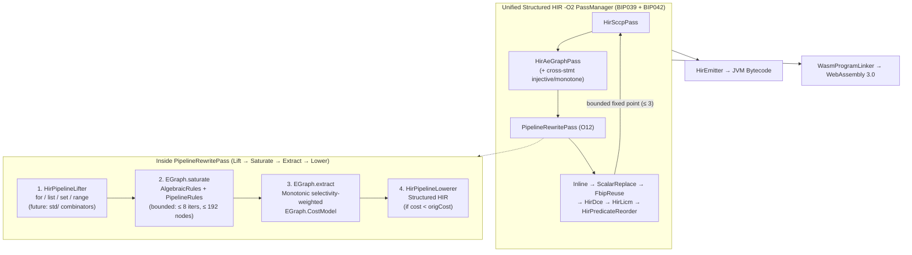

# BIP042: E-Graph Pipeline & Algebraic Loop Rewrites

| | |
|---|---|
| **BIP** | 042 |
| **Date** | 2026-11-27 |
| **Status** | Implemented (`BIP042-D1`–`D8` settled ; `BIP042-I1`–`I4` implemented ; `BIP042-Q9`–`Q11` open for future extensions ; completes `BIP014-I5` Half B independently of a standard library) |
| **Depends on** | Function effects, algebraic properties (`idempotent`, `commutative`, `associative`, `monotone`, `injective`) & ownership (`RM002`/`RM007`, [bip007_effects.md](bip007_effects.md)), 8-primitive unboxing & core collections (`RM005`, [bip011_core-types.md](bip011_core-types.md)), `for` loops & `break`/`continue` (`RM009`, [bip013_iterators.md](bip013_iterators.md)), typed `HIR` & `-O1`/`-O2` Nanopass optimizer (`RM010`/`RM013`, [bip014_optimization-passes.md](bip014_optimization-passes.md) `BIP014-I0`–`I4`), pure-by-default effects & `fn calling f` (`RM008`/`RM009`, [bip016_consolidating-effect-annotations.md](bip016_consolidating-effect-annotations.md), [bip017_higher-order-function-effects.md](bip017_higher-order-function-effects.md)), WebAssembly 3.0 backend (`RM018`, [bip025_compile-to-wasm.md](bip025_compile-to-wasm.md)), shared `org.babblelang.ir.egraph` core & `AlgebraicVerifier` (`RM012`, [bip027_tackling-complexity-in-the-compiler.md](bip027_tackling-complexity-in-the-compiler.md) `BIP027-I2`/`I6`), `.batest.md` v2 & IR goldens ([bip029_batest-v2-and-ir-goldens.md](bip029_batest-v2-and-ir-goldens.md)), first-class ranges & counted `for` loops (`RM019`, [bip031_ranges.md](bip031_ranges.md)), immutable `def` & mutable `var` bindings ([bip034_immutable-def-and-mutable-var.md](bip034_immutable-def-and-mutable-var.md)), test hygiene ([bip037_babble-test-hygiene.md](bip037_babble-test-hygiene.md)), and unified enriched `HIR` `-O2` + `HirAeGraphPass` ([bip039_mir-deorbitation.md](bip039_mir-deorbitation.md)) |
| **Scope** | Completing `BIP014-I5` Half B (`O12`) independently of introducing a `std/...` library or `babble.path` : extending `org.babblelang.ir.egraph` with `injective`/`monotone` algebraic comparison rules (shared across `-O1`, `-O2`, and `AlgebraicVerifier`), dominator-scoped cross-statement `UnaryCallOrigin` cancellation in `HirAeGraphPass` (`-O2`), a composable 11-op E-graph pipeline dialect (`ENode.Op.PIPE_*`), a monotonic selectivity-weighted `EGraph.CostModel`, declarative `PipelineRules` (`R1`–`R8` covering stream fusion, filter fusion, guard-safe filter reordering, map–filter push-down, `injective` `distinct` push-down, `monotone` range clamping / early-exit / whole-range pruning, and `associative` pairwise loop tree reduction), and a `PipelineRewritePass` (`HirPipelineLifter` → `EGraph.saturate` → `EGraph.extract` → `HirPipelineLowerer`) at `-O2` across both JVM bytecode and WebAssembly 3.0 — while exposing a clean lifting seam for future `std/` combinators |

---

## 1. Summary & Motivation

### 1.1 Decoupling `BIP014-I5` Half B (`O12`) from a Standard Library

[BIP014](bip014_optimization-passes.md) is almost completely implemented: `BIP014-I0`–`I4` landed the decoupled typed `HIR`, `-O1` Nanopass pipeline, `record` scalar replacement and FBIP reuse, and [BIP027](bip027_tackling-complexity-in-the-compiler.md) (`BIP027-I2`) delivered Half A of `BIP014-I5` (`org.babblelang.ir.egraph` + `HirEGraphSimplifyPass`), while [BIP039](bip039_mir-deorbitation.md) retired legacy SSA `MIR` and landed the dominator-scoped `HirAeGraphPass` directly on unified structured `HIR` at `-O2` (shared by both JVM bytecode and WebAssembly 3.0).

Only **Half B of `BIP014-I5` (`O12` : pipeline push-down / push-up, `monotone` range pruning, `injective` equality & `distinct` push-down, and `associative` fold reassociation)** remains. Originally, `BIP014` §3.2 assumed `O12` would wait for a future `std/...` library of higher-order combinators (`map`, `filter`, `reduce`, `distinct`) and a `babble.path` module search path (`BIP005-D5`). Coupling `O12` to `std/...` creates three unnecessary problems:

1. **Artificial sequencing bottleneck :** Designing a standard library, module search path, and versioning/packaging rules deserves its own dedicated BIP. Waiting on `std/...` stalls `BIP014` completion and, by `BIP018-D4`, blocks `BIP018-P1` onward.
2. **Real Babble programs already write pipelines today :** Idiomatic Babble code today builds multi-stage data pipelines with `for` loops, `CountedRangeLoop`s (`BIP031`), local `list` / `set` accumulators, and `pure deterministic nothrow` helpers annotated `injective`, `monotone`, or `associative` (`BIP007`, `BIP027-I6`). Furthermore, once `InlinePass` (`BIP014-I2`/`I4`) inlines small user-defined `map` / `filter` / `reduce` helpers, they lower to those exact same `for`-loop + `list.add` + `var acc` HIR shapes.
3. **Algebraic rewrites do not need `std/` at all :** `injective` equality cancellation (`f(a) == f(b) → a == b`), `monotone` + `injective` order cancellation (`f(a) < f(b) → a < b`), `monotone` counted-range pruning, `injective` `set` deduplication push-down, and `associative` counted-loop pairwise reduction are fundamental compiler optimizations over Babble's existing IR and `BIP007` effect contracts.

### 1.2 Why Lift → Saturate → Extract → Lower Beats Imperative Loop Surgery

A naive compiler-only implementation of `O12` would write separate imperative HIR passes: one for producer–consumer `for`-loop fusion, one for `def` sinking, one for `set` deduplication push-down, one for range clamping, one for `monotone` early exit, and one for `associative` loop unrolling. That approach suffers from two classic pitfalls:

1. **Severe phase-ordering coupling :** Consider a two-loop pipeline whose consumer filters the output of a `monotone injective` projection:
   ```babble
   def scores = list of double ()
   for x in 0..1000000 then ( scores.add(encode(x)) )
   var total = 0.0
   for s in scores then ( if s <= encode(50) then ( total += s ) )
   ```
   Eliminating both the `1,000,001`-element `ArrayList` *and* the `999,950` wasted iterations requires five distinct transformations to cooperate in sequence:
   - **Stream fusion** removes the intermediate `scores` list;
   - **Map–filter push-down** pushes `s <= encode(50)` across `s = encode(x)` to yield `encode(x) <= encode(50)`;
   - **Algebraic `monotone` + `injective` cancellation** simplifies `encode(x) <= encode(50)` to `x <= 50`;
   - **Range bound clamping** rewrites `for x in 0..1000000` filtered by `x <= 50` into `0..min(1000000, 50)`;
   - **Constant folding** simplifies `min(1000000, 50)` to `50`.

   With imperative passes, each combination of fusion, push-down, algebraic cancellation, `distinct` movement, and range pruning demands fragile pass ordering or multi-round global re-traversal.
2. **Duplication when `std/` arrives :** Imperative loop-surgery rules cannot be reused directly when pure functional `std/` combinator calls (`xs.filter(p).map(f).distinct().reduce(seed, op)`) are introduced later.

Babble **already ships** a compact, zero-dependency equality-saturation engine (`org.babblelang.ir.egraph.EGraph` + `AlgebraicRules`, `BIP027-I2`, `[WNW+21]`). By lifting qualifying HIR loop pipelines into a small **E-graph pipeline dialect** (`ENode.Op.PIPE_*`), saturating them jointly with `AlgebraicRules` and declarative **`PipelineRules`** in a single bounded saturation pass, extracting the globally minimum-cost plan via a **monotonic selectivity-weighted `EGraph.CostModel`**, and lowering the winning plan back to structured `HIR`, we solve both problems at once:

- Every interaction between algebraic axioms (`injective`, `monotone`, `associative`, `idempotent`, arithmetic/boolean identities) and stream transformations (fusion, filter push-down, filter reordering, `distinct` push-down, range clamping, early exit, pairwise fold) composes automatically with **zero manual phase ordering**.
- When a future `std/` BIP introduces functional combinators, `HirPipelineLifter` simply recognizes those `std/` calls and emits the exact same `PIPE_*` E-nodes — reusing 100% of `PipelineRules`, `AlgebraicRules`, `EGraph.CostModel`, and `HirPipelineLowerer`.
- Because `PipelineRewritePass` operates purely on unified structured `HIR` (`BIP039`), both **JVM bytecode (`HirEmitter`)** and **WebAssembly 3.0 (`WasmProgramLinker`)** receive every optimization identically.



---

## 2. Motivating Examples (Before / After)

Every transformation below preserves exact observable equivalence with the reference `Interpreter` (same return value, same side-effect order, same exceptions and error lines, and same termination behavior) across `interpret`, `-O0`, `-O1`, `-O2`, and WebAssembly 3.0.

### 2.1 Multi-Stage Producer–Consumer `for`-Loop Fusion (`R1`)

```babble
;; Before : allocates 2 intermediate ArrayLists, boxes/unboxes every int
def evens = list of int ()
for x in 0..<n then (
    if x mod 2 == 0 then ( evens.add(x) )
)
def doubled = list of int ()
for y in evens then (
    doubled.add(y * 3 + 1)
)
var total = 0
for z in doubled then (
    total += z
)

;; After PipelineRewritePass : 1 loop, 0 ArrayList allocations, unboxed int
var total = 0
for x in 0..<n then (
    if x mod 2 == 0 then (
        def y = x
        def z = y * 3 + 1
        total += z
    )
)
;; Subsequent HirAeGraphPass + HirDcePass collapse `y`/`z` to `total += x * 3 + 1`.
```

### 2.2 Nested `if` Filter Fusion & Guard-Safe Cost Reordering (`R2`, `R3`)

```babble
;; Before
for x in xs then (
    if expensiveCheck(x) then (
        if x > 0 then (
            if x mod 2 == 0 then ( acc += x )
        )
    )
)

;; After PipelineRewritePass (R3 reorders cheaper filters inward, R2 merges into `and`)
for x in xs then (
    if x > 0 and x mod 2 == 0 and expensiveCheck(x) then (
        acc += x
    )
)
```

Narrowing guards (`if x != null then ( if x.length() > 0 then ( ... ) )`) carry `"narrow"` on their `PIPE_FILTER` node, so `R3` never reorders a narrowed predicate ahead of its guard.

### 2.3 Map–Filter Push-Down (`R4`)

```babble
;; Before : calls transform(x) on every element even when x <= 0
for x in xs then (
    def mapped = transform(x)
    if x > 0 then (
        out.add(mapped)
    )
)

;; After PipelineRewritePass (R4 pushes filter below map ; transform(x) only runs when x > 0)
for x in xs then (
    if x > 0 then (
        def mapped = transform(x)
        out.add(mapped)
    )
)
```

### 2.4 `injective` `distinct` Push-Down (`R5`)

```babble
def encode = fn axiom pure deterministic nothrow monotone injective (x: int): double -> (
    x * 10.0 + 5.0
)

;; Before : calls encode(x) even for duplicate inputs
def seen = set of double ()
def out = list of double ()
for x in xs then (
    def y = encode(x)
    if seen.add(y) then (
        out.add(y)
    )
)

;; After PipelineRewritePass (R5 pushes PIPE_DISTINCT below PIPE_MAP(encode))
def seen = set of double ()   ;; erased HashSet/Wasm set holds boxed pre-map `x`
def out = list of double ()
for x in xs then (
    if seen.add(x) then (
        def y = encode(x)
        out.add(y)
    )
)
```

### 2.5 Joint Saturation : Fusion + Push-Down + `monotone`+`injective` + Range Clamping (`R1` + `R4` + `AlgebraicRules` + `R6`)

```babble
;; Before : 1,000,001 list elements + 1,000,001 encode calls + 1,000,001 branches
def scores = list of double ()
for x in 0..1000000 then ( scores.add(encode(x)) )
var total = 0.0
for s in scores then (
    if s <= encode(50) then ( total += s )
)

;; After single EGraph.saturate + extract : 51 branchless iterations, 0 allocations
var total = 0.0
for x in 0..50 then (
    def s = encode(x)
    total += s
)
```

### 2.6 `monotone` Early Exit & `O(1)` Whole-Range Pruning (`R7`)

```babble
;; (a) Ascending upper-bound guard : cannot invert 505.0 statically, so exit on first failure
for x in 0..1000000 then (
    if encode(x) <= 505.0 then ( acc += x )
)
;; After R7 (PIPE_TAKE_WHILE) : runs 51 iterations instead of 1,000,001
for x in 0..1000000 then (
    if encode(x) <= 505.0 then ( acc += x ) else ( break )
)

;; (b) Ascending inclusive lower-bound guard : O(1) whole-range pre-check
for x in lo..hi then (
    if encode(x) >= threshold then ( acc += x )
)
;; After R7 (PIPE_GUARD_RANGE) : skips entire loop in O(1) when even encode(hi) < threshold
def $lo = lo
def $hi = hi
if $lo <= $hi and encode($hi) >= threshold then (
    for x in $lo..$hi then (
        if encode(x) >= threshold then ( acc += x )
    )
)
```

### 2.7 `associative` Combiner Pairwise Tree Reduction (`R8`)

```babble
def combine = fn pure deterministic nothrow associative (a: int, b: int): int -> (
    if a > b then ( a ) else ( b )
)

;; Before : serial loop-carried dependency chain of length N
var acc = seed
for i in 0..<n then (
    acc = combine(acc, compute(i))
)

;; After R8 (PIPE_FOLD_PAIRWISE) : overflow-free 2-way pairwise reduction + single epilogue
def $lo = 0
def $hi = n
var $i = $lo
while $i < $hi and $i < $hi - 1 then (
    acc = combine(acc, combine(compute($i), compute($i + 1)))
    $i = $i + 2
)
if $i < $hi then (
    acc = combine(acc, compute($i))
)
```

No identity element is required, exact left-to-right order `(acc ⊕ (e0 ⊕ e1))` is preserved even for non-commutative `associative` combiners, and short-circuit `and` guarantees zero overflow across all `int`/`long` bounds (§7.2).

### 2.8 `injective` & `monotone` Comparison Cancellation (`-O1` & `-O2`)

```babble
;; Expression-local (-O1 & -O2 via AlgebraicRules + HirEGraphCodec):
encode(a) == encode(b)     ;; -> a == b  (requires `injective`)
encode(a) != encode(b)     ;; -> a != b  (requires `injective`)
encode(a) < encode(b)      ;; -> a < b   (requires `monotone` + `injective`)
encode(a) <= encode(b)     ;; -> a <= b  (requires `monotone` + `injective`)

;; Cross-statement (-O2 via HirAeGraphPass UnaryCallOrigin + HirDcePass):
def sa = encode(a)
def sb = encode(b)
sa < sb                    ;; -> a < b   (dead `sa`/`sb` subsequently dropped by HirDcePass)
```

---

## 3. Architectural Options Considered

| Option | Description | Pros | Cons |
|---|---|---|---|
| **Option A : Wait for `std/` & match `std/` calls only** | Defer all of `BIP014-I5` Half B until a `std/` library BIP lands, then optimize `std/iter.*` calls directly. | Clean functional combinator surface from day one. | Artificially blocks `BIP014` completion (and `BIP018-P1` per `BIP018-D4`) on an unwritten `std/` BIP; ignores hand-written `for` pipelines and inlined user helpers. |
| **Option B : Custom imperative HIR loop passes** | Write standalone imperative HIR rewriters (`LoopPipelineFuser`, `LoopAlgebraRewriter`) directly over `HirExpr.For` / `If` / `Def`. | Decouples from `std/` immediately; straightforward per-rule matching. | Suffers from phase-ordering conflicts between fusion, push-down, algebraic cancellation, `distinct`, and range clamping; rules must be duplicated later when `std/` combinators arrive. |
| **Option C : E-Graph Lift → Saturate → Extract → Lower *(Selected)*** | Lift qualifying `for` / `list` / `set` / `CountedRangeLoop` pipelines into a compact 11-op `ENode.Op.PIPE_*` dialect, saturate jointly with `AlgebraicRules` + declarative `PipelineRules` under a monotonic selectivity-weighted `EGraph.CostModel`, and lower winning plans back to structured `HIR`. | Decouples `BIP014-I5` from `std/` today; eliminates phase ordering across algebraic + pipeline rewrites; unit-testable in milliseconds via `EGraphTestCase`; future `std/` combinators plug into the exact same E-nodes; shared automatically by JVM and WebAssembly 3.0. | Requires adding a 10-line child-weighted `CostModel` overload to `EGraph.extract` and careful lifter/lowerer soundness guards (straightforward and cleanly encapsulated in `HirPipelineLifter` / `HirPipelineLowerer`). |

---

## 4. Design Decisions & Open Extensions

### 4.1 Settled Design Decisions (`BIP042-D1`–`D8`)

- **`BIP042-D1` *(resolves `BIP042-Q1`)* — Decouple `BIP014-I5` Half B (`O12`) from `std/...` :** Implement `O12` directly over Babble's existing structured `HIR` (`for`, `CountedRangeLoop`, local `list`/`set` accumulators, and `BIP007` algebraic contracts) so `BIP014` can complete independently of a future standard-library BIP. Future `std/` combinators will attach cleanly to `HirPipelineLifter` without rewriting the optimizer.
- **`BIP042-D2` *(resolves `BIP042-Q2`)* — Lift → Saturate → Extract → Lower on `org.babblelang.ir.egraph` :** Express all eight `O12` pipeline transformations (`R1`–`R8`) as declarative rewrite rules in `org.babblelang.ir.egraph.PipelineRules`, saturated jointly with `AlgebraicRules.optimizerRules()` inside Babble's existing `EGraph` engine (`[WNW+21]`, `[TSL+09]`). Imperative HIR code is strictly limited to the thin front-end lifter (`HirPipelineLifter`) and back-end lowerer (`HirPipelineLowerer`).
- **`BIP042-D3` *(resolves `BIP042-Q3`)* — Monotonic selectivity-weighted `EGraph.CostModel` :** Purely additive bottom-up node costs cannot distinguish `FILTER(MAP(s, f), p)` from `MAP(FILTER(s, p), f)` or `DISTINCT(MAP(s, f))` from `MAP(DISTINCT(s), f)` because both trees contain the exact same nodes. Extend `EGraph.extract` with `@FunctionalInterface public interface CostModel { int cost(ENode node, int[] childCosts); }` where `PIPE_FILTER` and `PIPE_DISTINCT` multiply their upstream stream cost `childCosts[0]` by `2` (§6.3). Because every weight is strictly positive ($\ge 1$) and capped, bottom-up fixed-point extraction remains guaranteed to converge to the global minimum.
- **`BIP042-D4` *(resolves `BIP042-Q4`)* — Optimization-tier placement (`-O1` vs. `-O2`) :**
  - Expression-local `injective` and `monotone`+`injective` comparison cancellation lives in shared `AlgebraicRules.optimizerRules()` and `HirEGraphCodec`, running at **both `-O1` and `-O2`** (and inherited by `AlgebraicVerifier` via `VERIFIER_RULES`).
  - Cross-statement dominator-scoped `UnaryCallOrigin` cancellation lives in `HirAeGraphPass` at **`-O2`**.
  - `PipelineRewritePass` runs in `PassManager.O2_PASSES` at **`-O2`** immediately after `HirAeGraphPass` (and before `InlinePass`, `ScalarReplacePass`, `FbipReusePass`, `HirDcePass`, `HirLicmPass`, `HirPredicateReorderPass`), benefiting both JVM bytecode and WebAssembly 3.0 while keeping `-O1` compilation lean and fast.
- **`BIP042-D5` *(resolves `BIP042-Q5`)* — Strict `BIP032`-grade soundness discipline :** Every lifting precondition and lowering emission must preserve exact observable equivalence with `Interpreter` across all edge cases: non-escaping `list`/`set` locals, pure-nothrow-terminating producer bodies, alias-disjointness against consumer writes, `Narrow` guard barriers, total-order `Float.compare`/`Double.compare` comparison discipline, overflow-free `MIN_VALUE`/`MAX_VALUE` range clamping and 2-way `While` stride, single-owner `declaredVars` placement, and exact `Convert` kind alignment (§7.1–§7.2).
- **`BIP042-D6` *(resolves `BIP042-Q6`)* — Scope of `associative` loop tree reduction (`R8`) :** Restrict `PIPE_FOLD → PIPE_FOLD_PAIRWISE` to explicit `pure deterministic nothrow @TERMINATING associative` call combiners (`DirectBabbleCall` / static `JavaMethodCall`), leaving plain primitive `acc += expr` / `acc *= expr` `CountedRangeLoop`s untouched so HotSpot C2 retains its counted-loop superword vectorization (`BIP014` §2) and existing `-O2` `for-range` goldens remain churn-free.
- **`BIP042-D7` *(resolves `BIP042-Q7`)* — Bounded compile-time budgets & zero-overhead fast path :** `PipelineRewritePass` skips any statement list containing no `HirExpr.For` with zero allocations. When a pipeline is lifted, saturation is capped at `PIPELINE_MAX_ITERS = 8` and `PIPELINE_MAX_NODES = 192`, and `HirPipelineLowerer` rewrites HIR **only** when `extractedCost < originalCost`.
- **`BIP042-D8` *(resolves `BIP042-Q8`)* — Modular decomposition & 6-scope JaCoCo coverage :** Keep every new file well under Babble's 1,250-LOC soft limit (`<= 600` LOC per file across `PipelineRules`, `PipelineRewritePass`, `HirPipelineLifter`, and `HirPipelineLowerer`), register all four `-O2`-only classes in `BatestCoverageReporter.O2_OPTIMIZER_CLASSES` (gated at `>= 80%` line and `>= 80%` branch coverage), and verify across all 4 JVM modes + WebAssembly 3.0.

### 4.2 Open Questions for Future Extensions (`BIP042-Q9`–`Q11`)

These are explicitly out of scope for `BIP042-I1`–`I4` (not required to close `BIP014-I5`) and recorded here as clean follow-ups:

- **`BIP042-Q9` — 4-way tree reduction & `commutative` multi-accumulator unrolling :** `R8` uses 2-way pairwise reduction (`acc = op(acc, op(e0, e1))`), which halves loop-carried latency and branch overhead with zero identity element and works for non-commutative semigroups. Should a later pass add a 4-way variant (`op(op(e0, e1), op(e2, e3))`) or multi-accumulator splits for `associative commutative` combiners once benchmarks warrant it?
- **`BIP042-Q10` — Multi-emit (`flatMap`) & nested-loop fusion :** `BIP042-I3` restricts producer lifting to straight-line / `if`-guarded single-emit loops (`tmp.add(e)` not inside an inner nested loop). Lifting nested producer `for` loops (`PIPE_FLAT_MAP`) is a natural future extension of the same dialect (with consumer `continue`/`break` guarded off).
- **`BIP042-Q11` — Direct `std/` combinator lifting :** Once a dedicated standard-library BIP introduces `std/...` combinators (`map`, `filter`, `flatMap`, `distinct`, `takeWhile`, `reduce`, `forEach`), should `HirPipelineLifter` lift recognized `std/` calls directly into `PIPE_*` E-nodes *before* `InlinePass` (avoiding inlining large combinator bodies altogether), or rely on `InlinePass` + loop lifting? Lifting `std/` calls directly into `PIPE_*` is strongly preferred (§7.5) and requires zero changes to `PipelineRules` or `HirPipelineLowerer`.

---

## 5. Shared E-Graph Algebraic Extensions (`-O1` & `-O2`)

### 5.1 `EGraph.CallProps` & `AlgebraicRules`

Extend [`EGraph.CallProps`](../../src/main/java/org/babblelang/ir/egraph/EGraph.java) from four booleans to six, retaining a 4-argument backwards-compatible constructor:

```java
public record CallProps(
        boolean idempotent,
        boolean associative,
        boolean commutative,
        boolean involution,
        boolean monotone,
        boolean injective) {
    public CallProps(
            boolean idempotent, boolean associative, boolean commutative, boolean involution) {
        this(idempotent, associative, commutative, involution, false, false);
    }

    public static final CallProps NONE =
            new CallProps(false, false, false, false, false, false);
}
```

Update [`EffectAstExtractors`](../../src/main/java/org/babblelang/analysis/EffectAstExtractors.java) to pass `fx.has(Effect.MONOTONE)` and `fx.has(Effect.INJECTIVE)` so `AlgebraicVerifier` shares the exact same algebraic rules.

Add `AlgebraicRules::injectiveAndMonotoneRules` to `AlgebraicRules.OPTIMIZER_RULES` (automatically inherited by `VERIFIER_RULES`):

1. **`injective` equality cancellation :**
   When `n.op() == EQ || n.op() == NEQ`, for any unary `CALL(sym, a)` in `g.nodesIn(n.child(0))` and unary `CALL(sym, b)` in `g.nodesIn(n.child(1))` with the same `sym` and `g.callProps(sym).injective()`:
   - Let `ka = inferClassKind(g, a)` and `kb = inferClassKind(g, b)`.
   - Guard : `ka != null && ka == kb && (ka.isPrimitive() || (g.isReflexiveEq(a) && g.isReflexiveEq(b)))`.
   - Action : `out.addAndUnion(id, ENode.binary(n.op(), PrimitiveKind.BOOL, a, b))`.
2. **`monotone` + `injective` order cancellation :**
   When `n.op() == LT || n.op() == LTE || n.op() == GT || n.op() == GTE`, for any unary `CALL(sym, a)` in `g.nodesIn(n.child(0))` and unary `CALL(sym, b)` in `g.nodesIn(n.child(1))` with the same `sym` and `g.callProps(sym).monotone() && g.callProps(sym).injective()`:
   - Guard : `ka != null && ka == kb && (ka.isNumeric() || ka == PrimitiveKind.CHAR)` (exact match with `HirLoweringRules.canLowerComparison` across both JVM and WebAssembly 3.0; excludes `BOOL`, which has no `<` operator in Babble, and excludes arbitrary `Object`).
   - Action : `out.addAndUnion(id, ENode.binary(n.op(), PrimitiveKind.BOOL, a, b))`.

**Mathematical Soundness Proof :**
- In Babble, `Effect.MONOTONE` is verified by `AlgebraicVerifier` as non-decreasing (`Sign.INC` : $a \le b \implies f(a) \le f(b)$) and `Effect.INJECTIVE` as one-to-one ($f(a) = f(b) \implies a = b$).
- All Babble primitive comparisons — including `float` and `double` — use total-order `Float.compare` / `Double.compare` (`-0.0 < +0.0`, `NaN == NaN`, `NaN > +Infinity`) across `Interpreter`, `JvmOpEmitter`, `WasmNumericRuntimeGen`, and `EGraph`.
- On any total order, if $f$ is non-decreasing and injective:
  - $a < b \implies a \le b \implies f(a) \le f(b)$, and $a \ne b \implies f(a) \ne f(b)$, so $f(a) < f(b)$.
  - Conversely, if $a \ge b$, then $f(a) \ge f(b)$, so $\neg(f(a) < f(b))$.
  - Hence $f(a) < f(b) \iff a < b$, $f(a) \le f(b) \iff a \le b$, $f(a) > f(b) \iff a > b$, and $f(a) \ge f(b) \iff a \ge b$.
- **Why `monotone` alone CANNOT cancel `<` or `<=` :** A constant or step function (e.g., `clamp(x, 0, 10)`) is `monotone` (non-decreasing), yet `clamp(20, 0, 10) <= clamp(15, 0, 10)` is `true` while `20 <= 15` is `false`. Requiring **both** `monotone` and `injective` is necessary and sufficient.
- **Why `nothrow @TERMINATING` is mandatory :** Rewriting `f(a) == f(b)` to `a == b` drops both calls to `f`. `HirEGraphCodec` therefore admits `f` into `ENode.Op.CALL` only when `f` is `pure deterministic nothrow @TERMINATING`.

### 5.2 `HirPurity` & `HirEGraphCodec` Generalization

- Add `HirPurity.isMonotoneCall`, `isInjectiveCall`, `isAssociativeCall`, and `isCommutativeCall` (mirroring `isIdempotentCall`, checking intra-module `HirFunction.effects()`, cross-module `externalTarget().effects()`, `DirectThisMethodCall`, and `JavaMethodCall`, strictly gated on `isPure() && isDeterministic() && !hasMutParam()`).
- Generalize `HirEGraphCodec`'s unary call lowering from idempotent-only to `isAlgebraicUnaryBabbleEligible` / `isAlgebraicUnaryJavaEligible` (requiring `pure deterministic nothrow @TERMINATING`, `wideningRank < 0`, `checkedType == null`, identity positional binding, and `idempotent || monotone || injective`), registering full `CallProps`. Because `ENode.Op.CALL` costs `10`, cancelling `f(a) <op> f(b)` (cost `28`) to `a <op> b` (cost `8`) strictly reduces cost and fires cleanly at both `-O1` and `-O2`.

### 5.3 Cross-Statement Cancellation in `HirAeGraphPass` (`-O2`)

Expression-local `HirEGraphSimplifyPass` (`-O1`) sees `encode(a) < encode(b)` when both calls sit in the same expression tree. At `-O2`, [`HirAeGraphPass`](../../src/main/java/org/babblelang/opt/hir/HirAeGraphPass.java) already tracks `AeGraphState.IdemOrigin` across statements for `def t = f(x); f(t) -> t`. Generalizing `IdemOrigin` to:

```java
record UnaryCallOrigin(
        String callSymbol,
        int argValId,
        PrimitiveKind argKind,
        boolean argStringType,
        boolean idempotent,
        boolean monotone,
        boolean injective) {}
```

lets `AeGraphExtractor.tryCancelUnaryComparison(...)` rewrite `def sa = encode(a); def sb = encode(b); sa < sb` straight to `a < b` whenever:
1. Both `sa` and `sb` map to `UnaryCallOrigin` with the exact same `callSymbol`,
2. The comparison operator matches (`injective` for `==`/`!=`; `monotone && injective` for `<`/`<=`/`>`/`>=`) with compatible argument kinds, and
3. Both `argValId`s extract to **dominating zero-cost live values** via `tryExtractDominating(..., allowCseMaterialize = false)` — which automatically rejects any variable reassigned after `def sa = encode(a)` because `AeGraphState.bumpVar` invalidates `varEpoch`!

Subsequent `HirDcePass` then deletes the dead `def sa` and `def sb` bindings.

---

## 6. The E-Graph Pipeline Dialect & Declarative `PipelineRules`

### 6.1 Pipeline `ENode.Op` Vocabulary (`org.babblelang.ir.egraph.ENode`)

Add 11 compact, zero-dependency pipeline ops to `ENode.Op` (plus `boolean isPipelineOp()`, skipped by `EGraph.tryFoldConst`):

| Category | `ENode.Op` | `symbol` | `kind` | Children | Semantics |
|---|---|---|---|---|---|
| **Source** | `PIPE_SRC` | `"src#k"` | `elemKind` | `[]` | Opaque iterable source (`ARRAY`, `JAVA_ITERABLE`, stepped range) |
| **Source** | `PIPE_RANGE` | `"asc:incl"` \| `"asc:excl"` \| `"desc:incl"` \| `"desc:excl"` | `INT` \| `LONG` | `[lo, hi]` | Counted unit-step integer/long range stream |
| **Transform** | `PIPE_MATERIALIZE` | `"tmp#k"` | `NONE` | `[stream]` | Intermediate `list()` allocation + `add` + re-iteration boundary |
| **Transform** | `PIPE_FILTER` | `""` \| `"narrow"` | `NONE` | `[stream, pred]` | Keep elements satisfying `pred` (`"narrow"` marks `Narrow` barrier) |
| **Transform** | `PIPE_MAP` | `"$eK"` (out binder) | `outKind` | `[stream, expr]` | Bind `$eK = expr` for each element of `stream` |
| **Transform** | `PIPE_DISTINCT` | `"seen#k"` | `NONE` | `[stream]` | First-seen deduplication via local non-escaping `set` |
| **Transform** | `PIPE_TAKE_WHILE` | `""` | `NONE` | `[stream, pred]` | Keep prefix while `pred` holds, then `break` on first `false` |
| **Transform** | `PIPE_GUARD_RANGE` | `""` | `NONE` | `[range, pred, guard]` | `O(1)` pre-check `if (guard)` guarding `PIPE_FILTER(range, pred)` |
| **Sink** | `PIPE_FOR_EACH` | `"sink#k"` | `NONE` | `[stream]` | Execute consumer loop body `"sink#k"` per element |
| **Sink** | `PIPE_FOLD` | `"opSym\|accId"` | `accKind` | `[stream, elemExpr]` | Sequential fold `acc = op(acc, elemExpr)` |
| **Sink** | `PIPE_FOLD_PAIRWISE` | `"opSym\|accId"` | `accKind` | `[stream, elemExpr]` | Overflow-free 2-way pairwise reduction `acc = op(acc, op(e0, e1))` |

**Binder-scoping discipline :** Each stream stage carries a unique, fresh binder opaque leaf (`$e0` for the root source's loop variable, `$e1` for the first `PIPE_MAP`'s output, `$e2` for the second, etc.). Because binder names are globally unique within one pipeline E-graph, `PIPE_MAP` and `PIPE_FILTER` can commute cleanly without variable capture: checking whether `pred` depends on `outBinder` is a simple reachability check for `OPAQUE(outBinder)` in `pred`'s e-class!

### 6.2 Declarative Rewrite Rule Catalogue (`org.babblelang.ir.egraph.PipelineRules`)

`PipelineRules.allRules()` combines `AlgebraicRules.optimizerRules()`, a small `minMaxConstFoldRule` (folding integral `CALL("$min", c1, c2)` / `CALL("$max", c1, c2)` and `min(x, x) -> x`), and the eight pipeline rules `R1`–`R8`:

| Rule | Pattern → Rewrite | Guard / Side Condition |
|---|---|---|
| **R1 — Stream Fusion** | `PIPE_MATERIALIZE(s)` → `s` | Always (lifter only constructs `PIPE_MATERIALIZE` after verifying all §7.1 fusion preconditions) |
| **R2 — Filter Fusion** | `PIPE_FILTER(PIPE_FILTER(s, p), q)` → `PIPE_FILTER(s, AND(p, q))` | Propagate `"narrow"` if either filter is `"narrow"` |
| **R3 — Guard-Safe Filter Reordering** | `PIPE_FILTER(PIPE_FILTER(s, p), q)` → `PIPE_FILTER(PIPE_FILTER(s, q), p)` | Neither filter has `"narrow"` |
| **R4 — Map–Filter Push-Down** | `PIPE_FILTER(PIPE_MAP(s, b, f), p)` → `PIPE_MAP(PIPE_FILTER(s, p'), b, f)` | **Case 4a :** `p` does not mention `b` → `p' = p`.<br>**Case 4b :** `p` is `CMP(b, rhs)` (or flipped) where `rhs` does not mention `b` and `f` is unary `CALL(fn, prev)` with `monotone \|\| injective` → `p' = CMP(CALL(fn, prev), rhs)` (immediately feeding `AlgebraicRules`, `R6`, and `R7`!) |
| **R5 — `injective` `distinct` Push-Down** | `PIPE_DISTINCT(PIPE_MAP(s, b, CALL(f, prev)))` → `PIPE_MAP(PIPE_DISTINCT(s), b, CALL(f, prev))` | `g.callProps(f).injective()` and `g.isReflexiveEq(prev)` (primitives & `string`) |
| **R6 — Direct Range Bound Clamping** | `PIPE_FILTER(PIPE_RANGE("asc:incl", lo, hi), LTE(e, ub))` → `PIPE_RANGE("asc:incl", lo, CALL("$min", hi, ub))`<br>`PIPE_FILTER(PIPE_RANGE("asc:incl", lo, hi), GTE(e, lb))` → `PIPE_RANGE("asc:incl", CALL("$max", lo, lb), hi)`<br>`PIPE_FILTER(PIPE_RANGE("asc:excl", lo, hi), LT(e, ub))` → `PIPE_RANGE("asc:excl", lo, CALL("$min", hi, ub))`<br>*(plus strict const `LT(e, c)`/`GT(e, c)` overflow-checked `c ± 1`, and flipped `ub >= e`/`lb <= e`)* | `e` is the range's binder `$e0`, `ub`/`lb` does not mention `$e0` and matches the range's `INT`/`LONG` kind |
| **R7 — `monotone` Early Exit & Whole-Range Pre-Check** | **Ascending `<=`/`<` :** `PIPE_FILTER(PIPE_RANGE("asc:*", lo, hi), LTE/LT(CALL(f, e), lim))` → `PIPE_TAKE_WHILE(range, pred)`<br>**Descending `>=`/`>` :** `PIPE_FILTER(PIPE_RANGE("desc:*", lo, hi), GTE/GT(CALL(f, e), lim))` → `PIPE_TAKE_WHILE(range, pred)`<br>**Ascending inclusive `>=`/`>` :** `PIPE_FILTER(PIPE_RANGE("asc:incl", lo, hi), GTE/GT(CALL(f, e), lim))` → `PIPE_GUARD_RANGE(range, pred, AND(LTE(lo, hi), GTE/GT(CALL(f, hi), lim)))` | `g.callProps(f).monotone()`, `e` is the range's binder, `lim` does not mention `e` (also handles flipped `lim >= CALL(f, e)` etc.). Because `PIPE_GUARD_RANGE` is a sibling of `PIPE_FILTER` rather than a wrapper around `PIPE_FILTER`, it can **never** infinitely re-wrap itself! |
| **R8 — `associative` Pairwise Fold** | `PIPE_FOLD(PIPE_RANGE("asc:*", lo, hi), "op\|acc", elem)` → `PIPE_FOLD_PAIRWISE(range, "op\|acc", elem)` | `g.callProps(op).associative()` |

### 6.3 Monotonic Selectivity-Weighted `EGraph.CostModel` (`BIP042-D3`)

Extend [`EGraph`](../../src/main/java/org/babblelang/ir/egraph/EGraph.java) with a 2-argument extraction overload:

```java
@FunctionalInterface
public interface CostModel {
    int cost(ENode node, int[] childCosts);
}

public ExtractedTree extract(int rootId, CostModel costModel)
```

(The existing `extract(int rootId, ToIntFunction<ENode> nodeCost)` delegates directly to `extract(rootId, ...)` with zero behavioral change.)

`PipelineRules.costModel()` assigns costs modeling stream selectivity:

| `ENode.Op` | Cost Formula | Optimization Effect |
|---|---|---|
| `PIPE_MATERIALIZE(s)` | `200 + childCosts[0]` | `R1` saves `200` → always fuses intermediate `list()`s |
| `PIPE_FILTER(s, p)` | `20 + 2 * childCosts[0] + childCosts[1]` | Weighting upstream `s` by `2×` strictly prefers pushing `PIPE_FILTER` below `PIPE_MAP` (`R4`), placing cheaper predicates closer to `s` (`R3`), fusing nested filters (`R2`), and clamping ranges (`R6`) |
| `PIPE_DISTINCT(s)` | `15 + 2 * childCosts[0]` | Weighting upstream `s` by `2×` strictly prefers pushing `PIPE_DISTINCT` below `PIPE_MAP` (`R5`) |
| `PIPE_TAKE_WHILE(s, p)` | `12 + childCosts[0] + childCosts[1]` | Strictly cheaper than `PIPE_FILTER` (`R7` early exit) |
| `PIPE_GUARD_RANGE(r, p, g)` | `14 + childCosts[0] + childCosts[1]` *(+1 for O(1) guard)* | Strictly cheaper than unguarded `PIPE_FILTER` (`R7` whole-range skip) |
| `PIPE_MAP(s, expr)` | `10 + childCosts[0] + childCosts[1]` | Downstream of filters/distinct pays `1×` instead of `2×` |
| `PIPE_FOLD(s, elem)` | `30 + childCosts[0] + childCosts[1]` | Baseline sequential fold |
| `PIPE_FOLD_PAIRWISE(s, elem)` | `15 + childCosts[0] + childCosts[1]` | Strictly cheaper than `PIPE_FOLD` (`R8`) |
| `PIPE_RANGE`, `PIPE_SRC`, `PIPE_FOR_EACH`, expression ops | `EGraph.defaultCost(node) + sum(childCosts)` | Standard expression cost (e.g., `CALL = 10`, binary op = `4`, `CONST = 1`) |

**Worked Cost Verification** (with `cost(s) = 5`, `cost(f) = 10`, `cost(p_cheap) = 4`, `cost(p_exp) = 12`):
- **R4 (`MAP`–`FILTER` push-down) :** `FILTER(MAP(s, f), p) = 20 + 2*(10+5+10) + 4 = 74` vs. `MAP(FILTER(s, p), f) = 10 + (20 + 2*5 + 4) + 10 = 54` (`54 < 74`).
- **R5 (`injective` `distinct` push-down) :** `DISTINCT(MAP(s, f)) = 15 + 2*(10+5+10) = 65` vs. `MAP(DISTINCT(s), f) = 10 + (15 + 2*5) + 10 = 45` (`45 < 65`).
- **R3 + R2 (filter reorder + merge) :** `FILTER(FILTER(s, p_exp), p_cheap) = 20 + 2*(20+10+12) + 4 = 108` vs. `FILTER(FILTER(s, p_cheap), p_exp) = 20 + 2*(20+10+4) + 12 = 100` → then `R2` merges to `FILTER(s, AND(p_cheap, p_exp)) = 20 + 10 + (4+4+12) = 50` (cheapest predicate on the left of `AND`!).
- **Convergence Guarantee :** Every coefficient on `childCosts[i]` is strictly positive ($\ge 1$) and saturated at `1_000_000`, so the cost function is monotonically non-decreasing in all children. Fixed-point bottom-up extraction in `EGraph.extract` therefore converges monotonically to the exact global optimum.

---

## 7. Sound HIR Lifting, Lowering & Target Parity

### 7.1 Adversarial Soundness & Bailout Matrix (`BIP032`-Grade, `BIP042-D5`)

`HirPipelineLifter` enforces strict preconditions *before* constructing any `PIPE_*` node so that `PipelineRules` can operate purely algebraically with zero risk of miscompilation:

| Hazard | Failure Mode if Unchecked | Soundness Precondition in `HirPipelineLifter` |
|---|---|---|
| **Escaping intermediate `list`** | Downstream code reads `tmp` after consumer `for` loop | Whole-function `countVarRefs(fnBody, tmp.id())` must equal `producerAddCount + 1` (the consumer's iterable); `tmp` must be non-captured, non-cell, initialized by 0-arg `CoreCollectionCall("list", List.of())` with `checkedType == null` |
| **Effect / exception interleaving on fusion** | Producer iteration 1 throws or prints; unfused code runs all of producer before consumer | Producer's iterable and entire body (excluding `tmp.add(...)`) must be `pure nothrow @TERMINATING`, and must read no `HirVar` written by consumer and no mutable heap alias written by consumer (`IrEffect.PURE` or disjoint `AliasClass`) |
| **Consumer `break`/`continue`/`return` mismatch** | Consumer `continue` inside a multi-`add` producer skips remaining `add`s; consumer `break val` conflicts with producer `break` | Producer has no `Return`/`Throw`, single `tmp.add` site (not inside nested loop); if consumer has `Break(val)`, producer must have no `Break` and fused `For` inherits consumer's `meta()` and `bodyWideningRank()` |
| **SAM element adaptation on consumer** | Consumer `For` wraps elements via `elemSamTarget` | Require `consumer.elemSamTarget() == null` |
| **Escaping / observed `seen` set (`R5`)** | Code inspects `seen.size()`, iterates `seen`, or checks `seen.contains(y)` after loop with mapped type `R` | Whole-function `countVarRefs(fnBody, seen.id())` must match ONLY the lifted `seen.add`/`seen.contains` calls inside that single loop; `seen` must be non-captured, non-cell, initialized by 0-arg `CoreCollectionCall("set", List.of())` |
| **Non-value-equality key in `seen` (`R5`)** | Pushing `distinct` to an arbitrary `any` / mutable object whose `equals`/`hashCode` diverges from Babble `==` | Require pre-map input `prev` to satisfy `prev.meta().kind().isPrimitive() \|\| prev.meta().stringType()` (`g.isReflexiveEq(prev)`). Java boxed `Double.equals`/`Float.equals` matches Babble's total-order `Double.compare`/`Float.compare` (`-0.0 != +0.0`, `NaN == NaN`) |
| **Crossing a `Narrow` guard (`R3`/`R4`)** | Reordering `x.length() > 0` ahead of `x != null` throws NPE | Tag any `PIPE_FILTER` whose predicate contains `HirExpr.Narrow` with `symbol = "narrow"`; `R3` never swaps across `"narrow"` |
| **Non-`nothrow` / non-terminating `f` in `R4`/`R5`/`R7` or `AlgebraicRules`** | Dropping `f(x)` suppresses an exception or infinite loop | Require `HirPurity.isPureNothrowTerminating` + `isDeterministic` on every algebraic call lowered into `EGraph` |
| **Aliasing / mutation between `def y = f(x)` and `seen.add(y)`** | Reassigned `x` after `def y = f(x)` would test the new `x` | `x` must not be modified in the loop body (true for immutable `for` loop vars and verified via `collectModifiedVars` for other vars) |
| **`acc` referenced inside `elem(i)` (`R8`)** | Reassociating `acc = op(acc, acc + i)` is unsound | Verify `countVarRefs(elem, acc.id()) == 0`, `elem` is `pure nothrow @TERMINATING`, `<= 20` HIR nodes, declaration-free, and `acc` is non-captured, non-cell |
| **`Convert` / `PrimitiveKind` mismatch** | `If` with primitive `thenBranch` and `NONE` meta, or `list.add(int)` fed to `for y: int` | Unwrap statement-position `Convert(..., NONE)` on lift; re-wrap `If.thenBranch` via `ensureKind` and adapt `PIPE_MAP` binding via `adaptKind` on lower; verified after every pass by `HirVerifier` |
| **Duplicate `HirVar` in `declaredVars`** | `HirSlotAllocator` slot-coloring conflict | Fresh alpha-renamed `HirVar`s for cloned consumer bodies; each `HirVar` belongs to at most one enclosing `declaredVars` list |

### 7.2 Exact Overflow-Free Proofs (`R6` & `R8`)

#### Proof 1 — Range Bound Clamping (`R6`)
For an ascending unit-step `CountedRangeLoop` (`lo..hi` or `lo..<hi`, `int` or `long`), `HirPipelineLowerer` lowers `CALL("$max", lo, lb)` to `if ($lo < $lb) then ($lb) else ($lo)` and `CALL("$min", hi, ub)` to `if ($hi < $ub) then ($hi) else ($ub)` (zero arithmetic, zero overflow across all `MIN_VALUE..MAX_VALUE`):
- Empty range `lo = 10, hi = 5` with `ub = 20` → `min(5, 20) = 5` → `10..5` (still empty).
- Empty range `lo = 10, hi = 5` with `ub = 2` → `min(5, 2) = 2` → `10..2` (still empty).
- `lo = 0, hi = 10` with `ub = -5` → `min(10, -5) = -5` → `0..-5` (0 iterations).
- Strict constant bounds (`x < c` on `lo..hi`, `x > c` on `lo..hi` / `lo..<hi`) only adjust `c - 1` when `c > MIN_VALUE` and `c + 1` when `c < MAX_VALUE` (for `x < MIN_VALUE` or `x > MAX_VALUE`, `x` is impossible so the filter is trivially empty!).

#### Proof 2 — 2-Way Pairwise `While` Stride (`R8`)
For any two signed two's-complement `int` or `long` values `$i` and `$hi`, consider the loop guard `$i < $hi and $i < ($hi - 1)` (short-circuit `and`):
1. If `$i >= $hi`, the short-circuit `and` returns `false` without evaluating `$hi - 1` (safe even when `$hi == MIN_VALUE`).
2. If `$i < $hi`, then `$hi >= $i + 1 >= MIN_VALUE + 1`, so **`$hi - 1` cannot underflow**.
3. If `$i < $hi - 1`, then `$i <= $hi - 2 <= MAX_VALUE - 2`, so **`$i + 1 <= MAX_VALUE - 1 < $hi`** (valid, no overflow) and **`$i + 2 <= MAX_VALUE`** (no overflow, `$i + 2 <= $hi`).
4. On loop exit:
   - **Exclusive (`lo..<hi`) :** either `$i >= $hi` (0 left) or `$i == $hi - 1` (1 left) → single epilogue `if ($i < $hi) then ( acc = op(acc, elem($i)) )`.
   - **Inclusive (`lo..hi`) :** either `$i > $hi` (empty), `$i == $hi` (1 left), or `$i == $hi - 1` (2 left, including the exact `MAX_VALUE - 1..MAX_VALUE` boundary!) → epilogue `if ($i < $hi) then ( acc = op(acc, op(elem($i), elem($i + 1))) ) else ( if ($i == $hi) then ( acc = op(acc, elem($i)) ) )` — never incrementing `$i` past `MAX_VALUE`!

| Case (`lo..hi` / `lo..<hi`) | Pairs in `while` | Epilogue executed | Total elements | Overflow? |
|---|---|---|---|---|
| `0..<0` / `5..3` (empty) | 0 | none | 0 | No |
| `0..<1` / `0..0` (1 elem) | 0 | single `elem(0)` | 1 | No |
| `0..<2` / `0..1` (2 elems) | 1 / 0 | none / pair `(0, 1)` | 2 | No |
| `0..<3` / `0..2` (3 elems) | 1 | single `elem(2)` | 3 | No |
| `MIN..<MIN` / `MIN..MIN` | 0 (short-circuit!) | none / single `elem(MIN)` | 0 / 1 | No |
| `(MAX-1)..<MAX` / `(MAX-1)..MAX` | 0 | single `MAX-1` / pair `(MAX-1, MAX)` | 1 / 2 | No |
| `MAX..MAX` | 0 | single `elem(MAX)` | 1 | No |

### 7.3 Fixed-Point Convergence & Non-Reunrolling

Because `PassManager` iterates `O2_PASSES` up to `MAX_ITERATIONS = 3` rounds:
- `PIPE_FOLD_PAIRWISE` lowers to `HirExpr.While` (not `HirExpr.For`), so `HirPipelineLifter` never lifts or double-unrolls it on subsequent rounds.
- `PIPE_GUARD_RANGE` wraps the `For` inside an `If` checking `$lo <= $hi and f($hi) >= $lim`; `HirPipelineLifter` skips re-lifting a `For` that is already the `thenBranch` of a range guard (or only lifts `PIPE_FILTER` when `elseBranch == null` and not already guarded).
- `PIPE_TAKE_WHILE` lowers to `If(..., else: Break(null))`, which has `elseBranch != null`, so `HirPipelineLifter` will not re-lift it as an unguarded `PIPE_FILTER`.
- Every rewrite strictly reduces E-graph cost (`extractedCost < originalCost`), guaranteeing finite termination.

### 7.4 JVM & WebAssembly 3.0 Parity

`HirPipelineLowerer` emits exclusively standard, existing `HirExpr` nodes (`For`, `While`, `If`, `Break`, `Block`, `Def`, `VarAssign`, `VarRead`, `Binary`, `Logic`, `Convert`, `DirectBabbleCall`, `JavaMethodCall`). No new `HirExpr` variants, no new JVM runtime helpers, and no new Wasm instructions are required:
- `WasmCoreEmitter` erases `set` elements to `anyref` via `emitBoxed(...)`, identically to JVM `LinkedHashSet<Object>`, so `R5` (`seen.add(x)` storing pre-map value-equality `x` in a local non-escaping `set`) works out of the box on both targets.
- `WasmControlAndTypeEmitter` already lowers `While`, `For` (`CountedRangeLoop`), `If`, and `Break(null)` with exact semantics matching `LoopEmitter`.

### 7.5 Extension Seam for Future `std/` Combinators (`BIP042-Q11`)

When a future standard-library BIP introduces `std/` modules (`map`, `filter`, `distinct`, `takeWhile`, `reduce`, `forEach`), `HirPipelineLifter` exposes a single clean hook:

```java
// In HirPipelineLifter : future std/ combinator lifting seam
// Recognized std/ calls (e.g. std/iter.map(xs, f), std/iter.filter(xs, p),
// std/iter.distinct(xs), std/iter.reduce(xs, seed, op)) lower directly into
// PIPE_MAP / PIPE_FILTER / PIPE_DISTINCT / PIPE_FOLD E-nodes without requiring
// any changes to PipelineRules, EGraph.CostModel, or HirPipelineLowerer.
```

---

## 8. Module Layout, File-Size Budget & Coverage Wiring

Every new and modified production file stays strictly within Babble's architecture boundaries (`RuntimeBoundaryTestCase`, `ArchitectureBoundaryTestCase`) and well under the 1,250-LOC soft limit:

| File | Package | Action | Actual LOC | JaCoCo Scope (`-Pbatest`) |
|---|---|---|---:|---|
| `ENode.java` | `org.babblelang.ir.egraph` | Modified | 297 | `Optimizer (-O1)` |
| `EGraph.java` | `org.babblelang.ir.egraph` | Modified | 653 | `Optimizer (-O1)` |
| `AlgebraicRules.java` | `org.babblelang.ir.egraph` | Modified | 875 | `Optimizer (-O1)` |
| `PipelineRules.java` | `org.babblelang.ir.egraph` | **New** | 725 | **`Optimizer (-O2)`** |
| `EffectAstExtractors.java` | `org.babblelang.analysis` | Modified | (+2 lines) | `Shared Front-End` |
| `EffectChecker.java` / `EffectSet.java` | `org.babblelang.analysis` | Modified | (+10 lines) | `Shared Front-End` |
| `HirPurity.java` | `org.babblelang.opt` | Modified | 893 | `Optimizer (-O1)` |
| `HirEGraphCodec.java` | `org.babblelang.opt.hir` | Modified | 481 | `Optimizer (-O1)` |
| `AeGraphState.java` | `org.babblelang.opt.hir` | Modified | 414 | `Optimizer (-O2)` |
| `AeGraphExtractor.java` | `org.babblelang.opt.hir` | Modified | 703 | `Optimizer (-O2)` |
| `AeGraphBuilder.java` | `org.babblelang.opt.hir` | Modified | 1,356 | `Optimizer (-O2)` |
| `PipelineRewritePass.java` | `org.babblelang.opt.hir` | **New** | 258 | **`Optimizer (-O2)`** |
| `HirPipelineLifter.java` | `org.babblelang.opt.hir` | **New** | 945 | **`Optimizer (-O2)`** |
| `HirPipelineAnalysis.java` | `org.babblelang.opt.hir` | **New** | 447 | **`Optimizer (-O2)`** |
| `HirPipelineLowerer.java` | `org.babblelang.opt.hir` | **New** | 992 | **`Optimizer (-O2)`** |
| `PassManager.java` | `org.babblelang.opt` | Modified | 125 | `Optimizer (-O1)` |
| `BatestCoverageReporter.java` / `pom.xml` | test harness / build | Modified | (+5 entries / `-O2` JaCoCo scope) | test harness |

- **Runtime boundary (`BIP006` §3) :** Zero references to `org.babblelang.ir` or `org.babblelang.opt` in `org.babblelang.runtime` or `org.babblelang.engine.impl.natives`.
- **ANTLR isolation (`BIP027-D9`) :** Zero `org.antlr`, `org.babblelang.parser`, or `ScopeAnalysis` references in any new or modified `ir.egraph` / `opt.hir` file.

---

## 9. Implementation Summary (`BIP042-I1`–`I4`)

### `BIP042-I1` — Shared E-Graph Algebraic Rules & Cross-Statement Cancellation
- Extended `EGraph.CallProps` (`monotone`, `injective`), `EGraph.CostModel`, and `ENode.Op` (11 `PIPE_*` variants).
- Implemented `AlgebraicRules::injectiveAndMonotoneRules`, `EffectAstExtractors` wiring, `HirPurity` algebraic queries, and `HirEGraphCodec` unary algebraic call lowering (`-O1` & `-O2`).
- Generalized `AeGraphState.UnaryCallOrigin` and added `AeGraphExtractor.tryCancelUnaryComparison` (`-O2`).
- Added unit tests in `EGraphTestCase` and `.batest.md` suite `src/test/batest/compiler/algebraic_injective_and_monotone.batest.md` (`interpret`, `-O0`, `-O1`, `-O2`, Wasm 3.0).

### `BIP042-I2` — Declarative `PipelineRules` (`R1`–`R8`) & Selectivity-Weighted `CostModel`
- Implemented `org.babblelang.ir.egraph.PipelineRules` (all 8 rewrite rules `R1`–`R8`, integral `min`/`max` folding, and monotonic selectivity-weighted `CostModel`).
- Added standalone saturation & extraction tests in `EGraphTestCase` covering every rule individually, negative guard bailouts (`"narrow"`, non-`injective`, non-`monotone`, non-`associative`), and the joint 5-step saturation (`materialize` → `push-down` → `monotone+injective` → `range clamp` → `min` fold).

### `BIP042-I3` — `HirPipelineLifter`, `HirPipelineAnalysis`, `HirPipelineLowerer` & `PipelineRewritePass` (`-O2`)
- Split soundness/alias analysis into `HirPipelineAnalysis` alongside `HirPipelineLifter`, `HirPipelineLowerer`, and `PipelineRewritePass` (every new file under 1,000 LOC), wired `PipelineRewritePass` into `PassManager.O2_PASSES`, and registered all five `-O2` classes in `BatestCoverageReporter.O2_OPTIMIZER_CLASSES` and `pom.xml`'s `report-opt-O2` scope.
- Propagated callee algebraic traits (`idempotent`, `commutative`, `associative`, `monotone`, `injective`) into call-site `EffectMetadata` in `EffectChecker.recordAllCallEffects` so Java `axiom` calls (e.g. `java.lang.Math.max`) lift cleanly into `PIPE_FOLD` and unary algebraic rewrites even when arguments read local `var`s.
- Added `.batest.md` specification + `hir -O0`/`-O1`/`-O2` golden suites (`pipeline_fusion_and_pushdown.batest.md` and `pipeline_monotone_and_associative.batest.md`) plus `OptimizerTestCase#testO2PipelineFusionZeroListAllocation` verifying zero `ArrayList`/`Iterator`/`NEW` allocations on the fused `-O2` 5-step joint-saturation bytecode.

### `BIP042-I4` — Benchmarks, Full-Suite Verification & `BIP014` Completion
- Added `pipeline : fused map+filter+reduce & associative fold` (`n = 50,000`, combining multi-stage `map`/`filter`/`sum` fusion, the 5-step joint saturation `0..50000` → `0..50`, and an `associative` pairwise fold) to `org.babblelang.bench.Benchmarks`. Separate-JVM 3-trial medians (`-Xms1g -Xmx1g -XX:+UseParallelGC`):

| Benchmark | `-O0` (ms) | `-O1` (ms) | `-O2` (ms) | `-O2` vs `-O0` | `-O2` vs `-O1` |
|---|---:|---:|---:|---:|---:|
| `pipeline : fused map+filter+reduce & associative fold` (`n = 50,000`) | 4.79 | 2.51 | **0.42** | **11.4×** | **6.0×** |

- Implementation refinements surfaced during testing:
  - **Refined `PipelineRules.costModel()` weights :** `PIPE_MAP` (`5 + cc[0] + cc[1]`), `PIPE_FILTER` (`20 + 2*cc[0] + 2*cc[1]`), `PIPE_DISTINCT` (`15 + 2*cc[0]`), and `AND` (`4 + 2*cc[0] + cc[1]`) guarantee cheaper predicates stay on the left of `AND`, fused `FILTER(s, AND(a, b))` always beats nested `FILTER`, and Case 4b (`R4`) never duplicates `f(x)` on opaque streams unless `AlgebraicRules` cancels or `R7` fires.
  - **Strict `R5` binder provenance :** `PIPE_SRC` encodes its binder in its symbol (`src#0:$e0`) so `R5` verifies `call.child(0)` is the exact element binder of the upstream stream (rejecting derived non-injective projections like `encode(x * 0)`).
  - **Output-list vs. chained-temp disambiguation (`isChainedTempList`) :** A fresh `list` preceding a `for` over `tmp` is only treated as an intermediate chained producer when consumed solely by a later `for` loop; otherwise it is hoisted as the final output list for the fused consumer loop.
- Verified byte-identical `examples/raytracer/assets/scene.ppm` at both `-O1` and `-O2`, 4-mode JVM + WebAssembly 3.0 parity across all `.batest.md` specs, `ArchitectureBoundaryTestCase`, `RuntimeBoundaryTestCase`, and `-format -check`. Promoted `BIP042-I1`–`I4` and `BIP014-I5` to **Implemented**, completing `BIP014` and unblocking `BIP018-P1` (`BIP018-D4`).

---

## 10. Bibliography

- **`[WNW+21]`** Max Willsey, Chandrakana Nandi, Yisu Remy Wang, Oliver Flatt, Zachary Tatlock, and Pavel Panchekha. *"[egg: Fast and Extensible Equality Saturation](https://doi.org/10.1145/3434304)."* **Proceedings of the ACM on Programming Languages (PACMPL)**, 5(POPL), Article 23, pp. 1–29, January 2021. DOI: [`10.1145/3434304`](https://doi.org/10.1145/3434304) ([`arXiv:2004.03082`](https://arxiv.org/abs/2004.03082)).
  - **Contribution to `BIP042` :** Supplies the congruence-closure e-graph architecture (`org.babblelang.ir.egraph.EGraph`) and bounded equality-saturation model enabling phase-order-free composition of `AlgebraicRules` and `PipelineRules` (§1.2, §6).

- **`[TSL+09]`** Ross Tate, Michael Stepp, Zachary Tatlock, and Sorin Lerner. *"[Equality Saturation: A New Approach to Optimization](https://doi.org/10.1145/1480881.1480915)."* In **Proceedings of the 36th Annual ACM SIGPLAN-SIGACT Symposium on Principles of Programming Languages (POPL '09)**, pp. 264–276, Savannah, GA, USA, January 2009. DOI: [`10.1145/1480881.1480915`](https://doi.org/10.1145/1480881.1480915).
  - **Contribution to `BIP042` :** Introduces lifting imperative loops into an expression-oriented E-graph (PEG), applying declarative algebraic and loop rewrites simultaneously, and extracting a minimum-cost implementation back to imperative IR — directly inspiring `BIP042`'s Lift → Saturate → Extract → Lower architecture (§1.2, §6–§7).

- **`[Fal22]`** Chris Fallin. *"[Cranelift: Using E-Graphs for Verified, Cooperating Middle-End Optimizations](https://github.com/bytecodealliance/rfcs/blob/main/accepted/cranelift-egraph.md)."* **Bytecode Alliance Accepted RFC**, 2022.
  - **Contribution to `BIP042` :** Shows how to pair a side-effect-preserving CFG/structured skeleton (`HirAeGraphPass`) with bounded pure-expression e-graph rewriting (§5.3, §6).

- **`[Fal26]`** Chris Fallin. *"[The acyclic e-graph: Cranelift's mid-end optimizer](https://cfallin.org/blog/2026/04/09/aegraph/)."* Technical Blog, April 9, 2026.
  - **Contribution to `BIP042` :** Motivates keeping `HirAeGraphPass` single-pass and dominator-scoped while reserving bounded multi-iteration saturation (`PipelineRewritePass`) strictly for lifted loop pipelines under tight node/iteration budgets (`BIP042-D7`).

- **`[Wad90]`** Philip Wadler. *"[Deforestation: Transforming Programs to Eliminate Trees](https://doi.org/10.1016/0304-3975(90)90147-A)."* **Theoretical Computer Science**, 73(2):231–248, June 1990. DOI: [`10.1016/0304-3975(90)90147-A`](https://doi.org/10.1016/0304-3975(90)90147-A).
  - **Contribution to `BIP042` :** Establishes the theoretical foundation for eliminating intermediate data structures across producer–consumer pipelines (`R1` `PIPE_MATERIALIZE(s) ≡ s`, §6.2).

- **`[CLS07]`** Duncan Coutts, Roman Leshchinskiy, and Don Stewart. *"[Stream Fusion: From Lists to Streams to Nothing at All](https://doi.org/10.1145/1291151.1291199)."* In **Proceedings of the 12th ACM SIGPLAN International Conference on Functional Programming (ICFP '07)**, pp. 315–326, Freiburg, Germany, October 2007. DOI: [`10.1145/1291151.1291199`](https://doi.org/10.1145/1291151.1291199).
  - **Contribution to `BIP042` :** Demonstrates representing multi-stage list/range pipelines (`map`, `filter`, `takeWhile`, `fold`) in a uniform non-recursive stream representation so arbitrary pipeline chains fuse into a single allocation-free loop — informing `BIP042`'s 11-op `PIPE_*` E-node dialect (§6.1).

- **`[KBO+17]`** Oleg Kiselyov, Aggelos Biboudis, Nick Palladinos, and Yannis Smaragdakis. *"[Stream Fusion, to Completeness](https://doi.org/10.1145/3009837.3009880)."* In **Proceedings of the 44th ACM SIGPLAN Symposium on Principles of Programming Languages (POPL '17)**, pp. 285–299, Paris, France, January 2017. DOI: [`10.1145/3009837.3009880`](https://doi.org/10.1145/3009837.3009880).
  - **Contribution to `BIP042` :** Shows how staged stream pipelines eliminate boxing, intermediate collections, and closure overhead across JVM/native targets while preserving exact termination and side-effect ordering (§6–§7).
