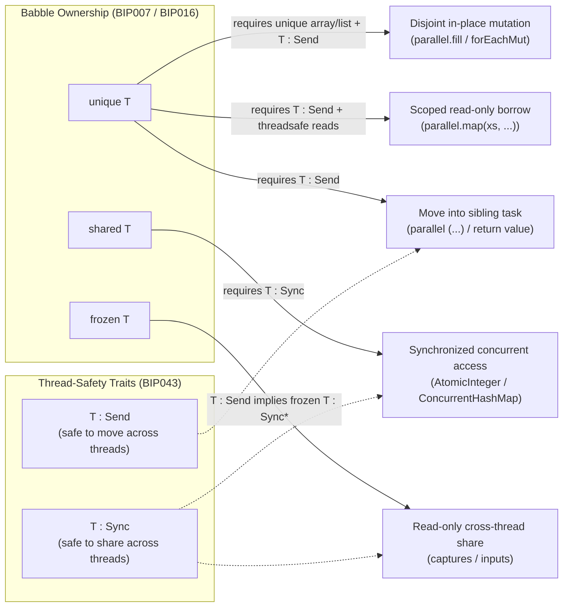
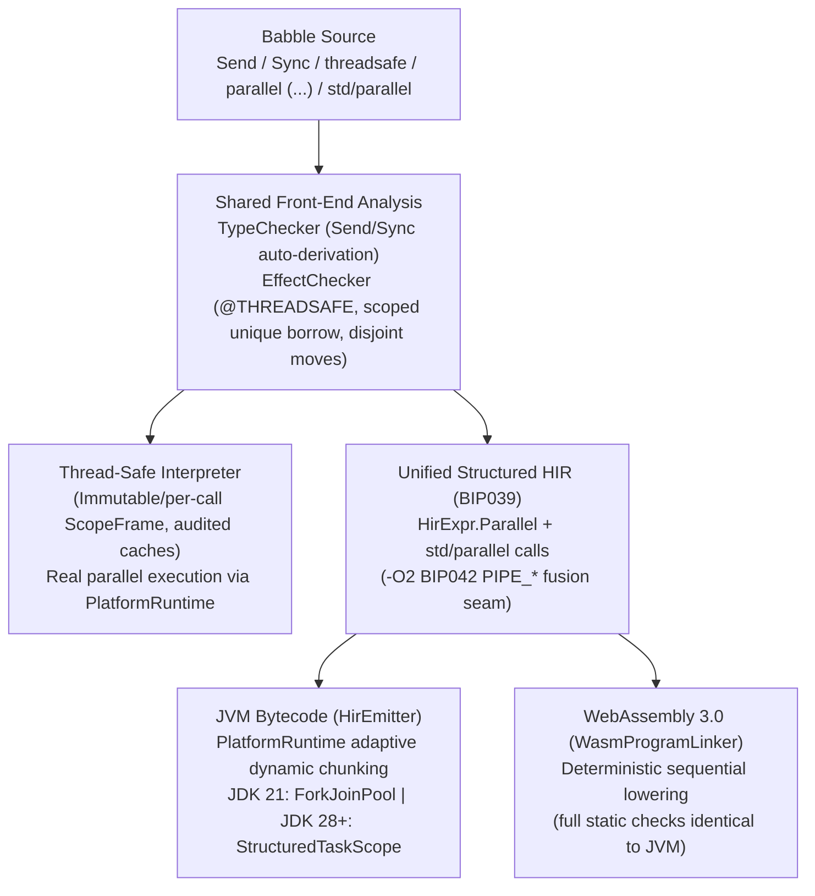

# BIP043: Verified Structured Parallelism (`Send`, `Sync`, `threadsafe`, `parallel`, and `std/parallel`)

| | |
|---|---|
| **BIP** | 043 |
| **Date** | 2026-11-28 |
| **Status** | Draft (`BIP043-D1`–`D9` settled ; `BIP043-Q1`–`Q6` open ; `BIP043-P1`–`P6` planned) |
| **Depends on** | Function effects, algebraic properties & `unique`/`frozen` ownership ([bip007_effects.md](bip007_effects.md) `BIP007-I1`–`I3`, §10), core types & collections ([bip011_core-types.md](bip011_core-types.md)), predicate-free LL(1)/LL(2) grammar ([bip012_grammar-improvements.md](bip012_grammar-improvements.md)), pure-by-default effects & return-through-borrow ([bip016_consolidating-effect-annotations.md](bip016_consolidating-effect-annotations.md)), higher-order function effects ([bip017_higher-order-function-effects.md](bip017_higher-order-function-effects.md)), `PlatformRuntime` / `ScopedValue` / `StructuredTaskScope` editions ([bip018_tracking-java-improvements.md](bip018_tracking-java-improvements.md) `BIP018-P1`–`P3`), curated & bytecode-inferred axioms ([bip019_refactoring-axioms.md](bip019_refactoring-axioms.md), [bip030_axiom-nullability-and-inferred-effects.md](bip030_axiom-nullability-and-inferred-effects.md)), `array of T` ([bip020_array-types.md](bip020_array-types.md)), optional/named arguments & generic functions ([bip021_optional-variadic-overloaded-arguments.md](bip021_optional-variadic-overloaded-arguments.md)), intersection types ([bip022_intersection-types.md](bip022_intersection-types.md)), WebAssembly 3.0 backend ([bip025_compile-to-wasm.md](bip025_compile-to-wasm.md)), exception handling ([bip028_exception-handling.md](bip028_exception-handling.md)), ranges ([bip031_ranges.md](bip031_ranges.md)), immutable `def` / mutable `var` ([bip034_immutable-def-and-mutable-var.md](bip034_immutable-def-and-mutable-var.md)), unified structured `HIR` ([bip039_mir-deorbitation.md](bip039_mir-deorbitation.md)), `init` constructors ([bip040_constructors.md](bip040_constructors.md)), E-graph pipeline rewrites ([bip042_egraph-pipeline-rewrites.md](bip042_egraph-pipeline-rewrites.md)), and a `std/...` standard-library module resolution path (`BIP005-D5`) |
| **Scope** | Statically verified, data-race-free structured data and task parallelism across Babble's thread-safe `Interpreter`, JVM bytecode compiler (`PlatformRuntime` on JDK 21 `ForkJoinPool` → JDK 28+ `StructuredTaskScope`), and WebAssembly 3.0 backend : two auto-derived, erased TitleCase marker interfaces (`Send` and `Sync` — exact naming open in `BIP043-Q1`), pure-by-default `threadsafe` function effect inference with explicit opt-in on `io`/`volatile`/`mut`/Java `axiom`s, scoped read-only borrowing and disjoint in-place parallel mutation on `unique` collections, a minimal `parallel (def ... ) [then (...)]` fork-join expression, and `std/parallel` data-parallel combinators (`map`, `filter`, `reduce`, `forEach`, `fill`, `mapInPlace`, `forEachMut`) |

---

## 1. Summary & Vision

Babble's existing effect and ownership system ([bip007_effects.md](bip007_effects.md), [bip016_consolidating-effect-annotations.md](bip016_consolidating-effect-annotations.md), [bip017_higher-order-function-effects.md](bip017_higher-order-function-effects.md)) already gives the compiler deep knowledge of **purity** (`@HERMETIC`), **determinism** (`@DETERMINISTIC`), **ownership** (`unique`, `shared`, `@BORROWED`, `frozen T`), and **algebraic laws** (`associative`, `commutative`, `idempotent`). Yet multi-threaded Babble programs today — such as [`examples/raytracer/io/jvm/png.ba`](../../examples/raytracer/io/jvm/png.ba) — must drop down to raw `java.lang.Thread`, `AtomicInteger`, and unverified `fn io` closures, forfeiting both static data-race protection and WebAssembly portability.

**BIP043** completes the parallelism vision sketched in [bip007_effects.md §10](bip007_effects.md#10-future-directions) with **verified structured data & task parallelism first** (`BIP043-D1`), plugging directly into Babble's existing three static hierarchies without adding a fourth (see [bip044_babble-hierarchies.md §7](bip044_babble-hierarchies.md#7-how-draft-bip043-parallelism-extends-the-three-hierarchies), and [bip046_formal-verification-strategies.md](bip046_formal-verification-strategies.md) for candidate pre-implementation Data-Race Freedom verification strategies):

1. **Two auto-derived structural marker interfaces (`Send` and `Sync`, `BIP043-D2`):**
   Purely static, erased TitleCase built-in interfaces (provisional names; see `BIP043-Q1`) inspired by Rust's `Send`/`Sync` auto-traits, composing seamlessly with Babble's existing `T: Bound`, `interface extends`, `BIP022` intersection types (`Hittable & Sync`), `frozen T`, and `axiom ...: class send sync`. Pure Babble types derive `Send` and `Sync` automatically from their fields; Java host classes default conservatively to `!Send, !Sync` until axiomatized.
2. **Pure-by-default `threadsafe` effect inference (`BIP043-D3`):**
   Pure-by-default Babble functions (`fn (...)`) are automatically inferred `threadsafe` whenever their captures are `Sync` (or disjoint moved `unique` `Send` values in `parallel (...)`) and every callee is `threadsafe`. Only `io`, `volatile`, `mut`, and Java `axiom` targets opt in explicitly with `threadsafe` (e.g. `axiom mut threadsafe on java.util.concurrent.atomic.AtomicInteger.incrementAndGet`).
3. **Minimal fork-join syntax + `std/parallel` combinators (`BIP043-D4`, `BIP043-D5`):**
   - Static K-way fork-join uses a single pure-`SLL` expression: **`parallel (def a = e1; def b = e2) [then (...)]`** — avoiding tuple types while enabling zero-ceremony `move(...)` of disjoint `unique` locals across sibling tasks without needing one-shot (`FnOnce`) closures.
   - Dynamic N-way data parallelism lives in **`std/parallel`**: `map`, `filter`, `reduce` (requiring `associative`), `forEach` (`io`), and disjoint in-place mutators (`fill`, `mapInPlace`, `forEachMut`).
   - Neither `parallel for` loop syntax nor dynamic `std/parallel.scope` task handles are included in v1 (both remain clean, additive two-way doors for later).
4. **Scoped read-only borrowing & disjoint in-place mutation (`BIP043-D7`):**
   A caller-owned `unique` collection (`list` / `array`) can be borrowed read-only across a structured parallel call without an irreversible `freeze(...)` — returning `unique` and mutable once the parallel call joins — or updated in place across disjoint indices (`parallel.fill`, `parallel.mapInPlace`, `parallel.forEachMut`) with zero intermediate allocation.
5. **Fail-fast structured cancellation & cross-target portability (`BIP043-D6`, `BIP043-D8`, `BIP043-D9`):**
   All parallel constructs enforce structured lifetime bounds (every worker finishes before the construct exits) and fail-fast cancellation on exceptions, backed by adaptive dynamic chunking behind `PlatformRuntime` (`ForkJoinPool` on JDK 21, `StructuredTaskScope` on JDK 28+ per `BIP018-P3`), a thread-safe `Interpreter`, and deterministic sequential lowering on single-threaded WebAssembly 3.0 (`BIP025`) with identical compile-time safety checks everywhere.

### Non-Goals for `BIP043`

- **No raw locks, mutex primitives, condition variables, or `async`/`await`:** Babble's v1 concurrency story is structured CPU/data parallelism, not unstructured thread spawning or server-side async I/O.
- **No `parallel for` syntax:** `break`/`continue`/`return` have ambiguous parallel semantics, and `std/parallel` combinators plug directly into `BIP042`'s `PIPE_*` E-graph fusion seam and `BIP021` named arguments (`threads:`, `chunkSize:`).
- **No dynamic `std/parallel.scope` / `Task of T` handles in v1:** Deferred until dynamic `while`-loop spawning or first-wins task racing proves necessary (`BIP043-D5`).
- **No WebAssembly Shared-Everything Threads runtime yet:** Wasm 3.0 enforces the full static contract and lowers deterministically to sequential execution until WasmGC shared threads stabilize (`BIP025` §12, `BIP043-D8`).

---

## 2. Motivating Examples

### 2.1 Replacing Manual `Thread` + `AtomicInteger` in `examples/raytracer`

Today, [`examples/raytracer/io/jvm/png.ba`](../../examples/raytracer/io/jvm/png.ba) spawns raw `java.lang.Thread` instances, claims rows via `AtomicInteger`, mutates a shared `BufferedImage` inside `fn io`, cannot run in interpreted mode when `threads > 1`, and is JVM-only.

With `BIP043`, the raytracer core renders in parallel **portably** (multi-threaded on JVM and thread-safe `Interpreter`, sequential on WebAssembly 3.0) with static data-race freedom and zero intermediate row-list allocations:

```babble
def parallel = import("std/parallel")

;; Core interface declares `Send` (enforced on all implementations).
;; Mutable builders like HittableList can still implement Hittable, and `freeze(world)`
;; produces `frozen Hittable`, which is automatically `Sync`!
export def Hittable = interface extends Describable, Send (
    def hit: fn (r: Ray, tmin: double, tmax: double): HitRecord?
    def boundingBox = fn (): AABB -> (AABB.empty)
    def kind = fn (): string -> ("hittable")
)

export def Scene = record (
    name: string,
    world: frozen Hittable,
    camera: Camera,
    defaultSeed: int = 2026
) ()

;; Portable, zero-race, zero-extra-allocation parallel pixel buffer render:
export def renderPixels = fn (
    scene: Scene,
    threads: int = 0,
    seed: int = scene.defaultSeed
): unique array of int -> (
    def cam = scene.camera
    def width = cam.imageWidth
    def height = cam.imageHeight
    def pixels = array of int (width * height) ;; `unique array of int`

    ;; Each row writes disjointly into `pixels` via parallel.map or slice-based fill:
    def rows = parallel.map(
        0..<height,
        fn (j: int): unique array of int -> (cam.renderRowArray(j, scene.world, seed)),
        threads: threads
    )
    ;; Or directly fill a flat buffer by pixel/row index with zero row-list allocation:
    parallel.fill(mut pixels, fn (idx: int): int -> (
        cam.renderPixelPacked(idx mod width, idx // width, scene.world, seed)
    ), threads: threads)

    move(pixels)
)
```

### 2.2 Heterogeneous Divide-and-Conquer with `unique` Moves (`parallel (...)`)

Building left and right BVH subtrees in parallel moves disjoint `unique` slices directly into sibling tasks without needing `FnOnce` closures or tuple types:

```babble
def buildBvh = fn (unique items: list of Hittable): unique BVHNode -> (
    if items.size() <= 4 then (
        buildLeaf(move(items))
    ) else (
        def split = partitionUnique(move(items))
        def leftItems = move(split.left)
        def rightItems = move(split.right)

        parallel (
            def left = buildBvh(move(leftItems))
            def right = buildBvh(move(rightItems))
        ) then (
            BVHNode(move(left), move(right))
        )
    )
)
```

- `leftItems` and `rightItems` are disjoint `unique` locals: `EffectChecker` rejects moving the same local in two sibling branches (`Cannot move already-moved local`), while preserving `unique` on `left` and `right` inside `then (...)`.

### 2.3 Scoped Read-Only Borrowing, `associative` Reductions & In-Place Particle Updates

```babble
def parallel = import("std/parallel")

;; 1. Scoped read-only borrow of a mutable `unique` list (no irreversible `freeze`!)
def xs = list of double ()
xs.add(1.0); xs.add(2.0); xs.add(3.0)
def squares = parallel.map(xs, fn (x: double): double -> (x * x))
xs.add(4.0) ;; Still `unique` and mutable after parallel.map joins!

;; 2. Verified deterministic tree reduction (`associative` required on combiner)
def total: long = parallel.reduce(
    0..<1000000,
    0L,
    fn (i: int): long -> (long(i) * long(i)),
    fn associative commutative (a: long, b: long): long -> (a + b)
)

;; 3. Disjoint in-place mutation of a `unique` collection (alias-free by BIP007-D6)
def particles = buildUniqueParticles(10000)
parallel.forEachMut(mut particles, fn (mut p: Particle): null -> (
    p.integrate(dt)
    null
))
```

### 2.4 Synchronized Shared Java Interop (`AtomicInteger`, `ConcurrentHashMap`)

```babble
axiom java.util.concurrent.atomic.AtomicInteger: class send sync (
    def incrementAndGet: fn mut threadsafe (): int
    def get: fn pure threadsafe (): int
)

def hits = java.util.concurrent.atomic.AtomicInteger(0)
parallel.forEach(0..<1000, fn io threadsafe (i: int): null -> (
    if testHit(i) then ( discard(hits.incrementAndGet()) )
    null
))
```

---

## 3. Type-System Foundation: `Send` and `Sync` Marker Interfaces

*(Provisional names `Send` and `Sync`; final naming is tracked in `BIP043-Q1`.)*

### 3.1 Why Two Separate Structural Traits (`BIP043-D2`)

Babble's existing ownership system (`unique`, `shared`, `@BORROWED`, `frozen T`) tracks **aliasing and mutability**, not **thread affinity** or **synchronized interior mutability**:

| Concept | Example | Alias-isolated (`unique`)? | Safe to move across threads (`Send`)? | Safe to share across threads (`Sync`)? |
|---|---|---|---|---|
| Core scalars, deep `record`, `frozen T` *(where `T: Send`)* | `int`, `Vec3`, `frozen list of int` | Yes (or freely shared) | **Yes** | **Yes** |
| Pure Babble mutable `class`, `list`/`array`/`map` of `Send` | `Rng`, `list of int`, `array of double` | When `unique` | **Yes** | **No** *(unsynchronized mutation)* |
| Synchronized Java concurrent container / atomic | `AtomicInteger`, `ConcurrentHashMap<K, V>` *(K, V: Send)* | Shared | **Yes** | **Yes** *(synchronized interior mutability)* |
| Thread-affine Java host resource | `ThreadLocal<T>`, `ReentrantLock` guard, UI handle | Even when `unique`! | **No** | **No** |
| Un-axiomatized Java class or unconstrained `any` | `java.awt.image.BufferedImage`, `any` | Conservative | **No** | **No** |

Separating **`Send`** (*safe to transfer ownership of a value to another thread*) from **`Sync`** (*safe to access a value concurrently from multiple threads through shared references*) captures all five rows cleanly:



*\*For Java classes inside `frozen T`, invoking a method across threads still requires that method to be `threadsafe` (§3.3), preventing hidden interior mutability such as `java.text.SimpleDateFormat.format`.*

### 3.2 Built-In Erased Marker Interfaces & Grammar Integration

- **`Send` and `Sync` are built-in, purely compile-time marker interfaces** pre-bound in the root type environment (`Resolver` / `TypeChecker`) — **zero new type-qualifier grammar rules** and **zero new reserved lowercase keywords** (so `channel.send(...)` and `def send = ...` continue to parse cleanly).
- They work everywhere an interface type is valid:
  - Generic bounds (`BIP021`): `fn of (T: Sync, U: Send) (...)`
  - Interface inheritance (`BIP002`): `def Hittable = interface extends Describable, Send (...)`
  - Intersection types (`BIP022`): `world: Hittable & Sync`, `payload: any & Send`
- **Purely static (erased at runtime):** Neither `Send` nor `Sync` has a JVM interface class or runtime tag (`RuntimeBoundaryTestCase` untouched). Runtime type tests `x is Send`, `x is Sync`, and casts `x as Send`, `x as Sync` are **compile-time errors** (matching `x is frozen T` in `BIP007-D7`). Narrowing `(any & Send)` with `x is Foo` preserves `Send` only when `Foo` itself is `Send` (and narrows cleanly to `Foo & Send` for open interfaces).

### 3.3 Structural Auto-Derivation Rules

A type `T` satisfies `Send` or `Sync` automatically according to its structure (with coinductive cycle handling for recursive classes/records), directly realized in Layer 1 by [`ModalKindTable.java`](../../src/main/java/org/babblelang/analysis/ModalKindTable.java)'s existing `Axis.PORTABILITY` (`Send`) and `Axis.CONTENTION` (`Sync`) mode-crossing axes (see [bip044_babble-hierarchies.md §7.2](bip044_babble-hierarchies.md#72-unifying-modalkindtableaxis-bip027-with-bip043-send--sync)):

| Type `T` | `T <: Send` iff | `T <: Sync` iff |
|---|---|---|
| Core scalars (`byte`..`string`, `null`), `range of E` (`E` scalar) | Always `true` | Always `true` |
| `record` with fields $f_1: T_1, \dots, f_n: T_n$ | $\forall i,\; T_i <: \text{Send}$ | $\forall i,\; T_i <: \text{Sync}$ |
| Babble `class` with `def`/`var` fields $f_1: T_1, \dots, f_n: T_n$ | $\forall i,\; T_i <: \text{Send}$ | No `var` fields **and** $\forall i,\; T_i <: \text{Sync}$ |
| Babble `object` singleton | Always `true` *(singleton identity)* | No `var` fields **and** all `def` fields $<: \text{Sync}$ |
| `frozen U` | $U <: \text{Send}$ | $U <: \text{Send}$ *(pure Babble; Java method calls on `frozen U` still check `threadsafe`)* |
| `array of E`, `list of E`, `set of E`, `sortedset of E` | $E <: \text{Send}$ | `false` *(mutable; use `frozen` or scoped `unique` borrow)* |
| `map of (K, V)`, `sortedmap of (K, V)` | $K <: \text{Send} \land V <: \text{Send}$ | `false` *(mutable; use `frozen` or scoped `unique` borrow)* |
| `entry of (K, V)` | $K <: \text{Send} \land V <: \text{Send}$ | $K <: \text{Sync} \land V <: \text{Sync}$ |
| Union `A \| B` / Nullable `U?` | Both members $<: \text{Send}$ | Both members $<: \text{Sync}$ |
| Intersection `A & B` | Either member $<: \text{Send}$ | Either member $<: \text{Sync}$ |
| Open Babble `interface I` | `I` explicitly `extends Send` (or `Sync`) | `I` explicitly `extends Sync` |
| Generic type parameter `T: Bound` | `Bound <: Send` | `Bound <: Sync` |
| `any` / `any?` | `false` *(use `any & Send` / `any & Sync`)* | `false` |
| Function type `fn ...` | `threadsafe` *(captures `Send`/`Sync` + `threadsafe` body)* | `threadsafe` *(captures `Sync` + `threadsafe` body)* |
| Java class `J<A1, ..., Ak>` | Declared `axiom ...: class send` *(and any type-arg bounds)* | Declared `axiom ...: class sync` *(and any type-arg bounds; `sync` implies `send` unless specified — see `BIP043-Q2`)* |

- **Interface implementation enforcement:** If `interface Hittable extends Send` (resp. `Sync`), any `class`, `record`, or `object` declaring `implements Hittable` is statically verified against the table above; failure is a compile-time `TypeCheckException` naming the offending field (`Class BadHittable cannot implement Hittable : field tls of type java.lang.ThreadLocal is not Send`).
- **Curated axioms (`src/main/java/org/babblelang/axioms/`):** Existing `Babble.g4` `axiom` syntax (`CLASS classWords+=ID*`) already parses `axiom java.util.concurrent.atomic.AtomicInteger: class send sync (...)` with zero grammar changes! Core immutable JDK types (`java.lang.String`, `java.time.Instant`, `java.nio.file.Path`, `java.math.BigInteger`, etc.) and concurrent JDK types (`Atomic*`, `ConcurrentHashMap`, `CopyOnWriteArrayList`, etc.) receive curated `send`/`sync` axioms in `src/main/java/org/babblelang/axioms/java/`.

---

## 4. Effect System Integration (`threadsafe`)

### 4.1 Pure-by-Default Inference (`BIP043-D3`)

Consistent with `BIP016` (pure-by-default functions, minimal opt-in keywords):

1. **Internal Layer 1 trait `@THREADSAFE` in `EffectSet`:**
   - **Concrete pure-by-default Babble functions** (`@HERMETIC @DETERMINISTIC`, no `io`/`volatile`/`mut` globals) are **automatically inferred `@THREADSAFE`** whenever:
     - every captured outer variable is `Sync` (for shared/reusable closures) — or a disjoint moved `unique` `Send` local (inside a single-shot `parallel (...)` branch); and
     - every callee invoked in the body is `@THREADSAFE` (including all pure Babble functions, core operators, and `threadsafe` Java axioms).
   - **Default on pure-by-default function types / interface methods?** Concrete bodies infer `@THREADSAFE` automatically, while function types requiring thread-safety (such as `std/parallel` callback parameters) write `fn threadsafe (...)` (or `fn io threadsafe (...)`). Whether plain `fn (...)` interface methods default to `@THREADSAFE` or require `fn threadsafe (...)` is tracked in `BIP043-Q3`.
   - **`io`, `volatile`, and `mut` functions** default to **not** `@THREADSAFE` and opt in explicitly with **`threadsafe`**:
     - `fn io threadsafe (...)` — verified to call only `threadsafe` callees and capture only `Sync` bindings (no unsynchronized mutable globals or `!Sync` captures).
     - `fn mut threadsafe (...)` — allowed on `Sync` receivers (or via `axiom mut threadsafe on ...` for Java synchronized mutators like `AtomicInteger.incrementAndGet` and `ConcurrentHashMap.put`) and on `unique`/disjoint `mut` parameter targets (like `parallel.forEachMut`'s `fn (mut p: Particle)` where each worker receives an exclusive `Particle`!).
2. **Higher-order effect forwarding (`BIP017`):**
   `fn calling f` forwards `@THREADSAFE` along with `@HERMETIC`/`@DETERMINISTIC`/`@NOTHROW` so higher-order pure helpers (`applyTwice`, `compose`) remain transparently `threadsafe` when passed a `threadsafe` callback.
3. **Bytecode analyzer (`BIP019`):**
   `BytecodeEffectAnalyzer` conservatively never infers `threadsafe` on arbitrary Java methods with field writes, `static` reads, or `native` calls — except trivially pure stateless bytecode helpers (no mutable static reads, no writes to non-fresh objects, all callees `threadsafe`). Curated axioms in `src/main/java/org/babblelang/axioms/` remain the authoritative source for JDK concurrency classes (`AxiomsTestCase` invariant preserved).

### 4.2 Subtyping

`@THREADSAFE` is a covariant guarantee on `EffectSet` (`BIP007` §3.4):

$$\text{fn threadsafe } (\dots) \quad <:\quad \text{fn } (\dots)$$
$$\text{fn io threadsafe } (\dots) \quad <:\quad \text{fn io } (\dots)$$

---

## 5. Scoped Read-Only Borrowing & Disjoint In-Place Mutation of `unique` Collections

### 5.1 Scoped Read-Only Borrowing (`BIP043-D7`)

A mutable `list of T` or `array of T` (where `T: Sync`) is `Send`, **not** `Sync`, because in general another alias could mutate it while workers read it. Requiring `Sync` on every parallel input would force callers to call irreversible `freeze(xs)` (or copy `xs`) even when they own `xs` uniquely and want to keep mutating it afterwards.

Because every construct in `BIP043` is **structured** (the caller blocks until all worker threads have joined) and takes read-only inputs as **`@CONST @BORROWED`**:

- When a caller passes a **`unique`** binding `xs` (of a `Send` type whose read operations are `threadsafe`, such as `list of T`, `array of T`, `set of T`, `map of (K, V)` with `Sync` elements/keys/values) into a structured read-only parallel slot (e.g. `parallel.map(xs, ...)`, or read-only capture in `parallel (...)`):
  1. `xs` is temporarily treated as **read-only and shared (`Sync`-view)** for the duration of the parallel construct — no sibling branch may mutate or `move` `xs`.
  2. No other alias to `xs` exists (guaranteed by `unique`), and `@BORROWED` prevents any worker from retaining `xs` past the join.
  3. Once the parallel construct joins, all workers are gone, so `xs` resumes its **`unique` mutable** state in the caller.

This is the exact Babble counterpart to Rust's `std::thread::scope` / `rayon::par_iter(&xs)` borrowing `&Vec<T>` across threads for a bounded lexical scope.

### 5.2 Disjoint In-Place Parallel Mutation (`BIP043-D7`)

`std/parallel` also provides in-place parallel mutators over caller-owned **`unique`** arrays and lists:

- `parallel.fill(mut dst, f)` — writes `dst[i] = f(i)` across disjoint index partitions of a `unique array of T` (or pre-sized `unique list of T`), where `T: Send`.
- `parallel.mapInPlace(mut xs, f)` — replaces `xs[i] = f(xs[i])` across disjoint indices of a `unique array of T` / `unique list of T` (`T: Send`).
- `parallel.forEachMut(mut xs, f)` — invokes `f(mut elem)` on each element of a `unique array of T` / `unique list of T` (`T: Send`).

**Why `parallel.forEachMut` is deeply race-free:** By `BIP007-D6`, a `unique` collection can only ever store `unique` (moved-in) or deeply immutable elements — storing any shared mutable alias demotes the collection from `unique` to `@SHARED`. Consequently, **no two elements `xs[i]` and `xs[j]` ($i \ne j$) inside a `unique` collection can ever alias mutable state** (verified for `array.set` as well in `BIP043-Q4`). Combined with `std/parallel`'s disjoint index partitioning and `T: Send`, every worker receives exclusive mutable access to its own elements with zero locks and zero copying.

---

## 6. Surface Syntax & Standard Library (`parallel (...)` & `std/parallel`)

### 6.1 Minimal `parallel (...)` Fork-Join Expression (`BIP043-D4`)

To support static K-way heterogeneous fork-join with zero-ceremony `move(...)` of disjoint `unique` locals — without introducing tuple types or one-shot `FnOnce` closure annotations — `BIP043` adds a single predicate-free LL(1) expression form mirroring Babble's `if ... then (...)`, `while ... then (...)`, `for ... in ... then (...)`, and `BIP018`'s `with ... then (...)`:

```antlr
parallelExpression
    : PARALLEL '(' NL* parallelBranches ')' (NL* THEN NL* joinBlock=block)?
    ;

parallelBranches
    : sep? (parallelBranch (sep parallelBranch)* sep?)?
    ;

parallelBranch
    : DEF name=ID (':' type)? '=' NL* value=expression
    | expression
    ;
```

- **New lexer tokens:** Only `PARALLEL` (`parallel`) and `THREADSAFE` (`threadsafe`), both exempted in `memberName` so existing field/method names stay valid and `ParserGrammarTestCase` stays 100% pure-`SLL`.
- **Static rules:**
  1. **Branch independence:** All branches inside `parallel (...)` see the **outer** lexical scope only — no branch may reference a `def` declared by a sibling branch.
  2. **Disjoint ownership:** Each branch may read `Sync` outer bindings (or scoped-borrow a `unique` outer binding read-only, provided no sibling mutates/moves it), and may `move(...)` outer `unique` locals (of `Send` type) provided **no two branches move or use the same `unique` local**.
  3. **Thread-safety:** Each branch expression must be `@THREADSAFE` (either pure-by-default, or calling only `threadsafe` `io`/`mut` operations on `Sync` or disjoint moved `unique` targets) and its result type must be `Send`.
  4. **Join & `then` clause:**
     - With `then (...)`: all `def` results are joined and bound as immutable `def`s in `joinBlock` (preserving `unique` if a branch produced a `unique` value!), and the value of `parallel (...) then (...)` is the value of `joinBlock`.
     - Without `then (...)`: all branches execute in parallel (useful for `io threadsafe` sibling tasks or disjoint `mut` work) and the expression evaluates to `null`.
  5. **Control flow:** `break`, `continue`, and `recurse` inside a `parallel` branch may not cross the `parallel` boundary (compile-time error).

### 6.2 `std/parallel` Combinators (`BIP043-D4`, `BIP043-D5`, `BIP043-D9`)

`std/parallel` exports the core data-parallel combinators (overloaded via `BIP021` for `range of int`/`range of long`, `list of T`, and `array of T`, with optional named tuning parameters `threads: int = 0` and `chunkSize: int = 0` where `0` selects the adaptive default):

| Function | Core Signature Sketch | Effect / Determinism | Notes |
|---|---|---|---|
| `parallel.map` | `fn of (T: Sync, U: Send) (xs: list of T, f: fn threadsafe (x: T): U, threads: int = 0, chunkSize: int = 0): unique list of U` *(+ `range`, `array`, scoped `unique` overloads)* | `@HERMETIC @DETERMINISTIC` | Preserves input index order; deterministic on success. |
| `parallel.filter` | `fn of (T: Sync) (xs: list of T, pred: fn threadsafe (x: T): bool, threads: int = 0, chunkSize: int = 0): unique list of T` | `@HERMETIC @DETERMINISTIC` | Preserves input index order via per-chunk compaction. |
| `parallel.reduce` | `fn of (T: Sync, R: Send) (xs: list of T, seed: R, map: fn threadsafe (x: T): R, combine: fn threadsafe associative (a: R, b: R): R, threads: int = 0, chunkSize: int = 0): R` *(+ 3-arg overload without `map`)* | `@HERMETIC @DETERMINISTIC` | Balanced partition tree fold preserves left-to-right order (`associative`); uses unordered work-stealing merge when `combine` is also `commutative`. |
| `parallel.fill` | `fn of (T: Send) mut (mut dst: unique array of T, f: fn threadsafe (i: int): T, threads: int = 0, chunkSize: int = 0): null` | `@HERMETIC @DETERMINISTIC` *(confined to `mut dst`)* | Writes disjoint index partitions in place; `dst` stays `unique`. |
| `parallel.mapInPlace` | `fn of (T: Send) mut (mut xs: unique array of T, f: fn threadsafe (x: T): T, threads: int = 0, chunkSize: int = 0): null` *(+ `unique list of T`)* | `@HERMETIC @DETERMINISTIC` *(confined to `mut xs`)* | Replaces elements across disjoint partitions in place. |
| `parallel.forEachMut` | `fn of (T: Send) mut (mut xs: unique array of T, f: fn mut threadsafe (mut x: T): null, threads: int = 0, chunkSize: int = 0): null` *(+ `unique list of T`)* | `@HERMETIC @DETERMINISTIC` *(confined to `mut xs`)* | Disjoint exclusive `mut` access per element (alias-free by `BIP007-D6`). |
| `parallel.forEach` | `fn of (T: Sync) io threadsafe (xs: list of T, f: fn io threadsafe (x: T): null, threads: int = 0, chunkSize: int = 0): null` *(+ `range`, `array`)* | `io threadsafe` *(non-deterministic order)* | Arbitrary concurrent side effects (`AtomicInteger`, `ConcurrentHashMap`, `println`); deterministic accumulation uses `reduce`/`fill`/`forEachMut`. |

---

## 7. Determinism, Exceptions, and Structured Cancellation (`BIP043-D6`)

1. **Structured lifetime guarantee:** No worker thread spawned by `parallel (...)` or `std/parallel` may outlive the construct — whether it exits normally or via an exception.
2. **Fail-fast cancellation:** If any task throws an exception:
   - The runtime immediately signals cancellation to sibling tasks (interrupting worker threads / setting the chunk-claim cancellation flag so unclaimed chunks are skipped immediately).
   - The caller waits for all active sibling tasks to finish before unwinding.
   - The first-observed exception is rethrown directly as a Babble `exception` (`BIP028`), with any additional sibling exceptions attached as Java suppressed exceptions on the JVM.
3. **Deterministic-on-success semantics:**
   - Pure combinators (`map`, `filter`, `reduce`, `fill`, `mapInPlace`, `forEachMut`) and pure `parallel (...)` expressions are **`@DETERMINISTIC`**: on every non-throwing run, their result is guaranteed identical to sequential execution regardless of thread count, scheduling, or backend (`interpret`, `-O0`, `-O1`, `-O2`, `wasm-js`).
   - When multiple tasks throw concurrently, which exception wins is fail-fast (matching JDK `StructuredTaskScope`), avoiding the latency penalty of waiting for slow earlier tasks after a fast later task fails.

---

## 8. Execution Across Backends & Optimizer Synergy



### 8.1 Thread-Safe `Interpreter` (`BIP043-D8`)

Today, [`Interpreter`](../../src/main/java/org/babblelang/engine/impl/Interpreter.java) stores its current lexical scope in an instance field, preventing multi-threaded execution (`AGENTS.md` Known Issues). `BIP043-P1` refactors `Interpreter` to pass the current evaluation frame explicitly (or per-invocation immutable/stack-confined frame) and audits shared runtime caches (`Bootstrap`, `Overloads`, `ModuleInterface`) so multi-threaded `parallel (...)`, `std/parallel`, and `examples/raytracer/raytracer_jvm.ba` run cleanly in `-Dbabble.mode=interpret`.

### 8.2 JVM `PlatformRuntime` Adaptive Chunking (`BIP043-D8`, `BIP043-D9`)

- **Adaptive dynamic chunking (`O(cores)` workers):** Rather than spawning 1 task per element (catastrophic for 1M-element loops) or statically dividing into `N = cores` rigid slices (poor load balance on uneven raytracer scanlines), `std/parallel` spawns `O(cores)` workers that dynamically claim chunks (adaptive chunk size based on total length, overridable via `chunkSize:` and `threads:`).
- **Edition backends (`BIP018` `PlatformRuntime`):**
  - **JDK 21 (`Babble 21`):** Backed by `ForkJoinPool` (handling nested parallelism such as `parallel (...)` inside `parallel.map` without fixed-pool deadlock; dedicated bounded pool when `threads: N` is explicitly requested).
  - **JDK 25 (`Babble 25`, `BIP018-P2`):** Integrates `ScopedValue` propagation for `scoped def` / `with ... then (...)`.
  - **JDK 28+ (`Babble 28`, `BIP018-P3`):** Backed by `StructuredTaskScope` over `O(cores)` coarse workers and `parallel (...)` branches, giving native fail-fast cancellation, automatic `ScopedValue` inheritance, and structured thread dumps.

### 8.3 WebAssembly 3.0 Portability (`BIP043-D8`)

On `-target wasm-js` and `-target wasm-bare` (`BIP025`), `parallel (...)` and `std/parallel` run the **exact same front-end `Send`/`Sync`/`threadsafe` verification**, then lower cleanly to deterministic sequential execution (evaluating `parallel (...)` branches left-to-right and executing `std/parallel` combinators sequentially). Portable programs — including the raytracer — therefore share one parallel source tree across JVM and WebAssembly without `#ifdef`-style forks, and will unlock real Wasm parallelism transparently once WebAssembly Shared-Everything Threads matures.

### 8.4 `-O2` Optimizer & `BIP042` E-Graph Pipeline Fusion

Because `std/parallel` combinators are pure-by-default library calls with explicit `associative` / `commutative` / `injective` / `monotone` contracts, they plug directly into [bip042_egraph-pipeline-rewrites.md](bip042_egraph-pipeline-rewrites.md)'s `HirPipelineLifter` seam: chained `parallel.reduce(parallel.filter(parallel.map(xs, f), p), seed, op)` can fuse into a single zero-intermediate-allocation parallel pass at `-O2` (explored in `BIP043-Q6`).

---

## 9. Decisions, Open Questions, and Phased Implementation Plan

### 9.1 Settled Design Decisions (`BIP043-D1`–`D9`)

| ID | Decision |
|---|---|
| **`BIP043-D1`** | **Structured data & task parallelism first:** Target deterministic fork-join combinators and structured task expressions with zero raw locks, mutexes, actors, or `async`/`await`. |
| **`BIP043-D2`** | **Two auto-derived, erased TitleCase marker interfaces (`Send` & `Sync`, naming open in `BIP043-Q1`):** Pure Babble types derive `Send`/`Sync` structurally from their fields; open interfaces enforce `extends Send`/`Sync` on all implementations and compose with `T: Bound` and `BIP022` intersections (`Hittable & Sync`); Java classes default conservatively to `!Send, !Sync` until axiomatized (`axiom ...: class send sync`). |
| **`BIP043-D3`** | **Pure-by-default `threadsafe` inference:** Pure-by-default Babble functions are automatically inferred `@THREADSAFE` when captures are `Sync` (or disjoint moved `unique` `Send` in `parallel (...)`) and all callees are `threadsafe`; `io`, `volatile`, `mut`, and Java axioms opt in explicitly with `threadsafe`. |
| **`BIP043-D4`** | **Minimal `parallel (def ... ) [then (...)]` fork-join + `std/parallel` combinators:** Add a single pure-`SLL` `parallel (...) [then (...)]` expression (no tuple types, direct disjoint `move(...)` of `unique` locals) alongside `std/parallel` data combinators; omit `parallel for` loop syntax. |
| **`BIP043-D5`** | **Defer dynamic `std/parallel.scope`:** Keep v1 free of `Scope` / `Task of T` handle types; `std/parallel.scope` remains a clean additive extension if dynamic/racing tasks are needed later. |
| **`BIP043-D6`** | **Fail-fast structured cancellation, deterministic on success:** Sibling tasks are cancelled and joined before exiting on any exception (matching JDK `StructuredTaskScope`); pure combinators (`map`, `filter`, `reduce` requiring `associative`, `fill`, `mapInPlace`, `forEachMut`) are `@DETERMINISTIC` on success. |
| **`BIP043-D7`** | **Scoped read-only borrowing + disjoint in-place mutation of `unique` collections:** Structured parallel calls may borrow caller-owned `unique` collections read-only (returning `unique` and mutable after join) and mutate `unique` arrays/lists in place across disjoint indices (`parallel.fill`, `parallel.mapInPlace`, `parallel.forEachMut`). |
| **`BIP043-D8`** | **Full 3-target portability & adaptive `PlatformRuntime` chunking:** Identical compile-time checks across all targets; real parallel execution on thread-safe `Interpreter` and JVM (`ForkJoinPool` on JDK 21 → `StructuredTaskScope` over `O(cores)` dynamic work-claiming chunks on JDK 28+, with optional `threads:` / `chunkSize:` args); deterministic sequential lowering on WebAssembly 3.0. |
| **`BIP043-D9`** | **`parallel.forEach` is `io threadsafe`:** Accepts any `io threadsafe` callback (`AtomicInteger`, `ConcurrentHashMap`, `println`) with non-deterministic execution order; deterministic accumulation uses `parallel.reduce` (`associative`) or `parallel.fill` / `forEachMut` on a `unique` buffer. |

### 9.2 Open Questions (`BIP043-Q1`–`Q6`)

- **`BIP043-Q1` — Final TitleCase names for `Send` and `Sync`:** `BIP043-D2` settles TitleCase built-in marker interfaces (no new reserved lowercase type keywords), but the exact vocabulary is still open: keep Rust's terse `Send` / `Sync` (widely recognized), or choose more self-describing Babble-native names (e.g. `Sendable` / `Shareable`, `Movable` / `ThreadSafe`, `Transferable` / `Concurrent`)?
- **`BIP043-Q2` — Does `Sync` always imply `Send` in Babble?** In Rust, `MutexGuard<'a, T>` is `Sync` but `!Send` (thread-affine drop). Because Babble has no RAII `Drop` destructor running lock-release automatically on scope exit, should `Sync <: Send` hold unconditionally (simplifying `TypeAlgebra` and axioms), or should `Send` and `Sync` remain completely independent to model Java lock guards if ever axiomatized?
- **`BIP043-Q3` — Default `@THREADSAFE` on pure-by-default interface methods & function types:** Should an unannotated pure interface method `def hit: fn (r: Ray, ...): HitRecord?` on a `Sync` interface default to requiring `@THREADSAFE` implementations (zero boilerplate for `Hittable`!), or require explicit `fn threadsafe (...)` on abstract signatures?
- **`BIP043-Q4` — `array.set` `BIP007-D6` uniqueness audit:** Verify that `EffectChecker` enforces the exact same `BIP007-D6` demotion invariant on `array.set(i, v)` as on `list.add(v)` / `list.set(i, v)` (storing a non-`unique`, non-immutable element demotes a `unique array of T` to `@SHARED`) so `parallel.forEachMut` on `unique array of T` is provably alias-free across indices.
- **`BIP043-Q5` — `parallel.reduce` seed semantics (`identity` vs fold seed):** For a non-commutative `associative` combiner (e.g. string concatenation or matrix multiplication), passing `seed` into every partition requires `seed` to be a true monoid identity ($e \oplus x = x \oplus e = x$), whereas folding non-empty partitions directly and applying `seed` once at the left avoids requiring an identity axiom (or providing both `reduce(xs, seed, op)` and `reduce1(xs, op): T?`). Which contract should `std/parallel.reduce` expose?
- **`BIP043-Q6` — `-O2` `BIP042` parallel pipeline fusion scope:** Should `BIP043-P6` fuse chained `std/parallel` combinators (`parallel.reduce(parallel.filter(parallel.map(...)))`) via `BIP042`'s `PIPE_*` E-graph dialect directly in `BIP043`, or leave parallel E-graph fusion as a small follow-up pass once `std/parallel` stabilizes?

### 9.3 Phased Implementation Plan (`BIP043-P1`–`P6`)

1. **`BIP043-P1` — Thread-Safe `Interpreter` & Runtime Cache Audit:**
   Remove the mutable current-scope field from `Interpreter`, audit shared runtime caches for concurrent safety, and add multi-threaded differential tests (including `examples/raytracer/raytracer_jvm.ba` with `threads > 1` in `-Dbabble.mode=interpret`). Independent of all other phases; can land at any time.
2. **`BIP043-P2` — Structural `Send` / `Sync` Marker Interfaces & Java Axioms:**
   Implement coinductive auto-derivation in `TypeChecker` / `TypeAlgebra`, interface `extends Send`/`Sync` enforcement, `BIP022` intersection support, `frozen T` synergy, rejection of runtime `is`/`as` on `Send`/`Sync`, and curated `send`/`sync` axioms in `src/main/java/org/babblelang/axioms/java/` (including `java.util.concurrent.*`, `java.time.*`, core collections).
3. **`BIP043-P3` — `@THREADSAFE` Effect Inference, `BIP017` Forwarding & Scoped `unique` Borrowing:**
   Add `THREADSAFE` lexer token + `EffectSet.THREADSAFE`, pure-by-default inference, explicit `io`/`volatile`/`mut` `threadsafe` checking, `fn calling f` forwarding, scoped read-only borrowing of `unique` locals across structured parallel boundaries, and `array.set` `BIP007-D6` audit (`BIP043-Q4`).
4. **`BIP043-P4` — `parallel (def ... ) [then (...)]` Expression Across All Stages:**
   Add pure-`SLL` `parallel` syntax to `Babble.g4`, `Formatter`, `BabbleSession.classify`, `BlockScopes`/`Resolver`/`TypeChecker`/`EffectChecker` (sibling independence + disjoint `unique` moves), `Interpreter`, `HirExpr.Parallel`, JVM `HirEmitter` (via `PlatformRuntime`), and sequential WebAssembly 3.0 lowering (`WasmFuncEmitter`), with `.batest.md` specs and `hir`/`wat` goldens.
5. **`BIP043-P5` — `std/parallel` Combinators & `PlatformRuntime` Adaptive Chunking:**
   Implement `std/parallel` (`map`, `filter`, `reduce`, `forEach`, `fill`, `mapInPlace`, `forEachMut`) backed by adaptive dynamic chunking on JDK 21 (`ForkJoinPool`) and JDK 28+ (`StructuredTaskScope` via `BIP018-P3`), plus portable sequential Wasm lowering.
6. **`BIP043-P6` — Raytracer Migration, Adversarial Soundness Probes & Optional `-O2` Fusion:**
   Migrate `examples/raytracer` to verified portable `std/parallel` + `parallel (...)` (verifying byte-identical `scene.ppm` and multi-threaded parity across `interpret`, `-O0`, `-O1`, `-O2`, and `wasm-js`), add adversarial data-race / escape probes to `BIP032`, and evaluate `BIP042` parallel pipeline fusion (`BIP043-Q6`).
