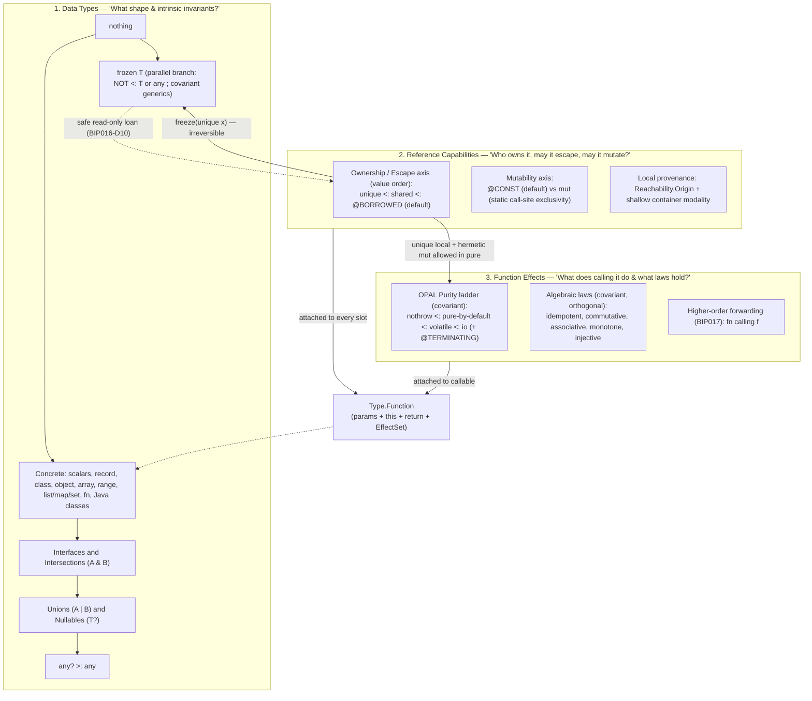
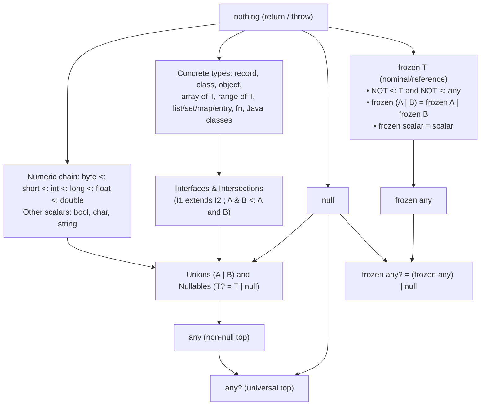
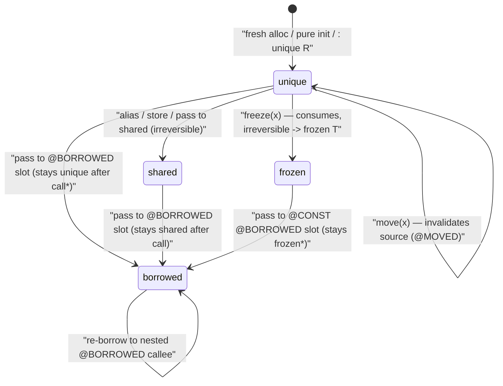
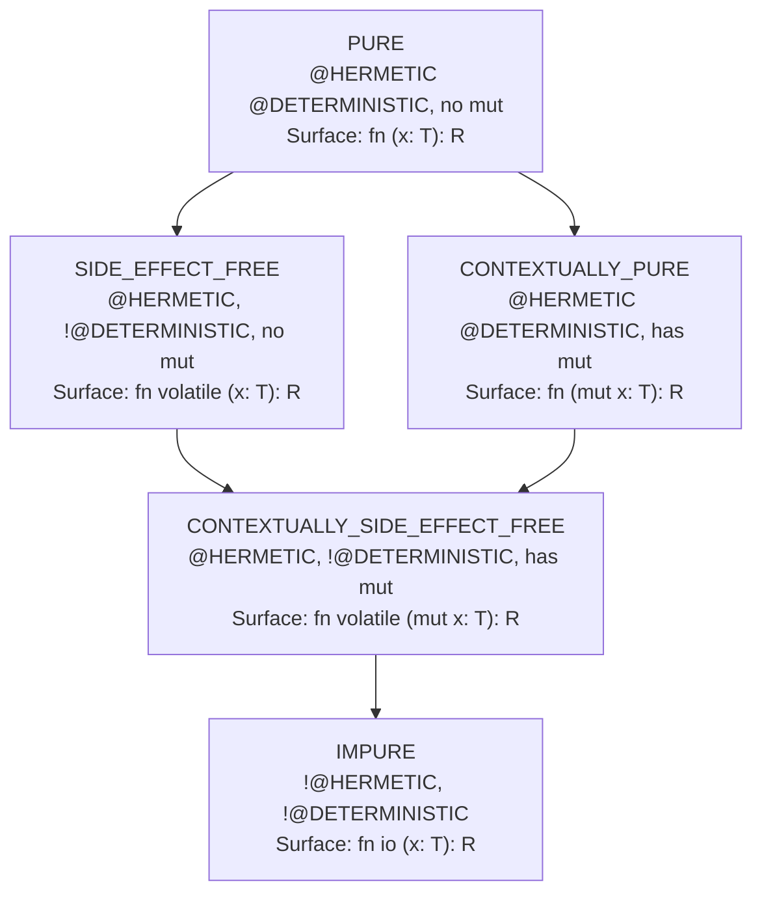
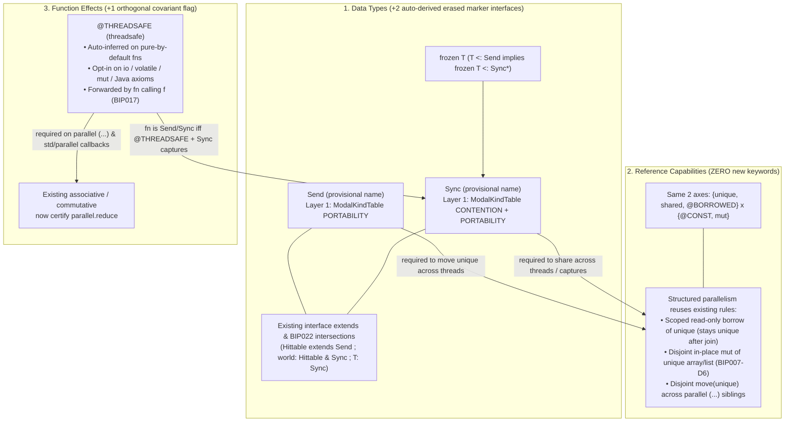

# BIP044: Babble Hierarchies — Data Types, Reference Capabilities, and Function Effects

| | |
|---|---|
| **BIP** | 044 |
| **Date** | 2026-11-28 |
| **Status** | Active (Reference — informational conceptual & terminology specification ; no code changes) |
| **Synthesizes** | Object model ([bip002_object-model.md](bip002_object-model.md)), function effects & ownership ([bip007_effects.md](bip007_effects.md)), static typing ([bip008_static-typing.md](bip008_static-typing.md)), core types & variance ([bip011_core-types.md](bip011_core-types.md)), HIR optimizations ([bip014_optimization-passes.md](bip014_optimization-passes.md)), pure-by-default effects & return-through-borrow ([bip016_consolidating-effect-annotations.md](bip016_consolidating-effect-annotations.md)), higher-order effect forwarding ([bip017_higher-order-function-effects.md](bip017_higher-order-function-effects.md)), axioms & bytecode analysis ([bip019_refactoring-axioms.md](bip019_refactoring-axioms.md), [bip030_axiom-nullability-and-inferred-effects.md](bip030_axiom-nullability-and-inferred-effects.md)), arrays, arguments, intersections & type aliases ([bip020_array-types.md](bip020_array-types.md), [bip021_optional-variadic-overloaded-arguments.md](bip021_optional-variadic-overloaded-arguments.md), [bip022_intersection-types.md](bip022_intersection-types.md), [bip023_type-aliases.md](bip023_type-aliases.md)), tail calls & `forever` ([bip024_tail-calls.md](bip024_tail-calls.md)), modular analysis & mode crossing ([bip027_tackling-complexity-in-the-compiler.md](bip027_tackling-complexity-in-the-compiler.md)), exceptions ([bip028_exception-handling.md](bip028_exception-handling.md)), ranges ([bip031_ranges.md](bip031_ranges.md)), immutable `def` & mutable `var` ([bip034_immutable-def-and-mutable-var.md](bip034_immutable-def-and-mutable-var.md)), pattern matching ([bip038_pattern-matching.md](bip038_pattern-matching.md)), `init` constructors ([bip040_constructors.md](bip040_constructors.md)), E-graph pipeline rewrites ([bip042_egraph-pipeline-rewrites.md](bip042_egraph-pipeline-rewrites.md)), and draft verified parallelism ([bip043_parallelism.md](bip043_parallelism.md)) |
| **Scope** | Authoritative terminology, subtyping & variance rules, Layer 1 vs. Layer 2 mapping, cross-hierarchy bridges, conceptual seams, and placement guidelines unifying Babble's three static hierarchies — **Data Types**, **Reference Capabilities**, and **Function Effects** — across today's implemented language (§2–§6) and the draft `BIP043` parallelism extension (§7) |

---

## 1. Executive Summary

Babble's static semantics evolved across more than fifteen focused proposals. Read individually, each proposal is crisp; read together, readers and contributors often ask how `class`/`record`/`interface`/`frozen`, `def`/`var`, `unique`/`shared`/`mut`/`@BORROWED`, and `io`/`volatile`/`nothrow`/`associative`/`calling` fit into one coherent picture.

This document establishes **one unified mental model and canonical vocabulary**:

> **Every static judgment in Babble sits in a 3-axis coordinate system:**
> $$\bigl(\,\textbf{Data Type},\;\; \textbf{Reference Capability},\;\; \textbf{Function Effect}\,\bigr)$$

1. **Hierarchy 1 — Data Types (`Type`):** *"What shape, operations, and intrinsic value invariants does this value carry?"*
2. **Hierarchy 2 — Reference Capabilities (`Type.Parameter` + `Reachability.Origin`):** *"Who owns this reference, may it escape this call frame, and may this call mutate through it?"*
3. **Hierarchy 3 — Function Effects & Algebraic Laws (`EffectSet` + `Purity`):** *"What observable impact does calling this function have on the world, and what mathematical laws does it obey?"*

All three hierarchies share one core ergonomic principle from `BIP016`: **Layer 1 (compiler lattices)** tracks fine-grained, orthogonal internal facts (`@HERMETIC`, `@DETERMINISTIC`, `@BORROWED`, `@CONST`, `@UNIQUE`, `Purity`, `Reachability.Origin`, `ModalKindTable`), while **Layer 2 (surface syntax)** defaults to the safest common case and requires keywords only to opt out (`io`, `volatile`, `mut`, `shared`) or request stronger guarantees (`unique`, `frozen`, `nothrow`, algebraic traits).



> **Reading guide:** Sections **§2–§6** describe **today's implemented Babble semantics**, grounded directly in the compiler's source files. Section **§7** is clearly demarcated and describes **how draft `BIP043` (Verified Structured Parallelism)** extends the exact same three hierarchies without adding a fourth. See also [BIP046](bip046_formal-verification-strategies.md) for a survey of formal verification strategies and tooling targeting these three hierarchies and their seven cross-hierarchy bridges.

---

## 2. Canonical Terminology & Layer 1 vs. Layer 2 Vocabulary

### 2.1 Canonical Glossary

Earlier BIPs used slightly different names for overlapping concepts ("ownership modifiers" in `BIP007`, "slot modifiers" in `BIP016`, "modal axes" in `BIP027`). `BIP044` standardizes the following terms across future documentation and diagnostics:

| Canonical Term | Definition | Distinct From |
|---|---|---|
| **Data Type** | Static classification of a value's shape, members, and intrinsic immutability (`int`, `Vec3`, `Hittable & Describable`, `frozen list of int`, `fn (...): R`). Represented by `Type`. | Reference capabilities (`unique`, `mut`, `shared`, `@BORROWED`) and function effects (`io`, `volatile`). |
| **Value Kind** | How a data type is declared or backed: core scalar (`byte`..`string`), `null`, `record`, `class`, `object`, `interface`, core collection (`list`..`entry`), `array of T`, `range of T`, `exception`, `fn`, `overload`, or Java class/interface. | Meta-types (`ClassValue`, `Module`, `JavaPackage`, `TypeAlias`) which denote declarations/namespaces rather than runtime data instances. |
| **Binding Mutability** | Whether a *variable or field slot* may be rebound via `=` (`def` = non-reassignable; `var` = reassignable, `BIP034`). | Reference mutability (`@CONST`/`mut`) and deep type immutability (`frozen T`). |
| **Reference Capability** | The **2D per-slot static capability** governing a reference in a parameter, receiver (`this`), return slot, or local expression: **Ownership/Escape** (`@UNIQUE`, `@SHARED`, `@BORROWED`) × **Mutability** (`@CONST`, `@MUTABLE`), tracked locally via `Reachability.Origin`. | Data types (`Type`) and Pony's bundled type qualifiers (see §6.2). |
| **Deep Immutability** | Intrinsic guarantee that *no mutable state is reachable anywhere* from a value (`ModalKindTable.isDeeplyImmutable`): core scalars, `null`, `frozen T`, deep `record`s, stateless `object`s, `range`s, `entry` of deeply immutable parts, and curated immutable Java types. | Binding immutability (`def`) and shallow `@CONST` read-only borrowing. |
| **Function Effect** | Behavioral and relational contract on invoking a callable (`EffectSet` / `Purity` lattice: `@HERMETIC`, `@DETERMINISTIC`, `@NOTHROW`, `@TERMINATING`, plus algebraic laws and `fn calling f` forwarding). | Reference capabilities of individual parameter/receiver slots. |
| **Axiom (`axiom`)** | An audited static trust declaration asserting a Data Type invariant (`class notnull`, `immutable`, future `send`/`sync`), Reference Capability (`mut`, `shared`, `unique`), or Function Effect (`pure`, `volatile`, `nothrow`, `associative`, ...) across a boundary the compiler cannot verify structurally (primarily Java/Wasm host interop). | Compiler-verified Babble declarations. |

### 2.2 Three Distinct Kinds of Immutability

The single most common mental-model trap in Babble is conflating **binding**, **reference**, and **deep type** immutability. They belong to three different mechanisms:

| Kind | Surface Syntax | What Is Forbidden | What Remains Allowed |
|---|---|---|---|
| **1. Binding immutability** (`BIP034`) | `def x = Box(1)` *(vs. `var x = Box(1)`)* | Reassigning `x = Box(2)` | Mutating the object `x` points to (`x.val = 2`, if `Box.val` is `var` and `x` is local/`mut`) |
| **2. Reference immutability** (Hierarchy 2) | `fn (b: Box)` *(default `@CONST`, vs. `fn (mut b: Box)`)* | Mutating `b` or calling `mut` methods on `b` *inside this callee* | The *caller* may still hold a mutable alias to the same `Box` and mutate it before/after the call |
| **3. Deep type immutability** (Hierarchy 1) | `def fb: frozen Box = freeze(Box(1))` *(or `record Vec3(x: double, y: double, z: double)`)* | Mutating *any* object reachable from `fb`, *anywhere*, *forever* (zero mutable aliases exist) | Freely sharing `fb` across fields, collections, closures, and `@CONST @BORROWED` reads |

```babble
def b = Box(1)          ;; 1. Binding is immutable (`def`), object is mutable & `unique`
b.val = 2               ;; OK : mutating `unique` local object
;; b = Box(3)           ;; ERROR : Cannot assign to immutable binding b (`def`)

def readOnly = fn (x: Box): int -> (
    ;; x.val = 9        ;; ERROR : Cannot mutate parameter x (reference is @CONST)
    x.val               ;; OK : reading through @CONST @BORROWED reference
)

def fb: frozen Box = freeze(b)  ;; 3. Deep type immutability (`b` is now @MOVED)
;; b.val                ;; ERROR : Variable b was moved/frozen
;; fb.val = 9           ;; ERROR : Cannot mutate frozen value
;; def m: Box = fb      ;; ERROR : frozen Box is NOT assignable to mutable Box
```

### 2.3 Master Layer 1 ↔ Layer 2 Translation Table

Following `BIP007` §3 and `BIP016` §6.1, internal compiler states use **`@UPPERCASE`** notation while user-facing Babble syntax is lowercase (plus TitleCase for nominal classes/interfaces and Java annotations):

| Hierarchy | Layer 2 Surface Syntax | Layer 1 Internal Representation | Default When Unwritten (Typed `fn` / `export` / `interface`) |
|---|---|---|---|
| **Data Types** | `frozen T` | `Type.Frozen` (`Type.frozen(T)`) | Unfrozen `T` |
| **Data Types** | `T?` / `T!` | `Type.Union(T, NULL)` / non-null `T` | Non-nullable `T` |
| **Data Types** | `A \| B`, `A & B` | `Type.Union`, `Type.Intersection` | — |
| **Ref. Capabilities** | *(omitted on param / `this`)* | `@CONST` + `@BORROWED` (`mut=false, borrow=true`) | `@CONST @BORROWED` *(untouched, non-escaping)* |
| **Ref. Capabilities** | `mut` *(on param or `fn mut`)* | `@MUTABLE` (`mut=true` / `mutThis=true`) | `@CONST` (`mut=false`) |
| **Ref. Capabilities** | `shared` *(on param or `fn shared`)* | `@SHARED` (`explicitShared=true, borrow=false`) | `@BORROWED` (`borrow=true`) |
| **Ref. Capabilities** | `unique` *(on param or `: unique R`)* | `@UNIQUE` (`unique=true` / `uniqueResult=true`) | `@BORROWED` (param) / non-unique (return) |
| **Ref. Capabilities** | `move(x)` / `freeze(x)` | Kill effect → `Origin.MOVED` | Auto-inferred `move` on provable last use |
| **Function Effects** | `fn (...)` *(typed)* | `@HERMETIC @DETERMINISTIC` (`Purity.PURE` or `CONTEXTUALLY_PURE`) | Pure-by-default (`@NOTHROW` & `@TERMINATING` inferred on bodies) |
| **Function Effects** | `fn volatile (...)` | `@HERMETIC`, `!@DETERMINISTIC` (`Purity.SIDE_EFFECT_FREE` / `CONTEXTUALLY_SIDE_EFFECT_FREE`) | `@DETERMINISTIC` |
| **Function Effects** | `fn io (...)` | `!@HERMETIC`, `!@DETERMINISTIC` (`Purity.IMPURE`) | `@HERMETIC @DETERMINISTIC` |
| **Function Effects** | `fn nothrow (...)` | `@NOTHROW` (`Effect.NOTHROW`) | Inferred on bodies; not required on abstract signatures |
| **Function Effects** | `idempotent`, `commutative`, `associative`, `monotone`, `injective` | `Effect.IDEMPOTENT` .. `Effect.INJECTIVE` | Absent (inferred where structurally provable) |
| **Function Effects** | `fn calling f (...)` | `Type.Function.forwardedEffectParams` / `capturedCallings` | Direct effects only |
| **Function Effects** | `forever expr` | Suppresses `@TERMINATING` check on intentional non-termination | `@TERMINATING` inferred via `SizeChangeTermination` |

*(Completely untyped inline lambdas `fn (x) -> (...)` with no effect keywords, no parameter types, and no `: R` return type infer `io`, `volatile`, `mut`, and `shared` from their body per `BIP016-D3`.)*

---

## 3. Hierarchy 1 — Data Types

Data types classify **what a value is** and **what operations exist on it**. Subtyping (`A <: B`) means any value of type `A` can be used where `B` is expected (with compile-time recorded numeric widening `int` → `double` where applicable).

### 3.1 The Data-Type Lattice



Key lattice laws:
- **Strict null safety (`BIP008`):** `null` is **not** a subtype of `any` or any reference type `T`. Only `T?` (`Union(T, NULL)`) and `any?` accept `null`.
- **Two disjoint non-null tops (`any` vs. `frozen any`):** `frozen T` is **never** assignable to plain `T`, `any`, or `any?`, and `any` is **never** assignable to `frozen T` (`BIP007-D7`). This guarantees a frozen value can never be erased into `any` and narrowed back to a mutable type.
- **Intersections (`BIP022`):** `A & B` is defined over interface types (`Type.Intersection`), normalized by flattening nested intersections, dropping `any` and duplicates, and dropping redundant supertypes (`Shape & Base` normalizes to `Shape` when `Shape extends Base`).
- **Type aliases (`BIP023`):** `def Name = type T` is 100% transparent — erased to `T` during type resolution, introducing no distinct nominal type.
- **No class inheritance (`BIP002`):** Babble `class`es and `record`s are final (cannot be subclassed); polymorphism flows strictly through `interface` inheritance (`implements` / `extends`), unions (`A | B`), and generics.

### 3.2 Variance Depends on Access Mode

Babble computes **per-type-parameter covariance** (`BIP011-D8`, `BIP032`) based on whether the container is accessed in an **owned/mutable mode** (`readOnly = false`) or a **read-only mode** (`readOnly = true`, i.e., `frozen T` or `@CONST @BORROWED` parameter):

| Generic Type | Owned / `shared` / `mut` (`readOnly = false`) | `@CONST @BORROWED` or `frozen T` (`readOnly = true`) |
|---|---|---|
| `list of T`, `set of T`, `sortedset of T`, `array of T` | **Invariant** *(prevents heap pollution)* | **Covariant** (`list of Dog <: list of Animal`) |
| `map of (K, V)`, `sortedmap of (K, V)` | **Invariant** in `K` and `V` | **Covariant** in `K` and `V` |
| `range of T`, `entry of (K, V)`, `java.util.Optional<T>` | **Covariant** *(inherently immutable)* | **Covariant** |
| Babble `record` / `class` / `interface` of `T` | **Covariant** only if *every* member/field uses `T` strictly in positive positions (no `var` fields, no `mut` or contravariant params) | **Covariant** if every `@CONST` member uses `T` strictly in positive positions (`var` writes & `mut` methods are forbidden, while contravariant non-`mut` methods still force invariance!) |

```babble
def printNames = fn (animals: list of Animal): null -> ( ... )
def dogs = list of Dog ()
printNames(dogs)     ;; OK : `animals` is @CONST @BORROWED -> read-only covariant!

def addCat = fn (mut animals: list of Animal, c: Cat): null -> ( animals.add(c); null )
;; addCat(dogs, Cat()) ;; ERROR : `mut` slot is invariant (prevents storing a Cat in `list of Dog`)
```

### 3.3 Deep Immutability via Mode Crossing

Rather than re-traversing every field of a `record` on each call, Babble classifies each `TypeNode` once using **mode crossing** (`BIP027` §3.3): a type's `ModalKind` records which modal axes its values cross and which of its type parameters (`deps`) must cross them too:
- Core scalars (`byte`..`string`), `null`, `frozen T`, `range of T`, and fieldless non-capturing `object`s cross unconditionally.
- A `record` crosses the meet (`meet`) of its field types' modal kinds (evaluated as a **greatest fixpoint** so recursive immutable records like linked lists cross cleanly).
- A Java class crosses if curated axioms mark it `immutable` and its type arguments cross.
- Any Babble `class` with `var` fields, any unfrozen mutable collection/array, any open `interface`, and `any` do **not** cross deep immutability (`ModalKind.NEVER`).

### 3.4 What Exists at Runtime vs. What Is Erased

- **Reified at runtime:** Nominal Babble `class`/`record`/`object`/`interface` tags (`ClassShape`, JVM classes/interfaces, WasmGC `$TypeDesc`), `array of T` element class (`ArraySupport`), and scalar/Java classes — usable in `x is T` and `x as T`.
- **Purely static (zero runtime tag):** `frozen T`, generic type arguments (`list of int`), and `Type.Function` effects/capabilities. Consequently, `x is frozen T` and `x is list of int` are rejected statically; narrowing `frozen any` with `x is Box` **preserves `frozen`** and narrows `x` to `frozen Box` (`BIP007-D7`).

> **Compiler realization:**
> - [`Type.java`](../../src/main/java/org/babblelang/analysis/Type.java) — sealed hierarchy of value types (`Simple`, `Union`, `Intersection`, `Array`, `Frozen`, `Function`, `Instance`, `JavaInstance`, `TypeVar`) and meta-types (`Overloaded`, `TypeAlias`, `ClassValue`, `CoreCollection`, `ArrayOfFactory`, `Module`, `JavaPackage`, `JavaClassValue`, `JavaMethod`, sentinels `ERROR`/`NOTHING`).
> - [`TypeAlgebra.java`](../../src/main/java/org/babblelang/analysis/TypeAlgebra.java) — subtyping, assignability, union/intersection normalization, `frozen` distribution, and `functionRelates`.
> - [`TypeVariance.java`](../../src/main/java/org/babblelang/analysis/TypeVariance.java) — per-parameter polarity analysis parameterized by `readOnly` (`false` vs. `true`).
> - [`ModalKindTable.java`](../../src/main/java/org/babblelang/analysis/ModalKindTable.java) — cached per-`TypeNode` mode-crossing table (`Axis.CONTENTION`, `Axis.PORTABILITY`) shared by `TypeChecker` and `EffectChecker`.

---

## 4. Hierarchy 2 — Reference Capabilities

Reference capabilities describe **how a specific binding, parameter, receiver (`this`), or return slot accesses an object graph**. They are orthogonal to the object's nominal Data Type and decompose into **two independent per-slot axes**.

### 4.1 The Two Axes: Ownership/Escape × Mutability

| Ownership \ Mutability | `@CONST` *(default — read-only)* | `mut` *(`@MUTABLE` — may write)* |
|---|---|---|
| **`@BORROWED`** *(default — frame-local loan)* | `x: T` / `fn (...)` — may read and return-through-borrow (`BIP016-D10`); cannot store past call or mutate | `mut x: T` / `fn mut (...)` — may mutate within call with static call-site exclusivity; cannot store past call |
| **`shared`** *(`@SHARED` — may escape)* | `shared x: T` / `fn shared (...)` — may retain in fields, collections, globals, or escaping closures; cannot mutate | `mut shared x: T` / `fn mut shared (...)` — may both mutate and retain past call |
| **`unique`** *(`@UNIQUE` — sole-owner transfer)* | `unique x: T` / `: unique R` — **consumes** caller's ownership via `move(x)`; callee becomes sole owner and may mutate privately even in a pure function *(making `mut` redundant as a caller contract)* | *(redundant on consuming `unique` param; `unique` return `: unique R` yields a fresh mutable sole-owned graph)* |

#### Capability Order & Subtyping Polarity

- **Value / argument capability order (what a caller holds):**
  $$\texttt{unique} \quad <:\quad \texttt{shared} \quad <:\quad \texttt{@BORROWED}$$
  - A `unique` value can satisfy any slot (`unique` via move, `shared` via irreversible demotion, or `@BORROWED` via call-scoped loan).
  - A `shared` value can satisfy `shared` or `@BORROWED`, never `unique`.
  - A `@BORROWED` value can only be re-borrowed to `@BORROWED`, never stored as `shared` or moved as `unique`.
- **Function parameter subtyping (contravariant — demanding less is a subtype):**
  $$\texttt{fn (x: T)} \quad <:\quad \texttt{fn (shared x: T)} \quad <:\quad \texttt{fn (unique x: T)}$$
  $$\texttt{fn (x: T)} \quad <:\quad \texttt{fn (mut x: T)}$$
- **Return slot subtyping (covariant — promising more is a subtype):**
  $$\texttt{fn (): unique R} \quad <:\quad \texttt{fn (): R}$$

### 4.2 Ownership Lifecycle State Machine



- *`unique --> borrowed`:* stays `unique` after a `@CONST` call and after a `hermetic mut` call whose arguments are `unique` or deeply immutable; demotes to `shared` if a `shared` reference may be stored into the graph (`BIP007-D6`) or if a non-`unique` mutable alias is returned via return-through-borrow (`BIP016-D10`).
- *`frozen --> borrowed`:* permitted only when the callee's return type cannot smuggle a non-frozen alias (§6.1 Bridge 3).
- *Locals only:* `unique` ownership is tracked exclusively on **function-local bindings not captured by any closure**. Top-level, module, static, and captured bindings are always `@EXTERNAL` (`shared`).

### 4.3 Shallow Local-Container Modality (`BIP016-D9`, `BIP027-I5`)

Storing a `@BORROWED` or `shared` element into a freshly allocated local `list` (e.g., collecting parameter references to iterate locally inside a pure function) demotes the container from deep `unique` (it can no longer be `freeze(...)`d or returned as `: unique`), **yet its outer shell has still never escaped**. Babble's **shallow modality** (`Origin.shallow`) keeps the container's own shell locally mutable inside a pure function while separately tracking the provenance (`Provenance`) of its elements — propagating element provenance on reads, deep mutations, or escapes, never confusing shell mutation with parameter mutation.

### 4.4 Two Strengths of `mut` Exclusivity (`BIP007-D9`)

1. **Plain `mut` (shallow static bug catcher):** At any call site, no two arguments (or `this`) where at least one is `mut` may statically resolve to the same object or overlapping field/collection projection (`a` overlaps `a.x`; `a.x` and `a.y` stay disjoint; `xs` overlaps `xs.get(i)`). Plain `mut` grants **permission to mutate**, *not* deep non-aliasing — two distinct wrappers `Vec(data)` and `Vec(data)` may still share `data`.
2. **`unique` (deep graph disjointness):** Because every mutable object reachable from a `unique` reference is reachable *only* through it, a `unique` graph is deeply disjoint from every other argument, `this`, captured variable, and global by construction — driving optimizer no-alias reasoning and FBIP reuse (`BIP014-I4`).

```babble
def swap = fn (mut a: Box, mut b: Box): null -> ( ... )
def x = Box(1)
def alias = x
;; swap(x, alias)   ;; ERROR : Exclusivity error — `x` and `alias` may refer to the same object
```

> **Compiler realization:**
> - [`Type.java`](../../src/main/java/org/babblelang/analysis/Type.java) (`Type.Parameter`) — stores `(mut, borrow, explicitShared, unique)` on every parameter slot; [`EffectSet.java`](../../src/main/java/org/babblelang/analysis/EffectSet.java) stores `(mutThis, borrowThis, explicitSharedThis, uniqueResult)` for the receiver and return slot.
> - [`Reachability.java`](../../src/main/java/org/babblelang/analysis/Reachability.java) — ANTLR-free `Origin`, `Provenance(params, aliasesThis, external)`, `Origin.shallow`, `Origin.MOVED`, `directKeys`, and depth-bounded ($k = 3$) `PathKey` prefix-overlap exclusivity.

---

## 5. Hierarchy 3 — Function Effects & Algebraic Laws

Function effects characterize **what executing a callable can observe or modify** and **which algebraic equivalences optimizers and callers may rely on**.

### 5.1 The OPAL 5-Point Purity Lattice

Under the hood (`BIP027-I5`), both Babble callables and Java `axiom`/bytecode profiles share a 5-point **OPAL-style `Purity` lattice** generated by three orthogonal bits — *mutates arguments* (`mut`), *reads non-deterministic external state* (`volatile`), and *non-hermetic global writes / I/O* (`io`):



- **Subtyping is covariant (upward in the diagram is stronger `<:`):**
  $$\texttt{fn nothrow ()} \; <:\; \texttt{fn ()} \; <:\; \texttt{fn volatile ()} \; <:\; \texttt{fn io ()}$$
- **Why `volatile` is separated from `io`:** Reading a clock (`Instant.now()`) or file (`Files.readString`) mutates nothing (`@HERMETIC`), so it cannot corrupt memory or alias state — yet it is **not** `@DETERMINISTIC`, so `-O1`/`-O2` must never CSE or memoize it across time.

### 5.2 Orthogonal Evaluation, Termination & Algebraic Properties

| Property | Category | Meaning | Primary Consumer |
|---|---|---|---|
| **`nothrow`** (`@NOTHROW`) | Evaluation | Guaranteed never to throw an exception on well-typed inputs (restored when caught by matching `try`/`catch`, `BIP028`). | Guard-safe hoisting (`HirLicmPass`), predicate reordering (`HirPredicateReorderPass`), dead-call elimination. |
| **`@TERMINATING`** *(inferred; `forever` opts out)* | Evaluation | Guaranteed to terminate in finite steps (Ben-Amram & Lee size-change termination `SizeChangeTermination` + finite-collection `for` certification). | Dead pure-expression elimination (`HirDcePass`) and `Unused pure expression` compile errors (`BIP007-D8`). |
| **`idempotent`** | Algebraic | Value form (`fn (T): T`): $f(f(x)) = f(x)$. Effect form (`mut`/`io` axiom): executing twice has same post-state as once. | `HirAeGraphPass` collapse (`f(f(x)) -> f(x)`), retry safety. |
| **`commutative`** | Algebraic | Value form (`fn (T, T): R`): $f(a, b) = f(b, a)$. Effect form (`mut`): $s.f(a); s.f(b) \equiv s.f(b); s.f(a)$. | Canonical operand ordering in `EGraph`, order-independent accumulation. |
| **`associative`** | Algebraic | Binary `fn (T, T): T`: $(a \oplus b) \oplus c = a \oplus (b \oplus c)$. *(Wrapping `int`/`long` `+` is associative; IEEE-754 `float`/`double` `+` is NOT unless axiomatized.)* | Pairwise loop tree reduction (`BIP042`), parallel tree reductions (`BIP043`). |
| **`monotone`** | Relational | $x \le y \implies f(x) \le f(y)$. *(Wrapping `int`/`long` `+` is NOT monotone.)* | Range clamping, early exit, whole-range pruning (`BIP042`). |
| **`injective`** | Relational | $x \ne y \implies f(x) \ne f(y)$. | Equality/comparison cancellation (`f(a) == f(b) -> a == b`), `distinct` push-down (`BIP042`). |

### 5.3 Higher-Order Effect Forwarding (`BIP017`) & Trust Boundaries (`BIP019`, `BIP030`)

- **`fn calling f`:** Higher-order functions declare `def apply = fn calling f (x: int, f: fn io (a: int): int): int -> (f(x))`. Calling `apply(1, fn (a: int) -> (a + 1))` evaluates `apply` as **pure**; calling `apply(1, fn io (a: int) -> (println(a); a))` evaluates it as **`io`** — instantiated in $O(k)$ via `SymbolicEffectSummary` bitvectors across functions, interfaces, closures (`capturedCallings`), and module boundaries.
- **Three derivation modes (`BIP007` §3.1):**
  1. **Inferred & verified** on Babble bodies (Bourdoncle WTO fixed-point + `AlgebraicVerifier` E-graph/derivative-sign domain + `SizeChangeTermination`).
  2. **Bytecode-analyzed** on closed Java methods via `BytecodeEffectAnalyzer` (conservative on `native`, mutable statics, and unverified escapes).
  3. **Curated `axiom` declarations** in [`src/main/java/org/babblelang/axioms/`](../../src/main/java/org/babblelang/axioms/README.md) (`axiom pure`, `axiom volatile`, `axiom mut`, `axiom ... associative`, `class notnull`, `T!`), keeping assumptions strictly out of compiler code (`AxiomsTestCase`).

> **Compiler realization:**
> - [`Effect.java`](../../src/main/java/org/babblelang/effects/Effect.java) — public `Effect` enum and host `@Pure`..`@IO` annotations.
> - [`EffectSet.java`](../../src/main/java/org/babblelang/analysis/EffectSet.java) — Layer 1 bitmask & flags (`@HERMETIC`, `@DETERMINISTIC`, `@NOTHROW`, `@TERMINATING`, algebraic traits, receiver/return capability flags).
> - [`Purity.java`](../../src/main/java/org/babblelang/analysis/Purity.java) — OPAL 5-point lattice shared by Babble summaries and Java call profiles.
> - [`SymbolicEffectSummary.java`](../../src/main/java/org/babblelang/analysis/SymbolicEffectSummary.java), [`AlgebraicVerifier.java`](../../src/main/java/org/babblelang/analysis/AlgebraicVerifier.java), [`SizeChangeTermination.java`](../../src/main/java/org/babblelang/analysis/SizeChangeTermination.java), [`BytecodeEffectAnalyzer.java`](../../src/main/java/org/babblelang/analysis/BytecodeEffectAnalyzer.java).

---

## 6. Cross-Hierarchy Interactions, Bridges & Conceptual Seams

### 6.1 The Seven Explicit Bridges Between Hierarchies

The three hierarchies are orthogonal by default and interact **only** through seven well-defined bridges:

#### Bridge 1 — `Type.Function` Unifies All Three Hierarchies
A function type `fn <effects> (p1, ..., pn): [unique] R` carries Data Types (`T_i`, `R`), Reference Capabilities (per-slot `mut`/`shared`/`unique`/`@BORROWED`, receiver `mutThis`/`borrowThis`, return `uniqueResult`), and Function Effects (`EffectSet` + `calling`). Subtyping `actual <: target` checks all three simultaneously:
- **Contravariant in parameters:** `target.T_i <: actual.T_i`, `actual.mut_i => target.mut_i`, and `actual` demands no stricter ownership than `target` (`@BORROWED <: shared <: unique`).
- **Covariant in return & effects:** `actual.R <: target.R`, `target.uniqueResult => actual.uniqueResult`, and `actual.EffectSet <: target.EffectSet`.

#### Bridge 2 — `freeze(unique x) -> frozen T` *(Hierarchy 2 → Hierarchy 1)*
`freeze(expr)` consumes a `unique` Reference Capability (invalidating the source binding via `@MOVED`) and transitions the value into a `frozen T` Data Type as a zero-cost runtime identity no-op. Once in Hierarchy 1, deep immutability travels across fields, collections, and returns forever.

```babble
def buildLookup = fn (): frozen map of (string, int) -> (
    def m = map of (string, int) ()   ;; `unique` (Hierarchy 2)
    m.put("a", 1)                     ;; `hermetic mut` allowed in pure fn
    freeze(m)                         ;; Bridge 2 -> `frozen map of (string, int)` (Hierarchy 1)
)
```

#### Bridge 3 — `frozen T <: @CONST @BORROWED T` + Return-Through-Borrow Gate *(Hierarchy 1 → Hierarchy 2, `BIP016-D10`)*
A `frozen T` value may be lent to any `@CONST @BORROWED T` parameter **only when the callee's return type cannot smuggle out an unfrozen mutable alias** (i.e., the return type is deeply immutable or `: unique R`).

```babble
def sum = fn (xs: list of int): int -> ( ... )
def unwrap = fn (b: Box): Box -> ( b )

def fxs: frozen list of int = freeze(list of int ())
sum(fxs)              ;; OK : `xs` is @CONST @BORROWED and return `int` is deeply immutable

def fb: frozen Box = freeze(Box(1))
;; def m: Box = unwrap(fb)  ;; REJECTED : return type `Box` could smuggle mutable alias to `fb`!
def fb2 = id(fb)            ;; OK : generic `id of T` infers `T = frozen Box` directly
```

#### Bridge 4 — `unique` + `hermetic mut` Inside Pure Functions *(Hierarchy 2 → Hierarchy 3, `BIP007-D6`)*
A pure-by-default function (`@HERMETIC @DETERMINISTIC`) forbids mutating parameters, `this`, or globals, **but allows mutating freshly allocated `unique` local objects** (and shallow local containers, §4.3) via `hermetic mut` methods (such as `list.add`, `map.put`, or `fn mut` helpers) — eliminating Haskell-style `ST` monad ceremony while remaining 100% observationally pure.

#### Bridge 5 — `@CONST @BORROWED` & `frozen` Unlock Read-Only Generic Covariance *(Hierarchy 2 → Hierarchy 1, `TypeVariance`)*
Mutable generic containers (`list of T`, `array of T`, `map of (K, V)`) are invariant under owned/`mut`/`shared` access, but become **covariant** when viewed through either a `@CONST @BORROWED` Reference Capability or a `frozen T` Data Type (§3.2).

#### Bridge 6 — Closures & Capture Semantics *(All 3 Hierarchies, `BIP016` + `BIP034`)*
- Capturing an immutable `def` local captures **by value** (`IrEffect.PURE_NOTHROW`, no `Cell` allocation) and keeps the closure pure if the captured value is deeply immutable (or only read non-mutably).
- Capturing a mutable `var` local allocates a `Cell`; reading a `var` drops `@DETERMINISTIC` (`volatile`), and writing it drops `@HERMETIC` (`io`).
- A closure that does not escape its enclosing call is a **frame-local `@BORROWED` closure** (may capture `@BORROWED` parameters); returning or storing a closure requires captured parameters/`this` to be `shared`.
- `unique` local bindings can **never** be captured by a closure (`@UNIQUE` is strictly non-escaping, single-owner).

#### Bridge 7 — Constructors (`init`, `BIP040`) & `record`s *(All 3 Hierarchies)*
`init` constructors are pure-by-default (`@HERMETIC @DETERMINISTIC`), enforce definite single assignment on all `def` fields (`ACC_FINAL` on JVM, immutable `(field T)` on WasmGC), and yield a **`unique` fresh allocation** whenever every argument stored into the new object is `unique` (moved in) or deeply immutable (`BIP007-D6`).

### 6.2 Conceptual Seams & Tensions (Candid Architectural Notes)

Documenting the clean model also means being honest about its three intentional design seams:

1. **Babble "Reference Capabilities" vs. Pony's Bundled Capabilities:**
   In Pony, reference capabilities (`iso`, `val`, `ref`, `box`, `trn`, `tag`) are **bundled type qualifiers** that simultaneously encode aliasing, local mutation, and cross-actor sending on every type. Babble deliberately **decomposes** them:
   - *Ownership/escape* (`unique`, `shared`, `@BORROWED`) and *mutability* (`@CONST`, `mut`) stay **orthogonal per-slot modifiers** (Hierarchy 2), avoiding a 6-way qualifier matrix on every type name.
   - *Deep immutability* (`frozen T`) is separated into Hierarchy 1 (§6.2 #2 below).
   - *Thread-safety* (`BIP043`) is separated into structural marker interfaces + `@THREADSAFE` (§7).
   Readers familiar with Pony should remember that Babble's "Reference Capability" refers to the *per-slot* pair `(ownership, mutability)` rather than a type constructor.
2. **Why `frozen T` Lives in Data Types (Hierarchy 1) Instead of Reference Capabilities (Hierarchy 2):**
   `unique`, `shared`, `@BORROWED`, and `mut` exist only on call signatures and local flow analysis — you cannot write a class field `def xs: unique list of int` (top-level/heap fields can be shared through their owning object). Deep immutability, by contrast, **must survive** inside fields, generic collections (`list of frozen Box`), return types, and `is` narrowing. Placing `frozen T` in Hierarchy 1 (`Type.Frozen`) gives it full compositional type power while keeping Hierarchy 2 strictly lexical and flow-sensitive.
3. **`BIP027`'s `ModalKindTable.Axis` (`CONTENTION`/`PORTABILITY`) vs. `BIP043`'s `Send`/`Sync`:**
   [`ModalKindTable.java`](../../src/main/java/org/babblelang/analysis/ModalKindTable.java) (`BIP027-I5`) already introduced two OxCaml-inspired internal modal axes — `CONTENTION` (safe shared reads) and `PORTABILITY` (safe cross-thread transfer) — alongside `Reachability.Origin`'s shallow modality. Meanwhile, draft `BIP043` exposes thread-safety at the surface as two Rust-inspired structural marker interfaces (`Send` and `Sync`, naming open in `BIP043-Q1`). As §7.2 shows, these are **not competing mechanisms**: `ModalKindTable` is the exact Layer 1 engine that implements `BIP043`'s Layer 2 structural traits!

---

## 7. How Draft `BIP043` (Parallelism) Extends the Three Hierarchies

> **Status note:** Everything in this section describes **draft, unimplemented** extensions from [bip043_parallelism.md](bip043_parallelism.md) (`BIP043-D1`–`D9`, `BIP043-Q1`–`Q6`, `BIP043-P1`–`P6`). Nothing in §7 is active in the compiler today.

A primary goal of `BIP043` is to deliver data-race-free structured parallelism **without adding a fourth hierarchy and without adding a single new reference-capability keyword**.



### 7.1 Before / After Delta Across All Three Hierarchies

| Hierarchy | Today (Implemented, §2–§6) | Delta Added by Draft `BIP043` |
|---|---|---|
| **1. Data Types** | `Type` lattice (`nothing`..`any?`, `interface` / `A & B`, `frozen T`, `ModalKindTable`) | Adds two **built-in, auto-derived, erased TitleCase marker interfaces** (`Send` and `Sync`; exact names open in `BIP043-Q1`) inside the existing interface / `BIP022` intersection lattice. Pure Babble types derive them structurally; Java classes default `!Send, !Sync` until blessed via `axiom ...: class send [sync]`. |
| **2. Reference Capabilities** | `{unique, shared, @BORROWED}` × `{@CONST, mut}` + `Reachability.Origin` | **Zero new reference-capability keywords.** Reuses `unique` + `@CONST @BORROWED` for scoped read-only borrowing across structured joins, `unique` + `BIP007-D6` alias-freedom for disjoint in-place mutation (`parallel.fill` / `mapInPlace` / `forEachMut`), and `move(...)` definite-unassignment for disjoint sibling branches in `parallel (def a = e1; def b = e2) [then (...)]`. |
| **3. Function Effects** | `Purity` (`nothrow`..`io`), `@TERMINATING`, 5 algebraic laws, `fn calling f` | Adds one covariant effect flag **`@THREADSAFE` (`threadsafe`)**: auto-inferred on pure-by-default Babble functions (when captures are `Sync` / disjoint moved `unique` `Send` and callees are `@THREADSAFE`), opt-in on `io`/`volatile`/`mut`/Java axioms, and forwarded by `fn calling f`. Existing `associative`/`commutative` certify `parallel.reduce`. |

### 7.2 Unifying `ModalKindTable.Axis` (`BIP027`) with `BIP043` (`Send` / `Sync`)

`BIP027` already built the Layer 1 mode-crossing engine needed by `BIP043` inside [`ModalKindTable.java`](../../src/main/java/org/babblelang/analysis/ModalKindTable.java):

| `BIP043` Surface Trait | `ModalKindTable` Layer 1 Equivalent | Pure Babble Derivation | Java Interop (`axiom`) |
|---|---|---|---|
| **`Send`** *(safe to move ownership across threads)* | **`Axis.PORTABILITY`** *(crosses threads when exclusively owned)* | Every field type crosses `PORTABILITY` (even if the class has `var` fields, e.g. `Rng`, `list of int`) | Conservative `false` unless `axiom ...: class send` |
| **`Sync`** *(safe to share concurrently across threads)* | **`Axis.CONTENTION` ∧ `Axis.PORTABILITY`** *(safe concurrent access)* | No `var` fields and every field crosses `CONTENTION ∧ PORTABILITY` — OR `frozen T` where `T` crosses `PORTABILITY` *(with Java method calls on `frozen T` still checking `@THREADSAFE`)* | Conservative `false` unless `axiom ...: class send sync` (e.g. `AtomicInteger`, `ConcurrentHashMap`) |

Separating `PORTABILITY` (`Send`) from `CONTENTION` (`Sync`) in `ModalKindTable` handles the exact two Java-interop cases that pure immutability alone cannot express:
- **Thread-affine host objects** (`ThreadLocal`, lock guards): `!PORTABILITY` (`!Send`) — rejected from crossing threads even when `unique` or `frozen`.
- **Synchronized interior mutability** (`AtomicInteger`, `ConcurrentHashMap`): `PORTABILITY ∧ CONTENTION` (`Send & Sync`) — allowed to be shared across threads and mutated concurrently via `axiom mut threadsafe` methods, even though they are *not* deeply immutable!

---

## 8. Placement Guide for Future BIPs

When designing a new language feature or static guarantee, use this decision table to place it in the right hierarchy (and avoid duplicating concepts across hierarchies):

| Question About the New Static Property | Target Hierarchy | Compiler Home | Examples |
|---|---|---|---|
| Does it describe **what a value is** and must it **survive fields, collections, returns, and generics**? | **Hierarchy 1 — Data Types** | `Type`, `TypeAlgebra`, `TypeVariance`, `ModalKindTable` | `range of T` (`BIP031`), `frozen T` (`BIP007`), `A & B` (`BIP022`), `tensor of (DType, ...)` (`BIP033`), `Send`/`Sync` (`BIP043`) |
| Does it describe **aliasing, lifetime/escape, or write permission of a specific binding or call-site slot**? | **Hierarchy 2 — Reference Capabilities** | `Type.Parameter`, `Reachability` (`Origin`, `Provenance`, `PathKey`) | `unique`, `shared`, `@BORROWED`, `mut`, `move`, shallow local container modality, scoped `unique` borrowing (`BIP043`) |
| Does it describe **what invoking a callable does** (side effects, non-determinism, exceptions, termination, thread-safety) or an **algebraic law**? | **Hierarchy 3 — Function Effects** | `Effect`, `EffectSet`, `Purity`, `SymbolicEffectSummary`, `AlgebraicVerifier`, `SizeChangeTermination` | `io`, `volatile`, `nothrow`, `@TERMINATING`, `associative`/`monotone`/`injective`, `fn calling f`, `@THREADSAFE` (`BIP043`) |
| Is it about **whether a variable/field name may be reassigned** (`=`)? | **Binding discipline** *(orthogonal to all 3)* | `BlockScopes`, `FieldInitAnalysis`, `HirNameInitAnalysis` | `def` vs. `var` (`BIP034`), definite single assignment in `init` (`BIP040`), `lazy def` / `scoped def` (`BIP018`) |
