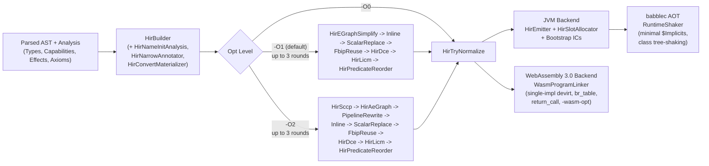

# BIP045: The Optimization Zoo

| | |
|---|---|
| **BIP** | 045 |
| **Date** | 2026-11-28 |
| **Status** | Active (Reference — informational optimization catalogue ; no code changes) |
| **Synthesizes** | Bytecode compiler ([bip001_bytecode-compiler.md](bip001_bytecode-compiler.md)), AOT & tree-shaking ([bip006_module-sources-and-aot.md](bip006_module-sources-and-aot.md)), effects & ownership ([bip007_effects.md](bip007_effects.md), [bip016_consolidating-effect-annotations.md](bip016_consolidating-effect-annotations.md), [bip017_higher-order-function-effects.md](bip017_higher-order-function-effects.md)), static typing & core scalars ([bip008_static-typing.md](bip008_static-typing.md), [bip011_core-types.md](bip011_core-types.md)), HIR Nanopass optimizer & SROA/FBIP ([bip014_optimization-passes.md](bip014_optimization-passes.md)), axioms ([bip019_refactoring-axioms.md](bip019_refactoring-axioms.md), [bip030_axiom-nullability-and-inferred-effects.md](bip030_axiom-nullability-and-inferred-effects.md)), arrays ([bip020_array-types.md](bip020_array-types.md)), tail calls ([bip024_tail-calls.md](bip024_tail-calls.md)), WebAssembly 3.0 ([bip025_compile-to-wasm.md](bip025_compile-to-wasm.md)), shared E-graph & algebraic verification ([bip027_tackling-complexity-in-the-compiler.md](bip027_tackling-complexity-in-the-compiler.md)), exceptions ([bip028_exception-handling.md](bip028_exception-handling.md)), ranges & floored division ([bip031_ranges.md](bip031_ranges.md)), immutable `def` & mutable `var` ([bip034_immutable-def-and-mutable-var.md](bip034_immutable-def-and-mutable-var.md)), pattern matching ([bip038_pattern-matching.md](bip038_pattern-matching.md)), unified structured HIR `-O2` ([bip039_mir-deorbitation.md](bip039_mir-deorbitation.md)), `init` constructors ([bip040_constructors.md](bip040_constructors.md)), E-graph pipeline rewrites ([bip042_egraph-pipeline-rewrites.md](bip042_egraph-pipeline-rewrites.md)), and static hierarchies ([bip044_babble-hierarchies.md](bip044_babble-hierarchies.md)) |
| **Scope** | Complete field guide to every optimization currently implemented across Babble's HIR optimizer (`-O1`, `-O2`), lowering, JVM bytecode emitter, WebAssembly 3.0 backend, and `babblec` AOT packager — demonstrated strictly at the Babble source level (no HIR, no JVM bytecode, no WAT) |

---

## 1. Executive Summary & How to Read the Zoo

Babble's compiler turns static facts from all three hierarchies of [BIP044](bip044_babble-hierarchies.md) — **Data Types**, **Reference Capabilities**, and **Function Effects** (plus binding immutability `def` vs. `var`) — into concrete performance transformations. Because those transformations were introduced across more than a dozen BIPs, this reference document gathers **every optimization implemented today** into one searchable field guide.

### Reading Convention: Babble-to-Babble Exhibits

Every exhibit in this Zoo shows a **tiny Before / After pair written in Babble**:

- **Before** is the Babble code a developer writes.
- **After** is Babble code that **behaves identically** to **Before** and shows the effect of the optimization at the Babble level — without exposing internal HIR dumps, JVM bytecode, or WebAssembly instructions.
- For pure HIR rewrites (Enclosures 1–8), **After** is the direct source-level equivalent of the optimized program.
- For representation, dispatch, and packaging optimizations (Enclosure 9), **After** illustrates the equivalent runtime work that remains after the compiler removes allocations, boxing, indirection, or unused code.
- Each exhibit also notes its **optimization level**, **target backends**, **implementing pass/source**, **required static facts**, and **soundness boundary** (when the compiler deliberately refuses to fire).

### Optimization Levels & Pipeline Architecture

Babble exposes three optimization levels via `-O0`, `-O1` (default), and `-O2` (or `-Dbabble.opt=0|1|2`), driven by [`PassManager.java`](../../src/main/java/org/babblelang/opt/PassManager.java) in a bounded fixed-point loop (up to **3 rounds**, stopping early as soon as a full round makes zero rewrites). Both JVM bytecode and WebAssembly 3.0 share the exact same structured HIR optimizer:



---

## 2. Master Zoo Directory

All **47 implemented optimizations** across **9 enclosures**:

| ID | Exhibit | Level | Targets | Pass / Component | Static Prerequisite | Source BIP |
|---|---|---|---|---|---|---|
| **Z1.1** | Scalar, Boolean, Comparison & String Constant Folding | `-O1`+ | JVM, Wasm | `HirConstFolder` | Constant operands, primitive/string types | `BIP014` |
| **Z1.2** | Zero-Divisor Throw Folding | `-O1`+ | JVM, Wasm | `HirConstFolder` | `int`/`long` `// 0` or `mod 0` | `BIP031` |
| **Z1.3** | Foldable JDK Axiom Evaluation | `-O1`+ | JVM, Wasm | `HirConstFolder` | `foldable` curated axiom (`Math.*`, `String.*`) | `BIP014`, `BIP019` |
| **Z1.4** | Single-Assignment Constant Propagation | `-O1` | JVM, Wasm | `HirEGraphSimplifyPass` | Non-reassigned, non-captured local | `BIP014` |
| **Z1.5** | Sparse Conditional Constant Propagation (SCCP) | `-O2` | JVM, Wasm | `HirSccpPass` | Non-captured locals across branches/loops/`try` | `BIP039` |
| **Z1.6** | Short-Circuit Logic Folding | `-O1`+ | JVM, Wasm | `HirConstFolder` / `HirSccpPass` | Constant LHS of `and` / `or` | `BIP014`, `BIP039` |
| **Z1.7** | Constant Branch & Dead-Loop Pruning | `-O1`+ | JVM, Wasm | `HirConstFolder` / `HirSccpPass` | Constant `if` / `while` condition | `BIP014`, `BIP039` |
| **Z1.8** | Constant `match` Folding & Guard Pruning | `-O1`+ | JVM, Wasm | `HirConstFolder` / `HirSccpPass` | Constant scrutinee or guard; pure skipped arms | `BIP038` |
| **Z2.1** | Integer Arithmetic Identities & Annihilators | `-O1`+ | JVM, Wasm | `AlgebraicRules` / `HirEGraphSimplifyPass` | Integral `int`/`long` (never IEEE-754 float) | `BIP014`, `BIP027` |
| **Z2.2** | Floored Division & Modulo Algebraic Laws | `-O1`+ | JVM, Wasm | `AlgebraicRules` / `HirEGraphSimplifyPass` | Integral `//`/`mod`; overflow guard for `(x*c)//c` | `BIP031` |
| **Z2.3** | Integer & String Associative / Commutative Reassociation | `-O1`+ | JVM, Wasm | `AlgebraicRules` (`EGraph`) | Pure `nothrow @TERMINATING` `int`/`long`/`string` | `BIP014`, `BIP027` |
| **Z2.4** | Boolean Negation, Comparison Flipping & Reflexive Equality | `-O1`+ | JVM, Wasm | `AlgebraicRules` / `HirEGraphSimplifyPass` | `bool`, primitive, or guaranteed `string` | `BIP014`, `BIP027` |
| **Z2.5** | `idempotent` Call Collapsing | `-O1`+ | JVM, Wasm | `AlgebraicRules` / `HirAeGraphPass` | Unary `pure nothrow idempotent` | `BIP007`, `BIP014`, `BIP039` |
| **Z2.6** | `injective` & `monotone` Comparison Cancellation | `-O1`+ | JVM, Wasm | `AlgebraicRules` / `HirAeGraphPass` | Unary `pure nothrow injective` (+ `monotone` for `<`..`>=`) | `BIP042` |
| **Z2.7** | Redundant Conversion, Widening, Cast & Box/Unbox Elimination | `-O1`+ | JVM, Wasm | `HirConstFolder` / `HirAeGraphPass` | Exact static primitive / boxed origins | `BIP039` |
| **Z3.1** | Dominator-Scoped GVN & Lazy CSE | `-O2` | JVM, Wasm | `HirAeGraphPass` | Pure/read-floatable, deeply immutable/scalar return | `BIP039` |
| **Z3.2** | Commutative Operand Canonicalization in GVN | `-O2` | JVM, Wasm | `HirAeGraphPass` | Commutative op or `commutative` pure call | `BIP039` |
| **Z3.3** | Alias-Partitioned Store-to-Load Forwarding (RLE) | `-O2` | JVM, Wasm | `HirAeGraphPass` | Dominating field store with disjoint alias classes | `BIP014`, `BIP039` |
| **Z4.1** | Backward-Liveness Dead-Store & Dead-Accumulator Elimination | `-O1`+ | JVM, Wasm | `HirDcePass` (`HirLiveness`) | Non-captured local dead after write; pure RHS | `BIP014`, `BIP039` |
| **Z4.2** | Unused Pure Expression & `discard(...)` Elimination | `-O1`+ | JVM, Wasm | `HirDcePass` | `pure nothrow @TERMINATING` expression | `BIP007`, `BIP014`, `BIP031` |
| **Z4.3** | Unreachable Code Truncation | `-O1`+ | JVM, Wasm | `HirDcePass` / `HirSccpPass` | Statement following `return`/`break`/`continue`/`throw` | `BIP014`, `BIP028` |
| **Z4.4** | Dead `catch` Elimination on `nothrow` `try` Blocks | `-O1`+ | JVM, Wasm | `HirDcePass` | Pure `nothrow @TERMINATING` `try` body | `BIP028` |
| **Z5.1** | Small Free-Function & Class/Record Method Inlining | `-O1`+ | JVM, Wasm | `InlinePass` | `<= 35` HIR nodes, non-recursive, capture-free, non-`io` | `BIP014` |
| **Z5.2** | AOT Cross-Module Function & `fastRecord` Method Inlining | `babblec -O1`+ | JVM AOT | `InlinePass` | Exported `pure nothrow @TERMINATING`, `<= 25` nodes | `BIP014` |
| **Z5.3** | `borrow`-Lambda Devirtualization & Closure Elimination | `-O1`+ | JVM, Wasm | `InlinePass` | `@BORROWED` fn param + capture-free lambda literal | `BIP014`, `BIP016` |
| **Z6.1** | `record` Projection Beta-Reduction | `-O1`+ | JVM, Wasm | `ScalarReplacePass` (`RecordBetaReducer`) | `fastRecord` constructor + direct field read | `BIP014` |
| **Z6.2** | `match` Record Destructuring SROA | `-O1`+ | JVM, Wasm | `ScalarReplacePass` (`RecordBetaReducer`) | `match` on `RecordNew` or scalarized local `record` | `BIP038` |
| **Z6.3** | Non-Escaping Local `record` Scalarization (SROA) | `-O1`+ | JVM, Wasm | `ScalarReplacePass` | Non-captured, non-escaping local `record` variable | `BIP014` |
| **Z6.4** | Flattened `$unboxed` Entry Points for `borrow` `record` Params | `-O1`+ | JVM, Wasm | `ScalarReplacePass` (`UnboxedBorrowSpecializer`) | `@BORROWED` `record` param read only via fields | `BIP014` |
| **Z6.5** | FBIP Collection Reuse (`unique` + `move`) | `-O1`+ | JVM, Wasm | `FbipReusePass` | `unique`, non-frozen `list`/`set`/`map` + `move` | `BIP007`, `BIP014` |
| **Z6.6** | FBIP In-Place Mutable `record` Reuse | `-O1`+ | JVM | `FbipReusePass` | `unique` non-deeply-immutable `record` param in tail | `BIP007`, `BIP014` |
| **Z7.1** | Alias-Aware Loop-Invariant Code Motion (LICM) | `-O1`+ | JVM, Wasm | `HirLicmPass` | Loop-invariant `pure` / un-clobbered `read`, no guard cross | `BIP014`, `BIP039` |
| **Z7.2** | Narrowing-Safe Pure Predicate Reordering | `-O1`+ | JVM, Wasm | `HirPredicateReorderPass` | `pure nothrow @TERMINATING`, zero narrowing crossing | `BIP014`, `BIP039` |
| **Z8.1** | Multi-Stage Stream Fusion (`R1`) | `-O2` | JVM, Wasm | `PipelineRewritePass` (`PipelineRules`) | Non-escaping local `list()`, pure producer, alias-disjoint | `BIP042` |
| **Z8.2** | Guard-Safe Filter Fusion & Cost-Guided Reordering (`R2`/`R3`) | `-O2` | JVM, Wasm | `PipelineRewritePass` (`PipelineRules`) | Pure non-narrowing predicates in lifted pipeline | `BIP042` |
| **Z8.3** | Map–Filter Push-Down (`R4`) | `-O2` | JVM, Wasm | `PipelineRewritePass` (`PipelineRules`) | Binder-independent pred, or `monotone`/`injective` map | `BIP042` |
| **Z8.4** | `injective` `distinct` Push-Down (`R5`) | `-O2` | JVM, Wasm | `PipelineRewritePass` (`PipelineRules`) | Local `set()` dedup after unary `injective` map | `BIP042` |
| **Z8.5** | Counted-Range Bound Clamping (`R6`) | `-O2` | JVM, Wasm | `PipelineRewritePass` (`PipelineRules`) | Ascending integral `lo..hi`/`lo..<hi` + bound filter | `BIP042` |
| **Z8.6** | `monotone` Range Early-Exit & O(1) Whole-Range Skip (`R7`) | `-O2` | JVM, Wasm | `PipelineRewritePass` (`PipelineRules`) | Integral range + unary `monotone` order filter | `BIP042` |
| **Z8.7** | `associative` Pairwise Loop Tree Reduction (`R8`) | `-O2` | JVM, Wasm | `PipelineRewritePass` (`PipelineRules`) | Ascending integral range + `associative` binary fold | `BIP042` |
| **Z9.1** | Unboxed Primitive Lowering & `$spec` Entry Points | `-O0`+ | JVM, Wasm | `HirBuilder` / `HirEmitter` / `WasmFuncEmitter` | Non-nullable core scalar types (`byte`..`char`) | `BIP001`, `BIP011` |
| **Z9.2** | Allocation-Free Counted Range Loops & Range Deforestation | `-O0`+ / `-O1`+ | JVM, Wasm | `HirBuilder` / `LoopEmitter` / `HirConstFolder` | Inline `lo..hi`/`lo..<hi` (with `.step`/`.reversed`) | `BIP031` |
| **Z9.3** | Power-of-Two & Non-Negative `mod` / `//` Strength Reduction | `-O0`+ | JVM, Wasm | `JvmOpEmitter` / `LoopEmitter` / `WasmCoreEmitter` | Positive power-of-two divisor or non-negative dividend | `BIP031` |
| **Z9.4** | Constant-Space Self Tail-Call Elimination (TCE) | `-O0`+ | JVM, Wasm, Interp | `TailCalls` / `CallEmitter` / `WasmCallEmitter` | Self-recursive call in strict tail position | `BIP024` |
| **Z9.5** | Immutable `def` Value Capture, `ACC_FINAL` & TDZ-Free Reads | `-O0`+ / `-O1`+ | JVM, Wasm | `HirNameInitAnalysis` / `ClassGen` / `Bootstrap` / Wasm | `def` immutability + definite initialization | `BIP034`, `BIP040` |
| **Z9.6** | Static Dispatch, `fastRecord`, Jump Tables, Devirt & ICs | `-O0`+ | JVM, Wasm | `HirEmitter` / `MatchEmitter` / `WasmMemberEmitter` / `Bootstrap` | Static target / `>= 3` const arms / closed-world Wasm | `BIP001`, `BIP025`, `BIP038` |
| **Z9.7** | Live-Range Slot Coloring, Dead-Result Suppression & AOT Tree-Shaking | `-O0`+ / `-O1`+ / `babblec` | JVM, Wasm | `HirSlotAllocator` / `ControlAndOpEmitter` / `RuntimeShaker` | Liveness, statement position, static imports | `BIP006`, `BIP025`, `BIP039` |

---

## 3. Enclosure 1 — Constant Evaluation & Control-Flow Pruning

### Z1.1 — Scalar, Boolean, Comparison & String Constant Folding
*Level: `-O1`, `-O2` | Targets: JVM, Wasm | Pass: [`HirConstFolder.java`](../../src/main/java/org/babblelang/opt/hir/HirConstFolder.java)*

Evaluates compile-time constant unary operations (`-`, `not`), numeric binary operations (`+`, `-`, `*`, `/`, `//`, `mod`), primitive comparisons, and string concatenations (up to 4,096 characters).

**Before**
```babble
def area = 2 * 3 + 4 * 5
def ok = not (10 < 3)
def msg = "hello" + ", " + "babble"
```

**After**
```babble
def area = 26
def ok = true
def msg = "hello, babble"
```

> *Soundness boundary:* String folding caps length at `EGraph.MAX_FOLDED_STRING_LENGTH` to prevent compile-time memory blowup; expressions carrying a runtime type check (`as`) are left intact.

---

### Z1.2 — Zero-Divisor Throw Folding
*Level: `-O1`, `-O2` | Targets: JVM, Wasm | Pass: [`HirConstFolder.java`](../../src/main/java/org/babblelang/opt/hir/HirConstFolder.java)*

Folds integer floored division or modulo by constant `0` directly into an explicit `throw`, dropping a pure dividend or preserving an impure dividend's side effects before throwing.

**Before**
```babble
def bad = fn (x: int): int -> (
    (x + 1) // 0
)
```

**After**
```babble
def bad = fn (x: int): int -> (
    throw java.lang.ArithmeticException("/ by zero")
)
```

> *Soundness boundary:* If the dividend has side effects (e.g., `sideEffect() mod 0`), the dividend is still evaluated first before throwing.

---

### Z1.3 — Foldable JDK Axiom Evaluation
*Level: `-O1`, `-O2` | Targets: JVM, Wasm | Pass: [`HirConstFolder.java`](../../src/main/java/org/babblelang/opt/hir/HirConstFolder.java) + [`curated.ba`](../../src/main/java/org/babblelang/axioms/java/lang/curated.ba)*

Evaluates whitelisted `foldable` pure deterministic JDK methods (`java.lang.Math.*` numeric functions and 0-argument `string` methods `.length()`, `.isEmpty()`, `.trim()`) at compile time when all arguments are constants.

**Before**
```babble
def hyp = java.lang.Math.sqrt(9.0) + java.lang.Math.abs(-4.0)
def trimmed = "  babble  ".trim()
def len = "babble".length()
```

**After**
```babble
def hyp = 7.0
def trimmed = "babble"
def len = 6
```

> *Soundness boundary:* Only methods explicitly annotated `foldable` in `src/main/java/org/babblelang/axioms/` are folded — never arbitrary Java reflection calls.

---

### Z1.4 — Single-Assignment Constant Propagation
*Level: `-O1` | Targets: JVM, Wasm | Pass: [`HirEGraphSimplifyPass.java`](../../src/main/java/org/babblelang/opt/hir/HirEGraphSimplifyPass.java)*

Propagates any non-reassigned, non-captured local constant into every downstream read, unlocking further folding and dead-store removal.

**Before**
```babble
def scale = fn (x: int): int -> (
    def factor = 10
    def offset = factor + 5
    x * offset
)
```

**After**
```babble
def scale = fn (x: int): int -> (
    x * 15
)
```

> *Soundness boundary:* At `-O1`, any variable reassigned anywhere in the function body (`var`) or captured by a closure is excluded. Use `-O2` (Z1.5) for flow-sensitive propagation across `var` reassignments.

---

### Z1.5 — Sparse Conditional Constant Propagation (SCCP)
*Level: `-O2` | Targets: JVM, Wasm | Pass: [`HirSccpPass.java`](../../src/main/java/org/babblelang/opt/hir/HirSccpPass.java)*

Runs a structured 3-level lattice (`TOP` / `CONST` / `BOTTOM`) dataflow analysis across reassigned `var`s, compound assignments (`+=`, `-=`, `*=`, `//=`), `if`/`match` branches, loops (with monotonic fixed-point widening), and `try`/`catch`/`finally`. Unreachable branches never pollute the lattice, and pure `if`/`match` joins whose reachable arms produce the same constant fold to that constant.

**Before**
```babble
def compute = fn (flag: bool): int -> (
    var x = 10
    x += 5
    if x == 15 then (x = 42) else (x = -1)
    def y = if flag then (x) else (42)
    y + 1
)
```

**After**
```babble
def compute = fn (flag: bool): int -> (
    43
)
```

> *Soundness boundary:* Loop-modified variables whose backedge disagrees with their entry value widen to `BOTTOM`; `catch` and `finally` blocks invalidate variables mutated inside `try`.

---

### Z1.6 — Short-Circuit Logic Folding
*Level: `-O1`, `-O2` | Targets: JVM, Wasm | Pass: [`HirConstFolder.java`](../../src/main/java/org/babblelang/opt/hir/HirConstFolder.java), [`HirSccpPass.java`](../../src/main/java/org/babblelang/opt/hir/HirSccpPass.java)*

Simplifies `and` and `or` whenever the left operand evaluates to a known truth value — short-circuiting the right operand completely when decided, or dropping the tautological left operand when boolean.

**Before**
```babble
def guard = fn (b: bool, expensive: fn (): bool): bool -> (
    def a = false and expensive()
    def c = true or expensive()
    def d = true and b
    a or (c and d)
)
```

**After**
```babble
def guard = fn (b: bool, expensive: fn (): bool): bool -> (
    b
)
```

> *Soundness boundary:* At `-O2`, if a constant-valued left operand has side effects (e.g., `(log(); false) and expensive()`), the left operand is still executed before yielding `false`.

---

### Z1.7 — Constant Branch & Dead-Loop Pruning
*Level: `-O1`, `-O2` | Targets: JVM, Wasm | Pass: [`HirConstFolder.java`](../../src/main/java/org/babblelang/opt/hir/HirConstFolder.java), [`HirSccpPass.java`](../../src/main/java/org/babblelang/opt/hir/HirSccpPass.java)*

Eliminates dead branches of `if` with a constant condition and deletes `while` loops whose condition is statically falsy on entry.

**Before**
```babble
def choose = fn (x: int): int -> (
    def debug = false
    while debug then (x + 1)
    if debug then (x * 100) else (x + 1)
)
```

**After**
```babble
def choose = fn (x: int): int -> (
    x + 1
)
```

> *Soundness boundary:* Never deletes an `if` branch when the condition itself is impure unless the condition is evaluated first; preserves exact numeric widening on the surviving branch.

---

### Z1.8 — Constant `match` Folding & Guard Pruning
*Level: `-O1`, `-O2` | Targets: JVM, Wasm | Pass: [`HirConstFolder.java`](../../src/main/java/org/babblelang/opt/hir/HirConstFolder.java), [`HirEGraphSimplifyPass.java`](../../src/main/java/org/babblelang/opt/hir/HirEGraphSimplifyPass.java), [`HirSccpPass.java`](../../src/main/java/org/babblelang/opt/hir/HirSccpPass.java)*

Evaluates constant scrutinees against scalar, wildcard, `def` bind, `|`-or, relational (`< 10`), and constant range (`1..10`, `0..10.step(2)`) patterns to pick the matching arm directly (or trim earlier non-matching pure arms). Independently strips always-true guards (`if true`) and drops arms with always-false guards (`if false`).

**Before**
```babble
def classify = fn (x: int): string -> (
    def tag = match 4
        case 0 | 1 then ("tiny")
        case 2..10 then ("small")
        else ("large")
    match x
        case def n if false then ("never")
        case def n if true then (tag)
        else ("none")
)
```

**After**
```babble
def classify = fn (x: int): string -> (
    "small"
)
```

> *Soundness boundary:* Stops trimming non-matching arms if an earlier arm's pattern or guard could have side effects or throw.

---

## 4. Enclosure 2 — Algebraic Simplification & E-Graph Saturation

### Z2.1 — Integer Arithmetic Identities & Annihilators
*Level: `-O1`, `-O2` | Targets: JVM, Wasm | Pass: [`AlgebraicRules.java`](../../src/main/java/org/babblelang/ir/egraph/AlgebraicRules.java), [`HirEGraphSimplifyPass.java`](../../src/main/java/org/babblelang/opt/hir/HirEGraphSimplifyPass.java)*

Simplifies integral (`int` / `long`) additive identities (`x + 0`, `x - 0`), negation (`0 - x`, `--x`), self-subtraction (`x - x`), multiplicative identities (`x * 1`), and zero annihilators (`x * 0`).

**Before**
```babble
def arith = fn (x: int, y: int): int -> (
    def a = (x + 0) * 1
    def b = (y - y) + (x * 0)
    def c = -(-a)
    c + b
)
```

**After**
```babble
def arith = fn (x: int, y: int): int -> (
    x
)
```

> *Soundness boundary:* **Strictly integral only!** Never applies `x + 0.0 -> x`, `x * 0.0 -> 0.0`, or `x - x -> 0.0` to `float`/`double` because IEEE-754 `-0.0`, `NaN`, and `Infinity` violate those identities. Order-preserving identities (`x + 0`, `x * 1`, `0 - x`) also fire on potentially impure operands, whereas dropping rules (`x * 0 -> 0`, `x - x -> 0`) require `pure nothrow @TERMINATING` operands.

---

### Z2.2 — Floored Division (`//`) & Modulo (`mod`) Algebraic Laws
*Level: `-O1`, `-O2` | Targets: JVM, Wasm | Pass: [`AlgebraicRules.java`](../../src/main/java/org/babblelang/ir/egraph/AlgebraicRules.java), [`HirEGraphSimplifyPass.java`](../../src/main/java/org/babblelang/opt/hir/HirEGraphSimplifyPass.java)*

Applies exact algebraic laws for Babble's floored `//` and `mod`: unit divisors (`x // 1 -> x`, `x // -1 -> -x`, `x mod 1 -> 0`, `x mod -1 -> 0`), non-zero-guarded self/zero cases (`0 // c -> 0`, `c // c -> 1`, `0 mod c -> 0`, `c mod c -> 0`), modulo idempotence (`(x mod b) mod b -> x mod b`), and overflow-guarded factor cancellation (`(x * c) // c -> x` when `x` has a narrower origin type like `short` in `int` or `int` in `long`).

**Before**
```babble
def mods = fn (x: int, s: short, b: int): int -> (
    def p = (x mod b) mod b
    def q = (s * 7) // 7
    def r = (x // 1) + (x mod 1)
    p + q + r
)
```

**After**
```babble
def mods = fn (x: int, s: short, b: int): int -> (
    def p = x mod b
    p + s + x
)
```

> *Soundness boundary:* `(x * c) // c -> x` fires **only** when `x * c` is provably overflow-free (for example `short * c` in `int` with `|c| <= 32767`, or `int * c` in `long`); arbitrary `int * c` could wrap mod $2^{32}$.

---

### Z2.3 — Integer & String Associative / Commutative Reassociation
*Level: `-O1`, `-O2` | Targets: JVM, Wasm | Pass: [`AlgebraicRules.java`](../../src/main/java/org/babblelang/ir/egraph/AlgebraicRules.java)*

Uses E-graph equality saturation to reassociate and commute integer `+` and `*` (folding scattered constants), and reassociates string `+` (associative, never commutative) to merge adjacent literal segments.

**Before**
```babble
def combine = fn (x: int, name: string): string -> (
    def n = (x + 3) + 4
    def m = (2 * n) * 5
    ("user" + ": ") + name + (" #" + "1")
)
```

**After**
```babble
def combine = fn (x: int, name: string): string -> (
    def n = x + 7
    def m = n * 10
    "user: " + name + " #1"
)
```

> *Soundness boundary:* Never reassociates `float`/`double` arithmetic (floating-point addition and multiplication are non-associative under IEEE-754 rounding) and never commutes string concatenation.

---

### Z2.4 — Boolean Negation, Comparison Flipping & Reflexive Equality
*Level: `-O1`, `-O2` | Targets: JVM, Wasm | Pass: [`AlgebraicRules.java`](../../src/main/java/org/babblelang/ir/egraph/AlgebraicRules.java), [`HirEGraphSimplifyPass.java`](../../src/main/java/org/babblelang/opt/hir/HirEGraphSimplifyPass.java)*

Eliminates double boolean negation (`not (not b) -> b`), pushes `not` into all six comparisons (`not (a < b) -> a >= b`), removes comparisons against boolean literals (`b == true -> b`, `b == false -> not b`), and folds reflexive equality (`x == x -> true`, `x != x -> false`) on all 8 primitives and guaranteed `string`s.

**Before**
```babble
def check = fn (a: int, b: int, x: double, flag: bool): bool -> (
    not (a < b) and (not (not flag) == true) and (x == x)
)
```

**After**
```babble
def check = fn (a: int, b: int, x: double, flag: bool): bool -> (
    (a >= b) and flag
)
```

> *Soundness boundary:* Reflexive equality holds even for `float`/`double` because Babble `==` uses `Float.compare`/`Double.compare` (`NaN == NaN` is `true` in Babble), but is **never** applied to arbitrary `any`/object references whose `equals` may be custom or impure.

---

### Z2.5 — `idempotent` Call Collapsing
*Level: `-O1`, `-O2` | Targets: JVM, Wasm | Pass: [`AlgebraicRules.java`](../../src/main/java/org/babblelang/ir/egraph/AlgebraicRules.java), [`HirEGraphSimplifyPass.java`](../../src/main/java/org/babblelang/opt/hir/HirEGraphSimplifyPass.java), [`HirAeGraphPass.java`](../../src/main/java/org/babblelang/opt/hir/HirAeGraphPass.java)*

Collapses nested applications `f(f(x)) -> f(x)` for unary `pure nothrow idempotent` Babble functions and curated Java methods (`Math.abs`, `Math.floor`, `Math.ceil`, `Math.rint`, `string.trim()`). At `-O2`, `HirAeGraphPass` collapses idempotent calls even across separate statements!

**Before**
```babble
def norm = fn idempotent (x: int): int -> (
    if x < 0 then (0) else (x)
)

def clean = fn (n: int, s: string): string -> (
    def a = norm(n)
    def b = norm(a)
    s.trim().trim() + b
)
```

**After**
```babble
def clean = fn (n: int, s: string): string -> (
    def a = norm(n)
    s.trim() + a
)
```

> *Soundness boundary:* Requires `pure nothrow @TERMINATING idempotent` (either structurally verified by `AlgebraicVerifier` on Babble functions or audited in `axioms/`).

---

### Z2.6 — `injective` & `monotone` Comparison Cancellation
*Level: `-O1`, `-O2` | Targets: JVM, Wasm | Pass: [`AlgebraicRules.java`](../../src/main/java/org/babblelang/ir/egraph/AlgebraicRules.java), [`HirAeGraphPass.java`](../../src/main/java/org/babblelang/opt/hir/HirAeGraphPass.java)*

Cancels matching unary calls on both sides of a comparison:
- `f(a) == f(b)` / `f(a) != f(b)` simplifies to `a == b` / `a != b` whenever `f` is `pure nothrow injective`.
- `f(a) <op> f(b)` (`<`, `<=`, `>`, `>=`) simplifies to `a <op> b` whenever `f` is both `monotone` and `injective`.
At `-O2`, `HirAeGraphPass` cancels even when `f(a)` and `f(b)` were bound in earlier statements!

**Before**
```babble
def score = fn axiom pure nothrow monotone injective (raw: int): double -> (
    raw * 10.0 + 5.0
)

def better = fn (a: int, b: int): bool -> (
    def sa = score(a)
    def sb = score(b)
    sa < sb
)
```

**After**
```babble
def better = fn (a: int, b: int): bool -> (
    a < b
)
```

> *Soundness boundary:* Ordering comparisons require **both** `monotone` (order-preserving) and `injective` (strictly increasing, never flat); a merely `monotone` function like `clamp(x)` can map `a < b` to `clamp(a) == clamp(b)`, so `<` is never canceled on non-injective functions.

---

### Z2.7 — Redundant Conversion, Widening, Cast & Box/Unbox Elimination
*Level: `-O1`, `-O2` | Targets: JVM, Wasm | Pass: [`HirConstFolder.java`](../../src/main/java/org/babblelang/opt/hir/HirConstFolder.java), [`HirAeGraphPass.java`](../../src/main/java/org/babblelang/opt/hir/HirAeGraphPass.java)*

Folds constant conversions/widenings, collapses lossless widening chains (`byte -> int -> double` in one step), and eliminates round-trip boxing (`unbox(box(x)) -> x`). At `-O2`, `HirAeGraphPass` also eliminates cross-statement `box(unbox(x)) -> x`, exact primitive casts `(boxedX as int) -> x`, and redundant primitive `Narrow` unpacks on freshly boxed values.

**Before**
```babble
def roundtrip = fn (x: int): int -> (
    def boxed: any = x
    def back: int = boxed as int
    back + 1
)
```

**After**
```babble
def roundtrip = fn (x: int): int -> (
    x + 1
)
```

> *Soundness boundary:* Never merges a lossy intermediate conversion (such as `int -> float -> double` or `long -> double`), where rounding through `float` changes precision.

---

## 5. Enclosure 3 — Value Numbering, CSE & Store Forwarding (`-O2`)

### Z3.1 — Dominator-Scoped Global Value Numbering (GVN) & Lazy CSE
*Level: `-O2` | Targets: JVM, Wasm | Pass: [`HirAeGraphPass.java`](../../src/main/java/org/babblelang/opt/hir/HirAeGraphPass.java)*

Tracks value numbers down the dominator tree for pure arithmetic, pure deterministic Babble/Java calls, field reads, `arr.size()`, and module export reads. When a dominated expression computes a value already computed earlier, it reuses an existing live variable (zero cost) or lazily hoists a `def $cse0 = ...` right before the first occurrence.

**Before**
```babble
def hypot2 = fn (x: double, y: double): double -> (
    def a = java.lang.Math.sqrt(x * x + y * y) + 1.0
    def b = java.lang.Math.sqrt(x * x + y * y) * 2.0
    a + b
)
```

**After**
```babble
def hypot2 = fn (x: double, y: double): double -> (
    def cse0 = java.lang.Math.sqrt(x * x + y * y)
    def a = cse0 + 1.0
    def b = cse0 * 2.0
    a + b
)
```

> *Soundness boundary:* Never merges calls that return fresh mutable objects (like `list()` or mutable class instances) because two calls must return distinct identities (`not same(list(), list())`).

---

### Z3.2 — Commutative Operand Canonicalization in GVN
*Level: `-O2` | Targets: JVM, Wasm | Pass: [`HirAeGraphPass.java`](../../src/main/java/org/babblelang/opt/hir/HirAeGraphPass.java)*

Canonicalizes operand order by value ID for commutative binary operators (`+`, `*`, `==`, `!=` — never string `+`) and `commutative` Babble/Java functions so swapped expressions receive the exact same value number.

**Before**
```babble
def mix = fn commutative (a: int, b: int): int -> (
    a * a + b * b + 1
)

def sym = fn (x: int, y: int): int -> (
    mix(x, y) + mix(y, x)
)
```

**After**
```babble
def sym = fn (x: int, y: int): int -> (
    def cse0 = mix(x, y)
    cse0 + cse0
)
```

> *Soundness boundary:* Only pure deterministic `nothrow @TERMINATING` calls marked `commutative` (verified by `AlgebraicVerifier` or curated axiom) have their arguments canonicalized.

---

### Z3.3 — Alias-Partitioned Store-to-Load Forwarding (RLE)
*Level: `-O2` | Targets: JVM, Wasm | Pass: [`HirAeGraphPass.java`](../../src/main/java/org/babblelang/opt/hir/HirAeGraphPass.java)*

Forwards a dominating store `obj.x = v` directly to subsequent dominated reads `obj.x` (on both Babble class fields and Java fields), keeping forwarded values alive across writes to **provably disjoint alias classes** (such as `frozen` objects or distinct `unique` parameters).

**Before**
```babble
def Box = class (var v: int) ()

def update = fn (unique a: Box, unique b: Box): int -> (
    a.v = 10
    b.v = 20  ;; disjoint unique param: cannot alias `a`!
    a.v + b.v
)
```

**After**
```babble
def update = fn (unique a: Box, unique b: Box): int -> (
    a.v = 10
    b.v = 20
    30
)
```

> *Soundness boundary:* Any write to a potentially aliasing `shared` class or any impure call bumps the shared memory epoch and immediately invalidates forwarded `shared` loads, while leaving `frozen` and disjoint `unique` loads intact.

---

## 6. Enclosure 4 — Dead-Code, Dead-Store & Exception Pruning

### Z4.1 — Backward-Liveness Dead-Store & Dead-Accumulator Elimination
*Level: `-O1`, `-O2` | Targets: JVM, Wasm | Pass: [`HirDcePass.java`](../../src/main/java/org/babblelang/opt/hir/HirDcePass.java) (`HirLiveness`)*

Computes backward liveness over frame-scoped functions to delete unused local `def`s, overwritten `var` assignments, and even **dead loop-carried accumulators** whose final value is never read — while keeping side-effecting right-hand sides.

**Before**
```babble
def sumOnly = fn (n: int): int -> (
    var live = 0
    var dead = 0
    for i in 0..<n then (
        live += i
        dead += i * 2
    )
    live
)
```

**After**
```babble
def sumOnly = fn (n: int): int -> (
    var live = 0
    for i in 0..<n then (
        live += i
    )
    live
)
```

> *Soundness boundary:* Dead compound assignments like `dead //= k` or `dead mod= k` are removed only when `k` is provably a non-zero constant, because division by zero must still throw.

---

### Z4.2 — Unused Pure Expression & `discard(...)` Elimination
*Level: `-O1`, `-O2` | Targets: JVM, Wasm | Pass: [`HirDcePass.java`](../../src/main/java/org/babblelang/opt/hir/HirDcePass.java)*

Drops non-final pure, `nothrow`, `@TERMINATING` expressions whose values are ignored (including unused pure `range` literals, pure `@TERMINATING` `for` loops, and pure `@TERMINATING` interface calls), and removes `discard(pureExpr)` wrappers.

**Before**
```babble
def work = fn (x: int): int -> (
    discard(x * x + 1)
    discard(0..x)
    x + 1
)
```

**After**
```babble
def work = fn (x: int): int -> (
    x + 1
)
```

> *Soundness boundary:* Never drops an expression that may throw, perform `io`, mutate state, or fail to terminate (`@TERMINATING` is required so an infinite loop is never silently deleted).

---

### Z4.3 — Unreachable Code Truncation
*Level: `-O1`, `-O2` | Targets: JVM, Wasm | Pass: [`HirDcePass.java`](../../src/main/java/org/babblelang/opt/hir/HirDcePass.java), [`HirSccpPass.java`](../../src/main/java/org/babblelang/opt/hir/HirSccpPass.java)*

Truncates dead statements immediately following an unconditional control-flow transfer (`return`, `break`, `continue`, or `throw`).

**Before**
```babble
def early = fn io (x: int): int -> (
    if x < 0 then (
        return 0
        println("unreachable")
    )
    x
)
```

**After**
```babble
def early = fn io (x: int): int -> (
    if x < 0 then (
        return 0
    )
    x
)
```

> *Soundness boundary:* Truncation applies strictly within the same sequential statement list after an unconditional jump; enclosing `finally` blocks still run as required by `BIP028`.

---

### Z4.4 — Dead `catch` Elimination on `nothrow` `try` Blocks
*Level: `-O1`, `-O2` | Targets: JVM, Wasm | Pass: [`HirDcePass.java`](../../src/main/java/org/babblelang/opt/hir/HirDcePass.java)*

When a `try` body is statically proven pure, `nothrow`, and `@TERMINATING`, no exception can ever be thrown: all `catch` clauses are deleted, and if there is no `finally`, the `try` wrapper disappears entirely.

**Before**
```babble
def safeAdd = fn (a: int, b: int): int -> (
    try (
        a + b
    ) catch e: exception then (
        -1
    )
)
```

**After**
```babble
def safeAdd = fn (a: int, b: int): int -> (
    a + b
)
```

> *Soundness boundary:* If the `try` has a non-empty `finally` block, only the dead `catch` clauses are removed while `finally` is preserved.

---

## 7. Enclosure 5 — Function Inlining & Higher-Order Specialization

### Z5.1 — Small Free-Function & Class/Record Method Inlining
*Level: `-O1`, `-O2` | Targets: JVM, Wasm | Pass: [`InlinePass.java`](../../src/main/java/org/babblelang/opt/hir/InlinePass.java)*

Inlines small (`<= 35` HIR nodes by default, tunable via `-Dbabble.inlineNodes`), non-recursive, capture-free, non-`io` free functions and compiled `record`/class methods, substituting constant or non-reassigned local arguments directly and alpha-renaming locals.

**Before**
```babble
def Vec2 = record (x: double, y: double) (
    def dot = fn (o: Vec2): double -> (this.x * o.x + this.y * o.y)
)

def norm2 = fn (v: Vec2): double -> (
    v.dot(v)
)
```

**After**
```babble
def norm2 = fn (v: Vec2): double -> (
    v.x * v.x + v.y * v.y
)
```

> *Soundness boundary:* Preserves every inlined expression's original source line number (`BIP014-D5`) for exact stack-trace parity with the interpreter; caps expansion at 32 inlines per enclosing function to prevent code bloat.

---

### Z5.2 — AOT Cross-Module Function & `fastRecord` Method Inlining
*Level: `babblec -O1`, `-O2` | Targets: JVM AOT | Pass: [`InlinePass.java`](../../src/main/java/org/babblelang/opt/hir/InlinePass.java)*

During ahead-of-time `babblec` compilation, exports self-contained small (`<= 25` HIR nodes) pure, `nothrow`, `@TERMINATING` functions and `fastRecord` methods across module boundaries so imported math libraries inline cleanly into callers.

**Before**
```babble
;; in vec2.ba:
;; export def Vec2 = record (x: double, y: double) (
;;     def dot = fn (o: Vec2): double -> ( this.x * o.x + this.y * o.y )
;; )

def vec2 = import("vec2.ba")
def len2 = fn (v: vec2.Vec2): double -> (
    v.dot(v)
)
```

**After**
```babble
def vec2 = import("vec2.ba")
def len2 = fn (v: vec2.Vec2): double -> (
    v.x * v.x + v.y * v.y
)
```

> *Soundness boundary:* Only self-contained `pure nothrow @TERMINATING` functions and `fastRecord` methods with no private/module-local references are exported for cross-module inlining, so separate compilation invariants remain intact.

---

### Z5.3 — `borrow`-Lambda Devirtualization & Closure Elimination
*Level: `-O1`, `-O2` | Targets: JVM, Wasm | Pass: [`InlinePass.java`](../../src/main/java/org/babblelang/opt/hir/InlinePass.java)*

When a higher-order function accepts a `@BORROWED` callback parameter (the default in `BIP016`) and is called with a capture-free lambda literal, inlining substitutes the lambda directly into the call site, turning an indirect closure call into a direct call that inlines on the next fixed-point round — eliminating both the closure allocation and the indirect call!

**Before**
```babble
def applyTwice = fn calling f (x: int, f: fn (int): int): int -> (
    f(f(x))
)

def quad = fn (n: int): int -> (
    applyTwice(n, fn (v: int): int -> (v * 2))
)
```

**After**
```babble
def quad = fn (n: int): int -> (
    n * 4
)
```

> *Soundness boundary:* Requires a `@BORROWED` parameter (not `shared`, which might store the closure past the call) and a capture-free lambda literal.

---

## 8. Enclosure 6 — `record` & Ownership Optimizations (SROA & FBIP)

### Z6.1 — `record` Projection Beta-Reduction
*Level: `-O1`, `-O2` | Targets: JVM, Wasm | Pass: [`RecordBetaReducer.java`](../../src/main/java/org/babblelang/opt/hir/RecordBetaReducer.java)*

Reduces immediate field projection from a freshly constructed `fastRecord` (`Pair(a, b).first -> a`) without allocating the `record` at all — often triggered right after `InlinePass` inlines a method that returns a `record`.

**Before**
```babble
def Pair = record (a: int, b: int) ()

def firstSum = fn (x: int, y: int): int -> (
    Pair(x + y, x - y).a
)
```

**After**
```babble
def firstSum = fn (x: int, y: int): int -> (
    x + y
)
```

> *Soundness boundary:* If an unselected sibling argument has side effects (e.g., `Pair(x, log()).a`), all arguments are still evaluated strictly left-to-right and the chosen field is saved in a temporary local before returning it.

---

### Z6.2 — `match` Record Destructuring SROA
*Level: `-O1`, `-O2` | Targets: JVM, Wasm | Pass: [`RecordBetaReducer.java`](../../src/main/java/org/babblelang/opt/hir/RecordBetaReducer.java), [`ScalarReplacePass.java`](../../src/main/java/org/babblelang/opt/hir/ScalarReplacePass.java)*

When `match` destructures an immediate `RecordNew` or a scalarized local `record` variable, resolves the matching arm statically and binds the field values straight into locals — zero `record` allocation and zero runtime type tests!

**Before**
```babble
def Point = record (x: int, y: int) ()

def manhattan = fn (a: int, b: int): int -> (
    match Point(a, b)
        case is Point(def x, def y) then (x + y)
)
```

**After**
```babble
def manhattan = fn (a: int, b: int): int -> (
    def x = a
    def y = b
    x + y
)
```

> *Soundness boundary:* Requires unguarded matching arm with direct field bindings or wildcards, and pure skipped earlier arms; falls back to normal `match` codegen when a guard or nested pattern needs runtime testing.

---

### Z6.3 — Non-Escaping Local `record` Scalarization (SROA)
*Level: `-O1`, `-O2` | Targets: JVM, Wasm | Pass: [`ScalarReplacePass.java`](../../src/main/java/org/babblelang/opt/hir/ScalarReplacePass.java)*

Replaces non-escaping local `record` variables — including loop-carried `var`s reassigned to fresh `record`s, copies, and `if` joins — with separate unboxed scalar locals for each field, eliminating all heap allocation inside hot loops!

**Before**
```babble
def Vec2 = record (x: double, y: double) (
    def plus = fn (o: Vec2): Vec2 -> (Vec2(this.x + o.x, this.y + o.y))
)

def walk = fn (n: int): double -> (
    var p = Vec2(0.0, 0.0)
    for i in 0..<n then (
        p = p.plus(Vec2(1.0, 2.0))
    )
    p.x + p.y
)
```

**After**
```babble
def walk = fn (n: int): double -> (
    var p_x = 0.0
    var p_y = 0.0
    for i in 0..<n then (
        p_x = p_x + 1.0
        p_y = p_y + 2.0
    )
    p_x + p_y
)
```

> *Soundness boundary:* Any use of the local other than field projection, `match` destructuring, or copying into another non-escaping local (e.g., returning it, storing it in a list, or passing it to a non-inlined, non-unboxed call) disqualifies it via fixed-point escape analysis.

---

### Z6.4 — Flattened `$unboxed` Entry Points for `borrow` `record` Parameters
*Level: `-O1`, `-O2` | Targets: JVM, Wasm | Pass: [`UnboxedBorrowSpecializer.java`](../../src/main/java/org/babblelang/opt/hir/UnboxedBorrowSpecializer.java)*

For non-inlined, capture-free functions taking `@BORROWED` `record` parameters accessed solely via field reads, synthesizes a companion `$unboxed` function accepting the record's fields as flat scalar parameters and rewrites qualifying call sites so callers never allocate a temporary `record` just to pass it!

**Before**
```babble
def Vec3 = record (x: double, y: double, z: double) ()

def heavyScore = fn (a: Vec3, b: Vec3): double -> (
    ;; Suppose this body is too large (> 35 nodes) to inline,
    ;; and only reads fields of `a` and `b`:
    a.x * b.x + a.y * b.y + a.z * b.z
)

def caller = fn (t: double): double -> (
    heavyScore(Vec3(t, t + 1.0, t + 2.0), Vec3(1.0, 2.0, 3.0))
)
```

**After**
```babble
def heavyScore_unboxed = fn (
    a_x: double, a_y: double, a_z: double,
    b_x: double, b_y: double, b_z: double
): double -> (
    a_x * b_x + a_y * b_y + a_z * b_z
)

def caller = fn (t: double): double -> (
    heavyScore_unboxed(t, t + 1.0, t + 2.0, 1.0, 2.0, 3.0)
)
```

> *Soundness boundary:* Skips recursive functions, closures with captured locals, and parameters that escape or are reassigned; respects JVM's 250-slot parameter limit.

---

### Z6.5 — FBIP Collection Reuse (`unique` + `move`)
*Level: `-O1`, `-O2` | Targets: JVM, Wasm | Pass: [`FbipReusePass.java`](../../src/main/java/org/babblelang/opt/hir/FbipReusePass.java)*

Rewrites `list(from: move(xs))`, `set(from: move(s))`, and `map(from: move(m))` on a statically `unique`, non-frozen collection into Functional-But-In-Place (FBIP) reuse — mutating the moved collection's backing storage directly instead of allocating and copying a new collection!

**Before**
```babble
def pushItem = fn (unique xs: list of int, v: int): list of int -> (
    def res = list(from: move(xs))
    res.add(v)
    res
)
```

**After**
```babble
def pushItem = fn (unique xs: list of int, v: int): list of int -> (
    ;; `xs` is proven unaliased and dead after `move(xs)`:
    ;; reuses `xs` directly in place (falling back to copy only for non-ArrayList inputs)
    xs.add(v)
    xs
)
```

> *Soundness boundary:* Never reuses `frozen` or deeply immutable inputs, and falls back dynamically to a fresh copy if the runtime instance is not an exact mutable `ArrayList` / `LinkedHashSet` / `LinkedHashMap` (e.g., `sortedmap` or `List.of()`).

---

### Z6.6 — FBIP In-Place Mutable `record` Reuse
*Level: `-O1`, `-O2` | Targets: JVM only | Pass: [`FbipReusePass.java`](../../src/main/java/org/babblelang/opt/hir/FbipReusePass.java)*

Inside a function taking a `unique` parameter `p` of a non-deeply-immutable local `fastRecord` (one containing a mutable component, where `EffectChecker` enforces strict sole ownership) that does not escape, rewrites a tail-position `R(e1, e2, ...)` construction to evaluate all field arguments and overwrite `p`'s fields in place — zero allocation!

**Before**
```babble
def Bucket = record (items: list of int, count: int) ()

def bump = fn (unique b: Bucket): Bucket -> (
    Bucket(b.items, b.count + 1)
)
```

**After**
```babble
def bump = fn (unique b: Bucket): Bucket -> (
    ;; All new field values are computed first, then written into `b`'s fields in place:
    def newItems = b.items
    def newCount = b.count + 1
    ;; (in-place reuse of `b` — zero Bucket allocation)
    Bucket(newItems, newCount)
)
```

> *Soundness boundary:* Intentionally disabled on WebAssembly 3.0 (`BIP025-D11`) so WasmGC `record` struct fields stay strictly immutable, and disabled on deeply immutable records (`record Vec3(...)`) where `EffectChecker` permits aliased callers.

---

## 9. Enclosure 7 — Loop Motion & Predicate Reordering

### Z7.1 — Alias-Aware Loop-Invariant Code Motion (LICM)
*Level: `-O1`, `-O2` | Targets: JVM, Wasm | Pass: [`HirLicmPass.java`](../../src/main/java/org/babblelang/opt/hir/HirLicmPass.java)*

Hoists loop-invariant pure calls, complex arithmetic/divisions, `arr.size()`, module exports, and alias-safe field reads (`frozen`, disjoint `unique` parameters, or un-clobbered fields) out of `while` headers, `while` bodies, and `for` bodies into a single pre-loop `def`.

**Before**
```babble
def scaleAll = fn (xs: array of double, factor: double): double -> (
    var sum = 0.0
    var i = 0
    while i < xs.size() then (
        sum += xs.get(i) * java.lang.Math.sqrt(factor)
        i += 1
    )
    sum
)
```

**After**
```babble
def scaleAll = fn (xs: array of double, factor: double): double -> (
    var sum = 0.0
    var i = 0
    def licm0 = xs.size()
    def licm1 = java.lang.Math.sqrt(factor)
    while i < licm0 then (
        sum += xs.get(i) * licm1
        i += 1
    )
    sum
)
```

> *Soundness boundary:* Never hoists fresh mutable allocations, impure or throwing calls, or reads that depend on a loop-internal narrowing guard (e.g., `if s != null then ( s.length() )` stays inside the guard).

---

### Z7.2 — Narrowing-Safe Pure Predicate Reordering
*Level: `-O1`, `-O2` | Targets: JVM, Wasm | Pass: [`HirPredicateReorderPass.java`](../../src/main/java/org/babblelang/opt/hir/HirPredicateReorderPass.java)*

Flattens `and`/`or` chains (and inspects nested pure `if` guards with identical `else` branches) and stably moves strictly cheaper `pure nothrow @TERMINATING` checks ahead of expensive ones (heuristic cost: calls = 10, field/array loads = 4, name/export reads = 3, scalar ops = 1, locals/consts = 0).

**Before**
```babble
def isHot = fn (x: int): bool -> (
    expensivePureCheck(x) and (x > 0)
)
```

**After**
```babble
def isHot = fn (x: int): bool -> (
    (x > 0) and expensivePureCheck(x)
)
```

> *Soundness boundary:* **Never** crosses a type-narrowing barrier (`s != null and s.length() > 0` or `x is Circle and x.r > 0`) or any predicate that may throw, diverge, or perform effects.

---

## 10. Enclosure 8 — E-Graph Pipeline & Algebraic Loop Rewrites (`-O2`)

All exhibits in this enclosure are driven jointly by [`PipelineRewritePass.java`](../../src/main/java/org/babblelang/opt/hir/PipelineRewritePass.java) and [`PipelineRules.java`](../../src/main/java/org/babblelang/ir/egraph/PipelineRules.java) (`R1`–`R8`) over `org.babblelang.ir.egraph`, extracting the global minimum-cost plan under a monotonic selectivity-weighted cost model and lowering back to portable structured HIR (shared by JVM and WebAssembly 3.0).

### Z8.1 — Multi-Stage Stream Fusion (`R1`)
*Level: `-O2` | Targets: JVM, Wasm | Pass: [`PipelineRewritePass.java`](../../src/main/java/org/babblelang/opt/hir/PipelineRewritePass.java)*

Fuses sequential producer–consumer `for` loops communicating through non-escaping local `list()` buffers (including multi-hop chains) into a single loop with zero intermediate list allocations!

**Before**
```babble
def sumSquares = fn (xs: list of int): int -> (
    def sq = list of int ()
    for x in xs then (sq.add(x * x))
    var total = 0
    for y in sq then (total += y)
    total
)
```

**After**
```babble
def sumSquares = fn (xs: list of int): int -> (
    var total = 0
    for x in xs then (
        def y = x * x
        total += y
    )
    total
)
```

> *Soundness boundary:* Fires only when the intermediate `list()` is fresh, non-captured, read solely by the next stage (exactly 2 total references), producer stages are pure and alias-disjoint from the consumer, and producers contain no `break`/`continue`/`return`.

---

### Z8.2 — Guard-Safe Filter Fusion & Cost-Guided Filter Reordering (`R2` / `R3`)
*Level: `-O2` | Targets: JVM, Wasm | Pass: [`PipelineRewritePass.java`](../../src/main/java/org/babblelang/opt/hir/PipelineRewritePass.java)*

Fuses adjacent `if` filters in a lifted pipeline (or splits `p and q` so parts can reorder independently) and places cheaper pure predicates ahead of expensive ones so rejected elements skip expensive tests.

**Before**
```babble
def countGood = fn (xs: list of int): int -> (
    var count = 0
    for x in xs then (
        if isExpensive(x) then (
            if x > 0 then (count += 1)
        )
    )
    count
)
```

**After**
```babble
def countGood = fn (xs: list of int): int -> (
    var count = 0
    for x in xs then (
        if x > 0 and isExpensive(x) then (
            count += 1
        )
    )
    count
)
```

> *Soundness boundary:* Filters that narrow a nullable or union variable (`if x != null then (...)`) are tagged `narrow` and never reordered across downstream predicates that rely on the narrowed type.

---

### Z8.3 — Map–Filter Push-Down (`R4`)
*Level: `-O2` | Targets: JVM, Wasm | Pass: [`PipelineRewritePass.java`](../../src/main/java/org/babblelang/opt/hir/PipelineRewritePass.java)*

Pushes a filter **above** a `def y = mapExpr` stage whenever either:
- **Case 4a:** the filter predicate does not depend on `y` (e.g., it tests `x`), or
- **Case 4b:** `y = f(x)` is a unary `monotone`/`injective` call and the filter compares `y` against a loop-invariant threshold (which then composes with Z2.6 comparison cancellation!).

**Before**
```babble
def encode = fn axiom pure nothrow monotone injective (x: int): double -> (
    x * 10.0 + 5.0
)

def sumHigh = fn (xs: list of int, threshold: int): double -> (
    var total = 0.0
    for x in xs then (
        def y = encode(x)
        if y > encode(threshold) then (total += y)
    )
    total
)
```

**After**
```babble
def sumHigh = fn (xs: list of int, threshold: int): double -> (
    var total = 0.0
    for x in xs then (
        if x > threshold then (
            def y = encode(x)
            total += y
        )
    )
    total
)
```

> *Soundness boundary:* Skips Case 4b when the filter is a narrowing guard or when `f` is not pure, `nothrow`, and `monotone`/`injective`.

---

### Z8.4 — `injective` `distinct` Push-Down (`R5`)
*Level: `-O2` | Targets: JVM, Wasm | Pass: [`PipelineRewritePass.java`](../../src/main/java/org/babblelang/opt/hir/PipelineRewritePass.java)*

When a pipeline maps through a unary `injective` function `f` and then deduplicates via a fresh local `set()`, pushes deduplication **before** `f` so `f(x)` is never evaluated twice for duplicate inputs!

**Before**
```babble
def tag = fn injective (x: int): string -> (
    "id:" + x
)

def uniqueTags = fn (xs: list of int): list of string -> (
    def seen = set of string ()
    def out = list of string ()
    for x in xs then (
        def y = tag(x)
        if seen.add(y) then (out.add(y))
    )
    out
)
```

**After**
```babble
def uniqueTags = fn (xs: list of int): list of string -> (
    def seen = set of int ()
    def out = list of string ()
    for x in xs then (
        if seen.add(x) then (
            def y = tag(x)
            out.add(y)
        )
    )
    out
)
```

> *Soundness boundary:* Requires `f` to be `injective` (so `f(a) == f(b)` iff `a == b`), `seen` to be a fresh non-escaping local `set()`, and the input element type to have reflexive equality (primitives or `string`).

---

### Z8.5 — Counted-Range Bound Clamping (`R6`)
*Level: `-O2` | Targets: JVM, Wasm | Pass: [`PipelineRewritePass.java`](../../src/main/java/org/babblelang/opt/hir/PipelineRewritePass.java)*

Folds lower- and upper-bound filters (`x >= a`, `x > a`, `x <= b`, `x < b`, including conjunctions) straight into the bounds of an ascending integral `for x in lo..hi` or `lo..<hi` loop — eliminating both the wasted iterations and the per-iteration branch!

**Before**
```babble
def sumWindow = fn (lo: int, hi: int, ub: int): int -> (
    var acc = 0
    for x in lo..hi then (
        if x >= 2 and x <= ub then (acc += x)
    )
    acc
)
```

**After**
```babble
def sumWindow = fn (lo: int, hi: int, ub: int): int -> (
    var acc = 0
    def clampedLo = if lo < 2 then (2) else (lo)
    def clampedHi = if hi < ub then (hi) else (ub)
    for x in clampedLo..clampedHi then (
        acc += x
    )
    acc
)
```

> *Soundness boundary:* Strict bounds that require ±1 adjustment (`x > c` on `..` or `x <= c` on `..<`) fire only for constant `c` strictly away from `MIN_VALUE`/`MAX_VALUE` so bound adjustment can never overflow.

---

### Z8.6 — `monotone` Range Early-Exit & $O(1)$ Whole-Range Skip (`R7`)
*Level: `-O2` | Targets: JVM, Wasm | Pass: [`PipelineRewritePass.java`](../../src/main/java/org/babblelang/opt/hir/PipelineRewritePass.java)*

Exploits monotonicity on integral counted-range loops in two complementary ways:
- **Early exit:** on an ascending range with `f(x) <= limit` (or `<`), once `f(x)` exceeds `limit` no later element can ever match — so the loop `break`s immediately! *(Symmetrically for descending ranges with `>=` / `>`.)*
- **$O(1)$ whole-range skip:** on an ascending inclusive range `lo..hi` with `f(x) >= limit` (or `>`), checks `lo <= hi and f(hi) >= limit` once before entering the loop — skipping the entire range in one call when even the maximum endpoint `f(hi)` falls short!

**Before**
```babble
def clampPos = fn monotone (x: int): int -> (
    if x < 0 then (0) else (x)
)

def sumPrefix = fn (n: int, lim: int): int -> (
    var acc = 0
    for x in 0..n then (
        if clampPos(x) <= lim then (acc += x)
    )
    acc
)

def sumSuffix = fn (lo: int, hi: int, lim: int): int -> (
    var acc = 0
    for x in lo..hi then (
        if clampPos(x) >= lim then (acc += x)
    )
    acc
)
```

**After**
```babble
def sumPrefix = fn (n: int, lim: int): int -> (
    var acc = 0
    for x in 0..n then (
        if clampPos(x) <= lim then (acc += x) else (break)
    )
    acc
)

def sumSuffix = fn (lo: int, hi: int, lim: int): int -> (
    var acc = 0
    def lo0 = lo
    def hi0 = hi
    if lo0 <= hi0 and clampPos(hi0) >= lim then (
        for x in lo0..hi0 then (
            if clampPos(x) >= lim then (acc += x)
        )
    )
    acc
)
```

> *Soundness boundary:* Requires `f` to be `pure nothrow @TERMINATING monotone`, the bound `lim` to be loop-invariant, and the range to be unit-step integral.

---

### Z8.7 — `associative` Pairwise Loop Tree Reduction (`R8`)
*Level: `-O2` | Targets: JVM, Wasm | Pass: [`PipelineRewritePass.java`](../../src/main/java/org/babblelang/opt/hir/PipelineRewritePass.java)*

Rewrites a counted-range fold `acc = op(acc, elem(i))` with a proven `associative` binary operator into a 2× unrolled pairwise tree reduction `acc = op(acc, op(elem(i), elem(i + 1)))` plus an overflow-free epilogue — halving the loop-carried dependency chain without requiring `op` to be commutative!

**Before**
```babble
def combineMax = fn associative (a: int, b: int): int -> (
    if a > b then (a) else (b)
)

def maxInRange = fn (lo: int, hi: int): int -> (
    var acc = lo
    for i in lo..<hi then (
        acc = combineMax(acc, i * 3 + 1)
    )
    acc
)
```

**After**
```babble
def maxInRange = fn (lo: int, hi: int): int -> (
    var acc = lo
    def lo0 = lo
    def hi0 = hi
    var idx = lo0
    while idx < hi0 and idx < hi0 - 1 then (
        acc = combineMax(acc, combineMax(idx * 3 + 1, (idx + 1) * 3 + 1))
        idx = idx + 2
    )
    if idx < hi0 then (
        acc = combineMax(acc, idx * 3 + 1)
    )
    acc
)
```

> *Soundness boundary:* Only requires `associative` (order of elements is strictly preserved, so non-commutative associative operations like `firstNonZero` or matrix multiplication stay exact), and guards `$i < $hi - 1` so `$i + 1` and `$i + 2` never overflow even near `Integer.MAX_VALUE`.

---

## 11. Enclosure 9 — Representation, Lowering & Backend Optimizations

Unlike Enclosures 1–8 (which rewrite HIR trees), the exhibits below happen during **lowering (`HirBuilder`)**, **code generation (`HirEmitter`, `Wasm*`)**, **runtime inline caching (`Bootstrap`)**, or **AOT packaging (`RuntimeShaker`)**. Most are active even at `-O0`! The **After** snippets show the equivalent Babble-level work that actually executes.

### Z9.1 — Unboxed Primitive Lowering & `$spec` Specialized Entry Points
*Level: `-O0`, `-O1`, `-O2` | Targets: JVM, Wasm | Component: [`HirBuilder.java`](../../src/main/java/org/babblelang/ir/hir/HirBuilder.java), [`HirEmitter.java`](../../src/main/java/org/babblelang/compiler/HirEmitter.java), [`WasmFuncEmitter.java`](../../src/main/java/org/babblelang/wasm/WasmFuncEmitter.java)*

Every non-nullable core scalar (`byte`, `short`, `int`, `long`, `float`, `double`, `bool`, `char`) stays strictly unboxed across locals, fields, `array of T`, closure cells (`IntCell`..`CharCell`), arithmetic, comparisons, and direct calls via specialized `$spec` entry points.

**Before**
```babble
;; Written with static scalar types:
def lerp = fn (a: double, b: double, t: double): double -> (
    a + (b - a) * t
)
def mid = lerp(1.0, 5.0, 0.5)
```

**After**
```babble
;; Executes directly on raw unboxed doubles from call site to return:
;; zero Double wrapper allocation, zero Object[] argument array, zero runtime type check
def mid = lerp(1.0, 5.0, 0.5)
```

> *Soundness boundary:* Boxing occurs only when a scalar crosses into a nullable (`int?`), union (`int | string`), `any`, or generic Java `Object` slot (`list of int` on JVM).

---

### Z9.2 — Allocation-Free Counted Range Loops & Inline Range Deforestation
*Level: `-O0`+ (counted loops), `-O1`+ (`.contains`/accessors) | Targets: JVM, Wasm | Component: [`HirBuilder.java`](../../src/main/java/org/babblelang/ir/hir/HirBuilder.java), [`LoopEmitter.java`](../../src/main/java/org/babblelang/compiler/LoopEmitter.java), [`HirConstFolder.java`](../../src/main/java/org/babblelang/opt/hir/HirConstFolder.java)*

Two cooperative range optimizations eliminate `Range` and `Iterator` objects completely:
1. `for i in lo..hi` / `lo..<hi` (including `.step(k)` and `.reversed()`) lowers directly to an unboxed primitive counter loop.
2. At `-O1`+, `(lo..hi).contains(x)` (including `.reversed()` and constant `.step(k)`), `.start()`, `.end()`, `.inclusive()`, and `.isEmpty()` deforest into inline scalar comparisons!

**Before**
```babble
def countEven = fn (n: int): int -> (
    var count = 0
    for i in 0..<n then (
        if (0..100).step(2).contains(i) then (count += 1)
    )
    count
)
```

**After**
```babble
def countEven = fn (n: int): int -> (
    var count = 0
    var i = 0
    while i < n then (
        if 0 <= i and i <= 100 and (i - 0) mod 2 == 0 then (count += 1)
        i += 1
    )
    count
)
```

> *Soundness boundary:* `.contains(x)` deforests only when `lo`, `hi`, and `x` are cheap pure leaves (constants or locals) so no subexpression is ever duplicated, and stepped deforestation checks that `hi - lo` cannot overflow.

---

### Z9.3 — Power-of-Two & Non-Negative Floored `mod` / `//` Strength Reduction
*Level: `-O0`, `-O1`, `-O2` | Targets: JVM, Wasm | Component: [`JvmOpEmitter.java`](../../src/main/java/org/babblelang/compiler/JvmOpEmitter.java), [`LoopEmitter.java`](../../src/main/java/org/babblelang/compiler/LoopEmitter.java), [`WasmCoreEmitter.java`](../../src/main/java/org/babblelang/wasm/WasmCoreEmitter.java)*

Replaces general floored `mod` and `//` calls (`Math.floorMod` / `Math.floorDiv`) with fast single-instruction hardware ops whenever possible:
- Positive power-of-two divisor $2^k$: `x mod 8` uses a bitmask (`x & 7`) and `x // 8` uses an arithmetic right shift (`x >> 3`), which are exact for **all** signed `int`/`long` values including negatives!
- Non-negative dividend (e.g., `0..<n` loop index, `arr.size()`, `s.length()`, or `def k = 0`): `x mod c` and `x // c` with positive constant `c` use direct hardware remainder/division without negative-sign adjustment.

**Before**
```babble
def bucket = fn (n: int): int -> (
    var acc = 0
    for i in 0..<n then (
        acc += (i mod 8) + (i // 8) + (i mod 10)
    )
    acc
)
```

**After**
```babble
def bucket = fn (n: int): int -> (
    var acc = 0
    for i in 0..<n then (
        ;; i mod 8 -> single bitmask ; i // 8 -> single right shift ;
        ;; i mod 10 -> direct unsigned-safe remainder (since i >= 0) — zero Math.floor* calls
        acc += (i mod 8) + (i // 8) + (i mod 10)
    )
    acc
)
```

> *Soundness boundary:* Non-negative tracking clears immediately if a loop variable is reassigned inside the loop body; arbitrary signed dividends with non-power-of-two divisors always use exact floored semantics.

---

### Z9.4 — Constant-Space Self Tail-Call Elimination (TCE)
*Level: `-O0`, `-O1`, `-O2` (and Interpreter) | Targets: JVM, Wasm, Interpreter | Component: [`TailCalls.java`](../../src/main/java/org/babblelang/analysis/TailCalls.java), [`CallEmitter.java`](../../src/main/java/org/babblelang/compiler/CallEmitter.java), [`WasmCallEmitter.java`](../../src/main/java/org/babblelang/wasm/WasmCallEmitter.java)*

Rewrites self-recursive calls in strict tail position into a parameter reassignment and jump back to function entry on JVM (and `return_call` on WebAssembly 3.0), executing arbitrarily deep tail recursion in $O(1)$ stack space.

**Before**
```babble
def sumTo = fn (n: int, acc: int): int -> (
    if n <= 0 then (acc) else (sumTo(n - 1, acc + n))
)
```

**After**
```babble
def sumTo = fn (n: int, acc: int): int -> (
    var curN = n
    var curAcc = acc
    while curN > 0 then (
        def nextN = curN - 1
        def nextAcc = curAcc + curN
        curN = nextN
        curAcc = nextAcc
    )
    curAcc
)
```

> *Soundness boundary:* All tail-call arguments are evaluated before any parameter is overwritten (preventing order-of-evaluation clobbering); calls inside `try` with an active `catch` or `finally` are not in tail position.

---

### Z9.5 — Immutable `def` Value Capture, `ACC_FINAL` Fields & TDZ-Free Reads
*Level: `-O0`+ (`def` capture, `ACC_FINAL`, TDZ-free reads), `-O1`+ (self-class & `NameCache`) | Targets: JVM, Wasm | Component: [`HirNameInitAnalysis.java`](../../src/main/java/org/babblelang/ir/hir/HirNameInitAnalysis.java), [`ClassGen.java`](../../src/main/java/org/babblelang/compiler/ClassGen.java), [`Bootstrap.java`](../../src/main/java/org/babblelang/runtime/Bootstrap.java), [`WasmVarAndDefEmitter.java`](../../src/main/java/org/babblelang/wasm/WasmVarAndDefEmitter.java)*

Immutability of `def` (`BIP034`) and definite single assignment in `init` (`BIP040`) unlock four representation wins:
1. **By-value closure capture:** capturing a definitely-initialized `def` local stores its raw value directly in the closure — zero heap `Cell` box!
2. **`ACC_FINAL` / immutable WasmGC fields:** all header and `init`-assigned `def` fields become final with zero `$defined` initialization-bitmask checks.
3. **TDZ-free top-level reads & constant folding:** `HirNameInitAnalysis` proves top-level `def`s are initialized before use, skipping `Undefined` checks (constant-folded via `NameCache` `MethodHandles.constant` on JVM, or inlined constants / unboxed globals on Wasm).
4. **Self-class shortcut (`-O1`+):** reading `Point` inside a method of `Point` reads the receiver's own class pointer directly instead of performing a namespace lookup.

**Before**
```babble
def PI = 3.141592653589793

def makeScaler = fn (scale: double): fn (double): double -> (
    ;; `scale` is immutable `def` -> captured by value (no DoubleCell allocation)
    ;; `PI` is definitely-initialized top-level `def` -> constant-folded, no TDZ check
    fn (x: double): double -> (x * scale * PI)
)
```

**After**
```babble
def makeScaler = fn (scale: double): fn (double): double -> (
    ;; Closure stores raw `scale: double` directly and reads cached constant `PI`
    fn (x: double): double -> (x * scale * 3.141592653589793)
)
```

> *Soundness boundary:* Mutable `var` captures and forward/self-recursive captures retain `Cell` indirection; top-level reads before initialization still raise `Name used before definition`.

---

### Z9.6 — Static Dispatch, `fastRecord`, Jump Tables, Devirtualization & Inline Caches
*Level: `-O0`+ (`-O1`+ for `NameCache`) | Targets: JVM, Wasm | Component: [`CallEmitter.java`](../../src/main/java/org/babblelang/compiler/CallEmitter.java), [`MatchEmitter.java`](../../src/main/java/org/babblelang/compiler/MatchEmitter.java), [`WasmMemberEmitter.java`](../../src/main/java/org/babblelang/wasm/WasmMemberEmitter.java), [`Bootstrap.java`](../../src/main/java/org/babblelang/runtime/Bootstrap.java)*

Replaces dynamic lookup with the tightest dispatch mechanism the static types allow:
- **Direct calls & fields:** statically typed Babble functions, class/record fields & methods, Babble/Java interfaces, arrays, and module exports emit direct field/call ops (and `fastRecord`s omit per-instance method fields and use a direct `$new` factory).
- **`match` jump tables:** contiguous runs of `>= 3` integer, `char`, enum, or string constant cases compile to $O(1)$ jump tables (`TABLESWITCH` / `LOOKUPSWITCH` / hash-switch on JVM; `br_table` on Wasm 3.0) rather than linear `if`/`else` chains.
- **Closed-world single-implementer devirtualization (Wasm 3.0):** when an interface has exactly one implementing class across the linked program, `shape.area()` lowers directly to a static call to that class's method!
- **Proxy-free Java SAMs & 4-entry inline caches (JVM):** Java functional interfaces use cached `LambdaMetafactory` adapters instead of `Proxy`, and remaining dynamic sites use 4-entry polymorphic inline caches (`CallCache`/`SelectCache`/`NameCache`) with `MethodHandles.constant` folding for final exports and static `def`s.

**Before**
```babble
def Shape = interface (
    def area: fn (): double
)
def Circle = record (r: double) implements Shape (
    def area = fn (): double -> (3.141592653589793 * this.r * this.r)
)

def dayType = fn (d: int): string -> (
    match d
        case 1 | 2 | 3 | 4 | 5 then ("weekday")
        case 6 | 7 then ("weekend")
        else ("invalid")
)

;; In a closed-world Wasm program where Circle is the sole Shape:
def measure = fn (s: Shape): double -> (s.area())
```

**After**
```babble
;; `dayType` dispatches in O(1) via an indexed jump table (not 7 sequential comparisons).
;; `measure` in Wasm calls Circle's `area` directly without any interface-table lookup:
def measure = fn (s: Circle): double -> (s.area())
```

> *Soundness boundary:* Jump-table runs stop before any guarded or variable-binding arm; single-implementer devirtualization applies only in closed-world whole-program Wasm linking, never on open JVM classloaders.

---

### Z9.7 — Live-Range Slot Coloring, Dead-Result Suppression & AOT Tree-Shaking
*Level: `-O0`+ (dead-result suppression, null branches), `-O1`+ (slot coloring), `babblec` / `-wasm-opt` | Targets: JVM, Wasm | Component: [`HirSlotAllocator.java`](../../src/main/java/org/babblelang/compiler/HirSlotAllocator.java), [`ControlAndOpEmitter.java`](../../src/main/java/org/babblelang/compiler/ControlAndOpEmitter.java), [`RuntimeShaker.java`](../../src/main/java/org/babblelang/compiler/RuntimeShaker.java)*

Shrinks frame size, bytecode footprint, and AOT artifact size without altering observable behavior:
- **Live-range slot coloring (`-O1`+, JVM):** greedily reuses local variable slots across non-overlapping variable lifetimes of the same JVM category (`int`/`float`/`long`/`double`/`ref`).
- **Statement-position dead-result suppression & null-branch lowering (`-O0`+, JVM):** assignments and `if` blocks in statement position skip pushing unused results, and `x == null` / `x != null` emit single null-branch instructions.
- **AOT runtime tree-shaking (`babblec`):** generates a minimal `babble/$Implicits` containing only referenced built-ins, strips unreachable runtime classes from the jar, and strips `LocalVariableTable`s unless `-dbg` is passed. On WebAssembly, `-wasm-opt` optionally runs Binaryen `wasm-opt -O3`.

**Before**
```babble
def staged = fn (x: int): int -> (
    def a = x + 1
    def b = a * 2  ;; `a` is dead after this line
    def c = b + 3  ;; `b` is dead after this line
    c
)
```

**After**
```babble
def staged = fn (x: int): int -> (
    ;; `a`, `b`, and `c` have disjoint lifetimes and share a single local slot:
    var slot = x + 1
    slot = slot * 2
    slot = slot + 3
    slot
)
```

> *Soundness boundary:* Parameters, captured/cell variables, potentially undefined locals, and locals live across `try` exception edges are pinned to dedicated slots and never colored together; programs with dynamic `import(expr)` keep the full runtime in `babblec` jars.

---

## 12. Feeding Time — How the Animals Cooperate

The real strength of Babble's fixed-point `PassManager` (up to 3 rounds) is how independent exhibits unlock each other. Two short showcases illustrate the synergy.

### Showcase A — Five-Step Joint Pipeline Saturation (`-O2`)

Combines **Z8.1** (Stream Fusion `R1`) + **Z8.3** (Map–Filter Push-Down `R4b`) + **Z2.6** (`monotone injective` Cancellation) + **Z8.5** (Range Clamping `R6`) + **Z1.1** (Constant Folding) + **Z5.1** (Inlining):

**Before**
```babble
def encode = fn axiom pure nothrow monotone injective (x: int): double -> (
    x * 10.0 + 5.0
)

def jointSat = fn (): double -> (
    def scores = list of double ()
    for x in 0..5000 then (scores.add(encode(x)))
    var total = 0.0
    for s in scores then (
        if s <= encode(50) then (total += s)
    )
    total
)
```

**After**
```babble
def jointSat = fn (): double -> (
    var total = 0.0
    ;; Zero list allocation, zero filter branch, 51 iterations instead of 5,001!
    for x in 0..50 then (
        total += x * 10.0 + 5.0
    )
    total
)
```

### Showcase B — Zero-Allocation Vector Math (`-O1`)

Combines **Z9.2** (Counted Range Loop) + **Z5.1** (Method Inlining) + **Z6.3** (Local `record` SROA) + **Z7.1** (LICM) + **Z1.1** (Constant Folding):

**Before**
```babble
def Vec2 = record (x: double, y: double) (
    def plus = fn (o: Vec2): Vec2 -> (Vec2(this.x + o.x, this.y + o.y))
    def scale = fn (k: double): Vec2 -> (Vec2(this.x * k, this.y * k))
)

def march = fn (n: int, k: double): double -> (
    var pos = Vec2(0.0, 0.0)
    for i in 0..<n then (
        def step = Vec2(1.0, 2.0).scale(java.lang.Math.sqrt(k))
        pos = pos.plus(step)
    )
    pos.x + pos.y
)
```

**After**
```babble
def march = fn (n: int, k: double): double -> (
    var pos_x = 0.0
    var pos_y = 0.0
    def licm0 = java.lang.Math.sqrt(k)
    var i = 0
    while i < n then (
        pos_x = pos_x + 1.0 * licm0
        pos_y = pos_y + 2.0 * licm0
        i += 1
    )
    pos_x + pos_y
)
```

---

## 13. What the Zoo Refuses to Do (Soundness Boundaries)

Every Babble optimization must preserve **exact behavioral parity** with the tree-walking `Interpreter` (`-Dbabble.mode=interpret`) across `-O0`, `-O1`, `-O2`, and WebAssembly 3.0. The table below summarizes the hard fences around the Zoo:

| Tempting Optimization | Why Babble Refuses | Guarded By |
|---|---|---|
| `x * 0.0 -> 0.0`, `x + 0.0 -> x`, `x - x -> 0.0`, `(a + b) + c -> a + (b + c)` on `float`/`double` | Violates IEEE-754 `NaN`, `Infinity`, `-0.0`, and rounding semantics (`NaN * 0.0` is `NaN`, `-0.0 + 0.0` is `+0.0`). | `AlgebraicRules` (`n.isIntegral()`), `HirEGraphCodec` |
| CSE or LICM on `list()` / `Box()` / mutable allocations | Two calls must return distinct object identities (`not same(a, b)`) and independent mutable state. | `AeGraphExtractor.isCseReturnable`, `HirLicmPass.isLoopInvariant` |
| Reordering predicates across `x != null` or `x is T` | Would dereference `null` or fail cast before the guard ran. | `HirExpr.Narrow`, `HirExpr.Logic.rightNarrowed`, `PipelineRules.NARROW_TAG` |
| Dropping unused expressions that lack `@TERMINATING` or `nothrow` | Could silently erase an infinite loop or a runtime exception (`ArithmeticException`, `assert`, `throw`). | `SizeChangeTermination`, `HirPurity.isPureNothrowTerminating` |
| Canceling `f(a) < f(b)` when `f` is `monotone` but **not** `injective` | A flat monotone function like `clamp` satisfies `clamp(-2) == clamp(-1)` even though `-2 < -1`. | `AlgebraicRules.injectiveAndMonotoneRules`, `AeGraphExtractor.tryCancelUnaryComparison` |
| `(x * c) // c -> x` for arbitrary `int` `x` | `x * c` can silently overflow 32-bit `int` before dividing back. | `AlgebraicRules.mulCannotOverflow` |
| Commuting string concatenation (`a + b -> b + a`) | String concatenation is associative, never commutative. | `AlgebraicRules.stringAssocRules`, `AeGraphExtractor.isCommutative` |
| FBIP in-place `record` reuse on WebAssembly 3.0 or deeply immutable records | WasmGC keeps `record` structs strictly immutable (`BIP025-D11`), and deeply immutable records allow aliased callers. | `FbipReusePass` (`!context.target().isWasm()`, `!r.meta().deeplyImmutable()`) |
| Losing original source line numbers during inlining or LICM | Runtime exceptions must report the exact same line number as the interpreter. | `ExprMeta.line()` preservation (`BIP014-D5`) |
