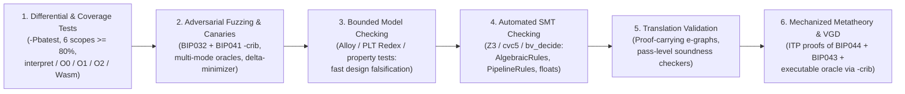
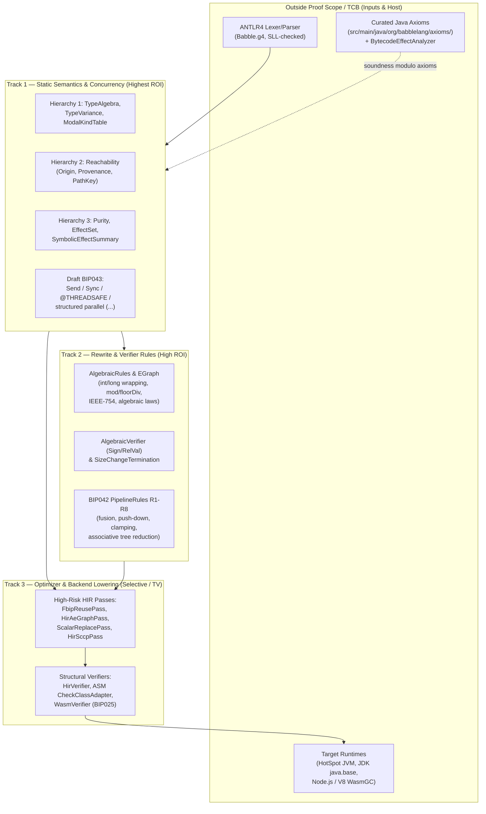
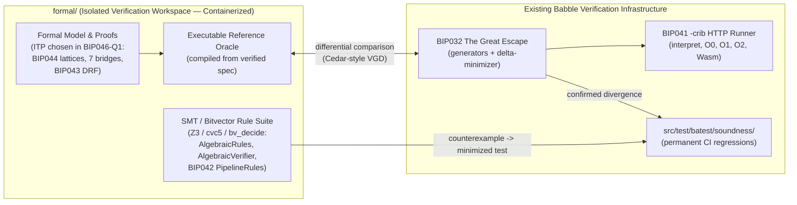

# BIP046: Formal Verification Strategies for Babble — Survey, SOTA Tools, Case Studies, and Candidate Tracks

| | |
|---|---|
| **BIP** | 046 |
| **Date** | 2026-11-28 |
| **Status** | Draft (Survey & Proposal — `BIP046-Q1`–`Q6` open ; `BIP046-P1`–`P4` tentative) |
| **Relates to** | Effects & ownership ([bip007_effects.md](bip007_effects.md)), HIR optimizations ([bip014_optimization-passes.md](bip014_optimization-passes.md)), front-end parser options ([bip015_down-with-the-ants.md](bip015_down-with-the-ants.md)), pure-by-default effects & return-through-borrow ([bip016_consolidating-effect-annotations.md](bip016_consolidating-effect-annotations.md)), higher-order effect forwarding ([bip017_higher-order-function-effects.md](bip017_higher-order-function-effects.md)), curated & bytecode-inferred axioms ([bip019_refactoring-axioms.md](bip019_refactoring-axioms.md), [bip030_axiom-nullability-and-inferred-effects.md](bip030_axiom-nullability-and-inferred-effects.md)), WebAssembly 3.0 backend ([bip025_compile-to-wasm.md](bip025_compile-to-wasm.md)), modular analysis, E-graph & mode crossing ([bip027_tackling-complexity-in-the-compiler.md](bip027_tackling-complexity-in-the-compiler.md)), exception handling ([bip028_exception-handling.md](bip028_exception-handling.md)), ranges & floored division ([bip031_ranges.md](bip031_ranges.md)), adversarial soundness (*The Great Escape*, [bip032_the-great-escape.md](bip032_the-great-escape.md)), compiler simplification ([bip036_compiler-simplification-and-god-class-splits.md](bip036_compiler-simplification-and-god-class-splits.md)), unified structured HIR `-O2` ([bip039_mir-deorbitation.md](bip039_mir-deorbitation.md)), `-crib` isolated HTTP runner ([bip041_crib-server.md](bip041_crib-server.md)), E-graph pipeline rewrites ([bip042_egraph-pipeline-rewrites.md](bip042_egraph-pipeline-rewrites.md)), draft verified structured parallelism ([bip043_parallelism.md](bip043_parallelism.md)), Babble static hierarchies ([bip044_babble-hierarchies.md](bip044_babble-hierarchies.md)), and The Optimization Zoo ([bip045_the-optimization-zoo.md](bip045_the-optimization-zoo.md)) |
| **Scope** | A Babble-grounded survey and strategic blueprint for formal verification across the whole compiler pipeline — prioritizing static semantics (`BIP044`'s three hierarchies and draft `BIP043` parallelism) and algebraic/E-graph rewrite rules (`BIP014`/`BIP031`/`BIP042`/`BIP045`). Covers Babble's verification surface and Trusted Computing Base (TCB), six formal verification strategies, a neutral evaluation of 2026 SOTA tools (weighted for computer-science and compiler-verification domain fit, with links to authoritative tutorials), a dedicated assessment of kernel-checked agentic proof engineering, a six-language Rosetta proof of Babble's `Purity` lattice, ten verified compiler and language case studies, ten distilled lessons learned, a comparison of three candidate rollout strategies, and open design questions (`BIP046-Q1`–`Q6`). |

---

## 1. Executive Summary & Motivation

Babble has crossed an architectural threshold where **formal verification** stops being an academic curiosity and becomes a practical engineering multiplier:

1. **Three interacting static hierarchies ([BIP044](bip044_babble-hierarchies.md)):** Babble's static discipline spans **Data Types** (`Type`, unions, intersections, `frozen T`, mode-dependent variance, `ModalKindTable`), **Reference Capabilities** (`{unique, shared, @BORROWED}` × `{@CONST, mut}`, shallow local containers, return-through-borrow provenance), and **Function Effects** (the 5-point OPAL `Purity` lattice, `nothrow`, `@TERMINATING`, 5 algebraic laws, `fn calling f`) linked by seven explicit cross-hierarchy bridges.
2. **47 optimizations exploiting static proofs ([BIP045](bip045_the-optimization-zoo.md)):** Passes such as `FbipReusePass` (in-place mutation of `unique` collections and records), `HirAeGraphPass` (alias-partitioned store-to-load forwarding), `HirDcePass` (`nothrow`/`@TERMINATING` elimination), `HirLicmPass`, `HirPredicateReorderPass`, and `PipelineRewritePass` (`BIP042` `R1`–`R8`) turn *any* static soundness crack directly into a silent wrong-code bug across both JVM bytecode and WebAssembly 3.0.
3. **Adversarial testing already proved where bugs hide ([BIP032](bip032_the-great-escape.md)):** Red-team rounds via `-crib` ([BIP041](bip041_crib-server.md)) repeatedly uncovered soundness holes at **cross-feature seams** (such as `record`/borrow covariance vs. contravariant methods, `nothrow` restoration vs. `java.lang.Error`, and `AlgebraicVerifier` IEEE-754 `-0.0` monotonicity) — bugs invisible to single-feature coverage testing even at `>= 80%` JaCoCo line and branch coverage.
4. **Draft parallelism ([BIP043](bip043_parallelism.md)) is still pre-implementation:** Data-race freedom (`Send`/`Sync`, `@THREADSAFE`, scoped read-only borrowing of `unique`, disjoint sibling `move(...)`) is vastly cheaper to verify *before* writing multi-threaded compiler and runtime code than to patch reactively after subtle concurrency races appear.

Formal methods do **not** replace Babble's `-Pbatest` coverage gate or `BIP032` adversarial fuzzing; they form the upper layers of a single **defense-in-depth assurance stack**:



> **Tooling neutrality:** This survey deliberately **does not prejudge a single proof assistant**. Different formal tools excel at fundamentally different parts of a compiler — pure mathematics vs. programming-language metatheory, interactive induction vs. push-button SMT bitvectors, rapid bounded counterexample search vs. executable reference interpreters. Tool selection stays explicitly open in `BIP046-Q1`.

---

## 2. Babble's Verification Surface & Trusted Computing Base (TCB)

Before choosing tools or writing proofs, a verification strategy must draw an honest line between **what is verified** and **what remains in the Trusted Computing Base (TCB)**. Because Babble already factored its analysis and IR into ANTLR-free, compact Layer 1 modules (`BIP010`, `BIP027`, `BIP039`), its highest-leverage verification targets are unusually clean:



### Verification Surface Inventory

| Subsystem | Compiler Source(s) | Approximate Size | Core Soundness Invariant | Current Assurance | Formal Verification Leverage |
|---|---|---|---|---|---|
| **Purity & Effect Lattices** | [`Purity.java`](../../src/main/java/org/babblelang/analysis/Purity.java), [`EffectSet.java`](../../src/main/java/org/babblelang/analysis/EffectSet.java), [`SymbolicEffectSummary.java`](../../src/main/java/org/babblelang/analysis/SymbolicEffectSummary.java) | ~900 LOC | Bounded join-semilattice; covariant effect subtyping; monotone `fn calling f` instantiation (`BIP017`). | Unit tests + `BIP032` | **Very high** — small, algebraic, ideal pilot target. |
| **Mode Crossing & Variance** | [`ModalKindTable.java`](../../src/main/java/org/babblelang/analysis/ModalKindTable.java), [`TypeVariance.java`](../../src/main/java/org/babblelang/analysis/TypeVariance.java) | ~750 LOC | Greatest-fixpoint deep immutability (`CONTENTION`/`PORTABILITY`) and read-only vs. owned variance never allow heap pollution or mutable leaks across cyclic generic types. | Unit tests + `BIP032` | **Very high** — DFS cycle-caching flags (`assumed`, `hitCycle`) are prime targets for coinductive proofs. |
| **Type Algebra & Subtyping** | [`TypeAlgebra.java`](../../src/main/java/org/babblelang/analysis/TypeAlgebra.java) | ~1,890 LOC | Reflexivity, transitivity, `frozen` isolation (`BIP007-D7`), union/intersection normalization, 4-mode `RelateMode` coherence. | Unit tests + `BIP032` | **High** — multi-mode subtyping + widening interactions easily break transitivity. |
| **Capabilities & Aliasing** | [`Reachability.java`](../../src/main/java/org/babblelang/analysis/Reachability.java) | ~990 LOC | `unique` single-owner disjointness, `freeze` immutability preservation, return-through-borrow gate (`BIP016-D10`), shallow local container soundness, `mut` exclusivity. | `.batest.md` + `BIP032` | **Very high** — `BIP044`'s 7 cross-hierarchy bridges live here; runtime erasure makes bugs silent. |
| **Draft Parallelism (`BIP043`)** | [bip043_parallelism.md](bip043_parallelism.md) *(not yet implemented)* | Spec only | Structured fork-join Data-Race Freedom (DRF): `Send`/`Sync`, `@THREADSAFE`, scoped `unique` borrowing, disjoint `move(...)`. | Design review only | **Very high** — pre-implementation proof prevents structural concurrency flaws. |
| **E-Graph & Algebraic Rules** | [`AlgebraicRules.java`](../../src/main/java/org/babblelang/ir/egraph/AlgebraicRules.java), [`PipelineRules.java`](../../src/main/java/org/babblelang/ir/egraph/PipelineRules.java), [`AlgebraicVerifier.java`](../../src/main/java/org/babblelang/analysis/AlgebraicVerifier.java) | ~2,200 LOC | Every rewrite preserves exact JVM/Wasm bit-level semantics (`MIN_VALUE`, wrapping, floored `mod`/`//`, IEEE-754 `NaN`/`-0.0`); `Sign`/`RelVal` transfer functions never mis-certify `monotone`/`injective`. | `.batest.md` + `BIP032` | **Very high** — finite-width integer/FP rules map directly to SMT (`Z3`/`cvc5`) and `bv_decide`. |
| **High-Risk HIR Passes** | [`FbipReusePass.java`](../../src/main/java/org/babblelang/opt/hir/FbipReusePass.java), [`HirAeGraphPass.java`](../../src/main/java/org/babblelang/opt/hir/HirAeGraphPass.java), [`ScalarReplacePass.java`](../../src/main/java/org/babblelang/opt/hir/ScalarReplacePass.java) | ~3,500 LOC | Semantic equivalence across `-O0`/`-O1`/`-O2`; alias-disjoint in-place reuse and store-to-load forwarding. | Multi-mode parity + `OptimizationZooTestCase` | **Medium** — best addressed via translation validation or proof certificates, not full pass rewriting. |
| **Backends & Verifiers** | [`HirVerifier.java`](../../src/main/java/org/babblelang/ir/hir/HirVerifier.java), [`WasmVerifier.java`](../../src/main/java/org/babblelang/wasm/WasmVerifier.java), `HirEmitter`, `WasmProgramLinker` | ~15,000+ LOC | Valid JVM bytecode & WebAssembly 3.0 binaries; behavioral parity with `Interpreter`. | `CheckClassAdapter`, `WasmVerifier`, Node.js Wasm parity | **Low ROI for full proof** — high LOC and host-runtime complexity; keep differential parity + structural verifiers. |
| **Java Axioms & Interop** | [`src/main/java/org/babblelang/axioms/README.md`](../../src/main/java/org/babblelang/axioms/README.md), [`BytecodeEffectAnalyzer.java`](../../src/main/java/org/babblelang/analysis/BytecodeEffectAnalyzer.java) | ~2,500 LOC | Curated axioms & bytecode profiles never over-claim purity, nullability, or immutability. | `AxiomChecker` fuzzing + `AxiomsTestCase` | **TCB boundary** — formalized as *hypotheses* (soundness *modulo axioms*); tested empirically. |

---

## 3. Taxonomy of Formal Verification Strategies

"Formally verifying a compiler" is not a monolith. Practice over the past twenty years has crystallized **six distinct strategies** with vastly different costs, trust boundaries, and payoffs:

| Strategy | What It Proves | Typical Tooling | Effort | Closes Java Implementation Gap? | Best Babble Target |
|---|---|---|---|---|---|
| **1. Mechanized Language & Type/Capability Metatheory** | *Design soundness* of a core calculus ("Featherweight Babble"): Progress, Preservation, Deep Immutability, Non-Interference, DRF. | Rocq (+ Iris), Isabelle/HOL, Lean 4 | Medium (weeks–months) | No (by itself — proves the *design*, not the Java code) | `BIP044` 3-axis system, 7 bridges, draft `BIP043` parallelism |
| **2. Verification-Guided Development (VGD): Executable Spec + Differential Testing** | Proves theorems on a compact *executable* formal model, then continuously runs millions of differential tests comparing the model against the production implementation. | Lean 4, Rocq (extraction), Isabelle (code gen) + fuzzer (`BIP032`/`-crib`) | Medium | **Practically yes** — empirically locks Java implementation to the verified spec | `TypeAlgebra`, `ModalKindTable`, `TypeVariance`, `Purity`/`EffectSet`, core `Reachability` |
| **3. Automated SMT / Bitvector Rule Verification** | Exhaustively proves (or produces a counterexample for) individual rewrite rules, algebraic identities, overflow guards, and abstract-domain transfer functions over exact 32/64-bit & IEEE-754 semantics. | Z3, cvc5, Lean 4 `bv_decide`, Rosette | **Low** (days–weeks) | Partially (verifies the exact mathematical rules encoded in Java) | `AlgebraicRules`, `PipelineRules` (`BIP042`), `AlgebraicVerifier`, `BIP031` `mod`/`//` identities |
| **4. Translation Validation & Proof-Carrying Optimization** | Leaves complex optimizing passes untrusted and fast, but proves a small *checker* that validates each compilation's input→output equivalence (or checks an emitted proof trace). | Alive2-style SMT validator, verified proof-trace checker in ITP, `egg` proof certificates | Medium–High | **Yes** (per compiled program — removes optimizer bugs from TCB) | `EGraph` saturation (`HirEGraphSimplifyPass`, `PipelineRewritePass`), `HirAeGraphPass`, `FbipReusePass` |
| **5. Verified Lowering / Rewrite DSLs** | Expresses rewrites or lowering passes in a small declarative DSL, then automatically verifies every rule against source and target semantics via SMT before code generation. | ISLE + VeriISLE, Rosette, Lean-MLIR | High (requires DSL investment) | **Yes** (verified rules generate the production code) | Future declarative rewrite table unifying `AlgebraicRules` + `PipelineRules` |
| **6. End-to-End Verified Compilation (Forward Simulation)** | Mechanically proves that *every* compiled output preserves the observable trace of the source program across every compiler pass from AST/IR to machine/bytecode. | Rocq (CompCert/CertiRocq), HOL4 (CakeML), Isabelle/HOL | **Very High** (person-years) | **Yes** (compiler itself is extracted from the proof) | **Non-goal for Babble** — incompatible with a fast-evolving Java codebase targeting both JVM and Wasm 3.0 |

The modern consensus across both academia and industry is clear: **Strategies 1–4 deliver 90%+ of the practical soundness benefit at 5–10% of the cost of Strategy 6.**

---

## 4. State-of-the-Art (SOTA) Tooling Landscape (2026)

### 4.1 Neutral Evaluation Weighted for CS & Compiler Verification

A common pitfall when choosing a formal tool is conflating **general theorem-proving popularity** (especially in pure mathematics) with **domain fit for programming-language metatheory and compiler verification**. For Babble, domain fit hinges on five CS-specific criteria:

1. **PL & binder infrastructure:** Libraries for variable binding, substitution, alpha-equivalence, operational semantics, and coinductive/greatest-fixpoint definitions.
2. **Concurrency & separation-logic support:** Ability to reason about heap ownership, aliasing, framing (`unique`/`frozen`/`@BORROWED`), and concurrent fork-join (`BIP043`).
3. **Bitvector, wrapping-int & IEEE-754 support:** Crucial for verifying `AlgebraicRules`, `BIP031` floored `mod`/`//`, and `AlgebraicVerifier`.
4. **Executable specification speed & extraction:** How easily the verified model compiles into a fast binary oracle callable from Babble's `BIP032` / `-crib` differential harness.
5. **Proof automation & ergonomics:** Built-in decision procedures, SMT hammers, counterexample generators, and IDE responsiveness.

| Tool / Ecosystem | Paradigm & Trust Kernel | CS / Compiler Domain Fit vs. Pure Math Fit | Key Strengths | Key Limitations | Authoritative Tutorials & Docs |
|---|---|---|---|---|---|
| **Rocq** *(formerly Coq)* **+ Iris** | Dependent type theory (CIC); tiny trusted kernel. | **Gold standard for PL & compiler verification.** Decades of compiler/PL infrastructure (`CompCert`, `CertiRocq`, `Vellvm`, `WasmCert-Coq`, `RustBelt`, `OxCaml` mode crossing, `Iris`, `Autosubst`, `Interaction Trees`). | Unmatched libraries for operational semantics, concurrent separation logic (`Iris`), and coinduction; battle-tested on industrial-grade compilers and mode-crossing type systems. | Steeper tactic/setup learning curve; extraction to OCaml adds a bridge step; graph/mutable data structures require careful encoding; less ergonomic general-purpose programming than Lean 4. | [Software Foundations](https://softwarefoundations.cis.upenn.edu/) · [Rocq Docs](https://rocq-prover.org/docs) · [Iris Project](https://iris-project.org/) |
| **Isabelle/HOL** | Higher-order logic (LCF-style kernel). | **Very strong CS/compiler fit** alongside math. Proven on JVM (`JinjaThreads`), WebAssembly (`WasmCert-Isabelle`), OS kernels (`seL4`), and verified semantics (`Concrete Semantics`). | **Sledgehammer** (automated dispatch to Z3/cvc5/Vampire/E with kernel-checked proof reconstruction via `metis`/`smt`) gives best-in-class interactive automation; **Nitpick / Quickcheck** catch false conjectures immediately; clean code export (Scala/OCaml/Haskell/SML). | HOL lacks full dependent types (rarely a blocker for PL, occasionally awkward for indexed syntax); jEdit IDE feels dated compared to VS Code LSP workflows. | [Concrete Semantics](https://concrete-semantics.org/) · [Isabelle Documentation](https://isabelle.in.tum.de/documentation.html) |
| **Lean 4** | Dependent type theory; small kernel + fast native C compiler. | **Fast-rising CS/VGD fit, historically math-first.** Mathlib's center of gravity is pure mathematics, *but* Lean 4's native execution speed, `grind` (2025), LRAT-checked `bv_decide`, `Plausible`, AWS `Cedar`, `Lean-MLIR`, and `OptiSat` have made it a powerhouse for executable specs and IR/rewrite verification. | Dual-purpose pure FP language + ITP (microsecond-speed executable models for VGD differential testing); modern VS Code UX; kernel-checked SAT (`bv_decide`) and built-in congruence-closure/E-matching (`grind`); vibrant community. | PL metatheory and concurrent separation-logic libraries (`Iris`-class) are much younger than Rocq's; coinductive reasoning is less mature out-of-the-box than Rocq/Isabelle. | [Theorem Proving in Lean 4](https://lean-lang.org/theorem_proving_in_lean4/) · [Functional Programming in Lean](https://lean-lang.org/functional_programming_in_lean/) |
| **Dafny** | Auto-active SMT verifier (Boogie → Z3); solver is in the TCB. | **Strong algorithmic & contract fit; weak PL metatheory fit.** Compiles to Java/C#/Go/Python. | Familiar imperative/functional syntax; zero manual tactic scripting on small invariants; can even compile directly to JVM/Java bytecode. | **SMT brittleness & timeouts** on recursive/inductive metatheory (the exact reason AWS Cedar migrated from Dafny to Lean 4); larger TCB (Boogie + Z3 unverified); awkward for operational semantics and concurrency proofs. | [Dafny Documentation](https://dafny.org/docs/) |
| **Verus / F\*** | SMT-backed verification embedded in Rust (`Verus`) or effectful ML (`F*`). | **Strong systems & crypto-compiler fit.** `Verus` verifies real Rust with linear/ghost state; `F*` excels at verified parsers/extractors (`EverParse`, `HACL*`). | Combines linear ownership reasoning with SMT automation; produces production Rust/C/OCaml directly. | Tightly coupled to Rust (`Verus`) or its own extraction target (`F*`) rather than verifying a Java compiler's abstract metatheory; SMT fragility still applies on large proofs. | [Verus Guide](https://verus-lang.github.io/verus/guide/) · [F* Tutorial](https://fstar-lang.org/tutorial/) |
| **Z3 / cvc5** *(SMT-LIB 2)* | Automated SMT solvers (bitvectors, IEEE-754 FP, arrays, LIA/NIA). | **Best-in-class for compiler rewrite rules & translation validation** (`Alive2`, `VeriISLE`). | Push-button verification or exact counterexamples in milliseconds for 32/64-bit wrapping arithmetic, floored `mod`/`//`, and IEEE-754 edge cases (`NaN`, `-0.0`, `±Infinity`); scriptable from Python/Java. | Cannot prove unbounded inductive/recursive theorems (e.g., preservation across arbitrary program depths) without manual encoding; solver is in the TCB unless proof-checked. | [Online Z3 Guide](https://microsoft.github.io/z3guide/) |
| **Alloy 6** | Bounded relational model checker (SAT-backed). | **Outstanding design-time bug finder for PL & concurrency.** | Finds subtle structural counterexamples in seconds (e.g., broken subtyping transitivity, cyclic `ModalKind` edge cases, ownership escape paths, `BIP043` race scenarios) with visual counterexample graphs; minimal learning curve. | Bounded scope only (proves absence of counterexamples up to scope *N*, not unbounded mathematical soundness). | [Alloy 6 Documentation](https://alloytools.org/documentation.html) · [Practical Alloy](https://alloytools.org/book.html) |
| **PLT Redex** | Mechanized operational semantics + random testing (Racket). | **Purpose-built for PL design prototyping.** | Executable reduction semantics and typing judgments with built-in random test generation and shrinking to falsify preservation/progress before writing an ITP proof. | Testing/falsification only — produces no machine-checked proof. | [PLT Redex Documentation](https://docs.racket-lang.org/redex/index.html) |
| **K Framework** | Rewriting-logic executable semantics & reachability logic. | **Strong full-language operational semantics** (C, Java, EVM, Wasm). | One formal definition yields parser, interpreter, symbolic executor, and deductive verifier. | Heavyweight ecosystem; less suited to lightweight type/capability metatheory than Rocq/Isabelle/Lean. | [K Framework](https://kframework.org/) |

> **Domain-fit summary:** If the single overriding goal is **deep concurrent separation-logic metatheory** (`BIP043` with rich shared-memory models, mirroring OxCaml's mode-crossing proof), **Rocq + Iris** has the deepest existing CS foundation. If the goal is **strongest built-in automation + JVM/Wasm heritage**, **Isabelle/HOL** shines. If the goal is **fast executable reference specs wired into `BIP032`/`-crib` differential testing + unified `bv_decide`/e-graph verification**, **Lean 4** has a compelling engineering edge. And for **immediate bug hunting in `AlgebraicRules`, `AlgebraicVerifier`, and draft designs**, **Z3/cvc5** and **Alloy 6** deliver value in days regardless of which ITP wins `BIP046-Q1`.

---

### 4.2 Agentic & AI-Assisted Proof Engineering (2025–2026)

Because Babble is developed heavily with agentic workflows, the economics of formal verification in 2026 look materially different from 2020. Proof assistants with small, mechanically verified kernels (**Lean 4**, **Rocq**, **Isabelle/HOL**) occupy a unique sweet spot for AI-assisted engineering:

- **Zero-trust-in-the-generator:** Unlike unverified code generation (where subtle LLM hallucinations slip past tests), an interactive theorem prover **mechanically rejects any invalid proof step**. An agent can iterate rapidly on tactic scripts, case splits, helper lemmas, and hammer invocations (`grind`, `bv_decide`, `Sledgehammer`, `RocqHammer`) while the kernel enforces 100% logical soundness.
- **Empirical scaling evidence:** A 2026 experience report on **CertiRocq** demonstrated agentic coding assistants constructing a ~7,800-line semantic preservation proof for an Administrative Normal Form (ANF) compiler pass in Rocq — work that traditionally required weeks of specialist proof engineering. Concurrently, Lean 4's native `grind` tactic (2025) and learned heuristic interventions (2026) dramatically cut boilerplate on algebraic and congruence-closure goals.
- **Where agentic proof engineering still fails (and requires strict human/review discipline):**
  1. **Vacuous or overly weak specifications:** An agent can easily "prove" a theorem whose hypotheses are contradictory, whose operational semantics silently omits an escape channel (such as `BIP028` exceptions or closure capture), or whose theorem statement is weaker than what Babble actually needs. **The kernel checks the proof, never whether the specification matches reality.**
  2. **Cheating axioms (`sorry`, `admit`, `Axiom`):** CI must mechanically forbid unfinished proofs and audit every declared axiom (analogous to Babble's `AxiomsTestCase`).
  3. **Spec-to-Java drift:** Proving a beautiful Lean/Rocq/Isabelle model says nothing about `TypeAlgebra.java` or `EffectBodyWalker.java` unless differential testing (`BIP032` / `-crib`) continuously checks the Java compiler against the executable formal specification.

---

## 5. Rosetta Proof — Babble's `Purity` Lattice Across 6 Languages

To compare real syntax, proof style, automation, and readability without bias, the six snippets below formalize the **exact same real Babble component**: the 5-point OPAL `Purity` lattice in [`src/main/java/org/babblelang/analysis/Purity.java`](../../src/main/java/org/babblelang/analysis/Purity.java#L27-L95) (`PURE`, `SIDE_EFFECT_FREE`, `CONTEXTUALLY_PURE`, `CONTEXTUALLY_SIDE_EFFECT_FREE`, `IMPURE`), its bitwise `join`, and its partial order `atLeastAsPureAs(a, b) ⟺ join(a, b) = b`.

All six verify four core lattice laws: **commutativity**, **associativity**, **idempotence** of `join`, and **transitivity** of `atLeastAsPureAs`.

### 5.1 Lean 4

```lean
inductive Purity where
  | pure | sideEffectFree | contextuallyPure | contextuallySEF | impure
  deriving DecidableEq, Repr

def Purity.bits : Purity → Bool × Bool × Bool
  | .pure             => (false, false, false)
  | .sideEffectFree   => (false, true,  false)
  | .contextuallyPure => (true,  false, false)
  | .contextuallySEF  => (true,  true,  false)
  | .impure           => (true,  true,  true)

def Purity.ofBits : Bool → Bool → Bool → Purity
  | _,     _,     true  => .impure
  | true,  true,  false => .contextuallySEF
  | true,  false, false => .contextuallyPure
  | false, true,  false => .sideEffectFree
  | false, false, false => .pure

def Purity.join (a b : Purity) : Purity :=
  let (m1, v1, i1) := a.bits
  let (m2, v2, i2) := b.bits
  Purity.ofBits (m1 || m2) (v1 || v2) (i1 || i2)

def Purity.le (a b : Purity) : Prop := a.join b = b

theorem join_comm (a b : Purity) : a.join b = b.join a := by
  cases a <;> cases b <;> rfl

theorem join_assoc (a b c : Purity) : (a.join b).join c = a.join (b.join c) := by
  cases a <;> cases b <;> cases c <;> rfl

theorem join_idem (a : Purity) : a.join a = a := by
  cases a <;> rfl

theorem le_trans {a b c : Purity} (h1 : a.le b) (h2 : b.le c) : a.le c := by
  unfold Purity.le at *
  rw [← h2, ← join_assoc, h1]
```

### 5.2 Rocq (formerly Coq)

```coq
Require Import Bool.

Inductive Purity : Type :=
  | Pure | SideEffectFree | ContextuallyPure | ContextuallySEF | Impure.

Definition bits (p : Purity) : bool * bool * bool :=
  match p with
  | Pure             => (false, false, false)
  | SideEffectFree   => (false, true,  false)
  | ContextuallyPure => (true,  false, false)
  | ContextuallySEF  => (true,  true,  false)
  | Impure           => (true,  true,  true)
  end.

Definition of_bits (m v i : bool) : Purity :=
  if i then Impure
  else if m then (if v then ContextuallySEF else ContextuallyPure)
  else (if v then SideEffectFree else Pure).

Definition join (a b : Purity) : Purity :=
  let '(m1, v1, i1) := bits a in
  let '(m2, v2, i2) := bits b in
  of_bits (m1 || m2) (v1 || v2) (i1 || i2).

Definition at_least_as_pure (a b : Purity) : Prop := join a b = b.

Lemma join_comm : forall a b, join a b = join b a.
Proof. destruct a, b; reflexivity. Qed.

Lemma join_assoc : forall a b c, join (join a b) c = join a (join b c).
Proof. destruct a, b, c; reflexivity. Qed.

Lemma join_idem : forall a, join a a = a.
Proof. destruct a; reflexivity. Qed.

Lemma at_least_as_pure_trans : forall a b c,
  at_least_as_pure a b -> at_least_as_pure b c -> at_least_as_pure a c.
Proof.
  unfold at_least_as_pure. intros a b c H1 H2.
  rewrite <- H2, <- join_assoc, H1. reflexivity.
Qed.
```

### 5.3 Isabelle/HOL

```isabelle
theory BabblePurity imports Main begin

datatype purity = Pure | SideEffectFree | ContextuallyPure | ContextuallySEF | Impure

fun bits :: "purity ⇒ bool × bool × bool" where
  "bits Pure             = (False, False, False)"
| "bits SideEffectFree   = (False, True,  False)"
| "bits ContextuallyPure = (True,  False, False)"
| "bits ContextuallySEF  = (True,  True,  False)"
| "bits Impure           = (True,  True,  True)"

definition of_bits :: "bool ⇒ bool ⇒ bool ⇒ purity" where
  "of_bits m v i = (if i then Impure
    else if m then (if v then ContextuallySEF else ContextuallyPure)
    else (if v then SideEffectFree else Pure))"

definition pjoin :: "purity ⇒ purity ⇒ purity" where
  "pjoin a b = (case (bits a, bits b) of
    ((m1, v1, i1), (m2, v2, i2)) ⇒ of_bits (m1 ∨ m2) (v1 ∨ v2) (i1 ∨ i2))"

definition at_least_as_pure :: "purity ⇒ purity ⇒ bool" where
  "at_least_as_pure a b ⟷ pjoin a b = b"

lemma pjoin_comm: "pjoin a b = pjoin b a"
  by (cases a; cases b) (simp_all add: pjoin_def of_bits_def)

lemma pjoin_assoc: "pjoin (pjoin a b) c = pjoin a (pjoin b c)"
  by (cases a; cases b; cases c) (simp_all add: pjoin_def of_bits_def)

lemma pjoin_idem: "pjoin a a = a"
  by (cases a) (simp_all add: pjoin_def of_bits_def)

lemma at_least_as_pure_trans:
  "at_least_as_pure a b ⟹ at_least_as_pure b c ⟹ at_least_as_pure a c"
  by (metis at_least_as_pure_def pjoin_assoc)

end
```

### 5.4 Dafny

```dafny
datatype Purity = Pure | SideEffectFree | ContextuallyPure | ContextuallySEF | Impure

function Mut(p: Purity): bool { p.ContextuallyPure? || p.ContextuallySEF? || p.Impure? }
function Vol(p: Purity): bool { p.SideEffectFree? || p.ContextuallySEF? || p.Impure? }
function Imp(p: Purity): bool { p.Impure? }

function OfBits(m: bool, v: bool, i: bool): Purity {
  if i then Impure
  else if m then (if v then ContextuallySEF else ContextuallyPure)
  else (if v then SideEffectFree else Pure)
}

function Join(a: Purity, b: Purity): Purity {
  OfBits(Mut(a) || Mut(b), Vol(a) || Vol(b), Imp(a) || Imp(b))
}

predicate AtLeastAsPure(a: Purity, b: Purity) { Join(a, b) == b }

lemma SemilatticeAndTransitivity(a: Purity, b: Purity, c: Purity)
  ensures Join(a, b) == Join(b, a)
  ensures Join(Join(a, b), c) == Join(a, Join(b, c))
  ensures Join(a, a) == a
  ensures AtLeastAsPure(a, b) && AtLeastAsPure(b, c) ==> AtLeastAsPure(a, c)
{ /* Discharged automatically by Z3 */ }
```

### 5.5 Z3 / SMT-LIB 2

```smt2
(declare-datatype Purity
  ((Pure) (SideEffectFree) (ContextuallyPure) (ContextuallySEF) (Impure)))

(define-fun mut ((p Purity)) Bool
  (or (= p ContextuallyPure) (= p ContextuallySEF) (= p Impure)))
(define-fun vol ((p Purity)) Bool
  (or (= p SideEffectFree) (= p ContextuallySEF) (= p Impure)))
(define-fun imp ((p Purity)) Bool (= p Impure))

(define-fun of-bits ((m Bool) (v Bool) (i Bool)) Purity
  (ite i Impure
    (ite m (ite v ContextuallySEF ContextuallyPure)
           (ite v SideEffectFree Pure))))

(define-fun pjoin ((a Purity) (b Purity)) Purity
  (of-bits (or (mut a) (mut b)) (or (vol a) (vol b)) (or (imp a) (imp b))))

(define-fun le ((a Purity) (b Purity)) Bool (= (pjoin a b) b))

(declare-const a Purity)
(declare-const b Purity)
(declare-const c Purity)

;; Negate the conjunction: `unsat` certifies zero counterexamples exist.
(assert (not (and
  (= (pjoin a b) (pjoin b a))
  (= (pjoin (pjoin a b) c) (pjoin a (pjoin b c)))
  (= (pjoin a a) a)
  (=> (and (le a b) (le b c)) (le a c)))))
(check-sat) ; expected: unsat
```

### 5.6 Alloy 6

```alloy
enum Flag { On, Off }

abstract sig Purity { mut: one Flag, vol: one Flag, imp: one Flag }
one sig Pure, SideEffectFree, ContextuallyPure, ContextuallySEF, Impure extends Purity {}

fact PurityBits {
  Pure.mut = Off and Pure.vol = Off and Pure.imp = Off
  SideEffectFree.mut = Off and SideEffectFree.vol = On and SideEffectFree.imp = Off
  ContextuallyPure.mut = On and ContextuallyPure.vol = Off and ContextuallyPure.imp = Off
  ContextuallySEF.mut = On and ContextuallySEF.vol = On and ContextuallySEF.imp = Off
  Impure.mut = On and Impure.vol = On and Impure.imp = On
}

fun flagOr[x, y: Flag]: Flag { (x = On or y = On) => On else Off }

fun pjoin[a, b: Purity]: Purity {
  let m = flagOr[a.mut, b.mut], v = flagOr[a.vol, b.vol], i = flagOr[a.imp, b.imp] |
    i = On => Impure
    else (m = On => (v = On => ContextuallySEF else ContextuallyPure)
                 else (v = On => SideEffectFree else Pure))
}

pred le[a, b: Purity] { pjoin[a, b] = b }

assert SemilatticeAndTransitivity {
  all a, b, c: Purity |
    pjoin[a, b] = pjoin[b, a] and
    pjoin[pjoin[a, b], c] = pjoin[a, pjoin[b, c]] and
    pjoin[a, a] = a and
    ((le[a, b] and le[b, c]) implies le[a, c])
}
check SemilatticeAndTransitivity for 5
```

### 5.7 Rosetta Takeaway

On a finite 5-element lattice, **every tool looks effortless**. The real divergence appears one step up the ladder — when modeling **mutually recursive generic records (`ModalKindTable`, `TypeVariance`), heap operational semantics (`BIP044`'s 7 bridges), or concurrent fork-join (`BIP043`)**:

- **Rocq**, **Isabelle/HOL**, and **Lean 4** scale to unbounded structural induction, coinduction, and semantic invariants while keeping a tiny trusted kernel.
- **Dafny** stays concise on local invariants, but increasingly needs manual triggers/fuel hints and risks Z3 timeouts on deep metatheory.
- **Z3/SMT-LIB 2** shines when a Babble verification question reduces to a finite-domain, bitvector, or IEEE-754 validity query (`AlgebraicRules`, `BIP031` floored `mod`/`//`, `AlgebraicVerifier` sign rules).
- **Alloy 6** shines *before* writing any inductive proof — e.g., asking Alloy to search up to scope 6 for a cycle of generic types where `ModalKindTable`'s DFS cache disagrees with the true greatest fixpoint, or a `BIP043` object graph that violates data-race freedom.

---

## 6. Case Studies — Compilers & Languages Verified in Practice

Real compiler verification efforts provide hard-won empirical data on what pays off and where teams get bogged down:

| Project | Domain | Primary Tool(s) | Verification Strategy | What Remained in TCB / Unverified | Direct Relevance to Babble |
|---|---|---|---|---|---|
| **1. CompCert** | Optimizing C compiler (→ x86, ARM, RISC-V, PowerPC) | Rocq (Coq) | End-to-end forward simulation + **verified translation validation** for complex passes | Parser (initially, later verified LR(1)), preprocessor, assembler/linker, C spec fidelity | **Validator Pattern:** even CompCert avoided proving register allocation & LICM directly, opting for untrusted heuristics + verified checkers. |
| **2. CakeML** | Functional ML compiler (→ machine code) | HOL4 | End-to-end verified compilation + verified GC + verified self-hosting bootstrap | Hardware ISA spec, minimal FFI stub | Shows the cost/benefit of verified GC & FFI boundaries — and why Babble (on JVM/WasmGC) is wise to keep GC in the host TCB. |
| **3. CertiRocq** *(CertiCoq)* | Functional compiler (Gallina → C & WebAssembly) | Rocq | Verified compilation pipeline; 2026 agentic proof scaling (~7.8k LOC ANF proof) | CompCert / Wasm engine / runtime primitives | Demonstrates verified functional → Wasm compilation and modern **agentic proof engineering** feasibility. |
| **4. Vellvm & Alive2** | LLVM IR semantics & peephole/pass validation | Rocq (`Interaction Trees`) & Z3 (SMT) | Dual: mechanized IR semantics (`Vellvm`) vs. automated **SMT translation validation** (`Alive2`) | `Alive2`: Z3 + LLVM-to-Alive2 encoder; bounded loops | `Alive2` found hundreds of real LLVM miscompilations without rewriting LLVM — blueprint for verifying Babble's `AlgebraicRules` & HIR peepholes. |
| **5. Cranelift + ISLE + VeriISLE** | Production Wasmtime/Rust backend instruction selection | ISLE DSL + SMT (Z3/cvc5) | **Verified lowering DSL** against official ARM ASL / x86 specs (ASPLOS 2024, OOPSLA 2025) | Solver + ISA model; register allocator verified separately | Shows how moving ad-hoc Java rewrite code into a declarative rule table unlocks automated SMT verification (`AlgebraicRules`, `PipelineRules`). |
| **6. WasmCert** | WebAssembly 1.0 / 2.0 / WasmGC specification | Rocq & Isabelle/HOL | Mechanized syntax, typing, reduction semantics, and Progress/Preservation | Host embedder & JS glue | Directly illuminates formalizing Babble's `BIP025` WebAssembly 3.0 / WasmGC target and `WasmVerifier`. |
| **7. Jinja & JinjaThreads** | Java source → JVM bytecode + Java Memory Model | Isabelle/HOL | Mechanized OO type safety, bytecode verifier soundness, and concurrent JMM DRF | Reflection, class loading, native JDK libraries | Closest precedent for Babble's JVM target and shows why JVM bytecode verification is cleanly separable from high-level language soundness. |
| **8. RustBelt, Pony & OxCaml Mode Crossing** | Ownership, reference capabilities, modal kinds, DRF | Rocq + Iris (RustBelt, OxCaml); formal type soundness (Pony) | **Mechanized capability/mode soundness** + semantic typing of unsafe/host primitives | Host runtime / unverified `unsafe` outside proved abstractions | **Direct theoretical lineage of `BIP044` & `BIP043`:** Babble's `ModalKindTable` (`CONTENTION`/`PORTABILITY`) literally descends from OxCaml's mode crossing (Peters et al., ICFP 2026). |
| **9. AWS Cedar** | Authorization policy language, validator & symbolic compiler | Lean 4 (migrated from Dafny) | **Verification-Guided Development (VGD):** compact Lean 4 executable model + proofs + millions of DRT runs against Rust | Differential testing bridges Lean ↔ Rust statistically rather than via machine-checked Rust proof | **Closest operational blueprint for Babble:** small verified model (~10× smaller than production code) + high-speed differential testing against Babble's Java compiler via `BIP032`/`-crib`. |
| **10. Verified E-Graphs (`OptiSat`, `Lean-MLIR`, `egg`)** | Equality saturation & SSA IR rewrites | Lean 4, Rocq, proof-producing `egg` | Two patterns: fully verified e-graph engine (`OptiSat`) vs. untrusted `egg` emitting checkable congruence proof traces | Extraction cost heuristic (affects speed, not soundness) | Directly maps to `org.babblelang.ir.egraph` (`EGraph`, `AlgebraicRules`, `BIP042` `PipelineRules`): verify the *rules* first, then optionally emit checkable traces. |

### Key Contrasts Across Case Studies

- **CompCert & CakeML vs. Alive2 & VeriISLE:** Full end-to-end verification (CompCert/CakeML) buys the strongest possible TCB guarantee — Yang et al.'s landmark Csmith study found **zero wrong-code bugs in CompCert's verified middle-end**, while finding bugs only in its *unverified* front end and backend stubs! Yet CompCert took years of expert effort and freezes compiler architecture around proof structure. Conversely, Alive2 and VeriISLE retrofitted formal guarantees onto fast-moving production compilers (LLVM, Cranelift) with a fraction of the effort by verifying **individual transformations and declarative rules** with SMT.
- **AWS Cedar's Dafny → Lean 4 migration:** Cedar initially used Dafny for automated SMT verification, but hit solver timeouts and proof brittleness as its validator grew. Moving to Lean 4 gave stable interactive proofs *and* a compiled reference implementation running at ~5 µs/test — fast enough to run **millions of Differential Random Tests** nightly against Rust. Crucially, Cedar's published metrics showed that **interactive proofs caught 4 deep validator design bugs**, while **differential testing caught 20+ implementation bugs** in Rust — proving the two approaches catch disjoint bug classes.
- **OxCaml Mode Crossing & RustBelt:** Both demonstrate that verifying a rich capability/mode system (uniqueness, borrowing, immutability, contention/portability across threads) is completely tractable on a **core calculus** without formalizing the full production compiler — and that framing mode crossing as a monotone function over a mode lattice with greatest fixpoints for recursive types makes the soundness proof clean and modular.

---

## 7. Distilled Lessons Learned & Anti-Patterns

Synthesizing the ten case studies above yields **ten concrete lessons** directly applicable to Babble:

1. **The Validator Pattern beats proving heuristic optimizers (CompCert, `egg`).** Never try to prove an intricate mutable e-graph saturation loop, register/slot allocator (`HirSlotAllocator`), or LICM heuristic directly inside an ITP. Keep the optimizer fast in Java, verify the *rewrite rules* mathematically, and (when stronger guarantees are needed) emit a lightweight trace checked by a small validator.
2. **Executable reference specs + differential testing close the spec-to-Java gap (AWS Cedar).** A mechanized proof of `BIP044` proves Babble's *design* sound, not `TypeAlgebra.java` or `EffectBodyWalker.java`. Compiling the formal spec into an executable oracle and pitting it against Babble's Java compiler via `BIP032` and `-crib` (`BIP041`) catches implementation drift continuously.
3. **Match the tool to the mathematical problem (Cedar, Alive2, OxCaml).** Use an **ITP** (Rocq, Isabelle/HOL, or Lean 4) for unbounded induction, coinduction, and type/capability/concurrency metatheory; use **SMT** (`Z3`/`cvc5` or `bv_decide`) for fixed-width integer wrapping, floored `mod`/`//`, and IEEE-754 floating-point rewrite rules; use **bounded model checking** (Alloy / `Plausible` / Quickcheck) to falsify draft designs in hours before investing weeks in proofs.
4. **Co-design proofs *before* implementation (OxCaml, WasmCert).** Formalizing `BIP043` (`Send`/`Sync`, `@THREADSAFE`, scoped `unique` borrowing, `parallel (...)`) while it is still a Draft catches missing restrictions (e.g., exception smuggling across threads or `frozen` Java-method `@THREADSAFE` checks) before any multi-threaded compiler code is written.
5. **Audit the specification and TCB relentlessly (CompCert Csmith lesson).** Every wrong-code bug Csmith found in early CompCert lived *outside* the verified core (unverified front end, ABI/target assumptions). For Babble, the primary TCB leak is **`BIP019`/`BIP030` Java `axiom`s and `BytecodeEffectAnalyzer`**: formal theorems are strictly *soundness modulo axioms*, so `AxiomChecker` fuzzing remains essential.
6. **Every escape channel must exist in the formal operational semantics (`BIP032` + `BIP044`).** In `BIP044` §6.1 Bridge 3 (`frozen T <: @CONST @BORROWED T`), the return-through-borrow gate guards the *return slot* — a faithful core calculus must also include **`mut` parameters, `this` mutation, escaping closures, and `BIP028` thrown exceptions**, forcing the proof to confirm no side channel leaks an unfrozen mutable alias.
7. **Coinductive DFS cycle caches are high-value early targets.** Both [`ModalKindTable.java`](../../src/main/java/org/babblelang/analysis/ModalKindTable.java#L245-L273) (`assumed` flag) and [`TypeVariance.java`](../../src/main/java/org/babblelang/analysis/TypeVariance.java#L115-L148) (`hitCycle` flag) implement DFS greatest-fixpoint queries with memoization. History in type-checker verification shows mutually recursive generic graphs frequently trigger premature caching bugs — an ideal early proof and Alloy check.
8. **Falsify fast before proving.** Spending one afternoon encoding a tricky interaction (`TypeAlgebra` multi-mode transitivity, or `BIP043` scoped borrows) in Alloy or property-based Quickcheck/Plausible often finds two or three counterexamples immediately, preventing wasted days trying to prove a false lemma.
9. **Prioritize by blast radius, not total-compiler completeness.** Formalizing ANTLR4 (`Babble.g4`), full `HirEmitter` ASM generation, or Java reflection has enormous cost and minimal soundness ROI compared to `BIP044`'s 7 bridges, `BIP043` DRF, and `AlgebraicRules`/`PipelineRules`.
10. **Decouple formal artifacts from AST churn (`BIP015`, `BIP036`).** Because Babble's front end may still evolve (`BIP015` parser decision, `BIP036` front-end simplification), formal models should target Babble's **ANTLR-free Layer 1 abstractions** (`Type`, `ModalKind`, `Purity`, `EffectSet`, `Reachability`, `EGraph` rules) rather than ANTLR parse trees.

---

## 8. Candidate Verification Architecture & Rollout Strategy Comparison

### 8.1 How Formal Verification Plugs Into Babble

Any future formal verification effort should live **completely outside `babble-runtime.jar` and standard `mvn test`** (zero production footprint, zero Maven dependency bloat, containerized alongside `src/tools/Containerfile.ci`):



### 8.2 Four Prioritized Verification Tracks

- **Track 1 — `BIP044` + `BIP043` Static Semantics & VGD Oracle *(Highest ROI)*:**
  - *Tier 1 (Layer 1 Lattices):* `Purity`, `EffectSet`, `SymbolicEffectSummary` monotonicity, `ModalKindTable` greatest-fixpoint soundness, `TypeVariance` read-only vs. owned covariance, and core `TypeAlgebra` subtyping + `frozen` isolation.
  - *Tier 2 ("Featherweight Babble" Core Calculus):* Small-step heap semantics covering `def`/`var`, `record`/`class`/mutable container, closures, `move`/`freeze`, and `throw`/`catch` — proving Progress, Preservation, **Deep Immutability Preservation** (Bridges 2 & 3), **Heap-Frame Non-Interference** (Bridge 4 + `Origin.shallow`), **No Heap Pollution** (Bridge 5), and **Closure Capture Soundness** (Bridge 6).
  - *Tier 3 (Draft `BIP043` Concurrency):* Structured fork-join (`parallel (...)`) heap-footprint semantics proving **Data-Race Freedom** for `Send`/`Sync` (`PORTABILITY` / `CONTENTION`), `@THREADSAFE`, scoped `unique` read-only borrowing, and disjoint `move(...)`.
  - *Tier 4 (VGD Differential Bridge):* Export executable Layer 1 checkers (`TypeAlgebra`, `ModalKindTable`, `TypeVariance`, `Purity`) to cross-check Babble's Java compiler inside `BIP032`.
- **Track 2 — Rewrite & Verifier Soundness via SMT / Bitvectors *(High ROI)*:**
  - Verify every identity in [`AlgebraicRules.java`](../../src/main/java/org/babblelang/ir/egraph/AlgebraicRules.java) over exact 32-bit/64-bit wrapping `int`/`long`, floored `mod`/`//` (`BIP031`), and IEEE-754 `float`/`double` (`NaN`, `-0.0`, `±Infinity`, `MIN_VALUE`).
  - Verify [`AlgebraicVerifier.java`](../../src/main/java/org/babblelang/analysis/AlgebraicVerifier.java)'s `Sign`/`RelVal` partial-derivative rules for `monotone`/`injective` (the exact surface where `BIP032` caught `x * (-0.0)`!).
  - Verify [`PipelineRules.java`](../../src/main/java/org/babblelang/ir/egraph/PipelineRules.java) `R1`–`R8` (`BIP042`) algebraic preconditions (stream fusion, map–filter push-down under `monotone`/`injective`, range clamping, associative tree reduction).
- **Track 3 — Targeted Translation Validation *(Medium ROI, Later)*:**
  - Proof-producing rewrite traces for `org.babblelang.ir.egraph` or lightweight validators for the highest-risk HIR passes (`FbipReusePass`, `HirAeGraphPass`, `ScalarReplacePass`).
- **Track 4 — Explicit Non-Goals:**
  - End-to-end CompCert-style verified JVM bytecode or WasmGC code generation.
  - Formalizing ANTLR4 (`Babble.g4`) or Java reflection / `java.base` internals behind `axiom`s.
  - Verifying Babble's Java implementation directly with Java-level deductive verifiers (KeY / OpenJML), which struggle with ANTLR, reflection, and rapid refactoring.

### 8.3 Comparing Three Candidate Rollout Strategies

Rather than locking into one rollout order prematurely, `BIP046` compares three viable execution strategies (to be settled in `BIP046-Q2`):

| Dimension | Strategy A — *Soundness-Before-Implementation* | Strategy B — *Quick-Wins-First (SMT-Led)* | Strategy C — *Comparative Pilot Spike First* |
|---|---|---|---|
| **Sequence** | 1. Pick ITP + Tier 1 `BIP044` lattices → 2. Featherweight Babble (7 bridges) + VGD oracle → 3. Draft `BIP043` DRF *before* `BIP043` lands → 4. SMT rewrite rules | 1. Z3/cvc5 verification of `AlgebraicRules`, `AlgebraicVerifier` & `PipelineRules` → 2. Pick ITP + Tier 1 `BIP044` lattices → 3. Featherweight Babble → 4. `BIP043` DRF | 1. Time-boxed 2-tool pilot (e.g., **Rocq vs. Lean 4**, or **Isabelle/HOL vs. Lean 4**) proving `Purity` + `ModalKindTable` + `TypeVariance` cycle caching → 2. Pick winner empirically → 3. Execute Strategy A or B |
| **Time to first real bug found** | Medium (weeks — during Tier 1/2 formalization) | **Fastest (days)** — SMT immediately probes 32/64-bit overflow, `mod`/`//`, and IEEE-754 edge cases | Fast–Medium (1–2 weeks — pilot directly audits `ModalKindTable` & `TypeVariance` DFS caching) |
| **Tool-selection risk** | Higher — commits to one ITP before experiencing real proof ergonomics on Babble | Medium — defers ITP choice while delivering SMT value immediately | **Lowest** — gathers direct empirical evidence on human + agentic proof ergonomics before major investment |
| **`BIP043` alignment** | **Best** — guarantees `BIP043` DRF is proved before concurrency code is written | Risk of `BIP043` starting before ITP core calculus is ready | Good — a short pilot still finishes well ahead of `BIP043` implementation |
| **Upfront infrastructure cost** | Medium (full ITP container + project skeleton) | **Lowest** (lightweight Python/Java + Z3/cvc5 script) | Medium (2 small pilot containers, one later retired) |
| **Best if…** | `BIP043` parallelism is near-term and the team already has a clear ITP preference | You want immediate, tangible bug-finding ROI on today's shipped `-O1`/`-O2` optimizer first | You want data-driven confidence between Rocq/Iris, Isabelle/HOL, and Lean 4 (including agentic proof speed) before committing |

---

## 9. Open Questions & Tentative Candidate Phases

### 9.1 Open Questions (`BIP046-Q1`–`Q6`)

- **`BIP046-Q1` (Primary ITP & companion tools):** Which interactive theorem prover should anchor Track 1 — **Rocq (+ Iris)** (strongest PL/compiler/concurrency ecosystem, direct lineage to OxCaml & WasmCert), **Isabelle/HOL** (strongest Sledgehammer automation + JinjaThreads/WasmCert heritage), or **Lean 4** (fastest native execution for Cedar-style VGD differential testing + `grind`/`bv_decide`/`Lean-MLIR`)? Should Z3/cvc5 (for Track 2) and Alloy 6 (for design-time falsification) be adopted alongside whichever ITP is chosen?
- **`BIP046-Q2` (Rollout strategy):** Which sequencing from §8.3 — **Strategy A** (Soundness-before-implementation), **Strategy B** (Quick-wins-first SMT), or **Strategy C** (Comparative 2-tool pilot spike on `Purity` + `ModalKindTable` + `TypeVariance`) — should Babble pursue?
- **`BIP046-Q3` (Repository layout & CI gating):** Should formal artifacts live in a top-level `formal/` directory in this repository (built via a dedicated container alongside [`src/tools/Containerfile.ci`](../../src/tools/Containerfile.ci)) or in a sibling repository? Should proof checking be opt-in at first and promoted to a CI gate once stabilized?
- **`BIP046-Q4` (Executable VGD differential bridge):** How should an executable formal oracle exchange test cases with Babble's Java compiler — via JSON payloads fed into `-crib` (`BIP041`) / `BIP032` white-box property tests, or via a shared minimal test-vector corpus?
- **`BIP046-Q5` (Floating-point & Java `axiom` boundaries):** In Track 2, should IEEE-754 rules be checked against full SMT-LIB `FloatingPoint` theory (`Float32`/`Float64`, which can be slow on multiplication/division) or via bounded/specialized solvers (`bv_decide`, `bitwuzla`/cvc5)? And how should curated `axiom` contracts (`BIP019`/`BIP030`) be reflected as explicit hypotheses in Track 1?
- **`BIP046-Q6` (Agentic proof governance):** If agentic workflows assist in writing proofs, what mandatory mechanical checks gate every proof PR (zero `sorry`/`admit`/`Axiom` audit, mandatory human review of every specification definition & theorem statement before trusting proof completion)?

### 9.2 Tentative Candidate Phases (`BIP046-P1`–`P4`)

Exact ordering depends on settling `BIP046-Q1` and `BIP046-Q2`; the tool-agnostic capability milestones are:

- **`BIP046-P1` — Toolchain Decision, Pilot & Tier 1 `BIP044` Lattices:** Settle `BIP046-Q1`–`Q3` (optionally via a Strategy C comparative pilot), establish a reproducible containerized verification workspace with zero-`sorry`/zero-`admit` enforcement, and verify Babble's Layer 1 lattices (`Purity`, `EffectSet`, `SymbolicEffectSummary`, `ModalKindTable` greatest fixpoint, `TypeVariance` cycle-guarded covariance, and core `TypeAlgebra` subtyping + `frozen` isolation).
- **`BIP046-P2` — SMT / Bitvector Verification of Rewrite Rules & Verifiers:** Verify `AlgebraicRules` (`BIP014`/`BIP031`/`BIP042` wrapping `int`/`long`, floored `mod`/`//`, IEEE-754 edge cases), `AlgebraicVerifier`'s `Sign`/`RelVal` monotonicity/injectivity transfer functions, and `BIP042` `PipelineRules` `R1`–`R8`, locking any discovered counterexamples into `src/test/batest/soundness/`.
- **`BIP046-P3` — "Featherweight Babble" Core Calculus (`BIP044` 7 Bridges) & VGD Differential Oracle:** Mechanize a small-step heap calculus covering `BIP044`'s three hierarchies and seven cross-hierarchy bridges (including `BIP028` exceptions and closure captures), prove Progress, Preservation, Deep Immutability Preservation, Heap-Frame Non-Interference, and No Heap Pollution, and wire an executable formal oracle into `BIP032` / `-crib` differential testing.
- **`BIP046-P4` — Pre-Implementation Data-Race Freedom Proof for Draft `BIP043`:** Extend the core calculus with structured fork-join (`parallel (...)`), `Send`/`Sync` (`PORTABILITY`/`CONTENTION`), `@THREADSAFE`, scoped `unique` read-only borrowing, and disjoint `move(...)`, proving Data-Race Freedom before `BIP043`'s multi-threaded runtime and compiler implementation lands.

---

## 10. Bibliography & Learning Resources

### Primary Case-Study Literature

- **CompCert:** X. Leroy, *"Formal Verification of a Realistic Compiler"*, CACM 2009; X. Leroy et al., *"CompCert — A Formally Verified Optimizing Compiler"*, ERTS 2016; X. Yang et al., *"Finding and Understanding Bugs in C Compilers"*, PLDI 2011 (Csmith empirical findings).
- **CakeML:** R. Kumar, M. O. Myreen, M. Norrish, S. Owens, *"CakeML: A Verified Implementation of ML"*, POPL 2014.
- **CertiRocq:** A. Anand et al., *"CertiCoq: A Verified Compiler for Coq"*, CoqPL 2017; and 2026 agentic proof-engineering experience report scaling semantic preservation for ANF lowering.
- **Vellvm & Alive2:** J. Zhao et al., *"Formalizing the LLVM Intermediate Representation for Verified Program Transformations"*, POPL 2012; Y. Zakowski et al., *"Modular, Compositional, and Executable Formal Semantics for LLVM IR"*, ICFP 2021; N. P. Lopes et al., *"Alive2: Bounded Translation Validation for LLVM"*, PLDI 2021.
- **Cranelift / ISLE / VeriISLE:** A. N. Crichton, C. Fallin et al., *"VeriISLE: Verifying Instruction Selection in Cranelift"*, ASPLOS 2024 & OOPSLA 2025.
- **WasmCert:** C. Watt, *"Mechanising and Verifying the WebAssembly Specification"*, CPP 2018; C. Watt et al., *WasmCert-Coq / WasmCert-Isabelle* (Wasm 1.0/2.0/WasmGC mechanizations).
- **Jinja / JinjaThreads:** G. Klein & T. Nipkow, *"A Machine-Checked Model for a Java-Like Language, Virtual Machine, and Compiler"*, TOPLAS 2006; A. Lochbihler, *"Making the Java Memory Model Safe"*, TOPLAS 2014.
- **RustBelt, Pony & OxCaml Mode Crossing:** R. Jung et al., *"RustBelt: Securing the Foundations of the Rust Programming Language"*, POPL 2018; S. Clebsch et al., *"Deny Capabilities for Safe, Fast Actors"*, AGERE/OOPSLA 2015; Peters et al., *"Mode Crossing"*, ICFP 2026 (formalized in Rocq + Iris).
- **AWS Cedar:** J. Cutler et al., *"Cedar: A New Language for Expressive, Fast, Safe, and Analyzable Authorization"*, OOPSLA 2024 (Lean 4 Verification-Guided Development & Differential Random Testing).
- **Verified E-Graphs & MLIR:** M. Willsey et al., *"egg: Fast and Extensible Equality Saturation"*, POPL 2021; O. Flatt et al., *"Small Proofs from Congruence Closure"*, FMCAD 2022; `Lean-MLIR` / `OptiSat` verified SSA and equality-saturation frameworks in Lean 4 (2024–2026).

### Official Tutorials & Documentation

- **Rocq & Iris:** [Software Foundations](https://softwarefoundations.cis.upenn.edu/) · [The Rocq Prover Documentation](https://rocq-prover.org/docs) · [Iris Framework](https://iris-project.org/)
- **Isabelle/HOL:** [Concrete Semantics (Nipkow & Klein)](https://concrete-semantics.org/) · [Isabelle Official Documentation](https://isabelle.in.tum.de/documentation.html)
- **Lean 4:** [Theorem Proving in Lean 4](https://lean-lang.org/theorem_proving_in_lean4/) · [Functional Programming in Lean](https://lean-lang.org/functional_programming_in_lean/)
- **Dafny / Verus / F\*:** [Dafny Documentation](https://dafny.org/docs/) · [Verus Guide](https://verus-lang.github.io/verus/guide/) · [F* Tutorial](https://fstar-lang.org/tutorial/)
- **SMT & Bounded Model Checking:** [Online Z3 Guide](https://microsoft.github.io/z3guide/) · [Alloy 6 Documentation](https://alloytools.org/documentation.html) · [Practical Alloy](https://alloytools.org/book.html) · [PLT Redex Documentation](https://docs.racket-lang.org/redex/index.html) · [K Framework](https://kframework.org/)
