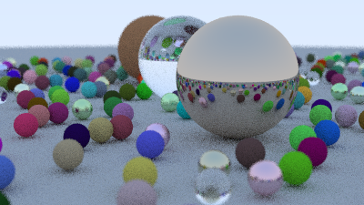

# Ray Tracing in One Weekend — Pure Babble (`raytracer-argon`)

A complete implementation of [*Ray Tracing in One Weekend*](https://raytracing.github.io/books/RayTracingInOneWeekend.html) (Peter Shirley, Trevor David Black, Steve Hollasch) in [raytracer.ba](raytracer.ba), written in **100% pure Babble with zero Java builtins** (`java.*`, `javax.*`, or `import` are never called).

## Rendered Scene



- **Raw PPM output**: [scene.ppm](scene.ppm) (`P3` ASCII PPM emitted directly by `raytracer.ba`)
- **PNG conversion**: [scene.png](scene.png) (`400 × 225`, 20 samples/pixel, max bounce depth 12)

### Scene Description (`raytracer.Scenes.finalScene`)
The rendered scene implements the Chapter 14 cover scene from *Ray Tracing in One Weekend*:
- **Ground sphere**: Large matte sphere (`Lambertian(Vec3(0.5, 0.5, 0.5))`, radius `1000.0`) centered at `(0, -1000, 0)`.
- **Three hero spheres**:
  - **Center (`(0, 1, 0)`, `r = 1.0`)**: Dielectric glass (`Dielectric(1.5)`) with Snell's law refraction, total internal reflection, and Schlick's polynomial reflectance approximation.
  - **Left (`(-4, 1, 0)`, `r = 1.0`)**: Matte terracotta Lambertian sphere (`Lambertian(Vec3(0.4, 0.2, 0.1))`).
  - **Right (`(4, 1, 0)`, `r = 1.0`)**: Mirror-polished metal sphere (`Metal(Vec3(0.7, 0.6, 0.5), 0.0)`).
- **22 × 22 randomized grid of marbles (`gridRadius: 11`, ~480 spheres, `r = 0.2`)**:
  - 80% diffuse `Lambertian` spheres with squared random albedo (`rng.nextDouble()`),
  - 15% brushed `Metal` spheres with randomized albedo in `[0.5, 1.0]` and fuzz in `[0.0, 0.5]`,
  - 5% `Dielectric(1.5)` glass spheres,
  - Accelerated with a pure-Babble Bounding Volume Hierarchy (`raytracer.BVHNode.fromList`).
- **Camera (`raytracer.Camera`)**:
  - Position `lookfrom = Vec3(13.0, 2.0, 3.0)`, target `lookat = Vec3(0.0, 0.0, 0.0)`, up `vup = Vec3(0.0, 1.0, 0.0)`, vertical FOV `20°`.
  - Thin-lens depth-of-field blur with `defocusAngle = 0.6°` and `focusDist = 10.0`.
  - Stratified random sub-pixel multisampling and gamma-2 (`math.sqrt`) output encoding.

## Highlights

### Zero Java Builtins
Every primitive that would ordinarily rely on the JDK is implemented directly in Babble:
- **`package math` (no `java.lang.Math`)**:
  - `math.sqrt(x)`: Range-scaling + 10-iteration Newton-Raphson (Heron's method) to full IEEE-754 `double` precision.
  - `math.sin(x)`, `math.cos(x)`, `math.tan(x)`: Angle wrapping into $[-\pi, \pi]$ followed by 10-term Taylor series expansion.
  - `math.powInt(base, exp)`: Recursive exponentiation using Babble's `recurse` keyword (for Schlick's glass reflectance polynomial).
  - `math.toInt(x)` and `math.toByte(x)`: Recursive binary bit-decomposition (`toIntPos` via `recurse`) and 8-bit unrolled branch decomposition to convert `double` values into exact Babble `int` values without `Double.intValue()`.
  - `math.infinity` (`1.0 / 0.0`), `math.negInfinity`, `math.pi`, `math.degreesToRadians`, `math.abs`, `math.min`, `math.max`, `math.clamp`.
- **`raytracer.Rng` (no `java.util.Random`)**:
  - 32-bit Linear Congruential Generator (`seed * 1664525 + 1013904223`) leveraging Babble's 32-bit signed integer wrap-around on `int` arithmetic.
- **`raytracer.HittableList` & `raytracer.BVHNode` (no `java.util.ArrayList`)**:
  - Linked-list scene container (`HittableNode` / `HittableList`) with higher-order `forEach` and closure-based `countWhere`.
  - Pure-Babble Bounding Volume Hierarchy (`AABB` + `BVHNode.fromList`) that recursively partitions `HittableList` along the longest bounding-box axis using `recurse`.
- **Native Babble I/O (`println` / `print`)**:
  - Outputs standard ASCII `P3` PPM image data via Babble's built-in `println(..., to: out)` (defaulting to `STDOUT`).

### Babble Language Features Exercised
- **Packages**: `package math` and `package raytracer`.
- **Value classes (`value class`)**: `Vec3`, `Ray`, `Interval`, `AABB`, `HitRecord`, `ScatterResult` (using generated structural `==`, `hashCode`, `toString`, and read-only members).
- **Classes (`class`)**: `Rng`, `Lambertian`, `Metal`, `Dielectric`, `Sphere`, `HittableNode`, `HittableList`, `BVHNode`, `Camera` (using header `def` and `private def` members, constructor-local parameters, and `private` body fields).
- **Static blocks (`static ( ... )`)**: `Vec3.zero`, `Vec3.one`, `Vec3.random*`, `Interval.empty`, `Interval.universe`, `Interval.enclose`, `AABB.empty`, `AABB.fromPoints`, `AABB.enclose`, `HitRecord.create`, `Dielectric.reflectance`, `BVHNode.fromList` (using `this(...)` inside `static` blocks to invoke the class constructor).
- **Interfaces (`interface`, `extends`, `implements`, default methods, `super`, `super(Type)`)**:
  - `Describable` base interface with required `kind()` and default `describe()`.
  - `Material extends Describable` and `Hittable extends Describable` overriding defaults and adding required signatures.
  - `Lambertian` and `Metal` calling `super.describe()`, and `Sphere implements Hittable, Describable` calling qualified `super(Hittable).describe()`.
- **Object literals (`object`)**: `emptyHittable` (`object implements Hittable`), `Color`, and `Scenes`.
- **First-class functions & closures**: `HittableList.forEach` and `HittableList.countWhere`, plus `recurse` in functions, methods, and static methods.
- **Named arguments & default parameters**: `Camera(...)`, `Scenes.finalScene(...)`, `println(..., to: out)`.
- **Runtime type introspection & equality**: `is`, `classof`, `same`, `==`, `assert`.
- **Gradual typing (`-Dbabble.typecheck=error`)**: Every parameter, return type, and member is annotated so the script passes `babble.typecheck=warn` and `babble.typecheck=error` cleanly with zero diagnostics.

## Running

Compile and execute [raytracer.ba](raytracer.ba) via Babble's `ScriptEngine` (`compile` mode with strict type checking enabled) to produce `scene.ppm`:

```bash
mvn test-compile exec:java \
  -Dbabble.mode=compile \
  -Dbabble.typecheck=error \
  -Dexec.mainClass=org.babblelang.Runner \
  -Dexec.args="examples/raytracer-argon/raytracer.ba" > examples/raytracer-argon/scene.ppm
```
