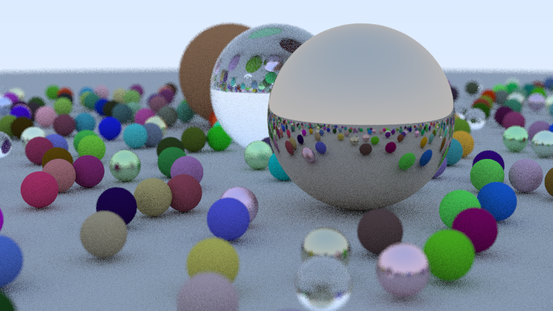
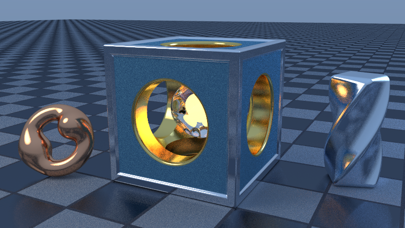
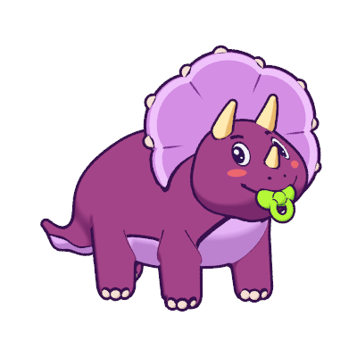
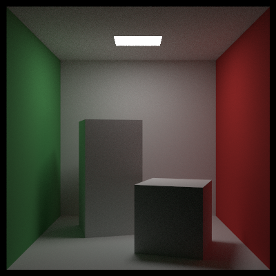
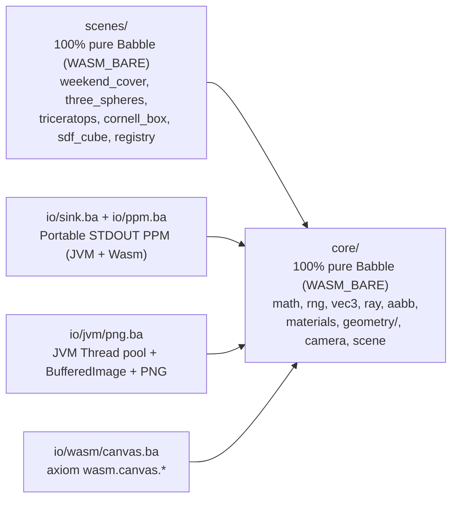

# Unified Babble Ray Tracer (`examples/raytracer`)

A single, layered ray tracer written maximally in **pure Babble** (math, RNG, BVH, materials, geometries, camera, and scenes) with only a **thin target-specific IO layer** bridging to the JVM or WebAssembly 3.0 (`WasmGC`).

Every scene renders **byte-for-byte identically** across `interpret`, compiled JVM (`-O0`, `-O1`, `-O2`, single-threaded or multi-threaded), ahead-of-time jars (`babblec -target jvm`), WebAssembly 3.0 on Node.js, and WebAssembly 3.0 in the browser (`<canvas>`).

## Rendered Scenes

| Weekend Cover (`cover`, 800×450) | Sculpted SDF Cube (`sdf-cube`, 800×450) | Baby Triceratops (`triceratops`, 160×160) | Cornell Box (`cornell-box`, 400×400) |
|---|---|---|---|
|  |  |  |  |

## Architecture



### Layers

1. **`core/` — Rendering engine, materials, and geometries (`WASM_BARE`-clean)**
   - **Numerics & RNG**: `math.ba` (Newton-Raphson `sqrt`, Taylor `sin`/`cos`/`tan`, `powInt`, clamping — zero `java.lang.Math`) and `rng.ba` (deterministic 32-bit LCG with per-scanline `Rng.forRow(seed, y)` so 1-thread and 16-thread renders match bit-for-bit).
   - **Math & Interfaces**: `vec3.ba` (`record Vec3` with `Vec3.srgb`), `ray.ba`, `interval.ba`, flat 6-double `aabb.ba`, `interfaces.ba` (`Describable`, `Scatter`, `AreaLight`, `Material`, `HitRecord`, `Hittable`, `emptyHittable`), `color.ba`, `background.ba` (`SkyBackground`, `SolidBackground`).
   - **Core Material Library (`materials.ba`)**: Immutable `record` materials implementing `Material` — `Lambertian`, `Metal`, `Dielectric`, `Emissive`, and `Toon`.
   - **Core Geometry Library (`geometry/`)**: `Sphere`, planar `Quad` & 6-sided `Box`, rigid-body `Translate` & `RotateY` transforms, oriented `Ellipsoid`, analytic tapered `RoundCone` (+ `addQuadraticBezierTube`), Fourier-contoured 3D `SculptedLobe`, Signed Distance Fields ([Inigo Quilez — Distance Functions](https://iquilezles.org/articles/distfunctions/), `sdf.ba`: `SdfSphere`, `SdfBox`, `SdfRoundBox`, `SdfBoxFrame`, `SdfTorus`, `SdfCapsule`, `SdfCylinder`, `SdfOctahedron`, `SdfFn`; `sdf_ops.ba`: exact & C1 smooth CSG Booleans, `SdfRound`, `SdfOnion`, rigid/scale/twist transforms), sphere-tracing `RaymarchedSdf` ([Inigo Quilez — Raymarching Distance Fields](https://iquilezles.org/articles/raymarchingdf/), `raymarched_sdf.ba`, with AABB slab clipping, signed interior refraction, 4-tap [tetrahedral SDF normals](https://iquilezles.org/articles/normalsSDF/), and zero-allocation per-hit `MaterialField`), pure-Babble `HittableList`, and pure-Babble `BVHNode`.
   - **Rendering (`camera.ba`, `scene.ba`, `core.ba`)**: Pure thin-lens `Camera` with optional direct area-light sampling (Next Event Estimation) and `BIP017` effect-polymorphic `renderRow` (`fn calling emit`), plus `Scene` record bundling world, camera, and seed.
2. **`scenes/` — Pure scene definitions (`WASM_BARE`-clean)**
   - `weekend_cover.ba` (*Ray Tracing in One Weekend* Ch. 14 22×22 marble cover scene)
   - `three_spheres.ba` (*Ray Tracing in One Weekend* Ch. 13 three-spheres scene)
   - `triceratops.ba` (Baby Triceratops sculpted from `SculptedLobe`, `Ellipsoid`, `RoundCone`, `Sphere`, `Toon`, and `Emissive` — now 100% WebAssembly-portable!)
   - `cornell_box.ba` (*Ray Tracing: The Next Week* Ch. 8 classic Cornell Box with green/red walls, ceiling `AreaLight`, and two rotated matte `Box` instances)
   - `sdf_cube.ba` (Sculpted CSG Cube Hero — sphere-traced carved rounded cube with smooth Boolean cutouts, chrome box-frame ribs, gold-inlaid cavity via `MaterialField`, nested refractive glass crystal & glowing core, smooth-blended copper torus sculpture, and twisted metallic pillar on a procedural studio tile floor)
   - `registry.ba` (`match`-based lookup by scene name)
3. **`io/` — Thin target-specific IO & execution adapters**
   - `io/sink.ba` & `io/ppm.ba`: Pure-Babble `PixelSink` interface, sequential scanline driver, and portable ASCII `P3` PPM writer (`STDOUT`).
   - `io/jvm/png.ba`: Thin JVM-only adapter (~60 lines) — the **only** module using `java.*`/`javax.*` (`Thread`, `AtomicInteger`, `BufferedImage`, `ImageIO`).
   - `io/wasm/canvas.ba`: Thin Wasm-only adapter (~20 lines) — the **only** module declaring `axiom wasm.canvas.*`.

## Running

Build Babble first from the repository root:

```bash
mvn package
```

### 1. Multi-threaded PNG rendering on the JVM (`raytracer_jvm.ba`)

```bash
# Weekend Cover (800x450, 20 spp, 16 threads)
java -jar target/babble-1.0-SNAPSHOT.jar examples/raytracer/raytracer_jvm.ba cover examples/raytracer/assets/scene.png 800 20 16

# Baby Triceratops (160x160, 64 spp, 16 threads)
java -jar target/babble-1.0-SNAPSHOT.jar examples/raytracer/raytracer_jvm.ba triceratops examples/raytracer/assets/triceratops.png

# Cornell Box (400x400, 256 spp, 16 threads)
java -jar target/babble-1.0-SNAPSHOT.jar examples/raytracer/raytracer_jvm.ba cornell-box examples/raytracer/assets/cornell_box.png 400 256 16

# Sculpted SDF Cube (800x450, 96 spp, 16 threads)
java -jar target/babble-1.0-SNAPSHOT.jar examples/raytracer/raytracer_jvm.ba sdf-cube examples/raytracer/assets/sdf_cube.png 800 96 16

# Score the Triceratops render against assets/triceratops.jpg
python3 examples/raytracer/assets/score_triceratops.py
```

Pass `1` as the thread count to run single-threaded (also works under `-Dbabble.mode=interpret`).

### 2. Portable PPM output on JVM, AOT jar, or WebAssembly Node.js (`raytracer_ppm.ba`)

```bash
# Direct JVM execution (defaults to cover 400x225, 20 spp -> matches assets/scene.ppm byte-for-byte)
java -jar target/babble-1.0-SNAPSHOT.jar examples/raytracer/raytracer_ppm.ba > scene.ppm

# Ahead-of-time standalone JVM jar
java -jar target/babble-1.0-SNAPSHOT.jar -compile examples/raytracer/raytracer_ppm.ba -o raytracer.jar
java -jar raytracer.jar > scene.ppm

# WebAssembly 3.0 (WasmGC) on Node.js — produces the exact same PPM byte-for-byte
java -jar target/babble-1.0-SNAPSHOT.jar -compile -target wasm-js examples/raytracer/raytracer_ppm.ba -o raytracer.wasm
node raytracer.mjs > scene.ppm
node raytracer.mjs triceratops 160 16 > triceratops.ppm
node raytracer.mjs cornell-box 300 32 > cornell_box.ppm
```

### 3. Interactive WebAssembly 3.0 browser `<canvas>` (`raytracer_wasm.ba` + `wasm_canvas.html`)

```bash
java -jar target/babble-1.0-SNAPSHOT.jar -compile -target wasm-js \
    examples/raytracer/raytracer_wasm.ba \
    -o examples/raytracer/raytracer_wasm.wasm
java -jar target/babble-1.0-SNAPSHOT.jar -dev-server -d examples/raytracer -p 8080
# Open http://127.0.0.1:8080/wasm_canvas.html and pick Cover, Three Spheres, Baby Triceratops, Cornell Box, or Sculpted SDF Cube
```

### 4. Pure-Babble Self-Test Suite (`selftest.ba`)

```bash
java -jar target/babble-1.0-SNAPSHOT.jar examples/raytracer/selftest.ba
```
